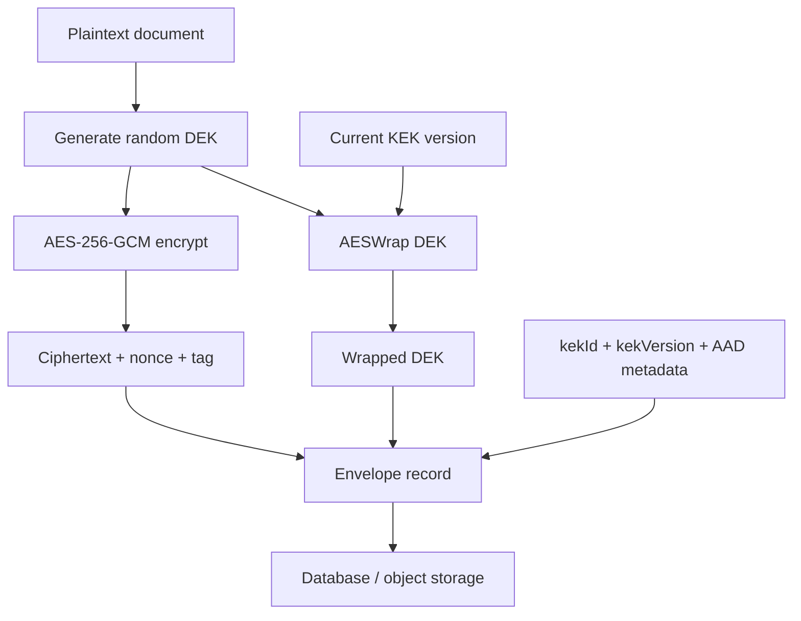
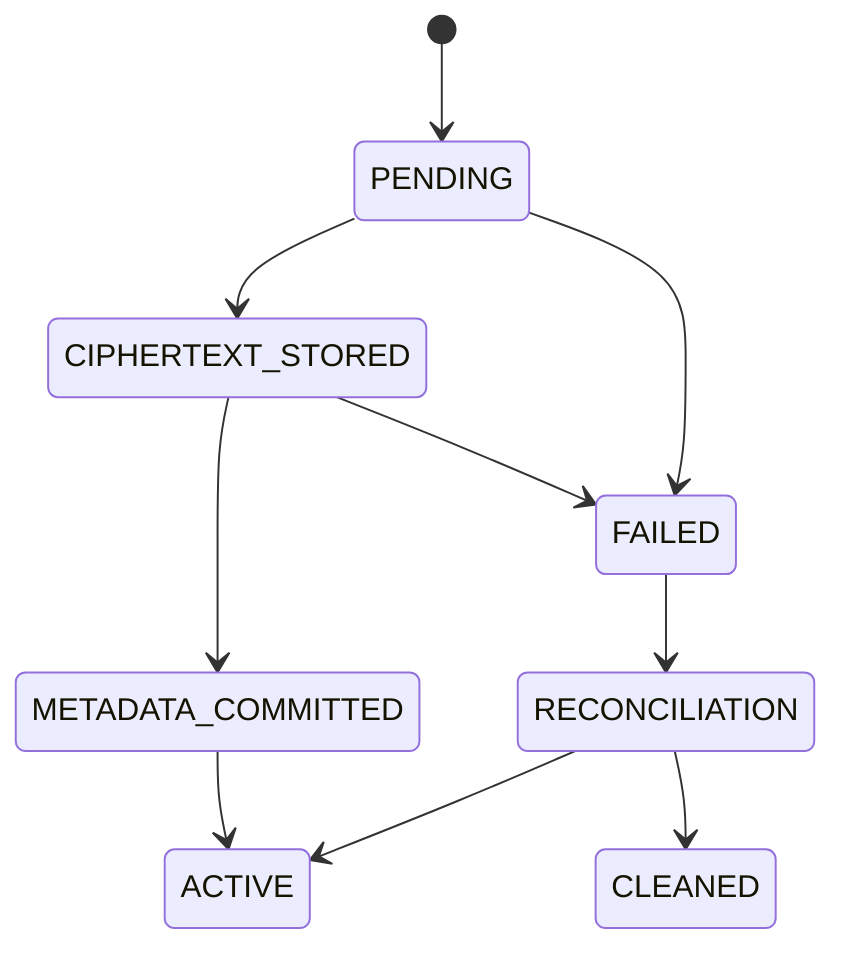

# Lưu ciphertext kèm key version

Trong bài thực hành này, bạn sẽ xây dựng một luồng mã hóa tài liệu có lưu **ciphertext cùng định danh và version của khóa đã bảo vệ DEK**. Ứng dụng phải biết chính xác version nào cần dùng để mở khóa dữ liệu khi giải mã, kể cả sau khi hệ thống đã chuyển sang version mới.

Lab mô phỏng một dịch vụ Java lưu hồ sơ của nhiều tenant. Mỗi object có một DEK riêng để mã hóa payload bằng AES-256-GCM; DEK được bọc bằng KEK. Metadata lưu cùng ciphertext có `kekId`, `kekVersion`, `wrappedDek`, nonce, AAD version và object identity. Khi rotation KEK, bản ghi mới dùng version mới, trong khi dữ liệu cũ vẫn có thể giải mã bằng version cũ. Lab cũng thực hiện rewrap để chuyển wrapped DEK sang version mới mà không mã hóa lại payload.

Đây là bài thực hành trong chương **Thực hành tổng hợp** của **SECURITY_KEY_MANAGEMENT_FUNDAMENTALS**. Bài tập kết nối key versioning, envelope encryption, AES-GCM, key inventory, KMS/HSM, access control, rotation, persistence và kiểm thử. Phần key ring cục bộ chỉ dùng để học luồng; production phải thay bằng KMS/HSM adapter và không lưu KEK dạng rõ trong ứng dụng.

## 1. Kết quả cần đạt

Sau khi hoàn thành, bạn có thể:

- Giải thích vì sao ciphertext phải đi kèm metadata chỉ ra key identity và key version.
- Phân biệt key version dùng để wrap DEK với version của payload/ciphertext.
- Mã hóa dữ liệu bằng DEK ngẫu nhiên và AES-GCM.
- Bọc DEK bằng KEK và lưu `kekId`/`kekVersion` cùng wrapped DEK.
- Giải mã dữ liệu cũ bằng đúng key version đã tạo wrapped DEK.
- Chuyển current write version sang KEK mới mà vẫn đọc được dữ liệu cũ.
- Rewrap DEK bằng KEK version mới mà không thay đổi ciphertext payload.
- Phát hiện sai tenant, sai object context, sai key version và ciphertext bị sửa.
- Cập nhật metadata an toàn bằng transaction hoặc compare-and-swap.

<text weight="semibold">Tiêu chí hoàn thành:</text> tạo được record mã hóa ở version 1, chuyển sang version 2, tạo record mới ở version 2, giải mã được record cũ bằng version 1, rewrap record cũ sang version 2 và chứng minh ciphertext payload không đổi.

## 2. Bối cảnh và phạm vi lab

Giả sử dịch vụ `DocumentVault` lưu tài liệu của tenant `tenant-42`. Mỗi tài liệu có `objectId` và `objectVersion`. Database lưu envelope metadata; object storage có thể lưu ciphertext. Khi upload, service tạo DEK, mã hóa payload, bọc DEK bằng KEK version hiện hành và lưu cả hai cùng metadata. Khi download, service lấy đúng key version từ record để unwrap DEK rồi xác minh tag AES-GCM.

Lab dùng các giả định sau:

| Thành phần | Lựa chọn trong lab |
|---|---|
| Runtime | Java 17 trở lên |
| Data encryption key | DEK AES-256, sinh mới cho mỗi object version |
| Payload cipher | AES/GCM/NoPadding |
| GCM nonce | 12 bytes, sinh ngẫu nhiên |
| GCM tag | 128 bits |
| Key wrapping | JCA `AESWrap` để mô phỏng thao tác wrap/unwrap |
| KEK | Key ring trong bộ nhớ, có version 1 và version 2 |
| Storage | Record minh họa và schema SQL |
| KMS/HSM | Mô phỏng bằng `KeyRing`; không kết nối dịch vụ thật |

Không dùng key ring trong bộ nhớ của lab làm kho khóa production. Trong môi trường thật, KEK phải được quản lý bởi KMS/HSM; application lưu provider key reference/version và wrapped DEK, không lưu raw KEK trong database, file cấu hình hoặc source code.

## 3. Hiểu đúng key version được lưu

Một record envelope có nhiều loại version khác nhau. Cần đặt tên rõ để tránh nhầm:

| Thuộc tính | Ý nghĩa | Có đổi khi chỉ rewrap DEK? |
|---|---|---|
| `kekId` | Logical identity của KEK | Không |
| `kekVersion` | Version KEK đã dùng để wrap `wrappedDek` | Có |
| `wrappedDek` | DEK đã được bọc bằng KEK version tương ứng | Có |
| `objectVersion` | Version nội dung của tài liệu | Không |
| `aadVersion` | Version quy tắc tạo AAD | Không |
| `ciphertext` | Payload đã mã hóa bằng DEK | Không |
| `nonce` | Nonce dùng cho lần mã hóa payload | Không |

Trong lab, `kekVersion` được lưu cùng `wrappedDek` vì nó cho biết phải chọn KEK nào để unwrap. Ciphertext payload được mã hóa bằng DEK, không trực tiếp bằng KEK. Khi chỉ thay KEK bảo vệ DEK, ta rewrap DEK và cập nhật `kekVersion`; ciphertext, nonce và object version giữ nguyên.

Không đưa `kekVersion` vào AAD của payload trong thiết kế này. Nếu AAD phụ thuộc vào version KEK, mỗi lần rewrap sẽ làm AAD thay đổi và buộc phải giải mã/mã hóa lại payload. AAD ở đây ràng buộc tenant, object, object version và purpose; metadata key wrapping được quản lý riêng.

## 4. Kiến trúc luồng dữ liệu



Khi đọc, service lấy `kekId` và `kekVersion` từ metadata đã xác minh, tra đúng key trong key ring, unwrap DEK rồi gọi AES-GCM với AAD được tái tạo từ tenant/object identity. Không chọn current version để giải mã dữ liệu cũ; current version chỉ điều khiển thao tác ghi mới.

## 5. Chuẩn bị môi trường

Kiểm tra JDK:

```bash
java -version
javac -version
```

Yêu cầu Java 17 trở lên. Tạo thư mục làm lab và file `VersionedCiphertextLab.java`. Không cần thư viện ngoài vì ví dụ dùng Java Cryptography Architecture (JCA).

Trong môi trường có policy provider riêng, xác nhận provider hỗ trợ `AES/GCM/NoPadding` và `AESWrap`. Nếu provider không hỗ trợ `AESWrap`, thay phần wrapping bằng API KMS/HSM tương ứng; không tự thay bằng phép nối byte hoặc XOR.

## 6. Thiết kế record envelope

Record cần lưu đủ dữ liệu để xác minh và giải mã độc lập với current key version:

| Field | Mục đích |
|---|---|
| `tenantId` | Tenant sở hữu dữ liệu |
| `objectId` | Định danh tài liệu |
| `objectVersion` | Phiên bản nội dung |
| `kekId` | Logical key identity |
| `kekVersion` | Version đã wrap DEK |
| `aadVersion` | Version quy tắc tạo AAD |
| `nonce` | GCM nonce 12 bytes |
| `wrappedDek` | DEK đã wrap |
| `ciphertextAndTag` | Ciphertext nối với GCM tag |
| `encryptedAt` | Thời điểm mã hóa payload |
| `wrappedAt` | Thời điểm wrap/rewrap DEK gần nhất |
| `rowVersion` | Version metadata dùng cho optimistic concurrency |

Record không lưu plaintext DEK hoặc raw KEK. Các mảng byte phải được copy khi tạo và khi trả ra để caller không thể sửa nội dung bên trong record qua một tham chiếu khác.

## 7. Cài đặt Java hoàn chỉnh

Lưu đoạn code sau vào `VersionedCiphertextLab.java`. Đây là implementation demo chạy cục bộ; phần `KeyRing` đại diện cho adapter KMS/HSM trong bài học.

```java
import javax.crypto.Cipher;
import javax.crypto.KeyGenerator;
import javax.crypto.SecretKey;
import javax.crypto.spec.GCMParameterSpec;
import java.io.ByteArrayOutputStream;
import java.io.DataOutputStream;
import java.nio.charset.StandardCharsets;
import java.security.GeneralSecurityException;
import java.security.SecureRandom;
import java.time.Instant;
import java.util.Arrays;
import java.util.HashMap;
import java.util.Map;
import java.util.NavigableMap;
import java.util.Objects;
import java.util.TreeMap;

public final class VersionedCiphertextLab {
    private static final int NONCE_BYTES = 12;
    private static final int TAG_BITS = 128;
    private static final int AAD_VERSION = 1;
    private static final String PURPOSE = "document-encryption";
    private static final SecureRandom RANDOM = new SecureRandom();

    private VersionedCiphertextLab() {}

    record EnvelopeRecord(
            String tenantId,
            String objectId,
            long objectVersion,
            String kekId,
            int kekVersion,
            int aadVersion,
            byte[] nonce,
            byte[] wrappedDek,
            byte[] ciphertextAndTag,
            Instant encryptedAt,
            Instant wrappedAt,
            long rowVersion) {

        EnvelopeRecord {
            Objects.requireNonNull(tenantId, "tenantId");
            Objects.requireNonNull(objectId, "objectId");
            Objects.requireNonNull(kekId, "kekId");
            Objects.requireNonNull(nonce, "nonce");
            Objects.requireNonNull(wrappedDek, "wrappedDek");
            Objects.requireNonNull(ciphertextAndTag, "ciphertextAndTag");
            Objects.requireNonNull(encryptedAt, "encryptedAt");
            Objects.requireNonNull(wrappedAt, "wrappedAt");
            if (objectVersion < 1 || kekVersion < 1 || aadVersion < 1 || rowVersion < 0) {
                throw new IllegalArgumentException("Invalid version metadata");
            }
            if (nonce.length != NONCE_BYTES || ciphertextAndTag.length < 16) {
                throw new IllegalArgumentException("Invalid GCM envelope lengths");
            }
            nonce = nonce.clone();
            wrappedDek = wrappedDek.clone();
            ciphertextAndTag = ciphertextAndTag.clone();
        }

        public byte[] nonce() {
            return nonce.clone();
        }

        public byte[] wrappedDek() {
            return wrappedDek.clone();
        }

        public byte[] ciphertextAndTag() {
            return ciphertextAndTag.clone();
        }
    }

    static final class KeyRing {
        private final Map<String, NavigableMap<Integer, SecretKey>> versions = new HashMap<>();
        private final Map<String, Integer> currentWriteVersion = new HashMap<>();

        void addVersion(String keyId, int version, SecretKey key, boolean makeCurrent) {
            Objects.requireNonNull(keyId, "keyId");
            Objects.requireNonNull(key, "key");
            if (keyId.isBlank() || version < 1) {
                throw new IllegalArgumentException("Invalid key identity/version");
            }
            NavigableMap<Integer, SecretKey> keyVersions =
                    versions.computeIfAbsent(keyId, ignored -> new TreeMap<>());
            if (keyVersions.putIfAbsent(version, key) != null) {
                throw new IllegalStateException("Key version already exists: " + version);
            }
            if (makeCurrent) {
                currentWriteVersion.put(keyId, version);
            }
        }

        SecretKey get(String keyId, int version) throws GeneralSecurityException {
            NavigableMap<Integer, SecretKey> keyVersions = versions.get(keyId);
            SecretKey key = keyVersions == null ? null : keyVersions.get(version);
            if (key == null) {
                throw new GeneralSecurityException(
                        "Unknown key version: " + keyId + "/" + version);
            }
            return key;
        }

        int currentVersion(String keyId) throws GeneralSecurityException {
            Integer version = currentWriteVersion.get(keyId);
            if (version == null) {
                throw new GeneralSecurityException("No current write version for " + keyId);
            }
            return version;
        }
    }

    static SecretKey newAesKey() throws GeneralSecurityException {
        KeyGenerator generator = KeyGenerator.getInstance("AES");
        generator.init(256);
        return generator.generateKey();
    }

    static byte[] aad(String tenantId, String objectId, long objectVersion, int aadVersion)
            throws Exception {
        if (aadVersion != AAD_VERSION) {
            throw new GeneralSecurityException("Unsupported AAD version: " + aadVersion);
        }
        ByteArrayOutputStream bytes = new ByteArrayOutputStream();
        try (DataOutputStream out = new DataOutputStream(bytes)) {
            out.writeInt(aadVersion);
            writeUtf8(out, tenantId);
            writeUtf8(out, objectId);
            out.writeLong(objectVersion);
            writeUtf8(out, PURPOSE);
        }
        return bytes.toByteArray();
    }

    private static void writeUtf8(DataOutputStream out, String value) throws Exception {
        byte[] encoded = value.getBytes(StandardCharsets.UTF_8);
        out.writeInt(encoded.length);
        out.write(encoded);
    }

    static byte[] wrapDek(SecretKey kek, SecretKey dek) throws GeneralSecurityException {
        Cipher wrapper = Cipher.getInstance("AESWrap");
        wrapper.init(Cipher.WRAP_MODE, kek);
        return wrapper.wrap(dek);
    }

    static SecretKey unwrapDek(SecretKey kek, byte[] wrappedDek)
            throws GeneralSecurityException {
        Cipher unwrapper = Cipher.getInstance("AESWrap");
        unwrapper.init(Cipher.UNWRAP_MODE, kek);
        java.security.Key key = unwrapper.unwrap(
                wrappedDek, "AES", Cipher.SECRET_KEY);
        if (!(key instanceof SecretKey secretKey)) {
            throw new GeneralSecurityException("Unwrapped value is not a secret key");
        }
        return secretKey;
    }

    static EnvelopeRecord encrypt(
            KeyRing keyRing,
            String kekId,
            String tenantId,
            String objectId,
            long objectVersion,
            byte[] plaintext) throws Exception {

        int kekVersion = keyRing.currentVersion(kekId);
        SecretKey kek = keyRing.get(kekId, kekVersion);
        SecretKey dek = newAesKey();
        byte[] nonce = new byte[NONCE_BYTES];
        RANDOM.nextBytes(nonce);

        Cipher cipher = Cipher.getInstance("AES/GCM/NoPadding");
        cipher.init(Cipher.ENCRYPT_MODE, dek, new GCMParameterSpec(TAG_BITS, nonce));
        cipher.updateAAD(aad(tenantId, objectId, objectVersion, AAD_VERSION));
        byte[] ciphertextAndTag = cipher.doFinal(plaintext);
        byte[] wrappedDek = wrapDek(kek, dek);
        Instant now = Instant.now();

        return new EnvelopeRecord(
                tenantId, objectId, objectVersion, kekId, kekVersion, AAD_VERSION,
                nonce, wrappedDek, ciphertextAndTag, now, now, 0);
    }

    static byte[] decrypt(
            KeyRing keyRing,
            EnvelopeRecord record,
            String authenticatedTenantId) throws Exception {

        if (!record.tenantId().equals(authenticatedTenantId)) {
            throw new SecurityException("Tenant authorization failed");
        }

        // Resolve the exact version stored with this wrapped DEK.
        SecretKey kek = keyRing.get(record.kekId(), record.kekVersion());
        SecretKey dek = unwrapDek(kek, record.wrappedDek());
        Cipher cipher = Cipher.getInstance("AES/GCM/NoPadding");
        cipher.init(Cipher.DECRYPT_MODE, dek,
                new GCMParameterSpec(TAG_BITS, record.nonce()));
        cipher.updateAAD(aad(record.tenantId(), record.objectId(),
                record.objectVersion(), record.aadVersion()));
        // doFinal verifies the authentication tag before returning plaintext.
        return cipher.doFinal(record.ciphertextAndTag());
    }

    static EnvelopeRecord rewrap(
            KeyRing keyRing, EnvelopeRecord oldRecord) throws GeneralSecurityException {

        int newVersion = keyRing.currentVersion(oldRecord.kekId());
        if (newVersion == oldRecord.kekVersion()) {
            return oldRecord;
        }

        SecretKey oldKek = keyRing.get(oldRecord.kekId(), oldRecord.kekVersion());
        SecretKey dek = unwrapDek(oldKek, oldRecord.wrappedDek());
        SecretKey newKek = keyRing.get(oldRecord.kekId(), newVersion);
        byte[] newWrappedDek = wrapDek(newKek, dek);

        // Ciphertext and nonce are intentionally preserved during KEK-only rewrap.
        return new EnvelopeRecord(
                oldRecord.tenantId(), oldRecord.objectId(), oldRecord.objectVersion(),
                oldRecord.kekId(), newVersion, oldRecord.aadVersion(),
                oldRecord.nonce(), newWrappedDek, oldRecord.ciphertextAndTag(),
                oldRecord.encryptedAt(), Instant.now(), oldRecord.rowVersion() + 1);
    }

    static EnvelopeRecord withCiphertext(EnvelopeRecord record, byte[] changedCiphertext) {
        return new EnvelopeRecord(
                record.tenantId(), record.objectId(), record.objectVersion(),
                record.kekId(), record.kekVersion(), record.aadVersion(),
                record.nonce(), record.wrappedDek(), changedCiphertext,
                record.encryptedAt(), record.wrappedAt(), record.rowVersion());
    }

    static EnvelopeRecord withKekVersion(EnvelopeRecord record, int changedVersion) {
        return new EnvelopeRecord(
                record.tenantId(), record.objectId(), record.objectVersion(),
                record.kekId(), changedVersion, record.aadVersion(),
                record.nonce(), record.wrappedDek(), record.ciphertextAndTag(),
                record.encryptedAt(), record.wrappedAt(), record.rowVersion());
    }

    static EnvelopeRecord withObjectId(EnvelopeRecord record, String changedObjectId) {
        return new EnvelopeRecord(
                record.tenantId(), changedObjectId, record.objectVersion(),
                record.kekId(), record.kekVersion(), record.aadVersion(),
                record.nonce(), record.wrappedDek(), record.ciphertextAndTag(),
                record.encryptedAt(), record.wrappedAt(), record.rowVersion());
    }

    public static void main(String[] args) throws Exception {
        String kekId = "tenant-42-document-kek";
        String tenantId = "tenant-42";
        String objectId = "contract-1007";
        byte[] plaintext = "Hợp đồng bảo mật của tenant 42".getBytes(StandardCharsets.UTF_8);

        KeyRing keyRing = new KeyRing();
        keyRing.addVersion(kekId, 1, newAesKey(), true);

        EnvelopeRecord version1Record = encrypt(
                keyRing, kekId, tenantId, objectId, 1, plaintext);
        byte[] firstRead = decrypt(keyRing, version1Record, tenantId);
        if (!Arrays.equals(plaintext, firstRead)) {
            throw new AssertionError("Version 1 round-trip failed");
        }
        System.out.println("PASS: record stored with KEK version " + version1Record.kekVersion());

        // Rotation changes the current write version. Version 1 remains available for reads.
        keyRing.addVersion(kekId, 2, newAesKey(), true);
        EnvelopeRecord version2Record = encrypt(
                keyRing, kekId, tenantId, "contract-1008", 1, plaintext);
        if (version2Record.kekVersion() != 2) {
            throw new AssertionError("New writes did not use version 2");
        }
        if (!Arrays.equals(plaintext, decrypt(keyRing, version1Record, tenantId))) {
            throw new AssertionError("Old record failed after rotation");
        }
        System.out.println("PASS: new writes use version 2; old version 1 record remains readable");

        EnvelopeRecord rewrapped = rewrap(keyRing, version1Record);
        if (rewrapped.kekVersion() != 2
                || !Arrays.equals(version1Record.ciphertextAndTag(), rewrapped.ciphertextAndTag())
                || !Arrays.equals(version1Record.nonce(), rewrapped.nonce())
                || !Arrays.equals(plaintext, decrypt(keyRing, rewrapped, tenantId))) {
            throw new AssertionError("KEK rewrap verification failed");
        }
        System.out.println("PASS: old DEK rewrapped to version 2; payload ciphertext unchanged");

        try {
            decrypt(keyRing, version1Record, "tenant-evil");
            throw new AssertionError("Wrong tenant was accepted");
        } catch (SecurityException expected) {
            System.out.println("PASS: wrong tenant rejected");
        }

        try {
            decrypt(keyRing, withKekVersion(version2Record, 99), tenantId);
            throw new AssertionError("Unknown key version was accepted");
        } catch (GeneralSecurityException expected) {
            System.out.println("PASS: unknown key version rejected");
        }

        try {
            decrypt(keyRing, withObjectId(version2Record, "another-object"), tenantId);
            throw new AssertionError("Changed object identity was accepted");
        } catch (GeneralSecurityException expected) {
            System.out.println("PASS: changed object identity rejected by AAD");
        }

        byte[] tampered = version2Record.ciphertextAndTag();
        tampered[0] ^= 0x01;
        try {
            decrypt(keyRing, withCiphertext(version2Record, tampered), tenantId);
            throw new AssertionError("Tampered ciphertext was accepted");
        } catch (GeneralSecurityException expected) {
            System.out.println("PASS: tampered ciphertext rejected");
        }

        System.out.println("All lab checks passed.");
    }
}
```

### 7.1. Đọc các phần quan trọng

- `EnvelopeRecord.kekVersion` xác định version chính xác đã wrap DEK.
- `KeyRing.currentVersion` chỉ được dùng khi tạo record mới hoặc rewrap.
- `decrypt` tra cứu theo `record.kekVersion`, không tra theo current write version.
- `aad` ràng buộc tenant, object, object version và purpose bằng encoding có length prefix.
- `rewrap` dùng KEK cũ mở DEK rồi bọc cùng DEK bằng KEK mới.
- `rewrap` giữ nguyên ciphertext và nonce; chỉ `wrappedDek`, `kekVersion`, `wrappedAt` và metadata revision thay đổi.
- `decrypt` kiểm tra tenant caller trước khi gọi thao tác unwrap.

Đoạn code giữ DEK dưới dạng `SecretKey` để JCA dùng trực tiếp. Ứng dụng không thể bảo đảm xóa mọi bản sao key bytes do JVM, JIT hoặc provider quản lý. Production nên dùng KMS/HSM để giới hạn key material xuất hiện trong process và tuân theo khả năng zeroization được thư viện/provider hỗ trợ; không tuyên bố rằng một lệnh ghi đè mảng byte đã xóa toàn bộ bản sao trong runtime.

## 8. Biên dịch và chạy

Từ thư mục chứa file:

```bash
javac VersionedCiphertextLab.java
java VersionedCiphertextLab
```

Kết quả kỳ vọng:

```text
PASS: record stored with KEK version 1
PASS: new writes use version 2; old version 1 record remains readable
PASS: old DEK rewrapped to version 2; payload ciphertext unchanged
PASS: wrong tenant rejected
PASS: unknown key version rejected
PASS: changed object identity rejected by AAD
PASS: tampered ciphertext rejected
All lab checks passed.
```

Nonce và key được sinh ngẫu nhiên nên giá trị bytes không cố định. Các dòng PASS mới là điều cần kiểm tra; không so sánh ciphertext giữa hai lần chạy.

## 9. Lưu metadata trong database

Trong production, ciphertext có thể nằm trong object storage còn envelope metadata nằm trong database. Ví dụ schema logic:

```sql
CREATE TABLE encrypted_document (
    tenant_id          VARCHAR(80)   NOT NULL,
    object_id          VARCHAR(160)  NOT NULL,
    object_version     BIGINT        NOT NULL,
    kek_id             VARCHAR(500)  NOT NULL,
    kek_version        INTEGER       NOT NULL,
    aad_version        SMALLINT      NOT NULL,
    cipher_suite       VARCHAR(40)   NOT NULL,
    nonce              VARBINARY(12) NOT NULL,
    wrapped_dek        BLOB          NOT NULL,
    ciphertext_ref     VARCHAR(1000) NOT NULL,
    encrypted_at       TIMESTAMP     NOT NULL,
    wrapped_at         TIMESTAMP     NOT NULL,
    row_version        BIGINT        NOT NULL,
    PRIMARY KEY (tenant_id, object_id, object_version)
);
```

Kiểu `BLOB`, `VARBINARY` và cú pháp phụ thuộc database. Nếu ciphertext lưu trong cùng table, thay `ciphertext_ref` bằng cột binary phù hợp. Không lưu raw KEK hoặc plaintext DEK. Bản ghi phải lưu đủ `kekId` và `kekVersion` để xác định key wrapping đã dùng.

### 9.1. Ghi ciphertext và metadata nhất quán

Khi object storage và database không cùng transaction, dùng trạng thái upload:



Chỉ đánh dấu object `ACTIVE` khi ciphertext và metadata tương ứng đã được lưu đầy đủ. Reconciliation xử lý upload dở dang; không để object ciphertext không có wrapped DEK hoặc metadata trỏ tới object chưa tồn tại.

## 10. Cập nhật version bằng compare-and-swap

Khi rewrap, worker có thể chạy đồng thời với một worker khác hoặc một thao tác update record. Không ghi đè metadata mới bằng kết quả rewrap dựa trên snapshot cũ.

Ví dụ SQL cập nhật wrapped DEK:

```sql
UPDATE encrypted_document
SET wrapped_dek = :new_wrapped_dek,
    kek_version = :new_kek_version,
    wrapped_at = :wrapped_at,
    row_version = row_version + 1
WHERE tenant_id = :tenant_id
  AND object_id = :object_id
  AND object_version = :object_version
  AND row_version = :expected_row_version
  AND kek_version = :expected_old_kek_version;
```

Ứng dụng phải kiểm tra số dòng được cập nhật bằng 1. Nếu bằng 0, record đã đổi hoặc không còn đúng version mong đợi; đọc lại trạng thái, reconcile và quyết định có cần chạy lại hay không. Không retry mù thao tác unwrap/wrap hoặc ghi metadata.

Trong update rewrap, ciphertext, nonce, object version và AAD version không đổi. Nếu update thay đổi payload, đó là một luồng re-encryption khác và phải tạo DEK/nonce phù hợp.

## 11. Thử nghiệm rotation KEK

Thực hiện theo trình tự:

1. Tạo key ring có KEK version 1 và đặt version 1 làm current write version.
2. Mã hóa object `contract-1007`; xác nhận record lưu `kekVersion=1`.
3. Giải mã record và so sánh plaintext với input.
4. Thêm KEK version 2 và chuyển current write version sang 2.
5. Mã hóa object mới; xác nhận record mới lưu `kekVersion=2`.
6. Giải mã record cũ version 1 sau khi current write version đã là 2.
7. Rewrap record cũ sang version 2.
8. So sánh ciphertext và nonce trước/sau rewrap; chúng phải giống nhau.
9. Giải mã record đã rewrap và xác nhận plaintext không đổi.
10. Chỉ sau khi inventory chứng minh không còn dependency mới xem xét retire version 1.

```mermaid
sequenceDiagram
    participant App as Application
    participant Ring as Versioned key provider
    participant DB as Metadata store
    App->>Ring: current KEK version = 1
    App->>App: Generate DEK + AES-GCM encrypt
    App->>Ring: Wrap DEK with KEK v1
    App->>DB: Store ciphertext + wrapped DEK + kekVersion=1
    App->>Ring: Add KEK v2; set current write version=2
    App->>App: Encrypt new object with new DEK
    App->>Ring: Wrap new DEK with KEK v2
    App->>DB: Store new record with kekVersion=2
    App->>DB: Read old record (kekVersion=1)
    App->>Ring: Unwrap old DEK with KEK v1; wrap with KEK v2
    App->>DB: CAS update wrapped DEK + kekVersion=2
```

## 12. Bài tập mở rộng: đổi KEK nhưng giữ ciphertext

Thực hiện rewrap và ghi nhận các field thay đổi:

| Field | Trước rewrap | Sau rewrap |
|---|---|---|
| `kekId` | `tenant-42-document-kek` | Giữ nguyên |
| `kekVersion` | `1` | `2` |
| `wrappedDek` | Wrapped bằng KEK v1 | Wrapped bằng KEK v2 |
| `ciphertext` | Ciphertext hiện tại | Không đổi |
| `nonce` | Nonce hiện tại | Không đổi |
| `objectVersion` | Version nội dung hiện tại | Không đổi |
| `aadVersion` | Version AAD hiện tại | Không đổi |

Giải thích vì sao rewrap không cần gọi AES-GCM decrypt/encrypt payload. Nêu rõ điều kiện để rewrap an toàn: DEK hiện tại còn đáng tin, KEK cũ có thể unwrap, KEK mới được phép wrap, context/metadata được xác minh và mọi update được commit nhất quán.

Nếu DEK bị lộ, rewrap không loại bỏ việc attacker đã biết DEK. Trong trường hợp đó phải tạo DEK mới và re-encrypt payload, sau đó xử lý các bản sao ciphertext/backup theo incident plan.

## 13. Bài tập mở rộng: version metadata bị sửa

Tạo các test âm sau:

| Thay đổi | Kết quả mong đợi | Lý do |
|---|---|---|
| `kekVersion` trỏ tới version không tồn tại | Reject | Không có key version để unwrap |
| `kekVersion` trỏ tới KEK khác | Reject | Wrapped DEK không mở được bằng key sai |
| `tenantId` đổi sang tenant khác | Reject | Authorization/AAD không khớp |
| `objectId` đổi | Reject | AAD ràng buộc object identity |
| `objectVersion` đổi | Reject | AAD ràng buộc phiên bản nội dung |
| Một byte ciphertext đổi | Reject | GCM tag không hợp lệ |
| Một byte tag đổi | Reject | GCM authentication thất bại |
| Wrapped DEK bị cắt | Reject | AESWrap integrity/format validation thất bại |
| Nonce sai độ dài | Reject trước khi gọi decrypt | Envelope validation thất bại |
| `aadVersion` không hỗ trợ | Reject | Không được tự đoán canonicalization |

Không biến lỗi unwrap hoặc lỗi tag thành plaintext rỗng hay kết quả thành công. API ngoài có thể trả lỗi chung để tránh lộ chi tiết; audit nội bộ cần reason code đủ để điều tra.

## 14. Bài tập mở rộng: phân biệt rewrap và re-encryption

| Tình huống | Thao tác đúng | Ciphertext payload |
|---|---|---|
| KEK đến cryptoperiod, DEK còn an toàn | Rewrap DEK sang KEK version mới | Giữ nguyên |
| DEK bị lộ | Tạo DEK mới và re-encrypt | Thay đổi |
| AES-GCM profile bị loại bỏ | Tạo DEK mới và re-encrypt theo profile mới | Thay đổi |
| Chỉ thay tên alias nhưng cùng immutable key reference | Cập nhật registry/reference theo policy; xác minh provider identity | Không nhất thiết thay đổi |
| Key version cũ còn được dùng bởi backup | Giữ khả năng unwrap/restore hoặc migrate backup trước khi retire | Không nhất thiết thay đổi |

Hãy ghi một decision record cho từng trường hợp gồm lý do, key/object scope, dependency, approval, cách kiểm chứng và điều kiện retire key cũ.

## 15. Mở rộng sang KMS/HSM thật

Khi thay `KeyRing` bằng KMS/HSM adapter, giữ nguyên nguyên tắc dữ liệu: mỗi record lưu immutable key reference/version tương ứng với wrapped DEK. Adapter cần cung cấp các thao tác tương đương:

| Lab method | Production operation tương đương |
|---|---|
| `addVersion` | Provision/import/enable key version theo provider |
| `currentVersion` | Đọc key registry hoặc alias policy đã được xác minh |
| `wrapDek` | KMS GenerateDataKey/Encrypt hoặc HSM wrap operation |
| `unwrapDek` | KMS Decrypt/Unwrap operation với đúng key reference/context |
| `get(keyId, version)` | Resolve exact immutable provider key/version |
| `rewrap` | KMS ReEncrypt hoặc unwrap-wrap workflow được phê duyệt |

Không phải provider nào cũng biểu diễn key version giống nhau. Một số dịch vụ dùng logical key với material rotation nội bộ; một số yêu cầu key object mới; một số API trả wrapped DEK nhưng không expose version như một trường độc lập. Adapter phải chuẩn hóa metadata nội bộ mà vẫn giữ provider reference chính xác.

Trong production:

- KEK nằm trong KMS/HSM và không được export nếu policy không cho phép.
- Workload identity chỉ có quyền operation cần thiết trên đúng KEK.
- Rotation worker có quyền rewrap trong scope được phê duyệt.
- Key administrator và approver tách biệt cho thao tác nhạy cảm.
- Encryption context ràng buộc tenant, object, purpose và environment.
- Audit ghi key reference/version, principal, operation, request ID và kết quả.
- Key version cũ được giữ đến khi mọi ciphertext, backup, archive và replica đã hết dependency.

## 16. Các lỗi thường gặp

| Lỗi | Hậu quả | Cách tránh |
|---|---|---|
| Chỉ lưu alias, không lưu version/reference bất biến | Alias trỏ sang key mới khiến dữ liệu cũ không mở được | Lưu immutable key reference và version metadata |
| Decrypt luôn bằng current key | Record cũ thất bại sau rotation | Resolve theo `kekId`/`kekVersion` trong record |
| Ghi đè version trước khi rewrap xong | Wrapped DEK không còn khớp key được chọn | Update wrapped DEK và version atomically |
| Xóa key cũ ngay sau khi tạo key mới | Mất khả năng đọc dữ liệu lịch sử | Dependency inventory và retirement gate |
| Đưa KEK vào database/config | Tăng nguy cơ lộ key material | Dùng KMS/HSM hoặc secure key provider |
| Gắn KEK version vào AAD payload | Rewrap buộc phải re-encrypt payload | AAD ràng buộc data identity; metadata wrapping quản lý riêng |
| Không kiểm tra tenant trước khi gọi KMS | Có thể dùng workload làm oracle giải mã cross-tenant | Authorization server-side và context binding |
| Dùng lại nonce với cùng DEK | Vi phạm yêu cầu an toàn của GCM | Nonce allocation/uniqueness theo DEK |
| Retry update không có CAS | Worker ghi đè kết quả rotation khác | Row version, idempotency và reconciliation |
| Coi rewrap là xử lý được DEK compromise | Attacker vẫn có DEK cũ | DEK compromise cần re-encryption |

## 17. Checklist hoàn thành lab

- [ ] Record có `kekId` và `kekVersion` cùng `wrappedDek`.
- [ ] Record có nonce, ciphertext/tag, tenant/object identity và AAD version.
- [ ] DEK mới được tạo cho mỗi object version trong lab.
- [ ] AES-GCM dùng nonce 12 bytes và tag 128 bits.
- [ ] AAD được tạo bằng encoding ổn định, có version.
- [ ] Decrypt tra đúng KEK version lưu trong record.
- [ ] Chuyển current write version từ 1 sang 2 không làm hỏng khả năng đọc record cũ.
- [ ] Record mới sau rotation lưu version 2.
- [ ] Rewrap record cũ cập nhật wrapped DEK và key version.
- [ ] Ciphertext và nonce không đổi trong KEK-only rewrap.
- [ ] Sai tenant và ciphertext bị sửa đều bị từ chối.
- [ ] SQL update có optimistic concurrency/CAS.
- [ ] Có kế hoạch giữ key version cũ cho backup/archive còn dependency.
- [ ] Đã ghi rõ khác biệt giữa lab key ring và KMS/HSM production.

## 18. Câu hỏi tự kiểm tra

1. Vì sao một ciphertext cần lưu key identity và key version?
2. `kekVersion` xác định key mã hóa payload hay key wrap DEK?
3. Vì sao không nên luôn dùng current key version để decrypt?
4. Điều gì thay đổi khi rotation KEK nhưng DEK vẫn an toàn?
5. Vì sao rewrap có thể giữ nguyên ciphertext và nonce?
6. Khi DEK bị lộ, vì sao chỉ rewrap là chưa đủ?
7. Vì sao AAD nên chứa tenant/object/object version?
8. Vì sao AAD trong lab không chứa `kekVersion`?
9. Điều gì xảy ra nếu record trỏ tới key version không tồn tại?
10. Vì sao phải cập nhật wrapped DEK và key version atomically?
11. Tại sao key version cũ cần được giữ cho backup và archive?
12. Những khác biệt nào phải kiểm tra khi chuyển từ lab `KeyRing` sang KMS/HSM?

## 19. Dọn dẹp sau lab

Key được tạo trong bộ nhớ và biến mất khi JVM kết thúc. Xóa các file `.class` được biên dịch nếu không cần giữ:

```bash
rm -f VersionedCiphertextLab.class 'VersionedCiphertextLab$*.class'
```

Trên Windows PowerShell, có thể dùng:

```powershell
Remove-Item -LiteralPath .\VersionedCiphertextLab.class -ErrorAction SilentlyContinue
Get-ChildItem -Filter 'VersionedCiphertextLab$*.class' | Remove-Item
```

Không có key production, account KMS/HSM hoặc dữ liệu thật nào được tạo trong lab này. Nếu tự mở rộng sang sandbox provider, xóa key test theo lifecycle và retention policy của sandbox sau khi xác nhận không còn dependency.

Kết quả của bài thực hành là một envelope record tự mô tả được cách mở khóa dữ liệu: nó giữ key identity/version, wrapped DEK, nonce, ciphertext và metadata xác minh. Khi rotation KEK, record mới dùng version hiện hành; record cũ vẫn tra đúng version lịch sử cho đến khi được rewrap và xác minh. Việc lưu ciphertext kèm key version chính xác giúp hệ thống duy trì khả năng giải mã, kiểm toán và migration trong suốt vòng đời khóa.
