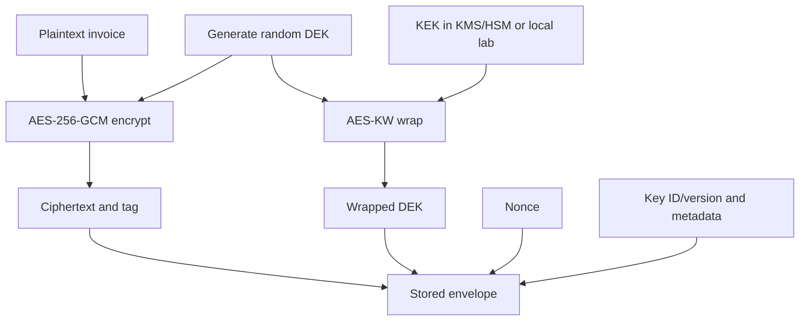
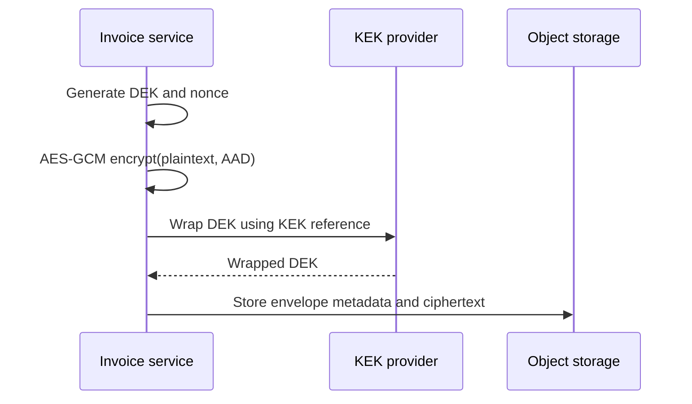
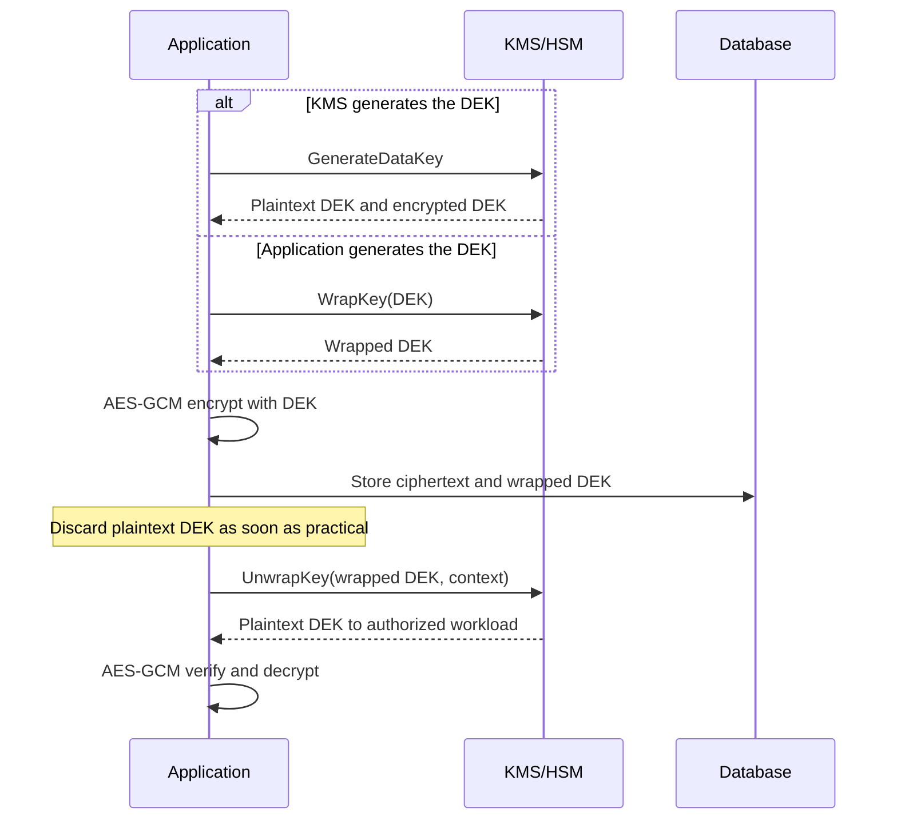

# Bọc DEK bằng KEK

## Mục tiêu thực hành

Trong bài thực hành này, bạn sẽ xây dựng một luồng envelope encryption nhỏ bằng Java 17. Dữ liệu được mã hóa bằng Data Encryption Key (DEK); DEK được bọc bằng Key Encryption Key (KEK). Ứng dụng lưu ciphertext và wrapped DEK cùng metadata để có thể giải mã đúng key version.

Sau khi hoàn thành, bạn có thể:

- Giải thích vai trò khác nhau của DEK và KEK.
- Tạo DEK và KEK bằng `KeyGenerator` với `SecureRandom`.
- Mã hóa payload bằng AES-GCM và xác thực Additional Authenticated Data (AAD).
- Bọc và mở DEK bằng AES Key Wrap (AES-KW, RFC 3394) qua Java JCA.
- Lưu một envelope chỉ chứa wrapped DEK, nonce, ciphertext/tag và key reference.
- Xử lý sai KEK, wrapped DEK bị sửa, sai AAD và sai key version.
- Mô tả cách thay KEK bằng rewrap DEK mà không phải mã hóa lại payload.
- Phân biệt rewrap với re-encryption khi DEK bị lộ.
- Chuyển mô hình local lab sang KMS/HSM mà không export KEK.

## 1. Bài toán

Một dịch vụ lưu hóa đơn cần mã hóa dữ liệu trước khi ghi vào object storage. Nếu dùng một key trực tiếp cho mọi record, việc rotation hoặc lộ key có thể ảnh hưởng phạm vi dữ liệu lớn. Nhóm chọn envelope encryption:

- Mỗi record có một DEK ngẫu nhiên.
- DEK mã hóa payload bằng AES-256-GCM.
- Một KEK được quản lý riêng dùng để bọc DEK.
- Object storage chỉ lưu wrapped DEK và ciphertext cùng metadata cần thiết.
- KEK được tham chiếu bằng key ID/version; trong production, KEK nằm trong KMS/HSM.

Khi đọc record, ứng dụng resolve đúng KEK version, unwrap DEK rồi dùng DEK xác thực và giải mã payload. KEK không cần rời khỏi cryptographic boundary.

## 2. Kiến trúc cần xây dựng



Hai key có nhiệm vụ khác nhau:

| Thành phần | Nhiệm vụ | Nơi lưu trong production |
|---|---|---|
| DEK | Mã hóa/giải mã payload | Chỉ ở memory trong thời gian cần thiết; bản lưu được wrap |
| KEK | Wrap/unwrap DEK | KMS/HSM hoặc cryptographic boundary được bảo vệ |
| Wrapped DEK | Cho phép khôi phục DEK khi có quyền dùng KEK | Database/object metadata |
| Key reference | Chọn đúng KEK resource/version | Envelope/configuration đã kiểm tra |
| Nonce và tag | Tham số và bằng chứng xác thực AES-GCM | Lưu cùng ciphertext |

## 3. Phân biệt encryption với key wrapping

Trong lab này có hai operation riêng:

1. `AES/GCM/NoPadding` mã hóa payload bằng DEK. GCM cung cấp confidentiality và integrity/authenticity; tag được xác minh trước khi plaintext được trả về thành công.
2. `AESWrap` bọc DEK bằng KEK theo AES Key Wrap (RFC 3394). Đây là thuật toán key wrapping có kiểm tra integrity riêng cho wrapped key.

Không dùng KEK trực tiếp để mã hóa invoice. Cũng không dùng DEK làm KEK. Tách vai trò giúp rotation và phân quyền rõ ràng.

## 4. Chuẩn bị môi trường

Yêu cầu:

- JDK 17 trở lên.
- Java Cryptography Architecture (JCA) provider có hỗ trợ `AES/GCM/NoPadding` và `AESWrap`.
- Một project Java trống hoặc thư mục lab riêng.
- Nếu dùng JUnit, thêm JUnit Jupiter 5 vào test scope của build tool.

Trong lab, KEK được tạo trong memory để dễ quan sát luồng. Đây chỉ là mô phỏng. Production phải tạo hoặc quản lý KEK trong KMS/HSM; không đặt KEK trong source code, `.properties`, environment variable hay object storage.

Kiểm tra JDK:

```bash
java -version
javac -version
```

Không cần tải production secret hoặc dữ liệu thật để làm bài.

## 5. Quy tắc dữ liệu và metadata

Một envelope tối thiểu cần lưu:

| Field | Ý nghĩa |
|---|---|
| `formatVersion` | Phiên bản format envelope |
| `kekId` | Định danh KEK hoặc KMS key reference |
| `kekVersion` | Version cụ thể được dùng để wrap DEK |
| `wrappingAlgorithm` | `AES-KW` / RFC 3394 trong lab |
| `dataAlgorithm` | `AES-256-GCM` |
| `wrappedDek` | DEK đã được wrap; không phải plaintext DEK |
| `nonce` | Nonce GCM 96-bit của payload |
| `ciphertextAndTag` | Ciphertext kèm authentication tag |

AAD thường được tạo từ context tin cậy như tenant ID, record ID, purpose và format version. AAD không cần bí mật, nhưng phải giống byte-for-byte khi decrypt. Trong production, tái tạo AAD từ metadata đã xác thực; không tin mù quáng AAD do client gửi.

## 6. Bước 1: tạo KEK và DEK

Tạo hai AES key độc lập. KEK dùng cho wrapping; DEK dùng cho data encryption.

```java
import java.security.GeneralSecurityException;
import java.security.SecureRandom;
import javax.crypto.KeyGenerator;
import javax.crypto.SecretKey;

final class LabKeyFactory {
    private static final SecureRandom RANDOM = new SecureRandom();

    private LabKeyFactory() {}

    static SecretKey newAesKey(int bits) throws GeneralSecurityException {
        KeyGenerator generator = KeyGenerator.getInstance("AES");
        generator.init(bits, RANDOM);
        return generator.generateKey();
    }
}
```

Thực hiện:

1. Gọi `LabKeyFactory.newAesKey(256)` để tạo KEK trong lab.
2. Gọi lại hàm để tạo DEK độc lập.
3. Không in key bytes hoặc gọi `getEncoded()` để ghi key ra console.
4. Ghi nhận trong biến lab rằng hai key có purpose khác nhau.

Trong production, DEK có thể được sinh bằng KMS `GenerateDataKey` hoặc CSPRNG trong process theo policy. KEK nên được tạo và giữ trong KMS/HSM.

## 7. Bước 2: mã hóa payload bằng AES-GCM

GCM dùng nonce 12 byte theo profile thông dụng và tag 128 bit. Không được tái sử dụng nonce dưới cùng một key. Trong bài lab, mỗi envelope có DEK riêng và nonce được sinh ngẫu nhiên bằng `SecureRandom`.

```java
import java.nio.charset.StandardCharsets;
import java.security.GeneralSecurityException;
import java.security.SecureRandom;
import javax.crypto.Cipher;
import javax.crypto.SecretKey;
import javax.crypto.spec.GCMParameterSpec;

final class DataEncryption {
    private static final int NONCE_BYTES = 12;
    private static final int TAG_BITS = 128;
    private static final SecureRandom RANDOM = new SecureRandom();

    private DataEncryption() {}

    static byte[] newNonce() {
        byte[] nonce = new byte[NONCE_BYTES];
        RANDOM.nextBytes(nonce);
        return nonce;
    }

    static byte[] encrypt(SecretKey dek, byte[] plaintext,
                          byte[] nonce, byte[] aad)
            throws GeneralSecurityException {
        if (nonce == null || nonce.length != NONCE_BYTES || aad == null) {
            throw new IllegalArgumentException("Invalid GCM nonce or AAD");
        }
        Cipher cipher = Cipher.getInstance("AES/GCM/NoPadding");
        cipher.init(Cipher.ENCRYPT_MODE, dek,
                new GCMParameterSpec(TAG_BITS, nonce));
        cipher.updateAAD(aad);
        return cipher.doFinal(plaintext);
    }

    static byte[] decrypt(SecretKey dek, byte[] ciphertextAndTag,
                          byte[] nonce, byte[] aad)
            throws GeneralSecurityException {
        if (nonce == null || nonce.length != NONCE_BYTES || aad == null
                || ciphertextAndTag == null
                || ciphertextAndTag.length < TAG_BITS / 8) {
            throw new IllegalArgumentException("Malformed GCM input");
        }
        Cipher cipher = Cipher.getInstance("AES/GCM/NoPadding");
        cipher.init(Cipher.DECRYPT_MODE, dek,
                new GCMParameterSpec(TAG_BITS, nonce));
        cipher.updateAAD(aad);
        return cipher.doFinal(ciphertextAndTag);
    }
}
```

`doFinal` khi decrypt xác minh tag. Nếu tag hoặc AAD sai, provider ném lỗi xác thực như `AEADBadTagException`; ứng dụng không được trả plaintext một phần hoặc fallback sang chế độ không xác thực.

## 8. Bước 3: tạo AAD từ context

AAD gắn ciphertext với tenant, record và purpose. Thay đổi một field phải khiến decrypt thất bại.

Ví dụ context của lab:

```java
import java.nio.charset.StandardCharsets;

final class InvoiceContext {
    private InvoiceContext() {}

    static byte[] aad(String tenantId, String invoiceId) {
        String canonical = "v1|tenant=" + tenantId
                + "|invoice=" + invoiceId
                + "|purpose=invoice-data";
        return canonical.getBytes(StandardCharsets.UTF_8);
    }
}
```

Lab dùng ID do bài thực hành kiểm soát và không chứa dấu phân cách `|`. Production nên dùng canonical encoding có version và biểu diễn trường không nhập nhằng, chẳng hạn serialization có length-prefix hoặc định dạng canonical đã quy định. Không ghép chuỗi tùy tiện với dữ liệu do user kiểm soát.

## 9. Bước 4: bọc DEK bằng AES-KW

Java JCA cung cấp transformation `AESWrap` trên các provider hỗ trợ. `Cipher.WRAP_MODE` nhận KEK và `wrap` nhận DEK. Với AES-KW theo RFC 3394, input phải có độ dài tối thiểu 16 byte và là bội số của 8 byte. DEK AES-256 dài 32 byte nên đáp ứng điều kiện; wrapped output dài 40 byte.

```java
import java.security.GeneralSecurityException;
import javax.crypto.Cipher;
import javax.crypto.SecretKey;

final class KeyWrapping {
    private KeyWrapping() {}

    static byte[] wrapDek(SecretKey kek, SecretKey dek)
            throws GeneralSecurityException {
        Cipher cipher = Cipher.getInstance("AESWrap");
        cipher.init(Cipher.WRAP_MODE, kek);
        return cipher.wrap(dek);
    }

    static SecretKey unwrapDek(SecretKey kek, byte[] wrappedDek)
            throws GeneralSecurityException {
        Cipher cipher = Cipher.getInstance("AESWrap");
        cipher.init(Cipher.UNWRAP_MODE, kek);
        return (SecretKey) cipher.unwrap(
                wrappedDek, "AES", Cipher.SECRET_KEY);
    }
}
```

Thực hiện:

1. Dùng KEK tạo ở bước 1.
2. Gọi `KeyWrapping.wrapDek(kek, dek)`.
3. Ghi nhận độ dài wrapped DEK là 40 byte với DEK 32 byte theo RFC 3394.
4. Không serialize hoặc log plaintext DEK/KEK.
5. Lưu wrapped DEK như một phần của envelope.

AES-KW không dùng nonce hoặc AAD như AES-GCM. Nếu cần ràng buộc context ở KMS, dùng encryption context/API policy do KMS hỗ trợ. Trong lab, AAD bảo vệ payload được xác thực ở AES-GCM layer; không nhầm nó với context binding của KMS.

## 10. Bước 5: mô hình hóa envelope

Envelope lưu key reference và bytes đã mã hóa. Các array được defensive-copy để caller không thể sửa dữ liệu nội bộ sau khi tạo record.

```java
import java.util.Objects;

record Envelope(
        int formatVersion,
        String kekId,
        int kekVersion,
        String wrappingAlgorithm,
        String dataAlgorithm,
        byte[] wrappedDek,
        byte[] nonce,
        byte[] ciphertextAndTag) {

    Envelope {
        Objects.requireNonNull(kekId);
        Objects.requireNonNull(wrappingAlgorithm);
        Objects.requireNonNull(dataAlgorithm);
        Objects.requireNonNull(wrappedDek);
        Objects.requireNonNull(nonce);
        Objects.requireNonNull(ciphertextAndTag);
        if (formatVersion < 1 || kekVersion < 1) {
            throw new IllegalArgumentException("Invalid envelope version");
        }
        if (nonce.length != 12 || ciphertextAndTag.length < 16) {
            throw new IllegalArgumentException("Malformed GCM envelope fields");
        }
        wrappedDek = wrappedDek.clone();
        nonce = nonce.clone();
        ciphertextAndTag = ciphertextAndTag.clone();
    }

    @Override
    public byte[] wrappedDek() {
        return wrappedDek.clone();
    }

    @Override
    public byte[] nonce() {
        return nonce.clone();
    }

    @Override
    public byte[] ciphertextAndTag() {
        return ciphertextAndTag.clone();
    }
}
```

Không đưa KEK hoặc plaintext DEK vào record. `kekId` và `kekVersion` là metadata định tuyến; ứng dụng phải kiểm tra chúng với tenant, purpose và inventory đáng tin trước khi resolve key.

## 11. Bước 6: ghép luồng encrypt và wrap

Thứ tự logic:

1. Sinh DEK mới cho record.
2. Sinh nonce mới.
3. Tạo AAD từ tenant/record/purpose đã xác thực.
4. Mã hóa plaintext bằng DEK và AES-GCM.
5. Bọc DEK bằng KEK và AES-KW.
6. Tạo envelope với KEK ID/version, wrapped DEK, nonce và ciphertext/tag.
7. Persist envelope cùng record ID và metadata nghiệp vụ.



Trong local lab, `KeyWrapping` nhận `SecretKey kek`. Trong production, thay lời gọi này bằng KMS/HSM `WrapKey` hoặc `Encrypt` theo contract của nhà cung cấp; KEK chỉ được tham chiếu bằng ID và không export về ứng dụng.

## 12. Bước 7: unwrap DEK và giải mã

Khi đọc record:

1. Đọc envelope và lấy key ID/version.
2. Xác minh key reference thuộc đúng tenant/environment/purpose.
3. Resolve KEK version chính xác.
4. Dùng KEK unwrap DEK.
5. Tái tạo AAD từ context tin cậy.
6. Dùng DEK, nonce, ciphertext/tag và AAD để decrypt AES-GCM.
7. Chỉ trả plaintext sau khi tag được xác minh.

Không fallback sang “current KEK” nếu version trong envelope không tồn tại. Nếu không tìm được key version, trả lỗi có kiểm soát và tạo audit event; fallback có thể làm sai key hoặc vượt tenant boundary.

## 13. Bước 8: chương trình lab hoàn chỉnh

Ghép các class `LabKeyFactory`, `DataEncryption`, `InvoiceContext`, `KeyWrapping` và `Envelope` ở trên. Thêm resolver cho local lab và service sau để thực hiện hai chiều:

```java
import java.nio.charset.StandardCharsets;
import java.security.GeneralSecurityException;
import java.util.Objects;
import javax.crypto.SecretKey;

interface LabKekResolver {
    SecretKey resolve(String kekId, int kekVersion);
}

final class InvoiceEnvelopeService {
    private static final String WRAP_ALGORITHM = "AES-KW-RFC3394";
    private static final String DATA_ALGORITHM = "AES-256-GCM";

    private InvoiceEnvelopeService() {}

    static Envelope encryptAndWrap(
            String kekId, int kekVersion, SecretKey kek,
            String tenantId, String invoiceId, String plaintext)
            throws GeneralSecurityException {
        SecretKey dek = LabKeyFactory.newAesKey(256);
        byte[] nonce = DataEncryption.newNonce();
        byte[] aad = InvoiceContext.aad(tenantId, invoiceId);
        byte[] clear = plaintext.getBytes(StandardCharsets.UTF_8);
        byte[] ciphertextAndTag = DataEncryption.encrypt(
                dek, clear, nonce, aad);
        byte[] wrappedDek = KeyWrapping.wrapDek(kek, dek);

        return new Envelope(
                1, kekId, kekVersion, WRAP_ALGORITHM, DATA_ALGORITHM,
                wrappedDek, nonce, ciphertextAndTag);
    }

    static String unwrapAndDecrypt(
            Envelope envelope, LabKekResolver resolver,
            String expectedKekId, int expectedKekVersion,
            String tenantId, String invoiceId)
            throws GeneralSecurityException {
        Objects.requireNonNull(envelope);
        if (envelope.formatVersion() != 1
                || !WRAP_ALGORITHM.equals(envelope.wrappingAlgorithm())
                || !DATA_ALGORITHM.equals(envelope.dataAlgorithm())
                || !expectedKekId.equals(envelope.kekId())
                || expectedKekVersion != envelope.kekVersion()) {
            throw new IllegalArgumentException(
                    "Envelope metadata does not match trusted key policy");
        }

        SecretKey kek = Objects.requireNonNull(
                resolver.resolve(expectedKekId, expectedKekVersion),
                "KEK version is unavailable");
        SecretKey dek = KeyWrapping.unwrapDek(kek, envelope.wrappedDek());
        byte[] aad = InvoiceContext.aad(tenantId, invoiceId);
        byte[] plaintext = DataEncryption.decrypt(
                dek, envelope.ciphertextAndTag(), envelope.nonce(), aad);
        return new String(plaintext, StandardCharsets.UTF_8);
    }
}
```

Đây là local teaching sample. `LabKekResolver` trả key trong memory chỉ để mô phỏng registry của lab. Trong production, resolver phải kiểm tra tenant/purpose và gọi KMS/HSM unwrap bằng key reference; nó không trả KEK bytes về ứng dụng. `expectedKekId`/version phải đến từ trusted policy chứ không lấy lại từ chính envelope chưa xác minh. Cũng cần giới hạn kích thước input, kiểm tra tenant authorization, audit, timeout/retry và quản lý plaintext trong memory. Java/JVM/provider có thể tạo bản sao key trong memory; không thể khẳng định xóa hoàn toàn chỉ bằng cách ghi đè một array.

## 14. Bước 9: chạy thử happy path

Tạo một KEK trong lab, sau đó:

```java
import javax.crypto.SecretKey;

SecretKey kek = LabKeyFactory.newAesKey(256);
LabKekResolver resolver = (keyId, version) -> {
    if (!"lab/tenant-a/kek".equals(keyId) || version != 1) {
        throw new IllegalArgumentException("Unknown lab KEK reference");
    }
    return kek;
};
Envelope envelope = InvoiceEnvelopeService.encryptAndWrap(
        "lab/tenant-a/kek", 1, kek,
        "tenant-a", "invoice-1001", "Hoa don thang 11");

String recovered = InvoiceEnvelopeService.unwrapAndDecrypt(
        envelope, resolver, "lab/tenant-a/kek", 1,
        "tenant-a", "invoice-1001");

if (!"Hoa don thang 11".equals(recovered)) {
    throw new AssertionError("Round-trip failed");
}
System.out.println("Envelope round-trip: PASS");
```

Kết quả mong đợi là `Envelope round-trip: PASS`. Không in KEK, DEK hoặc plaintext trong log production; dòng in ở đây chỉ là kết quả kiểm thử tổng quát.

## 15. Bước 10: kiểm thử sai KEK

Tạo một KEK độc lập khác và dùng nó để unwrap envelope. AES-KW integrity check phải từ chối wrapped DEK.

```java
import static org.junit.jupiter.api.Assertions.assertThrows;
import java.security.InvalidKeyException;
import javax.crypto.SecretKey;
import org.junit.jupiter.api.Test;

@Test
void wrongKekCannotUnwrapDek() throws Exception {
    SecretKey kek = LabKeyFactory.newAesKey(256);
    SecretKey wrongKek = LabKeyFactory.newAesKey(256);
    Envelope envelope = InvoiceEnvelopeService.encryptAndWrap(
            "lab/tenant-a/kek", 1, kek,
            "tenant-a", "invoice-1001", "synthetic invoice");

    assertThrows(InvalidKeyException.class, () ->
            KeyWrapping.unwrapDek(wrongKek, envelope.wrappedDek()));
}
```

Đặt các method test trong một JUnit 5 test class, ví dụ `EnvelopeCryptoTest`. Nếu test không fail như mong đợi, kiểm tra provider, transformation và cách test lấy đúng KEK độc lập. Không “sửa” test bằng cách bỏ kiểm tra integrity.

## 16. Bước 11: kiểm thử wrapped DEK bị sửa

AES-KW có integrity check. Sửa một byte của wrapped DEK phải khiến unwrap thất bại.

```java
import static org.junit.jupiter.api.Assertions.assertThrows;
import java.security.InvalidKeyException;
import javax.crypto.SecretKey;
import org.junit.jupiter.api.Test;

@Test
void modifiedWrappedDekIsRejected() throws Exception {
    SecretKey kek = LabKeyFactory.newAesKey(256);
    SecretKey dek = LabKeyFactory.newAesKey(256);
    byte[] wrapped = KeyWrapping.wrapDek(kek, dek);
    wrapped[wrapped.length - 1] ^= 0x01;

    assertThrows(InvalidKeyException.class,
            () -> KeyWrapping.unwrapDek(kek, wrapped));
}
```

Không nhầm integrity check của AES-KW với authentication tag của AES-GCM. Hai lớp bảo vệ hai đối tượng khác nhau: wrapped DEK và payload.

## 17. Bước 12: kiểm thử sai AAD và ciphertext

DEK có thể unwrap thành công nhưng payload vẫn phải thất bại nếu AAD hoặc ciphertext sai.

```java
import static org.junit.jupiter.api.Assertions.assertThrows;
import javax.crypto.AEADBadTagException;
import javax.crypto.SecretKey;
import org.junit.jupiter.api.Test;

@Test
void wrongAadCannotDecryptPayload() throws Exception {
    SecretKey dek = LabKeyFactory.newAesKey(256);
    byte[] nonce = DataEncryption.newNonce();
    byte[] originalAad = InvoiceContext.aad("tenant-a", "invoice-1001");
    byte[] ciphertext = DataEncryption.encrypt(
            dek, "synthetic invoice".getBytes(java.nio.charset.StandardCharsets.UTF_8),
            nonce, originalAad);
    byte[] wrongAad = InvoiceContext.aad("tenant-b", "invoice-1001");

    assertThrows(AEADBadTagException.class, () ->
            DataEncryption.decrypt(dek, ciphertext, nonce, wrongAad));
}
```

Tạo thêm test sửa một byte trong ciphertext/tag và test đổi nonce. Cả hai phải bị từ chối bởi GCM authentication. Không trả plaintext khi tag không hợp lệ.

## 18. Bước 13: kiểm tra metadata và tenant isolation

Một wrapped DEK hợp lệ vẫn có thể bị gắn nhầm với tenant hoặc record. Hãy kiểm tra:

- `kekId` thuộc đúng tenant và environment.
- `kekVersion` tồn tại và được phép cho recipient usage.
- `formatVersion`, wrapping algorithm và data algorithm nằm trong allowlist.
- AAD được tạo từ tenant/record/purpose đã xác thực.
- Key reference không được caller thay bằng ID tùy ý.
- Tenant A không thể dùng envelope của tenant B để lấy plaintext.

Thử đổi `expectedKekId`, version, tenant ID và invoice ID. Metadata mismatch phải bị từ chối trước khi unwrap hoặc decrypt.

Ví dụ test version mismatch phải xác minh resolver chưa được gọi:

```java
import static org.junit.jupiter.api.Assertions.assertThrows;
import javax.crypto.SecretKey;
import org.junit.jupiter.api.Test;

@Test
void wrongKekVersionIsRejectedBeforeResolve() throws Exception {
    SecretKey kek = LabKeyFactory.newAesKey(256);
    Envelope envelope = InvoiceEnvelopeService.encryptAndWrap(
            "lab/tenant-a/kek", 1, kek,
            "tenant-a", "invoice-1001", "synthetic invoice");
    LabKekResolver mustNotResolve = (keyId, version) -> {
        throw new AssertionError("Resolver must not run for mismatched metadata");
    };

    assertThrows(IllegalArgumentException.class, () ->
            InvoiceEnvelopeService.unwrapAndDecrypt(
                    envelope, mustNotResolve, "lab/tenant-a/kek", 2,
                    "tenant-a", "invoice-1001"));
}
```

## 19. Bước 14: lưu envelope

Trong lab, có thể serialize envelope thành JSON/Base64 hoặc ghi vào file nhị phân. Lưu ý:

- Binary fields phải encode nhất quán, ví dụ Base64URL.
- Không ghi plaintext DEK hoặc KEK.
- Lưu key ID/version, algorithm và format version.
- Không dùng alias mutable làm định danh duy nhất.
- AAD phải được tái tạo từ metadata tin cậy hoặc lưu theo canonical format có integrity binding.
- Database access và backup của envelope vẫn cần access control.

Ví dụ JSON minh họa, các giá trị bytes đã được thay bằng placeholder:

```json
{
  "formatVersion": 1,
  "kekId": "lab/tenant-a/kek",
  "kekVersion": 1,
  "wrappingAlgorithm": "AES-KW-RFC3394",
  "dataAlgorithm": "AES-256-GCM",
  "wrappedDek": "BASE64URL_WRAPPED_DEK",
  "nonce": "BASE64URL_NONCE",
  "ciphertextAndTag": "BASE64URL_CIPHERTEXT_AND_TAG"
}
```

Placeholder không phải dữ liệu có thể decrypt. Không dùng ví dụ này làm cấu hình production.

## 20. Bước 15: rotation KEK bằng rewrap

Giả sử envelope đang dùng KEK version 1. Khi rotation, tạo KEK version 2. Nếu DEK vẫn đáng tin và không bị lộ, có thể:

1. Resolve KEK version 1.
2. Unwrap DEK cũ.
3. Wrap cùng DEK bằng KEK version 2.
4. Cập nhật `kekId`/`kekVersion` trong envelope atomically.
5. Giữ ciphertext, nonce và tag không đổi.
6. Kiểm tra decrypt sau rewrap.
7. Chỉ retire KEK version 1 khi không còn envelope/backup cần nó.

Rewrap thay lớp bảo vệ DEK; không cần giải mã và mã hóa lại payload. Tuy nhiên, nếu DEK đã bị lộ, rewrap cùng DEK không khôi phục confidentiality. Khi đó phải sinh DEK mới và re-encrypt dữ liệu.

Để giữ khả năng rewrap mà không re-encrypt payload, AAD của data encryption trong ví dụ ràng buộc tenant, record, purpose và format version, không ràng buộc KEK version. Key ID/version vẫn phải được xác minh bằng trusted resolver/policy; với KMS, có thể dùng encryption context riêng cho thao tác wrap/unwrap.

## 21. Bước 16: KMS/HSM trong production

Trong production, ứng dụng không nên nhận KEK bytes. Một mô hình điển hình:



API cụ thể tùy provider. `GenerateDataKey` thường để KMS sinh DEK và trả plaintext DEK cùng bản encrypted DEK; `WrapKey`/`Encrypt` có thể nhận DEK do ứng dụng sinh và trả wrapped bytes. Đây là hai flow thay thế nhau; chọn theo provider và policy. Cần:

- Dùng workload identity ngắn hạn.
- Cấp quyền `GenerateDataKey`/`Encrypt`/`Decrypt`/`UnwrapKey` đúng key và purpose.
- Dùng encryption context nếu KMS hỗ trợ để ràng buộc tenant/purpose.
- Không log plaintext DEK hoặc credential.
- Giữ KEK non-exportable nếu policy yêu cầu.
- Audit principal, key ID/version, operation, context và kết quả.

## 22. Bước 17: kiểm thử failure và retry

Mô phỏng các lỗi:

- KMS timeout trước khi xử lý request.
- KMS xử lý xong nhưng response timeout.
- Workload identity hết hạn.
- Key version bị disable hoặc scheduled for deletion.
- Permission bị revoke giữa một batch.
- Database ghi envelope thất bại sau khi đã wrap DEK.
- Audit sink không nhận event.

Thiết kế idempotency và reconciliation để không tạo orphan envelope hoặc mất wrapped DEK. Không retry vô hạn khi sai key/tag/policy. Khi kết quả operation không rõ, tra cứu theo request ID/idempotency token trước khi thực hiện lại.

## 23. Bước 18: kiểm thử backup và restore

Backup phải giữ được ciphertext, wrapped DEK, nonce, tag, metadata version và key dependency. Một backup thành công chưa chứng minh dữ liệu có thể restore.

Thực hiện restore vào môi trường test:

1. Khôi phục object và metadata.
2. Resolve đúng KEK version hoặc replica được phê duyệt.
3. Unwrap DEK.
4. Tái tạo AAD từ context đã xác thực.
5. Decrypt và xác minh tag.
6. So sánh plaintext với fixture hoặc digest đã biết.
7. Thu hồi quyền recovery tạm sau test.

Không export KEK ra ngoài HSM chỉ để làm backup dễ hơn. Dùng cơ chế backup/restore của provider và dual control khi cần.

## 24. Lỗi thường gặp

| Lỗi | Nguyên nhân | Cách xử lý |
|---|---|---|
| `NoSuchAlgorithmException: AESWrap` | Provider không hỗ trợ transformation | Kiểm tra provider/JDK và profile được phép |
| `InvalidKeyException` khi unwrap | Sai KEK, wrapped DEK bị sửa hoặc integrity check thất bại | Kiểm tra key reference/version và bảo toàn envelope để điều tra |
| `AEADBadTagException` | Sai DEK, nonce, AAD, ciphertext hoặc tag | Không trả plaintext; kiểm tra metadata/context và nguồn dữ liệu |
| Decrypt không tìm thấy key | Key ID/version sai hoặc đã retire | Resolve inventory và recovery policy; không fallback ngẫu nhiên |
| Restore thất bại | Backup thiếu wrapped DEK/metadata hoặc key dependency | Sửa backup manifest và chạy restore drill |
| Rotation làm mất khả năng đọc | Retire KEK cũ trước khi rewrap/retention hoàn tất | Giữ recipient access có kiểm soát cho dữ liệu cũ |

Không ghi stack trace kèm secret hoặc plaintext vào log. Chỉ ghi error category, request ID, key reference và correlation ID phù hợp policy.

## 25. AES-KW và AES-KWP

AES-KW theo RFC 3394 phù hợp với key material có độ dài tối thiểu 16 byte và là bội số của 8 byte. AES-KWP theo RFC 5649 bổ sung padding để hỗ trợ input không thỏa điều kiện độ dài của AES-KW.

Không tự thêm padding vào DEK rồi gọi AES-KW nếu không có format/policy được định nghĩa. Chọn đúng wrapping algorithm và ghi rõ trong metadata. JCA provider có thể đặt tên transformation khác nhau; phải xác minh tài liệu provider và test vector tương ứng.

NIST SP 800-38F mô tả các phương pháp AES Key Wrap và AES Key Wrap with Padding. RFC 3394 và RFC 5649 là tài liệu kỹ thuật cho hai định dạng này.

## 26. Checklist hoàn thành lab

- [ ] Tạo KEK và DEK độc lập bằng `KeyGenerator`/`SecureRandom`.
- [ ] Dùng DEK AES-256-GCM mã hóa payload.
- [ ] Dùng nonce mới và tag 128 bit.
- [ ] Tạo AAD từ tenant, record và purpose.
- [ ] Dùng `AESWrap` với `Cipher.WRAP_MODE` để bọc DEK.
- [ ] Dùng `Cipher.UNWRAP_MODE` để khôi phục DEK.
- [ ] Envelope chỉ lưu wrapped DEK và metadata, không lưu KEK/DEK plaintext.
- [ ] Round-trip trả lại đúng plaintext fixture.
- [ ] Sai KEK bị AES-KW integrity check từ chối.
- [ ] Wrapped DEK bị sửa bị từ chối.
- [ ] Sai AAD/ciphertext/tag bị AES-GCM từ chối.
- [ ] Sai key ID/version/tenant bị policy gate từ chối.
- [ ] Rewrap KEK mới giữ nguyên ciphertext khi DEK vẫn đáng tin.
- [ ] Re-encrypt bằng DEK mới khi DEK bị lộ.
- [ ] Backup/restore được kiểm tra với key version phù hợp.
- [ ] Không có key material hoặc plaintext nhạy cảm trong log/artifact.

### Sản phẩm cần nộp

1. Source code cho key generation, AES-GCM, AES-KW, envelope và service encrypt/decrypt.
2. Test report cho happy path, wrong KEK, tampered wrapped DEK, wrong AAD và tampered ciphertext/tag.
3. Một envelope mẫu chỉ chứa placeholder hoặc test bytes đã mã hóa; không nộp raw key.
4. Sơ đồ luồng wrap/unwrap và mô tả nơi KEK được giữ trong production.
5. Ghi chú ngắn giải thích khi nào rewrap đủ và khi nào phải tạo DEK mới để re-encrypt.

### Tiêu chí đạt

- Có thể khôi phục đúng plaintext fixture sau unwrap và AES-GCM decrypt.
- Mọi trường hợp sai key/context hoặc dữ liệu bị sửa đều thất bại an toàn.
- Metadata chọn đúng KEK ID/version và không có fallback sang key tùy ý.
- Envelope không chứa KEK hoặc plaintext DEK.
- Người thực hiện giải thích được vì sao KEK ở KMS/HSM và vì sao rewrap không sửa được một DEK đã bị lộ.

## 27. Bài tập mở rộng

1. Thay local KEK bằng interface `KekProvider` để có thể dùng local JCA hoặc KMS adapter.
2. Viết `KeyResolver` kiểm tra tenant, purpose, key ID và version trước khi unwrap.
3. Thêm format version 2 với metadata canonical encoding.
4. Viết batch rewrap từ KEK version 1 sang version 2 có checkpoint và idempotency.
5. Mô phỏng một DEK bị lộ: tạo DEK mới và re-encrypt payload, sau đó so sánh với thao tác rewrap cùng DEK.
6. Thêm audit event `DataKeyWrapped`, `DataKeyUnwrapped` và `EnvelopeRewrapped` chỉ chứa metadata.
7. Kiểm thử workload identity không có quyền unwrap key của tenant khác.

## 28. Câu hỏi tự kiểm tra

**1. DEK và KEK khác nhau thế nào?**

DEK mã hóa dữ liệu; KEK bọc và bảo vệ DEK.

**2. Vì sao không mã hóa mọi payload trực tiếp bằng KEK?**

Tách data encryption khỏi key protection giúp giới hạn phạm vi, phân quyền và rotation.

**3. AES-GCM và AES-KW dùng cho việc gì trong lab?**

AES-GCM mã hóa payload; AES-KW bọc DEK.

**4. `Cipher.WRAP_MODE` có ý nghĩa gì?**

Khởi tạo cipher để bọc một key bằng wrapping key.

**5. `Cipher.UNWRAP_MODE` có ý nghĩa gì?**

Khởi tạo cipher để khôi phục key từ wrapped key bytes.

**6. Vì sao DEK AES-256 phù hợp AES-KW RFC 3394?**

DEK dài 32 byte, là bội số của 8 và lớn hơn mức tối thiểu 16 byte.

**7. Wrapped DEK dài bao nhiêu byte trong ví dụ này?**

40 byte: AES-KW RFC 3394 thêm 8 byte integrity value vào input 32 byte.

**8. AES-KW có dùng nonce/AAD không?**

Không. Đây là key wrapping mode; context binding cần cơ chế riêng như KMS encryption context hoặc AAD ở data encryption layer.

**9. Vì sao cần lưu KEK ID/version?**

Để resolve đúng key đã bọc DEK; không được đoán hoặc fallback sang key hiện tại.

**10. Nếu sai KEK thì sao?**

Integrity check của AES-KW phải khiến unwrap thất bại.

**11. Nếu wrapped DEK bị sửa thì sao?**

AES-KW integrity check từ chối wrapped key.

**12. Nếu AAD sai thì sao?**

AES-GCM tag verification thất bại và plaintext không được trả về thành công.

**13. Vì sao nonce GCM phải mới?**

Không được tái sử dụng nonce dưới cùng một key vì có thể phá vỡ confidentiality và integrity.

**14. Rewrap có thay đổi ciphertext không?**

Không. Rewrap chỉ thay wrapped DEK bằng cách dùng KEK mới.

**15. Khi nào rewrap không đủ?**

Khi DEK đã bị lộ; cần tạo DEK mới và re-encrypt dữ liệu.

**16. KEK có nên nằm trong database không?**

Không. Production nên giữ KEK trong KMS/HSM và lưu key reference.

**17. Envelope có cần lưu plaintext DEK không?**

Không. Chỉ lưu wrapped DEK.

**18. Backup envelope cần những gì?**

Ciphertext, wrapped DEK, nonce, tag, metadata và khả năng resolve key version.

**19. AES-KWP khác AES-KW thế nào?**

AES-KWP hỗ trợ padding cho input không đáp ứng yêu cầu độ dài của AES-KW.

**20. Vì sao cần tenant binding trong AAD/context?**

Để ciphertext không thể bị chuyển sang tenant/record khác mà vẫn xác thực thành công.

## 29. Kết luận

Envelope encryption dùng DEK để mã hóa dữ liệu và KEK để bảo vệ DEK. Trong lab, AES-GCM cung cấp confidentiality và integrity cho payload; AES-KW theo RFC 3394 bảo vệ DEK khi lưu trữ. Envelope giữ wrapped DEK, nonce, ciphertext/tag cùng key reference/version để có thể khôi phục đúng key.

Khi rotation KEK, có thể unwrap rồi wrap lại DEK bằng KEK mới mà không thay đổi ciphertext nếu DEK vẫn đáng tin. Nếu DEK đã bị lộ, rewrap không khôi phục confidentiality; phải tạo DEK mới và re-encrypt dữ liệu. Trong production, KEK nên ở KMS/HSM, workload identity chỉ có quyền cần thiết, context được ràng buộc, audit không chứa secret và backup/restore phải được kiểm thử.
