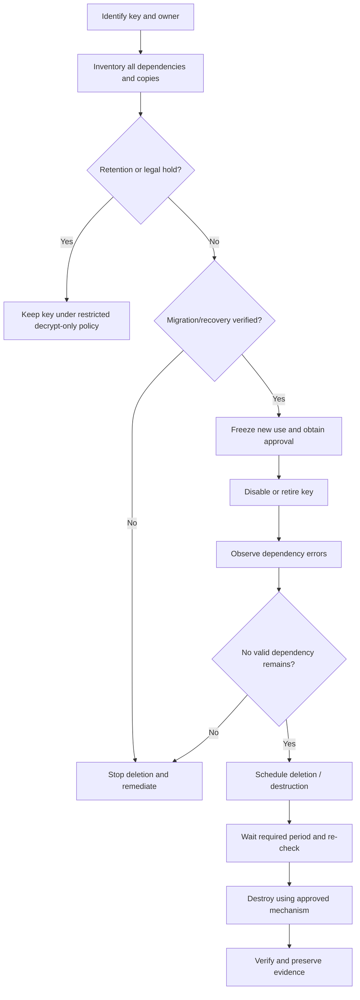

# Xóa key an toàn

Xóa key an toàn là quy trình đưa một khóa mật mã ra khỏi sử dụng, xác minh không còn phụ thuộc hợp lệ, thực hiện hủy theo cơ chế được phê duyệt và lưu bằng chứng để chứng minh key không còn khả năng được dùng. Đây là thao tác có thể làm dữ liệu không thể giải mã hoặc chữ ký không thể tạo lại, vì vậy cần kiểm soát chặt hơn một thay đổi cấu hình thông thường.

Trong bài thực hành này, bạn sẽ tạo một AES key chỉ dùng cho lab trong keystore PKCS#12, mã hóa một tệp dữ liệu giả, tạo bản sao backup, kiểm tra dependency, retire key, xóa entry khỏi keystore chính và xác minh bản backup vẫn giữ khả năng giải mã. Sau đó bạn sẽ đánh giá việc xử lý bản backup và phân biệt xóa entry với zeroization hoặc cryptographic erasure. Toàn bộ thao tác kỹ thuật chỉ áp dụng cho keystore và dữ liệu test trong thư mục lab.

Một key chỉ được hủy khi owner xác nhận hết mục đích sử dụng, các consumer đã chuyển hoặc không còn cần key, retention/legal hold được xử lý, backup và replica có kế hoạch rõ ràng, và người có thẩm quyền đã phê duyệt. Nếu key bị compromise, quy trình containment và replacement có thể cần diễn ra khẩn cấp; không được chờ quy trình retire thông thường nếu attacker vẫn có thể sử dụng key.

## 1. Mục tiêu thực hành

Sau bài lab, bạn có thể:

- Phân biệt disable, retire, revoke, schedule deletion, destroy, zeroization và cryptographic erasure.
- Xác định consumer, ciphertext, wrapped DEK, backup, replica, snapshot và dependency của key.
- Lập kế hoạch migration hoặc rewrap trước khi hủy key.
- Thực hiện một deletion gate có owner, approval, retention check và dual control.
- Tạo và kiểm tra key entry trong keystore PKCS#12 dùng riêng cho lab.
- Chứng minh xóa entry khỏi keystore chính không xóa key trong backup copy.
- Xác minh key không còn được dùng sau khi hủy và ghi nhận bằng chứng.
- Giải thích giới hạn của việc xóa file trên filesystem và các cơ chế hủy trong KMS/HSM.

## 2. Phạm vi an toàn và điều kiện bắt buộc

<badge>Chỉ dùng test key</badge>

Lab này chỉ dùng dữ liệu giả và một keystore mới tạo trong thư mục tạm. Không dùng key production, key của khách hàng, private key cá nhân, certificate đang phục vụ, backup thật hoặc HSM partition production.

Trước khi chạy lệnh:

1. Tạo thư mục riêng, ví dụ `key-deletion-lab`.
2. Xác nhận `lab.p12` chưa tồn tại hoặc không chứa dữ liệu cần giữ.
3. Tạo alias riêng `lab-kek`; không tái sử dụng alias thật.
4. Dùng mật khẩu lab mới, không dùng mật khẩu công ty hoặc mật khẩu cá nhân.
5. Chỉ đặt tệp giả trong thư mục lab; không trỏ lệnh tới thư mục dữ liệu thật.
6. Đọc kỹ từng đường dẫn trước khi copy, ghi đè hoặc xóa tệp.

Không chạy các lệnh trong bài với keystore, alias hoặc thư mục production. Các lệnh xóa ở phần lab chỉ xóa entry/tệp test đã tạo trong bài.

## 3. Phân biệt các trạng thái trong key lifecycle

Các trạng thái sau thường bị nhầm lẫn nhưng có tác động khác nhau:

| Trạng thái/hành động | Ý nghĩa | Khả năng sử dụng key |
|---|---|---|
| Active | Key đang được phép dùng theo policy | Có thể thực hiện operation được cấp |
| Disabled | Tạm ngăn operation theo cơ chế dịch vụ | Material có thể vẫn tồn tại và có thể enable lại |
| Retired | Không dùng cho hoạt động mới; có thể vẫn cần cho decrypt/verify lịch sử | Thường giữ khả năng đọc hoặc xác minh theo policy |
| Revoked | Thu hồi quyền hoặc trạng thái tin cậy, thường dùng với certificate/credential | Consumer phải từ chối theo semantics tương ứng |
| Scheduled for deletion | Đã đặt lịch hủy và đang trong thời gian chờ | Có thể còn khả năng hủy lịch theo provider/policy |
| Destroyed | Material/object đã bị hủy theo cơ chế được hỗ trợ | Không thể sử dụng lại key đã hủy |
| Zeroized | Key material được xóa khỏi boundary/memory theo cơ chế zeroization | Không còn material trong boundary đã được xác minh |
| Cryptographically erased | Key mã hóa/wrapping cần thiết bị hủy để ciphertext không thể giải mã | Ciphertext còn nhưng không còn đường giải mã hợp lệ |

Disable không phải destroy. Xóa alias không chứng minh key material đã bị xóa khỏi backup, snapshot hoặc thiết bị lưu trữ. Retire cũng không nhất thiết có nghĩa mọi operation đều bị cấm: một decrypt-only key có thể tiếp tục giải mã dữ liệu lịch sử trong thời gian retention.

## 4. Tình huống thực hành

Bạn là key custodian của dịch vụ `training-orders`. Một AES key alias `lab-kek` được dùng để mã hóa một tệp giả `sample.txt`. Dịch vụ đã chuyển sang key mới và owner yêu cầu retire key cũ. Trước khi xóa, bạn phải xác minh:

- Không còn workload nào ghi dữ liệu mới bằng key cũ.
- Dữ liệu cần giữ đã được migrate hoặc vẫn có phương án giải mã được phê duyệt.
- Không còn backup/replica cần key cũ ngoài kế hoạch retention.
- Owner đã xác nhận mục đích sử dụng kết thúc.
- Có approval và bằng chứng kiểm tra dependency.
- Sau khi xóa, ứng dụng không còn truy cập được key cũ.

Lab tạo một backup copy có chủ đích để chứng minh rằng xóa key trong keystore chính không loại bỏ các bản sao. Bạn sẽ quan sát backup vẫn giải mã được ciphertext, sau đó xử lý bản backup test theo quyết định của lab.

## 5. Quy trình xóa key an toàn

Quy trình tổng quát nên đi theo thứ tự:

1. **Identify:** xác định key ID, alias, version, owner, purpose, algorithm và phạm vi.
2. **Inventory:** tìm mọi consumer, ciphertext, wrapped DEK, backup, replica, snapshot, archive và dependency.
3. **Assess retention:** kiểm tra data retention, legal hold, audit, chữ ký lịch sử và yêu cầu khôi phục.
4. **Plan migration:** rewrap DEK, re-encrypt dữ liệu hoặc chuyển consumer sang key khác khi cần.
5. **Verify migration:** kiểm tra decrypt/verify trên dữ liệu đại diện và xác nhận consumer coverage.
6. **Freeze new use:** ngăn tạo dữ liệu mới bằng key cũ.
7. **Approve:** owner, security approver và custodian xác nhận deletion gate; dùng dual control khi policy yêu cầu.
8. **Disable/retire:** ngăn operation mới và theo dõi lỗi phụ thuộc.
9. **Schedule deletion:** đặt lịch hủy theo provider, thời gian chờ và quy trình khôi phục lịch nếu còn được phép.
10. **Destroy:** hủy material/object theo cơ chế KMS/HSM hoặc quy trình zeroization được hỗ trợ.
11. **Verify:** kiểm tra state, khả năng truy cập, replica/backup và audit evidence.
12. **Close:** cập nhật inventory, ticket, evidence và owner; không xóa bằng chứng kiểm toán.



Nếu key bị compromise, chuyển sang incident response: revoke identity/grant, cô lập key, đánh giá material exposure và tạo key thay thế. Không tiếp tục quy trình bình thường nếu attacker vẫn có thể dùng key.

## 6. Deletion gate: điều kiện trước khi xóa

Không thực hiện thao tác hủy cho tới khi mọi câu hỏi sau được trả lời:

| Nhóm kiểm tra | Câu hỏi cần trả lời | Bằng chứng |
|---|---|---|
| Ownership | Ai là key owner và ai có quyền phê duyệt? | Inventory, owner attestation, approval ticket |
| Purpose | Key còn dùng cho encryption, decrypt, signing, MAC hay backup không? | Key metadata, application config, usage report |
| Consumers | Service, job, batch, tenant hoặc partner nào còn gọi key? | Dependency map, KMS audit, code/config reference |
| Data | Ciphertext hoặc wrapped DEK nào còn phụ thuộc key? | Data inventory, key version report, migration report |
| Backup | Backup, snapshot, replica, archive hoặc export nào còn giữ key? | Backup catalog, storage inventory, restore plan |
| Retention | Có legal hold, audit, tax, dispute hoặc retention requirement không? | Data retention policy, legal approval |
| Migration | Rewrap/re-encryption đã hoàn tất và được xác minh chưa? | Migration report, decrypt/verify test |
| Recovery | Còn cần key cho disaster recovery hoặc dữ liệu lịch sử không? | DR plan, restore drill, owner sign-off |
| Access | Grant, IAM role, alias và workload reference đã được thu hồi/cập nhật chưa? | Policy snapshot, access review, change record |
| Approval | Có phê duyệt destruction và separation of duties không? | Ticket, dual-control record, approver identity |

Nếu một câu trả lời là “không biết”, trạng thái deletion gate là **BLOCKED**. Thiếu thông tin không được xem là không có dependency.

## 7. Chuẩn bị môi trường lab

Yêu cầu:

- JDK 17 trở lên.
- `keytool` và `javac` có trong `PATH`.
- Terminal tương tác để nhập mật khẩu keystore.
- Một thư mục lab mới, không chứa dữ liệu quan trọng.

Tạo thư mục riêng và chuyển vào đó. Ví dụ PowerShell:

```powershell
New-Item -ItemType Directory -Path .\key-deletion-lab
Set-Location .\key-deletion-lab
```

Tạo tệp giả `sample.txt` với nội dung không nhạy cảm, ví dụ:

```text
LAB ONLY - fake order record
order_id=TEST-0001
customer=Example Customer
amount=10.00
```

Không đưa dữ liệu khách hàng thật vào bài lab. Xác nhận thư mục hiện tại là `key-deletion-lab` trước khi tiếp tục.

## 8. Tạo test key trong PKCS#12

Dùng `keytool` tạo một AES-256 secret key với alias `lab-kek`:

```powershell
keytool -genseckey -alias lab-kek -keyalg AES -keysize 256 -storetype PKCS12 -keystore lab.p12
```

Nhập mật khẩu keystore tại prompt. Khi `keytool` hỏi mật khẩu riêng cho key, nhấn Enter để dùng cùng mật khẩu keystore. Không đặt password trực tiếp trong command line vì command history/process list có thể lưu lại.

Liệt kê keystore:

```powershell
keytool -list -v -keystore lab.p12 -storetype PKCS12
```

Xác nhận có alias `lab-kek`, entry type là SecretKeyEntry và algorithm là AES. Nếu keytool/JDK không hỗ trợ thao tác này, dừng lab và kiểm tra JDK; không thay bằng key production hoặc một file key tải từ nguồn không tin cậy.

## 9. Tạo Java helper cho lab

Tạo file `KeyDeletionLab.java` với nội dung dưới đây. Helper hỗ trợ mã hóa/giải mã dữ liệu giả, kiểm tra alias và xóa một entry khỏi keystore PKCS#12. Mật khẩu được nhập qua terminal, không truyền như tham số.

```java
import javax.crypto.Cipher;
import javax.crypto.SecretKey;
import javax.crypto.spec.GCMParameterSpec;
import java.io.Console;
import java.io.InputStream;
import java.io.OutputStream;
import java.nio.ByteBuffer;
import java.nio.charset.StandardCharsets;
import java.nio.file.AtomicMoveNotSupportedException;
import java.nio.file.Files;
import java.nio.file.Path;
import java.nio.file.StandardCopyOption;
import java.security.Key;
import java.security.KeyStore;
import java.security.SecureRandom;
import java.util.Arrays;

public final class KeyDeletionLab {
    private static final int NONCE_LENGTH = 12;
    private static final int TAG_BITS = 128;
    private static final byte[] AAD =
        "key-deletion-lab:v1".getBytes(StandardCharsets.UTF_8);

    private KeyDeletionLab() {}

    public static void main(String[] args) throws Exception {
        if (args.length < 3) {
            usage();
            return;
        }

        String command = args[0];
        Path storePath = Path.of(args[1]).toAbsolutePath();
        String alias = args[2];
        char[] password = readPassword();

        try {
            KeyStore store = loadStore(storePath, password);
            switch (command) {
                case "verify" -> {
                    requireArgs(args, 3);
                    System.out.println(store.isKeyEntry(alias)
                        ? "KEY_ENTRY_PRESENT" : "KEY_ENTRY_ABSENT");
                }
                case "encrypt" -> {
                    requireArgs(args, 5);
                    SecretKey key = getSecretKey(store, alias, password);
                    encrypt(key, Path.of(args[3]), Path.of(args[4]));
                    System.out.println("ENCRYPTED");
                }
                case "decrypt" -> {
                    requireArgs(args, 5);
                    SecretKey key = getSecretKey(store, alias, password);
                    decrypt(key, Path.of(args[3]), Path.of(args[4]));
                    System.out.println("DECRYPTED");
                }
                case "delete" -> {
                    requireArgs(args, 3);
                    if (!store.isKeyEntry(alias)) {
                        throw new IllegalStateException("Key entry not found");
                    }
                    store.deleteEntry(alias);
                    saveStoreAtomically(store, storePath, password);
                    KeyStore check = loadStore(storePath, password);
                    if (check.isKeyEntry(alias)) {
                        throw new IllegalStateException(
                            "Key entry is still present after save");
                    }
                    System.out.println(
                        "ENTRY_REMOVED_FROM_THIS_KEYSTORE_ONLY");
                }
                default -> usage();
            }
        } finally {
            Arrays.fill(password, '\0');
        }
    }

    private static char[] readPassword() {
        Console console = System.console();
        if (console == null) {
            throw new IllegalStateException(
                "Run from an interactive terminal to enter the password");
        }
        return console.readPassword("PKCS12 password: ");
    }

    private static KeyStore loadStore(Path path, char[] password)
            throws Exception {
        KeyStore store = KeyStore.getInstance("PKCS12");
        try (InputStream input = Files.newInputStream(path)) {
            store.load(input, password);
        }
        return store;
    }

    private static SecretKey getSecretKey(
            KeyStore store, String alias, char[] password) throws Exception {
        Key key = store.getKey(alias, password);
        if (!(key instanceof SecretKey secretKey)
                || !"AES".equalsIgnoreCase(secretKey.getAlgorithm())) {
            throw new IllegalStateException("Expected an AES secret key");
        }
        return secretKey;
    }

    private static void encrypt(
            SecretKey key, Path input, Path output) throws Exception {
        byte[] plaintext = Files.readAllBytes(input);
        byte[] nonce = new byte[NONCE_LENGTH];
        new SecureRandom().nextBytes(nonce);
        try {
            Cipher cipher = Cipher.getInstance("AES/GCM/NoPadding");
            cipher.init(Cipher.ENCRYPT_MODE, key,
                new GCMParameterSpec(TAG_BITS, nonce));
            cipher.updateAAD(AAD);
            byte[] ciphertext = cipher.doFinal(plaintext);
            ByteBuffer result = ByteBuffer.allocate(
                nonce.length + ciphertext.length);
            result.put(nonce).put(ciphertext);
            Files.write(output, result.array());
        } finally {
            Arrays.fill(plaintext, (byte) 0);
        }
    }

    private static void decrypt(
            SecretKey key, Path input, Path output) throws Exception {
        byte[] envelope = Files.readAllBytes(input);
        if (envelope.length <= NONCE_LENGTH + TAG_BITS / 8) {
            throw new IllegalArgumentException("Invalid encrypted file");
        }
        byte[] nonce = Arrays.copyOfRange(envelope, 0, NONCE_LENGTH);
        byte[] ciphertext = Arrays.copyOfRange(
            envelope, NONCE_LENGTH, envelope.length);
        byte[] plaintext = null;
        try {
            Cipher cipher = Cipher.getInstance("AES/GCM/NoPadding");
            cipher.init(Cipher.DECRYPT_MODE, key,
                new GCMParameterSpec(TAG_BITS, nonce));
            cipher.updateAAD(AAD);
            plaintext = cipher.doFinal(ciphertext);
            Files.write(output, plaintext);
        } finally {
            if (plaintext != null) {
                Arrays.fill(plaintext, (byte) 0);
            }
            Arrays.fill(envelope, (byte) 0);
            Arrays.fill(ciphertext, (byte) 0);
        }
    }

    private static void saveStoreAtomically(
            KeyStore store, Path path, char[] password) throws Exception {
        Path temporary = Files.createTempFile(
            path.getParent(), "keystore-update-", ".tmp");
        try {
            try (OutputStream output = Files.newOutputStream(temporary)) {
                store.store(output, password);
            }
            try {
                Files.move(temporary, path,
                    StandardCopyOption.ATOMIC_MOVE,
                    StandardCopyOption.REPLACE_EXISTING);
            } catch (AtomicMoveNotSupportedException unsupported) {
                Files.move(temporary, path,
                    StandardCopyOption.REPLACE_EXISTING);
            }
        } finally {
            Files.deleteIfExists(temporary);
        }
    }

    private static void requireArgs(String[] args, int expected) {
        if (args.length != expected) {
            usage();
            throw new IllegalArgumentException("Wrong number of arguments");
        }
    }

    private static void usage() {
        System.err.println("Usage:");
        System.err.println("  verify <store.p12> <alias>");
        System.err.println("  encrypt <store.p12> <alias> <input> <output>");
        System.err.println("  decrypt <store.p12> <alias> <input> <output>");
        System.err.println("  delete <store.p12> <alias>");
    }
}
```

Helper này dành cho lab, không phải công cụ quản trị KMS/HSM production. `delete` chỉ xóa entry khỏi file PKCS#12 được chỉ định và ghi lại keystore; thông báo của chương trình cố ý ghi rõ phạm vi. Nó không tìm hoặc xóa backup, snapshot, bản sao filesystem, key cache hay bản sao trong memory của process khác. Việc ghi lại keystore cũng không chứng minh byte cũ đã được zeroize khỏi thiết bị lưu trữ.

## 10. Biên dịch helper

Chạy trong terminal tại thư mục lab:

```powershell
javac KeyDeletionLab.java
```

Nếu biên dịch lỗi, kiểm tra `java -version` và `javac -version`. Bài dùng Java 17 syntax cho pattern matching `instanceof` và switch arrow. Không tiếp tục với một helper chưa biên dịch thành công.

## 11. Tạo ciphertext và xác minh key đang hoạt động

Mã hóa tệp giả:

```powershell
java KeyDeletionLab encrypt lab.p12 lab-kek sample.txt sample.enc
```

Giải mã thử:

```powershell
java KeyDeletionLab decrypt lab.p12 lab-kek sample.enc recovered.txt
```

So sánh `sample.txt` và `recovered.txt`; nội dung phải giống nhau. Kiểm tra alias:

```powershell
java KeyDeletionLab verify lab.p12 lab-kek
```

Kết quả mong đợi là `KEY_ENTRY_PRESENT`. Nếu encryption/decryption không thành công, dừng lab và sửa nguyên nhân trước khi thực hành deletion.

AES-GCM cung cấp confidentiality và integrity. Helper lưu nonce 12 byte ở đầu tệp, sau đó là ciphertext kèm authentication tag. AAD cố định trong lab chỉ để minh họa; production phải bind context với metadata tin cậy như tenant, object ID và purpose.

## 12. Tạo backup để quan sát dependency

Tạo bản sao test keystore:

```powershell
Copy-Item -LiteralPath .\lab.p12 -Destination .\lab-backup.p12
```

Xác minh backup có alias:

```powershell
java KeyDeletionLab verify lab-backup.p12 lab-kek
```

Kết quả phải là `KEY_ENTRY_PRESENT`. Giải mã bằng backup:

```powershell
java KeyDeletionLab decrypt lab-backup.p12 lab-kek sample.enc recovered-from-backup.txt
```

So sánh `recovered-from-backup.txt` với `sample.txt`. Backup vẫn giải mã được dữ liệu vì nó còn chứa cùng key material. Đây là điểm kiểm tra quan trọng: xóa key khỏi primary keystore chưa phải là hủy key nếu backup còn giữ key.

Trong hệ thống thật, backup có thể nằm trong backup vault, snapshot, object version, replica, offline media hoặc bản export được mã hóa. Tạo một danh sách mọi bản sao và xác định retention/destruction policy cho từng loại.

Trong lab, primary entry được xóa ở bước sau chỉ để quan sát một bản sao bị loại bỏ trong khi backup vẫn còn. Vì `lab-backup.p12` vẫn giữ key và `sample.enc` vẫn phụ thuộc vào key đó, deletion gate cho **final destruction** vẫn đang BLOCKED. Không coi thao tác xóa primary entry là đã hoàn tất hủy key.

## 13. Lập dependency inventory trước khi retire

Tạo một bảng kiểm kê cho key trong tình huống:

| Dependency | Giá trị trong lab | Kết quả cần xác minh |
|---|---|---|
| Key alias | `lab-kek` | Đúng alias và đúng keystore |
| Key type | AES-256 secret key | Phù hợp mục đích lab |
| Primary store | `lab.p12` | Entry tồn tại trước deletion |
| Backup copy | `lab-backup.p12` | Entry còn tồn tại và có thể dùng |
| Ciphertext | `sample.enc` | Được tạo bằng `lab-kek` |
| Consumer | Java helper | Không còn consumer khác |
| Plaintext test | `sample.txt` | Chỉ là dữ liệu giả |
| Retention/legal hold | Không áp dụng cho lab | Được ghi nhận rõ |
| Owner/approval | Người thực hiện lab | Chỉ áp dụng trong sandbox |

Với production, inventory phải mở rộng tới ứng dụng, batch job, tenant, database, object storage, backup, archive, disaster recovery, certificate/signature validation, HMAC verification, key cache, environment variable, config, secret store và vendor integration. Tìm cả consumer ít hoạt động hoặc chỉ chạy theo quý/năm.

## 14. Freeze new use và retire key

Trước khi hủy key thật, cần ngăn tạo dữ liệu mới bằng key đó. Có thể cập nhật policy để chặn `Encrypt`/`GenerateDataKey` nhưng vẫn cho phép `Decrypt` trong giai đoạn migration. Với signing key, dừng ký mới nhưng có thể giữ public key/certificate để xác minh chữ ký cũ. Với HMAC key, phải xác định có cần xác minh message lịch sử hay không.

Retire không nên được thực hiện chỉ bằng cách đổi tên alias. Cần cập nhật key state/inventory, consumer config, monitoring và policy. Theo dõi access log sau khi retire để tìm workload còn gọi key; một operation bất ngờ có thể chỉ ra dependency bị bỏ sót.

Trong lab, ghi trạng thái giả định:

```yaml
key_id: lab-kek
purpose: encrypt-lab-file
state: RETIRED
new_encryption_allowed: false
historical_decryption_required: true
dependencies:
  - sample.enc
  - lab-backup.p12
owner: lab-operator
approval: LAB-ONLY
```

Đây là manifest ghi chú cho bài tập, không phải cấu hình KMS. Chỉ tiếp tục khi hiểu rằng backup vẫn là dependency có khả năng giải mã.

## 15. Migration trước khi hủy

Nếu dữ liệu cần tiếp tục truy cập, chọn phương án migration phù hợp:

| Tình huống | Hành động thường dùng | Điều cần xác minh |
|---|---|---|
| KEK cũ còn an toàn, DEK còn hợp lệ | Rewrap DEK bằng KEK mới | Wrapped DEK mới unwrap được và metadata được cập nhật |
| DEK bị thay thế theo policy | Re-encrypt payload bằng DEK mới | Ciphertext mới giải mã/AEAD verify thành công |
| Signing key hết cryptoperiod | Tạo key pair/certificate mới | Consumer tin key mới; public key cũ còn để verify lịch sử |
| HMAC key hết hạn | Chuyển producer/consumer theo giai đoạn | Message lịch sử còn được xác minh theo policy |
| Key compromise | Contain, replace, revoke và đánh giá dữ liệu bị lộ | Rewrap đơn thuần không xử lý DEK đã lộ |
| Không còn nhu cầu giữ dữ liệu | Hủy theo retention/destruction policy | Legal hold và backup đã được xử lý |

Không hủy key trước khi migration verification hoàn tất. Với envelope encryption, rewrap DEK bằng KEK mới không cần re-encrypt payload nếu DEK vẫn an toàn; nhưng nếu DEK đã compromise thì phải tạo DEK mới và re-encrypt dữ liệu.

## 16. Approval và separation of duties

Trước deletion cần có approval theo policy. Một workflow có thể phân vai:

| Vai trò | Trách nhiệm |
|---|---|
| Key owner | Xác nhận purpose kết thúc và dependency đã xử lý |
| Data owner | Xác nhận retention, legal hold và khả năng truy cập dữ liệu |
| Security approver | Đánh giá risk, scope và phương án recovery |
| Key custodian/operator | Thực hiện disable/schedule/destroy theo phê duyệt |
| Independent reviewer | Kiểm tra evidence và xác nhận đúng key/version |
| Auditor/SOC | Bảo toàn audit và kiểm tra sự kiện bất thường |

Người yêu cầu xóa không nên tự phê duyệt và tự thực hiện toàn bộ thao tác nhạy cảm nếu policy yêu cầu dual control. HSM recovery/destruction có thể cần M-of-N custodians hoặc ceremony được ghi nhận. Không chia sẻ PIN, password hoặc recovery share qua email/chat/ticket.

## 17. Xóa entry khỏi keystore chính

Chỉ thực hiện bước này sau khi xác nhận mục tiêu của lab là xóa entry khỏi primary để quan sát bản backup còn lại. Đây không phải final destruction; deletion gate cho final destruction vẫn BLOCKED khi `lab-backup.p12` còn giữ key. Lệnh dưới đây chỉ tác động `lab.p12` trong thư mục test:

```powershell
java KeyDeletionLab delete lab.p12 lab-kek
```

Chương trình sẽ yêu cầu mật khẩu, xóa alias khỏi keystore, lưu keystore mới và đọc lại để xác nhận entry không còn. Kết quả mong đợi:

```text
ENTRY_REMOVED_FROM_THIS_KEYSTORE_ONLY
```

Kiểm tra lại:

```powershell
java KeyDeletionLab verify lab.p12 lab-kek
```

Kết quả mong đợi là `KEY_ENTRY_ABSENT`. Có thể dùng `keytool -list -keystore lab.p12 -storetype PKCS12` để xác nhận alias không còn trong primary store.

## 18. Chứng minh backup vẫn giữ key

Sau khi xóa entry khỏi primary, thử giải mã bằng primary:

```powershell
java KeyDeletionLab decrypt lab.p12 lab-kek sample.enc should-fail.txt
```

Lệnh phải thất bại vì alias không còn. Sau đó thử bằng backup:

```powershell
java KeyDeletionLab decrypt lab-backup.p12 lab-kek sample.enc recovered-from-backup.txt
```

Lệnh backup vẫn thành công vì `lab-backup.p12` giữ key entry. Nếu bạn có thể giải mã bằng backup, bạn đã chứng minh rằng xóa primary entry chưa làm key bị hủy trên toàn bộ bản sao.

Trong production, không được xóa backup chỉ để làm cho một bài kiểm thử pass. Phải xác định backup có cần giữ theo retention, legal hold, recovery hoặc audit policy không. Nếu cần giữ, bảo vệ bằng access restriction, inventory và thời hạn destruction; nếu hết nhu cầu, xử lý theo quy trình backup destruction riêng.

## 19. Xử lý backup test và cleanup

Trong sandbox, sau khi đã quan sát backup còn giải mã được, bạn có thể xóa các tệp lab khi không còn cần dùng:

```powershell
Remove-Item -LiteralPath .\lab-backup.p12
Remove-Item -LiteralPath .\lab.p12
Remove-Item -LiteralPath .\sample.enc
Remove-Item -LiteralPath .\sample.txt
Remove-Item -LiteralPath .\KeyDeletionLab.java
Remove-Item -LiteralPath .\KeyDeletionLab.class -ErrorAction SilentlyContinue
Remove-Item -LiteralPath .\recovered.txt -ErrorAction SilentlyContinue
Remove-Item -LiteralPath .\recovered-from-backup.txt -ErrorAction SilentlyContinue
```

Chỉ chạy các lệnh trên khi terminal đang ở đúng thư mục `key-deletion-lab` và bạn đã xác nhận các tệp đều do chính lab tạo. Không dùng các lệnh này cho backup hoặc keystore thật.

Xóa tệp bằng `Remove-Item` hoặc `rm` không bảo đảm secure erase. Filesystem journal, snapshot, SSD wear-leveling, cloud versioning, backup agent hoặc storage replication có thể giữ bản sao. Cleanup của lab chỉ nhằm dọn workspace, không phải chứng minh zeroization.

## 20. Zeroization và cryptographic erasure

**Zeroization** là loại bỏ key material khỏi memory hoặc storage boundary theo phương pháp được thiết kế và kiểm chứng. Với HSM, việc này có thể do module thực hiện theo security policy. Với managed runtime, việc ghi đè một mảng byte chỉ là best-effort vì garbage collector, JIT hoặc thư viện có thể tạo bản sao.

**Cryptographic erasure** là làm cho dữ liệu mã hóa không còn giải mã được bằng cách hủy key cần thiết để giải mã. Ví dụ, nếu mỗi dataset có DEK riêng và DEK được wrap bằng một KEK chuyên biệt, việc hủy KEK có thể khiến các wrapped DEK không thể được unwrap. Nhưng điều này chỉ đúng nếu không còn bản sao KEK, plaintext DEK, recovery key hoặc đường giải mã thay thế.

| Phương pháp | Điều bị loại bỏ | Giới hạn |
|---|---|---|
| Xóa alias | Reference/entry trong một keystore | Backup hoặc bản sao key có thể còn nguyên |
| Xóa file keystore | Một file trong filesystem | Snapshot, journal, backup và block cũ có thể còn |
| HSM zeroization | Material trong boundary HSM theo cơ chế được xác minh | Cần xác minh mọi replica/backup/security domain |
| KMS destroy | Key object/material theo semantics provider | Có thể có waiting period và scope theo version/replica |
| Crypto erasure | Key mã hóa/wrapping làm dữ liệu không thể giải mã | Chỉ đúng nếu mọi bản sao và plaintext key đều không còn |

Không hủy KEK dùng chung khi các DEK hoặc dataset khác vẫn phụ thuộc vào nó. Trước crypto erasure phải xác định chính xác blast radius, backup, wrapped key, replica và legal retention.

## 21. Xóa key trong KMS/HSM thực tế

Quy trình cụ thể phụ thuộc nhà cung cấp, loại key và module. Một workflow thường có các trạng thái:

1. Disable hoặc chặn operation mới.
2. Retire key khỏi consumer và chuyển sang decrypt-only nếu cần.
3. Đặt lịch deletion theo waiting period của provider.
4. Trong thời gian chờ, kiểm tra lại dependency, backup, approval và incident status.
5. Hủy lịch nếu phát hiện dependency hợp lệ hoặc approval sai và provider còn cho phép.
6. Khi hết thời gian chờ, provider thực hiện destruction theo semantics dịch vụ.
7. Xác minh key state, replica, audit và bằng chứng destruction.

Không giả định mọi KMS đều có cùng waiting period, trạng thái hoặc khả năng cancel. Không dùng command của một cloud provider cho provider khác. Với HSM, có thể cần key object deletion, partition procedure, backup-set handling hoặc zeroization ceremony; thực hiện theo security policy và hướng dẫn đã được phê duyệt.

## 22. Xác minh sau destruction

Sau khi hủy, xác minh bằng nhiều nguồn độc lập:

- Key state trong KMS/HSM báo destroyed/deleted theo semantics dịch vụ.
- Key ID/version không còn thực hiện operation được phép.
- Alias và application reference đã được retire hoặc trỏ sang key mới đúng cách.
- Không còn workload gọi key cũ trong monitoring window phù hợp.
- Replica và backup được xử lý theo retention/destruction plan.
- KMS/HSM audit có event disable, schedule, cancel nếu có, và final destruction.
- Inventory đánh dấu destroyed với timestamp, approver và evidence reference.
- Restore test hoặc consumer test không còn phụ thuộc key đã hủy.
- Evidence được lưu ở kho audit có access control và integrity.

Không thử đoán key bằng brute force hoặc tìm cách khôi phục material đã hủy. Mục tiêu là xác minh trạng thái và dependency qua API, audit, inventory và test được phê duyệt.

## 23. Bằng chứng cần lưu

Evidence pack cho một deletion có thể gồm:

| Bằng chứng | Nội dung |
|---|---|
| Deletion request | Key ID/version, purpose, reason, requester và thời điểm |
| Owner attestation | Xác nhận purpose kết thúc và dependency được xử lý |
| Dependency report | Consumer, ciphertext, backup, replica và archive đã rà soát |
| Retention/legal review | Kết luận về retention, legal hold và data owner approval |
| Migration validation | Rewrap/re-encryption/decrypt/verify test và consumer coverage |
| Approval | Security approver, dual control và change reference |
| Execution audit | Actor, action, key ID/version, request ID, timestamp và result |
| Destruction evidence | KMS/HSM final state, provider evidence hoặc zeroization record |
| Post-check | Alias/reference, backup/replica status, monitoring và inventory update |
| Closure | Owner xác nhận, residual risk và ticket closure |

Không lưu raw key, password, PIN, recovery share, plaintext DEK hoặc private key trong evidence pack. Evidence chứng minh quá trình và trạng thái, không cần chứa material bí mật.

## 24. Test matrix

| Test case | Thao tác | Kết quả mong đợi |
|---|---|---|
| Key active | Encrypt/decrypt bằng alias | Thành công |
| Primary backup | Copy keystore và kiểm tra alias | Backup có key entry |
| Retire | Chặn new encryption trong policy/workflow | Không tạo ciphertext mới bằng key cũ |
| Dependency remains | Cố xóa khi còn backup/ciphertext cần giữ | Deletion gate BLOCKED |
| Approval missing | Không có approval record | Không được thực hiện destruction |
| Delete primary entry | Xóa alias khỏi `lab.p12` | Primary báo `KEY_ENTRY_ABSENT` |
| Decrypt with primary | Dùng primary sau deletion | Thất bại do không có key entry |
| Decrypt with backup | Dùng `lab-backup.p12` | Thành công, chứng minh bản sao còn key |
| Backup disposition | Xử lý backup theo lab/retention decision | Có evidence và trạng thái rõ |
| KMS waiting period | Schedule deletion trong môi trường test | Có thể quan sát/cancel theo provider semantics |
| HSM zeroization | Diễn tập trên test partition | Có ceremony/evidence và xác minh module state |
| Post-destruction | Reconcile inventory/audit/consumer | Không còn dependency hợp lệ hoặc exception được ghi nhận |

## 25. Lỗi thường gặp

- **Xóa alias và tuyên bố key đã bị hủy:** material có thể còn trong backup.
- **Không inventory consumer:** batch job hiếm chạy có thể thất bại sau deletion.
- **Không kiểm tra legal hold:** dữ liệu cần giữ có thể trở nên không thể truy cập.
- **Hủy KEK trước khi rewrap DEK:** ciphertext không còn giải mã được.
- **Rewrap DEK đã compromise:** attacker vẫn có DEK cũ.
- **Không freeze new use:** workload tiếp tục tạo ciphertext phụ thuộc key sắp hủy.
- **Không quan sát sau disable:** bỏ sót consumer chỉ chạy định kỳ.
- **Xóa backup quá sớm:** mất khả năng recovery hợp lệ.
- **Giữ backup không kiểm soát:** key vẫn có thể được dùng sau khi primary đã xóa.
- **Không hiểu waiting period:** nhầm schedule deletion với final destruction.
- **Không xử lý replica:** key còn ở region hoặc HSM domain khác.
- **Dùng filesystem delete làm bằng chứng zeroization:** không xét snapshot/journal/wear-leveling.
- **Không phân biệt key type:** signing, HMAC và decryption key có dependency lịch sử khác nhau.
- **Không có dual control:** một người có thể xóa key quan trọng ngoài ý muốn.
- **Xóa audit evidence:** làm mất khả năng chứng minh ai đã thực hiện destruction.

## 26. Bài tập mở rộng

### Bài tập A: Key còn dependency

Giả sử inventory phát hiện một batch job chỉ chạy cuối tháng vẫn dùng key cũ để giải mã archive. Hãy xác định deletion gate nào bị BLOCKED, ai cần xác nhận, và cách chuyển job sang key mới mà vẫn đọc được archive lịch sử.

### Bài tập B: KEK và DEK

Một KEK bảo vệ 10.000 wrapped DEK. Hãy thiết kế quy trình rewrap sang KEK mới, xác minh coverage và xác định điều kiện an toàn để hủy KEK cũ. Nếu một DEK đã bị lộ, giải thích vì sao rewrap không đủ.

### Bài tập C: Signing key

Một signing key hết cryptoperiod nhưng chữ ký cũ cần được xác minh trong 7 năm. Hãy mô tả phần nào cần retire/destroy, phần nào phải giữ (public key/certificate, timestamp, validation evidence) và cách consumer xác minh chữ ký lịch sử.

### Bài tập D: Backup bị quên

Primary KMS key đã bị schedule deletion nhưng một backup vault vẫn có key recovery material. Hãy thiết kế inventory, approval và destruction plan cho backup; nêu cách xử lý nếu backup đang chịu legal hold.

## 27. Tiêu chí hoàn thành

Bài lab được xem là hoàn thành khi bạn có thể trình bày và chứng minh:

- [ ] Tạo test-only AES key trong PKCS#12.
- [ ] Mã hóa và giải mã thành công tệp dữ liệu giả.
- [ ] Tạo backup copy và xác nhận backup còn key entry.
- [ ] Lập dependency inventory cho primary, backup và ciphertext.
- [ ] Giải thích deletion gate và các điều kiện BLOCKED.
- [ ] Xóa entry khỏi primary keystore và xác minh alias không còn.
- [ ] Chứng minh backup vẫn giải mã được sau khi primary entry bị xóa.
- [ ] Phân biệt xóa entry, xóa file, zeroization và cryptographic erasure.
- [ ] Giải thích cách xử lý KMS waiting period, HSM quorum và backup retention.
- [ ] Nêu được evidence cần lưu và lý do không ghi secret vào audit.

## 28. Câu hỏi tự kiểm tra

1. Vì sao disable key không đồng nghĩa destroy key?
2. Retire khác revoke và schedule deletion như thế nào?
3. Vì sao phải xác định owner, purpose và dependency trước khi xóa?
4. Những loại backup/replica nào có thể vẫn giữ key material?
5. Khi nào cần rewrap DEK và khi nào cần re-encrypt dữ liệu?
6. Vì sao không được hủy KEK nếu wrapped DEK còn cần dùng?
7. Nếu DEK bị compromise, rewrap bằng KEK mới có giải quyết được không?
8. Vì sao cần freeze new use trước khi retire key?
9. Deletion gate phải BLOCKED trong những trường hợp nào?
10. Dual control và separation of duties bảo vệ thao tác destruction ra sao?
11. Vì sao xóa alias khỏi PKCS#12 không chứng minh zeroization?
12. Filesystem snapshot và SSD wear-leveling ảnh hưởng secure deletion thế nào?
13. Cryptographic erasure cần bảo đảm những bản sao key nào không còn?
14. KMS waiting period và cancel window phụ thuộc điều gì?
15. HSM zeroization cần evidence và ceremony nào?
16. Vì sao signing key có thể cần giữ public certificate sau khi private key bị hủy?
17. Những event nào cần lưu trong audit trail của deletion?
18. Làm thế nào xác minh không còn consumer sử dụng key sau destruction?
19. Khi nào backup phải được giữ vì legal hold hoặc retention?
20. Những tiêu chí nào cho phép owner đóng deletion ticket?

Xóa key an toàn là một quyết định lifecycle có bằng chứng, không phải một lệnh xóa đơn lẻ. Khi đã inventory mọi dependency, hoàn tất migration, kiểm tra retention, có approval độc lập, xử lý backup/replica và xác minh trạng thái cuối, tổ chức mới có thể kết luận key đã được retire hoặc destroy đúng phạm vi. Lab cho thấy xóa một entry chỉ thay đổi một keystore; muốn chứng minh key không còn khả năng sử dụng phải quản lý mọi bản sao và dùng đúng cơ chế zeroization hoặc cryptographic erasure của hệ thống.
