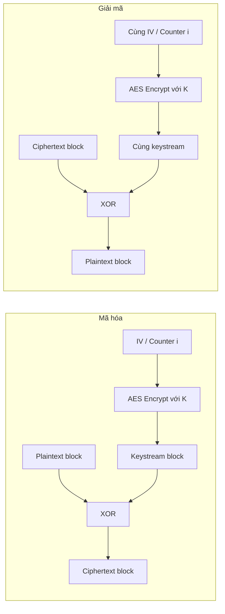
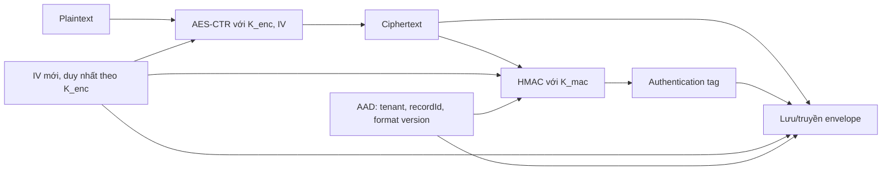

# AES-CTR (Advanced Encryption Standard — Counter mode)

Trong chương **Mật mã đối xứng** của module **SECURITY_KEY_MANAGEMENT_FUNDAMENTALS**, **AES-CTR** là cách sử dụng mã khối AES ở **chế độ bộ đếm (Counter mode, CTR)** để tạo dòng byte giả ngẫu nhiên (*keystream*) rồi XOR với dữ liệu. AES là thuật toán mã khối đối xứng; CTR là **chế độ vận hành** của AES, không phải một thuật toán khóa mới. Với cùng khóa và cùng giá trị bộ đếm khởi đầu, hai phía tạo ra cùng keystream để mã hóa và giải mã.

AES-CTR cho phép xử lý song song và truy cập ngẫu nhiên vào dữ liệu đã mã hóa, nhưng có hai điều kiện bảo mật quan trọng: **không tái sử dụng cùng chuỗi counter block dưới cùng khóa** và **không coi CTR là cơ chế xác thực dữ liệu**. Nếu dùng CTR không kèm MAC, kẻ tấn công có thể chỉnh sửa bản mã để gây thay đổi có kiểm soát lên bản rõ. Bài này giải thích nguyên lý, IV/nonce, giới hạn bộ đếm, triển khai Java, quan hệ với KMS/HSM, envelope encryption, vòng đời khóa và kiểm toán.

## 1. Mục tiêu học tập

Sau bài học, bạn có thể:

- Giải thích AES-CTR biến AES từ mã khối 128 bit thành cơ chế mã hóa hoạt động theo dòng byte bằng phép XOR.
- Phân biệt **AES key**, **initial counter block/IV**, **nonce**, **counter**, **keystream**, **ciphertext** và **authentication tag**.
- Phân tích hậu quả khi dùng lại IV/counter, khi tràn bộ đếm hoặc khi bản mã bị sửa.
- Sử dụng `AES/CTR/NoPadding` trong Java JCA đúng mục đích; kết hợp **Encrypt-then-MAC** hoặc chọn cơ chế AEAD như AES-GCM để bảo vệ toàn vẹn.
- Gắn thiết kế AES-CTR với DEK/KEK, envelope encryption, quản lý vòng đời khóa bằng KMS/HSM, phân quyền và audit.

## 2. AES và CTR khác nhau thế nào?

**AES (Advanced Encryption Standard)** là mật mã khối với **kích thước khối cố định 128 bit = 16 byte** và khóa dài **128, 192 hoặc 256 bit**. Bản thân AES thực hiện một phép biến đổi trên đúng một khối 16 byte. Để mã hóa thông điệp dài tùy ý, hệ thống dùng một **mode of operation** như CTR hoặc GCM.

Ở CTR, ứng dụng **không trực tiếp đưa từng khối plaintext vào AES**. Thay vào đó, nó mã hóa liên tiếp các giá trị counter block bằng AES, nhận keystream rồi XOR với plaintext.

| Thuật ngữ | Vai trò trong AES-CTR | Có cần bí mật không? |
| --- | --- | --- |
| **Key `K`** | Khóa AES, ví dụ AES-256 dài 32 byte. | **Có.** Cần sinh an toàn, lưu giữ/kiểm soát quyền chặt chẽ. |
| **IV / initial counter block** | Giá trị đầu của dãy counter block dùng để sinh keystream. | Thường **không cần bí mật**, nhưng phải tránh tái sử dụng dãy counter block với cùng khóa. |
| **Nonce** | Phần “chỉ dùng một lần” trong một quy ước xây counter block, nếu giao thức chia nonce + counter. | Không nhất thiết bí mật, nhưng phải tuân thủ tính duy nhất theo khóa. |
| **Counter** | Phần tăng qua mỗi khối dữ liệu để tạo đầu vào AES khác nhau. | Không bí mật; cần thống nhất cách tăng, thứ tự byte và giới hạn. |
| **Keystream** | `AES_K(counterBlock_i)`, 16 byte mỗi khối. | Không được để lộ vì có thể suy ra plaintext tương ứng từ ciphertext. |
| **Ciphertext** | `plaintext XOR keystream`. | Có thể lưu/transmit nhưng cần xác thực để chống sửa đổi. |
| **Authentication tag** | Tag từ HMAC hoặc AEAD bên ngoài CTR. | Không phải thành phần của CTR thuần; dùng để phát hiện sửa đổi. |

Một IV của AES-CTR thường có độ dài **16 byte**, vì nó được hiểu là giá trị counter block ban đầu 128 bit. **Định dạng nonce/counter không đồng nhất giữa mọi giao thức và provider**: có giao thức chia 96 bit nonce + 32 bit counter; có giao thức xử lý toàn bộ 128 bit như một số nguyên. Hai bên phải thỏa thuận cùng cách biểu diễn và tăng bộ đếm, nếu không sẽ không giải mã được.

## 3. Nguyên lý hoạt động AES-CTR

Giả sử thông điệp được chia thành các đoạn 16 byte `P_0, P_1, ...` (đoạn cuối có thể ngắn hơn). Với một khóa `K` và dãy counter block không lặp `T_0, T_1, ...`:

\[
S_i = \operatorname{AES}_K(T_i)
\]

\[
C_i = P_i \oplus S_i
\]

Trong đó `S_i` là keystream, `C_i` là ciphertext, và `⊕` là XOR. Giải mã dùng lại cùng keystream:

\[
P_i = C_i \oplus \operatorname{AES}_K(T_i)
\]

Vì `(P_i \oplus S_i) \oplus S_i = P_i`, bên giải mã **không cần gọi hàm giải mã khối AES**; cả hai chiều đều sử dụng phép AES mã hóa counter block, rồi XOR.



### 3.1. Một ví dụ XOR ở mức byte

Ví dụ tưởng tượng một byte của plaintext là `0x41` (ký tự `A`), byte keystream tương ứng là `0x55`:

```text
Mã hóa:  0x41 XOR 0x55 = 0x14
Giải mã: 0x14 XOR 0x55 = 0x41
```

Đây chỉ là ví dụ của phép XOR. Byte `0x55` không phải một test vector AES-CTR thực. Trong hệ thống thật, keystream phải được tạo bằng AES với khóa và counter block phù hợp.

### 3.2. Tại sao CTR không cần padding?

CTR sinh keystream theo từng khối 16 byte, nhưng có thể lấy **chỉ số byte cần thiết** ở khối cuối. Nếu plaintext có 37 byte, ciphertext cũng có 37 byte; không phải thêm PKCS#5/PKCS#7 padding cho đủ bội số 16.

Ví dụ:

```text
Plaintext       : 16 byte | 16 byte | 5 byte
Counter blocks  : T0      | T1      | T2
Keystream dùng  : 16 byte | 16 byte | 5 byte đầu của AES_K(T2)
Ciphertext      : 16 byte | 16 byte | 5 byte
```

Với Java JCA, tên transformation thường là `AES/CTR/NoPadding`. Việc không có padding **không đồng nghĩa** đã có kiểm tra tính toàn vẹn; CTR thuần không phát sinh authentication tag.

### 3.3. Tính song song và truy cập ngẫu nhiên

Các `S_i = AES_K(T_i)` có thể tính **độc lập**. Vì vậy CTR có ưu điểm:

- **Song song:** nhiều worker có thể xử lý các khối, miễn vùng counter block được cấp phát không trùng nhau.
- **Truy cập ngẫu nhiên:** khi biết byte offset, có thể tính khối counter tương ứng bằng `floor(offset/16)` và bỏ qua `offset mod 16` byte đầu của keystream.
- **Không có lan truyền lỗi theo kiểu CBC:** lỗi một bit của ciphertext CTR thuần làm đổi đúng bit tương ứng của plaintext sau XOR (và đây cũng là một nguy cơ bảo mật).

Nếu xây dịch vụ đọc một đoạn tệp đã mã hóa, cần quản lý offset, thứ tự tăng counter và xác thực dữ liệu. Một HMAC duy nhất cho **toàn tệp** thường đòi hỏi xác minh toàn bộ ciphertext trước khi tin phần được đọc; để đọc từng đoạn độc lập có xác thực, nên thiết kế mã hóa theo chunk với IV/tag hoặc AEAD riêng cho mỗi chunk.

## 4. IV, nonce và counter: ranh giới sống còn

Trong CTR, **giá trị AES đầu vào ở mọi khối phải khác nhau khi dùng cùng khóa**. Tái sử dụng cùng counter block dưới cùng `K` đồng nghĩa tái sử dụng một đoạn keystream, làm mất bảo mật.

Một cách thiết kế minh họa:

```text
CounterBlock(128 bit) = Nonce(96 bit) || BlockCounter(32 bit)
                         [12 byte]    || [4 byte]

Message A: nonce_A || 00000001, nonce_A || 00000002, ...
Message B: nonce_B || 00000001, nonce_B || 00000002, ...
Điều kiện: nonce_A != nonce_B nếu cùng key K
```

Đây là **một quy ước**, không phải định dạng CTR bắt buộc. Một số thư viện, bao gồm các provider JCA, có thể tăng toàn bộ counter block 128 bit theo quy tắc riêng. Nếu chương trình cần liên thông với giao thức nonce 96 + counter 32, phải kiểm tra chính xác hành vi provider hoặc dùng implementation đáp ứng hợp đồng giao thức.

### 4.1. Giới hạn bộ đếm

Với counter 32 bit chạy từ `1` đến `2^32 - 1`, tối đa có `2^32 - 1` khối khác nhau trước khi hết vùng counter theo quy ước này. Mỗi khối AES dài 16 byte, nên giới hạn lý thuyết xấp xỉ **64 GiB trừ 16 byte** cho một nonce; hệ thống thực tế thường đặt ngưỡng thấp hơn để chừa biên an toàn.

Không được để counter **quay vòng về giá trị đã dùng**, kể cả khi API vẫn có thể tiếp tục trả ciphertext. Giới hạn thực tế tùy cách định dạng counter và quy tắc của thư viện; không được áp dụng mù quáng giới hạn 32 bit cho hệ thống tăng toàn bộ 128 bit.

### 4.2. Chiến lược cấp phát IV an toàn

| Chiến lược | Ưu điểm | Việc phải đảm bảo |
| --- | --- | --- |
| **DEK riêng cho từng bản ghi/thông điệp**, IV mới | Cô lập phạm vi và giảm nguy cơ IV trùng trong cùng khóa khi chỉ mã hóa một lần với mỗi DEK. | DEK phải được sinh an toàn; mỗi DEK thực sự chỉ dùng cho phạm vi đã định; lưu đủ metadata để giải mã. |
| **Nonce/counter được cấp phát tuần tự dưới cùng key** | Có thể chứng minh tính duy nhất nếu điều phối đúng. | Bộ đếm phải bền vững, cấp phát nguyên tử trên nhiều node, chống tái sử dụng sau restart/rollback/restore. |
| **Nonce ngẫu nhiên bằng CSPRNG** | Đơn giản với workload giới hạn. | Không được nhầm xác suất trùng thấp với cam kết tuyệt đối; đánh giá xác suất va chạm, tổng số thông điệp và phạm vi khóa. |
| **Không gian nonce chia theo node** | Hữu ích khi nhiều dịch vụ mã hóa song song. | Quy ước phân vùng, định danh node và counter riêng không được trùng khi scale hoặc khôi phục từ snapshot. |

**IV không cần giấu**: thường có thể lưu ngay cạnh ciphertext. Nhưng **không bao giờ dùng IV cố định như 16 byte zero cho nhiều thông điệp cùng một AES key**, không copy IV từ bản ghi trước, và không dựa vào timestamp đơn thuần. Với IV ngẫu nhiên, dùng `SecureRandom` trong Java, không dùng `Random`.

### 4.3. Tại sao tái sử dụng keystream làm lộ dữ liệu?

Giả sử hai plaintext `P_1` và `P_2` được mã hóa bằng **cùng khóa và cùng dãy counter block**, tạo cùng keystream `S`:

\[
C_1 = P_1 \oplus S, \qquad C_2 = P_2 \oplus S
\]

Khi đó:

\[
C_1 \oplus C_2 = P_1 \oplus P_2
\]

Keystream bị triệt tiêu. Kẻ tấn công có thể khai thác cấu trúc plaintext, nội dung dự đoán được hoặc một plaintext đã biết để suy ra nhiều thông tin của plaintext còn lại. **HMAC không khắc phục rủi ro bảo mật đã xảy ra do trùng nonce/counter**.

Lưu ý thêm: nguy cơ còn xảy ra nếu hai thông điệp khởi đầu từ IV khác nhau nhưng **dãy counter block bị giao nhau** (ví dụ một counter chạy đủ xa để đụng vùng đã cấp cho thông điệp khác).

## 5. AES-CTR thuần không xác thực ciphertext

CTR có tính **malleable**: thay đổi bit trong ciphertext sẽ thay đổi đúng bit tương ứng trong plaintext sau giải mã, ngay cả khi kẻ tấn công **không biết khóa AES**. Nếu kẻ tấn công thay một byte ciphertext từ `C` thành `C XOR Δ` thì plaintext nhận được sẽ là `P XOR Δ`.

Vì vậy, **không nên dùng AES-CTR đơn độc cho dữ liệu mà kẻ tấn công có thể tác động đến bản mã hoặc metadata**. Các cách bảo vệ:

1. **Ưu tiên AEAD**, chẳng hạn AES-GCM hoặc ChaCha20-Poly1305 nếu phù hợp nền tảng và yêu cầu. AEAD bảo vệ bí mật và tính toàn vẹn bằng một giao thức có tag xác thực.
2. Khi có lý do tương thích cần dùng CTR, kết hợp **Encrypt-then-MAC (EtM)**: mã hóa CTR bằng một khóa, tính HMAC trên **IV + ciphertext + AAD + version/cấu trúc cần xác thực** bằng khóa MAC độc lập. **Kiểm tra tag trước khi giải mã** và từ chối nếu không hợp lệ.
3. Xây dựng serialization không mơ hồ: nếu ghép nhiều trường vào MAC input, cần prefix độ dài hoặc định dạng chuẩn, tránh trường hợp hai bộ metadata khác nhau cho cùng một chuỗi byte.
4. Thêm các kiểm tra **chống replay/rollback** nếu kẻ tấn công có thể gửi lại một bản tin cũ hợp lệ: MAC/AEAD không tự cấm phát lại một thông điệp hợp lệ trước đây.



**Không dùng cùng byte khóa cho cả AES-CTR và HMAC**. Sinh hai khóa độc lập hoặc dùng KDF như HKDF với nhãn tách mục đích `enc`/`mac` từ một DEK gốc có entropy đủ mạnh. Khi dùng KMS, có thể tạo DEK gốc rồi dẫn xuất hai khóa con theo một định dạng được định nghĩa và kiểm thử.

**Thứ tự giải mã an toàn với EtM:** đọc metadata → kiểm tra quyền và phạm vi → tính HMAC trên đúng các byte quy định → so sánh tag theo cơ chế chống timing leak → chỉ khi tag hợp lệ mới AES-CTR decrypt. Không dùng plaintext trước khi xác thực thành công.

## 6. Ví dụ Java 17: AES-CTR kết hợp HMAC-SHA256

Đoạn mã sau minh họa **một lần mã hóa bằng khóa mới tạo** và giải mã sau khi xác thực tag. Để dễ quan sát, mỗi lần chạy tự sinh một khóa AES-256 và khóa HMAC-SHA256 **độc lập**, thay vì lấy khóa từ KMS. Việc chỉ mã hóa **một thông điệp với một AES key trong ví dụ** tránh tái dùng dãy counter trong cùng khóa; nếu dùng một AES key để mã hóa nhiều thông điệp, hệ thống phải quản lý tính duy nhất của IV/counter một cách có kiểm soát.

```java
import javax.crypto.Cipher;
import javax.crypto.KeyGenerator;
import javax.crypto.Mac;
import javax.crypto.SecretKey;
import javax.crypto.spec.IvParameterSpec;
import javax.crypto.spec.SecretKeySpec;
import java.nio.ByteBuffer;
import java.nio.charset.StandardCharsets;
import java.security.GeneralSecurityException;
import java.security.MessageDigest;
import java.security.SecureRandom;

public class AesCtrEtmDemo {
    record Envelope(byte[] iv, byte[] ciphertext, byte[] tag) {}

    static byte[] hmac(SecretKey macKey, byte[] aad, byte[] iv, byte[] ct)
            throws GeneralSecurityException {
        Mac mac = Mac.getInstance("HmacSHA256");
        mac.init(macKey);
        mac.update((byte) 1); // Định dạng phiên bản 1
        mac.update(ByteBuffer.allocate(4).putInt(aad.length).array());
        mac.update(aad);
        mac.update(iv); // IV luôn 16 byte ở định dạng này
        mac.update(ByteBuffer.allocate(4).putInt(ct.length).array());
        mac.update(ct);
        return mac.doFinal();
    }

    static Envelope encrypt(
            byte[] plaintext, byte[] aad,
            SecretKey encKey, SecretKey macKey, SecureRandom random)
            throws GeneralSecurityException {
        byte[] iv = new byte[16];
        random.nextBytes(iv);

        Cipher cipher = Cipher.getInstance("AES/CTR/NoPadding");
        cipher.init(Cipher.ENCRYPT_MODE, encKey, new IvParameterSpec(iv));
        byte[] ct = cipher.doFinal(plaintext);
        byte[] tag = hmac(macKey, aad, iv, ct);
        return new Envelope(iv, ct, tag);
    }

    static byte[] decrypt(
            Envelope envelope, byte[] aad,
            SecretKey encKey, SecretKey macKey)
            throws GeneralSecurityException {
        if (envelope.iv().length != 16 || envelope.tag().length != 32) {
            throw new SecurityException("Invalid envelope");
        }
        byte[] expected = hmac(macKey, aad, envelope.iv(), envelope.ciphertext());
        if (!MessageDigest.isEqual(expected, envelope.tag())) {
            throw new SecurityException("Authentication failed");
        }

        Cipher cipher = Cipher.getInstance("AES/CTR/NoPadding");
        cipher.init(Cipher.DECRYPT_MODE, encKey, new IvParameterSpec(envelope.iv()));
        return cipher.doFinal(envelope.ciphertext());
    }

    public static void main(String[] args) throws Exception {
        SecureRandom random = new SecureRandom();

        KeyGenerator aesGenerator = KeyGenerator.getInstance("AES");
        aesGenerator.init(256, random);
        SecretKey encKey = aesGenerator.generateKey();

        byte[] macSecret = new byte[32];
        random.nextBytes(macSecret);
        SecretKey macKey = new SecretKeySpec(macSecret, "HmacSHA256");

        byte[] plaintext = "Hồ sơ thanh toán nội bộ".getBytes(StandardCharsets.UTF_8);
        byte[] aad = "schema=v1|tenant=t42|record=r7"
                .getBytes(StandardCharsets.UTF_8);

        Envelope envelope = encrypt(plaintext, aad, encKey, macKey, random);
        byte[] recovered = decrypt(envelope, aad, encKey, macKey);
        System.out.println(new String(recovered, StandardCharsets.UTF_8));

        // Cố ý sửa ciphertext: HMAC phải từ chối trước bước CTR decrypt.
        byte[] tampered = envelope.ciphertext().clone();
        tampered[0] ^= 0x01;
        try {
            decrypt(new Envelope(envelope.iv(), tampered, envelope.tag()),
                    aad, encKey, macKey);
            throw new AssertionError("Tampering was not detected");
        } catch (SecurityException expected) {
            System.out.println("Tampered ciphertext rejected");
        }
    }
}
```

Chương trình sử dụng `AES/CTR/NoPadding` cùng `HmacSHA256` và bảo vệ cả IV, AAD lẫn ciphertext trong tag. Khi thay đổi một bit ciphertext, xác thực HMAC thất bại **trước khi trả plaintext**.

Đây là **ví dụ học tập**, chưa phải lớp thư viện hoàn chỉnh. Với ứng dụng thực, cần thiết kế serialization và giới hạn kích thước dữ liệu (bao gồm chống tràn khi xử lý độ dài), bảo vệ byte arrays khỏi chỉnh sửa ngoài ý muốn, xóa bí mật trong bộ nhớ ở mức khả thi, tổ chức quản lý IV duy nhất theo khóa, tránh log plaintext/secret, và có chiến lược lưu/khôi phục khóa. Bản ghi `Envelope` ở ví dụ giữ tham chiếu đến mảng byte có thể sửa; code production nên sao chép và bảo vệ dữ liệu cần bất biến. Ví dụ cũng không xử lý streaming, phân tán hay backup.

Nếu cần mã hóa nhiều bản ghi, **không giữ nguyên một AES key rồi gọi hàm `encrypt` bất tận với IV ngẫu nhiên mà không đánh giá rủi ro va chạm và giới hạn lưu lượng**. Có thể chọn DEK mới cho mỗi bản ghi và bọc DEK bằng KMS, hoặc một cơ chế cấp phát IV/counter được chứng minh không lặp.

## 7. AES-CTR trong kiến trúc KMS/HSM và envelope encryption

Một hệ thống có thể lưu dữ liệu mã hóa CTR bằng **Data Encryption Key (DEK)**, còn **Key Encryption Key (KEK)** dùng để bọc DEK trong **envelope encryption**. KMS/HSM đảm nhiệm quản lý KEK, phân quyền thao tác tạo DEK/mở bọc, xoay vòng, kiểm toán; ứng dụng thực hiện AES-CTR và HMAC trong vùng thực thi được bảo vệ, hoặc dùng API mã hóa của nhà cung cấp nếu phù hợp.

Quy trình minh họa khi mỗi bản ghi có DEK gốc riêng:

```mermaid
sequenceDiagram
    participant S as Dịch vụ ứng dụng
    participant KMS as KMS/HSM
    participant DB as Kho lưu trữ
    S->>KMS: GenerateDataKey(KEK, encryptionContext)
    KMS-->>S: rootDEK rõ + wrappedRootDEK + key metadata
    S->>S: HKDF(rootDEK) -> K_enc, K_mac độc lập theo mục đích
    S->>S: AES-CTR encrypt với IV mới
    S->>S: HMAC(AAD, IV, ciphertext)
    S->>DB: ciphertext, IV, tag, wrappedRootDEK, schema
    Note over S: Giảm thời gian lưu rootDEK và khóa con trong bộ nhớ
    S->>DB: Đọc envelope và kiểm tra quyền ứng dụng
    DB-->>S: Metadata + wrappedRootDEK + ciphertext
    S->>KMS: Decrypt/Unwrap(wrappedRootDEK, context)
    KMS-->>S: rootDEK nếu policy cho phép
    S->>S: Dẫn xuất lại K_enc/K_mac; kiểm tra HMAC
    S->>S: Chỉ khi HMAC hợp lệ mới AES-CTR decrypt
```

Metadata nên có **định dạng/phiên bản giao thức, key ID hoặc tham chiếu KEK khi cần, wrapped DEK, IV, thuật toán, tag và thông tin AAD**. Một số KMS đặt thông tin khóa trong wrapped DEK; cách chọn khóa khi unwrap phải tuân theo API của nhà cung cấp. HKDF cần `salt`/`info` và encoding nhất quán; nếu salt thay đổi theo bản ghi thì phải lưu nó để dẫn xuất lại các khóa con.

Một số nguyên tắc vận hành:

- **Phân tách khóa:** KEK có nhiệm vụ bọc DEK; `K_enc` chỉ mã hóa CTR, `K_mac` chỉ HMAC. Không dùng một khóa cho tất cả mục đích.
- **Phân quyền:** workload được phép ghi có thể gọi API cấp DEK; workload đọc cần quyền unwrap/decrypt; quyền thay policy và hủy KEK thuộc vai trò riêng.
- **AAD và phạm vi:** đưa `tenantId`, `recordId`, loại dữ liệu và version vào dữ liệu xác thực bằng một định dạng không mơ hồ. Ngoài HMAC, KMS có thể kiểm soát `encryptionContext` khi tạo/mở bọc DEK.
- **Audit:** ghi ai gọi KMS, key ID/version nào, thao tác gì, lúc nào và kết quả; không log plaintext, DEK rõ, khóa con, tag/IV nếu không cần thiết.
- **Availability:** nếu KMS không sẵn sàng, unwrap có thể thất bại; chính sách cache phải giới hạn thời gian và phạm vi, không mở rộng quyền hoặc lưu DEK vô thời hạn.

### 7.1. Xoay KEK và xoay DEK không giống nhau

| Tình huống | Cách xử lý thường gặp | Ảnh hưởng tới CTR ciphertext |
| --- | --- | --- |
| **Xoay KEK theo lịch** | KMS bọc lại cùng root DEK dưới phiên bản KEK mới (*rewrap*) nếu chính sách cho phép. | Không cần đổi ciphertext nếu root DEK và khóa con không đổi; phải cập nhật metadata/wrapped DEK đúng định dạng. |
| **Đổi root DEK vì đã lộ hoặc hết vòng đời** | Tạo DEK mới, dẫn xuất khóa con mới và mã hóa + tạo HMAC tag mới (*re-encrypt*). | Phải xử lý lại ciphertext; chỉ rewrap không vô hiệu hóa DEK đã lộ. |
| **Nghi ngờ IV/counter bị lặp** | Khoanh vùng các bản mã cùng khóa, đánh giá lộ dữ liệu; mã hóa lại với khóa mới và IV mới. | HMAC vẫn hợp lệ không chứng minh plaintext còn bí mật. |
| **Hủy KEK cũ** | Kiểm tra dữ liệu trực tuyến, bản backup và wrapped DEK vẫn cần KEK đó. | Xóa quá sớm có thể khiến dữ liệu không thể giải mã. |

Nếu policy yêu cầu bảo vệ/kiểm tra cả metadata KEK khi rewrap, cần lưu ý **cập nhật authentication tag** tương ứng hoặc dùng cơ chế bảo vệ metadata riêng; thiết kế không nên vô tình gắn một tham chiếu KEK sẽ thay đổi vào AAD bất biến của ciphertext rồi kỳ vọng rewrap hoàn toàn trong suốt.

## 8. So sánh AES-CTR với một số chế độ khác

| Tiêu chí | AES-CTR | AES-GCM | AES-CBC |
| --- | --- | --- | --- |
| Mã hóa kiểu | Keystream XOR plaintext | Keystream kiểu CTR kết hợp xác thực GCM | Chuỗi các khối phụ thuộc nhau |
| Độ dài ciphertext | Bằng plaintext, không cần padding | Thông thường bằng plaintext, cộng tag và nonce metadata | Thường cần padding nếu plaintext không đủ khối |
| Tính toàn vẹn | **Không có sẵn** | **Có tag AEAD** nếu sử dụng và kiểm tra đúng | **Không có sẵn**; cần cơ chế MAC an toàn |
| Nonce/IV | Cần tránh trùng counter block dưới cùng khóa | Nonce phải duy nhất theo khóa; trùng nonce gây hậu quả nghiêm trọng | IV ngẫu nhiên/không dự đoán theo quy ước CBC an toàn |
| Xử lý song song / random access | Tốt; xác thực theo chunk cần thiết kế thêm | Có thể xử lý hiệu quả; xác thực chunk phải theo giao thức phù hợp | Mã hóa có phụ thuộc chuỗi, random access hạn chế |
| Khi nên dùng | Tương thích giao thức CTR, có EtM được thiết kế đúng | **Lựa chọn mặc định thường hợp lý** cho mã hóa dữ liệu ứng dụng có xác thực | Hệ thống tương thích cũ hoặc giao thức yêu cầu CBC với MAC đúng cách |

Bảng chỉ nêu tính chất cấp cao. Lựa chọn thực tế còn phải căn cứ vào cách quản lý khóa, IV/nonce, độ dài bản mã, khả năng của thư viện và nguy cơ thao túng dữ liệu. Nếu API đang hỗ trợ AES-GCM tốt và không có ràng buộc đặc biệt, thường không cần tự xây dựng CTR + HMAC.

## 9. Tình huống thiết kế: mã hóa đoạn dữ liệu trong kho đối tượng

Một dịch vụ quản lý tài liệu lưu các tệp lớn trên object storage. Nhóm thiết kế chọn CTR vì muốn đọc một đoạn dữ liệu không phải giải mã toàn bộ tệp. Các yêu cầu an toàn cần tính:

1. **Chia tệp thành chunk độc lập:** mỗi chunk có `chunkIndex`, IV/counter riêng không trùng theo khóa, ciphertext và tag xác thực riêng, hoặc sử dụng DEK riêng mỗi chunk.
2. **Ràng buộc AAD:** tối thiểu chứa tenant, file ID, chunk index, version và kích thước hoặc định dạng đã thỏa thuận. Điều này hạn chế tráo đổi chunk giữa tệp/tenant.
3. **Xác thực trước khi sử dụng:** phải xác minh tag của chunk được đọc, thay vì giải mã CTR rồi trả ngay dữ liệu chưa xác thực cho người dùng.
4. **Chống rollback:** HMAC hợp lệ không tự ngăn kẻ tấn công thay cả chunk bằng một phiên bản cũ từng hợp lệ. Cần metadata manifest có phiên bản, kiểm soát nhất quán và cơ chế chống phát lại/rollback của hệ thống.
5. **Quản lý khóa và khôi phục:** lưu wrapped DEK, key reference, phiên bản định dạng và thông tin cần để giải mã khi KEK xoay. Kiểm tra bản backup và quy trình phục hồi.
6. **Phân quyền và giám sát:** chỉ workload có quyền theo tenant/file mới được phép unwrap; audit thao tác truy cập/giải mã bất thường.

Nếu không có yêu cầu kỹ thuật buộc sử dụng CTR, một **thiết kế AEAD theo chunk** thường dễ đánh giá bảo mật hơn việc xây riêng nhiều lớp CTR + HMAC. Dù chọn phương án nào, phải thiết kế chống trùng nonce trong toàn bộ thời gian sống của khóa, kể cả khi nhiều node xử lý đồng thời.

## 10. Sai lầm thường gặp

| Sai lầm | Tác động | Cách phòng tránh |
| --- | --- | --- |
| Dùng **cùng khóa AES và cùng IV** cho hai bản ghi. | Keystream tái sử dụng; XOR hai ciphertext làm lộ quan hệ giữa plaintext. | DEK riêng mỗi thông điệp hoặc cấp phát IV/counter duy nhất theo khóa, kiểm soát va chạm. |
| Dùng IV cố định toàn zero cho các lần mã hóa cùng khóa. | Keystream lặp ngay từ khối đầu. | Không tái sử dụng counter block; không dùng `Random` hoặc timestamp làm nguồn duy nhất. |
| Cho counter chạy vượt miền được cấp phát, quay vòng hoặc chồng lên vùng khác. | Keystream lặp ngay trong một thông điệp hoặc giữa các thông điệp. | Đặt giới hạn số khối và kiểm tra trước khi xử lý; phân vùng dãy counter giữa các worker. |
| Dùng AES-CTR thuần để lưu dữ liệu có thể bị chỉnh sửa. | Bit-flipping khiến plaintext bị thay đổi mà không có báo lỗi. | AES-GCM hoặc CTR + EtM với HMAC key riêng; xác minh tag trước decrypt. |
| Dùng **một khóa byte** cho cả AES-CTR và HMAC. | Không có domain separation, khó đánh giá thiết kế khóa. | Sinh khóa độc lập hoặc dẫn xuất bằng HKDF với nhãn khác nhau. |
| MAC chỉ ciphertext, bỏ qua IV/AAD/metadata. | Kẻ tấn công có thể thay phần không được xác thực, làm thay đổi ý nghĩa bản rõ. | MAC chính xác mọi trường an ninh liên quan, với định dạng không mơ hồ. |
| Bỏ qua tag hoặc trả plaintext trước khi xác thực. | Dữ liệu bị sửa có thể đi vào xử lý nghiệp vụ. | Fail closed; verify MAC/tag trước khi dùng plaintext. |
| Chỉ xoay KEK khi DEK đã lộ. | Kẻ có DEK vẫn giải mã được ciphertext tương ứng. | Tạo DEK mới, re-encrypt và đánh giá phạm vi lộ dữ liệu. |
| Không lưu IV/metadata phiên bản với ciphertext. | Không giải mã được sau cập nhật hệ thống hoặc chuyển provider. | Ghi envelope có version, IV, keyRef, wrapped DEK, thuật toán, tag và định dạng AAD. |
| Nghĩ HMAC đã chống được phát lại bản tin cũ. | Bản tin cũ có MAC hợp lệ vẫn được chấp nhận lại. | Gắn version, sequence/timestamp/nonces nghiệp vụ, quy tắc chống replay. |

## 11. Checklist trước khi sử dụng AES-CTR

1. **Lý do chọn CTR:** có yêu cầu đặc biệt về liên thông, random access hoặc nền tảng? Có thể dùng AEAD như AES-GCM an toàn và đơn giản hơn không?
2. **Khóa:** AES key được sinh bằng CSPRNG/KMS, được quản lý đúng mục đích và đủ độ dài theo chính sách chưa?
3. **Counter block:** định dạng 128 bit, nonce/counter, thứ tự byte và quy tắc tăng có được đặc tả cùng với giới hạn độ dài không?
4. **Tính duy nhất:** có cách đảm bảo không lặp counter block theo cùng khóa trên mọi instance, restart và bản backup không?
5. **Xác thực:** IV, ciphertext, AAD, metadata nhạy cảm có được bảo vệ bởi AEAD hoặc Encrypt-then-MAC với khóa MAC riêng không?
6. **Xử lý lỗi:** hệ thống có từ chối bản mã sửa đổi và không trả plaintext trước khi xác thực thành công không?
7. **Envelope:** có lưu đủ key reference, wrapped DEK, IV, tag, format version và dữ liệu cần dẫn xuất khóa để đọc lịch sử không?
8. **IAM/KMS:** workload có quyền tối thiểu, tách nhiệm vụ xoay/xóa với thao tác giải mã và có audit không?
9. **Rotation:** hiểu rõ khi nào rewrap KEK đủ, khi nào phải tạo DEK mới rồi re-encrypt không?
10. **Khôi phục/hủy:** đã thử đọc dữ liệu từ backup và xác định được mọi bản sao khóa trước khi hủy chưa?

## 12. Câu hỏi tự kiểm tra

1. Vì sao AES-CTR dùng phép **AES encryption** ở cả chiều mã hóa lẫn giải mã? Vai trò của XOR là gì?
2. Plaintext dài 37 byte cần bao nhiêu counter block? Ciphertext dài bao nhiêu byte nếu chỉ dùng CTR thuần?
3. Điều gì xảy ra nếu hai bản mã sử dụng cùng khóa và IV? Vì sao có thể tính `C1 XOR C2 = P1 XOR P2`?
4. Vì sao kẻ tấn công có thể sửa plaintext giải mã khi CTR không kèm xác thực? Encrypt-then-MAC phải kiểm tra theo thứ tự nào?
5. Trong thiết kế envelope encryption, trường hợp nào chỉ cần rewrap root DEK và trường hợp nào phải re-encrypt dữ liệu?
6. Một file có thể đọc theo chunk bằng CTR thì có thể bỏ qua xác thực cả file hoặc từng chunk không? Vì sao?
7. Một hệ thống sử dụng counter 32 bit trong cấu trúc IV 96+32 cần kiểm soát điều gì khi xử lý dữ liệu lớn hoặc sau khi worker khởi động lại?

**Ghi nhớ:** AES-CTR là chế độ mã hóa đối xứng nhanh, song song tốt và không cần padding, nhưng bảo mật của nó phụ thuộc quyết định vào **không trùng counter block dưới cùng khóa**. CTR tự thân **không bảo vệ tính toàn vẹn**. Khi thiết kế hệ thống bảo vệ dữ liệu lâu dài, hãy ưu tiên AEAD hoặc kết hợp CTR với cơ chế xác thực an toàn, đồng thời quản lý DEK/KEK, phân quyền, kiểm toán, rotation và khả năng khôi phục xuyên suốt vòng đời khóa.
