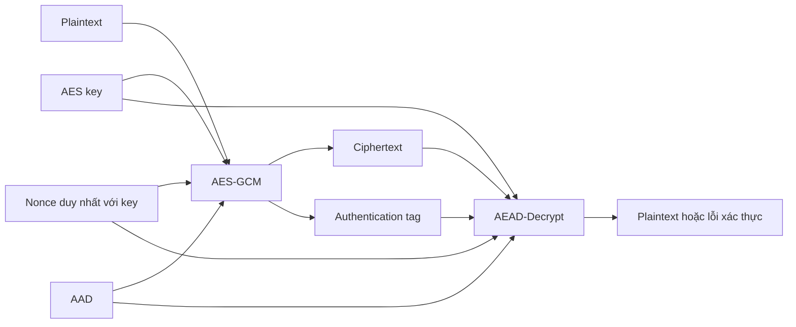
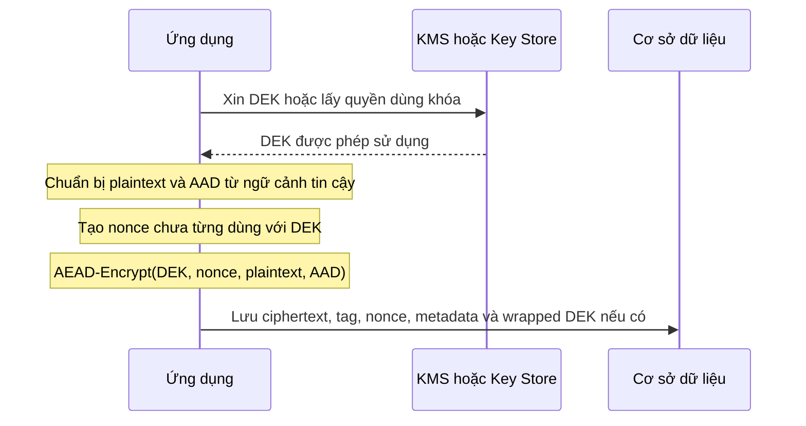
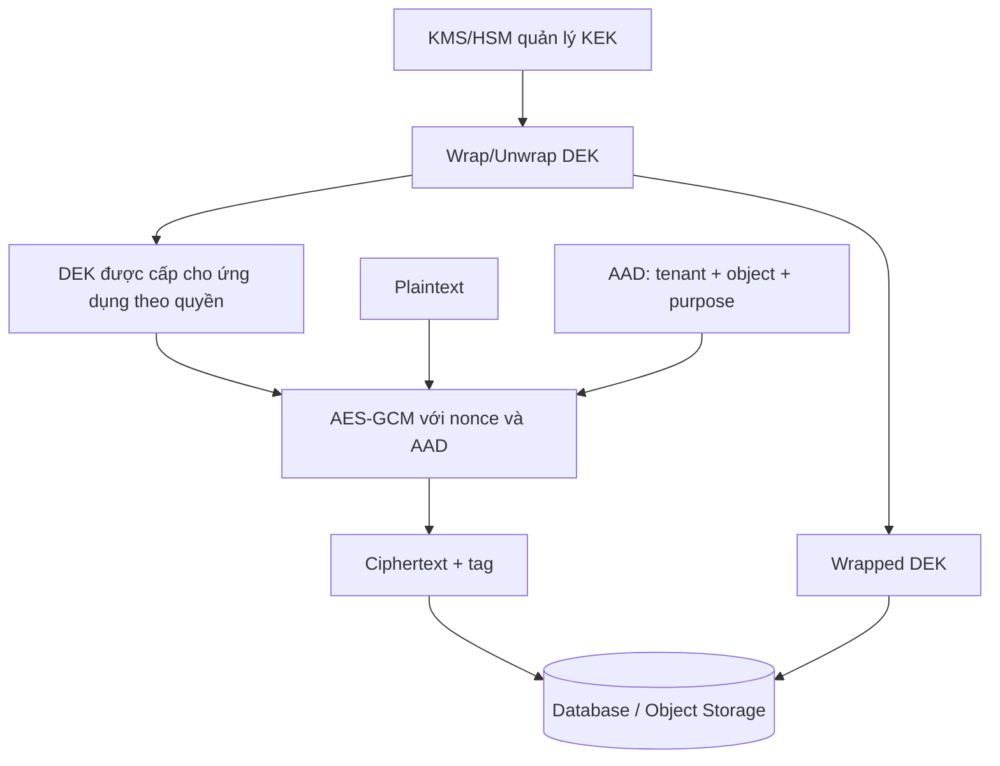
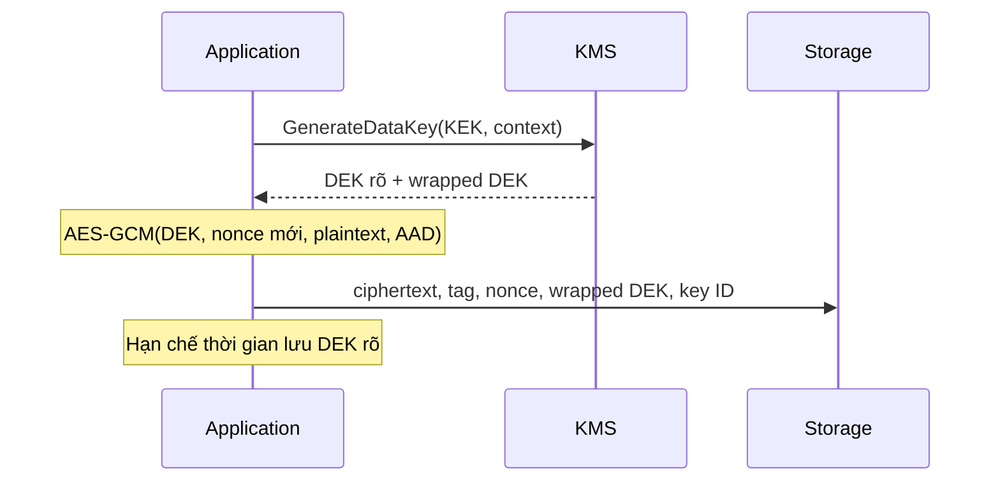
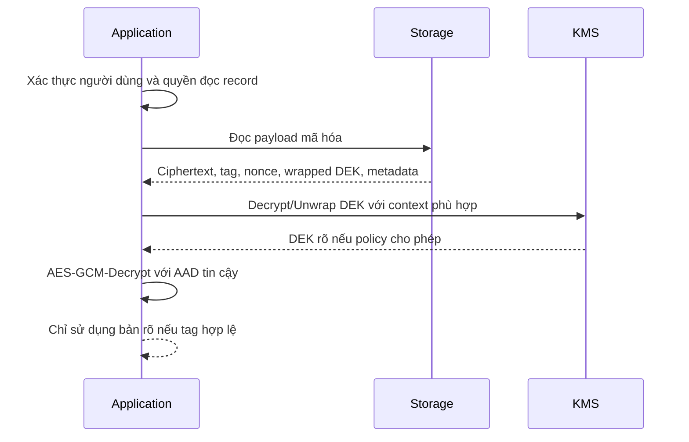

# Authenticated encryption: Mã hóa có xác thực

> **Chương:** Mật mã đối xứng  
> **Chủ đề:** Authenticated encryption  
> **Phạm vi:** SECURITY_KEY_MANAGEMENT_FUNDAMENTALS — tìm hiểu bảo vệ dữ liệu bằng mật mã đối xứng kết hợp quản lý vòng đời khóa, KMS/HSM, envelope encryption, kiểm soát truy cập và kiểm toán.

## 1. Tại sao chỉ mã hóa thôi chưa đủ?

Giả sử hệ thống thương mại điện tử mã hóa địa chỉ giao hàng trước khi lưu vào cơ sở dữ liệu. Nhờ có khóa bí mật, người lấy được bản mã không dễ đọc nội dung. Nhưng ứng dụng còn phải trả lời một câu hỏi quan trọng: **bản mã có bị ai đó sửa trước khi giải mã hay không?**

Nếu dùng một chế độ mã hóa chỉ cung cấp tính bí mật, việc sửa các byte bản mã có thể dẫn tới kết quả giải mã sai, thay đổi nội dung có chủ đích hoặc lỗi xử lý khó lường. Một số chế độ mã hóa còn cho phép thao túng bản rõ theo cách có cấu trúc mà không cần biết khóa.

**Authenticated encryption (AE)** là cơ chế mã hóa kết hợp **tính bí mật (confidentiality)** với **tính toàn vẹn và xác thực nguồn gốc thông điệp theo khóa (integrity and authenticity)**. Nói thực tế: bên giải mã chỉ chấp nhận bản rõ khi bằng chứng xác thực mật mã hợp lệ. Nếu bản mã hoặc dữ liệu được xác thực bị sửa, thao tác giải mã phải thất bại.

Dạng phổ biến nhất là **Authenticated Encryption with Associated Data (AEAD)**. AEAD cho phép bảo vệ cùng lúc:

- **Plaintext:** nội dung cần giữ bí mật, ví dụ địa chỉ giao hàng.
- **Associated data (AAD):** ngữ cảnh không cần mã hóa nhưng cần chống bị sửa hoặc bị tráo, ví dụ `tenantId`, `objectId`, phiên bản định dạng.
- **Authentication tag:** bằng chứng mật mã được tạo từ khóa, nonce, plaintext/ciphertext và AAD theo thuật toán.

Ví dụ, `tenantId=company-A` có thể nằm ngoài bản mã để hệ thống định tuyến bản ghi. Nếu giá trị tenant được đưa vào AAD, việc sửa thành `company-B` sẽ khiến xác thực thất bại **khi bên giải mã sử dụng đúng ngữ cảnh tenant mong đợi**.

### Mục tiêu học tập

Sau bài này, bạn có thể:

1. Phân biệt mã hóa thông thường, MAC, chữ ký số và AEAD.
2. Giải thích khóa, nonce/IV, AAD, ciphertext và authentication tag trong AES-GCM.
3. Mô tả vì sao trùng nonce với cùng khóa là lỗi nghiêm trọng.
4. Sử dụng AES-GCM đúng cách với Java 17, xử lý lỗi xác thực mà không trả bản rõ.
5. Kết hợp AEAD với DEK/KEK, KMS/HSM, envelope encryption, phân quyền và kiểm toán.
6. Thiết kế chính sách rotation, chống phát lại và khôi phục dữ liệu mã hóa.

---

## 2. AE và AEAD thực sự bảo đảm điều gì?

### 2.1. Ba thuộc tính thường được nhắc đến

| Thuộc tính | Câu hỏi | AEAD hỗ trợ ra sao? |
|---|---|---|
| **Confidentiality – tính bí mật** | Người không có khóa có đọc được plaintext không? | Mã hóa nội dung thành ciphertext dưới khóa phù hợp. |
| **Integrity – tính toàn vẹn** | Bản mã hoặc AAD có bị sửa mà không phát hiện không? | Tag được kiểm tra khi giải mã; sai tag phải từ chối. |
| **Message authenticity – xác thực thông điệp** | Thông điệp có được tạo bởi bên có khả năng dùng khóa đúng không? | Tag hợp lệ tạo bằng chứng theo khóa bí mật chung, trong các giả định bảo mật của thuật toán. |

**AEAD không tự xác thực danh tính người dùng cuối.** Nếu hai dịch vụ cùng nắm một DEK, cả hai đều có thể tạo ciphertext hợp lệ. Tag chỉ nói rằng dữ liệu được tạo hoặc chỉnh sửa bởi một bên có quyền sử dụng khóa, chứ không tự phân biệt người nào đã thao tác.

**AEAD không tự chống phát lại (replay).** Một ciphertext từng hợp lệ vẫn có thể được gửi hoặc ghi lại lần nữa, và xác thực mật mã vẫn thành công nếu các đầu vào phù hợp. Muốn ngăn replay hoặc rollback, hệ thống phải quản lý thêm số thứ tự, phiên bản, nonce giao thức, idempotency, trạng thái lưu trữ hoặc mốc thời gian đã được kiểm soát.

**AEAD không cung cấp chữ ký số.** Người xác minh AEAD thường cần cùng khóa bí mật; một bên có khóa cũng có thể tạo dữ liệu hợp lệ. Khi cần xác minh công khai, phân tách người ký và người kiểm tra hoặc bằng chứng có tính pháp lý, có thể cần chữ ký số và PKI theo mô hình phù hợp.

### 2.2. Những điều AEAD không thay thế được

| Nhu cầu | Cần bổ sung |
|---|---|
| Biết người dùng được phép xem đơn hàng nào | Authentication và authorization nghiệp vụ. |
| Biết bản ghi mới nhất, không bị khôi phục phiên bản cũ | Version/sequence được quản lý đáng tin cậy, điều kiện cập nhật nguyên tử. |
| Chống gửi lại lệnh thanh toán hợp lệ | Nonce/request ID, idempotency, kiểm tra trạng thái giao dịch. |
| Giữ an toàn DEK/KEK | KMS/HSM, phân quyền, vòng đời khóa và bảo vệ runtime. |
| Xác minh văn bản do một cá nhân/tổ chức ký | Chữ ký số, khóa riêng và cơ chế xác minh danh tính tương ứng. |
| Ngăn xâm nhập vào máy chủ đang giải mã | Bảo mật ứng dụng, hệ điều hành, quyền truy cập, giám sát và hạn chế lộ plaintext. |

Một hệ thống có thể sử dụng AES-256-GCM đúng tiêu chuẩn mà vẫn mất dữ liệu nếu khóa bị lộ, role có quyền giải mã quá rộng hoặc endpoint bỏ qua quyền truy cập theo tenant.

## 3. Mã hóa thuần túy, MAC và authenticated encryption

### 3.1. Encryption-only

```text
plaintext -- Encrypt(Kenc, IV) --> ciphertext
ciphertext -- Decrypt(Kenc, IV) --> plaintext
```

Mã hóa bảo vệ tính bí mật theo giả định của thuật toán và chế độ sử dụng. Không nên suy ra tính toàn vẹn chỉ từ việc ciphertext khó đọc. Các chế độ như CTR hoặc CBC **không tự cung cấp xác thực**; cấu trúc bị sửa có thể gây ra những vấn đề khác nhau tùy chế độ.

### 3.2. MAC-only

```text
message + Kmac -- MAC --> tag
message + tag + Kmac -- Verify --> hợp lệ / không hợp lệ
```

MAC như HMAC-SHA-256 giúp bảo vệ tính toàn vẹn và xác thực thông điệp theo khóa, **không giấu nội dung message**.

### 3.3. Kết hợp Encrypt-then-MAC

Trong một thiết kế kết hợp hai cơ chế được phân tích bảo mật phù hợp:

```text
                 +----------------+
plaintext ------>| Encrypt(Kenc)  |------> ciphertext
                 +----------------+
                                  |
AAD + nonce + ciphertext --------+----> MAC(Kmac) ---> tag
```

Bên nhận kiểm tra tag trước khi dùng kết quả giải mã. Cần dùng khóa và định dạng riêng, ràng buộc đúng nonce/IV, metadata và chiều dài các trường. Tự thiết kế tổ hợp mã hóa–MAC rất dễ sai, vì vậy đối với ứng dụng mới nên **ưu tiên AEAD đã được chuẩn hóa và thư viện đã được kiểm chứng**.

Ba cấu trúc lịch sử thường gặp là *Encrypt-then-MAC*, *MAC-then-Encrypt* và *Encrypt-and-MAC*. Chúng không mặc nhiên có bảo đảm như nhau. Tính an toàn phụ thuộc vào thuật toán, thứ tự thao tác, kiểu tấn công và cách xác định các byte được bảo vệ. Không tự thay thế một cấu trúc bằng cấu trúc khác trong một giao thức có sẵn.

### 3.4. AEAD tích hợp

```text
               key + nonce + plaintext + AAD
                              |
                          AEAD-Encrypt
                              |
                       ciphertext + tag
                              |
               key + nonce + ciphertext + AAD
                              |
                          AEAD-Decrypt
                              |
                   plaintext hoặc lỗi xác thực
```

AEAD hỗ trợ **một giao diện mật mã thống nhất**. Hai thuật toán thực tế phổ biến là AES-GCM và ChaCha20-Poly1305.

---

## 4. Các thành phần của một lần mã hóa AEAD

| Thành phần | Vai trò | Có cần bí mật? | Yêu cầu bảo mật quan trọng |
|---|---|---|---|
| **Key (DEK)** | Khóa đối xứng để mã hóa và xác thực. | **Có.** | Đúng độ dài/thuật toán, entropy mạnh, không lộ và được xoay vòng hợp lý. |
| **Nonce/IV** | Giá trị dùng để phân biệt các lần mã hóa dưới cùng khóa. | Thường **không**. | Phải đáp ứng quy tắc duy nhất/không tái sử dụng của thuật toán. |
| **Plaintext** | Nội dung cần bảo vệ. | Tùy loại dữ liệu. | Không lưu/log ngoài phạm vi cần thiết. |
| **AAD** | Dữ liệu ngoài ciphertext nhưng cần xác thực. | **Không mặc nhiên.** | Giải mã phải dùng AAD đúng; không nhầm lẫn định dạng/ngữ cảnh. |
| **Ciphertext** | Dữ liệu mã hóa. | Không cần giấu theo cùng cách với khóa, nhưng vẫn có thể mang thông tin nhạy cảm về metadata/độ dài. | Bảo toàn, đúng phiên bản và nguồn. |
| **Authentication tag** | Giá trị xác thực do thuật toán tạo ra. | Thường không. | Phải được kiểm tra đầy đủ, không bị bỏ qua hoặc rút ngắn tùy tiện. |

### 4.1. Nonce/IV không phải một loại khóa

Một **nonce** thường được lưu cạnh ciphertext. Với AES-GCM, lựa chọn phổ biến là nonce/IV **96 bit (12 byte)**. Yêu cầu quan trọng nhất là **không dùng lại cùng nonce với cùng một khóa**.

Sai lầm nghiêm trọng:

```text
AES-GCM(K, nonce-123, plaintext-A, aad-A) -> ciphertext-A
AES-GCM(K, nonce-123, plaintext-B, aad-B) -> ciphertext-B  # SAI
```

Việc tái sử dụng nonce trong GCM dưới cùng khóa có thể làm lộ quan hệ giữa các plaintext và tạo điều kiện giả mạo tag, phá vỡ các bảo đảm bảo mật cốt lõi. Việc hai lời gọi có AAD khác nhau **không khắc phục** lỗi nonce trùng.

Có thể quản lý nonce theo hai hướng, tùy quy mô:

- **Sinh ngẫu nhiên an toàn:** phù hợp khi mỗi DEK được sử dụng ít lần và hệ thống kiểm soát xác suất va chạm; với dữ liệu nhiều, số lần dùng lớn, xác suất trùng tăng theo hiệu ứng ngày sinh.
- **Cấp nonce có cấu trúc/bộ đếm:** bảo đảm không trùng trong phạm vi khóa, nhưng cần phối hợp nhiều instance, xử lý restart/rollback và phân vùng bộ đếm đúng thiết kế.

Không đặt nonce cố định bằng 0 cho mọi lần gọi. Không cho nhiều instance dùng một key và cùng bộ đếm bắt đầu từ 0 nếu không có phân vùng bảo đảm duy nhất.

### 4.2. AAD cần có một định dạng nhất quán

Ví dụ muốn ràng buộc bản mã với tenant và đơn hàng:

```text
tenantId = "tenant-42"
orderId  = "order-1024"
purpose  = "shipping-address"
version  = 1
```

Có thể tạo AAD bằng một định dạng **không nhập nhằng**, ví dụ các trường có tiền tố độ dài. Không nối chuỗi tùy tiện như `tenantId + orderId`: các cặp `("ab","c")` và `("a","bc")` đều thành `"abc"`.

AAD không được mã hóa. Không đưa mật khẩu, bearer token, private key, dữ liệu cá nhân nhạy cảm hoặc bản rõ DEK vào AAD hay encryption context KMS nếu chúng có thể bị ghi log hoặc lưu kèm ciphertext.

**AAD phải đến từ ngữ cảnh được tin cậy.** Nếu kẻ tấn công đổi đồng thời `tenantId` trong record và giá trị AAD mà ứng dụng dựa vào, việc AEAD xác thực thành công vẫn không chứng minh rằng người gọi có quyền xem tenant đó. Ứng dụng cần truyền `expectedTenantId` lấy từ phiên đã xác thực khi giải mã và kiểm tra quyền trước đó.

### 4.3. Tag phải được kiểm tra trước khi tin plaintext

Với AES-GCM trong Java/JCA, `Cipher.doFinal()` ở chế độ decrypt thường ném `AEADBadTagException` khi xác thực thất bại. Ứng dụng phải coi đây là **thất bại giải mã**, không trả plaintext một phần và không tự bỏ qua lỗi để cố giải mã tiếp.

Một số API giải mã có chế độ streaming trả byte trước khi kiểm tra tag. **Không được chuyển các byte này đến người dùng hoặc dùng trong nghiệp vụ trước khi toàn bộ tag đã được xác thực.** Trong Java demo bên dưới, dùng `doFinal()` trên payload hoàn chỉnh để tránh rủi ro này.

## 5. AES-GCM hoạt động thế nào?

**AES-GCM** là chế độ AEAD kết hợp:

- **AES trong dạng counter** để biến plaintext thành ciphertext.
- **GHASH** và quy tắc GCM để tạo/kiểm tra authentication tag trên ciphertext, AAD và thông tin chiều dài theo đặc tả.

Mô hình khái niệm:



Một số đặc điểm:

1. **Khóa AES:** thường dùng 128 bit hoặc 256 bit, tùy yêu cầu bảo mật, nền tảng và chính sách.
2. **Nonce:** 96 bit là kích thước phổ biến, có đường xử lý hiệu quả trong GCM.
3. **Tag:** dùng độ dài đủ mạnh theo đặc tả/chính sách; tag 128 bit là lựa chọn thông dụng trong hệ thống hiện đại.
4. **AAD:** có thể rỗng, nhưng nếu thiết kế dùng AAD, hai phía phải truyền đúng cùng byte và thứ tự.
5. **Ciphertext và tag:** thường được đóng gói thành một byte array trong các thư viện như Java/JCA, nhưng một số thư viện tách tag thành trường riêng.
6. **Giới hạn mỗi khóa/nonce và độ dài thông điệp:** phải tuân thủ đặc tả và giới hạn triển khai; không giả định một DEK có thể mã hóa vô hạn dữ liệu.

**Không dùng AES/ECB/PKCS5Padding** để “cho đơn giản”; ECB không che được mẫu dữ liệu lặp và không cung cấp xác thực. **AES/CBC/PKCS5Padding** riêng lẻ cũng không phải AEAD và dễ gặp rủi ro nếu không có cơ chế xác thực đúng cách.

### 5.1. Vì sao nonce trùng đặc biệt nguy hiểm với GCM?

GCM sử dụng phần mã hóa kiểu CTR; lặp lại nonce với cùng khóa làm lặp lại dòng khóa. Hai ciphertext có thể tiết lộ quan hệ XOR giữa các plaintext. Đồng thời, cấu trúc xác thực GCM có thể bị suy yếu nghiêm trọng, tạo nguy cơ giả mạo bản mã/tag. Vì vậy **đừng coi nonce chỉ là dữ liệu tùy ý**.

Ngay cả khi tag đủ 128 bit và key AES dài 256 bit, **sử dụng lại nonce vẫn làm hỏng thiết kế**. Tăng độ dài khóa không sửa được lỗi này.

### 5.2. Có nên tái sử dụng DEK?

Có thể, nhưng phải kiểm soát **phạm vi dùng khóa**, tổng số lần mã hóa, cách cấp nonce và giới hạn của thuật toán. Trong envelope encryption, dùng **DEK mới cho từng object hoặc nhóm nhỏ** giúp giảm nguy cơ nonce trùng giữa các object và giới hạn phạm vi ảnh hưởng nếu DEK bị lộ.

Nếu dùng một DEK chung trong thời gian dài cho hàng tỷ bản ghi, cần một kiến trúc quản lý nonce có bằng chứng không trùng và kế hoạch thay khóa trước khi chạm giới hạn; nonce ngẫu nhiên 96 bit không tự tạo lời bảo đảm tuyệt đối ở quy mô đó.

## 6. ChaCha20-Poly1305 và lựa chọn thuật toán

**ChaCha20-Poly1305** là AEAD tiêu chuẩn hóa kết hợp stream cipher ChaCha20 với MAC Poly1305. Biến thể IETF trong RFC 8439 sử dụng khóa 256 bit và nonce 96 bit. Giống AES-GCM, nó yêu cầu **không tái sử dụng nonce dưới cùng khóa**.

| Tiêu chí | AES-GCM | ChaCha20-Poly1305 |
|---|---|---|
| Dạng cơ chế | AES dạng counter kết hợp xác thực GCM. | ChaCha20 stream cipher kết hợp Poly1305. |
| Khóa phổ biến | 128 hoặc 256 bit. | 256 bit. |
| Nonce thông dụng | 96 bit. | 96 bit trong biến thể IETF. |
| AAD | Có. | Có. |
| Tag thông dụng | 128 bit. | 128 bit. |
| Hiệu năng | Có thể rất cao với tăng tốc AES phần cứng. | Thường phù hợp phần mềm không có tăng tốc AES chuyên dụng. |
| Điều cần tránh | Lặp nonce với cùng khóa, bỏ qua tag, sai AAD. | Lặp nonce với cùng khóa, bỏ qua tag, sai AAD. |

Java 17 cung cấp các API JCA/JCE cho `AES/GCM/NoPadding` và, tùy provider được cài đặt, `ChaCha20-Poly1305`. Khi chọn thuật toán, cần kiểm tra chính sách hệ thống, provider hỗ trợ, định dạng trao đổi dữ liệu, phần cứng, khả năng tương tác và hệ thống KMS/HSM liên quan.

Một lựa chọn khác là **AES-GCM-SIV** (RFC 8452), có đặc tính chịu lỗi tái sử dụng nonce tốt hơn AES-GCM trong những giả định/giới hạn cụ thể. Tuy nhiên nó là **thuật toán khác**, không được suy ra từ tên `AES/GCM/NoPadding`, không mặc nhiên có trong Java provider và không thay thế yêu cầu thiết kế nonce đúng cách.

Không tự “chế” thuật toán bằng cách sửa tag, nonce hoặc trộn các phép toán theo trực giác.

---

## 7. Quy trình mã hóa và giải mã AEAD

### 7.1. Khi ghi một bản ghi



Các bước cốt lõi:

1. Kiểm tra ứng dụng đang thao tác trên đúng tenant và đối tượng.
2. Chọn DEK có mục đích và phạm vi phù hợp.
3. Tạo nonce theo chiến lược **không trùng với cùng DEK**.
4. Mã hóa bằng AEAD và sử dụng AAD có định dạng cố định.
5. Lưu ciphertext, nonce, tag, định danh khóa, phiên bản format và các trường cần thiết.
6. Hạn chế thời gian giữ plaintext và DEK dạng rõ trong bộ nhớ.

### 7.2. Khi đọc một bản ghi

```mermaid
sequenceDiagram
    participant User as Người dùng/API
    participant App as Ứng dụng
    participant DB as Cơ sở dữ liệu
    participant Key as KMS hoặc Key Store
    User->>App: Yêu cầu xem bản ghi
    Note over App: Xác thực và kiểm tra quyền của user
    App->>DB: Lấy payload đã mã hóa
    DB-->>App: Ciphertext + tag + nonce + metadata
    App->>Key: Lấy DEK phù hợp theo quyền workload
    Key-->>App: DEK nếu được phép
    Note over App: AEAD-Decrypt(ciphertext, AAD mong đợi)
    alt Tag hợp lệ
        App-->>User: Plaintext được phép truy cập
    else Tag không hợp lệ
        App-->>User: Từ chối; không trả plaintext
    end
```

**Không được tự tạo AAD từ mỗi trường không tin cậy trong ciphertext record rồi coi xác thực thành công là đủ.** Phải kiểm tra quyền người dùng và ràng buộc các trường định danh với giá trị mong đợi được xác thực ở tầng ứng dụng.

### 7.3. Định dạng record nên chứa gì?

Ví dụ minh họa cách đóng gói:

```json
{
  "formatVersion": 1,
  "algorithm": "AES-256-GCM",
  "kmsKeyId": "orders-prod",
  "wrappedDek": "<base64-of-encrypted-data-key>",
  "nonce": "<base64-of-12-byte-value>",
  "ciphertextAndTag": "<base64-of-bytes>",
  "tenantId": "tenant-42",
  "objectId": "order-1024",
  "purpose": "shipping-address"
}
```

Đây chỉ là định dạng mẫu, không phải bản mã có thể giải mã. `wrappedDek` là **DEK đã mã hóa bằng KEK**, không phải raw DEK. Việc lưu `wrappedDek` cùng ciphertext là thông thường trong envelope encryption, khi KEK và quyền unwrap được bảo vệ tốt.

Thiết kế thực tế cần xác định rõ:

- `formatVersion` dùng để chọn cách parse và cách tạo AAD.
- `algorithm` phải được **giới hạn bằng allowlist từ cấu hình tin cậy**. Không cho record tùy ý yêu cầu chế độ kém an toàn.
- `kmsKeyId` và `wrappedDek` phải được ràng buộc với key mà ứng dụng được phép dùng; thay đổi trái phép không được mở rộng quyền.
- `nonce` có độ dài đúng và **không bị dùng trùng khi mã hóa dưới cùng DEK**.
- `ciphertextAndTag` gồm những byte nào, tag được nối cuối hay lưu tách, cách Base64 và giới hạn kích thước.
- AAD chứa những metadata cần xác thực; serialization phải nhất quán giữa các phiên bản.
- Bản ghi cũ phải được đọc đúng khi xoay vòng khóa và thay đổi định dạng.

## 8. Java 17: AES-GCM hoàn chỉnh với AAD và kiểm tra tag

Ví dụ bên dưới dùng Java 17, `javax.crypto` và `SecureRandom`. Nó minh họa AEAD tại tầng ứng dụng với một DEK đã được cung cấp. Trong hệ thống thật, DEK có thể được tạo/bảo vệ bằng KMS và **phải có chiến lược không trùng nonce nếu một DEK được dùng cho nhiều lần mã hóa**.

```java
import java.io.ByteArrayOutputStream;
import java.io.DataOutputStream;
import java.io.IOException;
import java.nio.charset.StandardCharsets;
import java.security.GeneralSecurityException;
import java.security.SecureRandom;

import javax.crypto.Cipher;
import javax.crypto.KeyGenerator;
import javax.crypto.SecretKey;
import javax.crypto.spec.GCMParameterSpec;

public final class AesGcmRecordCrypto {
    private static final SecureRandom RANDOM = new SecureRandom();
    private static final int IV_SIZE_BYTES = 12;    // nonce GCM 96 bit
    private static final int TAG_SIZE_BITS = 128;   // tag 128 bit
    private static final int FORMAT_VERSION = 1;

    public record EncryptedRecord(
            int formatVersion,
            String keyId,
            String tenantId,
            String objectId,
            byte[] iv,
            byte[] ciphertextAndTag) {
        public EncryptedRecord {
            iv = iv.clone();
            ciphertextAndTag = ciphertextAndTag.clone();
        }
        @Override public byte[] iv() {
            return iv.clone();
        }
        @Override public byte[] ciphertextAndTag() {
            return ciphertextAndTag.clone();
        }
    }

    private AesGcmRecordCrypto() {}

    public static SecretKey createDemoDataKey()
            throws GeneralSecurityException {
        KeyGenerator generator = KeyGenerator.getInstance("AES");
        generator.init(256);
        return generator.generateKey();
    }

    public static EncryptedRecord encrypt(
            SecretKey dek,
            String keyId,
            String tenantId,
            String objectId,
            byte[] plaintext)
            throws GeneralSecurityException, IOException {

        // Chỉ phù hợp khi số lần mã hóa với mỗi DEK được giới hạn.
        // Ở tải cao, dùng chiến lược cấp IV duy nhất đã được thiết kế.
        byte[] iv = new byte[IV_SIZE_BYTES];
        RANDOM.nextBytes(iv);

        Cipher cipher = Cipher.getInstance("AES/GCM/NoPadding");
        cipher.init(
                Cipher.ENCRYPT_MODE,
                dek,
                new GCMParameterSpec(TAG_SIZE_BITS, iv));

        cipher.updateAAD(aad(keyId, tenantId, objectId));
        byte[] ciphertextAndTag = cipher.doFinal(plaintext);

        return new EncryptedRecord(
                FORMAT_VERSION,
                keyId,
                tenantId,
                objectId,
                iv,
                ciphertextAndTag);
    }

    public static byte[] decrypt(
            SecretKey dek,
            EncryptedRecord record,
            String expectedKeyId,
            String expectedTenantId,
            String expectedObjectId)
            throws GeneralSecurityException, IOException {

        // Giá trị expected... phải đến từ context đã được xác thực.
        if (record.formatVersion() != FORMAT_VERSION
                || !expectedKeyId.equals(record.keyId())
                || !expectedTenantId.equals(record.tenantId())
                || !expectedObjectId.equals(record.objectId())) {
            throw new GeneralSecurityException(
                    "Unexpected encrypted record metadata");
        }

        byte[] iv = record.iv();
        if (iv.length != IV_SIZE_BYTES) {
            throw new GeneralSecurityException("Invalid IV length");
        }

        Cipher cipher = Cipher.getInstance("AES/GCM/NoPadding");
        cipher.init(
                Cipher.DECRYPT_MODE,
                dek,
                new GCMParameterSpec(TAG_SIZE_BITS, iv));

        cipher.updateAAD(
                aad(expectedKeyId, expectedTenantId, expectedObjectId));

        // Nếu ciphertext, tag hoặc AAD sai, doFinal sẽ báo lỗi xác thực.
        // Không trả plaintext nào cho caller trước khi doFinal thành công.
        return cipher.doFinal(record.ciphertextAndTag());
    }

    private static byte[] aad(
            String keyId, String tenantId, String objectId)
            throws IOException {
        ByteArrayOutputStream buffer = new ByteArrayOutputStream();
        DataOutputStream out = new DataOutputStream(buffer);

        out.writeInt(FORMAT_VERSION);
        writeString(out, "shipping-address");
        writeString(out, keyId);
        writeString(out, tenantId);
        writeString(out, objectId);
        out.flush();

        return buffer.toByteArray();
    }

    private static void writeString(
            DataOutputStream out, String text) throws IOException {
        byte[] value = text.getBytes(StandardCharsets.UTF_8);
        out.writeInt(value.length);
        out.write(value);
    }
}
```

Cách gọi tối giản:

```java
import java.nio.charset.StandardCharsets;
import javax.crypto.SecretKey;

SecretKey dek = AesGcmRecordCrypto.createDemoDataKey();

AesGcmRecordCrypto.EncryptedRecord record =
        AesGcmRecordCrypto.encrypt(
                dek,
                "dek-order-1024",
                "tenant-42",
                "order-1024",
                "Giao đến địa chỉ A".getBytes(StandardCharsets.UTF_8));

// Ở hệ thống thật, trước dòng này phải kiểm tra quyền đọc order-1024.
byte[] decrypted = AesGcmRecordCrypto.decrypt(
        dek, record,
        "dek-order-1024",
        "tenant-42",
        "order-1024");

System.out.println(new String(decrypted, StandardCharsets.UTF_8));
```

### 8.1. Vì sao ví dụ an toàn hơn một lệnh `Cipher.doFinal()` đơn lẻ?

- Dùng `AES/GCM/NoPadding`, tức một cơ chế AEAD.
- Tạo nonce 12 byte từ `SecureRandom` cho mỗi lượt mã hóa. **Chưa phải bằng chứng bảo đảm duy nhất ở mọi quy mô**; khóa dùng nhiều lần phải có giới hạn/chiến lược nonce phù hợp.
- Đặt tag 128 bit.
- AAD chứa mục đích, key ID, tenant ID và object ID, có tiền tố độ dài để tránh nhập nhằng.
- Khi giải mã, kiểm tra metadata record với giá trị **mong đợi**, sau đó tính AAD từ giá trị đã được tin cậy.
- `doFinal` chỉ trả plaintext khi xác thực GCM thành công; thay đổi AAD, ciphertext hay tag phải dẫn tới lỗi.
- Sao chép mảng `iv`/`ciphertextAndTag` trong record để hạn chế trường hợp bên gọi vô tình sửa byte lưu trữ qua một tham chiếu mảng.

### 8.2. Những gì ví dụ chưa làm

Đoạn mã **chưa phải thiết kế production hoàn chỉnh**:

- `createDemoDataKey()` tạo DEK trong một tiến trình; không có KMS, không wrap DEK hoặc lưu khóa an toàn để phục hồi.
- Không ghi/lưu định dạng record vào database, không có serializer Base64/binary với giới hạn độ dài.
- Không triển khai authentication, authorization, kiểm soát tenant hoặc audit request.
- Không có nonce allocator cho lượng lớn ciphertext dưới cùng DEK; với tải cao cần chiến lược bảo đảm duy nhất.
- Chưa triển khai version migration, key rotation, retry KMS, quota hay tính sẵn sàng đa vùng.
- Các đối tượng `SecretKey`, plaintext và bản sao dữ liệu trong bộ nhớ vẫn có thể tồn tại cho đến khi JVM dọn dẹp; không được giả định có zeroization tuyệt đối.
- Không có chống replay/rollback: một record AES-GCM hợp lệ cũ vẫn có thể giải mã thành công.

Khi kiểm tra lỗi, có thể bắt `AEADBadTagException` để ghi nhận kiểu lỗi và trả một mã lỗi ứng dụng chung, nhưng **không log plaintext, raw key hay dữ liệu có thể nhạy cảm**.

### 8.3. Tự kiểm tra việc chỉnh sửa bản mã

Với bản mã hợp lệ `record`, thử thay một byte trong `ciphertextAndTag`, giữ nguyên khóa, nonce và AAD. Giải mã phải thất bại. Tương tự, thay `expectedTenantId` từ `tenant-42` sang `tenant-43` phải bị từ chối.

Lưu ý: bài tập này chỉ kiểm tra **đường lỗi xác thực** và ràng buộc AAD. Nó không thay thế kiểm thử nonce uniqueness, xử lý lỗi, kiểm soát quyền hoặc toàn bộ giao thức.

## 9. Authentication failure: xử lý đúng khi tag sai

Một sai tag có thể xuất phát từ:

- Ciphertext/tag bị sửa hoặc cắt cụt.
- AAD sai, khác serialization, version hoặc tenant/object.
- Dùng nhầm DEK, dùng sai `keyId`/key version.
- IV/nonce bị thay đổi hoặc record bị hỏng.
- Lỗi lưu trữ, truyền tải hoặc triển khai.

**Đừng tự suy ra mọi sai tag đều là tấn công có chủ đích**; có thể là lỗi kỹ thuật. Nhưng phải xử lý nó như một tình trạng dữ liệu **không còn được xác thực**.

Cách làm:

1. Dừng giải mã; không trả plaintext một phần.
2. Trả lỗi tổng quát cho caller, tránh tiết lộ chi tiết nhạy cảm.
3. Ghi audit metadata tối thiểu: correlation ID, loại record, key ID cho phép, mã lỗi và môi trường.
4. Đo tỷ lệ lỗi; cảnh báo khi tăng đột biến hoặc tập trung vào một tenant/key.
5. Khi điều tra, xác minh phiên bản format, serialization của AAD, rotation và khả năng lỗi lưu trữ trước khi kết luận.

**Không fallback sang giải mã AES-CBC/ECB hoặc trả ciphertext như plaintext** khi tag sai. Chính sách chuyển đổi thuật toán phải dựa vào format đáng tin và migration có kiểm soát.

## 10. AEAD và envelope encryption trong quản lý khóa

Trong hệ thống cần xử lý nhiều đối tượng dữ liệu, AEAD thường kết hợp **envelope encryption**:

- **DEK (Data Encryption Key):** khóa AES-GCM dùng mã hóa và xác thực payload.
- **KEK (Key Encryption Key):** khóa cấp trên dùng wrap/unwrap DEK.
- **KMS:** quản lý KEK, chính sách, IAM, rotation và audit thao tác khóa.
- **HSM:** có thể cung cấp ranh giới phần cứng để bảo vệ KEK hoặc khóa cấp cao tùy kiến trúc.



### 10.1. Luồng ghi với KMS



### 10.2. Luồng đọc với KMS



Trong cách làm này, database thường chỉ chứa **wrapped DEK**, không chứa raw DEK. Nếu database bị lộ, người tấn công chưa tự động có quyền giải mã. Tuy nhiên nếu workload bị chiếm quyền và có API `Decrypt` quá rộng, kẻ tấn công vẫn có thể yêu cầu KMS unwrap một lượng lớn DEK.

**KMS không thay thế authorization nghiệp vụ.** Quyền gọi KMS chỉ xác định workload có được dùng KEK hay không; người dùng cuối có được xem đúng bản ghi đó hay không vẫn do ứng dụng kiểm tra.

### 10.3. KEK rotation không đồng nghĩa DEK rotation

Giả sử `ciphertext-A` được mã hóa bằng `DEK-A`, còn `DEK-A` được wrap dưới `KEK-v1`:

```text
Ban đầu:
  C = AES-GCM-Encrypt(DEK-A, P, nonce-A, AAD)
  W1 = Wrap(KEK-v1, DEK-A)

Xoay vòng KEK, rewrap:
  C vẫn giữ nguyên
  W2 = Wrap(KEK-v2, DEK-A)

Nếu DEK-A đã bị lộ:
  Sinh DEK-B, nonce-B chưa dùng với DEK-B
  C2 = AES-GCM-Encrypt(DEK-B, P, nonce-B, AAD)
  W2 = Wrap(KEK-v2, DEK-B)
```

Chỉ đổi alias KEK không tự đảm bảo DEK cũ đã được rewrap, cũng không biến DEK bị lộ thành an toàn. **Nếu DEK bị lộ, cần đánh giá phạm vi dữ liệu và mã hóa lại bằng DEK mới**.

Khi rotation, hệ thống phải giữ khả năng xác định đúng KEK/phiên bản để giải mã dữ liệu cũ, cho đến khi migration/rewrap được kiểm chứng hoàn tất.

---

## 11. Vòng đời khóa AEAD từ tạo đến hủy

| Giai đoạn | Câu hỏi thiết kế | Kiểm soát nên có |
|---|---|---|
| **Tạo khóa** | Sinh DEK/KEK từ đâu, entropy ra sao? | CSPRNG, KMS/HSM, thuật toán và độ dài phù hợp; tách mục đích sử dụng. |
| **Cấp phát** | Workload nào được dùng DEK? | IAM, TLS, workload identity, chính sách khóa và encryption context. |
| **Lưu trữ** | Raw DEK có bị ghi vào database/log không? | Chỉ lưu wrapped DEK khi dùng envelope encryption; hạn chế bản sao secret. |
| **Sử dụng** | Nonce có trùng không? AAD có đúng ngữ cảnh? | AEAD chuẩn, giới hạn số lần dùng DEK, xử lý tag sai an toàn. |
| **Xoay vòng** | KEK hay DEK cần thay? Dữ liệu cũ có đọc được? | Key version, rewrap, re-encrypt khi cần, kiểm thử migration. |
| **Thu hồi quyền** | Ai không còn được decrypt? | Revoke role/grant, disable key phù hợp, xử lý cache DEK đã được cấp. |
| **Hủy khóa** | Có gây mất dữ liệu hoặc tạo khoảng trống trong backup? | Xác minh phụ thuộc dữ liệu, backup, DR và quy trình xóa có phê duyệt. |

### 11.1. KMS/HSM không tự xóa DEK đã cache

Khi DEK dạng rõ đã được ứng dụng nhận về, nó có thể còn ở heap, native buffer, dump hoặc cache. **Disable KEK trong KMS không làm DEK dạng rõ đã cấp biến mất.** Cache DEK phải có phạm vi, TTL, cơ chế xử lý sự cố và chính sách rõ ràng.

Nếu cần hủy dữ liệu bằng hủy khóa (*cryptographic erasure*), phải xác nhận không còn bản sao vật liệu khóa, plaintext hoặc con đường phục hồi trái mong muốn. Xóa duy nhất một bản ghi key ID không bảo đảm đã hủy an toàn.

### 11.2. Backup và phục hồi

Để phục hồi bản ghi AES-GCM, cần đủ:

- Ciphertext và tag nguyên vẹn.
- Nonce/IV đúng.
- AAD có thể dựng lại **đúng từng byte** và đúng ngữ cảnh.
- DEK đúng hoặc wrapped DEK và KEK/phiên bản có thể unwrap.
- Metadata định dạng, thuật toán và key ID.
- Quyền truy cập của workload ở môi trường khôi phục.

Một bản backup có đủ ciphertext nhưng không còn KEK hay không biết cách dựng AAD sẽ **không thể giải mã**. Thử nghiệm DR phải thực hiện giải mã và kiểm tra tag thực tế, thay vì chỉ xác minh file backup tồn tại.

## 12. AEAD, kiểm soát truy cập và audit

### 12.1. Nguyên tắc quyền tối thiểu

| Chủ thể | Quyền hợp lý | Tránh cấp mặc định |
|---|---|---|
| Dịch vụ ghi đơn hàng | `GenerateDataKey` hoặc mã hóa trong miền đơn hàng. | Quản trị policy, xóa KEK, giải mã toàn bộ tenant. |
| Dịch vụ đọc đơn hàng | Unwrap DEK cho dữ liệu được phép, sau kiểm tra quyền nghiệp vụ. | Quyền decrypt mọi miền dữ liệu/môi trường. |
| Người quản trị khóa | Tạo/rotate/disable theo quy trình. | Quyền tự đọc plaintext của khách hàng. |
| Kiểm toán viên | Xem key metadata và log. | Raw key, `Decrypt` và quyền xóa log. |
| Hệ thống ứng cứu sự cố | Quyền khẩn cấp có thời hạn, ghi nhận đầy đủ. | Quyền rộng và tồn tại vĩnh viễn. |

**Một ciphertext có tag hợp lệ vẫn có thể thuộc tenant khác.** AEAD chỉ xác thực nội dung so với AAD mà bên kiểm tra cung cấp; API phải xác thực người yêu cầu và kiểm tra họ có quyền đối với `tenantId`, `objectId` trước khi gọi giải mã.

### 12.2. Nên kiểm toán điều gì?

Ghi nhận ở mức phù hợp:

- Principal/workload gọi KMS, thời gian, key ID và API (`GenerateDataKey`, `Decrypt`, `DisableKey`...).
- Thao tác đổi quyền, rotation, disable, xóa khóa và cấp grant.
- Tỷ lệ lỗi tag/định dạng tăng bất thường theo dịch vụ hoặc tenant.
- Tần suất decrypt vượt dự kiến, access denied và truy cập ngoài vùng.
- Correlation ID và trạng thái nghiệp vụ không nhạy cảm.

**Không log raw DEK, plaintext, private key, bearer token hoặc encryption context chứa secret.** Các trường nhạy cảm có thể vô tình bị ghi nếu sử dụng log debug cho SDK hoặc thông điệp lỗi của ứng dụng; cần kiểm tra cả logging và telemetry.

### 12.3. Hành vi lỗi khi KMS không sẵn sàng

- KMS timeout hoặc throttling: retry có giới hạn, backoff/jitter nếu phép toán có thể retry an toàn.
- Sai quyền: từ chối và kiểm tra cấu hình; không tự fallback sang khóa toàn cục rộng quyền hơn.
- Không unwrap được DEK cũ: kiểm tra phiên bản khóa, rotation và kế hoạch khôi phục.
- Sai tag GCM: từ chối bản rõ, không bỏ qua xác thực.
- Không còn khả năng gọi KMS: chấp nhận giảm sẵn sàng nếu chính sách yêu cầu **fail closed**; không tự lưu plaintext để “chạy tạm”.

## 13. Bốn sai lầm trong thiết kế AEAD

### 13.1. Dùng lại nonce với cùng khóa

Một nhóm phát triển đặt nonce bằng timestamp tính theo giây. Hai request đến trong cùng giây dùng chung DEK sẽ trùng nonce. Đây là lỗi nguy hiểm dù **timestamp thường tăng**, vì không bảo đảm duy nhất dưới tải đồng thời.

**Sửa:** thiết kế nonce duy nhất cho phạm vi khóa: cấp phát nguyên tử, phân vùng instance, hoặc sinh DEK mới đủ thường xuyên kết hợp nonce ngẫu nhiên trong giới hạn được kiểm soát.

### 13.2. AAD bị lấy hoàn toàn từ dữ liệu không tin cậy

Một bản ghi có `tenantId` và ciphertext hợp lệ. Người dùng tenant B thay tham số URL để yêu cầu đọc tenant A. Ứng dụng lấy AAD từ record rồi giải mã, không kiểm tra quyền tenant. Tag vẫn có thể hợp lệ, nhưng dữ liệu đã bị tiết lộ vì authorization sai.

**Sửa:** xác minh tenant và quyền đọc từ session/workload đã xác thực; so sánh record metadata với giá trị mong đợi trước khi giải mã; tạo AAD từ các giá trị đã tin cậy.

### 13.3. Bỏ qua lỗi tag hoặc dùng plaintext trước khi xác thực hoàn tất

Một streaming API trả byte sớm. Ứng dụng xử lý dữ liệu từng phần trước khi đọc đến tag cuối. Kẻ tấn công có thể khiến hệ thống xử lý plaintext chưa được xác thực.

**Sửa:** giữ plaintext trong vùng đệm/tầng xử lý đáng tin cho đến khi toàn bộ authentication tag được xác minh. Nếu dữ liệu quá lớn để đệm, thiết kế **chunked AEAD** với mỗi chunk có nonce duy nhất, tag riêng và metadata liên kết thứ tự/chunk count/tổng thể theo giao thức được thiết kế chuẩn.

### 13.4. Tin rằng mã hóa bảo vệ dữ liệu khi khóa bị đánh cắp

Ứng dụng lưu DEK rõ trong cùng bảng với ciphertext. Khi database lộ, kẻ tấn công có đủ cả hai. AEAD vẫn thực hiện đúng phép toán, nhưng thiết kế key management đã thất bại.

**Sửa:** bảo vệ KEK trong KMS/HSM, lưu wrapped DEK, cấp quyền decrypt theo workload và giảm thời gian giữ DEK rõ.

## 14. Các rủi ro ít hiển nhiên nhưng quan trọng

| Rủi ro | Vì sao AEAD vẫn có thể không đủ? | Hướng xử lý |
|---|---|---|
| **Replay/rollback record hợp lệ** | Tag hợp lệ với dữ liệu cũ; AEAD không biết bản ghi mới nhất. | Version/counter/transaction state được quản lý đáng tin cậy. |
| **Lộ thông tin qua kích thước** | Ciphertext thường làm lộ xấp xỉ độ dài plaintext. | Đánh giá metadata/traffic analysis; padding/batching nếu mô hình đe dọa yêu cầu. |
| **Thay đổi format/AAD khi triển khai** | Dữ liệu cũ không giải mã được dù khóa còn. | Version hóa format và AAD, migration và compatibility test. |
| **DEK dùng sai tenant** | KMS role rộng có thể unwrap dữ liệu nhiều tenant. | IAM, key scope, encryption context và authorization nghiệp vụ. |
| **Mất KEK/phiên bản cũ** | Wrapped DEK không thể mở, dữ liệu mất. | Lập kế hoạch rotation/rewrap và kiểm thử DR trước khi xóa. |
| **Khóa và nonce xuất hiện trong log** | Raw DEK bị lộ; nonce không cần giấu nhưng log có thể lộ ngữ cảnh. | Redact secret, kiểm toán logging và telemetry. |
| **Cùng DEK/nonce ở nhiều vùng** | Hai vùng cấp IV trùng sau failover hoặc restore. | Nonce allocator với phân vùng duy nhất và chống rollback. |
| **Quá nhiều ciphertext trên một khóa** | Rủi ro xác suất và giới hạn thuật toán tích lũy. | Giới hạn số lần dùng, giám sát, tạo DEK theo phạm vi hẹp. |
| **Dùng AEAD thay chữ ký số** | Mọi bên có khóa chung có thể tạo bản mã/tag hợp lệ. | Thêm chữ ký số nếu cần xác minh bằng public key hoặc tách danh tính bên ký. |

### 14.1. AEAD có bảo vệ tính toàn vẹn của metadata không?

**Chỉ những gì được đưa vào đầu vào xác thực mới được bảo vệ.** Nếu `algorithm`, `recordVersion`, `tenantId` hoặc `purpose` nằm ngoài AAD và nằm ngoài ciphertext, kẻ tấn công có thể đổi chúng mà không nhất thiết khiến kiểm tra AEAD thất bại theo cách thiết kế mong đợi.

Không nhất thiết đưa toàn bộ metadata vào AAD, nhưng các trường có ảnh hưởng quyết định thuật toán, ngữ nghĩa, quyền và cách diễn giải bản rõ cần có **ràng buộc đáng tin cậy**.

### 14.2. Nonce duy nhất không đồng nghĩa chống replay

Một ciphertext hợp lệ có nonce duy nhất vẫn có thể được phát lại nguyên trạng. Khi record bị replay, nonce vẫn là nonce đã dùng trước đó nhưng **không phải một lần mã hóa mới**; kiểm tra tag vẫn thành công. Chống replay là nhiệm vụ khác với **bảo đảm không dùng trùng nonce khi encrypt**.

---

## 15. Case study: bảo vệ địa chỉ giao hàng trong hệ thống nhiều tenant

Giả sử một nền tảng thương mại điện tử lưu thông tin giao hàng của nhiều cửa hàng. Yêu cầu:

- Nhân viên chỉ xem dữ liệu của cửa hàng được phân quyền.
- Người quản trị database không tự đọc được dữ liệu.
- Có thể xoay vòng khóa mà vẫn đọc được đơn hàng cũ.
- Có thể phát hiện dữ liệu bị sửa hoặc bị gắn nhầm sang tenant khác.
- Có audit và khả năng khôi phục sau sự cố.

### 15.1. Thiết kế đề xuất

**Bước 1.** Ứng dụng quản lý danh tính workload theo môi trường. KMS lưu KEK `orders-prod` với policy giới hạn `GenerateDataKey`/`Decrypt`.

**Bước 2.** Mỗi đơn hàng có DEK riêng hoặc theo phạm vi nhỏ phù hợp. Ứng dụng nhận DEK rõ qua kênh an toàn và wrapped DEK từ KMS.

**Bước 3.** Ứng dụng mã hóa `shippingAddress` bằng AES-256-GCM, nonce mới, AAD chứa `formatVersion`, `tenantId`, `orderId` và `purpose=shipping-address` trong định dạng không nhập nhằng.

**Bước 4.** Lưu ciphertext+tag, nonce, wrapped DEK, key ID và metadata có phiên bản. Không lưu DEK rõ.

**Bước 5.** Khi xem đơn, API xác thực user, kiểm tra tenant và quyền đọc cụ thể rồi mới lấy DEK từ KMS và giải mã với AAD được tạo từ dữ liệu mong đợi.

**Bước 6.** Rotation KEK dùng phiên bản khóa và kế hoạch rewrap. Khi DEK bị lộ, đánh giá tái mã hóa bằng DEK mới.

**Bước 7.** Audit các lần gọi KMS, lỗi tag, truy cập trái quyền và thay đổi policy; diễn tập DR cả ciphertext lẫn key version.

### 15.2. Phân tích ba tình huống

| Tình huống | Điều gì được bảo vệ? | Cần thêm gì? |
|---|---|---|
| Database bị đọc trái phép | Ciphertext và wrapped DEK không tự tiết lộ plaintext khi KMS/DEK chưa bị lộ. | Chính sách KMS, giữ kín KEK/DEK, giám sát truy cập. |
| Attacker sửa tenant ID trong record | Tag thất bại nếu tenant ID được ràng buộc bằng AAD mong đợi. | Authorization tenant từ session, không tin metadata tự khai. |
| Attacker thay record bằng bản mã hợp lệ nhưng cũ hơn | AES-GCM vẫn xác minh hợp lệ. | Version/rollback guard nằm ngoài bản ghi có thể bị thay thế. |

**Kết luận kiến trúc:** AEAD bảo vệ mỗi payload dưới khóa và ngữ cảnh xác thực; KMS bảo vệ quyền sử dụng khóa; ứng dụng bảo vệ danh tính, quyền đọc và tính mới của trạng thái nghiệp vụ. Ba lớp phải phối hợp.

## 16. Checklist triển khai AEAD trong production

### Thuật toán và dữ liệu

- [ ] Dùng AEAD chuẩn được thư viện hỗ trợ, ví dụ AES-GCM hoặc ChaCha20-Poly1305.
- [ ] Không dùng AES-ECB hoặc AES-CBC đơn lẻ cho dữ liệu cần xác thực.
- [ ] Xác định chính xác độ dài key, nonce và tag theo thuật toán.
- [ ] Có cơ chế **không lặp nonce với cùng DEK**, kể cả nhiều thread, instance, vùng và sau restore.
- [ ] Đặt giới hạn số lần mã hóa/khối dữ liệu trên mỗi DEK theo đặc tả và mô hình đe dọa.
- [ ] Ràng buộc metadata quan trọng bằng AAD có định dạng không nhập nhằng và có version.
- [ ] Kiểm tra tag đầy đủ; không dùng plaintext trước khi xác thực thành công.
- [ ] Không tin thuật toán/key ID tùy ý do payload không đáng tin cậy yêu cầu.

### Quản lý khóa

- [ ] DEK sinh bằng CSPRNG hoặc KMS; KEK được bảo vệ theo chính sách KMS/HSM.
- [ ] Tách DEK khỏi KEK và tách mục đích khóa khỏi khóa MAC/ký số khác.
- [ ] Lưu wrapped DEK và key ID nếu dùng envelope encryption; không lưu DEK rõ cạnh ciphertext.
- [ ] Kiểm soát danh tính workload và quyền KMS tối thiểu.
- [ ] Có kế hoạch rotation/rewrap/re-encrypt và khả năng đọc dữ liệu cũ.
- [ ] Quản lý DEK cache, vòng đời bộ nhớ, log, dump và khôi phục.
- [ ] Có quy trình disable, revoke, destroy và kiểm tra backup trước khi hủy khóa.

### Ứng dụng và vận hành

- [ ] Kiểm tra authentication và authorization nghiệp vụ trước khi giải mã.
- [ ] Không nhầm AAD với chính sách quyền truy cập.
- [ ] Có cơ chế chống replay/rollback khi dữ liệu yêu cầu tính mới.
- [ ] Giới hạn kích thước bản mã và xử lý lỗi tag an toàn.
- [ ] Ghi audit KMS và cảnh báo dấu hiệu bất thường, không ghi secret.
- [ ] Kiểm thử DR: ciphertext, nonce, AAD, wrapped DEK, key version và quyền decrypt.
- [ ] Kiểm thử sửa byte ciphertext/tag/AAD, sai tenant, sai khóa, mất khóa và lỗi KMS.

## 17. Câu hỏi tự kiểm tra

**Câu 1.** AES-GCM cung cấp những thuộc tính gì và không cung cấp thuộc tính gì?

**Gợi ý:** bảo vệ tính bí mật, tính toàn vẹn và xác thực thông điệp theo khóa với các giả định sử dụng đúng. Không tự cung cấp authorization người dùng, chống replay/rollback hoặc chữ ký số.

**Câu 2.** Có thể công khai nonce và AAD không?

**Gợi ý:** thông thường có. Nonce phải đáp ứng yêu cầu duy nhất với cùng khóa; AAD không được mã hóa nhưng được xác thực, nên không chứa thông tin cần giữ kín.

**Câu 3.** Hai request AES-GCM dùng cùng key và nonce, nhưng AAD khác nhau. Có an toàn không?

**Gợi ý:** không. AAD khác không sửa được lỗi lặp nonce trong GCM.

**Câu 4.** Một người dùng tenant B lấy ciphertext của tenant A. Nếu tag hợp lệ thì có được trả plaintext không?

**Gợi ý:** không. API phải kiểm tra quyền đọc và ràng buộc AAD với tenant mong đợi từ ngữ cảnh đáng tin cậy.

**Câu 5.** Rotate KEK có buộc phải mã hóa lại payload bằng DEK mới không?

**Gợi ý:** không tự động. Rewrap DEK có thể đủ khi DEK vẫn an toàn; nếu DEK bị lộ, cần đánh giá tái mã hóa dữ liệu bằng DEK mới.

**Câu 6.** Vì sao mã hóa một file với AES-GCM đúng cách vẫn không tự phát hiện bản file cũ được khôi phục?

**Gợi ý:** ciphertext cũ và tag cũ vẫn hợp lệ. Cần phiên bản/trạng thái mới nhất ở nguồn tin cậy để chống rollback.

## 18. Ghi nhớ cốt lõi

**Authenticated encryption** kết hợp mã hóa dữ liệu với kiểm tra tính toàn vẹn và xác thực theo khóa. **AEAD** mở rộng cơ chế đó bằng khả năng xác thực dữ liệu liên kết **AAD** mà không cần mã hóa AAD. Với AES-GCM, việc dùng **key, nonce, AAD, ciphertext và tag đúng cách** quyết định tính an toàn thực tế; đặc biệt không được lặp nonce với cùng khóa và không được bỏ qua lỗi xác thực.

Trong một hệ thống bảo vệ khóa, **AEAD giải quyết tính an toàn của từng payload**, còn KMS/HSM và envelope encryption giải quyết việc sinh, lưu, phân quyền, xoay vòng và khôi phục khóa. Authentication, authorization, kiểm toán và kiểm soát replay/rollback vẫn cần thiết ở những lớp còn lại. Thiết kế an toàn đến từ việc kết hợp đầy đủ các lớp này và kiểm thử cả đường lỗi.

### Tài liệu tham khảo

- **NIST SP 800-38D**, *Recommendation for Block Cipher Modes of Operation: Galois/Counter Mode (GCM) and GMAC* — chế độ GCM, tag, IV và giới hạn sử dụng.
- **RFC 5116**, *An Interface and Algorithms for Authenticated Encryption* — mô hình AEAD, API và quy ước nonce.
- **RFC 8439**, *ChaCha20 and Poly1305 for IETF Protocols* — AEAD ChaCha20-Poly1305.
- **RFC 8452**, *AES-GCM-SIV: Nonce Misuse-Resistant Authenticated Encryption* — dạng AEAD chịu lỗi nonce hơn trong giới hạn được mô tả.
- **NIST SP 800-57 Part 1**, *Recommendation for Key Management* — vòng đời, phân loại và chính sách khóa.
- **OWASP Cryptographic Storage Cheat Sheet** và **OWASP Key Management Cheat Sheet** — áp dụng mật mã và bảo vệ khóa trong ứng dụng.
