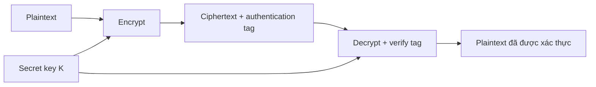
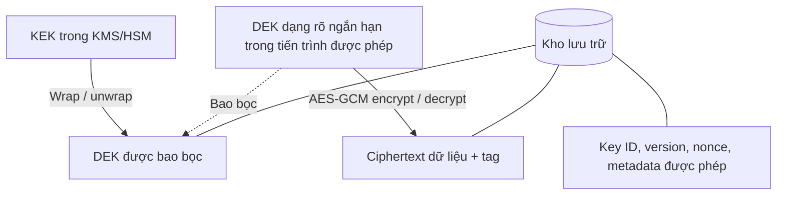
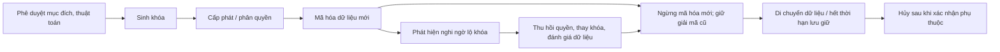

# Encryption key và decryption key

## 1. Encryption key và decryption key là gì?

**Encryption key (khóa mã hóa)** là vật liệu mật mã được thuật toán sử dụng để biến **plaintext** (dữ liệu rõ) thành **ciphertext** (dữ liệu mã hóa). **Decryption key (khóa giải mã)** là vật liệu mật mã được sử dụng để khôi phục plaintext từ ciphertext hợp lệ. Tên gọi hai loại khóa mô tả **vai trò trong thao tác**, nhưng không nhất thiết có nghĩa chúng là hai giá trị bí mật khác nhau.

Trong **mật mã đối xứng (symmetric cryptography)**, bên mã hóa và bên giải mã thông thường sử dụng **cùng một khóa bí mật** `K`. Với AES-GCM, chẳng hạn, `K` có thể là một khóa AES 128 bit hoặc 256 bit được tạo ngẫu nhiên an toàn. Cùng một vật liệu `K` phục vụ cả hai thao tác, mặc dù thuật toán và thư viện có thể thực hiện các bước tính toán nội bộ khác nhau khi mã hóa và giải mã.



Ngược lại, trong **mã hóa bất đối xứng (asymmetric encryption)**, public key có thể dùng để mã hóa và private key tương ứng dùng để giải mã, tùy sơ đồ. Không được đem quy tắc của mã hóa bất đối xứng áp dụng trực tiếp cho khóa AES.

Bài học thuộc chương **Mật mã đối xứng** của module `SECURITY_KEY_MANAGEMENT_FUNDAMENTALS`. Nó kết nối việc sử dụng khóa với toàn bộ vòng đời tạo, cấp phát, lưu trữ, sử dụng, xoay vòng, thu hồi, hủy; đồng thời liên hệ KMS/HSM, envelope encryption, quyền truy cập, kiểm toán và các rủi ro khi quản lý khóa sai.

Sau bài học, bạn có thể:

- Phân biệt **vai trò mã hóa/giải mã** với **danh tính vật liệu khóa**, đặc biệt trong AES và các sơ đồ bất đối xứng.
- Mô tả các thành phần cần để mã hóa và giải mã có xác thực: key, nonce/IV, ciphertext, authentication tag và AAD.
- Giải thích vì sao biết ciphertext cùng thuật toán vẫn không đủ để giải mã khi không có khóa thích hợp.
- Tách quyền **encrypt** và **decrypt** trong ứng dụng dùng KMS, dù cả hai cùng liên quan đến một khóa logic.
- Thiết kế luồng DEK/KEK, rotation, backup và xử lý sự cố mà vẫn bảo toàn khả năng đọc dữ liệu cũ.
- Đọc và triển khai ví dụ Java AES-GCM minh họa các thao tác mã hóa/giải mã an toàn ở cấp nguyên lý.

## 2. Mật mã đối xứng: cùng một bí mật, hai thao tác

Trong sơ đồ mã hóa đối xứng, ký hiệu tổng quát:

\[
C = \operatorname{Enc}_{K}(P)
\]

\[
P = \operatorname{Dec}_{K}(C)
\]

với `P` là plaintext, `C` là ciphertext và `K` là khóa bí mật. Khi xét chế độ mã hóa có xác thực (*Authenticated Encryption with Associated Data — AEAD*) như AES-GCM, biểu diễn chính xác hơn:

\[
(C,T) = \operatorname{Encrypt}(K,N,P,A)
\]

\[
\operatorname{Decrypt}(K,N,C,T,A) =
\begin{cases}
P & \text{nếu xác thực thành công}\\
\bot & \text{nếu dữ liệu hoặc ngữ cảnh không hợp lệ}
\end{cases}
\]

Ở đây:

| Ký hiệu / thuật ngữ | Vai trò | Có phải bí mật không? |
| --- | --- | --- |
| `K` — symmetric key | Bí mật được dùng trong cả mã hóa và giải mã | **Có** |
| `P` — plaintext | Dữ liệu trước mã hóa, chỉ xuất hiện tại các điểm xử lý được ủy quyền | **Có thể rất nhạy cảm** |
| `C` — ciphertext | Dữ liệu đã mã hóa | **Không phải khóa**, nhưng vẫn có thể chứa metadata nhạy cảm |
| `N` — nonce/IV | Giá trị cần thiết cho mỗi thao tác; hỗ trợ bảo đảm tính duy nhất trong chế độ mã hóa | Thông thường **không**, nhưng phải tuân thủ quy tắc sinh/sử dụng |
| `T` — authentication tag | Thông tin kiểm tra tính toàn vẹn và tính hợp lệ của ciphertext/AAD | Thông thường **không** |
| `A` — AAD | Dữ liệu liên kết được xác thực nhưng không mã hóa, ví dụ định danh tenant hoặc bản ghi | Không nhất thiết bí mật; phải khớp khi giải mã |

**Điều kiện để giải mã thành công** không chỉ là “có khóa đúng”, mà còn cần thuật toán/chế độ đúng, nonce/IV đúng, ciphertext và tag nguyên vẹn, cùng AAD chính xác nếu lúc mã hóa đã sử dụng. Với AEAD, ứng dụng phải **từ chối kết quả giải mã khi kiểm tra tag thất bại**.

### 2.1. Khóa dùng để mã hóa có “biến thành” khóa giải mã không?

Với AES thông dụng, không cần sinh thêm một bí mật độc lập cho giải mã: cùng **key material** được đưa vào thuật toán ở chế độ mã hóa hoặc giải mã. Thư viện có thể tạo *round keys* hoặc một **key schedule** nội bộ khác cho từng hướng, nhưng những cấu trúc trung gian ấy không phải một cặp public/private key và không cần lưu như hai bí mật nghiệp vụ riêng biệt.

Với một số hệ thống quản lý khóa, **cùng một khóa logic** có thể hỗ trợ cả lệnh `Encrypt` và `Decrypt`. Chính sách IAM vẫn có thể cho một danh tính **chỉ được gọi Encrypt**, danh tính khác **được gọi Decrypt**, hoặc cả hai. Sự khác nhau ở đây là **quyền thao tác**, không nhất thiết là hai vật liệu khóa.

### 2.2. Bốn trường hợp cần tránh nhầm

| Trường hợp | Encryption key | Decryption key | Nhận xét |
| --- | --- | --- | --- |
| **AES-GCM đối xứng** | Bí mật `K` | Cùng bí mật `K` | Một khóa, hai thao tác; cần quản lý nonce và tag. |
| **Mã hóa bất đối xứng** | Thường là public key người nhận | Private key tương ứng | Hai giá trị khóa có quan hệ toán học theo sơ đồ. |
| **Mã hóa dữ liệu bằng DEK và bọc DEK bằng KEK** | DEK trực tiếp mã hóa dữ liệu; KEK bọc DEK | DEK giải mã dữ liệu; KEK mở bọc DEK | Hai **tầng khóa với hai mục đích**, không phải public/private pair. |
| **Mã xác thực HMAC** | Shared secret để tạo MAC | Shared secret để kiểm tra MAC | Đây là MAC, **không phải mã hóa/giải mã dữ liệu**. |

## 3. Chỉ giữ kín khóa có đủ không?

Bí mật của khóa là điều kiện quan trọng cho **tính bí mật (confidentiality)**, nhưng thiết kế mã hóa còn phải giải quyết **tính toàn vẹn (integrity)** và ràng buộc dữ liệu với ngữ cảnh đúng.

Nếu ứng dụng dùng một chế độ mã hóa thiếu xác thực và kẻ tấn công sửa ciphertext, quá trình giải mã có thể sinh plaintext bị thay đổi mà không phát hiện được trong một số tình huống. Vì vậy, với mã hóa dữ liệu ứng dụng, thường ưu tiên chế độ **AEAD** được phê duyệt như AES-GCM, có kiểm tra authentication tag.

Một sơ đồ xử lý đúng cần:

1. Chọn thuật toán và kích thước khóa theo danh mục được phê duyệt.
2. Tạo khóa bằng nguồn ngẫu nhiên an toàn mật mã.
3. Sinh nonce/IV đúng theo quy tắc riêng của chế độ mã hóa.
4. Dùng cùng AAD/metadata ràng buộc ngữ cảnh khi mã hóa và giải mã.
5. Chỉ chấp nhận plaintext sau khi cơ chế xác thực thành công.
6. Không log, phát tán hoặc giữ plaintext/key dạng rõ ngoài phạm vi cần thiết.

**Lưu ý:** AEAD cung cấp xác thực thông điệp **đối với những bên biết khóa bí mật**. Nếu nhiều dịch vụ cùng có quyền mã hóa bằng một khóa, ciphertext có tag hợp lệ không tự xác nhận chính xác *dịch vụ nào* đã tạo ra nó. Việc quy thuộc chủ thể còn cần IAM, quy trình ghi dữ liệu, chữ ký số hoặc bằng chứng kiểm toán tùy yêu cầu.

### 3.1. Nonce/IV không phải encryption key

Trong AES-GCM, mỗi lần mã hóa bằng **cùng một khóa** phải sử dụng nonce **không trùng** theo yêu cầu của chế độ. Nonce 96 bit được sinh ngẫu nhiên an toàn là lựa chọn phổ biến cho ví dụ và nhiều trường hợp sử dụng, nhưng khi lượng dữ liệu lớn hoặc giới hạn va chạm trở nên đáng kể, phải có chiến lược sinh nonce và giới hạn số lần dùng khóa theo thiết kế được kiểm chứng.

```text
Lần 1: Encrypt(K, nonce-001, plaintext-A, AAD) -> ciphertext-A, tag-A
Lần 2: Encrypt(K, nonce-002, plaintext-B, AAD) -> ciphertext-B, tag-B
Không làm: Encrypt(K, nonce-001, plaintext-C, AAD) -> ...
```

**Tái sử dụng nonce với cùng khóa AES-GCM có thể gây hậu quả nghiêm trọng đối với cả tính bí mật và tính toàn vẹn.** Thay nonce không đồng nghĩa xoay khóa; thay khóa cũng không có nghĩa có thể bỏ qua kiểm soát nonce trong các lần mã hóa tiếp theo.

Đừng nhầm nonce với *salt*. Salt thường dùng để bảo vệ đầu vào của quá trình dẫn xuất khóa (đặc biệt từ mật khẩu); nonce là tham số của phép mã hóa. Chúng có mục đích và quy tắc quản lý khác nhau.

### 3.2. AAD gắn ciphertext với bối cảnh nghiệp vụ

Giả sử hệ thống mã hóa số tài khoản của hai khách hàng bằng cùng cơ chế. Nếu dữ liệu mã hóa có thể bị sao chép giữa các bản ghi mà ứng dụng không kiểm tra bối cảnh, sẽ xuất hiện nguy cơ **hoán đổi ciphertext hợp lệ**.

Có thể đưa `tenantId`, `recordId`, loại dữ liệu hoặc format version vào AAD. Khi giải mã, ứng dụng cung cấp **đúng chuỗi bytes AAD** gắn với bản ghi đã mã hóa; nếu AAD khác, xác minh tag thất bại. AAD thường không được mã hóa, vì vậy **không đưa dữ liệu nhạy cảm vào AAD** trừ khi việc để lộ metadata là chấp nhận được.

Cần chuẩn hóa cách biểu diễn bytes và version của AAD để tránh lỗi khi một hệ thống viết bằng Java, hệ thống khác viết bằng ngôn ngữ khác.

## 4. Key material, key identifier, key version và key alias

Để dùng khóa đúng, phải phân biệt:

| Thành phần | Chức năng | Ví dụ |
| --- | --- | --- |
| **Key material** | Các bit bí mật trực tiếp tham gia mật mã | Khóa AES 256 bit |
| **Key ID** | Định danh tài nguyên khóa logic | `keys/customer-prod` |
| **Key version** | Định danh thế hệ vật liệu khóa | `v3` |
| **Key alias** | Tên tham chiếu gián tiếp tới khóa hoặc version tùy hệ thống | `alias/customer-data-current` |
| **Cryptoperiod** | Khoảng thời gian khóa được phép dùng cho một hoặc nhiều thao tác | Thời hạn cho mã hóa mới |
| **Key policy / IAM** | Quy định danh tính có thể làm gì với khóa | Dịch vụ A được `Encrypt`, dịch vụ B được `Decrypt` |

Không được coi `keyId` hoặc `version` như một bản sao của khóa bí mật. Chúng thường là metadata dùng tra cứu và kiểm toán; **không thể dùng để giải mã dữ liệu nếu không có quyền truy cập vật liệu khóa hoặc dịch vụ mật mã hợp lệ**.

Một khóa logic có thể có nhiều thế hệ vật liệu. Ứng dụng mã hóa mới bằng `v3` nhưng còn cần `v1` để giải mã bản ghi lịch sử. Việc thay default version không tự thay đổi ciphertext cũ. Một số KMS tự lưu thông tin phiên bản bên trong ciphertext blob; các KMS khác yêu cầu ứng dụng lưu thêm metadata. Cần tuân thủ API cụ thể của nhà cung cấp.

## 5. DEK và KEK: hai tầng khóa trong envelope encryption

Trong ứng dụng có nhiều dữ liệu, một kiến trúc thường gặp là **envelope encryption**:

- **DEK — Data Encryption Key:** khóa đối xứng dùng trực tiếp để **mã hóa và giải mã dữ liệu**.
- **KEK — Key Encryption Key:** khóa dùng để **bao bọc/mở bọc DEK**, thường được KMS/HSM bảo vệ.

Đây là cách phân chia **theo mục đích**, không có nghĩa mọi thao tác encrypt đều dùng KEK hoặc mọi thao tác decrypt đều phải diễn ra trong KMS. Một DEK vẫn có vai trò vừa mã hóa vừa giải mã **dữ liệu**; KEK bảo vệ **vật liệu DEK**.



### 5.1. Luồng mã hóa dữ liệu bằng envelope encryption

1. Ứng dụng được ủy quyền yêu cầu KMS **tạo DEK** hoặc lấy DEK theo cơ chế đã phê duyệt.
2. KMS có thể trả về **DEK dạng rõ** cho điểm dùng tạm thời và **DEK đã được KEK bao bọc**; hoặc có thể hỗ trợ mô hình thực thi mật mã khác, tùy dịch vụ.
3. Ứng dụng dùng DEK dạng rõ **chỉ trong bộ nhớ cần thiết**, chọn nonce/AAD phù hợp và thực hiện AES-GCM đối với dữ liệu.
4. Lưu **ciphertext + tag + nonce + DEK được bao bọc + metadata**. Không ghi DEK dạng rõ vào database, file, log hoặc error report.
5. Hạn chế vòng đời plaintext DEK trong bộ nhớ và xử lý bảo vệ tiến trình; trong Java, việc xóa sạch mọi bản sao bí mật do runtime/thư viện tạo ra không thể được bảo đảm tuyệt đối.

### 5.2. Luồng giải mã

1. Ứng dụng xác thực danh tính và **quyền đọc dữ liệu nghiệp vụ** trước khi truy xuất dữ liệu.
2. Đọc ciphertext, wrapped DEK và metadata; từ chối tham chiếu khóa không nằm trong phạm vi được phép.
3. Gửi wrapped DEK tới KMS/HSM để **mở bọc** qua API có quyền thích hợp; nếu dịch vụ hỗ trợ, ràng buộc encryption context/AAD.
4. Sử dụng DEK đã được mở bọc để giải mã AES-GCM với nonce và AAD chính xác.
5. **Chỉ chấp nhận plaintext nếu kiểm tra tag thành công**, sau đó trả dữ liệu cho chủ thể có quyền và dọn dẹp vùng nhớ nhạy cảm trong khả năng của môi trường.

### 5.3. Lưu dạng envelope nào?

Ví dụ **minh họa**, không phải contract bắt buộc cho mọi KMS:

```json
{
  "envelopeFormat": 1,
  "dataAlgorithm": "AES-256-GCM",
  "kekId": "customer-data/prod",
  "kekVersion": "v3",
  "encryptedDek": "<base64-wrapped-DEK>",
  "nonce": "<base64-12-byte-nonce>",
  "ciphertextAndTag": "<base64-ciphertext-with-auth-tag>",
  "aad": {
    "tenantId": "tenant-42",
    "recordId": "record-123"
  }
}
```

**Không phải trường nào cũng bắt buộc** nếu API KMS đã đóng gói version hoặc metadata vào blob. Khi đưa `kekId` từ bản ghi vào KMS, phải kiểm tra whitelist, môi trường và phạm vi tenant; không để dữ liệu chưa tin cậy tự chọn một khóa bất kỳ mà danh tính dịch vụ đang có quyền truy cập.

Thành phần AAD cần được biểu diễn thành bytes **đồng nhất** khi mã hóa và giải mã; nếu lưu object JSON, định nghĩa rõ canonical serialization hoặc dữ liệu dẫn xuất AAD theo phiên bản. Ngữ cảnh xác minh của KMS và AAD của AES-GCM có thể là **hai cơ chế riêng** và phải được sử dụng đúng API tương ứng.

## 6. Tạo và dẫn xuất encryption/decryption key an toàn

### 6.1. Khóa ngẫu nhiên mật mã

Khóa đối xứng dùng trực tiếp cho AES nên được tạo bằng **CSPRNG** hoặc cơ chế sinh khóa đáng tin cậy của KMS/HSM. Ví dụ AES hỗ trợ các kích thước khóa **128, 192 và 256 bit**; chọn mức phù hợp với tiêu chuẩn và môi trường triển khai.

Không dùng làm khóa trực tiếp:

- Chuỗi hằng như `"1234567890123456"` hoặc `"secret-key"`.
- Timestamp, mã khách hàng, số đơn hàng, UUID phổ thông hoặc số ngẫu nhiên từ `java.util.Random`.
- Hash đơn giản của mật khẩu dễ đoán mà không có quy trình dẫn xuất được thiết kế cho mật khẩu.
- Khóa được ghi cứng trong mã nguồn, biến môi trường chia sẻ thiếu bảo vệ, container image hoặc tài liệu triển khai.

**Độ dài chuỗi không đồng nghĩa độ ngẫu nhiên của khóa.** Một chuỗi 32 ký tự dễ đoán không có sức mạnh bảo mật tương đương khóa 256 bit được sinh ngẫu nhiên an toàn.

### 6.2. Khóa dẫn xuất từ vật liệu gốc

Nếu ứng dụng có một secret đầu vào **đủ entropy** và cần nhiều khóa mục đích khác nhau, có thể dùng KDF được phê duyệt, ví dụ HKDF, với ngữ cảnh riêng cho từng ứng dụng/mục đích. Điều này giúp tách khóa cho encryption, MAC hoặc các dịch vụ khác theo thiết kế.

Nếu nguồn đầu vào là **mật khẩu người dùng**, cần cơ chế dẫn xuất chuyên dụng cho mật khẩu, chẳng hạn Argon2id hoặc phương án được tiêu chuẩn nội bộ phê duyệt với salt và tham số chi phí thích hợp; không coi HKDF đơn thuần là đủ để chống đoán mật khẩu. Khi có thể, ứng dụng nên để KMS/HSM tạo DEK thay vì bắt người dùng hoặc lập trình viên tự tạo khóa thủ công.

### 6.3. Không dùng cùng một khóa cho mọi mục đích

Một khóa bí mật có thể được **phép toán encrypt và decrypt của cùng một sơ đồ** sử dụng, nhưng điều đó không cho phép tái sử dụng khóa ấy cho **HMAC, nhiều thuật toán, nhiều môi trường hoặc nhiều tenant** tùy tiện.

Ví dụ nên có tách biệt rõ:

```text
customer-data/prod/encryption-key
customer-data/staging/encryption-key
billing/prod/encryption-key
billing/prod/hmac-key
```

Tách khóa theo mục đích và phạm vi giúp giới hạn tác động của việc lộ bí mật, giảm sai sót IAM và có lịch rotation riêng. Mức độ phân tách cụ thể phải cân bằng mô hình đe dọa, quy định và chi phí quản lý.

## 7. Sử dụng KMS/HSM và phân quyền encrypt/decrypt

Một hệ thống có thể dùng cùng key material nhưng **phân quyền theo thao tác**:

| Vai trò minh họa | Quyền trên khóa | Lý do |
| --- | --- | --- |
| **Writer/producer** | Quyền mã hóa hoặc tạo data key theo phạm vi được duyệt | Ghi dữ liệu mới mà không nhất thiết được đọc plaintext lịch sử. |
| **Reader/consumer** | Quyền giải mã có điều kiện, sau kiểm tra quyền dữ liệu | Đọc bản ghi hợp lệ khi nghiệp vụ yêu cầu. |
| **Key administrator** | Tạo, cấu hình, chuyển vòng đời khóa | Không mặc nhiên được giải mã dữ liệu khách hàng. |
| **Security auditor** | Đọc metadata, chính sách, log | Không mặc nhiên được sử dụng khóa để mã hóa hoặc giải mã. |
| **Incident responder** | Quyền khẩn cấp có điều kiện và thời hạn | Khoanh vùng sự cố, kiểm soát hồi phục và có hậu kiểm. |

Ví dụ, dịch vụ **ingest** chỉ cần được phép mã hóa và ghi ciphertext, còn dịch vụ **fulfillment** cần giải mã để xử lý đơn hàng. Có thể cấp quyền cho hai danh tính vào cùng một khóa KMS với các tập lệnh khác nhau, nhưng vẫn phải **kiểm soát đọc dữ liệu ở tầng nghiệp vụ**. Quyền `Decrypt` trên KEK không tự chứng minh người gọi được đọc mọi bản ghi do KEK đó bảo vệ.

Trong thực tế, các API như `Encrypt`, `Decrypt`, `GenerateDataKey`, `ReEncrypt`, `Sign` được nhà cung cấp đặt tên và kiểm soát khác nhau. Không giả định có thể tách encrypt/decrypt ở mức bản thân vật liệu khóa nếu KMS chỉ hỗ trợ quyền theo tài nguyên, hoặc tự suy rằng tất cả các dịch vụ đều có khả năng áp chính sách trên từng key version.

### 7.1. KMS khác HSM ở đâu?

- **KMS (Key Management Service)** cung cấp quản lý vòng đời khóa, API sử dụng mật mã, chính sách truy cập, metadata và khả năng kiểm toán tùy sản phẩm.
- **HSM (Hardware Security Module)** dùng phần cứng chuyên dụng để bảo vệ vật liệu khóa và thực hiện thao tác mật mã trong ranh giới bảo vệ đã định.

KMS có thể sử dụng HSM ở tầng nền, nhưng mức bảo đảm, khả năng export, cách chia sẻ quyền, vùng triển khai và mô hình quản trị khác nhau theo nhà cung cấp. Không coi nhãn “đã dùng KMS/HSM” là đủ: **danh tính được cấp quyền giải mã quá rộng vẫn có thể lạm dụng API** ngay cả khi không thể xuất khóa dạng rõ.

### 7.2. Không biến bản ghi ciphertext thành khả năng giải mã tùy ý

Trước khi gọi KMS, cần xác định ứng dụng có quyền đọc bản ghi, khóa thuộc hệ thống/môi trường nào, metadata có hợp lệ không và encryption context có đúng không. Nếu mọi người có thể sửa trường `keyId` để chọn khóa, họ có thể lạm dụng dịch vụ làm *decryption oracle* hoặc giải mã dữ liệu ngoài phạm vi.

Biện pháp gồm: allowlist key IDs, giới hạn IAM theo tài nguyên/danh tính, ràng buộc tenant/record bằng AAD/encryption context, phân quyền database/storage, kiểm toán và hạn chế số lần gọi.

## 8. Java: ví dụ AES-GCM mã hóa và giải mã bằng cùng SecretKey

Ví dụ sau sử dụng Java 17+ với **Java Cryptography Architecture (JCA)** để minh họa nguyên lý. Trong đó:

- `KeyGenerator` tạo khóa AES 256 bit bằng nguồn ngẫu nhiên mật mã của JCA.
- `Cipher` dùng `AES/GCM/NoPadding`, nonce 12 byte và tag 128 bit.
- `encrypt` và `decrypt` nhận **cùng một `SecretKey`**.
- AAD được cung cấp ở cả hai phía. Dữ liệu chỉ được trả lại nếu xác minh thành công.
- Nonce được tạo mới ngẫu nhiên cho mỗi lần mã hóa, phù hợp để **minh họa**; dịch vụ lưu lượng rất lớn cần quản lý giới hạn và tính duy nhất của nonce theo chính sách riêng.

```java
import java.nio.charset.StandardCharsets;
import java.security.GeneralSecurityException;
import java.security.SecureRandom;
import java.util.Base64;
import javax.crypto.Cipher;
import javax.crypto.KeyGenerator;
import javax.crypto.SecretKey;
import javax.crypto.spec.GCMParameterSpec;

public class SymmetricKeyDemo {
    private static final String TRANSFORMATION = "AES/GCM/NoPadding";
    private static final int NONCE_BYTES = 12;       // 96-bit nonce
    private static final int TAG_BITS = 128;
    private static final SecureRandom RNG = new SecureRandom();

    // Ví dụ đơn giản; production cần định dạng envelope có version.
    record EncryptedData(byte[] nonce, byte[] ciphertextAndTag) {}

    static SecretKey generateAesKey() throws GeneralSecurityException {
        KeyGenerator generator = KeyGenerator.getInstance("AES");
        generator.init(256, RNG);
        return generator.generateKey();
    }

    static EncryptedData encrypt(
            SecretKey key, byte[] plaintext, byte[] aad)
            throws GeneralSecurityException {
        byte[] nonce = new byte[NONCE_BYTES];
        RNG.nextBytes(nonce);

        Cipher cipher = Cipher.getInstance(TRANSFORMATION);
        cipher.init(
            Cipher.ENCRYPT_MODE,
            key,
            new GCMParameterSpec(TAG_BITS, nonce)
        );
        cipher.updateAAD(aad);
        byte[] ciphertextAndTag = cipher.doFinal(plaintext);

        return new EncryptedData(nonce, ciphertextAndTag);
    }

    static byte[] decrypt(
            SecretKey key, EncryptedData encrypted, byte[] aad)
            throws GeneralSecurityException {
        Cipher cipher = Cipher.getInstance(TRANSFORMATION);
        cipher.init(
            Cipher.DECRYPT_MODE,
            key,
            new GCMParameterSpec(TAG_BITS, encrypted.nonce())
        );
        cipher.updateAAD(aad);

        // Nếu key, nonce, AAD hoặc ciphertext/tag sai,
        // doFinal() phải thất bại khi xác minh authentication tag.
        return cipher.doFinal(encrypted.ciphertextAndTag());
    }

    public static void main(String[] args) throws Exception {
        SecretKey key = generateAesKey();

        byte[] plaintext = "Khách hàng số 42".getBytes(
            StandardCharsets.UTF_8
        );
        byte[] aad = "tenant=42;field=profile".getBytes(
            StandardCharsets.UTF_8
        );

        EncryptedData encrypted = encrypt(key, plaintext, aad);
        System.out.println("Ciphertext + tag: "
            + Base64.getEncoder().encodeToString(
                encrypted.ciphertextAndTag()
            ));

        byte[] recovered = decrypt(key, encrypted, aad);
        System.out.println(new String(
            recovered, StandardCharsets.UTF_8
        ));

        // Giải mã với AAD khác phải thất bại.
        byte[] wrongAad = "tenant=99;field=profile".getBytes(
            StandardCharsets.UTF_8
        );
        try {
            decrypt(key, encrypted, wrongAad);
            throw new IllegalStateException("Unexpected verification success");
        } catch (javax.crypto.AEADBadTagException expected) {
            System.out.println("Sai AAD: từ chối giải mã");
        }
    }
}
```

Trong Java, `AES/GCM/NoPadding` đặt **authentication tag** cùng dữ liệu đầu ra của `doFinal`; lưu và đọc `ciphertextAndTag` phải theo cùng định dạng. Một số thư viện khác trả tag tách riêng. Cấu trúc record trong ví dụ chỉ phục vụ học tập; production cần kiểm tra độ dài trường, giới hạn kích thước, bảo vệ dữ liệu/mảng byte khỏi bị sửa, serialization, xử lý cache và quản lý key ID/version.

### 8.1. Vì sao mã ví dụ chưa đủ cho production?

Các bước còn thiếu khi triển khai thực tế:

- Không sinh khóa mới mỗi lần ứng dụng khởi động nếu muốn đọc dữ liệu đã mã hóa trước đó. Phải lưu và quản trị khóa/DEK qua **KMS/HSM** hoặc quy trình chuyên biệt, kèm backup/khả năng khôi phục.
- Không dùng cùng một nonce với cùng khóa trong các lần mã hóa. Phải giám sát chiến lược tạo nonce, mức sử dụng và giới hạn theo chế độ.
- Không giữ key dưới dạng hằng số, file cấu hình rõ hoặc đưa vào log. Java không bảo đảm có thể xóa sạch tất cả bản sao vật liệu nhạy cảm trong bộ nhớ được runtime và provider tạo ra.
- Nếu dữ liệu đầu vào và AAD đến từ nhiều ngôn ngữ, phải thống nhất **encoding và canonicalization**.
- Không trả plaintext khi **AEAD tag thất bại**; không tự “thử bỏ tag” hoặc fallback sang chế độ không xác thực.
- Cần quy định key ID, version, thuật toán, nonce và format version cho bản ghi; triển khai chính sách IAM, retry, timeout và kiểm soát phân quyền dữ liệu.
- Nếu có lượng lớn dữ liệu, sử dụng giải pháp streaming/chunking được thiết kế và xác minh đúng chuẩn, tránh tự chia một thông điệp GCM thành nhiều đoạn với nonce lặp.

### 8.2. Điều gì xảy ra khi giải mã với khóa khác?

Nếu mã hóa bằng `K1` rồi cố giải mã bằng `K2` độc lập, AES-GCM **thường từ chối do authentication tag không hợp lệ**. Cùng một điều xảy ra khi sai nonce, AAD hoặc ciphertext/tag đã bị sửa. Ứng dụng cần xem kết quả thất bại là một lỗi xác thực mật mã, không tiếp tục xử lý dữ liệu như plaintext hợp lệ.

Trong hệ thống thật, lỗi `bad tag` cần được điều tra theo các khả năng: metadata version sai, AAD không thống nhất, nhầm môi trường/tenant, dữ liệu bị hỏng hoặc bị sửa đổi. Không ghi khóa hoặc plaintext vào log để chẩn đoán.

## 9. Vòng đời encryption/decryption key

Một khóa an toàn cần được quản lý từ trước khi tạo ra đến sau khi dừng sử dụng:



| Giai đoạn | Điều bắt buộc quan tâm |
| --- | --- |
| **Tạo** | Sinh vật liệu khóa ngẫu nhiên an toàn; chọn thuật toán, kích thước và purpose theo chính sách. |
| **Đăng ký** | Gắn owner, `keyId`, version, môi trường, phân loại dữ liệu, thời gian tạo và mã phê duyệt. |
| **Cấp phát** | Chỉ cấp thao tác cần thiết; tránh chia sẻ vật liệu khóa rõ giữa nhiều dịch vụ nếu KMS có thể cung cấp API được kiểm soát. |
| **Sử dụng** | Bảo vệ nonce, AAD, plaintext DEK, ciphertext tag, IAM và log; giám sát hành vi bất thường. |
| **Rotation** | Chuyển ghi mới sang vật liệu khóa mới; duy trì giải mã dữ liệu cũ còn hợp lệ. |
| **Tạm dừng/thu hồi** | Chặn danh tính hoặc khóa bị nghi lộ; đánh giá tác động khả năng giải mã. |
| **Lưu giữ/khôi phục** | Backup phải khôi phục được **cả dữ liệu lẫn khả năng sử dụng khóa hợp lệ**. |
| **Hủy** | Kiểm kê mọi phụ thuộc và bản sao, phê duyệt, ghi log; chỉ hủy khi không còn nghĩa vụ/nhu cầu đọc. |

### 9.1. Cryptoperiod và thời gian giải mã dữ liệu cũ

Thời hạn được phép **mã hóa mới** bằng một khóa có thể ngắn hơn thời hạn cần giữ nó để **giải mã** dữ liệu lịch sử. Ví dụ, sau một lần rotation, `v2` là version mặc định cho dữ liệu mới, còn `v1` vẫn phải dùng để đọc hồ sơ được mã hóa trước đó hoặc để khôi phục backup.

Không được tự động xóa `v1` chỉ vì đã có `v2`. Các thành phần như snapshot, archive, queue, message retry và dữ liệu ít truy cập có thể vẫn phụ thuộc version cũ.

### 9.2. Rotation không đồng nghĩa re-encryption

Trong envelope encryption, phải phân biệt:

| Thao tác | Khóa nào đổi? | Dữ liệu nào cần ghi lại? | Bài toán giải quyết |
| --- | --- | --- | --- |
| **Đổi KEK đang dùng cho ghi mới** | Version KEK mặc định | Có thể chỉ ảnh hưởng bản ghi mới | Bảo vệ DEK mới bằng KEK mới. |
| **Rewrap DEK** | KEK bao bọc DEK | **Wrapped DEK**, thường không đổi ciphertext dữ liệu | Thay lớp bảo vệ khóa dữ liệu. |
| **Re-encrypt dữ liệu** | DEK mới, có thể KEK mới | **Ciphertext dữ liệu + metadata + wrapped DEK** | Thay khóa mã hóa trực tiếp dữ liệu hoặc thuật toán. |

Nếu **DEK bị lộ**, chỉ rewrap bằng KEK mới không giải quyết bí mật đã mất của DEK cũ. Cần đánh giá phạm vi dữ liệu và tái mã hóa phù hợp. Nếu **KEK bị lộ** cùng các wrapped DEK đã bị lấy, có nguy cơ dữ liệu bị giải mã; việc khắc phục phải dựa trên tình hình kẻ tấn công đã có được những gì, không đơn thuần dựa vào số lần xoay khóa.

### 9.3. Khi khóa giải mã bị hủy nhầm

Nếu dữ liệu còn lại chỉ có ciphertext và không còn vật liệu khóa hoặc đường khôi phục hợp lệ, dữ liệu sẽ không thể giải mã bằng cách thông thường. Điều này có thể là mục tiêu của **cryptographic erasure**, nhưng cũng là sự cố mất dữ liệu nghiêm trọng nếu thực hiện ngoài kế hoạch.

Trước khi hủy khóa cần: kiểm kê ciphertext/backup/snapshot phụ thuộc, xác nhận retention, kiểm thử phục hồi, ghi phê duyệt và hiểu thời gian chờ xóa của KMS. Không tạo hoặc phát tán thêm các bản sao secret tùy tiện chỉ để tránh mất khóa; phải có phương án phục hồi được thiết kế và kiểm soát trước.

## 10. Chính sách quyền truy cập và nhật ký kiểm toán

Khả năng gọi API **Decrypt** có thể nguy hiểm không kém việc đánh cắp key material, đặc biệt nếu một tài khoản dịch vụ có thể giải mã dữ liệu cho toàn bộ tenant. Chính sách quản trị nên yêu cầu:

1. **Tách trách nhiệm:** người quản trị khóa, người đọc dữ liệu, người ghi dữ liệu và người kiểm toán có phạm vi quyền khác nhau.
2. **Giới hạn theo tài nguyên:** không cấp quyền `Decrypt` trên mọi khóa hoặc mọi môi trường khi chỉ cần một tập nhỏ.
3. **Giới hạn theo danh tính/ngữ cảnh:** service account, workload identity, tenant, môi trường và encryption context tùy KMS.
4. **Kiểm soát thay đổi:** phê duyệt quyền mới, thay đổi key policy, tạo version, disable, re-enable và destroy.
5. **Kiểm toán:** ghi metadata cần thiết cho thao tác khóa và cảnh báo khi có thay đổi nhạy cảm hoặc hành vi lệch chuẩn.
6. **Ứng phó:** có đường vô hiệu hóa quyền khẩn cấp, thay khóa và khôi phục khả năng xử lý dữ liệu mà không phá hủy chứng cứ.

Một log thao tác phù hợp có thể chứa `timestamp`, `actor`, `keyId`, `keyVersion` nếu khả dụng, `operation`, `environment`, `requestId`, `result`. **Không lưu plaintext, khóa rõ, wrapped DEK ở nơi không cần thiết hoặc dữ liệu cá nhân** trong nhật ký. Nếu log metadata có thể suy ra thông tin nhạy cảm, cũng cần kiểm soát quyền truy cập và thời hạn lưu.

### 10.1. “Encrypt only” không thay thế kiểm soát quyền nghiệp vụ

Một người dùng có quyền mã hóa có thể tạo ciphertext mới hợp lệ bằng cùng khóa; AES-GCM tự nó không phân biệt người dùng đó có được phép **ghi đè dữ liệu khách hàng** hay không. Vì vậy, hệ thống cần xác thực và phân quyền ở tầng API, database và nghiệp vụ bên cạnh quyền KMS.

Tương tự, người có quyền `Decrypt` nhưng không có quyền truy cập bản ghi không được tự ý đọc bản ghi của người khác. Nên ràng buộc ciphertext với tenant/record khi phù hợp, đồng thời kiểm tra quyền truy cập trước khi gọi giải mã.

## 11. Các rủi ro thường gặp và cách khắc phục

| Sai lầm | Hậu quả | Cách tiếp cận |
| --- | --- | --- |
| Nghĩ AES có public encryption key và private decryption key | Thiết kế key distribution và IAM sai | Hiểu AES dùng cùng secret key cho encrypt/decrypt. |
| Dùng chuỗi hardcode làm khóa | Rò rỉ qua Git, container image, log, backup | Sinh khóa an toàn; quản lý qua KMS/HSM hoặc hệ thống được duyệt. |
| Tái sử dụng nonce AES-GCM với cùng khóa | Có thể phá vỡ tính bí mật và tính toàn vẹn | Quản lý nonce duy nhất; giới hạn số phép mã hóa mỗi khóa. |
| Dùng chế độ mã hóa không xác thực rồi tin ciphertext chưa bị sửa | Có thể chấp nhận plaintext đã bị thao túng | Ưu tiên AEAD như AES-GCM; kiểm tra tag bắt buộc. |
| Lưu DEK dạng rõ cạnh ciphertext | Kẻ tấn công đọc được cả key lẫn dữ liệu | Lưu DEK đã bọc; hạn chế plaintext DEK trong bộ nhớ. |
| Coi `keyId` là bí mật hoặc quyền giải mã | Metadata không phải thay thế cho quyền dùng key material | Dùng IAM/KMS và ánh xạ khóa đáng tin cậy. |
| Mọi service dùng chung quyền `Decrypt` | Một service bị xâm nhập ảnh hưởng toàn bộ dữ liệu | Least privilege, giới hạn resource và tenant. |
| Không giữ version cũ sau rotation | Dữ liệu lịch sử hoặc backup không giải mã được | Có quy trình chuyển tiếp và kiểm kê phụ thuộc. |
| Chỉ rewrap KEK khi DEK đã lộ | Không loại bỏ rủi ro của DEK cũ | Cần đánh giá/tái mã hóa dữ liệu với DEK mới. |
| Log plaintext/khóa trong lúc debug | Rò rỉ bí mật ngoài ranh giới bảo vệ | Log metadata an toàn, giới hạn truy cập và retention. |
| Bỏ qua lỗi authentication tag | Có thể xử lý dữ liệu sai hoặc bị sửa | Từ chối kết quả giải mã, điều tra nguyên nhân. |
| Hủy key khi chỉ vừa hết thời gian ghi mới | Không thể khôi phục dữ liệu còn hạn | Tách thời hạn mã hóa mới và thời hạn giải mã cũ. |

## 12. Case study: mã hóa số điện thoại của khách hàng

Giả sử hệ thống `customer-profile-prod` cần bảo vệ số điện thoại. Mỗi bản ghi có DEK sinh ngẫu nhiên, dữ liệu được mã hóa bằng AES-GCM; một KEK trong KMS bao bọc DEK.

**Yêu cầu kỹ thuật và chính sách:**

- Dịch vụ `profile-writer` được cấp quyền tạo DEK và mã hóa dữ liệu theo đúng mục đích.
- Dịch vụ `profile-reader` được phép mở bọc DEK/giải mã sau khi API xác nhận quyền đọc bản ghi.
- Mỗi bản ghi có `tenantId`, `recordId` được ràng buộc bằng AAD để giảm rủi ro hoán đổi ciphertext.
- KEK được quản lý qua KMS, có key ID/version và log thao tác.
- Bản ghi chỉ chứa ciphertext, nonce, tag, wrapped DEK và metadata theo schema đã định.
- Sao lưu dữ liệu phải đi kèm chiến lược duy trì khả năng giải mã hợp lệ qua KMS/khóa dự phòng được kiểm soát.
- Khi xoay KEK, ghi mới dùng version mới; dữ liệu cũ vẫn đọc được và được rewrap nếu chính sách yêu cầu.
- Khi có dấu hiệu lộ DEK, đánh giá phạm vi bản ghi ảnh hưởng và cần tái mã hóa bằng DEK mới.

### 12.1. Kịch bản đọc sai tenant

Một người dùng thuộc `tenant-B` cố truy cập bản ghi của `tenant-A`:

1. **Kiểm tra quyền ở API** phải từ chối trước khi giải mã.
2. Nếu có lỗi ở tầng truy cập dữ liệu khiến ciphertext được gửi nhầm đến module giải mã, AAD dựa trên tenant/record kỳ vọng có thể giúp phát hiện sự không khớp khi chính sách gắn dữ liệu đúng cách.
3. Đừng để attacker tự gửi `tenantId` trong AAD mà ứng dụng tin ngay; ngữ cảnh phải được xác định từ danh tính và bản ghi đáng tin cậy.
4. Ghi nhận lỗi truy cập và metadata điều tra theo chính sách, tránh log số điện thoại dạng rõ.

**Lưu ý giới hạn:** AAD tăng cường ràng buộc mật mã, nhưng không thay thế cơ chế authorization, truy cập database hoặc kiểm soát danh tính ở tầng nghiệp vụ.

### 12.2. Kịch bản mất KEK

Nếu backup chứa ciphertext và wrapped DEK nhưng toàn bộ vật liệu KEK hợp lệ đã mất, backup có thể **không thể khôi phục**. Một chiến lược restore đúng phải kiểm thử được việc gọi KMS/HSM hoặc đường phục hồi khóa theo thiết kế đã phê duyệt; chỉ kiểm tra rằng file backup tồn tại là chưa đủ.

## 13. Checklist thiết kế encryption/decryption key

Trước khi triển khai hệ thống dùng mật mã đối xứng, hãy kiểm tra:

- **Key purpose:** khóa nào trực tiếp mã hóa/giải mã dữ liệu, khóa nào chỉ bao bọc DEK?
- **Key generation:** khóa được sinh bằng CSPRNG/KMS/HSM và có mức mạnh/thuật toán được phê duyệt chưa?
- **Secret handling:** có đường nào ghi key hoặc plaintext ra log, disk, Git, image hoặc cache ngoài kiểm soát không?
- **Mode:** có dùng AEAD và xác thực tag đúng cách không? Nonce/IV có tuân thủ điều kiện không trùng với cùng khóa không?
- **Context binding:** có ràng buộc tenant, record, purpose, định dạng qua AAD/encryption context khi cần không?
- **IAM:** đã tách quyền `Encrypt`/`Decrypt` theo danh tính, thao tác và tài nguyên phù hợp chưa?
- **Key identification:** có quản lý `keyId`, version, format/algorithm và metadata đủ để giải mã dữ liệu cũ không?
- **Rotation:** có biết ciphertext nào còn phụ thuộc version cũ, khi nào cần rewrap hoặc re-encrypt không?
- **Backup:** đã diễn tập restore với dữ liệu cũ và quyền truy cập khóa tương ứng chưa?
- **Incident:** khi key bị lộ hoặc một danh tính được cấp `Decrypt` bị chiếm quyền, có cách khoanh vùng và khắc phục không?
- **Audit:** các sự kiện quyền/lifecycle của khóa có thể truy vết và cảnh báo không?
- **Destruction:** đã xác minh mọi phụ thuộc hợp lệ trước khi hủy key chưa?

**Ghi nhớ:** Trong **mật mã đối xứng**, encryption key và decryption key thông thường là **cùng một khóa bí mật**, nhưng **quyền mã hóa** và **quyền giải mã** có thể và nên được quản lý độc lập khi cần. Bảo vệ dữ liệu an toàn đòi hỏi chọn chế độ mã hóa có xác thực, quản lý nonce/AAD đúng, bảo vệ DEK/KEK bằng KMS/HSM, kiểm soát truy cập và duy trì khả năng giải mã trong toàn bộ vòng đời khóa.
