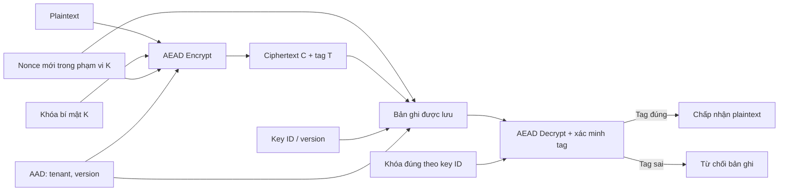
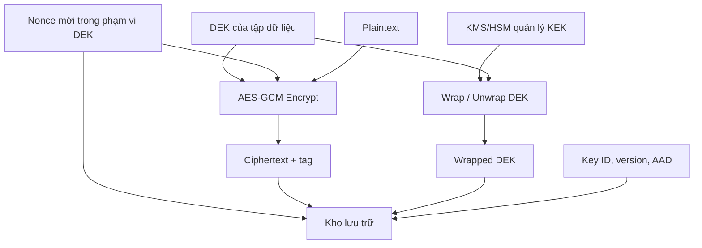

# Nonce trong mật mã đối xứng: ý nghĩa, tính duy nhất và cách quản lý an toàn

> **Chương:** Mật mã đối xứng  
> **Module:** SECURITY_KEY_MANAGEMENT_FUNDAMENTALS

**Nonce** là giá trị dùng cho một lần hoặc một ngữ cảnh thực hiện phép toán mật mã (*number used once*). Trong nhiều thuật toán mã hóa đối xứng hiện đại, nonce được đưa cùng **khóa bí mật** vào phép toán để phân biệt những lần mã hóa, kể cả khi plaintext giống nhau. Nonce thường **không cần giữ bí mật**, nhưng phải thỏa mãn quy tắc của thuật toán, nhất là **không được lặp dưới cùng một khóa** khi chế độ mã hóa yêu cầu tính duy nhất.

Ví dụ, với **AES-GCM**, một khóa AES có thể mã hóa nhiều bản ghi, miễn mỗi lần mã hóa có nonce hợp lệ và duy nhất trong phạm vi khóa đó. Nếu tái sử dụng cùng cặp **(key, nonce)**, những bảo đảm về tính bí mật và tính xác thực của GCM bị phá vỡ nghiêm trọng. Khóa AES dài 256 bit không cứu được lỗi thiết kế này.

Nonce là chi tiết nhỏ nhưng liên quan trực tiếp đến **vòng đời khóa**: tạo, cấp phát, lưu trữ, sử dụng, xoay vòng, thu hồi và hủy. Hệ thống có KMS/HSM bảo vệ khóa vẫn có thể gặp sự cố nếu ứng dụng quản lý nonce sai.

Sau bài này, người học có thể:

- Phân biệt nonce với **khóa, IV, salt, counter, authentication tag** và token chống phát lại.
- Hiểu yêu cầu **duy nhất** và **khó đoán** của nonce/IV tùy thuật toán.
- Giải thích hậu quả của nonce reuse trong **AES-GCM, AES-CTR, ChaCha20-Poly1305**.
- Chọn cách sinh nonce phù hợp: ngẫu nhiên, bộ đếm hoặc dẫn xuất theo giao thức.
- Tránh trùng nonce trong hệ thống nhiều node, có retry, restart và rotate key.
- Thiết kế định dạng lưu ciphertext, nonce, tag, AAD và key ID; sử dụng Java 17 JCA để minh họa.

## 1. Nonce đóng vai trò gì trong phép mã hóa?

Một phép mã hóa có xác thực kèm dữ liệu bổ sung (*authenticated encryption with associated data*, **AEAD**) có thể được biểu diễn:

\[
(C,T)=\operatorname{Encrypt}(K,N,P,A)
\]

| Ký hiệu | Ý nghĩa | Cần giữ bí mật? |
|---|---|---|
| \(K\) | **Key** — khóa đối xứng | Có |
| \(N\) | **Nonce** — giá trị phân biệt lần sử dụng | Thường không |
| \(P\) | **Plaintext** — dữ liệu trước mã hóa | Thường có |
| \(A\) | **AAD** — dữ liệu phụ được xác thực nhưng không mã hóa | Không nhất thiết |
| \(C\) | **Ciphertext** — bản mã | Không nhất thiết |
| \(T\) | **Authentication tag** — giá trị dùng để kiểm tra tính xác thực/toàn vẹn | Có thể lưu cùng ciphertext |

Để giải mã, ứng dụng phải cung cấp **đúng khóa, nonce, ciphertext, tag và AAD** đã dùng. Nếu kiểm tra authentication tag thất bại, **không được chấp nhận plaintext**.

Nonce không phải một khóa thứ hai. Ứng dụng thường **lưu nonce cùng ciphertext và tag** mà không cần giấu nó. Giá trị bí mật cần bảo vệ là key và plaintext; metadata khác cần bảo vệ tùy bối cảnh.

### 1.1. Minh họa hai lần mã hóa một plaintext

```text
Khóa K:       AES key bí mật
Plaintext P:  {"status":"PAID"}

Lần 1: Encrypt(K, nonce N1, P, AAD) -> ciphertext C1 + tag T1
Lần 2: Encrypt(K, nonce N2, P, AAD) -> ciphertext C2 + tag T2

Với AES-GCM: N1 phải khác N2 nếu dùng cùng khóa K.
Lưu: [keyId, N1, C1, T1] và [keyId, N2, C2, T2].
```

Mục tiêu không phải làm nonce “bí mật”, mà là đảm bảo những lần mã hóa có **ngữ cảnh duy nhất theo khóa**, đúng đặc tả thuật toán.

## 2. Hai thuộc tính khác nhau: duy nhất và khó đoán

### 2.1. Tính duy nhất (*uniqueness*)

Với **AES-GCM** và nhiều AEAD phổ biến, quy tắc cốt lõi là:

> Không thực hiện hai phép mã hóa khác nhau với **cùng một cặp (key, nonce)**.

Tính duy nhất được xét **trong phạm vi một khóa**. Một giá trị nonce có thể xuất hiện dưới hai khóa độc lập khác nhau nếu thuật toán cho phép. Tuy nhiên không được để lỗi key ID hoặc rotation khiến cùng một khóa thực tế được dùng lặp nonce mà hệ thống tưởng đó là hai khóa.

Với AES-GCM, **nonce 96 bit (12 byte)** là lựa chọn thông dụng và được khuyến nghị. Có API cho phép nonce dài khác, nhưng việc xử lý/giới hạn có thể khác; không nên tự chọn kích thước tùy ý.

### 2.2. Tính khó đoán (*unpredictability*)

**Nonce duy nhất không nhất thiết phải ngẫu nhiên.** Một counter tăng dần có thể duy nhất nếu được cấp phát chính xác, dù mọi người đoán được số tiếp theo.

- **AES-GCM:** tính duy nhất dưới cùng khóa là yêu cầu thiết yếu; một cấu trúc nonce từ bộ đếm được quản lý đúng có thể hợp lệ.
- **AES-CBC:** IV có yêu cầu riêng, điển hình là **khó đoán** đối với kẻ tấn công trong mô hình bảo mật thông dụng; counter dễ đoán có thể không phù hợp.
- **Challenge-response:** nonce được dùng để chứng minh sự mới mẻ của yêu cầu có thể cần cả tính khó đoán và chống phát lại. Đây là ngữ cảnh khác với nonce mã hóa GCM.

Không áp dụng nguyên xi quy tắc nonce của GCM sang CBC, ECDSA hoặc một giao thức khác.

## 3. Phân biệt nonce, IV, salt, counter và tag

| Thuật ngữ | Nhiệm vụ | Yêu cầu quản lý |
|---|---|---|
| **Nonce** | Phân biệt một lần gọi hoặc ngữ cảnh của phép toán mật mã | Duy nhất hoặc khó đoán theo đặc tả |
| **IV** (*initialization vector*) | Khởi tạo trạng thái của chế độ mã hóa | Có thể đóng vai trò nonce, nhưng yêu cầu khác nhau giữa GCM/CBC |
| **Salt** | Làm khác đầu vào của password hashing/KDF và giảm lợi ích của bảng tiền tính toán | Thường ngẫu nhiên và lưu cùng kết quả hash/KDF |
| **Counter** | Số đếm block, bản ghi hoặc lần mã hóa | Không được quay vòng dẫn tới lặp trạng thái dưới cùng khóa |
| **Authentication tag** | Kiểm tra tính toàn vẹn/xác thực của ciphertext và AAD | Phải xác minh trước khi chấp nhận plaintext |
| **Key ID / version** | Chỉ ra khóa dùng để giải mã | Không thay nonce; cần ràng buộc metadata thích hợp |
| **Challenge nonce** | Ràng buộc phản hồi với yêu cầu mới | Có thể đòi hỏi khó đoán và chống phát lại |

Trong Java, **AES-GCM** dùng lớp `GCMParameterSpec` truyền vào một tham số mang tên IV; giá trị này thực hiện vai trò **nonce của GCM**. Tên trong API không thay thế quy tắc bảo mật của thuật toán.

**Salt của PBKDF2/Argon2 không thay thế nonce AES-GCM.** Salt dùng ở bước dẫn xuất từ mật khẩu; sau khi có key, ứng dụng vẫn phải quản lý nonce cho **mỗi lần mã hóa**.

## 4. Nonce và IV trong các thuật toán đối xứng

| Thuật toán/chế độ | Vai trò của nonce/IV | Rủi ro nếu dùng sai |
|---|---|---|
| **AES-GCM** | Nonce thường 96 bit, duy nhất theo khóa | Lặp key/nonce gây rò rỉ quan hệ plaintext và nguy cơ giả mạo tag |
| **AES-CTR** | Nonce/counter block xác định keystream | Lặp keystream làm lộ XOR của plaintext |
| **ChaCha20-Poly1305 (IETF)** | Nonce 96 bit, duy nhất theo khóa | Lặp keystream và khóa Poly1305 dùng một lần; phá vỡ bí mật/toàn vẹn |
| **XChaCha20-Poly1305** | Nonce 192 bit theo đặc tả tương ứng, thuận tiện với chiến lược sinh ngẫu nhiên | Rủi ro va chạm ngẫu nhiên thấp hơn, nhưng không được bỏ qua giới hạn của API |
| **AES-CBC** | IV có yêu cầu khó đoán trong mô hình thông dụng | IV không phù hợp gây rò rỉ; CBC một mình không có xác thực |
| **AES-SIV/GCM-SIV** | Chế độ được thiết kế chống chịu nonce reuse tốt hơn GCM ở một mức độ nhất định | Không đồng nghĩa lặp nonce tùy ý là vô hại; vẫn có các giới hạn và rò rỉ có thể xảy ra |

Với ứng dụng mới, nên ưu tiên **AEAD có triển khai được kiểm chứng** thay vì tự ghép chế độ mã hóa và MAC. Bảng này chỉ tập trung vào nonce, chưa phải hướng dẫn chọn đầy đủ thuật toán.

## 5. Vì sao tái sử dụng nonce nguy hiểm?

### 5.1. AES-CTR: tái sử dụng keystream làm lộ quan hệ plaintext

CTR kết hợp plaintext với keystream \(S\) bằng XOR:

\[
C_1=P_1\oplus S,\qquad C_2=P_2\oplus S
\]

Nếu hai thông điệp vô tình dùng cùng keystream do trùng key và nonce/counter:

\[
C_1\oplus C_2=P_1\oplus P_2
\]

Attacker biết hoặc đoán được phần plaintext thứ nhất có thể suy ra phần tương ứng của plaintext thứ hai. Không cần biết khóa AES để khai thác quan hệ này.

### 5.2. AES-GCM: mất cả bảo mật và xác thực

**AES-GCM** kết hợp cơ chế mã hóa dựa trên counter và cơ chế xác thực GHASH. Tái sử dụng nonce dưới cùng key có thể làm lặp keystream và để lộ thông tin phục vụ **giả mạo tag** trong những điều kiện nhất định. Hậu quả không đơn thuần là “hai ciphertext giống nhau”.

Sau khi xảy ra nonce reuse, chỉ phát nonce mới từ thời điểm đó **không khôi phục** bí mật của các bản ghi đã mã hóa sai. Phải đánh giá phạm vi, thay khóa và có thể mã hóa lại dữ liệu liên quan.

### 5.3. Ví dụ lỗi trong cluster

```text
Key K:       một khóa AES-GCM dùng chung toàn bộ order-service

Node A khởi động: counter = 0
Node B khởi động: counter = 0

Node A: Encrypt(K, nonce=0, order-123)
Node B: Encrypt(K, nonce=0, order-456)

=> Trùng (K, nonce), dù mỗi node nghĩ mình có counter riêng.
```

Lỗi xuất phát từ **thiết kế cấp phát nonce và quản lý khóa**, không cần có bug trong bản thân thư viện AES. KMS có thể bảo vệ key gốc nhưng không tự biết hai node đã dùng cùng nonce nếu ứng dụng tự mã hóa bằng DEK ở ngoài KMS.

## 6. Ba chiến lược sinh nonce

### 6.1. Nonce ngẫu nhiên từ CSPRNG

Với AES-GCM, cách thông dụng là sinh **12 byte** mới từ **CSPRNG** cho từng lần mã hóa:

```java
import java.security.SecureRandom;

SecureRandom random = new SecureRandom();
byte[] nonce = new byte[12];
random.nextBytes(nonce);
```

Ưu điểm: đơn giản, không cần counter bền vững cho từng khóa khi tổng số phép mã hóa nằm trong giới hạn phù hợp. Hạn chế: nonce ngẫu nhiên vẫn có **xác suất va chạm**. Cần giới hạn số lần dùng key, tuân thủ chuẩn/chính sách của provider và rotate key đúng lúc.

Giả sử nonce phân bố độc lập, đều trên không gian 96 bit, với \(q\) lần sinh thì xác suất có **ít nhất một va chạm** gần đúng:

\[
p_{\mathrm{collision}}\approx\frac{q(q-1)}{2^{97}}
\]

Ví dụ với \(q=10^6\), xác suất xấp xỉ \(6{,}3\times10^{-18}\) trong mô hình lý tưởng. Đây chỉ là ước lượng xác suất, **không phải cam kết duy nhất tuyệt đối**; lỗi RNG, tái tạo state từ snapshot hoặc cấu hình hệ thống có thể làm nguy cơ cao hơn nhiều.

### 6.2. Nonce từ counter duy nhất

Một bộ đếm tăng đơn điệu có thể tránh va chạm ngẫu nhiên, nhưng phải giải quyết:

- **Restart:** không quay về giá trị đã dùng dưới cùng key.
- **Nhiều node:** các writer không được cùng chiếm một giá trị nonce theo khóa.
- **Rollback/restore:** trạng thái snapshot cũ không được tạo lại nonce đã cấp trước đó.
- **Overflow:** không tăng counter quá không gian cấp phát cho phép.
- **Retry:** không trả nonce đã dùng về pool để cấp lại chỉ vì transaction timeout.

Thiết kế có thể dành **một phần nonce cho writer ID được cấp độc nhất** và **phần còn lại cho counter**. Ví dụ minh họa 96 bit = 32 bit writer ID + 64 bit counter, nếu đặc tả thuật toán cho phép cách dựng đó. Mỗi writer ID phải được quản lý không trùng dưới cùng key, và mỗi counter phải bền vững khi restart. Đây là một mô hình phân vùng, không phải cấu hình có thể chép vào mọi hệ thống mà không đánh giá.

### 6.3. Nonce dẫn xuất theo giao thức

Không phải mỗi bản ghi đều sinh một nonce random. Trong **TLS 1.3**, nonce cho bản ghi có thể được dựng từ **static IV của traffic key** XOR với **sequence number đã được đệm theo đặc tả**. Điều quan trọng là quy tắc giao thức bảo đảm nonce không lặp trong phạm vi traffic key và có cơ chế cập nhật key.

**Không tự thay công thức nonce của TLS hoặc JSSE.** Hãy để thư viện giao thức quản lý sequence number, nonce, key schedule và key update. Ứng dụng chỉ tự sinh nonce khi thực hiện phép mã hóa ở tầng ứng dụng như AES-GCM để lưu dữ liệu.

### 6.4. Gợi ý lựa chọn

| Trường hợp | Hướng tiếp cận |
|---|---|
| Service mã hóa record bằng AES-GCM, số lượng phép mã hóa được kiểm soát | Nonce 96 bit từ CSPRNG, theo dõi ngân sách sử dụng key |
| Hệ thống throughput lớn có state cấp phát đáng tin | Counter construction theo chuẩn và kiểm soát state bền vững |
| Nhiều writer cùng dùng một key | Chia miền nonce hoặc tách key theo writer, bảo đảm không trùng |
| TLS/QUIC hoặc giao thức đã định nghĩa nonce | Dùng đúng API/giao thức thay vì tạo riêng |
| Cần giảm nguy cơ lỗi khi nonce bị lặp | Cân nhắc AEAD chống chịu misuse phù hợp cùng các giới hạn của nó |

## 7. Nonce trong hệ thống phân tán, retry và restart

### 7.1. Nhiều writer chia sẻ một key

Nếu node A và node B cùng dùng key K nhưng cả hai khởi tạo counter 0, chắc chắn có nguy cơ lặp nonce. Những hướng khả thi:

1. **Key riêng theo node/tenant/writer** và metadata cho phép chọn đúng key khi decrypt.
2. **Miền nonce tách biệt:** mỗi writer có prefix được cấp duy nhất + counter không lặp.
3. **Bộ cấp phát tập trung hoặc lease:** giữ cấp phát không trùng, xử lý gián đoạn mạng, lease và failover.

Mỗi hướng cần một phương án xử lý backup, restore, di chuyển node và thay khóa. Không có giải pháp tự an toàn khi bỏ qua trạng thái thực tế.

### 7.2. Retry: mã hóa lại khác với ghi lại

Giả sử bản ciphertext đã được tạo nhưng request lưu trữ bị timeout:

- **Gửi lại chính ciphertext/nonce/tag cũ đến storage** có thể là retry thao tác ghi, không phải một phép mã hóa AES-GCM mới.
- **Gọi mã hóa thêm lần nữa** dưới cùng key phải có nonce mới, cho dù plaintext giống hệt.
- **Mã hóa lại bằng nonce cũ nhưng plaintext/AAD khác** tạo lỗi nghiêm trọng.

Hãy tách rõ **bước mã hóa** và **bước lưu trữ**. Không mặc định rằng transaction ID cố định sẽ là nonce an toàn cho mọi lần retry.

### 7.3. Rollback, restore và key rotation

Nếu ứng dụng phục hồi snapshot có counter cũ trong khi bản mã được tạo sau snapshot vẫn tồn tại, counter có thể tái sử dụng nonce. Cần bảo đảm state cấp phát không đi lùi hoặc **chuyển sang key mới** trước khi tiếp tục mã hóa.

Khi rotate key, tính duy nhất được xét theo key mới. Ciphertext cũ vẫn phải lưu **key ID/version và nonce** để giải mã bằng đúng key. Chỉ đổi key ID trong metadata không tương đương mã hóa lại dữ liệu.

## 8. Thiết kế bản ghi ciphertext để lưu và giải mã

Một bản ghi mã hóa có xác thực có thể có cấu trúc:

```text
EncryptedRecord {
  formatVersion: 1
  keyId: "orders-dek-v17"
  algorithm: "AES-256-GCM"
  nonce: <12 bytes>
  ciphertext: <encrypted bytes>
  tag: <16 bytes>
  aadContext: <metadata cần được xác thực>
}
```

Ứng dụng phải giữ **nonce, tag, ciphertext, thuật toán và định danh khóa** phù hợp. Một số thư viện trả **ciphertext và tag gộp** trong cùng mảng byte; cần tài liệu hóa cách serialize để đọc đúng.

**AAD** (*additional authenticated data*) cho phép bảo vệ tính toàn vẹn của metadata **không mã hóa**, ví dụ tenant ID, loại record hoặc phiên bản định dạng. Phía decrypt phải xây dựng **đúng cùng byte AAD**; tốt nhất ràng buộc metadata quan trọng với nguồn tin cậy, tránh dùng thông tin bị thay tùy ý làm căn cứ quyết định quyền truy cập.



Nếu phải đọc dữ liệu nhiều năm sau, việc đánh rơi nonce cũng làm bản ghi **không giải mã được**, dù vẫn còn key. Kiểm soát tính nhất quán, backup và migration của metadata là một phần quan trọng của key management.

## 9. Ví dụ Java 17: AES-GCM với nonce mới cho từng lần mã hóa

Ví dụ Java dùng JCA/JCE. Mỗi lần gọi `encrypt()` tạo nonce **12 byte** bằng `SecureRandom`. `GCMParameterSpec(128, nonce)` yêu cầu authentication tag **128 bit**. Bản ghi được đóng gói theo thứ tự: version (1 byte), nonce (12 byte), ciphertext gộp với tag.

```java
import java.nio.ByteBuffer;
import java.nio.charset.StandardCharsets;
import java.security.GeneralSecurityException;
import java.security.SecureRandom;
import java.util.Arrays;
import javax.crypto.Cipher;
import javax.crypto.KeyGenerator;
import javax.crypto.SecretKey;
import javax.crypto.spec.GCMParameterSpec;

public final class AesGcmNonceDemo {
    private static final SecureRandom RANDOM = new SecureRandom();
    private static final int NONCE_BYTES = 12;
    private static final int TAG_BITS = 128;
    private static final int TAG_BYTES = TAG_BITS / 8;
    private static final byte FORMAT_VERSION = 1;

    // Demo dùng AAD hằng số; thực tế cần ràng buộc metadata
    // theo bản ghi, với canonical encoding và nguồn tin cậy.
    private static final byte[] AAD =
            "orders:v1|tenant=demo".getBytes(StandardCharsets.UTF_8);

    public static byte[] encrypt(SecretKey key, byte[] plaintext)
            throws GeneralSecurityException {
        byte[] nonce = new byte[NONCE_BYTES];
        RANDOM.nextBytes(nonce); // Sinh mới cho MỖI lần encrypt.

        Cipher cipher = Cipher.getInstance("AES/GCM/NoPadding");
        cipher.init(
                Cipher.ENCRYPT_MODE,
                key,
                new GCMParameterSpec(TAG_BITS, nonce)
        );
        cipher.updateAAD(AAD);
        byte[] ciphertextAndTag = cipher.doFinal(plaintext);

        // Với JCA GCM, ciphertext và tag nằm trong cùng mảng byte.
        return ByteBuffer.allocate(1 + NONCE_BYTES + ciphertextAndTag.length)
                .put(FORMAT_VERSION)
                .put(nonce)
                .put(ciphertextAndTag)
                .array();
    }

    public static byte[] decrypt(SecretKey key, byte[] packed)
            throws GeneralSecurityException {
        if (packed.length < 1 + NONCE_BYTES + TAG_BYTES) {
            throw new IllegalArgumentException("Encrypted record too short");
        }

        ByteBuffer input = ByteBuffer.wrap(packed);
        if (input.get() != FORMAT_VERSION) {
            throw new IllegalArgumentException("Unsupported format version");
        }

        byte[] nonce = new byte[NONCE_BYTES];
        input.get(nonce);
        byte[] ciphertextAndTag = new byte[input.remaining()];
        input.get(ciphertextAndTag);

        Cipher cipher = Cipher.getInstance("AES/GCM/NoPadding");
        cipher.init(
                Cipher.DECRYPT_MODE,
                key,
                new GCMParameterSpec(TAG_BITS, nonce)
        );
        cipher.updateAAD(AAD); // Phải khớp AAD khi encrypt.
        return cipher.doFinal(ciphertextAndTag);
        // Tag sai -> GeneralSecurityException (thường AEADBadTagException).
    }

    public static void main(String[] args) throws Exception {
        // Demo chỉ giữ key trong một tiến trình. Hệ thống thật
        // cần giữ key qua KMS / envelope encryption để giải mã sau.
        KeyGenerator generator = KeyGenerator.getInstance("AES");
        generator.init(256);
        SecretKey key = generator.generateKey();

        byte[] plaintext =
                "don-hang-123".getBytes(StandardCharsets.UTF_8);
        byte[] record1 = encrypt(key, plaintext);
        byte[] record2 = encrypt(key, plaintext);
        byte[] recovered = decrypt(key, record1);

        System.out.println("Giai ma dung: " +
                Arrays.equals(plaintext, recovered));
        System.out.println("Hai record khac nhau: " +
                !Arrays.equals(record1, record2));
    }
}
```

**Những điều cần lưu ý:**

1. **Nonce được lưu trong bản ghi.** Khi decrypt phải dùng **chính nonce đã dùng khi encrypt**, không tạo nonce mới.
2. **Tag là một phần của dữ liệu đầu ra JCA.** Nếu sai key, nonce, ciphertext, tag hoặc AAD, phép giải mã sẽ thất bại với xác suất rất cao. Trong Java, lỗi thường thể hiện qua `AEADBadTagException`; không được nuốt lỗi rồi cố dùng plaintext.
3. **AAD cần chuẩn hóa byte encoding.** Trong ứng dụng đa tenant phải xây AAD ổn định từ ngữ cảnh đáng tin, không mặc định một chuỗi hằng cho mọi record.
4. Ví dụ chỉ có **một key trong bộ nhớ**, chưa có key ID, rotation, KMS/HSM hoặc ngân sách số phép mã hóa. Dự án thật cần quản lý cả những yếu tố này.
5. Việc hai bản ghi khác nhau **không chứng minh** nonce không thể va chạm. Nonce random có xác suất va chạm và cần chính sách giới hạn số phép mã hóa theo key.
6. Khi lưu dữ liệu thật, phải kiểm tra format, giới hạn kích thước, quyền truy cập, lỗi storage; không in key hoặc plaintext nhạy cảm ra log.

## 10. Kết nối nonce với KMS/HSM và envelope encryption

Trong **envelope encryption**, một **KEK** (*key-encryption key*) được KMS/HSM bảo vệ. Ứng dụng sinh hoặc nhận **DEK** (*data-encryption key*) để mã hóa dữ liệu thực tế. Quy trình phổ biến:

1. **KMS/HSM** quản lý KEK, chính sách IAM và thao tác wrap/unwrap hoặc GenerateDataKey.
2. Ứng dụng có **DEK** thích hợp cho phạm vi dữ liệu cần bảo vệ.
3. Ứng dụng mã hóa bằng **AES-GCM**, cấp **nonce mới phù hợp cho mỗi lần mã hóa dưới DEK**.
4. DEK được wrap bằng KEK, còn kho dữ liệu lưu **ciphertext, nonce, tag, wrapped DEK, key ID và metadata**.
5. Khi đọc, KMS unwrap DEK theo quyền hợp lệ; ứng dụng dùng đúng **DEK, nonce, ciphertext, tag và AAD** để giải mã.



**KMS không tự bảo đảm nonce duy nhất** nếu ứng dụng nhận plaintext DEK rồi tự mã hóa ở ngoài KMS. Trách nhiệm cấp nonce thuộc về **thành phần trực tiếp thực hiện phép mã hóa**, trừ khi API mã hóa của dịch vụ đã quản lý nonce theo hợp đồng rõ ràng.

**Rotate KEK** không sửa lỗi **nonce reuse dưới DEK**. Nếu cùng DEK được dùng với nonce trùng, chỉ rewrap DEK bằng KEK mới sẽ không thay đổi các ciphertext đã được tạo sai. Cần đánh giá phạm vi ảnh hưởng và có thể **sinh DEK mới, mã hóa lại dữ liệu**.

### 10.1. Key rotation và cặp (key, nonce)

Về nguyên tắc, cùng nonce có thể xuất hiện **dưới hai khóa mật mã độc lập khác nhau** nếu thuật toán cho phép, vì cặp key/nonce là khác. Nhưng hệ thống phải đảm bảo key **thực sự đã thay** và metadata luôn trỏ đúng key. Rotation không thay thế thiết kế cấp phát nonce chính xác.

### 10.2. IAM và kiểm toán

IAM/KMS policy cần giới hạn ai có thể gọi **GenerateDataKey, Encrypt, Decrypt, Wrap/Unwrap** theo đúng vai trò. Audit nên ghi đủ **key ID, workload, writer, số lần mã hóa, sự kiện rotate, counter rollover và thay đổi cấu hình cấp nonce**. Không ghi key material, plaintext DEK, KEK hoặc dữ liệu khách hàng nhạy cảm vào log.

Nonce thường công khai, nhưng metadata liên kết nonce với một record nhạy cảm vẫn cần được quản lý quyền truy cập và lưu trữ theo chính sách.

## 11. Nonce không tự giải quyết replay attack

Một nhầm lẫn phổ biến là: “nonce đã duy nhất thì không thể phát lại bản tin.” **AEAD không tự lưu lịch sử các bản tin đã xử lý.**

```text
packet = (nonce N, ciphertext C, tag T)

Server nhận packet lần đầu: xác minh tag thành công.
Attacker gửi lại nguyên packet N/C/T.
Nếu server không có replay protection, tag vẫn hợp lệ.
```

Nonce bảo đảm giả định an toàn cho **phép mã hóa**, còn chống phát lại cần cơ chế giao thức hoặc ứng dụng như sequence number, replay window, message ID, TTL, trạng thái đã xử lý và idempotency. Metadata chống replay có thể được ràng buộc bằng AAD, nhưng **chỉ đưa sequence vào AAD chưa đủ** nếu bên nhận không kiểm tra tính mới.

Trong **challenge-response**, nonce có thể đóng vai trò khác: chứng minh phản hồi thuộc một challenge mới, và khi đó nonce có thể cần khó đoán. Ngoài phạm vi đối xứng, **ECDSA** cũng sử dụng giá trị mỗi chữ ký thường gọi là nonce \(k\); tái sử dụng nó có thể làm lộ private key. Không lấy cách sinh/định nghĩa nonce của GCM áp dụng cho ECDSA.

## 12. Quy trình xử lý khi phát hiện nonce reuse

Lặp nonce dưới cùng key của một AEAD như AES-GCM là **sự cố mật mã**, kể cả khi chưa có bằng chứng dữ liệu đã bị kẻ tấn công đọc hoặc sửa.

### Bước 1 — Chặn phát sinh thêm bản mã sai

Tạm dừng hoặc chuyển tuyến luồng mã hóa bị lỗi. Khoanh vùng **key ID/version, thuật toán, writer, node, thời điểm và trạng thái counter/RNG**. Nếu nguyên nhân là counter reset, writer ID trùng hoặc cấu hình nonce cố định, phải sửa cơ chế cấp nonce trước khi tiếp tục hoạt động.

### Bước 2 — Bảo toàn bằng chứng, tìm record bị ảnh hưởng

Thu thập metadata cho các cặp **(key ID, nonce)** trùng, thời điểm tạo, request ID và log truy cập bản mã. Không xuất key plaintext hay dữ liệu khách hàng vào ticket/log chỉ để xác minh. Phân biệt **số bản ghi có nguy cơ** với **số bản ghi xác nhận bị khai thác**.

### Bước 3 — Đánh giá tính bí mật và toàn vẹn

Xác định attacker có thể truy cập ciphertext nào, biết hoặc đoán plaintext nào, và có khả năng giả mạo bản mã hay không. Nếu nghi có tag giả hoặc dữ liệu bị sửa, phải đối chiếu với nguồn tin cậy/backup đã xác minh; không mặc định ciphertext hiện tại chắc chắn đáng tin.

### Bước 4 — Thay khóa và di chuyển dữ liệu

Ngừng dùng key/DEK bị ảnh hưởng để **mã hóa mới**. Tạo key thay thế trong môi trường an toàn và khắc phục nonce allocation. Với dữ liệu lưu lâu dài, đánh giá việc **mã hóa lại dữ liệu bằng key và nonce mới**, xử lý tính nhất quán, retry và kiểm chứng nguồn dữ liệu trước khi migration.

### Bước 5 — Thu hồi có kiểm soát và giám sát

Theo dõi lỗi giải mã, tiến độ migration, trạng thái key và cảnh báo counter bất thường. Không hủy khóa cũ quá sớm khi còn dữ liệu cần khôi phục; nhưng cũng không tiếp tục cấp quyền mã hóa mới trên key đã gặp lỗi. Bổ sung kiểm tra failover, restore, retry, key budget và replay vào quy trình phòng ngừa.

## 13. Anti-pattern thường gặp

| Lỗi | Hậu quả | Cách sửa |
|---|---|---|
| Hard-code nonce 12 byte bằng 0 và mã hóa nhiều bản tin bằng một key | Chắc chắn lặp cặp key/nonce | Sinh nonce mới hoặc cấp bằng counter duy nhất |
| Dùng timestamp theo mili giây làm nonce | Nhiều request cùng mili giây hoặc nhiều node có thể trùng | CSPRNG hoặc cơ chế cấp phát duy nhất |
| Dùng `java.util.Random` thay vì CSPRNG cho nonce random | Không có bảo đảm an toàn mật mã của nguồn ngẫu nhiên | Dùng `SecureRandom` hoặc cơ chế giao thức yêu cầu |
| Node reset counter = 0 mỗi lần khởi động | Có thể tái sử dụng nonce đã dùng dưới key cũ | Counter bền vững, chia miền nonce hoặc đổi key |
| Retry mã hóa với cùng nonce | Có nguy cơ lặp keystream, phá vỡ GCM | Nonce mới cho phép mã hóa mới; retry lưu đúng ciphertext cũ khi phù hợp |
| Lưu ciphertext nhưng bỏ nonce hoặc tag | Không giải mã hoặc xác thực được bản ghi | Lưu format, key ID, nonce, ciphertext, tag |
| Xem nonce là secret phải giấu, bỏ qua uniqueness | Không ngăn lặp nonce | Bảo vệ key, quản lý nonce theo thuật toán |
| Lấy salt password KDF làm nonce cho mọi record | Salt phục vụ mục đích khác, không bảo đảm nonce không lặp theo key | Cấp nonce riêng cho từng phép mã hóa |
| Rotate KEK nhưng giữ DEK đã bị lỗi nonce | Ciphertext cũ vẫn bị ảnh hưởng | Xem xét thay DEK và reencrypt |
| Tin AEAD tự chống replay | Bản tin hợp lệ gửi lại vẫn có thể được xác thực | Replay window, sequence, TTL, idempotency |
| Chuyển sang CBC với IV từ counter vì GCM cho phép counter nonce | CBC có yêu cầu IV khác và thiếu xác thực tích hợp | Chọn AEAD phù hợp, tuân thủ mode và đặc tả |

## 14. Checklist trước khi đưa AES-GCM vào production

1. **Key scope:** key nào mã hóa record, có phạm vi riêng cho tenant/writer không, có key ID/version để decrypt không?
2. **Nonce source:** mỗi lần mã hóa cấp nonce thế nào, kích thước/cách dựng có đúng mode và API không?
3. **Uniqueness:** có giới hạn số lần dùng key hoặc cách chứng minh không lặp, bao gồm multi-node, retry, failover, snapshot và restore không?
4. **AEAD:** tag được xác minh đầy đủ, sai tag có bị từ chối, ứng dụng có tránh dùng plaintext chưa xác thực không?
5. **AAD:** metadata cần xác thực (tenant, record type, version) có byte encoding nhất quán và nguồn tin cậy không?
6. **Record format:** có lưu nonce/tag/ciphertext/key ID, xử lý sai version, cắt cụt hoặc mất metadata không?
7. **KMS/HSM:** KEK/DEK nằm ở đâu, thành phần nào chịu trách nhiệm cấp nonce, IAM giới hạn quyền dùng khóa ra sao?
8. **Rotation:** có ngân sách dùng key, kế hoạch đổi key và khả năng decrypt dữ liệu cũ không?
9. **Audit:** có phát hiện bất thường của writer/counter, thay policy và key rotation mà không ghi secret không?
10. **Sự cố:** đã thử kịch bản duplicate nonce, replay, tag sai, rollback counter và migration DEK chưa?

## 15. Câu hỏi tự kiểm tra

**1. Nonce AES-GCM có cần giữ bí mật như AES key không?**  
Không. Nonce thường được lưu cùng ciphertext; yêu cầu cốt lõi là **không lặp dưới cùng key**.

**2. Nonce bằng 0 xuất hiện dưới hai key AES thật sự độc lập có nhất thiết sai không?**  
Không nhất thiết. Với GCM, giới hạn không lặp được xét cho **cặp (key, nonce)**. Tuy nhiên cần đảm bảo hệ thống thực sự dùng hai key khác nhau, không lỗi key ID/rotation.

**3. Sinh nonce 96 bit ngẫu nhiên có chắc chắn không trùng không?**  
Không. Nó có xác suất va chạm. Cần CSPRNG, giới hạn số lần mã hóa dưới key và tuân thủ ngân sách theo chuẩn; nếu muốn tránh va chạm bằng cấu trúc phải quản lý counter và writer chính xác.

**4. Vì sao GCM nonce reuse nguy hiểm hơn việc hai ciphertext giống nhau?**  
Vì reuse làm hỏng giả định keystream và GHASH; có nguy cơ lộ plaintext và giả mạo tag, không chỉ lộ tính bằng nhau của dữ liệu.

**5. Gửi lại nguyên ciphertext, nonce và tag hợp lệ có tự bị AEAD từ chối không?**  
Không. AEAD có thể xác thực lại cùng packet. Cần replay protection riêng.

**6. Đã dùng KMS/HSM thì có thể bỏ qua nonce management không?**  
Không. Nếu ứng dụng tự mã hóa bằng DEK, nó chịu trách nhiệm về nonce; nếu dùng API mã hóa trực tiếp của dịch vụ, phải hiểu dịch vụ cấp và kiểm soát nonce như thế nào.

**7. Rotate KEK có sửa được dữ liệu đã bị nonce reuse dưới DEK cũ không?**  
Không. Rewrap DEK bằng KEK mới không thay đổi những ciphertext đã dùng cặp (DEK, nonce) sai. Cần đánh giá phạm vi và có thể thay DEK rồi reencrypt.

## 16. Ghi nhớ

**Nonce là giá trị phân biệt lần sử dụng khóa, thường công khai nhưng phải tuân thủ nghiêm ngặt quy tắc của thuật toán.** Với **AES-GCM, AES-CTR và ChaCha20-Poly1305**, lặp nonce dưới cùng key có thể phá vỡ tính bí mật và toàn vẹn. Với các chế độ khác, IV/nonce có thể còn đòi hỏi tính khó đoán.

Trong kiến trúc an toàn, nonce là một phần của **vòng đời khóa và dữ liệu mã hóa**: sinh đúng, bảo đảm duy nhất theo key, lưu cùng ciphertext/tag, xử lý multi-node/retry/restart, đặt giới hạn sử dụng, thay key và giám sát sự cố. **KMS/HSM bảo vệ key; thành phần thực hiện mã hóa phải dùng nonce đúng cách**. Cần cả hai để bảo toàn tính bí mật, tính toàn vẹn và khả năng giải mã dữ liệu.
