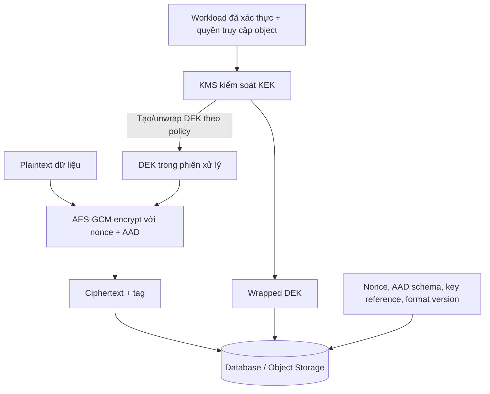
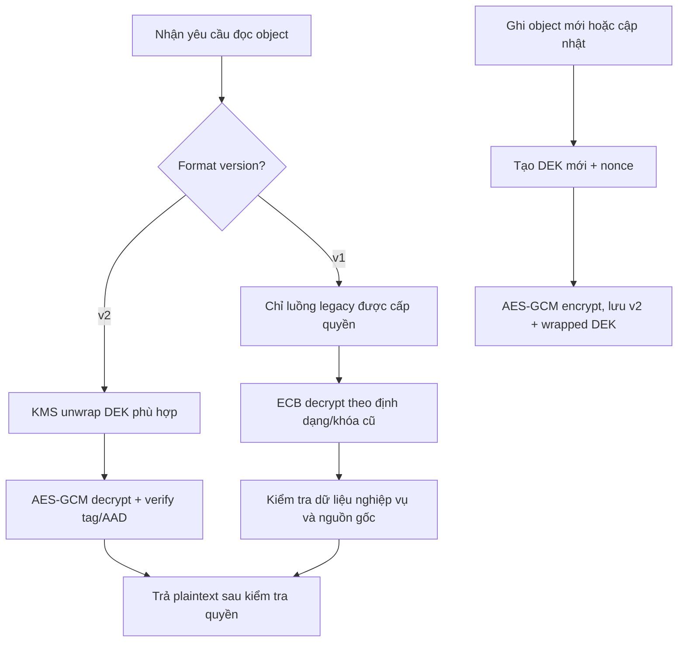

# Không dùng ECB cho dữ liệu nhạy cảm

> **Chương:** Mật mã đối xứng  
> **Phạm vi module:** SECURITY_KEY_MANAGEMENT_FUNDAMENTALS — hiểu vòng đời khóa mật mã từ tạo, cấp phát, lưu trữ, sử dụng, xoay vòng đến thu hồi và hủy; kết hợp mật mã đối xứng, bất đối xứng, chữ ký số, KMS/HSM, envelope encryption, kiểm soát truy cập và kiểm toán để bảo vệ khóa và dữ liệu.

## 1. Mục tiêu học tập

Sau bài này, bạn có thể:

1. Giải thích **Electronic Codebook (ECB)** vận hành trên các khối dữ liệu như thế nào và tại sao tính **xác định** của nó làm lộ mẫu lặp.
2. Phân tích hậu quả khi dùng AES-ECB cho file, ảnh, bản ghi cơ sở dữ liệu hoặc trường dữ liệu nhạy cảm, kể cả khi thuật toán AES và độ dài khóa đều mạnh.
3. Nhận diện ECB trong thiết kế, cấu hình và mã Java/JCA; hiểu vì sao **padding**, đổi khóa định kỳ hay giấu tên thuật toán không khắc phục vấn đề cốt lõi.
4. Biết khi nào nên sử dụng **authenticated encryption with associated data (AEAD)** như AES-GCM, yêu cầu không tái sử dụng nonce với cùng khóa và xác thực authentication tag.
5. Thiết kế luồng mã hóa dữ liệu dùng **DEK/KEK, KMS/HSM và envelope encryption**, đồng thời phân biệt mã hóa dữ liệu với kiểm soát truy cập và kiểm toán.
6. Lập kế hoạch chuyển đổi dữ liệu cũ mã hóa bằng ECB sang cơ chế an toàn hơn, không gây mất khả năng đọc bản ghi lịch sử hoặc backup.

## 2. ECB là gì?

**ECB (Electronic Codebook)** là một *mode of operation* của mật mã khối. Với AES, kích thước **mỗi block là 128 bit (16 byte)**, bất kể khóa AES dài 128, 192 hay 256 bit.

ECB chia plaintext thành các khối có kích thước cố định. Mỗi khối được mã hóa **độc lập** bằng cùng một khóa:

```text
Plaintext:  P1          P2          P3          P4
            |           |           |           |
          AES(K)      AES(K)      AES(K)      AES(K)
            |           |           |           |
Ciphertext: C1          C2          C3          C4
```

Với khóa `K` và phép mã hóa một khối `E_K`:

\[
C_i = E_K(P_i)
\]

Đối với plaintext nhiều khối có padding thích hợp ở khối cuối:

\[
\operatorname{ECB}_K(P_1 \| P_2 \| \dots \| P_n)
= E_K(P_1) \| E_K(P_2) \| \dots \| E_K(P_n)
\]

**Hệ quả quyết định:** nếu hai khối plaintext bằng nhau và được mã hóa **bằng cùng khóa**, hai khối ciphertext tương ứng cũng bằng nhau:

\[
P_i = P_j \implies E_K(P_i) = E_K(P_j)
\]

ECB không có IV/nonce cho từng thông điệp hay cơ chế ngẫu nhiên hóa các khối giống nhau. Tính xác định này chính là nguồn gốc của sự rò rỉ cấu trúc.

### 2.1. Ví dụ khối trùng nhau

Giả sử ký hiệu `A` là một khối 16 byte giống hệt nhau, `B` là khối 16 byte khác:

| Vị trí | Plaintext | Ciphertext AES-ECB với cùng khóa |
| --- | --- | --- |
| Khối 1 | A | X |
| Khối 2 | B | Y |
| Khối 3 | A | X |
| Khối 4 | A | X |
| Khối 5 | B | Y |

Bên quan sát ciphertext nhìn thấy chuỗi `X - Y - X - X - Y`. Họ chưa cần biết khóa hay nội dung đầy đủ của `A` và `B` để nhận ra: vị trí 1, 3, 4 chứa plaintext giống nhau; vị trí 2 và 5 cũng giống nhau.

Đối với **dữ liệu nhạy cảm**, cấu trúc đó đã là thông tin có giá trị: sự lặp lại của mẫu, bố cục biểu mẫu, phần chung của hồ sơ, trạng thái hoặc thuộc tính người dùng.

### 2.2. Vì sao có thể rò rỉ dù AES vẫn mạnh?

**AES** là thuật toán mã hóa khối, được thiết kế chống nhiều dạng tấn công mật mã. **ECB** là cách sử dụng AES để mã hóa nhiều khối dữ liệu. Một thuật toán khối mạnh **không tự bảo đảm rằng mọi mode of operation sử dụng nó đều an toàn cho mục đích mã hóa thông điệp**.

Có thể có hai phát biểu đồng thời đúng:

- Kẻ tấn công rất khó suy ra khóa AES chỉ từ một số ciphertext.
- Kẻ tấn công vẫn phân biệt được các khối plaintext trùng nhau, nhận biết bố cục hoặc hoán đổi khối ciphertext khi hệ thống không kiểm tra tính toàn vẹn.

**Không nên kết luận rằng ECB luôn làm lộ nguyên văn toàn bộ plaintext.** Rủi ro chính là lộ sự bằng nhau và cấu trúc của dữ liệu; mức độ khôi phục thêm thông tin phụ thuộc định dạng, tính dự đoán được của plaintext và quyền quan sát/đưa dữ liệu vào hệ thống của kẻ tấn công.

## 3. Tại sao ECB không phù hợp với dữ liệu nhạy cảm?

### 3.1. Lộ mẫu lặp và cấu trúc

Khi ảnh, biểu mẫu hoặc file có nhiều khối giống nhau, các ciphertext block tương ứng cũng trùng. Nếu các khối được đặt lại đúng vị trí trong một định dạng có thể quan sát, hình dạng hoặc bố cục tổng thể vẫn có thể nhận ra.

Một hình minh họa nổi tiếng dùng ảnh một con chim cánh cụt: mã hóa phần pixel ảnh bằng ECB vẫn để lộ hoa văn lớn, vì các vùng màu giống nhau tạo khối lặp. Đây là **trực quan hóa hiện tượng**, không phải mọi file ảnh ECB đều hiển thị rõ hình gốc; mã hóa dữ liệu nén hoặc có cấu trúc khác có thể che bớt hoa văn trực quan mà **không làm ECB thành an toàn**.

Trong dữ liệu nghiệp vụ, mẫu lặp có thể xuất hiện ở:

- Các biểu mẫu với nhiều trường cố định hoặc khoảng trắng/padding.
- File chứa tiêu đề, template, cấu trúc lặp hoặc bản ghi được xếp thành các khối đều nhau.
- Các cột trạng thái có số giá trị ít (ví dụ `ACTIVE`/`SUSPENDED`), nếu đóng gói/mã hóa giống nhau và dùng lại khóa.
- Hàng loạt bản ghi cùng tenant có cùng prefix/metadata định dạng cố định.
- Object hoặc file được lưu với nội dung giống nhau dưới cùng khóa.

### 3.2. Rò rỉ bằng nhau giữa các bản ghi ngắn

Ngay cả khi mỗi giá trị chỉ chiếm **một block**, ECB vẫn có tính xác định: cùng plaintext và cùng khóa tạo ra cùng ciphertext (khi padding/serialization cũng giống nhau).

Ví dụ một dịch vụ mã hóa trường `status` hoặc `countryCode` bằng cùng khóa AES-ECB:

```text
user 101: ACTIVE   → ciphertext X
user 102: DISABLED → ciphertext Y
user 103: ACTIVE   → ciphertext X
user 104: ACTIVE   → ciphertext X
```

Kẻ đọc database không cần giải mã vẫn có thể thống kê tần suất ciphertext, biết những bản ghi có cùng giá trị và liên kết thay đổi qua thời gian. Nếu biết trước một vài cặp plaintext/ciphertext hoặc có khả năng gửi dữ liệu lựa chọn vào dịch vụ, họ có thể học cách nhận diện một số giá trị nhạy cảm. Điều này đặc biệt đáng ngại đối với **miền dữ liệu có ít giá trị** như cờ trạng thái, giới tính được mã hóa thành danh mục, loại tài khoản hoặc vùng địa lý.

Việc chọn **AES-256 thay cho AES-128** không làm mất tính xác định của ECB. Khóa dài hơn không ngẫu nhiên hóa kết quả cho hai plaintext bằng nhau.

### 3.3. Không có xác thực tính toàn vẹn

ECB tự thân **không có authentication tag** và không phát hiện việc ciphertext bị sửa đổi/hay tráo đổi. Một attacker có thể thay thế hoặc sắp xếp lại các block ciphertext. Khi giải mã, hệ thống sẽ tạo ra các block plaintext tương ứng; kết quả có thể vẫn hợp lệ về cú pháp trong một số định dạng.

Ví dụ minh họa theo block:

```text
Ciphertext gốc:       C_A | C_B | C_C
Ciphertext bị tráo:   C_A | C_X | C_C
Plaintext sau giải mã:P_A | P_X | P_C
```

Kết quả tùy vào ranh giới khối, padding, định dạng dữ liệu và các kiểm tra ở lớp ứng dụng. Nhưng **không có cơ chế xác thực mật mã trong ECB để khẳng định ciphertext chưa bị can thiệp**.

Lưu ý: những chế độ chỉ mã hóa như **CBC hoặc CTR cũng không tự bảo đảm tính toàn vẹn**. Không nên “sửa” ECB bằng cách đổi sang CBC/CTR thuần mà quên bảo vệ chống sửa đổi. Với ứng dụng mới, thường nên chọn **AEAD**.

### 3.4. Có thể xây dựng bảng đối chiếu với dữ liệu dự đoán được

Trong những trường hợp dữ liệu đầu vào có ít lựa chọn, kẻ tấn công có **quyền thử mã hóa đầu vào đã chọn** có thể so sánh ciphertext để suy ra bản ghi được mã hóa thuộc loại nào.

Chẳng hạn:

- Hệ thống dùng AES-ECB với cùng khóa để lưu giá trị `role = user | admin | auditor`.
- Một endpoint mã hóa công khai cho phép gửi các giá trị đó.
- Kẻ tấn công so sánh ciphertext vừa nhận với ciphertext trong cơ sở dữ liệu bị lộ.

Tình huống thực tế còn phụ thuộc padding, ngữ cảnh, kiểm tra quyền, quy trình mã hóa và độ dài/định dạng plaintext. Nhưng ECB tạo điều kiện cho việc so sánh trực tiếp nếu các yếu tố đó giống nhau.

**Không được dùng ECB để “ẩn” giá trị danh mục có miền nhỏ**. Nếu nghiệp vụ cần so khớp/tìm kiếm dữ liệu được bảo vệ, phải thiết kế riêng cho mục tiêu đó và hiểu rõ phần thông tin bị rò rỉ.

### 3.5. ECB không giấu mối quan hệ giữa các bản sao

Nếu cùng một khối dữ liệu được mã hóa nhiều lần **dưới cùng khóa**, ciphertext của khối đó không đổi. Bên quan sát có thể biết nội dung lặp, quan sát bản ghi nào có cùng giá trị qua các lần export hoặc snapshot và liên kết những đối tượng vốn cần được tách biệt.

Đặc biệt, cùng một khóa được sử dụng rộng cho **nhiều người dùng, tenant, loại dữ liệu hoặc môi trường** làm tăng phạm vi quan sát và tác động nếu quyền truy cập bị lộ.

## 4. Những hiểu lầm thường gặp

| Nhận định | Đánh giá | Giải thích |
| --- | --- | --- |
| “ECB an toàn vì dùng AES-256” | **Sai** | Sức mạnh AES không loại bỏ rò rỉ mẫu lặp của ECB. |
| “Tôi bật PKCS5Padding nên các block khác nhau” | **Sai** | Padding chỉ xử lý khối cuối; không ngẫu nhiên hóa mọi khối giống nhau. |
| “File đã nén thì ECB an toàn” | **Không thể kết luận** | Nén có thể giảm mẫu lặp trực quan nhưng không cung cấp bảo đảm chống rò rỉ/tấn công có chọn plaintext. |
| “Chỉ mã hóa một block thì ECB luôn vô hại” | **Sai nếu nói chung** | Dưới cùng khóa, các giá trị một block bằng nhau vẫn có cùng ciphertext; không có xác thực. |
| “ECB không có IV nên đỡ rủi ro dùng sai IV” | **Sai hướng** | Không có IV là một phần của lý do thiếu ngẫu nhiên hóa; nên chọn mode phù hợp và quản lý nonce/IV đúng. |
| “Cứ xoay khóa mỗi tuần sẽ xóa được mẫu ECB” | **Sai** | Trong mỗi khoảng dùng cùng khóa, mẫu vẫn lộ; ciphertext cũ vẫn có đặc tính đó. |
| “Thêm một chuỗi random trước dữ liệu là tương đương AEAD” | **Sai** | Random prefix không tạo cơ chế xác thực và không bảo đảm mọi khối phía sau được bảo vệ khỏi lặp. |
| “AES/CBC/PKCS5Padding là đủ vì ciphertext không lặp như ECB” | **Chưa đủ** | CBC có yêu cầu IV và bảo vệ toàn vẹn riêng; AEAD thường phù hợp hơn cho thông điệp ứng dụng. |
| “ECB chỉ nguy hiểm với ảnh” | **Sai** | File, cấu trúc JSON, trường CSDL, token và bản ghi ngắn đều có thể bị rò rỉ thông tin. |
| “Khóa nằm trong HSM nên dùng ECB không sao” | **Sai** | HSM có thể bảo vệ khóa nhưng không sửa được nhược điểm của ECB khi mã hóa dữ liệu. |

### 4.1. Có tình huống kỹ thuật nào ECB được sử dụng không?

ECB không phù hợp để **mã hóa thông điệp/file/bản ghi nhạy cảm nhiều khối**. Tuy nhiên, một phép mã hóa khối đơn lẻ có thể xuất hiện **bên trong cấu trúc mật mã chuẩn hóa đã được chứng minh/thiết kế riêng**, chẳng hạn các cơ chế xây dựng từ AES block cipher. Không nên nhìn thấy từ “ECB” trong một thư viện mật mã nội bộ rồi tự suy ra toàn bộ hệ thống sai; phải xem **API và mục đích cụ thể**.

Cũng có hệ thống cũ dùng ECB với từng giá trị dữ liệu. Điều đó không phải lý do khuyên dùng ECB cho phát triển mới. Nếu cần xử lý dữ liệu lịch sử, chỉ nên giới hạn phần giải mã cũ trong đường chuyển đổi có kiểm soát.

## 5. Chọn mode mã hóa thay thế

Đối với **thông điệp và dữ liệu ứng dụng cần bí mật và toàn vẹn**, ưu tiên **AEAD (Authenticated Encryption with Associated Data)** khi có giải pháp và thư viện phù hợp.

| Cơ chế | Tính bí mật khi triển khai đúng | Phát hiện sửa đổi nhờ chính mode? | Lưu ý |
| --- | --- | --- | --- |
| **AES-ECB** | Có tính bí mật ở từng block trong điều kiện giới hạn, nhưng rò rỉ mẫu khi xử lý nhiều block | **Không** | Tránh với dữ liệu nhạy cảm |
| **AES-CBC + padding** | Có thể bảo vệ tính bí mật với IV phù hợp | **Không** | Cần xác thực tách biệt theo thiết kế đã thẩm định; rủi ro padding oracle nếu sai |
| **AES-CTR** | Có thể bảo vệ tính bí mật với counter/nonce không lặp | **Không** | Ciphertext có thể bị thay đổi theo cấu trúc; nonce/counter reuse đặc biệt nguy hiểm |
| **AES-GCM** | Có, với khóa và nonce quản lý đúng | **Có** | AEAD; bảo vệ ciphertext và AAD bằng authentication tag |
| **ChaCha20-Poly1305** | Có, với khóa và nonce quản lý đúng | **Có** | AEAD; thích hợp cho nhiều môi trường phần mềm |
| **AES-XTS** | Dành cho thiết bị lưu trữ theo khối/sectors | **Không cung cấp AEAD toàn vẹn nói chung** | Dùng trong thiết kế mã hóa ổ đĩa, không phải thay thế chung cho mã hóa thông điệp |

**Chọn mode theo mục đích.** Ví dụ, mã hóa ổ đĩa toàn phần có thể dùng XTS theo chuẩn của nền tảng lưu trữ vì yêu cầu truy cập sector; không nên ép AES-GCM vào định dạng sector nếu không có kiến trúc metadata, nonce, tag và cập nhật nguyên tử phù hợp. Với bản ghi CSDL, file hoặc object do ứng dụng tự mã hóa, AES-GCM thường là lựa chọn dễ kiểm chứng hơn ECB.

### 5.1. AEAD mang lại điều gì?

**AEAD** cung cấp hai thuộc tính khi triển khai đúng:

1. **Confidentiality:** người không có khóa phù hợp không dễ khôi phục plaintext từ ciphertext.
2. **Integrity/authenticity of encrypted data:** khi ciphertext hoặc **AAD** bị sửa mà không có khóa, thao tác giải mã đúng phải **báo lỗi xác thực**, không chấp nhận nội dung bị can thiệp.

**AAD (Additional Authenticated Data)** là dữ liệu được bảo vệ tính toàn vẹn nhưng không được mã hóa, ví dụ ID đối tượng, loại nội dung, phiên bản schema hoặc ngữ cảnh tenant. AAD không tự giải quyết phân quyền nghiệp vụ: ứng dụng vẫn phải kiểm tra người gọi có quyền đọc đối tượng hay không, từ danh tính được xác thực và nguồn metadata tin cậy.

### 5.2. Điều kiện quan trọng của AES-GCM

- Sử dụng khóa AES được tạo bởi **CSPRNG** hoặc KMS/HSM được phê duyệt; độ dài khóa theo chính sách, ví dụ 256 bit.
- **Không bao giờ tái sử dụng cùng nonce với cùng khóa.** Đây là yêu cầu bảo mật quan trọng; tái sử dụng nonce AES-GCM có thể gây mất bí mật và tính xác thực.
- Nonce **96 bit (12 byte)** là cấu hình phổ biến; cần thiết kế tạo nonce duy nhất, kể cả khi có nhiều instance, restart hay tác vụ chạy đồng thời.
- Khi sinh nonce ngẫu nhiên, vẫn phải đánh giá xác suất trùng, **giới hạn số lần mã hóa dưới cùng khóa** và yêu cầu trong tiêu chuẩn/thư viện áp dụng. Ngẫu nhiên không có nghĩa chắc chắn duy nhất.
- Authentication tag, thường là **128 bit**, phải được kiểm tra thành công trước khi ứng dụng chấp nhận plaintext.
- Gửi **đúng byte AAD** khi giải mã, không thay đổi cách serialize giữa các phiên bản.
- Lưu nonce, ciphertext, tag, wrapped DEK và version metadata cùng object theo định dạng có khả năng khôi phục.

### 5.3. Tại sao đổi ECB thành GCM không chỉ là sửa một chuỗi?

Ví dụ thay:

```java
Cipher.getInstance("AES/ECB/PKCS5Padding");
```

thành:

```java
Cipher.getInstance("AES/GCM/NoPadding");
```

**không đủ**. AES-GCM cần tạo/quản lý nonce, sinh và kiểm tra tag, lưu metadata, có AAD nếu thiết kế dùng AAD, xử lý lỗi xác thực và kế hoạch giải mã dữ liệu cũ. Các ciphertext đã tạo bằng ECB **không thể được giải mã trực tiếp bằng GCM**; phải giải mã qua chế độ cũ trước khi mã hóa lại bằng chế độ mới.

Trong Java, việc gọi `Cipher.getInstance("AES")` có thể dùng mode/padding mặc định của provider; đừng dựa vào mặc định hoặc giả định nó luôn giống nhau. Hãy **chỉ định transformation đầy đủ**, với mode đã được phê duyệt.

## 6. Minh họa Java: thay ECB bằng AES-GCM

Ví dụ dưới đây sử dụng **Java Cryptography Architecture (JCA)** để mã hóa một thông điệp bằng AES-GCM. Nó minh họa **bước mã hóa/giải mã dữ liệu đã được cung cấp DEK**; không tự triển khai KMS, IAM, kiểm toán hay quy trình sao lưu.

**Giả định:** mỗi object được cấp một **DEK mới** bằng KMS hoặc bộ sinh khóa được phê duyệt. Đó là cách đơn giản để giới hạn phạm vi tác động và giảm khả năng sử dụng lại một khóa quá nhiều lần. Trong ứng dụng thật, cần kiểm tra kỹ chính sách tạo nonce và giới hạn số lần sử dụng khóa.

```java
import java.security.GeneralSecurityException;
import java.security.InvalidKeyException;
import java.security.SecureRandom;
import java.util.Objects;

import javax.crypto.Cipher;
import javax.crypto.spec.GCMParameterSpec;
import javax.crypto.spec.SecretKeySpec;

public final class SafeAesGcm {
    private static final int AES_256_KEY_BYTES = 32;
    private static final int NONCE_BYTES = 12;
    private static final int TAG_BITS = 128;

    private static final SecureRandom RANDOM = new SecureRandom();

    private SafeAesGcm() {}

    public record EncryptedBlob(byte[] nonce, byte[] ciphertextAndTag) {
        public EncryptedBlob {
            Objects.requireNonNull(nonce);
            Objects.requireNonNull(ciphertextAndTag);
            nonce = nonce.clone();
            ciphertextAndTag = ciphertextAndTag.clone();
        }

        @Override
        public byte[] nonce() {
            return nonce.clone();
        }

        @Override
        public byte[] ciphertextAndTag() {
            return ciphertextAndTag.clone();
        }
    }

    public static EncryptedBlob encrypt(byte[] dek, byte[] plaintext, byte[] aad)
            throws GeneralSecurityException {
        validateDek(dek);
        Objects.requireNonNull(plaintext);
        Objects.requireNonNull(aad);

        // Ví dụ dùng nonce ngẫu nhiên cho mỗi object có DEK riêng.
        // Nếu tái sử dụng DEK, phải có chiến lược bảo đảm nonce không trùng.
        byte[] nonce = new byte[NONCE_BYTES];
        RANDOM.nextBytes(nonce);

        Cipher cipher = Cipher.getInstance("AES/GCM/NoPadding");
        cipher.init(
            Cipher.ENCRYPT_MODE,
            new SecretKeySpec(dek, "AES"),
            new GCMParameterSpec(TAG_BITS, nonce)
        );
        cipher.updateAAD(aad);
        return new EncryptedBlob(nonce, cipher.doFinal(plaintext));
    }

    public static byte[] decrypt(byte[] dek, EncryptedBlob blob, byte[] aad)
            throws GeneralSecurityException {
        validateDek(dek);
        Objects.requireNonNull(blob);
        Objects.requireNonNull(aad);

        byte[] nonce = blob.nonce();
        if (nonce.length != NONCE_BYTES) {
            throw new IllegalArgumentException("Invalid AES-GCM nonce");
        }

        Cipher cipher = Cipher.getInstance("AES/GCM/NoPadding");
        cipher.init(
            Cipher.DECRYPT_MODE,
            new SecretKeySpec(dek, "AES"),
            new GCMParameterSpec(TAG_BITS, nonce)
        );
        cipher.updateAAD(aad);

        // Nếu nonce, ciphertext, tag, AAD hoặc DEK sai, doFinal sẽ thất bại
        // xác thực (thường là AEADBadTagException). Không trả plaintext.
        return cipher.doFinal(blob.ciphertextAndTag());
    }

    private static void validateDek(byte[] dek) throws InvalidKeyException {
        if (dek == null || dek.length != AES_256_KEY_BYTES) {
            throw new InvalidKeyException("Expected a 32-byte AES-256 DEK");
        }
    }
}
```

### 6.1. Giải thích những dòng quan trọng

- `"AES/GCM/NoPadding"` chọn mode AEAD thay cho ECB. `NoPadding` **không có nghĩa bỏ kiểm tra tính toàn vẹn**; GCM xử lý dữ liệu có độ dài tùy ý và tạo tag.
- `SecureRandom` được dùng sinh nonce; **mô hình demo giả định mỗi object một DEK**. Nếu cùng DEK dùng nhiều lần, cần kiểm soát rủi ro va chạm và áp dụng chính sách giới hạn sử dụng.
- `GCMParameterSpec(TAG_BITS, nonce)` cấu hình tag 128 bit và nonce 12 byte.
- `cipher.updateAAD(aad)` ràng buộc metadata không mã hóa với ciphertext. **Cả mã hóa và giải mã phải có cùng byte AAD**.
- `cipher.doFinal(plaintext)` khi encrypt trả về ciphertext kèm authentication tag theo quy ước giao diện JCA đang dùng.
- `cipher.doFinal(blob.ciphertextAndTag())` khi decrypt sẽ kiểm tra tag; khi thất bại phải xử lý theo nguyên tắc **fail closed**.
- Record `EncryptedBlob` sao chép mảng để giảm rủi ro mã bên ngoài sửa nonce/ciphertext sau khi truyền dữ liệu.

### 6.2. Những phần hệ thống vẫn phải triển khai

Đoạn Java trên **không đủ để trở thành một dịch vụ bảo mật hoàn chỉnh**. Một luồng production còn cần:

1. **Xác thực và phân quyền đối tượng:** người dùng nào được đọc/ghi bản ghi nào; không nhầm quyền gọi KMS với quyền đọc mọi dữ liệu.
2. **Quản lý khóa:** DEK sinh từ nguồn phù hợp; KEK trong KMS/HSM; wrapped DEK lưu cùng ciphertext; key reference và version metadata.
3. **Vòng đời plaintext DEK:** chỉ hiện diện ở thành phần cần xử lý trong thời gian ngắn; không đưa vào `String`, log, telemetry hoặc crash dump nếu tránh được. Xóa buffer do ứng dụng sở hữu có ích nhưng **không bảo đảm xóa mọi bản sao** mà JVM/thư viện/native đã tạo.
4. **Mô hình tạo AAD chuẩn hóa:** tránh nối chuỗi mơ hồ; có schema/version; không lấy `tenantId` từ đầu vào client rồi mặc định đó là tenant được phép.
5. **Lưu trữ và khả năng khôi phục:** ciphertext, nonce, tag, wrapped DEK, thuật toán và metadata phải nhất quán; kiểm thử dữ liệu lịch sử và backup.
6. **Quan sát sự cố:** log key reference, danh tính, hành động và kết quả khi thích hợp; không log secret. Phát hiện số lượng unwrap bất thường hoặc quyền KMS thay đổi.
7. **Chính sách nonce và giới hạn sử dụng:** không chia sẻ cùng DEK vô hạn trên nhiều instance mà không kiểm soát nonce.

## 7. Kết nối với DEK, KEK, KMS/HSM và envelope encryption

Trong module quản lý khóa, việc loại bỏ ECB cần kết hợp **thiết kế sử dụng khóa đúng cách**. Chọn AES-GCM trong code chưa đủ nếu DEK được hardcode hoặc một tài khoản có thể giải bọc tất cả DEK một cách tùy ý.

### 7.1. Mô hình đề xuất cho file hoặc bản ghi nhạy cảm

- **DEK (Data Encryption Key):** khóa đối xứng được dùng trực tiếp để mã hóa dữ liệu bằng AES-GCM.
- **KEK (Key Encryption Key):** khóa dùng để bọc/bảo vệ DEK. Một ứng dụng có thể gọi KEK cấp cao là *master key*.
- **KMS:** quản lý KEK, quyền, trạng thái, vòng đời và log của các API liên quan.
- **HSM:** mô-đun có thể bảo vệ vật liệu khóa và thao tác mật mã trong ranh giới an toàn; KMS có thể sử dụng HSM nội bộ.
- **Wrapped DEK:** bản DEK đã được bọc; lưu được cùng ciphertext theo thiết kế chính sách và định dạng.



Khi đọc, ứng dụng phải **kiểm tra quyền đối tượng**, tải ciphertext và metadata, dùng danh tính hợp lệ yêu cầu KMS giải bọc DEK, rồi giải mã **với đúng nonce/tag/AAD**. Nếu authentication tag không hợp lệ, không được trả plaintext.

KMS/HSM giải quyết phần quan trọng về **quản lý khóa** nhưng không biến AES-ECB thành chế độ mã hóa an toàn. Ngược lại, **AES-GCM đúng thuật toán** nhưng DEK lộ ra log hoặc IAM cấp quyền unwrap không kiểm soát vẫn có thể làm lộ dữ liệu.

### 7.2. Khóa phải gắn với phạm vi dữ liệu

Một DEK có thể áp dụng theo file, object, record, tenant hoặc partition. Phạm vi rộng giảm overhead nhưng tăng lượng dữ liệu bị ảnh hưởng nếu khóa lộ. Phạm vi hẹp hạn chế tác động nhưng tăng số wrapped DEK, metadata và thao tác KMS.

Đối với dữ liệu nhạy cảm, có thể chọn **mỗi object một DEK** để đơn giản hóa giới hạn sử dụng và cô lập dữ liệu. Không phải mọi hệ thống đều cần per-record DEK; lựa chọn còn phụ thuộc yêu cầu bảo mật, hiệu năng, chi phí và khả năng vận hành.

Không tái sử dụng DEK giữa **development, staging và production**. Với đa tenant, cần bảo đảm tenant này không có đường dùng KMS giải bọc DEK của tenant khác, kể cả khi ciphertext được truy cập do lỗi ở lớp storage.

### 7.3. Cần lưu những metadata nào?

Một object mã hóa bằng AEAD có thể có định dạng minh họa như sau:

```json
{
  "formatVersion": 2,
  "algorithm": "AES-256-GCM",
  "keyReference": "kms://prod/orders/kek",
  "wrappedDek": "<base64-wrapped-dek>",
  "nonce": "<base64-12-byte-nonce>",
  "ciphertextAndTag": "<base64-ciphertext-and-tag>",
  "aadSchema": "order-record-v2",
  "objectId": "order-3578",
  "tenantId": "tenant-25"
}
```

Đây chỉ là metadata mẫu, không chứa giá trị khóa thật. **Không lưu plaintext DEK** vào trường dữ liệu hoặc log. Khi dữ liệu được đưa vào AAD, phải chọn serialization xác định, có phiên bản và **không mù quáng tin metadata do client cung cấp**.

### 7.4. Khi cần tìm kiếm trên dữ liệu nhạy cảm

Một lý do nhóm phát triển đôi khi chọn ECB là “cùng plaintext luôn cho cùng ciphertext nên truy vấn bằng nhau dễ”. Đây là **sự đánh đổi bảo mật nguy hiểm**, nhất là với giá trị có miền nhỏ.

Tùy nghiệp vụ, có thể cân nhắc:

- Tách **mã hóa dữ liệu** bằng AEAD khỏi **cơ chế tìm kiếm** được thiết kế riêng.
- Với một số yêu cầu so khớp chính xác, sử dụng chỉ mục dựa trên **HMAC có khóa riêng** và thiết kế quản trị truy cập; cần phân tích rò rỉ tần suất, khả năng suy đoán khi khóa/endpoint bị lạm dụng và chính sách xoay khóa chỉ mục.
- Sử dụng tokenization hoặc nền tảng tìm kiếm hỗ trợ bảo vệ dữ liệu khi đáp ứng mô hình đe dọa, cùng kiểm soát quyền và logging.

Không coi các phương pháp trên tự động có độ bảo mật bằng **mã hóa ngẫu nhiên hóa** trong mọi ngữ cảnh. Một chỉ mục tìm kiếm theo equality thường **tiết lộ quan hệ bằng nhau** theo thiết kế; phải chấp nhận và kiểm soát mức rò rỉ đó, không giấu nó bằng ECB.

## 8. Vòng đời khóa ảnh hưởng đến quyết định thay ECB

Nếu một hệ thống đang dùng AES-ECB với DEK cũ, việc cải tiến mode phải đi cùng **quản lý vòng đời khóa**.

| Giai đoạn | Nội dung cần kiểm soát khi thay ECB |
| --- | --- |
| **Tạo khóa** | Tạo DEK/KEK bằng CSPRNG, KMS/HSM hoặc giải pháp được phê duyệt; không hardcode |
| **Cấp phát** | Gắn khóa đúng ứng dụng, môi trường, tenant, mục đích và chính sách IAM |
| **Sử dụng** | Code ghi mới chỉ dùng mode đã được phê duyệt; nonce/AAD đúng; không gọi ECB để mã hóa dữ liệu mới |
| **Lưu trữ** | Lưu wrapped DEK, nonce/tag và metadata; tách quyền đọc DB khỏi quyền unwrap |
| **Xoay vòng** | Quy định khi nào thay DEK, khi nào chỉ rewrap bằng KEK mới; kiểm thử decrypt lịch sử |
| **Thu hồi** | Ngăn workload hoặc identity bị nghi lộ gọi KMS; đánh giá DEK dạng rõ đã bị sao chép |
| **Khôi phục** | Giữ khả năng đọc dữ liệu cũ và backup trong thời gian migration, rồi loại bỏ phụ thuộc có kiểm soát |
| **Hủy** | Xác minh dữ liệu và backup cần thiết không còn phụ thuộc trước khi hủy DEK/KEK cũ |

**Đổi KEK và rewrap DEK không thay đổi ciphertext ECB.** Chỉ thay lớp bọc khóa sẽ không xóa các mẫu lặp đã lộ trong ciphertext cũ. Để loại bỏ rủi ro của ECB trên dữ liệu lưu trữ, phải **giải mã dữ liệu cũ theo cơ chế hợp lệ rồi mã hóa lại bằng mode được phê duyệt**, có thể đồng thời sử dụng DEK mới.

Nếu DEK cũ từng bị lộ, chuyển sang GCM nhưng **dùng lại DEK đã bị lộ** không bảo đảm bí mật. Cần sinh DEK mới, đánh giá dữ liệu đã bị truy cập, bản sao lịch sử và giới hạn quyền sử dụng trong tương lai.

## 9. Kế hoạch chuyển dữ liệu ECB sang AEAD

Đổi thuật toán/mode của một hệ thống có dữ liệu đang hoạt động cần kế hoạch migration để tránh gián đoạn, mất dữ liệu hoặc bỏ sót các bản ghi cũ.

### 9.1. Bước 1 — Kiểm kê phạm vi

Xác định:

- Hệ thống và trường dữ liệu nào đang dùng ECB; loại thuật toán, khóa, padding, provider và encoding cũ.
- Những ứng dụng nào ghi hoặc đọc dữ liệu ECB, gồm ứng dụng nền, báo cáo, tích hợp và backup.
- Có bao nhiêu object/bản ghi, dung lượng, phân loại dữ liệu và owner.
- ECB đang dùng khóa chung, per-tenant hay per-object; những KEK/DEK nào liên quan.
- Có thông tin kiểm tra toàn vẹn độc lập hay không; dữ liệu cũ **không tự có authentication tag**.
- Dữ liệu bản cũ có các ràng buộc nghiệp vụ cần kiểm tra sau khi decrypt hay không.
- Chức năng tìm kiếm bằng ciphertext equality nào đang phụ thuộc tính xác định của ECB.

Ví dụ với Java, những chuỗi như `AES/ECB/PKCS5Padding`, `AES/ECB/NoPadding`, `DES/ECB` hoặc `Cipher.getInstance("AES")` là các vị trí **cần kiểm tra**. Trường hợp không chỉ định mode có thể phụ thuộc provider; phải xác minh thực tế thay vì kết luận từ tên gọi.

### 9.2. Bước 2 — Thiết kế định dạng mới có version

Tạo định dạng dữ liệu đủ để giải mã ổn định:

```text
version | algorithm | key-reference | wrapped-DEK | nonce | ciphertext+tag | AAD-schema
```

Ví dụ quy ước:

- **Version 1:** AES-ECB, chỉ hỗ trợ **đọc cũ có kiểm soát** trong giai đoạn chuyển đổi.
- **Version 2:** AES-GCM, ghi mới và đọc mới; có nonce, tag, wrapped DEK và AAD schema.

Không suy đoán dữ liệu cũ/mới bằng độ dài hoặc prefix ciphertext tùy ý nếu có thể lưu **formatVersion** minh bạch và đáng tin cậy. Không chọn thuật toán giải mã bằng chuỗi do client cung cấp mà không có chính sách cho phép.

### 9.3. Bước 3 — Triển khai luồng “đọc cũ, ghi mới”



Trong quá trình chuyển đổi:

1. **Tất cả write mới** dùng format v2/AEAD.
2. **Read format v1** chỉ tồn tại trong luồng legacy được kiểm soát quyền, có telemetry và kế hoạch loại bỏ.
3. **Không đưa dữ liệu v1 chưa xác thực** vào logic nghiệp vụ nhạy cảm mà thiếu kiểm tra định dạng, toàn vẹn nghiệp vụ hoặc nguồn dữ liệu theo khả năng.
4. Có giới hạn, cảnh báo và báo cáo để thấy số object v1 còn lại.
5. Không để lỗi parse, lỗi padding hay khác biệt phản hồi của đường legacy trở thành **oracle** cung cấp thông tin cho attacker qua API công khai.

### 9.4. Bước 4 — Migrate theo lô và kiểm tra

Một quá trình migration có kiểm soát nên:

1. Chọn nhóm dữ liệu thử nghiệm, gồm bản ghi bình thường, biên, dữ liệu Unicode, file lớn, dữ liệu trống và dữ liệu lịch sử.
2. Đọc ciphertext v1 và **giải mã trong thành phần tin cậy** bằng đúng khóa/mode/padding đã triển khai.
3. Kiểm tra dữ liệu sau giải mã. Vì ECB cũ không có xác thực, không thể coi plaintext giải mã được là bằng chứng nó chưa từng bị sửa.
4. Sinh **DEK mới** theo thiết kế, tạo nonce, AAD và mã hóa AEAD thành v2; lưu metadata cùng ciphertext.
5. Ghi kết quả **nguyên tử hoặc có cơ chế phục hồi/checkpoint** để tránh object chứa ciphertext mới nhưng wrapped DEK/metadata chưa cập nhật.
6. Giải mã thử v2 và so sánh kết quả với plaintext hợp lệ ban đầu theo cách không làm lộ dữ liệu qua log.
7. Ghi checkpoint, kết quả và metric; hỗ trợ retry idempotent và xử lý cập nhật đồng thời.
8. Chuyển lần lượt các bản ghi, kiểm tra đối soát và theo dõi tỷ lệ v1/v2 giảm theo kế hoạch.
9. Test backup, restore, replica và các hệ thống đọc phụ trợ trước khi tắt đường decrypt v1.

**Cẩn trọng với backup và dữ liệu sao chép:** backup tạo trước migration vẫn có ciphertext ECB; có thể cần giữ đường giải mã cũ trong thời gian retention hợp lệ, bảo vệ khóa legacy ở chế độ hạn chế và hủy khi thực sự không còn phụ thuộc.

### 9.5. Bước 5 — Tắt ECB đúng thời điểm

Khi không còn dữ liệu hoạt động v1 và đã giải quyết yêu cầu backup/retention:

- Chặn toàn bộ **encrypt bằng ECB** trong code, cấu hình và thư viện mới.
- Hạn chế rồi loại bỏ **decrypt legacy** khỏi đường xử lý thông thường theo kế hoạch.
- Thu hồi quyền dùng khóa cũ; chỉ giữ decrypt-only nếu thật sự còn dữ liệu cần đọc.
- Kiểm tra lộ DEK, IAM, KMS grants và điểm lưu trữ khóa.
- Cập nhật runbook, tài liệu, audit và quy tắc static analysis/build để phát hiện ECB tái xuất hiện.
- Phê duyệt hủy DEK/KEK cũ sau khi có bằng chứng không còn phụ thuộc.

**Không xóa khóa hoặc code legacy chỉ vì tỷ lệ migration hiển thị 100%** nếu hệ thống DR và backup dài hạn chưa được kiểm thử.

## 10. Kịch bản thực tế: rò rỉ quan hệ giữa hồ sơ khách hàng

Giả sử ứng dụng quản lý khách hàng lưu `loyaltyTier` theo các giá trị `BRONZE`, `SILVER`, `GOLD` và `PLATINUM`. Nhà phát triển dùng AES-ECB với một khóa chung để mã hóa cột này.

### 10.1. Điều gì có thể bị lộ?

Khi database bị đọc trái phép, các giá trị plaintext giống nhau tạo ra ciphertext giống nhau. Dù attacker không biết ban đầu ciphertext nào là `GOLD`, họ có thể:

- Thấy tỷ lệ bản ghi có cùng trạng thái.
- Liên kết các khách hàng mang cùng trạng thái.
- Quan sát ai thay trạng thái qua snapshot.
- Kết hợp dữ liệu phụ đã biết để gán nhãn cho ciphertext phổ biến.

Nếu có một API cho phép người dùng tạo hồ sơ với một trạng thái cụ thể và nhận ciphertext qua lỗ hổng khác, attacker có thể sử dụng kết quả đó để đối chiếu. **Mật mã không bị “phá khóa” theo nghĩa suy ra AES key**; hệ thống đang rò rỉ thông tin do mode và thiết kế dữ liệu.

### 10.2. Sửa ở mức kiến trúc

Phương án:

1. Mỗi object hoặc nhóm dữ liệu có DEK với phạm vi rõ ràng.
2. Mã hóa trạng thái bằng AEAD với nonce duy nhất dưới cùng DEK; ràng buộc object/tenant qua AAD.
3. Lưu wrapped DEK được bảo vệ bằng KEK trong KMS.
4. Quyền DB và quyền giải bọc KMS phải tách biệt; ứng dụng kiểm tra quyền đối tượng.
5. Nếu cần lọc theo tier, thiết kế cơ chế tìm kiếm/analytics phù hợp với yêu cầu, **phân tích mức rò rỉ** và giới hạn quyền; không dựa vào ECB.
6. Migrate dữ liệu lịch sử, kiểm tra kết quả, giảm phạm vi sử dụng khóa cũ và audit.

### 10.3. Đánh giá rủi ro còn lại

Ngay cả khi đã thay ECB bằng AES-GCM, nếu API trả toàn bộ hồ sơ khách hàng cho mọi tài khoản đăng nhập thì dữ liệu vẫn bị lộ. Hoặc nếu KMS cho phép một service account bất kỳ unwrap mọi DEK thì attacker chiếm account đó vẫn có thể giải mã.

**Mã hóa an toàn là một lớp**, cần phối hợp kiểm soát truy cập, phân tách nhiệm vụ, giám sát, bảo vệ backup và vòng đời khóa.

## 11. Kiểm thử và kiểm toán sau khi loại bỏ ECB

Các mục cần kiểm tra:

| Đối tượng | Kiểm tra đề xuất | Kỳ vọng |
| --- | --- | --- |
| **Cấu hình mật mã** | Tìm ECB/legacy transformation trong code, cấu hình và thư viện sử dụng | Không có đường ghi dữ liệu nhạy cảm bằng ECB |
| **Thực thi AES-GCM** | Kiểm thử encrypt/decrypt đúng, sai tag, sai nonce, sai AAD, ciphertext bị sửa | Đọc đúng khi hợp lệ; giải mã thất bại khi sai |
| **Nonce** | Đánh giá cấp phát nonce với nhiều instance, restart, retry, re-encryption | Không có đường tái sử dụng nonce với cùng DEK theo thiết kế |
| **Metadata** | Đọc lại dữ liệu qua version, thuật toán, key reference, nonce, tag | Đủ thông tin và nhất quán qua các phiên bản |
| **DEK/KEK** | Kiểm tra wrapped DEK, quyền gọi KMS và quyền truy cập object | Không lưu plaintext key, không cấp quyền unwrap tràn lan |
| **Migration** | Đối soát object v1/v2, kiểm tra dữ liệu đã giải mã, retry | Không thiếu, trùng hoặc mất khả năng đọc |
| **Backup/DR** | Restore snapshot trước và sau migration với khóa tương ứng | Phục hồi hợp lệ, chỉ hủy khóa khi hết phụ thuộc |
| **Audit** | Log thay policy, KMS usage và lỗi giải mã ở mức metadata | Phát hiện bất thường nhưng không lộ plaintext/key |
| **Phân quyền tenant** | Thử user/tenant A truy cập ciphertext của tenant B | Bị từ chối ở lớp nghiệp vụ/KMS theo thiết kế |
| **Xử lý sự cố** | Diễn tập nghi DEK hoặc credential KMS bị lộ | Có thể thu hồi quyền, thay DEK, re-encrypt và giữ bằng chứng |

### 11.1. Lỗi cần giám sát

- Tăng bất thường số lần gọi **KMS unwrap/decrypt** hoặc yêu cầu từ môi trường lạ.
- Cấu hình chuyển từ AEAD về ECB hoặc xuất hiện `AES/ECB` trong pull request.
- Giải mã thất bại vì **authentication tag không hợp lệ**; cần phân tích lỗi dữ liệu/cấu hình hoặc khả năng can thiệp, tránh log plaintext.
- Hệ thống vẫn ghi thêm bản ghi format v1 sau ngày cutover.
- Có dữ liệu v1 trong backup nhưng kế hoạch hủy khóa cũ đã được kích hoạt.
- Secret hoặc raw DEK xuất hiện trong telemetry, build artifact hay crash dump.

Với một số KMS, mức log cho thao tác dữ liệu có thể khác theo API và nhà cung cấp. Chính sách kiểm toán cần mô tả **khả năng quan sát thực tế** và cơ chế bù trừ, không tuyên bố “mọi thao tác đều được ghi” nếu chưa kiểm tra.

## 12. Bài tập tự kiểm tra

**Câu 1.** Hai file có cùng một đoạn 16 byte lặp ba lần, cùng được mã hóa bằng AES-ECB dưới một khóa. Kẻ quan sát ciphertext biết chắc điều gì?

**Gợi ý:** Các plaintext block bằng nhau tại những vị trí ấy cho ciphertext block bằng nhau. Điều này làm lộ mẫu lặp; chưa có nghĩa attacker biết nguyên văn tất cả plaintext hay suy được khóa AES.

**Câu 2.** Một nhóm đổi `AES/ECB/PKCS5Padding` thành `AES/CBC/PKCS5Padding` và cho rằng đã giải quyết mọi rủi ro. Bạn đánh giá ra sao?

**Gợi ý:** CBC cần IV đúng quy tắc và **không tự xác thực ciphertext**. Nên lựa chọn AEAD được hỗ trợ hoặc phương án mã hóa+xác thực đã được thẩm định; kiểm tra migration và metadata.

**Câu 3.** Một trường nhạy cảm chỉ có giá trị một block, dùng ECB với một khóa cho một triệu bản ghi. Không có block nào lặp **bên trong** một bản ghi. Có an toàn không?

**Gợi ý:** Chưa. Các bản ghi có plaintext bằng nhau sẽ tạo ciphertext bằng nhau **giữa các bản ghi**, làm lộ equality/frequency; còn thiếu bảo vệ toàn vẹn.

**Câu 4.** Nhà phát triển dùng AES-GCM nhưng cấp nonce cố định toàn số không cho mọi lần mã hóa dưới cùng DEK. Có cải thiện bảo mật đủ chưa?

**Gợi ý:** Không. **Nonce reuse dưới cùng khóa** là lỗi nghiêm trọng của GCM, làm mất bảo đảm bí mật và xác thực. Cần thiết kế nonce và giới hạn sử dụng khóa phù hợp.

**Câu 5.** Nhóm vận hành chỉ thay KEK bọc DEK của dữ liệu ECB cũ. Các ciphertext trong DB không đổi. Rủi ro mẫu lặp đã được xóa chưa?

**Gợi ý:** Chưa. Rewrap DEK chỉ thay lớp bọc khóa, không thay mode hoặc ciphertext. Phải giải mã dữ liệu cũ rồi mã hóa lại bằng cơ chế được phê duyệt, thường với DEK mới.

**Câu 6.** Một ứng dụng dùng AES-GCM và AAD chứa `tenantId` do client tự gửi. Server không kiểm tra user có thuộc tenant đó hay không. Mã hóa có thay thế kiểm soát truy cập không?

**Gợi ý:** Không. AAD xác thực dữ liệu ngữ cảnh đã đưa vào phép mã hóa; ứng dụng phải lấy tenant/quyền từ danh tính được xác thực và nguồn đáng tin cậy.

**Câu 7.** Hệ thống mới đã chuyển 100% bản ghi đang hoạt động sang AES-GCM; backup năm trước vẫn chứa ciphertext ECB. Có nên xóa ngay khóa legacy?

**Gợi ý:** Không. Phải xem retention, khả năng restore, bộ đọc legacy trong môi trường DR và kiểm thử dữ liệu từ backup; chỉ hủy khóa khi thật sự không còn phụ thuộc hợp lệ.

**Câu 8.** Một nhóm dùng AES-256-ECB vì KMS bảo vệ khóa dưới HSM. Lập luận này có hợp lý không?

**Gợi ý:** Không. HSM/KMS có thể bảo vệ vật liệu khóa và API sử dụng, nhưng không sửa được rò rỉ cấu trúc hay thiếu authentication tag của ECB đối với thông điệp.

## 13. Tóm lược kiến thức cốt lõi

- **ECB mã hóa từng block độc lập:** dưới cùng khóa, plaintext block giống nhau sinh ciphertext block giống nhau. Chính tính xác định này để lộ mẫu lặp, quan hệ bằng nhau và cấu trúc của dữ liệu nhạy cảm.
- **AES mạnh không cứu được thiết kế ECB sai mục đích:** độ dài khóa, padding hay việc lưu khóa trong HSM không loại bỏ thuộc tính rò rỉ của mode.
- **ECB không cung cấp bảo vệ toàn vẹn:** không phát hiện sửa đổi/tráo block; CBC/CTR thuần cũng không tự có xác thực.
- **Với dữ liệu ứng dụng mới, ưu tiên AEAD phù hợp**, chẳng hạn AES-GCM hoặc ChaCha20-Poly1305; phải quản lý khóa, **nonce duy nhất dưới cùng khóa**, authentication tag và AAD đúng quy tắc.
- **Bảo vệ DEK bằng KEK/KMS/HSM và kiểm soát truy cập:** không lưu plaintext key, hạn chế quyền unwrap, phân tách nhiệm vụ và audit. Không nhầm mã hóa thành phân quyền nghiệp vụ.
- **Không thể chỉ đổi chuỗi cấu hình để sửa dữ liệu ECB cũ:** phải version hóa định dạng, có đường đọc legacy có kiểm soát, giải mã lại và **mã hóa lại bằng AEAD**, kiểm tra dữ liệu/backup trước khi hủy khóa cũ.
- **Migration là một phần của vòng đời khóa:** tạo mới, cấp phát, lưu trữ, sử dụng, xoay, thu hồi, khôi phục và hủy phải được tính cùng dữ liệu đang phụ thuộc.

### Tài liệu tham khảo để đào sâu

- **NIST SP 800-38A:** các chế độ vận hành của block cipher, trong đó có ECB, CBC, CFB, OFB và CTR; giúp hiểu giới hạn của từng mode.
- **NIST SP 800-38D:** Galois/Counter Mode (GCM), trong đó nêu các yêu cầu về IV/nonce và xác thực.
- **NIST SP 800-57 Part 1:** nguyên tắc quản lý khóa, key usage, cryptoperiod và vòng đời khóa.
- **OWASP Cryptographic Storage Cheat Sheet:** thực hành lựa chọn thuật toán/mode và lưu trữ dữ liệu được mã hóa.
- **OWASP Key Management Cheat Sheet:** kiểm soát khóa từ tạo, lưu trữ, cấp quyền đến thu hồi và hủy.

Những tài liệu này cung cấp nguyên tắc thiết kế; lựa chọn triển khai cuối cùng phải tương thích thư viện, khả năng KMS/HSM, mức rủi ro và chính sách của hệ thống.
