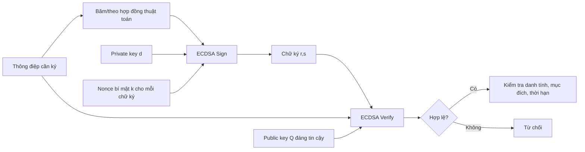
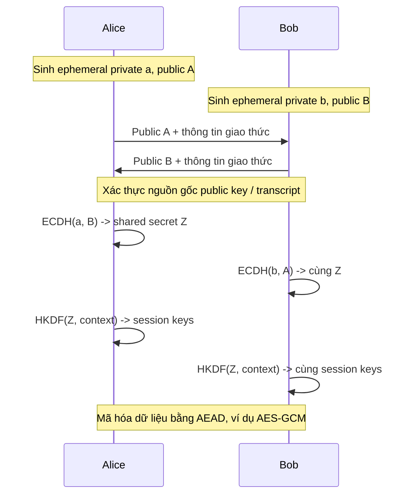
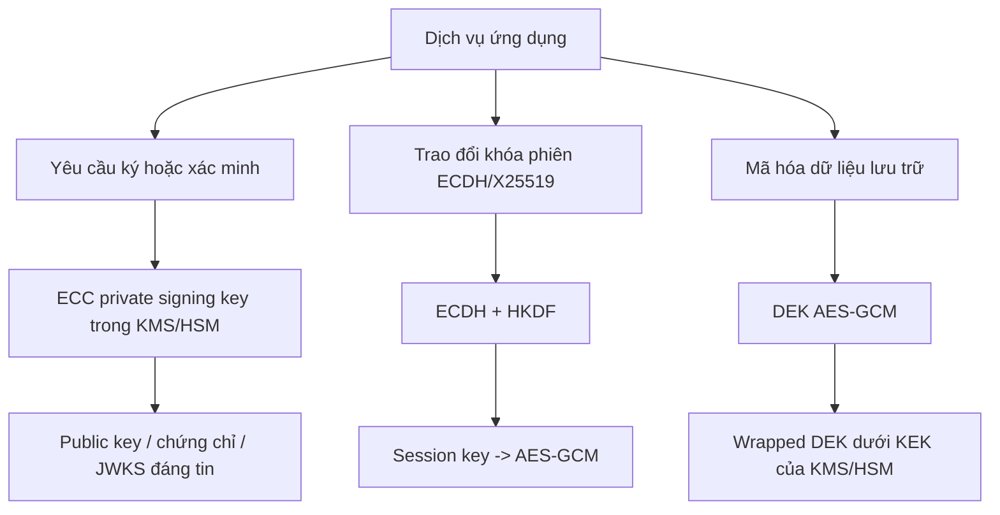

# Elliptic-curve cryptography (Mật mã đường cong elliptic)

Trong chương **Mật mã bất đối xứng** của module **SECURITY_KEY_MANAGEMENT_FUNDAMENTALS**, **elliptic-curve cryptography (ECC)** là họ kỹ thuật mật mã khóa công khai dựa trên phép toán điểm của đường cong elliptic trên trường hữu hạn. ECC cho phép tạo cặp khóa **private key/public key**, thực hiện **thỏa thuận khóa** như ECDH, và tạo **chữ ký số** như ECDSA hoặc Ed25519. ECC thường đạt mức an toàn cổ điển tương đương với RSA bằng khóa ngắn hơn, thuận lợi cho hệ thống có giới hạn băng thông, CPU hoặc dung lượng lưu trữ.

Học ECC trong bối cảnh **key management** quan trọng hơn việc thuộc công thức: khóa riêng được sinh và giữ ở đâu, khóa công khai được xác thực bằng cách nào, khóa có thể dùng cho mục đích gì, làm sao chống lộ khóa khi ký/trao đổi khóa, và quy trình xoay vòng, thu hồi, hủy có làm gián đoạn việc giải mã hoặc xác minh dữ liệu cũ không. Bài này kết nối ECC với AES, chữ ký số, KMS/HSM, envelope encryption, IAM và kiểm toán.

## 1. Mục tiêu học tập

Sau bài học, bạn có thể:

- Mô tả trực quan phép toán trên đường cong elliptic và lý do **dễ tính khóa công khai** nhưng **khó suy ra khóa riêng** trong điều kiện tham số mật mã phù hợp.
- Phân biệt **ECC**, **ECDSA**, **EdDSA/Ed25519**, **ECDH**, **X25519**, **ECIES** và các cơ chế mã hóa lai (*hybrid encryption*).
- Giải thích vì sao **ECDH đơn thuần không xác thực danh tính** và vì sao shared secret cần đưa qua **KDF** trước khi làm khóa đối xứng.
- Thực hành Java JCA ký/xác minh ECDSA và thỏa thuận khóa X25519 ở mức minh họa.
- Thiết kế vòng đời khóa ECC với KMS/HSM: sinh khóa, cấp quyền, phân phối public key, xoay vòng, xử lý lộ khóa, audit và hủy an toàn.

## 2. ECC dựa trên ý tưởng toán học nào?

### 2.1. Đường cong elliptic trên trường hữu hạn

Với một họ đường cong dạng Weierstrass ngắn thường dùng trong mật mã, các điểm thỏa mãn:

\[
y^2 \equiv x^3 + ax + b \pmod p
\]

Trong đó `p` là số nguyên tố xác định trường hữu hạn và `a`, `b` là tham số đường cong thỏa điều kiện không suy biến. Các điểm cùng một **điểm vô cực** tạo thành một nhóm với phép cộng điểm được định nghĩa toán học. Phép nhân vô hướng `dG` nghĩa là cộng điểm cơ sở `G` với chính nó `d` lần theo định nghĩa nhóm; thực tế thư viện dùng các thuật toán hiệu quả hơn việc cộng lặp lại.

Không phải mọi cơ chế ECC đều dùng chính phương trình trên: **X25519** sử dụng dạng Montgomery, **Ed25519** dùng dạng twisted Edwards. Cần chọn đúng thuật toán và tập tham số được tiêu chuẩn hóa, không tự tạo đường cong cho production.

Giả sử hệ thống có:

- **Điểm cơ sở (base point)** `G`, có bậc `n` phù hợp.
- **Private key** `d`: số vô hướng được chọn hợp lệ, phải giữ bí mật.
- **Public key** `Q = dG`: điểm có thể phân phối công khai.

```text
Sinh khóa riêng d  ────>  Tính Q = d · G  ────>  Công bố Q
     (bí mật)                (dễ tính)          (có xác thực)

Biết G và Q ────> Tìm lại d: bài toán logarit rời rạc trên đường cong
                               elliptic (ECDLP), được coi là khó
                               khi dùng tham số an toàn.
```

Độ an toàn dựa trên **độ khó của ECDLP đối với tập tham số và mô hình tấn công đã chọn**, không phải vì đường cong hình học “khó đoán” hay vì tọa độ điểm tự chúng là dữ liệu bí mật.

### 2.2. Tại sao kích thước khóa ECC thường nhỏ?

Tại mức an toàn cổ điển xấp xỉ **128 bit**, hệ sinh thái thường so sánh ECC trên các nhóm có bậc khoảng 256 bit với RSA có modulus khoảng 3072 bit. Đây là **độ dài khóa**, không phải kích thước chữ ký hay dung lượng bản mã, và không có nghĩa hiệu năng ECC luôn hơn trong mọi thao tác/hệ thống.

| Tham số/nhóm ví dụ | Mức an toàn cổ điển xấp xỉ | Ứng dụng thường gặp |
| --- | --- | --- |
| **NIST P-256 (secp256r1)** | 128 bit | ECDSA, ECDH; tương thích rộng trong TLS, PKI và nền tảng doanh nghiệp. |
| **NIST P-384** | 192 bit | Chữ ký và trao đổi khóa cần biên an toàn cao hơn khi giao thức/hạ tầng hỗ trợ. |
| **NIST P-521** | Khoảng 256 bit | Một số hệ thống có yêu cầu mức an toàn cao, tương thích tùy nền tảng. |
| **Curve25519/X25519** | Khoảng 128 bit | Trao đổi/thỏa thuận khóa, giao thức hiện đại. |
| **Ed25519** | Khoảng 128 bit | Chữ ký số EdDSA, ví dụ nhận diện dịch vụ, artifact và dữ liệu ký. |

Mức an toàn nêu ở đây là **ước lượng chống tấn công cổ điển**, giả định thuật toán, sinh khóa và triển khai đúng. ECC và RSA hiện hành đều **không kháng máy tính lượng tử quy mô đủ lớn**; về dài hạn cần cân nhắc lộ trình mật mã hậu lượng tử theo đặc tính dữ liệu và thời gian cần giữ bí mật.

## 3. ECC là họ công nghệ, không phải một thao tác duy nhất

| Thuật ngữ | Tác dụng | Vật liệu khóa | Cần nhớ |
| --- | --- | --- | --- |
| **ECC** | Tên chung cho mật mã dựa trên đường cong elliptic. | Cặp private/public key và tham số miền. | Không phải tên cụ thể của một thuật toán mã hóa. |
| **ECDSA** | Tạo/xác minh **chữ ký số**. | Private signing key và public verification key trên đường cong tương ứng. | Nonce của từng chữ ký cực kỳ quan trọng. |
| **EdDSA / Ed25519** | Chữ ký số trên đường cong Edwards theo thuật toán Ed25519. | Private/public signing key Ed25519. | Không phải ECDH hay mã hóa dữ liệu. |
| **ECDH** | Hai bên thỏa thuận **shared secret** từ khóa riêng của mình và khóa công khai phía kia. | Cặp khóa thỏa thuận của mỗi bên. | Chưa tự xác thực đối tác; cần KDF và cơ chế xác thực. |
| **X25519** | Hàm thỏa thuận khóa Diffie–Hellman dùng dạng Montgomery trên Curve25519. | Private scalar và public key X25519. | Không được dùng như khóa ký Ed25519 chỉ vì tên giống nhau. |
| **ECIES / HPKE** | Họ/cơ chế **mã hóa lai**: trao đổi hoặc đóng gói khóa, dẫn xuất khóa, rồi mã hóa dữ liệu đối xứng. | Khóa bất đối xứng phía nhận, khóa tạm thời, khóa đối xứng phát sinh. | Tên “ECIES” không đủ chỉ rõ định dạng; cần chọn một giao thức đầy đủ có xác thực. |
| **AES-GCM** | Mã hóa đối xứng có xác thực (AEAD) để bảo vệ payload. | Khóa AES bí mật. | Không phải ECC, nhưng thường kết hợp với cơ chế ECC để mã hóa lai. |

**Phân tách mục đích khóa:** một key pair dùng để ký không tự động là key pair dùng để trao đổi khóa. Điều này đặc biệt quan trọng với **Ed25519** (ký) và **X25519** (trao đổi khóa): cùng liên quan tới Curve25519 nhưng thuật toán và biểu diễn khóa khác nhau. Không tự chuyển đổi hoặc tái sử dụng private key giữa hai mục đích vì tiện triển khai.

## 4. Chữ ký số với ECDSA và Ed25519

### 4.1. Cách một chữ ký ECDSA hình thành

Với khóa riêng `d`, khóa công khai `Q = dG`, một giá trị đại diện thông điệp được tạo từ hàm băm theo giao thức, ECDSA dùng một **nonce bí mật `k` riêng cho từng lần ký** để tính cặp giá trị chữ ký `(r, s)`. Bên nhận dùng `Q`, thông điệp và chữ ký để xác minh.



**Rủi ro trọng yếu:** nếu ECDSA dùng lại `k` cho hai thông điệp khác nhau dưới cùng private key, hoặc `k` yếu/dễ đoán, private key có thể bị suy ra. Vì vậy phải sử dụng thư viện và CSPRNG đã được kiểm chứng, hoặc quy trình sinh nonce xác định theo chuẩn được hỗ trợ; tuyệt đối không tự chế thuật toán ký hay cố định `k`.

**Ed25519** là họ chữ ký EdDSA với cách thiết kế khác ECDSA và thường ký theo quy trình xác định. Điều này giảm một loại sai lầm khi chọn nonce, nhưng **không làm private key được phép xuất công khai** và không loại trừ lỗi thư viện, lạm dụng API ký, side channel hoặc quản lý khóa kém.

### 4.2. Java 17: ECDSA P-256 ký và xác minh

Ví dụ dùng **Java Cryptography Architecture (JCA)** tạo một cặp khóa P-256 trong bộ nhớ và ký một message UTF-8. Nó minh họa hành vi thuật toán; trong production, khóa ký lâu dài nên được quản lý bởi keystore hoặc cơ chế KMS/HSM phù hợp với quyền truy cập và vòng đời.

```java
import java.nio.charset.StandardCharsets;
import java.security.KeyPair;
import java.security.KeyPairGenerator;
import java.security.Signature;
import java.security.spec.ECGenParameterSpec;

public class EcdsaP256Demo {
    public static void main(String[] args) throws Exception {
        KeyPairGenerator generator = KeyPairGenerator.getInstance("EC");
        generator.initialize(new ECGenParameterSpec("secp256r1"));
        KeyPair keyPair = generator.generateKeyPair();

        byte[] payload = "orderId=42;amount=1000"
                .getBytes(StandardCharsets.UTF_8);

        Signature signer = Signature.getInstance("SHA256withECDSA");
        signer.initSign(keyPair.getPrivate());
        signer.update(payload);
        byte[] signature = signer.sign();

        Signature verifier = Signature.getInstance("SHA256withECDSA");
        verifier.initVerify(keyPair.getPublic());
        verifier.update(payload);
        System.out.println("Signature valid: " + verifier.verify(signature));

        byte[] tampered = "orderId=42;amount=9000"
                .getBytes(StandardCharsets.UTF_8);
        verifier.initVerify(keyPair.getPublic());
        verifier.update(tampered);
        System.out.println("After tampering: " + verifier.verify(signature));
    }
}
```

Với provider JCA hỗ trợ P-256/ECDSA, hai dòng kết quả dự kiến là `true` rồi `false`. Trong JCA, `SHA256withECDSA` tự xử lý bước băm message; **không tự SHA-256 message trước rồi nạp digest** vào API này. Nếu giao thức yêu cầu ký **digest đã băm**, phải dùng cơ chế được provider hỗ trợ và tuân thủ định dạng ký chính xác.

**Tương thích định dạng:** `Signature.sign()` cho ECDSA ở JCA phổ biến trả chữ ký **ASN.1 DER** chứa `r, s`. Ngược lại, **JWS ES256** quy định chữ ký dạng 64 byte `R || S` (hai số nguyên 32 byte, big-endian, chiều dài cố định). Không lấy trực tiếp DER rồi gắn vào trường chữ ký JWS; sử dụng thư viện JOSE chuẩn hoặc chuyển đổi đúng, có kiểm tra độ dài và miền giá trị.

### 4.3. Xác minh chữ ký ≠ xác minh ý nghĩa giao dịch

Chữ ký hợp lệ chỉ chứng minh rằng **vật liệu khóa ký tương ứng** đã được dùng để tạo chữ ký trên byte được kiểm tra, trong điều kiện thuật toán an toàn. Một giao dịch có chữ ký hợp lệ vẫn có thể bị từ chối vì người yêu cầu không có quyền, token đã hết hạn, thông điệp bị phát lại, hoặc public key chưa được liên kết với đúng tổ chức.

Với hệ thống JWT/JWS, bên xác minh còn phải ràng buộc `kid` với issuer/JWKS được cấu hình tin cậy, kiểm tra thuật toán cho phép và các claim `iss`, `aud`, `exp`, `nbf`. **Không chọn public key từ URL hoặc tệp do `kid` trong input chưa tin cậy chỉ định**, và không tin thuật toán do header tự khai mà không có chính sách phía máy chủ.

## 5. Thỏa thuận khóa với ECDH và X25519

### 5.1. Hai bên tạo cùng shared secret như thế nào?

Ví dụ Alice có private key `a`, public key `A=aG`; Bob có `b`, `B=bG`. Nếu họ trao đổi public key đúng cách, Alice tính `aB` còn Bob tính `bA`, cả hai thu được cùng một điểm nhóm:

\[
aB = a(bG) = abG = b(aG) = bA
\]

Cơ chế này cho phép hai bên thống nhất một **bí mật chung** mà không truyền private key qua mạng. Tuy nhiên, public key có thể bị kẻ tấn công tráo trong quá trình truyền. **ECDH thuần không xác thực danh tính**, vì vậy dễ bị **man-in-the-middle (MITM)** nếu không có chữ ký, chứng chỉ, khóa công khai đã ghim/được chứng thực hoặc một giao thức xác thực khác.



Dữ liệu ra từ ECDH/X25519 **không nên dùng trực tiếp như khóa AES**. Thông thường giao thức dùng **HKDF** với salt/thông tin ngữ cảnh và nhãn phân tách mục đích để dẫn xuất khóa mã hóa, nonce base và những khóa con khác. HKDF không thay thế kiểm tra danh tính hoặc bảo đảm private key vẫn bí mật.

Khi dùng **ephemeral ECDH/ECDHE**, mỗi phiên sử dụng cặp khóa tạm thời, sau đó loại bỏ private key phiên. Nếu protocol có xác thực đúng và không có khóa phiên còn bị lưu/lộ, thiết kế này có thể tạo **forward secrecy** đối với việc khóa xác thực dài hạn bị lộ trong tương lai. Forward secrecy không bảo đảm nếu khóa phiên hoặc plaintext của chính phiên đó đã bị thu thập.

### 5.2. Java 17: hai bên thỏa thuận khóa bằng X25519

Đoạn mã sử dụng JCA tạo hai cặp khóa X25519, chạy KeyAgreement theo hai phía và so sánh **shared secret**. Đây chỉ là minh họa về sự trùng khớp, **chưa thực hiện xác thực public key và chưa dẫn xuất khóa ứng dụng**.

```java
import javax.crypto.KeyAgreement;
import java.security.KeyPair;
import java.security.KeyPairGenerator;
import java.security.MessageDigest;
import java.util.Arrays;

public class X25519AgreementDemo {
    private static byte[] sharedSecret(
            KeyPair local, java.security.PublicKey remotePublic) throws Exception {
        KeyAgreement agreement = KeyAgreement.getInstance("X25519");
        agreement.init(local.getPrivate());
        agreement.doPhase(remotePublic, true);
        return agreement.generateSecret();
    }

    public static void main(String[] args) throws Exception {
        KeyPairGenerator generator = KeyPairGenerator.getInstance("X25519");
        KeyPair alice = generator.generateKeyPair();
        KeyPair bob = generator.generateKeyPair();

        byte[] aliceSecret = sharedSecret(alice, bob.getPublic());
        byte[] bobSecret = sharedSecret(bob, alice.getPublic());

        System.out.println("Same secret: " +
                MessageDigest.isEqual(aliceSecret, bobSecret));

        // Chưa được dùng secret này trực tiếp làm AES key:
        // Phải xác thực public key/transcript và áp dụng KDF theo giao thức.
        Arrays.fill(aliceSecret, (byte) 0);
        Arrays.fill(bobSecret, (byte) 0);
    }
}
```

Đầu ra dự kiến là `Same secret: true`. Code production cần xử lý các giá trị public key không hợp lệ theo thuật toán/SDK, đặc biệt không chấp nhận **shared secret toàn zero** nếu giao thức hoặc thư viện không từ chối trước. Ngoài ra, phải xác thực nguồn public key, ràng buộc transcript vào KDF, thiết kế chống replay và bảo vệ bí mật trong bộ nhớ. `Arrays.fill` chỉ xóa những buffer mà ứng dụng nắm được; không bảo đảm xóa các bản sao trong heap hoặc provider.

### 5.3. Thỏa thuận khóa khác mã hóa dữ liệu

Đối với payload lớn, ECC thường chỉ tạo/đóng gói **bí mật phiên**; phần dữ liệu thực tế được mã hóa bởi **AES-GCM** hoặc AEAD tương đương. Như vậy cần phân biệt:

- **ECDH/X25519**: hai bên tạo bí mật chung.
- **HKDF**: dẫn xuất khóa đối xứng từ bí mật chung, với ngữ cảnh phù hợp.
- **AES-GCM**: mã hóa plaintext và tạo authentication tag.
- **Chữ ký/chứng chỉ**: xác thực danh tính hoặc transcript để ngăn MITM.

**ECIES** là tên thường gặp cho cấu trúc mã hóa lai dựa trên đường cong, nhưng có nhiều biến thể không tương thích. Nếu cần một giao thức mã hóa công khai hiện đại, hãy chọn **bộ thuật toán và định dạng được quy định trọn vẹn** (chẳng hạn một suite HPKE phù hợp) thay vì tự nối ECDH, hash và AES theo các giả định ngầm. HPKE có các chế độ với bảo đảm xác thực khác nhau; **base mode không tự xác thực danh tính người gửi**.

## 6. ECC trong KMS/HSM, envelope encryption và hệ thống ứng dụng

Một hệ thống quản lý khóa có thể dùng nhiều thuật toán **với mục đích riêng biệt**, thay vì coi ECC là giải pháp thay thế tất cả AES và KEK:



### 6.1. Signing key bằng ECC

Đối với thao tác ký như phát hành JWT, ký artifact hay chứng từ:

1. KMS/HSM tạo và bảo vệ **private signing key** không xuất được nếu nền tảng hỗ trợ.
2. Workload ký chỉ được cấp quyền **`Sign`** trên key ID/mục đích phù hợp. Quyền `CreateKey`, `DisableKey`, `ScheduleDeletion` thuộc vai trò vận hành riêng.
3. Bên xác minh nhận public key qua kênh tin cậy, có thể là **chứng chỉ X.509** hoặc **JWKS** gắn với issuer, rồi kiểm tra chữ ký và các điều kiện nghiệp vụ.
4. Log ghi danh tính workload, key ID, thuật toán, thời điểm, request ID và kết quả; không ghi private key hoặc nội dung nhạy cảm không cần thiết.

KMS/HSM có thể giảm rủi ro **xuất vật liệu khóa riêng**, nhưng không chặn được một workload bị chiếm quyền **gọi API Sign hợp lệ để ký dữ liệu độc hại**. Cần kiểm soát tính hợp lệ của dữ liệu cần ký, phê duyệt nghiệp vụ, hạn mức và giám sát.

### 6.2. EC public key và envelope encryption

Với dữ liệu lưu trữ, **DEK thường là khóa đối xứng AES** được ứng dụng sinh hoặc nhận từ KMS. Một **KEK** quản lý trong KMS/HSM được dùng để bảo vệ DEK. KEK có thể là khóa đối xứng hoặc một cơ chế bọc khóa theo giao thức cụ thể. Không mặc định rằng mọi khóa ECC trong KMS đều hỗ trợ `Encrypt`/`Decrypt` hoặc có thể dùng như KEK bọc AES DEK: khả năng của khóa phụ thuộc thuật toán, mục đích và API của nhà cung cấp.

Một phương án **mã hóa lai dùng ECC** cho bên nhận có khóa công khai:

```text
Sender:
  1. Xác thực recipient public key (ECC/X25519) và bộ thuật toán hỗ trợ.
  2. Sinh ephemeral key pair, thỏa thuận shared secret với recipient public key.
  3. HKDF(shared secret, protocol context) -> AEAD key và tham số cần thiết.
  4. Mã hóa nội dung bằng AEAD; lưu ephemeral public key + nonce + ciphertext/tag.

Recipient:
  1. Kiểm tra định dạng, phiên bản, public key theo chính sách giao thức.
  2. Dùng private key người nhận thỏa thuận cùng shared secret.
  3. Dẫn xuất lại khóa với KDF và context tương ứng.
  4. AEAD decrypt và kiểm tra tag; thất bại thì không trả plaintext.
```

Đây là mô hình khái niệm, **không đủ để tự triển khai giao thức**: một thiết kế thực phải quy định chặt cách serialize public key, xử lý điểm không hợp lệ, xác thực người gửi khi yêu cầu, nonce, domain separation, KDF/AEAD suite, giới hạn bản tin và chống replay. Hãy dùng thư viện mã hóa lai theo một tiêu chuẩn được hỗ trợ, thay vì tự lắp ráp từ pseudocode này.

## 7. Biểu diễn và phân phối khóa công khai ECC

ECC không chỉ có “chuỗi khóa”. Các định dạng và giao thức cần biết chính xác loại khóa, curve và mục đích:

| Định dạng/thuộc tính | Mục đích | Cảnh báo |
| --- | --- | --- |
| **DER/PEM SubjectPublicKeyInfo (SPKI)** | Đóng gói public key và định danh thuật toán, dùng trong nhiều thư viện và chứng chỉ. | PEM là cách biểu diễn base64 có header/footer; không tự xác thực người sở hữu. |
| **PKCS#8 private key** | Lưu/trao đổi private key có metadata thuật toán, có thể dùng định dạng đã mã hóa. | Bảo vệ bằng keystore/HSM, không commit tệp private key vào repository. |
| **X.509 certificate** | Liên kết public key với danh tính thông qua PKI. | Phải kiểm tra chuỗi tin cậy, tên, thời hạn, mục đích và thu hồi khi phù hợp. |
| **JWK với `kty=EC`** | Biểu diễn public key ECDSA trên đường cong hỗ trợ qua `crv`, `x`, `y`. | Trường `d` là private key, không công bố trong JWKS công khai. |
| **JWK với `kty=OKP`** | Biểu diễn khóa Ed25519/X25519 theo `crv` tương ứng, thường chỉ dùng trường `x` cho public key. | Không nhầm `OKP` với `EC` hoặc đổi mục đích khóa do cùng tên “25519”. |
| **`kid` / key ID** | Chọn một khóa ứng viên trong tập khóa đã được chấp nhận. | Không chứng minh danh tính, quyền hay tính xác thực của public key. |

Khi nhận public key từ nguồn ngoài, thư viện/giao thức phải **kiểm tra độ dài, encoding, tham số curve và tính hợp lệ** của điểm hoặc đầu vào theo quy định. Với một số thuật toán/giao thức, việc không kiểm tra điểm thuộc đường cong hoặc bậc nhóm có thể gây lỗi **invalid-curve** hoặc **small-subgroup**; các xử lý cụ thể khác nhau giữa Weierstrass ECDH, X25519 và các cơ chế có cofactor.

**Không tự bỏ qua bước kiểm tra chỉ vì “đây là public key”**. Public key không phải bí mật, nhưng một public key do kẻ tấn công tạo vẫn có thể gây nguy cơ khi đưa vào phép thỏa thuận khóa hoặc được tin là của một tổ chức.

## 8. Vòng đời khóa ECC trong hệ thống thật

| Giai đoạn | Nhiệm vụ | Kiểm soát nên có |
| --- | --- | --- |
| **Lập chính sách** | Xác định khóa cho ký hay trao đổi khóa, curve/thuật toán, môi trường, tenant, owner và cryptoperiod. | Tách mục đích, chọn tham số đã được hỗ trợ và đánh giá. |
| **Sinh khóa** | Sinh private key bằng CSPRNG hoặc trong HSM/KMS; tính public key tương ứng. | Dùng thư viện chuẩn, bảo vệ entropy, hạn chế xuất private key. |
| **Đăng ký/cấp phát** | Gắn key ID, version, purpose; cấp quyền `Sign`, `DeriveKey`, `Verify` theo khả năng thực của API. | IAM tối thiểu, phân tách nhiệm vụ; không đưa private key cho verifier. |
| **Phân phối public key** | Cung cấp qua cert/JWKS/trust store hoặc kênh có xác thực. | Kiểm tra issuer, certificate chain, fingerprint đã ghim hoặc trust anchor. |
| **Sử dụng** | Ký đúng byte thông điệp hoặc ECDH với public key được kiểm chứng; dẫn xuất key và mã hóa AEAD. | Chống lỗi nonce ECDSA, chống MITM/replay, bảo vệ secret trong bộ nhớ. |
| **Xoay vòng** | Sinh key pair mới; chuyển traffic mới sang key mới; xử lý token/đối tượng cũ. | Giữ đường xác minh chữ ký lịch sử hoặc đường giải mã có chính sách cho ciphertext cũ. |
| **Đình chỉ/thu hồi** | Dừng ký hoặc thỏa thuận khóa bằng private key nghi bị lộ; thông báo các verifier. | Thu hồi chứng chỉ (nếu dùng PKI), cập nhật JWKS/trust và đánh giá chữ ký/giao dịch bị ảnh hưởng. |
| **Lưu trữ/hủy** | Hủy private key khi hết nhu cầu và đã xử lý bản sao; giữ public key/bằng chứng cần thiết cho xác minh lịch sử. | Kiểm kê backup, key version, ciphertext và ràng buộc lưu trữ trước khi xóa. |

### 8.1. Rotation cho ECC signing key

Ví dụ dịch vụ phát hành token xoay khóa ECDSA:

```text
Trước: kid=sign-v1 -> ký token mới bằng private v1
       JWKS công bố public v1

Trong chuyển đổi:
       kid=sign-v2 -> ký token mới bằng private v2
       JWKS công bố public v1 + public v2 trong thời gian cần thiết

Sau thời hạn chấp nhận token cũ và cache phù hợp:
       Ngừng dùng private v1 để ký
       Có thể ngừng công bố public v1 theo chính sách
```

Chữ ký của tài liệu lâu dài có thể cần lưu **public key/certificate, thông tin thời điểm ký và bằng chứng trạng thái chứng chỉ** lâu hơn thời gian token tồn tại. Việc đổi private key không tự làm chữ ký cũ không hợp lệ; vấn đề là kiểm tra được sự tin cậy của khóa tại thời điểm có liên quan hay không.

### 8.2. Rotation cho ECC dùng thỏa thuận khóa

Với **khóa tạm thời mỗi phiên** (ephemeral ECDHE), một vòng đời khóa có thể chỉ dài bằng một phiên. Với **khóa nhận mã hóa lai dài hạn**, đổi private key yêu cầu phát hành public key mới cho người gửi và **giữ khả năng giải mã ciphertext cũ** trong thời gian dữ liệu còn cần truy cập. Nếu hủy private key của người nhận quá sớm và không còn bản sao/hạ tầng giải mã, các bản mã được gửi tới public key cũ có thể mất khả năng giải mã vĩnh viễn.

Do đó khi xem xét hủy khóa, phải phân biệt:
- **Signing private key cũ:** có thể hủy trong khi vẫn giữ public verification key để kiểm tra chữ ký lịch sử.
- **Recipient private key cũ:** có thể vẫn cần để giải mã các bản mã cũ, trừ khi đã chuyển đổi/re-encrypt dữ liệu hoặc có phương án di chuyển phù hợp.
- **Ephemeral ECDH private key:** nên loại bỏ sau khi hoàn tất thiết lập phiên; không lưu lâu không cần thiết.

### 8.3. Ứng phó khi private key ECC bị lộ

Đổi key ID hoặc alias **không phải xoay vật liệu khóa**. Khi private signing key lộ, người tấn công có thể ký giả; khi recipient private key lộ, người tấn công có thể giải mã dữ liệu phụ thuộc vào khóa đó nếu có bản mã phù hợp; khi ephemeral key lộ, có thể ảnh hưởng phiên tương ứng.

Các bước điều phối điển hình:

1. Giảm quyền truy cập và vô hiệu hóa thao tác bằng khóa nghi vấn khi phù hợp mức độ sự cố.
2. Xác định phạm vi từ key ID, version, thời gian, dịch vụ, tenant, bản mã và log audit.
3. Sinh key pair mới; cập nhật trust store/JWKS/certificate hoặc public key người nhận qua kênh có xác thực.
4. Với khóa ký: đánh giá chữ ký có thể đã phát hành trái phép và cách thông báo/thu hồi; với khóa giải mã: đánh giá dữ liệu đã có nguy cơ lộ và kế hoạch mã hóa lại.
5. Kiểm chứng quy trình khôi phục, dữ liệu lịch sử và nhật ký sự cố trước khi hủy bản sao khóa cũ theo chính sách.

Một chứng chỉ X.509 bị thu hồi thường cần cơ chế kiểm tra trạng thái như CRL/OCSP nếu hệ thống PKI dùng các cơ chế đó. Chỉ xóa private key trên một server **không tự thông báo cho bên xác minh** rằng public key hoặc chứng chỉ không còn đáng tin.

## 9. Rủi ro đặc thù của ECC và sai lầm thiết kế

| Sai lầm / rủi ro | Hậu quả | Cách phòng tránh |
| --- | --- | --- |
| Tự chọn đường cong hoặc tham số miền không được đánh giá. | Có thể chọn nhóm có cấu trúc yếu, thư viện không tương thích hoặc thiếu kiểm tra. | Dùng curve/thuật toán chuẩn được hệ sinh thái hỗ trợ và chính sách cho phép. |
| Sinh private key từ `Random`, timestamp hoặc seed dễ đoán. | Khóa riêng có thể bị đoán hoặc khôi phục. | CSPRNG/KeyPairGenerator/KMS/HSM chuẩn; quản lý entropy. |
| Tái sử dụng hoặc sinh `k` ECDSA yếu. | Có thể lộ private signing key. | Thư viện chữ ký đã kiểm chứng, nonce an toàn hoặc deterministic signing theo chuẩn. |
| Dùng ECDH mà không xác thực khóa bên kia. | MITM có thể thiết lập hai bí mật riêng với hai phía. | Kết hợp xác thực transcript/chứng chỉ/chữ ký, hoặc giao thức đã được đánh giá. |
| Dùng shared secret ECDH trực tiếp làm AES key. | Thiếu domain separation, phụ thuộc biểu diễn và cấu trúc secret. | HKDF với ngữ cảnh, nhãn và tham số theo giao thức được định nghĩa. |
| Nhận tùy ý public key/điểm không hợp lệ. | Nguy cơ invalid-curve, small-subgroup hoặc thao túng trao đổi khóa tùy thuật toán. | Sử dụng API chuẩn có kiểm tra phù hợp; kiểm tra all-zero X25519 theo giao thức. |
| Nhầm Ed25519 với X25519, hoặc EC JWK với OKP JWK. | Dùng sai mục đích, không tương thích hoặc làm mất cách quản lý khóa riêng biệt. | Tách loại khóa, thuật toán, định dạng và quyền. |
| Trộn DER ECDSA signature với định dạng `R || S` của JWS ES256. | Xác minh thất bại hoặc xử lý sai dữ liệu ký. | Dùng thư viện giao thức chuyên dụng, chuyển đổi có kiểm tra. |
| Tin `kid` hoặc public key chưa được xác thực. | Chấp nhận chữ ký của khóa kẻ tấn công. | Ràng buộc issuer, JWKS/trust anchor, thuật toán và claim phù hợp. |
| Nghĩ HSM ngăn được mọi chữ ký giả. | Workload bị chiếm quyền vẫn có thể gọi `Sign` hợp lệ. | Kiểm soát nội dung ký, IAM, audit, phê duyệt nghiệp vụ và hạn mức. |
| Xoay cặp khóa xong hủy ngay khóa nhận cũ. | Dữ liệu mã hóa tới public key cũ không còn giải mã được. | Kiểm kê ciphertext và kế hoạch chuyển đổi/re-encrypt trước khi hủy. |
| Bỏ qua side channel và triển khai không constant-time. | Có nguy cơ lộ thông tin private key qua thời gian hoặc hành vi phần cứng. | Thư viện/provider được kiểm thử, HSM phù hợp và hardening runtime. |
| Coi ECC hiện tại là kháng lượng tử. | Dữ liệu giữ bí mật dài hạn có thể gặp rủi ro tương lai. | Theo dõi lộ trình thuật toán hậu lượng tử, phân loại dữ liệu và khả năng nâng cấp giao thức. |

## 10. Tình huống thiết kế: API giao dịch và trao đổi khóa

Một nền tảng thanh toán có ba nhu cầu khác nhau:

1. **Ký lệnh phát hành:** dịch vụ nghiệp vụ được phép ký một thông điệp có các trường `transactionId`, `amount`, `currency`, `expiresAt`; signing key ECDSA hoặc Ed25519 được bảo vệ bởi KMS/HSM. Bên nhận cần public key đáng tin và phải kiểm tra quyền giao dịch, thời hạn, nonce chống phát lại.
2. **Bảo vệ kênh truyền:** TLS có thể dùng **ECDHE/X25519** để thỏa thuận khóa phiên và chứng chỉ/chữ ký để xác thực máy chủ; các bản tin thực tế được bảo vệ bằng AEAD phiên. Không dùng một private key ký lệnh nghiệp vụ làm khóa phiên ECDHE.
3. **Mã hóa dữ liệu lưu trữ:** hồ sơ giao dịch dùng **DEK AES-GCM**, DEK được bọc bởi **KEK của KMS** theo envelope encryption. Việc có ECDSA signing key **không** loại bỏ nhu cầu DEK/KEK và quản lý nonce/tag của AES-GCM.

Một bảng phân quyền gợi ý:

| Chủ thể | Quyền cấp | Quyền tránh cấp |
| --- | --- | --- |
| `transaction-signer` | `Sign` trên đúng ECC signing key khi giao dịch đã qua kiểm tra nghiệp vụ. | Xuất private key, thay policy, xóa key, ký tài liệu không thuộc purpose. |
| `transaction-verifier` | Truy cập public key/JWKS được tin cậy và `Verify`. | `Sign`, `Decrypt` hoặc quản trị khóa riêng. |
| `records-writer` | Tạo DEK/mã hóa dữ liệu qua quyền KMS được giới hạn. | Xóa KEK, xem private signing key. |
| `records-reader` | Unwrap/decrypt trong tenant và mục đích được cấp. | Thay chính sách KMS, đọc dữ liệu tenant khác. |
| Security operations | Tạo, xoay, tạm dừng và hủy khóa theo quy trình xét duyệt. | Tự ý phát hành giao dịch ngoài luồng ứng dụng. |
| Auditor | Xem metadata và sự kiện ký, thay đổi quyền, xoay khóa, lỗi dùng khóa. | Trích xuất private key hoặc sử dụng quyền ký. |

Các log nên chứa **key ID, key version, thuật toán, danh tính workload, kết quả, request ID và thời điểm**. Không ghi private key, shared secret, DEK rõ hoặc plaintext nhạy cảm. Khi giám sát, chú ý gia tăng đột biến số yêu cầu ký, thỏa thuận khóa từ danh tính lạ và sự kiện thay đổi policy hoặc certificate/JWKS bất thường.

## 11. Checklist thiết kế ECC an toàn

1. **Chọn đúng chức năng:** ECDSA/Ed25519 để ký, ECDH/X25519 để thỏa thuận khóa, AEAD để mã hóa dữ liệu; không dùng lại khóa giữa các purpose không tương thích.
2. **Thuật toán và curve:** thuộc bộ được hỗ trợ, phù hợp chuẩn giao thức và chính sách; không tự tạo đường cong hay cài đặt phép toán điểm.
3. **Sinh/lưu private key:** CSPRNG hoặc HSM/KMS; ưu tiên non-exportable nếu nền tảng và yêu cầu cho phép, tránh Git, log và backup thiếu bảo vệ.
4. **Xác thực public key:** kiểm tra encoding, loại, curve, issuer/chứng chỉ/JWKS/trust anchor; không tin `kid` như bằng chứng danh tính.
5. **Ký:** thống nhất byte message, hàm băm, định dạng chữ ký, quy tắc ECDSA nonce và điều kiện nghiệp vụ; tách quyền ký khỏi quản trị.
6. **ECDH:** xác thực peer/transcript, kiểm tra public key/shared secret theo giao thức, đưa kết quả qua KDF và dùng AEAD; không coi ECDH là xác thực.
7. **Envelope encryption:** biết DEK, KEK và ECC nằm ở khâu nào; không giả định ECC signing key là khóa mã hóa dữ liệu.
8. **Rotation:** cập nhật public key đáng tin, giữ khả năng xác minh/giải mã lịch sử và xác định thời gian chuyển đổi từ yêu cầu thực tế.
9. **Thu hồi/hủy:** có kịch bản xử lý lộ private key, thông báo verifier, quản lý chứng chỉ và xử lý phụ thuộc backup/ciphertext.
10. **Audit và nâng cấp:** phân quyền, lưu log không chứa secret, diễn tập khôi phục, đánh giá khả năng đổi thuật toán và lộ trình hậu lượng tử.

## 12. Câu hỏi tự kiểm tra

1. Vì sao từ private key `d` dễ tạo public key `Q=dG`, nhưng từ `Q` khó khôi phục `d` trên một curve được chọn đúng?
2. Khác nhau cơ bản giữa **ECDSA** và **ECDH** là gì? Một key pair Ed25519 có nên dùng trực tiếp để thỏa thuận khóa X25519 không?
3. Nếu ECDSA lặp nonce `k` khi ký hai message, vì sao private key có thể bị nguy hiểm?
4. Tại sao hai bên tính được cùng shared secret bằng X25519 vẫn chưa chứng minh họ đang nói chuyện đúng đối tác?
5. Với Java `SHA256withECDSA`, vì sao việc tự băm message trước khi gọi `Signature.update` có thể là sai? Chữ ký JCA khác biểu diễn chữ ký JWS ES256 ở điểm nào?
6. Khi xoay khóa ECC dùng ký JWT, vì sao cần giữ public key cũ một thời gian? Khi nào phải cập nhật trạng thái chứng chỉ?
7. Khi private key ECC dùng để nhận bản mã lai bị hủy, điều gì có thể xảy ra với ciphertext cũ?
8. KMS/HSM giữ private key không xuất được nhưng workload bị chiếm quyền vẫn có `Sign`. Những biện pháp nào giúp ngăn ký trái phép?

**Ghi nhớ:** ECC là nền tảng toán học cho nhiều cơ chế **chữ ký số và thỏa thuận khóa**, không phải một thuật toán mã hóa thay thế toàn bộ mật mã đối xứng. Mức an toàn của hệ thống phụ thuộc vào **curve/thuật toán thích hợp, tính bí mật của private key, xác thực public key, lựa chọn đúng purpose, KDF/AEAD theo giao thức, phân quyền, kiểm toán và quản lý vòng đời khóa**.
