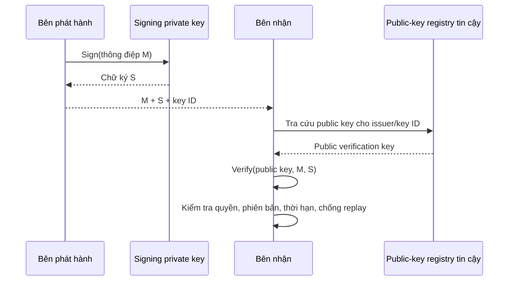
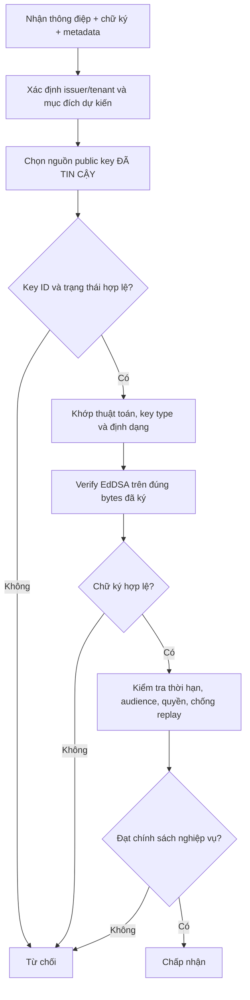
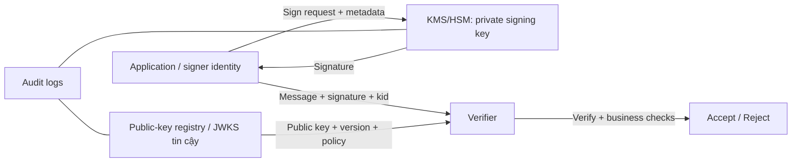
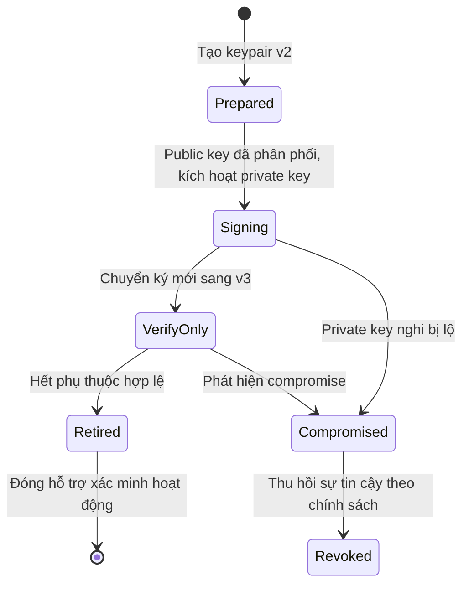
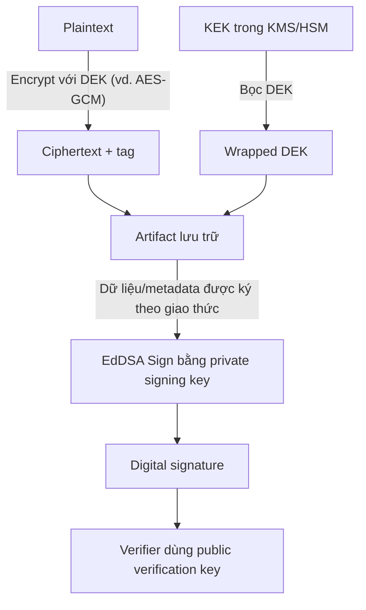

# EdDSA

## 1. EdDSA là gì?

**EdDSA (Edwards-curve Digital Signature Algorithm)** là một họ thuật toán **chữ ký số bất đối xứng** dựa trên đường cong elliptic dạng Edwards. EdDSA được thiết kế để tạo chữ ký và kiểm tra chữ ký bằng một **cặp khóa**: khóa riêng (*private signing key*) và khóa công khai (*public verification key*). Hai biến thể được sử dụng phổ biến trong tiêu chuẩn RFC 8032 là **Ed25519** và **Ed448**.

- **Bên ký** sử dụng khóa riêng để ký chính xác thông điệp hoặc dữ liệu đã được quy định trong giao thức.
- **Bên xác minh** sử dụng khóa công khai tương ứng để kiểm tra chữ ký.
- Chữ ký hợp lệ cho thấy dữ liệu phù hợp với chữ ký và khóa công khai đã chọn. Việc xác định **khóa đó có thực sự thuộc chủ thể được tin cậy hay không** vẫn cần cơ chế quản lý danh tính/khóa riêng.

EdDSA **không phải thuật toán mã hóa dữ liệu**. Nó không làm plaintext trở thành ciphertext và không dùng để giải mã. Khi cần bảo mật nội dung, hệ thống vẫn dùng cơ chế mã hóa phù hợp như AES-GCM với DEK/KEK; khi cần kiểm chứng tính toàn vẹn và nguồn phát hành, chữ ký EdDSA có thể là một lớp bổ sung.

Bài học thuộc chương **Mật mã bất đối xứng** của module `SECURITY_KEY_MANAGEMENT_FUNDAMENTALS`. EdDSA là ví dụ để kết nối mật mã bất đối xứng, chữ ký số, KMS/HSM, kiểm soát truy cập, kiểm toán và toàn bộ vòng đời khóa từ tạo, cấp phát, lưu trữ, sử dụng, xoay vòng đến thu hồi, hủy.

Sau bài học, bạn có thể:

1. Phân biệt **EdDSA**, **Ed25519**, **Ed448**, **ECDSA**, **HMAC** và thuật toán mã hóa.
2. Mô tả luồng ký/xác minh và vai trò của private key, public key, key ID và phiên bản khóa.
3. Giải thích tính xác định (*deterministic*) của EdDSA và các giới hạn của tính chất đó.
4. Phân biệt Ed25519 thuần với các biến thể sử dụng context hoặc prehash.
5. Viết ví dụ ký/xác minh Ed25519 bằng **Java 17+** và hiểu các điểm còn thiếu khi triển khai production.
6. Thiết kế cách phân phối public key tin cậy, kiểm tra JWT/JWS và xoay khóa ký an toàn.
7. Áp dụng các yêu cầu quản lý EdDSA key trong KMS/HSM, IAM, giám sát và ứng phó sự cố.

## 2. EdDSA giải quyết vấn đề nào?

Giả sử một hệ thống phát hành bản cập nhật phần mềm cho hàng nghìn máy khách. Mỗi máy cần xác minh gói cập nhật đến từ nhà phát hành đáng tin cậy và không bị thay đổi sau khi phát hành.

Một cách tiếp cận là nhà phát hành giữ **private key** ở nơi được kiểm soát chặt chẽ và ký bản cập nhật. Các máy khách chỉ cần **public key** để xác minh. Public key có thể được phân phối rộng rãi qua cơ chế tin cậy; máy khách không được biết private key nên không thể tự tạo chữ ký của nhà phát hành.



Kết quả kiểm tra mật mã **chưa đủ để quyết định cài bản cập nhật**: thiết bị còn cần kiểm tra phiên bản không bị hạ cấp, nguồn khóa tin cậy, quyền của bên phát hành, thông tin phiên bản mục tiêu và thời hạn theo chính sách.

### 2.1. Vai trò của khóa ký và khóa xác minh

| Thành phần | Vai trò | Cần giữ bí mật? | Kiểm soát quan trọng |
| --- | --- | --- | --- |
| **Signing private key** | Tạo chữ ký EdDSA | **Có** | Chống xuất lộ; IAM hạn chế quyền ký; giám sát sử dụng. |
| **Verification public key** | Xác minh chữ ký EdDSA | Thường **không** | Xác thực nguồn gốc, tính toàn vẹn và liên kết với issuer/tenant/mục đích. |
| **Key ID / `kid`** | Xác định khóa để tra cứu | Thường không | Chỉ được tra cứu trong tập khóa tin cậy đã giới hạn. |
| **Key version** | Nhận diện thế hệ cặp khóa | Thường không | Chuyển tiếp khóa mới và giữ khả năng xác minh chữ ký cũ. |
| **Signature** | Kết quả của thao tác ký thông điệp | Không bắt buộc giữ bí mật | Gắn với đúng bytes thông điệp, thuật toán và ngữ cảnh. |

Một **public key** bất kỳ có thể xác minh một chữ ký do chính người gửi tự tạo với private key tương ứng. Vì vậy, nếu ứng dụng chấp nhận cả public key do người gửi tự khai báo, kết quả `Verify = true` không chứng minh tài liệu thuộc nhà phát hành mà ứng dụng kỳ vọng.

## 3. Cơ chế EdDSA ở mức khái niệm

EdDSA thuộc nhóm chữ ký dựa trên đường cong elliptic và có cấu trúc liên quan đến **Schnorr signature**. EdDSA tính toán chữ ký từ private key, thông điệp và các bước băm/nhóm điểm quy định trong biến thể cụ thể.

Ở mức giao diện lập trình:

```text
(keyPair)       = KeyGen(randomness)
signature       = Sign(privateKey, exactMessageBytes)
isValid         = Verify(publicKey, exactMessageBytes, signature)
```

Chữ ký được biểu diễn bằng hai thành phần toán học thường gọi là **R** và **S**, được mã hóa theo đặc tả. Ứng dụng bình thường không nên tự tính các thành phần này hoặc tự viết phép toán điểm đường cong elliptic; hãy dùng thư viện mật mã uy tín hoặc API ký/xác minh được hỗ trợ.

### 3.1. Tính xác định (*deterministic*) có nghĩa gì?

Trong các biến thể Ed25519/Ed448 chuẩn, thao tác ký được thiết kế **xác định từ khóa riêng và thông điệp** (cùng ngữ cảnh/biến thể tương ứng). Không cần ứng dụng tự cung cấp một số ngẫu nhiên mới cho từng chữ ký như nhiều thiết kế ký khác.

Hệ quả:

- Với **cùng private key, cùng thông điệp, cùng biến thể và ngữ cảnh**, chữ ký thường có cùng giá trị bytes theo chuẩn.
- Lỗi sinh nonce ngẫu nhiên cho từng chữ ký được giảm bớt so với cách triển khai ECDSA phụ thuộc nonce được tạo đúng cách.
- **Vẫn phải dùng nguồn ngẫu nhiên mật mã an toàn khi tạo khóa riêng.** Tính xác định của ký không làm cho khóa yếu hoặc dễ đoán trở nên an toàn.
- Tính xác định cũng không loại bỏ tấn công qua **side channel**, lỗi triển khai hoặc việc private key bị lộ qua log, dump, backup và quyền ký quá rộng.

Đừng suy ra rằng cứ có hai chữ ký giống nhau là chứng minh hai lần ký diễn ra cùng thời điểm hoặc chỉ có một request. Nếu ứng dụng cần chống phát lại (*replay*), phải đưa **timestamp, nonce/id giao dịch, audience hoặc giá trị ràng buộc theo giao thức** vào thông điệp cần ký và kiểm tra chúng ở phía nhận.

### 3.2. EdDSA không phải ECDH hoặc X25519

**Ed25519** dành cho chữ ký số. **X25519** là cơ chế trao đổi khóa (*key agreement*) trên một nhóm/biểu diễn liên quan nhưng có giao diện và mục đích khác. Tương tự, **Ed448** phục vụ chữ ký, còn **X448** phục vụ trao đổi khóa.

Không sử dụng trực tiếp cùng một key pair Ed25519 để thay thế key pair X25519 chỉ vì tên giống nhau. Việc chuyển đổi khóa giữa hai dạng trong một số thư viện là thao tác chuyên biệt có điều kiện và rủi ro thiết kế; đối với ứng dụng thông thường nên **tạo và quản lý khóa riêng theo mục đích**.

## 4. Ed25519 và Ed448 khác nhau như thế nào?

| Đặc điểm | Ed25519 | Ed448 |
| --- | --- | --- |
| Họ thuật toán | EdDSA | EdDSA |
| Đường cong nền | Edwards25519 | Edwards448 |
| Mức bảo mật thường được mô tả | Khoảng **128 bit** | Khoảng **224 bit** |
| Kích thước private-key seed theo RFC 8032 | **32 byte** | **57 byte** |
| Public key mã hóa chuẩn | **32 byte** | **57 byte** |
| Chữ ký mã hóa chuẩn | **64 byte** | **114 byte** |
| Hàm băm/cấu trúc dẫn xuất nội bộ | Dựa trên **SHA-512** | Dựa trên **SHAKE256** |
| Hệ sinh thái hỗ trợ | Phổ biến trong nhiều thư viện và giao thức | Cần kiểm tra hỗ trợ cụ thể của SDK/KMS/HSM |
| Lựa chọn | Thường phù hợp khi ưu tiên hỗ trợ rộng, chữ ký nhỏ và hiệu năng | Cân nhắc khi chính sách yêu cầu mức bảo mật cao hơn và nền tảng tương thích |

Các kích thước trên nói về **dạng mã hóa khóa/chữ ký theo thuật toán**, không mặc nhiên là kích thước của file PEM, cấu trúc SPKI, PKCS#8 hoặc JSON Web Key. Các định dạng bao gói có metadata nên dài hơn.

Việc chọn Ed25519 hay Ed448 phải theo **chính sách mật mã, mức an toàn cần thiết, giao thức, khả năng vận hành và hỗ trợ thực tế của nền tảng**. Không nên đưa Ed448 vào một giao thức không được thư viện, thiết bị hoặc verifier hỗ trợ chỉ vì mức bảo mật lý thuyết cao hơn.

### 4.1. EdDSA so với ECDSA và RSA-PSS

| Tiêu chí | EdDSA | ECDSA | RSA-PSS |
| --- | --- | --- | --- |
| Kiểu mật mã | Chữ ký bất đối xứng dựa trên elliptic curve | Chữ ký bất đối xứng dựa trên elliptic curve | Chữ ký bất đối xứng dựa trên RSA |
| Sinh chữ ký | Xác định theo thiết kế của các biến thể RFC 8032 | Cần nonce đúng; có thể dùng phương pháp deterministic ECDSA theo chuẩn riêng | Cơ chế PSS có salt theo cấu hình/chế độ |
| Key/signature format | Định dạng Ed25519/Ed448 riêng | Cần thống nhất đường cong và encoding DER hoặc raw | Cần thống nhất hash, MGF và salt length |
| Chuyển đổi tương thích | Không thể dùng public key EdDSA để verify chữ ký ECDSA/RSA | Không thể dùng key EdDSA thay thế | Không thể tự động thay thế bằng EdDSA |
| Quản trị | Bảo vệ private key, chọn thuật toán, phân phối public key tin cậy | Tương tự, cộng thêm kiểm soát nonce và encoding | Tương tự, cộng thêm tham số padding |

Không có thuật toán “tốt nhất” cho mọi sản phẩm. Hỗ trợ giao thức và chính sách tổ chức có thể quyết định một lựa chọn khác EdDSA, đặc biệt khi tích hợp hệ thống cũ hoặc phần cứng chuyên dụng.

## 5. Các biến thể EdDSA và rủi ro ký sai thông điệp

Theo RFC 8032, một họ EdDSA có thể có các biến thể khác nhau về **context** và **prehash**. Các tên quan trọng:

| Tên | Đặc điểm | Lưu ý |
| --- | --- | --- |
| **Ed25519** | Ký thông điệp trực tiếp theo biến thể thuần | Phổ biến; nhiều API có tên `Ed25519` hỗ trợ dạng này. |
| **Ed25519ctx** | Biến thể có ngữ cảnh riêng theo chuẩn | Context cần được cả bên ký và bên xác minh thống nhất. |
| **Ed25519ph** | Biến thể có prehash được quy định bởi thuật toán | Không tương đương với việc tự SHA-512 rồi gọi API Ed25519 thuần. |
| **Ed448** | Dạng Ed448 có xử lý context theo đặc tả | Giao thức và hai đầu phải thống nhất context; context có thể rỗng. |
| **Ed448ph** | Biến thể Ed448 có prehash theo đặc tả | Không tự thay bằng Ed448 thuần trên hash do ứng dụng tùy ý tạo. |

**Prehash** trong Ed25519ph/Ed448ph có định nghĩa và xử lý domain separation riêng. Nếu bên phát hành ký một bản **Ed25519ph**, bên nhận không được thử xác minh bằng `Ed25519` thuần trên một chuỗi hash rồi hy vọng tương đương.

Khái niệm **domain separation** nhằm bảo đảm cùng một dữ liệu được xử lý trong những mục đích hoặc giao thức khác nhau không bị lẫn lộn. Nếu giao thức không sử dụng biến thể context chuyên dụng, ứng dụng vẫn nên quy định một **định dạng thông điệp có miền mục đích rõ ràng**, chẳng hạn prefix và format version, theo quy trình thiết kế được phê duyệt.

### 5.1. Exact bytes quan trọng hơn vẻ ngoài của thông điệp

Với chữ ký số, bên xác minh phải kiểm tra **đúng dãy byte đã được ký**, không phải một JSON object được parse rồi serialize lại tùy ý.

Ví dụ:

```json
{"amount":100,"currency":"VND"}
```

và

```json
{ "currency": "VND", "amount": 100 }
```

có thể mang ý nghĩa nghiệp vụ giống nhau nhưng biểu diễn bytes khác nhau. Nếu giao thức muốn ký JSON logic, phải quy định **canonicalization** hoặc dùng định dạng serialization cố định, với xử lý Unicode, thứ tự trường, số, dấu cách và encoding rõ ràng. Tương tự, việc tự động thay dấu xuống dòng CRLF thành LF có thể làm chữ ký không còn hợp lệ.

## 6. Luồng ký và xác minh EdDSA an toàn

Một quy trình thực tế nên gồm cả kiểm tra mật mã lẫn kiểm tra quyền:



**Bước 1 — Xác định chủ thể kỳ vọng.** Một API thanh toán cần biết thông điệp phải do dịch vụ nào ký, không chỉ có một chữ ký bất kỳ hợp lệ với một public key do người gửi cung cấp.

**Bước 2 — Tra cứu khóa trong nguồn tin cậy.** Public key có thể lấy từ cấu hình pin, key registry, JWKS gắn với issuer, hoặc chứng chỉ đã được kiểm tra chuỗi tin cậy. Không để header chưa xác thực mở rộng tùy ý nguồn khóa.

**Bước 3 — Cố định sơ đồ được phép.** Chỉ chấp nhận Ed25519/Ed448 hay biến thể đã được phê duyệt cho hệ thống đó. Kiểm tra độ dài, encoding và loại khóa qua thư viện mật mã đáng tin cậy.

**Bước 4 — Xác minh bytes chính xác.** Không thay đổi thông điệp trước khi verify, không “thử nhiều chuẩn” thiếu kiểm soát để làm chữ ký qua kiểm tra.

**Bước 5 — Kiểm tra thời gian và nghiệp vụ.** Chữ ký hợp lệ không tự động chứng minh token chưa hết hạn, giao dịch chưa bị phát lại, yêu cầu được gửi đến đúng audience, hoặc người ký có quyền nghiệp vụ.

**Bước 6 — Ghi audit và phản hồi lỗi thích hợp.** Lưu key ID, issuer, version, request/correlation ID, kết quả và nguyên nhân ở mức metadata cần thiết; tránh log private key, access token đầy đủ hoặc dữ liệu nhạy cảm.

### 6.1. Public key không bí mật, nhưng không được lấy tùy ý

Giả sử client gửi:

```json
{
  "message": "approve-transfer-123",
  "signature": "<base64-signature>",
  "publicKey": "<base64-any-key>"
}
```

Nếu backend tin ngay vào `publicKey` này, kẻ tấn công có thể tự tạo cặp Ed25519, tự ký một yêu cầu chuyển tiền và gửi chữ ký cùng public key của họ. Phép `Verify` có thể trả `true` mà **không hề chứng minh** yêu cầu được ký bởi thực thể được ủy quyền.

Giải pháp là backend phải chọn **public key đã được gắn với danh tính/issuer đáng tin cậy**, kiểm tra trạng thái và quyền, rồi mới gọi `Verify`.

### 6.2. Chữ ký không thay thế chống replay

Nếu request chuyển tiền có chữ ký hợp lệ nhưng không chứa transaction ID, timestamp hoặc một nonce nghiệp vụ được kiểm tra, người nghe lén có thể gửi lại cùng gói tin nhiều lần. Chữ ký EdDSA sẽ vẫn hợp lệ vì nội dung không bị thay đổi.

Chống replay cần quy định rõ dữ liệu nào nằm trong thông điệp ký, thời gian hiệu lực, kho đánh dấu request ID đã sử dụng hoặc cơ chế idempotency. Sự bảo vệ này phải được thực thi tại tầng ứng dụng.

## 7. Ví dụ Java: tạo và xác minh chữ ký Ed25519

Java 17+ có hỗ trợ Ed25519 trong **Java Cryptography Architecture (JCA)**. Ví dụ sau minh họa **đúng nguyên lý ký và xác minh**, sử dụng khóa sinh cục bộ để quan sát kết quả. Đây chưa phải hệ thống quản lý khóa production.

```java
import java.nio.charset.StandardCharsets;
import java.security.KeyPair;
import java.security.KeyPairGenerator;
import java.security.Signature;

public class EdDsaDemo {
    public static void main(String[] args) throws Exception {
        // Demo: sinh khóa trong tiến trình.
        // Production: quản lý signing key trong KMS/HSM phù hợp khi có thể.
        KeyPairGenerator generator = KeyPairGenerator.getInstance("Ed25519");
        KeyPair pair = generator.generateKeyPair();

        byte[] message = "invoice:INV-2026-001:amount=500000"
                .getBytes(StandardCharsets.UTF_8);

        // Ký bằng PRIVATE KEY.
        Signature signer = Signature.getInstance("Ed25519");
        signer.initSign(pair.getPrivate());
        signer.update(message);
        byte[] signature = signer.sign();

        // Xác minh bằng PUBLIC KEY.
        Signature verifier = Signature.getInstance("Ed25519");
        verifier.initVerify(pair.getPublic());
        verifier.update(message);
        boolean valid = verifier.verify(signature);
        System.out.println("Original valid: " + valid); // true

        // Đổi nội dung phải làm xác minh thất bại.
        byte[] modified = "invoice:INV-2026-001:amount=900000"
                .getBytes(StandardCharsets.UTF_8);

        verifier.initVerify(pair.getPublic());
        verifier.update(modified);
        boolean modifiedValid = verifier.verify(signature);
        System.out.println("Modified valid: " + modifiedValid); // false

        // Chữ ký của key A không được xác minh bằng public key B.
        KeyPair other = generator.generateKeyPair();
        verifier.initVerify(other.getPublic());
        verifier.update(message);
        boolean wrongKeyValid = verifier.verify(signature);
        System.out.println("Wrong key valid: " + wrongKeyValid); // false

        if (!valid || modifiedValid || wrongKeyValid) {
            throw new IllegalStateException("Signature test failed");
        }
    }
}
```

**Vì sao đoạn code có ý nghĩa?**

- `getPrivate()` chỉ được dùng cho **ký**; `getPublic()` chỉ được dùng cho **xác minh**.
- `Signature.getInstance("Ed25519")` chọn sơ đồ chữ ký Ed25519. Không truyền tên `SHA256withECDSA` hoặc tên thuật toán mã hóa khác.
- Bên ký và xác minh phải thống nhất **chính xác** bytes của `message`.
- Một chữ ký phải bị từ chối nếu thông điệp hoặc public key không đúng.
- Bộ sinh khóa của JCA dùng cơ chế mật mã do provider cung cấp; trong production phải tuân thủ chính sách chọn provider, quản lý entropy và cất giữ khóa.

### 7.1. Đọc public key từ nguồn tin cậy

Thông thường verifier không có `KeyPair` của bên ký. Nó chỉ nhận public key đã được cấp phát và lưu tại nguồn tin cậy. Một định dạng phổ biến là **SubjectPublicKeyInfo (SPKI) DER**, có thể nằm trong PEM `BEGIN PUBLIC KEY`.

Nếu đã nhận được bytes DER từ một registry tin cậy:

```java
import java.security.KeyFactory;
import java.security.PublicKey;
import java.security.spec.X509EncodedKeySpec;

// trustedSpkiDerBytes đã được nạp qua một nguồn có kiểm soát.
PublicKey trustedKey = KeyFactory.getInstance("Ed25519")
        .generatePublic(new X509EncodedKeySpec(trustedSpkiDerBytes));
```

**Parse key thành công không xác nhận nguồn gốc của key.** Phải kiểm tra mapping `issuer → key ID → public key → trạng thái`. Không nạp trực tiếp `trustedSpkiDerBytes` từ nội dung request của người dùng nếu mục tiêu là xác minh chữ ký của một issuer cụ thể.

Trong JCA, bytes từ `PublicKey.getEncoded()` thường là cấu trúc SPKI, không đơn giản là 32 byte raw public key Ed25519. Ứng dụng cần chuyển đổi định dạng bằng thư viện phù hợp, tránh cắt bytes tùy ý.

### 7.2. Điều Java demo không nên bị hiểu nhầm

Ví dụ JCA chưa bao gồm:

- KMS/HSM, remote signing API, key policy và phân quyền theo danh tính.
- Lưu/đọc khóa an toàn qua nhiều lần khởi động, key rotation và public-key registry.
- Chứng chỉ, chuỗi tin cậy, JWKS, kiểm tra JWT claims.
- Domain separation, canonicalization của JSON hoặc chống replay.
- Kiểm tra kích thước payload, streaming, timeout, rate limiting và giám sát.
- Thu hồi khóa bị nghi xâm phạm và xử lý các chữ ký đã phát hành.

Không tự lập trình EdDSA từ phương trình toán học để thay thế API mật mã đã được đánh giá. Hãy dùng provider thư viện có chính sách cập nhật bảo mật và kiểm thử tích hợp.

## 8. EdDSA trong JWT/JWS và hệ thống phân phối khóa

Một JWT được ký theo **JWS** có header khai báo thuật toán và key ID. Trong một số profile JOSE dùng EdDSA, header có thể giống:

```json
{
  "alg": "EdDSA",
  "typ": "JWT",
  "kid": "auth-signing-v3"
}
```

Một public key Ed25519 có thể được công bố theo dạng **JWK** tương ứng (giá trị `x` bên dưới chỉ là ký hiệu minh họa, không phải khóa hợp lệ để sử dụng):

```json
{
  "kty": "OKP",
  "crv": "Ed25519",
  "kid": "auth-signing-v3",
  "use": "sig",
  "x": "<base64url-encoded-public-key>"
}
```

`kid` là **nhãn tra cứu**, không phải sự bảo đảm về danh tính. `alg` và `kid` trong token chưa được xác minh là dữ liệu **chưa đáng tin cậy**; chúng chỉ được dùng theo cách giới hạn bởi **issuer đã cấu hình, nguồn JWKS tin cậy, thuật toán được cho phép và loại khóa đúng**.

Luồng xác minh nên:

1. Dựa vào cấu hình ứng dụng để xác định issuer/audience dự kiến.
2. Lấy JWKS từ endpoint thuộc issuer được tin cậy; cache và refresh theo quy trình có giới hạn.
3. Tra cứu `kid` trong phạm vi keyset phù hợp với issuer, tenant và mục đích.
4. Chỉ cho phép những thuật toán đã duyệt cho ứng dụng; không chấp nhận `alg=none` hay tự động chuyển sang HMAC do token yêu cầu.
5. Sử dụng thư viện JWS/JWT đáng tin cậy để xác minh **đúng JWS signing input**, định dạng chữ ký và loại khóa.
6. Sau khi chữ ký hợp lệ, kiểm tra `iss`, `aud`, `exp`, `nbf`, loại token, scope/role, tenant và chính sách chống replay khi cần.

Không nên tự parse JSON rồi gọi `Signature.update()` trên một chuỗi tự tái tạo để xác minh JWS. JWS định nghĩa rõ dữ liệu được ký; một thư viện JWT chất lượng giúp tránh nhầm lẫn giữa payload logic và signing input.

### 8.1. Algorithm confusion và key substitution

Hai lỗi đáng chú ý:

- **Algorithm confusion:** verifier chấp nhận thuật toán do token tự khai báo, có thể dẫn đến việc dùng sai loại key hoặc cơ chế so với chính sách đã dự kiến.
- **Key substitution:** verifier tin một public key hoặc URL JWKS do token/request chỉ định, thay vì nguồn khóa đã gắn với issuer được tin cậy.

Việc hỗ trợ EdDSA không tự sửa hai lỗi trên. Biện pháp là cấu hình **allowlist thuật toán**, ràng buộc key type/curve, nguồn khóa cố định, kiểm tra issuer và chỉ cho phép metadata chưa xác thực tham gia tra cứu có kiểm soát.

### 8.2. EdDSA trong chứng chỉ X.509

Public key và chữ ký Ed25519/Ed448 có thể xuất hiện trong hệ sinh thái chứng chỉ X.509, nhưng mức hỗ trợ phụ thuộc giao thức, thư viện, TLS stack, CA và các thiết bị đang sử dụng. Một certificate có public key Ed25519 **không tự khiến chủ thể đáng tin cậy**.

Ứng dụng vẫn cần kiểm tra chuỗi tin cậy, tên/chủ thể, thời hạn, `KeyUsage`/`ExtendedKeyUsage`, trạng thái thu hồi và yêu cầu riêng của giao thức. Việc verify chữ ký trên chứng chỉ chỉ là một phần của đánh giá tin cậy.

## 9. EdDSA và quản lý khóa bằng KMS/HSM

Hệ thống quản lý khóa an toàn phải bảo vệ **private signing key**, nhưng cũng phải quản lý **ai được gọi lệnh ký**, **ai có thể thay public key được tin cậy** và **cách kiểm toán**.

Một kiến trúc điển hình:



Các điểm cần phân biệt:

- **KMS** cung cấp API quản lý vòng đời khóa, chính sách và kiểm toán tùy nhà cung cấp. Không phải KMS nào cũng hỗ trợ ký Ed25519 hoặc Ed448.
- **HSM** cung cấp ranh giới bảo vệ phần cứng cho vật liệu và phép toán được hỗ trợ; không phải thiết bị HSM nào cũng hỗ trợ mọi biến thể EdDSA.
- Một provider Java có thể hỗ trợ Ed25519 cục bộ, nhưng private key trong HSM thường được ký qua **provider chuyên dụng hoặc API remote sign**, thay vì nhận toàn bộ private key dạng rõ vào ứng dụng.
- Public verification key thông thường có thể được công bố để xác minh bên ngoài KMS. Việc xuất **public key** khác hoàn toàn với xuất **private key**.
- **Non-exportable private key** giảm rủi ro bị sao chép trực tiếp, nhưng nếu danh tính dịch vụ bị chiếm quyền và vẫn có quyền `Sign`, kẻ tấn công có thể yêu cầu KMS/HSM tạo chữ ký giả.

Trước khi chọn nền tảng, xác nhận thực tế: có hỗ trợ Ed25519/Ed448 và biến thể nào, định dạng chữ ký/public key, ràng buộc quyền, cách tạo/nhập/xuất khóa, audit logs, key version/alias và phương án thay thế hoặc khôi phục.

### 9.1. Phân quyền theo mục đích

| Danh tính/vai trò | Quyền phù hợp | Không nên mặc nhiên có |
| --- | --- | --- |
| **Signing service** | Yêu cầu ký bằng khóa cụ thể và đúng mục đích | Xóa khóa, cấp quyền cho mình, xuất private key. |
| **Verification service** | Đọc public key tin cậy; xác minh bằng thư viện hoặc API phù hợp | Gọi `Sign` hoặc tự sửa key registry. |
| **Key administrator** | Tạo, xoay, disable, lịch hủy, quản trị key policy theo phê duyệt | Tùy ý ký thay dịch vụ hoặc đọc dữ liệu nghiệp vụ. |
| **Security owner** | Duyệt thuật toán, mục đích, hạn dùng và xử lý sự cố | Không mặc nhiên có private-key material. |
| **Auditor** | Xem lịch sử version, thay đổi quyền và sự kiện ký | Sửa hoặc xóa log, sử dụng private key. |

Với dữ liệu giao dịch quan trọng, danh tính ký nên được cấp quyền theo service, môi trường, mục đích và tài nguyên. Có thể bổ sung kiểm tra nội dung/luồng phê duyệt trước khi gọi `Sign` để ngăn người có quyền kỹ thuật ký bất kỳ thông điệp nào.

## 10. Vòng đời khóa EdDSA

EdDSA có **private key** để ký mới và **public key** để xác minh cả chữ ký hiện hành lẫn chữ ký lịch sử. Hai thành phần có yêu cầu lưu giữ khác nhau.

| Giai đoạn | Private signing key | Public verification key |
| --- | --- | --- |
| **Tạo** | Sinh trong môi trường mật mã tin cậy với entropy đủ; không tự chọn seed dễ đoán | Sinh tương ứng từ private key bằng thư viện/API chuẩn. |
| **Đăng ký** | Gán owner, purpose, môi trường, key ID/version, chính sách và quyền ký | Gắn với issuer/tenant, key ID/version, thuật toán, nguồn tin cậy. |
| **Lưu trữ** | KMS/HSM hoặc kho được kiểm soát; ngăn export/backup trái phép | Registry/JWKS/chứng chỉ, bảo vệ quyền sửa và nguồn phát hành. |
| **Sử dụng** | Chỉ danh tính được phép mới thực hiện `Sign` | Verifier đọc khóa được tin cậy và đánh giá chính sách. |
| **Xoay vòng** | Chuyển ký mới sang private key mới | Phân phối public key mới trước cutover; có thể giữ khóa cũ để verify. |
| **Nghi ngờ lộ khóa** | Ngừng quyền ký, cô lập, điều tra và thay khóa | Thu hồi hoặc đánh dấu không tin cậy theo mức ảnh hưởng và chính sách. |
| **Lưu giữ** | Chỉ giữ private key cũ nếu có lý do hợp lệ, được bảo vệ và giới hạn sử dụng | Có thể giữ dài hạn để kiểm chứng hiện vật/chữ ký lịch sử. |
| **Hủy** | Hủy vật liệu bí mật và bản sao theo quy trình, sau khi bảo đảm không còn nghĩa vụ cần ký | Không cần hủy vì bí mật, nhưng phải quản lý trạng thái tin cậy và bằng chứng lưu trữ. |

**Cryptoperiod để ký mới** có thể ngắn hơn thời gian cần xác minh chữ ký cũ. Không nên xóa public key cũ ngay khi private key mới được kích hoạt, vì access token chưa hết hạn hoặc tài liệu lịch sử có thể còn cần xác minh.

### 10.1. Ví dụ trạng thái key version



Đây là **trạng thái khái niệm của chính sách**. KMS/HSM có thể không hỗ trợ trạng thái `VerifyOnly` hoặc thu hồi phiên bản trên cùng một key object. Ứng dụng phải triển khai thêm logic trong registry/JWKS và hệ thống xác minh nếu cần.

### 10.2. Xoay signing key không gián đoạn

Một kế hoạch rotation thường gồm:

1. **Chuẩn bị keypair v2** bằng cơ chế sinh khóa được phê duyệt; giữ private key trong KMS/HSM phù hợp.
2. **Công bố verification public key v2** trên registry/JWKS/chứng chỉ theo kênh tin cậy.
3. **Kiểm tra các verifier** đã nhận v2, thuật toán và `kid` đúng; vẫn xác minh được v1 trong thời gian chuyển tiếp.
4. **Chuyển ký mới sang v2**, ghi metadata version phù hợp và giám sát lỗi ký/xác minh.
5. **Ngừng dùng private v1 cho thao tác ký mới**, giới hạn hoặc vô hiệu hóa quyền ký v1.
6. **Giữ public v1** trong thời gian các token/chữ ký cũ còn hợp lệ hoặc theo nghĩa vụ xác minh lâu dài.
7. **Đánh giá và đóng v1** theo chính sách; xác nhận backup, cache, public-key clients, yêu cầu kiểm toán và bằng chứng cần lưu.

Ví dụ: token sống 15 phút có thể cần cửa sổ chồng lấn public key đủ bao phủ thời hạn token, độ lệch đồng hồ và cache; tài liệu ký số cần lưu bằng chứng 10 năm thì cần chính sách lưu public key/chứng chỉ và bằng chứng thời gian riêng.

### 10.3. Nếu private key bị lộ, rotation có đủ không?

**Không.** Khi kẻ tấn công đã có private key, họ có thể tạo chữ ký giả bằng khóa đó ngoài KMS, miễn là hệ thống còn tin public key tương ứng. Kể cả private key không thể xuất, danh tính có quyền `Sign` bị chiếm vẫn có thể tạo chữ ký giả qua API.

Ứng phó cần:

- Xác định `keyId`/version, thời điểm nghi lộ, danh tính và hệ thống sử dụng.
- Thu hồi quyền `Sign` hoặc disable khóa bị ảnh hưởng tùy mức độ; ưu tiên cô lập nhanh mà vẫn bảo toàn chứng cứ.
- Tạo private/public key mới qua nguồn sạch, phân phối tin cậy.
- Kiểm tra tất cả token, tài liệu, artifact và chữ ký chịu ảnh hưởng; quyết định thu hồi/hết hạn/chặn theo chính sách.
- Ghi audit, thông báo liên quan, khôi phục hệ thống xác minh và cập nhật runbook.

Không thể luôn phân biệt một chữ ký hợp lệ trước sự cố với chữ ký giả tạo sau khi lộ khóa nếu không có bằng chứng độc lập đáng tin cậy như log và timestamp có kiểm soát. Vì thế, trách nhiệm lưu bằng chứng phải được thiết kế trước.

## 11. EdDSA kết nối với envelope encryption như thế nào?

**EdDSA dùng cho ký/xác minh**, còn envelope encryption thường dùng **DEK** để mã hóa dữ liệu và **KEK** để bao bọc DEK.



Một gói dữ liệu có thể vừa được **mã hóa** để bảo vệ bí mật, vừa được **ký** để chứng minh tính toàn vẹn và nguồn phát hành theo hệ thống tin cậy. Nhưng cần xác định **đúng bytes nào được ký**: chỉ ciphertext, hay cả thuật toán, nonce, key ID, version, AAD và metadata liên quan? Nếu metadata quan trọng không được xác thực bằng chữ ký hoặc AEAD, kẻ tấn công có thể tìm cách tráo ngữ cảnh hoặc thay tham chiếu.

Không sử dụng khóa Ed25519 như DEK hay KEK cho AES; không coi chữ ký EdDSA là bước thay thế cho kiểm tra AEAD tag. Hai cơ chế có mục đích bảo mật và vòng đời riêng, dù cùng thuộc hệ thống quản lý khóa.

## 12. Tình huống thực tế: phát hành bản cập nhật đã ký

Một tổ chức triển khai agent lên nhiều máy khách. Hệ thống phát hành dùng private key Ed25519 phiên bản `release-v1` để ký gói cập nhật, còn các client chứa public key tin cậy hoặc root trust anchor có thể cập nhật an toàn.

```text
Publish:
  package.bin
  manifest: packageVersion=2026.11.1, product=agent, size=..., digest=...
  Sign(privateReleaseKey, canonicalManifestBytes) -> signature
  Gửi: package.bin + manifest + signature + key ID

Client:
  Chọn publicReleaseKey theo issuer/key ID đã tin cậy
  Verify(publicReleaseKey, canonicalManifestBytes, signature)
  Tính digest(package.bin) và so với digest trong manifest đã ký
  Kiểm tra product, version, chống rollback/replay và chính sách thiết bị
  Chỉ cài khi tất cả kiểm tra thành công
```

Một số rủi ro và biện pháp:

| Rủi ro | Hậu quả | Kiểm soát |
| --- | --- | --- |
| Kẻ tấn công sửa gói cập nhật | Digest không còn khớp manifest đã ký | Verify chữ ký manifest và đối chiếu digest của file tải. |
| Kẻ tấn công thay public key | Chữ ký của kẻ tấn công có thể được chấp nhận | Pin/trust anchor hoặc cơ chế phân phối khóa được xác thực. |
| Phát lại bản cập nhật cũ có chữ ký thật | Client cài phiên bản có lỗ hổng | Kiểm tra monotonic version, chống rollback và chính sách phát hành. |
| Private key của dịch vụ phát hành bị lộ | Có thể tạo gói cập nhật giả hợp lệ | Cô lập quyền ký, rotation, revoke, audit và quy trình phục hồi root of trust. |
| Chuyển sang key v2 nhưng client chưa biết | Client từ chối bản cập nhật mới | Công bố public key v2 trước cutover, giai đoạn chồng lấn, kiểm tra rollout. |
| Chỉ ký tên file, không ký digest/nội dung | Có thể tráo nội dung khi tên không đổi | Quy định rõ thông điệp ký và xác minh digest bytes của payload. |

### 12.1. Áp dụng KMS/HSM vào luồng phát hành

Private release key nên được bảo vệ trong dịch vụ ký, KMS/HSM hoặc cơ chế tương đương theo đánh giá rủi ro. CI/CD chỉ có danh tính ký với quyền hạn và luồng phê duyệt phù hợp, không được mặc nhiên xuất private key về runner. Dịch vụ verifier ở máy khách chỉ cần public key được tin cậy.

Việc chọn khóa ký có thể dựa vào môi trường (`staging`, `prod`), sản phẩm và quyền phát hành. Không nên dùng một private key phát hành production để ký dữ liệu thử nghiệm nếu không có lý do và kiểm soát được phê duyệt.

## 13. Quản trị EdDSA: chính sách, phân quyền và kiểm toán

Một chính sách quản lý key cho EdDSA nên quy định:

| Chính sách | Thực thi đề xuất | Bằng chứng |
| --- | --- | --- |
| Private key không được lộ | Sinh/lưu trong KMS/HSM phù hợp, hạn chế export, secret scanning | Cấu hình khóa, audit truy cập, kết quả rà soát secret. |
| Chỉ ký đúng nghiệp vụ | IAM `Sign` theo service/key/purpose; có phê duyệt cho thao tác nhạy cảm | Grant, ticket, log lệnh ký. |
| Không nhận public key tùy ý | Registry/JWKS/PKI tin cậy, whitelist issuer/tenant/alg | Cấu hình verifier và kiểm thử key substitution. |
| Có phiên bản và kế hoạch rotation | Key ID/version, primary cho ký mới, cửa sổ overlap | Bản ghi cutover, tỷ lệ lỗi verify, kiểm kê token/artifact cũ. |
| Ứng phó khi lộ private key | Thu hồi quyền ký, đổi khóa, quyết định thu hồi chữ ký/hiện vật | Incident timeline, bằng chứng thông báo, kết quả khôi phục. |
| Chữ ký được xác minh trong ngữ cảnh | Kiểm tra audience, thời hạn, loại dữ liệu, chống replay và authorization | Test case âm tính, audit quyết định xác minh. |
| Có thể truy vết | Ghi actor, key ID, hành động, thời điểm, kết quả, correlation ID | Log tập trung, dashboard, cảnh báo bất thường. |

Log nên ghi **metadata đủ điều tra** như `timestamp`, `actor`, `keyId`, `version`, `operation`, `outcome`, `requestId` và `environment`. Tránh ghi private seed, private key bytes, token đầy đủ, dữ liệu bí mật hoặc những thông tin nhạy cảm không cần thiết.

Có thể theo dõi: số yêu cầu ký bất thường theo danh tính, lần thay đổi key policy, số verifier chưa nhận public key mới, tỷ lệ `unknown kid`, `invalid signature`, khóa vượt cryptoperiod và sự kiện gọi `Sign` từ service không nằm trong danh sách cho phép.

## 14. Những sai lầm thường gặp

| Hiểu nhầm / sai lầm | Thực tế và hướng xử lý |
| --- | --- |
| “EdDSA là thuật toán mã hóa bất đối xứng.” | EdDSA là **chữ ký số**, không mã hóa/giải mã dữ liệu. |
| “Ed25519 và X25519 chỉ là hai tên của cùng một khóa.” | Chúng phục vụ **chữ ký** và **trao đổi khóa**; tạo khóa riêng theo mục đích. |
| “EdDSA deterministic nên không cần nguồn ngẫu nhiên.” | Tạo private key vẫn cần CSPRNG/entropy tốt; phải bảo vệ việc ký khỏi side channel. |
| “Tự SHA-512 message rồi ký bằng Ed25519 nghĩa là Ed25519ph.” | Ed25519ph có định nghĩa prehash/domain separation riêng; cần dùng đúng API/đặc tả. |
| “Chữ ký hợp lệ thì chắc chắn đúng issuer.” | Cần lấy verification key từ **nguồn tin cậy** và kiểm tra quyền của issuer. |
| “Có `kid` trong JWT là xác định được khóa tin cậy.” | `kid` chỉ tra cứu trong keyset được kiểm soát; không tự chứng minh danh tính. |
| “Public key không bí mật nên ai thay cũng được.” | Tráo public key có thể làm verifier chấp nhận chữ ký giả. |
| “Một public key Ed25519 có thể thay public key ECDSA.” | Thuật toán và encoding không tương thích; không chuyển đổi tùy ý. |
| “Đã xoay private key thì có thể bỏ public key cũ.” | Token và chữ ký cũ có thể cần verify; giữ key cũ theo retention có kiểm soát. |
| “KMS/HSM bảo đảm không ai có thể ký giả.” | Danh tính có quyền `Sign` quá rộng vẫn có thể bị lạm dụng. |
| “Verify JWT bằng cách lấy JSON payload rồi ký kiểm tra lại.” | JWS ký **signing input theo định dạng giao thức**; dùng thư viện JWT/JWS đáng tin cậy. |
| “Chữ ký đúng nghĩa là message không bị phát lại.” | Chống replay cần nonce/id giao dịch, thời gian và trạng thái nghiệp vụ. |

## 15. Khung tự kiểm tra trước khi đưa EdDSA vào production

Hãy kiểm tra các câu hỏi sau:

1. **Mục đích:** EdDSA dùng để ký token, firmware, tài liệu hay thông điệp nghiệp vụ? Có cần thêm mã hóa AES-GCM/DEK/KEK không?
2. **Biến thể:** Ed25519, Ed25519ctx, Ed25519ph, Ed448 hay Ed448ph? SDK ở cả hai phía có hỗ trợ đúng biến thể và định dạng không?
3. **Sinh khóa:** Private key được tạo từ nguồn ngẫu nhiên đủ mạnh, thuộc đúng môi trường và chủ sở hữu chưa?
4. **Lưu giữ:** Private key nằm ở đâu? Có thể export không? Ai có quyền `Sign`, rotate và disable?
5. **Nguồn công khai:** Public key được xác thực và gắn với đúng issuer/tenant/mục đích/phiên bản thế nào?
6. **Bytes ký:** Giao thức quy định chính xác thông điệp, encoding, format version, AAD/ngữ cảnh bổ sung và canonicalization ra sao?
7. **Verifier:** Có allowlist thuật toán, kiểm tra source, key ID, quyền, trạng thái khóa, thời hạn và chống replay không?
8. **Rotation:** Public key mới có thể phân phối trước khi chuyển sang ký mới? Có đo được việc sử dụng version cũ và cache của verifier?
9. **Sự cố:** Khi private key bị lộ hoặc bị lạm dụng API ký, có thể thu hồi quyền, thay khóa, đánh giá chữ ký giả và phục hồi lòng tin không?
10. **Kiểm toán:** Có log thao tác ký, cập nhật registry, thay đổi quyền và các trường hợp xác minh bất thường mà không làm lộ dữ liệu nhạy cảm không?
11. **Khả năng tương thích:** Hệ thống cũ, HSM, SDK Java, JWT verifier, thiết bị và chứng chỉ đang dùng có hỗ trợ thuật toán không?
12. **Kiểm thử:** Đã thử đúng khóa, sai public key, thay một byte payload, unsupported algorithm, unknown `kid`, wrong issuer, token hết hạn, replay và rollover chưa?

**Ghi nhớ:** EdDSA là họ **thuật toán chữ ký số bất đối xứng**, với Ed25519/Ed448 là hai biến thể quan trọng. Khóa riêng dùng để **ký**, khóa công khai dùng để **xác minh**. Chữ ký mạnh chỉ thực sự có ý nghĩa khi khóa được tạo và bảo vệ đúng, public key được phân phối qua nguồn tin cậy, verifier kiểm tra đúng bytes và ngữ cảnh, và tổ chức quản lý được toàn bộ vòng đời khóa bằng KMS/HSM, IAM, rotation cùng kiểm toán.
