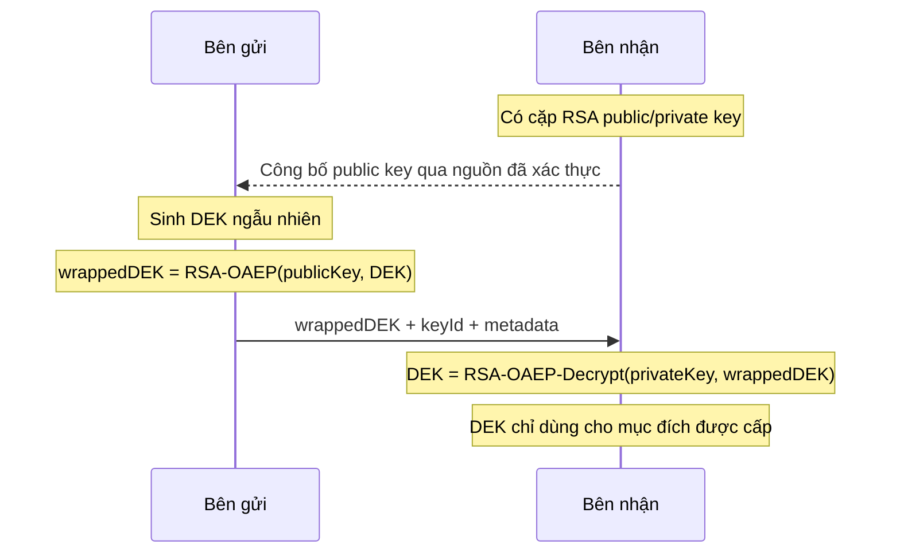
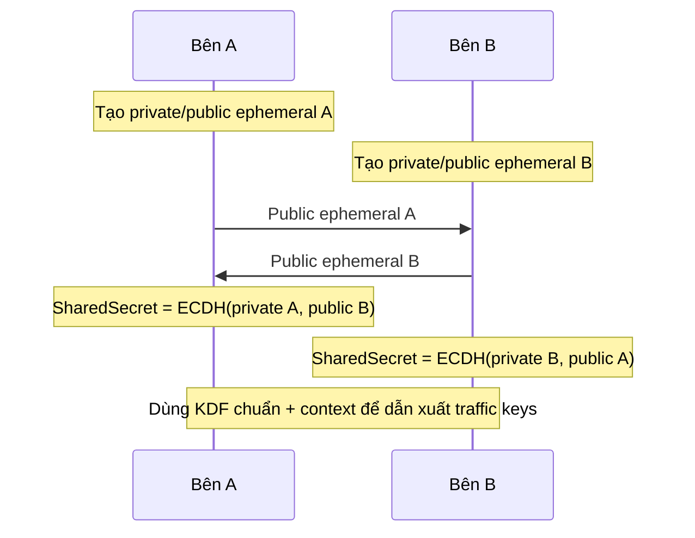
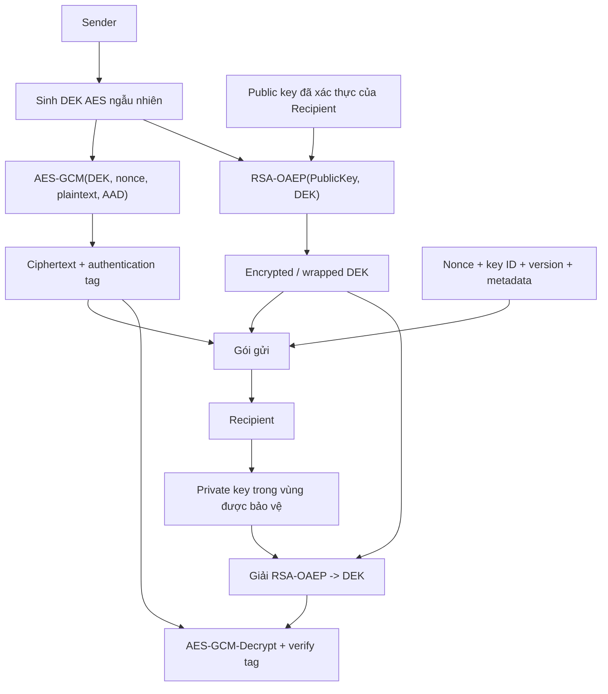
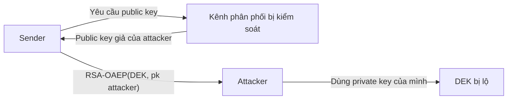
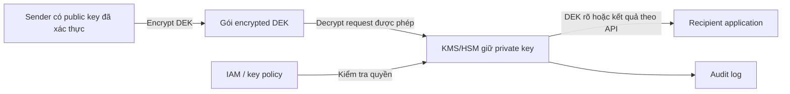
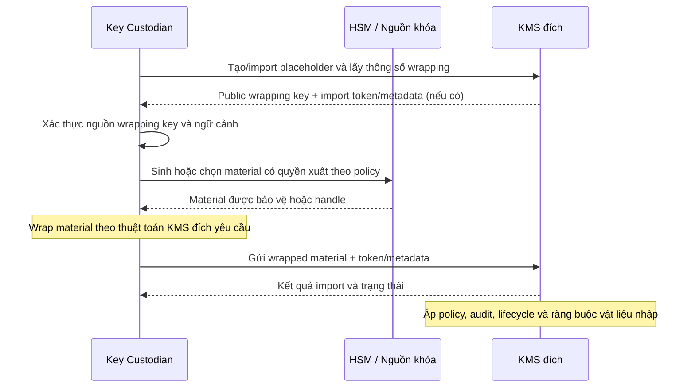

# Key transport: Truyền khóa an toàn bằng mật mã bất đối xứng

> **Chương:** Mật mã bất đối xứng  
> **Bài học:** Key transport  
> **Phạm vi:** Module `SECURITY_KEY_MANAGEMENT_FUNDAMENTALS` — hiểu vòng đời khóa từ tạo, cấp phát, lưu trữ, sử dụng, xoay vòng đến thu hồi và hủy, kết hợp mật mã đối xứng/bất đối xứng, chữ ký số, KMS/HSM, envelope encryption, kiểm soát truy cập và kiểm toán.

## 1. Key transport giải quyết vấn đề gì?

Giả sử `Billing Service` muốn gửi một tệp hóa đơn mã hóa cho `Archive Service`. Hai bên không có sẵn cùng một khóa AES, nhưng bên nhận có một cặp khóa bất đối xứng: **public key** được công bố có xác thực và **private key** được giữ an toàn trong KMS/HSM.

`Billing Service` có thể:

1. Tạo một **Data Encryption Key (DEK)** ngẫu nhiên, ví dụ khóa AES-256.
2. Mã hóa tệp hóa đơn bằng DEK với thuật toán **AES-GCM**.
3. Dùng **public key của Archive Service** để bảo vệ DEK trong lúc chuyển cho bên nhận.
4. Gửi tệp đã mã hóa, DEK đã được bảo vệ và metadata cần thiết.
5. `Archive Service` dùng private key tương ứng để khôi phục DEK, rồi giải mã tệp sau khi kiểm tra quyền và tính toàn vẹn.

Cách chuyển giao một khóa bí mật đã được chọn/sinh bởi một bên để bên còn lại nhận được an toàn được gọi là **key transport** (vận chuyển hoặc truyền khóa).

**Điểm mấu chốt:** key transport giải quyết bài toán **đưa vật liệu khóa đến bên nhận được phép**, sao cho người quan sát đường truyền không biết được khóa ở dạng rõ. Bảo mật của hệ thống còn phụ thuộc việc xác thực public key, quyền truy cập dữ liệu, tính toàn vẹn, chống replay, thời hạn và vòng đời khóa.

Trong ngữ cảnh chuẩn mật mã, thuật ngữ *key transport* có thể chỉ các cơ chế thiết lập khóa mà một bên chọn giá trị khóa rồi chuyển bí mật đó đến bên khác qua cơ chế bảo vệ thích hợp. Những giao thức khác như **key agreement** và **KEM** cũng thiết lập vật liệu khóa chung, nhưng có quy trình và bảo đảm khác.

### Mục tiêu sau bài học

- Giải thích được quy trình key transport và vai trò của khóa công khai, khóa riêng, DEK/KEK.
- Phân biệt **key transport**, **key agreement** và **Key Encapsulation Mechanism (KEM)**.
- Hiểu cách kết hợp **RSA-OAEP + AES-GCM**, tại sao không dùng RSA để mã hóa dữ liệu lớn.
- Xác định các yêu cầu xác thực public key, chống tráo khóa, chống lỗi oracle và chống phát lại.
- Viết ví dụ Java 17 truyền DEK qua RSA-OAEP và mã hóa dữ liệu bằng AES-GCM.
- Thiết kế vòng đời, rotation, thu hồi, nhập khóa KMS/HSM và kiểm toán phù hợp.

---

## 2. Phân biệt key transport và các cơ chế thiết lập khóa

### 2.1. Các thuật ngữ cần phân biệt

| Thuật ngữ | Cách hai bên có khóa chung | Bên nào quyết định giá trị? | Ví dụ |
|---|---|---|---|
| **Key transport** | Một bên chọn/sinh khóa rồi bảo vệ và chuyển cho bên còn lại. | Bên gửi chọn khóa được chuyển. | Bên gửi sinh AES DEK và mã hóa DEK bằng RSA-OAEP public key của bên nhận. |
| **Key agreement** | Hai bên trao đổi các giá trị công khai, kết hợp bí mật mỗi bên rồi dẫn xuất khóa chung. | Giá trị cuối thường phụ thuộc đóng góp của cả hai bên. | ECDH/ECDHE kết hợp KDF, theo giao thức được xác thực. |
| **KEM – Key Encapsulation Mechanism** | Bên gửi dùng public key để `Encapsulate`, nhận shared secret và encapsulation ciphertext; bên nhận `Decapsulate`. | Thông thường shared secret là đầu ra của KEM, không phải khóa AES tùy ý được đưa trực tiếp vào KEM. | KEM trong HPKE, các cơ chế KEM hậu lượng tử được chuẩn hóa. |
| **Key wrapping** | Bảo vệ một khóa bằng khóa khác, thường có khả năng kiểm tra tính toàn vẹn. | Không nhất thiết là phương thức thiết lập khóa giữa hai thực thể. | AES Key Wrap, một cơ chế wrap DEK dưới KEK do KMS quản lý. |
| **Envelope encryption** | Mã hóa dữ liệu bằng DEK; mã hóa hoặc wrap DEK bằng khóa cấp trên. | Tùy kiến trúc: DEK có thể do bên gửi/KMS sinh. | AES-GCM cho dữ liệu, RSA-OAEP hoặc KMS KEK để bảo vệ DEK. |

**Không nên đồng nhất mọi cơ chế trao đổi khóa với RSA key transport.** Ví dụ TLS 1.3 sử dụng cơ chế thiết lập khóa dựa trên (EC)DHE và key schedule, **không sử dụng kiểu RSA key transport cũ**. Một chứng thư RSA trong TLS cũng không có nghĩa khóa phiên được vận chuyển bằng RSA.

### 2.2. Key transport theo mô hình RSA



**Bên gửi phải xác minh public key thuộc đúng bên nhận.** Mã hóa bằng một public key do kẻ tấn công đánh tráo vẫn tạo ciphertext hợp lệ nhưng bí mật có thể bị gửi cho kẻ tấn công.

### 2.3. Key agreement theo mô hình ECDH



Key agreement **không tự chứng minh danh tính bên đối diện**. Nếu public key trao đổi bị thay bởi người ở giữa, hệ thống có thể bị tấn công MITM. Giao thức phải xác thực các giá trị trao đổi bằng chứng thư, chữ ký, khóa được tin cậy hoặc cơ chế phù hợp.

Trong những giao thức được thiết kế đúng, khóa ECDH tạm thời có thể tạo **forward secrecy**, vì khóa dài hạn lộ về sau không nhất thiết đủ để giải mã toàn bộ phiên cũ. RSA key transport bằng cặp RSA tĩnh **không có đặc tính này theo mặc định**: ai lưu được `wrappedDEK` rồi sau đó có private key RSA vẫn có thể mở lại các DEK lịch sử.

### 2.4. KEM không đơn giản là “RSA-OAEP đổi tên”

Một KEM có giao diện khái niệm:

```text
(pk, sk) <- KeyGen()
(ct, ss) <- Encapsulate(pk)
ss'      <- Decapsulate(sk, ct)
```

Khi hợp lệ, `ss'` khớp `ss`. `ss` là bí mật được thiết lập nhờ KEM; có thể đưa qua KDF với ngữ cảnh thích hợp để tạo khóa mã hóa thông điệp. Bên sử dụng không mặc nhiên chọn một giá trị AES tùy ý rồi “đưa vào KEM”.

Ví dụ **HPKE** kết hợp KEM, KDF và AEAD thành một cơ chế mã hóa lai. Cần đọc rõ chế độ sử dụng: chế độ cơ bản của HPKE không tự cung cấp xác thực danh tính bên gửi; những chế độ xác thực khác có đặc tính riêng. KEM cũng không tự thay thế authorization nghiệp vụ hoặc chống replay.

## 3. Kiến trúc key transport kết hợp mã hóa lai

RSA có thể bảo vệ một khóa AES ngắn nhưng không phù hợp để mã hóa trực tiếp tệp nhiều megabyte. Nguyên nhân gồm giới hạn kích thước thông điệp mỗi phép RSA-OAEP, hiệu năng và tính phức tạp.

**Hybrid encryption (mã hóa lai)** kết hợp:

- Thuật toán bất đối xứng hoặc KEM: đưa DEK/shared secret đến bên nhận một cách được bảo vệ.
- Thuật toán đối xứng AEAD: bảo vệ payload có kích thước lớn.
- Metadata xác thực: ràng buộc ciphertext với bên nhận, đối tượng, thuật toán, phiên bản và ngữ cảnh.



Ở đây, `wrapped DEK` là cách gọi thuận tiện cho DEK đã được bảo vệ bởi RSA-OAEP; không nên coi mọi định dạng mã hóa khóa là tương đương hoặc tương thích với **AES Key Wrap**.

### 3.1. Những khóa nào tồn tại?

| Vật liệu | Ai có? | Vai trò | Tính bí mật |
|---|---|---|---|
| **Public RSA key của recipient** | Sender và bên xác minh danh tính | Bảo vệ DEK trong lúc truyền. | Không bí mật; bắt buộc xác thực đúng chủ thể. |
| **Private RSA key của recipient** | Recipient/KMS/HSM theo thiết kế | Khôi phục DEK từ ciphertext RSA-OAEP. | Bí mật, kiểm soát chặt, nên hạn chế xuất khóa. |
| **DEK AES-256** | Sender tạm thời; recipient sau khi nhận | Mã hóa/giải mã payload bằng AES-GCM. | Bí mật trong suốt vòng đời. |
| **RSA-OAEP ciphertext của DEK** | Bên gửi, bên nhận, kênh/lưu trữ | Bảo vệ DEK trong gói truyền. | Không chứa DEK rõ; vẫn cần integrity metadata và tránh thao tác sai khóa. |
| **Nonce và AAD** | Sender, recipient | Ràng buộc mỗi lần mã hóa và ngữ cảnh payload. | Thường không bí mật; tuân thủ tính duy nhất/cách mã hóa nhất quán. |
| **Key ID/phiên bản** | Hai bên hoặc KMS | Chọn đúng private key và duy trì khả năng giải mã dữ liệu cũ. | Thường không bí mật; không phải credential. |

### 3.2. Không có bước nào “gửi private key”

Private key chỉ nên được giữ ở ranh giới tin cậy của recipient. Sender cần **public key đúng chủ thể**, có thể lấy qua chứng thư được xác minh hoặc cấu hình tin cậy. Recipient không gửi private key cho sender để thực hiện key transport.

Nếu ứng dụng thực sự cần chuyển **private key** qua hệ thống khác, đó là bài toán xuất/nhập vật liệu khóa có mức rủi ro cao hơn, phụ thuộc policy KMS/HSM, cơ chế wrapping chính thức và quy trình chuyển giao; không áp dụng trực tiếp mô hình gửi DEK của ví dụ mà bỏ qua chính sách.

---

## 4. RSA-OAEP: lựa chọn cho key transport truyền thống

### 4.1. Vì sao chọn OAEP?

**RSA-OAEP** là cơ chế mã hóa bất đối xứng có padding được thiết kế cho bảo mật tốt hơn so với việc dùng RSA “raw” hoặc padding RSA v1.5 cũ trong các giao thức mới.

Các thông số quan trọng:

- Độ dài modulus RSA đủ theo yêu cầu an toàn và chính sách; ví dụ **RSA 3072 bit** trong minh họa.
- Hash chính của OAEP, ví dụ `SHA-256`.
- **MGF1 hash** được chọn rõ ràng, ví dụ `SHA-256`.
- `PSource.PSpecified.DEFAULT` cho label OAEP rỗng trong Java, trừ khi giao thức có quy định khác.

Không giả định mọi provider JVM hiểu cùng cấu hình `OAEPWithSHA-256AndMGF1Padding`. Để tránh khác biệt về MGF1 hash giữa provider và các hệ thống khác, ví dụ Java sẽ chỉ định rõ `OAEPParameterSpec` ở cả hai đầu.

### 4.2. Giới hạn kích thước đầu vào

Với RSA-OAEP, độ dài dữ liệu rõ tối đa tính theo octet:

\[
mLen \leq k - 2hLen - 2
\]

Trong đó `k` là độ dài modulus RSA tính bằng byte, `hLen` là kích thước đầu ra hash.

Ví dụ:

- RSA 2048 bit: `k = 256`; SHA-256: `hLen = 32` → tối đa `256 - 64 - 2 = 190 byte`.
- RSA 3072 bit: `k = 384`; SHA-256 → tối đa `384 - 64 - 2 = 318 byte`.
- DEK AES-256 chỉ dài **32 byte**, nên dễ nằm trong giới hạn.

Đó là lý do dùng RSA-OAEP để bảo vệ **DEK nhỏ**, còn dữ liệu lớn được mã hóa bằng AES-GCM. Không chia tệp thành các block rồi mã hóa RSA từng block.

### 4.3. Những lựa chọn RSA cần tránh

Không dùng:

```text
RSA/ECB/NoPadding                      # raw RSA, không có padding bảo mật
RSA/ECB/PKCS1Padding                   # PKCS#1 v1.5 cho thiết kế key transport mới
textbookRSA(m) = m^e mod n             # thao tác tự chế
```

RSAES-PKCS1-v1_5 có lịch sử rủi ro **padding oracle** khi ứng dụng tiết lộ khác biệt giữa các lỗi giải mã. Những giao thức cũ còn dùng nó cần hướng xử lý và tương thích riêng, không nên tự vá bằng cách chỉ thay một dòng code mà bỏ qua đặc tả giao thức.

### 4.4. RSA-OAEP mã hóa DEK, nhưng không xác thực người gửi

Bất kỳ ai có public key của recipient đều có thể tạo gói RSA-OAEP hợp lệ chứa một DEK do họ sinh. Vì vậy **RSA-OAEP không tự chứng minh gói đến từ sender được tin cậy**.

Nếu ứng dụng cần xác thực sender:

1. Xác thực kênh (ví dụ mTLS, workload identity) và kiểm tra quyền nghiệp vụ; và/hoặc
2. Ký toàn bộ gói theo định dạng chuẩn bằng private signing key của sender, kiểm tra bằng public key đã xác thực; và
3. Chống replay, ràng buộc audience/recipient, timestamp, `objectId` khi giao thức yêu cầu.

Chữ ký số và key transport giải quyết hai bài toán bổ sung nhau. Không lấy “giải mã OAEP thành công” làm bằng chứng nhận diện sender.

## 5. Vai trò của public key trust và chống người ở giữa

### 5.1. Public key công khai không đồng nghĩa public key đáng tin

Một kẻ tấn công kiểm soát kênh phân phối khóa có thể thay public key của `Archive Service` bằng public key của mình. Sender vẫn mã hóa DEK thành công, nhưng attacker có private key để giải ra DEK.



Cần một cách **gắn khóa với danh tính**:

- Chứng thư X.509 với chuỗi tin cậy, hostname/định danh, mục đích sử dụng, thời hạn và chính sách được kiểm tra.
- Public key pinning hoặc fingerprint đã được cấp qua kênh đáng tin cậy, có cơ chế cập nhật/rotation.
- Kho khóa tập trung được phân quyền và bảo vệ tính toàn vẹn, ánh xạ rõ `recipientId → publicKeyVersion`.
- Quy trình xác minh thủ công/ngoài băng cho trường hợp chuyển khóa nhạy cảm.

Chỉ kiểm tra định dạng public key hoặc độ dài RSA chưa đủ để chứng minh nó thuộc đúng recipient.

### 5.2. Key ID nên được xử lý như thế nào?

`recipientKeyId` là tham chiếu giúp hai bên biết public/private key nào được sử dụng. Nó thường không cần bí mật. Tuy nhiên:

- Không để input tùy ý trỏ đến khóa của tenant hoặc môi trường khác.
- Không dùng key ID như credential hoặc bằng chứng xác thực danh tính.
- Khi rotation, lưu key ID hoặc version trong gói dữ liệu để bên nhận tìm đúng private key.
- Ràng buộc key ID và các trường có ý nghĩa bảo mật vào AAD hoặc chữ ký đúng ngữ cảnh.
- Kiểm tra key ID được chấp nhận theo chính sách của bên nhận; không “fallback” sang một key có quyền rộng hơn.

### 5.3. Mã hóa kênh truyền có còn cần không?

**Có.** Ngay cả khi DEK được RSA-OAEP bảo vệ, TLS vẫn giúp bảo vệ kết nối, metadata giao thức, xác thực máy chủ và các thông tin khác. Key transport ở tầng ứng dụng có thể cung cấp thêm ranh giới bảo vệ, nhưng không phải lý do bỏ qua HTTPS/TLS hoặc xác thực giao tiếp dịch vụ.

## 6. Gói dữ liệu minh họa khi truyền DEK

Một payload được mã hóa lai có thể có cấu trúc:

```json
{
  "formatVersion": 1,
  "keyTransport": "RSA-OAEP-SHA256-MGF1SHA256",
  "recipientKeyId": "archive-prod-rsa-v3",
  "contentAlgorithm": "AES-256-GCM",
  "tenantId": "tenant-42",
  "objectId": "invoice-1007",
  "purpose": "invoice-archive",
  "encryptedDek": "<base64-of-rsa-oaep-ciphertext>",
  "nonce": "<base64-of-12-byte-nonce>",
  "ciphertextAndTag": "<base64-of-aes-gcm-output>"
}
```

Đây là **định dạng minh họa**, không phải payload đã mã hóa thật.

Cần quyết định rõ các vấn đề khi hiện thực:

1. **Version hóa:** `formatVersion` quy định cấu trúc, serialization, phép toán và cách tính AAD.
2. **Algorithm allowlist:** không để các giá trị tự khai trong gói buộc server chọn thuật toán yếu hoặc chấp nhận trường hợp “không mã hóa”.
3. **Định danh:** recipient, tenant, object và purpose phải được kiểm tra với giá trị mong đợi từ ngữ cảnh đã xác thực.
4. **Tính toàn vẹn:** AAD của AES-GCM bảo vệ metadata có ý nghĩa với payload; nếu cần xác thực sender thì dùng thêm chữ ký/kênh xác thực.
5. **Tính mới:** phiên bản object và replay phải được quản lý ở tầng ứng dụng; AEAD tag hợp lệ không tự chứng minh đây là bản mới nhất.
6. **Kích thước và lỗi:** giới hạn byte đầu vào, không tiết lộ thông tin oracle từ lỗi RSA giải mã hoặc lỗi tag; bảo vệ dịch vụ khỏi request quá lớn.
7. **Khóa cũ:** gói lưu key ID/phiên bản để có thể giải mã sau khi public key mới được sử dụng.

### 6.1. AAD nên ràng buộc những trường nào?

Ví dụ:

```text
formatVersion
keyTransportAlgorithm
contentAlgorithm
recipientKeyId
tenantId
objectId
purpose
```

Không chỉ dùng phép nối chuỗi mơ hồ. Một định dạng nhị phân có tiền tố độ dài, CBOR/JSON canonicalization phù hợp hoặc giao thức chuẩn được sử dụng nhất quán sẽ tránh các cặp trường khác nhau tạo cùng chuỗi byte AAD.

**Chú ý:** AAD xác thực bản mã AES-GCM dưới DEK. Người tấn công có thể tạo **một gói mới hoàn toàn** bằng public key của recipient vì ai cũng có thể mã hóa DEK; AAD không tự cung cấp xác thực danh tính sender. Nếu yêu cầu xác thực sender, phải có cơ chế riêng.

---

## 7. Ví dụ Java 17: RSA-OAEP truyền DEK và AES-GCM bảo vệ dữ liệu

Đoạn mã sau minh họa đầy đủ ở mức nguyên lý:

- Bên nhận tạo cặp RSA 3072 bit cho ví dụ.
- Sender sinh **DEK AES-256** bằng `KeyGenerator`.
- Sender mã hóa dữ liệu bằng AES-GCM với nonce ngẫu nhiên 96 bit và AAD có phiên bản.
- Sender dùng `RSA/ECB/OAEPPadding` với **OAEP SHA-256 và MGF1 SHA-256 được chỉ định rõ** để mã hóa DEK.
- Recipient dùng private key để khôi phục DEK, kiểm tra key ID/tenant/object và xác thực tag AES-GCM.
- Không in hoặc lưu DEK dạng rõ, RSA private key hoặc plaintext trong log.

Đây là một chương trình mẫu tự chạy trên Java 17 với provider hỗ trợ các thuật toán được nêu. Trong production, recipient private key nên nằm trong KMS/HSM, việc chọn public key phải có xác thực và giao thức cần thêm sender authentication/anti-replay theo yêu cầu.

```java
import java.io.ByteArrayOutputStream;
import java.io.DataOutputStream;
import java.io.IOException;
import java.nio.charset.StandardCharsets;
import java.security.GeneralSecurityException;
import java.security.KeyPair;
import java.security.KeyPairGenerator;
import java.security.MessageDigest;
import java.security.PrivateKey;
import java.security.PublicKey;
import java.security.SecureRandom;
import java.security.spec.MGF1ParameterSpec;
import java.util.Arrays;

import javax.crypto.Cipher;
import javax.crypto.KeyGenerator;
import javax.crypto.SecretKey;
import javax.crypto.spec.GCMParameterSpec;
import javax.crypto.spec.OAEPParameterSpec;
import javax.crypto.spec.PSource;
import javax.crypto.spec.SecretKeySpec;

public final class RsaOaepKeyTransportDemo {
    private static final SecureRandom RNG = new SecureRandom();
    private static final int AES_BYTES = 32;
    private static final int GCM_NONCE_BYTES = 12;
    private static final int GCM_TAG_BITS = 128;
    private static final int FORMAT_VERSION = 1;

    private static final OAEPParameterSpec OAEP_SHA256 =
            new OAEPParameterSpec(
                    "SHA-256",
                    "MGF1",
                    MGF1ParameterSpec.SHA256,
                    PSource.PSpecified.DEFAULT);

    // Các mảng trong record được sao chép để tránh sửa lén từ bên ngoài.
    public record Envelope(
            String recipientKeyId,
            String tenantId,
            String objectId,
            byte[] encryptedDek,
            byte[] nonce,
            byte[] ciphertextAndTag) {
        public Envelope {
            encryptedDek = encryptedDek.clone();
            nonce = nonce.clone();
            ciphertextAndTag = ciphertextAndTag.clone();
        }
        @Override public byte[] encryptedDek() {
            return encryptedDek.clone();
        }
        @Override public byte[] nonce() {
            return nonce.clone();
        }
        @Override public byte[] ciphertextAndTag() {
            return ciphertextAndTag.clone();
        }
    }

    private RsaOaepKeyTransportDemo() {}

    public static Envelope seal(
            PublicKey authenticatedRecipientPublicKey,
            String recipientKeyId,
            String tenantId,
            String objectId,
            byte[] plaintext)
            throws GeneralSecurityException, IOException {

        // Mỗi gói trong ví dụ có DEK riêng.
        KeyGenerator generator = KeyGenerator.getInstance("AES");
        generator.init(256, RNG);
        SecretKey dek = generator.generateKey();

        byte[] rawDek = dek.getEncoded();
        if (rawDek == null || rawDek.length != AES_BYTES) {
            throw new GeneralSecurityException("Unexpected DEK");
        }

        try {
            // Chỉ mã hóa DEK ngắn bằng RSA-OAEP.
            Cipher rsa = Cipher.getInstance("RSA/ECB/OAEPPadding");
            rsa.init(
                    Cipher.ENCRYPT_MODE,
                    authenticatedRecipientPublicKey,
                    OAEP_SHA256);
            byte[] encryptedDek = rsa.doFinal(rawDek);

            byte[] nonce = new byte[GCM_NONCE_BYTES];
            RNG.nextBytes(nonce);

            Cipher aes = Cipher.getInstance("AES/GCM/NoPadding");
            aes.init(
                    Cipher.ENCRYPT_MODE,
                    new SecretKeySpec(rawDek, "AES"),
                    new GCMParameterSpec(GCM_TAG_BITS, nonce));
            aes.updateAAD(
                    context(recipientKeyId, tenantId, objectId));
            byte[] ciphertextAndTag = aes.doFinal(plaintext);

            return new Envelope(
                    recipientKeyId,
                    tenantId,
                    objectId,
                    encryptedDek,
                    nonce,
                    ciphertextAndTag);
        } finally {
            // Best effort: không đảm bảo xóa mọi bản sao bên trong JVM.
            Arrays.fill(rawDek, (byte) 0);
        }
    }

    public static byte[] open(
            PrivateKey recipientPrivateKey,
            Envelope packet,
            String expectedRecipientKeyId,
            String expectedTenantId,
            String expectedObjectId)
            throws GeneralSecurityException, IOException {

        // Các expected... phải được suy ra từ ngữ cảnh đã xác thực.
        if (!expectedRecipientKeyId.equals(packet.recipientKeyId())
                || !expectedTenantId.equals(packet.tenantId())
                || !expectedObjectId.equals(packet.objectId())) {
            throw new GeneralSecurityException(
                    "Unexpected recipient or object");
        }

        byte[] nonce = packet.nonce();
        if (nonce.length != GCM_NONCE_BYTES) {
            throw new GeneralSecurityException("Invalid nonce");
        }

        Cipher rsa = Cipher.getInstance("RSA/ECB/OAEPPadding");
        rsa.init(
                Cipher.DECRYPT_MODE,
                recipientPrivateKey,
                OAEP_SHA256);
        byte[] rawDek = rsa.doFinal(packet.encryptedDek());

        try {
            if (rawDek.length != AES_BYTES) {
                throw new GeneralSecurityException("Invalid DEK length");
            }

            Cipher aes = Cipher.getInstance("AES/GCM/NoPadding");
            aes.init(
                    Cipher.DECRYPT_MODE,
                    new SecretKeySpec(rawDek, "AES"),
                    new GCMParameterSpec(GCM_TAG_BITS, nonce));
            aes.updateAAD(context(
                    expectedRecipientKeyId,
                    expectedTenantId,
                    expectedObjectId));

            // doFinal chỉ trả bản rõ nếu tag GCM xác thực thành công.
            return aes.doFinal(packet.ciphertextAndTag());
        } finally {
            Arrays.fill(rawDek, (byte) 0);
        }
    }

    private static byte[] context(
            String recipientKeyId,
            String tenantId,
            String objectId) throws IOException {
        ByteArrayOutputStream buffer = new ByteArrayOutputStream();
        DataOutputStream out = new DataOutputStream(buffer);
        out.writeInt(FORMAT_VERSION);
        writeString(out, "RSA-OAEP-SHA256-MGF1SHA256");
        writeString(out, "AES-256-GCM");
        writeString(out, "invoice-archive");
        writeString(out, recipientKeyId);
        writeString(out, tenantId);
        writeString(out, objectId);
        out.flush();
        return buffer.toByteArray();
    }

    private static void writeString(
            DataOutputStream out, String value) throws IOException {
        byte[] bytes = value.getBytes(StandardCharsets.UTF_8);
        out.writeInt(bytes.length);
        out.write(bytes);
    }

    public static void main(String[] args) throws Exception {
        // DEMO: recipient tạo key pair tại chỗ.
        // Production: private key ở KMS/HSM, public key phải xác thực.
        KeyPairGenerator rsaKeys = KeyPairGenerator.getInstance("RSA");
        rsaKeys.initialize(3072, RNG);
        KeyPair recipient = rsaKeys.generateKeyPair();

        byte[] plaintext = "Hoa don so 1007"
                .getBytes(StandardCharsets.UTF_8);

        Envelope packet = seal(
                recipient.getPublic(),
                "archive-prod-rsa-v3",
                "tenant-42",
                "invoice-1007",
                plaintext);

        byte[] recovered = open(
                recipient.getPrivate(),
                packet,
                "archive-prod-rsa-v3",
                "tenant-42",
                "invoice-1007");

        System.out.println(
                "Round trip verified: "
                + MessageDigest.isEqual(plaintext, recovered));

        Arrays.fill(plaintext, (byte) 0);
        Arrays.fill(recovered, (byte) 0);
    }
}
```

### 7.1. Vai trò của các thành phần trong code

| Thành phần | Chức năng |
|---|---|
| `KeyPairGenerator` với RSA 3072 | Tạo public/private key cho recipient trong demo. |
| `KeyGenerator` với AES 256 | Sinh DEK dùng mã hóa nội dung của một gói. |
| `OAEPParameterSpec` | Chọn SHA-256 và MGF1 SHA-256 nhất quán ở hai phía. |
| `Cipher` với `RSA/ECB/OAEPPadding` | Bảo vệ và khôi phục 32 byte DEK, không mã hóa cả tệp. |
| `Cipher` với `AES/GCM/NoPadding` | Mã hóa dữ liệu và xác thực ciphertext/AAD. |
| `nonce` 12 byte | Phân biệt mỗi lần AES-GCM encrypt dưới cùng DEK; trong demo DEK được sinh riêng cho mỗi gói. |
| `context(...)` | Sinh AAD với cấu trúc có tiền tố độ dài, ràng buộc recipient/tenant/object và mục đích. |
| `packet.recipientKeyId()` | Cho recipient biết khóa/phiên bản được kỳ vọng; kiểm tra với thông tin đáng tin cậy. |
| `Arrays.fill(rawDek, 0)` | Giảm thời gian tồn tại của một mảng chứa DEK, nhưng không phải cơ chế xóa toàn bộ bản sao trong JVM. |

### 7.2. Các giới hạn của ví dụ

- **Chưa có xác thực sender**: RSA-OAEP + AES-GCM không chứng minh người tạo gói là ai. Muốn chứng minh sender phải thêm chữ ký, kênh xác thực hoặc giao thức chuẩn có chế độ xác thực phù hợp.
- **Chưa có replay protection**: packet hợp lệ có thể được phát lại; cần kiểm tra request ID, object version, timestamp hoặc trạng thái nghiệp vụ.
- **Chưa dùng KMS/HSM thật**: không có SDK, IAM, policy, audit, quota và không cất private key trong HSM. `PrivateKey` Java trong demo không phải khóa không xuất được.
- **Chưa có serialization**: `Envelope` minh họa cấu trúc trong bộ nhớ. Production cần định dạng có version, allowlist thuật toán, encoding và giới hạn kích thước.
- **Chưa có error-handling API**: lỗi OAEP, tag và quyền truy cập không nên được phân biệt chi tiết cho nguồn không đáng tin cậy; tránh tạo oracle.
- **Chưa có input limits**: payload quá lớn cần thiết kế streaming/chunked AEAD có xác thực thứ tự và tổng thể, không trả plaintext trước khi xác minh tag.
- **Chưa có authz**: `expectedTenantId` và các giá trị expected phải đến từ authorization nghiệp vụ, không phải tự sao chép từ packet nhận được.
- **Không cam kết zeroization hoàn toàn**: Java provider, mảng nội bộ và GC có thể giữ bản sao khóa hoặc dữ liệu rõ trong bộ nhớ.

### 7.3. Kiểm tra các tình huống thất bại

Mô phỏng trong môi trường học tập:

1. Đổi một byte `encryptedDek`: RSA-OAEP decrypt cần thất bại, hoặc nhận dữ liệu không thể xác thực tiếp. **Không trả plaintext**.
2. Đổi một byte `ciphertextAndTag`: AES-GCM tag phải không hợp lệ.
3. Đổi `expectedTenantId` sang tenant khác: bước kiểm tra metadata phải từ chối.
4. Dùng private key khác: không thể khôi phục đúng DEK của gói.
5. Dùng public key bị tráo tại sender: bên nắm private key tương ứng có thể mở DEK; điều này cho thấy **bảo vệ đường phân phối public key** là bắt buộc.
6. Gửi lại nguyên gói cũ: mã vẫn có thể giải mã thành công; cần **chống replay/rollback ngoài AEAD**.

Chỉ báo cáo những kết quả đã thực sự kiểm thử; ví dụ trên là tài liệu minh họa, không tự khẳng định đã vượt qua mọi kiểm thử production.

## 8. Key transport qua KMS và HSM

### 8.1. Khi private key không được phép xuất

Trong KMS/HSM, một private key có thể được gắn cờ **non-exportable**:



Trong mô hình này, recipient ứng dụng **không cần đọc raw private key**. KMS/HSM thực hiện phép toán với khóa được bảo vệ, xác thực danh tính workload, giới hạn thuật toán/quyền và ghi nhật ký tùy khả năng.

Một số thiết bị trả **raw DEK** cho ứng dụng sau khi decrypt; thiết bị khác hỗ trợ thao tác tiếp theo ngay trong ranh giới HSM. Sự khác nhau này ảnh hưởng lớn đến mô hình đe dọa, độ trễ, giới hạn payload và khả năng quản trị khóa.

### 8.2. Khóa dùng để truyền khác khóa dùng để ký

Một cặp RSA cho `Decrypt` được dùng theo chính sách mã hóa phù hợp. Một cặp khóa dùng `Sign` nhằm tạo chữ ký, không nên mặc nhiên dùng cho giải mã chỉ vì cùng là RSA.

Nên tách **khóa transport** và **khóa signing** theo mục đích, quyền, audit, thời hạn và tác động sự cố. Ví dụ:

- `archive-key-transport-prod`: workload giải mã DEK theo quyền `Decrypt` và key policy.
- `archive-signing-prod`: workload ký manifest theo quyền `Sign`.
- `orders-data-kek-prod`: KMS symmetric KEK dùng wrap DEK lưu trữ.

Tách quyền quản trị khóa khỏi quyền sử dụng khóa theo nhiệm vụ khi mô hình IAM hỗ trợ. Một workload có quyền `Decrypt` rộng có thể đọc nhiều dữ liệu dù không lấy được private key.

### 8.3. KMS có cung cấp RSA-OAEP không?

Phải kiểm tra **nhà cung cấp và từng loại khóa**:

- Có hỗ trợ RSA-OAEP SHA-256 với MGF1 SHA-256 không?
- Public key lấy theo format nào: X.509 SubjectPublicKeyInfo, PEM, DER hay cấu trúc khác?
- API `Decrypt` cần key ID, thuật toán hay encryption context nào?
- Vật liệu private key có được xuất không?
- KMS có quota, giới hạn độ dài dữ liệu, chi phí và giới hạn vùng?
- Khi rotate/disable/delete, ciphertext cũ được khôi phục như thế nào?

Không giả định API của mọi dịch vụ KMS cùng tên/cùng cú pháp hoặc đều hỗ trợ một số thuật toán RSA nhất định. **Tham khảo tài liệu API chính thức** trước khi chọn format và thuật toán tương tác.

## 9. Key transport khi nhập khóa ngoài: BYOK và HSM

Một trường hợp quan trọng của key transport trong vận hành là **BYOK (Bring Your Own Key)**: tổ chức tạo vật liệu khóa bên ngoài rồi nhập vào KMS bằng phương thức an toàn mà dịch vụ quy định.

### 9.1. Mô hình nhập khóa minh họa



Đây là khung khái niệm. Trình tự thực tế, định dạng import token, wrapping algorithm, thời hạn và quyền phụ thuộc nhà cung cấp KMS/HSM.

**Không dùng trực tiếp code RSA-OAEP mẫu để tự nhập bất kỳ khóa nào vào KMS** nếu API import yêu cầu một cấu trúc wrapping cụ thể, nhiều tầng wrap hoặc token tạm thời. Tuân thủ đúng giao thức nhập khóa đã công bố.

### 9.2. Những câu hỏi phải trả lời trước BYOK

- Ai tạo material? Nguồn CSPRNG/HSM có được chấp thuận không?
- Key material được xuất ra ở dạng nào? Ai có thể thấy raw key trong quá trình chuyển?
- Public wrapping key của KMS đích lấy từ đâu và xác thực ra sao?
- Import token có giới hạn thời gian không? Rủi ro nếu token hoặc khóa wrapping bị lộ?
- Bản gốc hoặc bản sao khóa ở HSM nguồn có được giữ lại không? Ai có quyền khôi phục?
- Import thất bại có sinh ra bản sao secret hoặc log debug không?
- Khi khóa nhập hết hạn, bị xóa, mất nguồn BYOK hoặc khôi phục sau DR, dữ liệu cũ xử lý ra sao?
- Phải sao lưu bằng cơ chế nào để vẫn đáp ứng quy định hủy khóa?

Lưu ý: `BYOK` không đồng nghĩa khóa nằm hoàn toàn ngoài nhà cung cấp. Có mô hình **external key store/HYOK** giữ sự phụ thuộc vào hệ thống bên ngoài; nó đặt ra vấn đề độ sẵn sàng, kết nối và quyền khác với key import thông thường.

## 10. Key transport, envelope encryption và key wrapping

### 10.1. Ba khái niệm nằm ở những tầng nào?

| Tầng | Ví dụ | Mục tiêu |
|---|---|---|
| **Truyền khóa đến recipient** | RSA-OAEP bảo vệ DEK theo public key recipient. | Recipient nhận được DEK, bên khác không khôi phục được nếu không có private key. |
| **Mã hóa payload** | AES-256-GCM với DEK và AAD. | Bảo vệ bí mật, toàn vẹn payload ở cấp bản ghi/file. |
| **Bảo vệ khóa khi lưu** | KMS KEK wrap DEK; lưu wrapped DEK cạnh ciphertext. | Cho phép lưu/khôi phục bản mã mà không lưu DEK rõ. |

Hai mô hình thường gặp:

**A. Sender chọn DEK, recipient mở bằng private key:**

```text
Sender:
  DEK = CSPRNG()
  encryptedDek = RSA-OAEP(recipientPublicKey, DEK)
  ciphertext = AES-GCM(DEK, plaintext, nonce, AAD)

Recipient:
  DEK = RSA-OAEP-Decrypt(recipientPrivateKey, encryptedDek)
  plaintext = AES-GCM-Decrypt(DEK, ciphertext, nonce, AAD)
```

**B. Dữ liệu được mã hóa và lưu bằng KMS symmetric KEK:**

```text
Application:
  (raw DEK, wrapped DEK) = KMS.GenerateDataKey(KEK)
  ciphertext = AES-GCM(DEK, plaintext, nonce, AAD)
  store(ciphertext, nonce, AAD metadata, wrapped DEK)

Read:
  DEK = KMS.Decrypt(KEK, wrapped DEK)
  plaintext = AES-GCM-Decrypt(DEK, ciphertext, nonce, AAD)
```

Trong mô hình B, KMS quản lý KEK và cơ chế unwrap; **không nhất thiết có cặp RSA**. Envelope encryption là kiến trúc bảo vệ khóa dữ liệu, còn key transport là một họ cơ chế có thể được sử dụng để chuyển giao vật liệu khóa trong kiến trúc đó.

### 10.2. Key agreement/KEM có thể thay RSA transport ra sao?

Với KEM/HPKE:

```text
(pkR, skR) = recipient key pair
(enc, sharedSecret) = KEM.Encapsulate(pkR)
trafficKey = KDF(sharedSecret, protocol context)
ciphertext = AEAD.Encrypt(trafficKey, nonce, plaintext, AAD)
send(enc, nonce, ciphertext, metadata)
```

Recipient dùng `skR` để decapsulate rồi dẫn xuất đúng traffic key. Đây là dạng thiết lập khóa chung khác với việc sender **tự chọn AES DEK rồi mã hóa trực tiếp DEK đó bằng RSA-OAEP**.

Giao thức mới nên chọn cơ chế đã chuẩn hóa phù hợp yêu cầu, thay vì tự phối hợp KEM/KDF/AEAD thiếu ràng buộc ngữ cảnh, xác thực và khôi phục. Nếu dùng giao thức chuẩn, theo đúng quy tắc phiên bản, mode, key schedule và API của nó.

---

## 11. Rủi ro thường gặp và phản ứng phù hợp

### 11.1. Bị tráo public key khi phân phối

**Hiện tượng:** sender tải public key từ một endpoint không xác thực hoặc file có thể bị sửa. Attacker cung cấp public key của mình.

**Hậu quả:** DEK được mã hóa cho attacker; attacker dùng private key của mình khôi phục DEK.

**Biện pháp:** xác thực chứng thư/nguồn khóa, mapping recipient-keyId đáng tin, pinning/fingerprint hoặc cơ chế phân phối có kiểm toán; test trường hợp public key sai danh tính.

### 11.2. Lộ recipient private key dài hạn

**Hiện tượng:** RSA private key bị xuất trái phép hoặc file chứa private key bị đánh cắp.

**Hậu quả:** ciphertext RSA-OAEP đã lưu có thể được giải mã về sau. Nếu attacker đã ghi lại gói cũ, họ có thể khôi phục **DEK lịch sử**. RSA key transport tĩnh không bảo đảm forward secrecy.

**Biện pháp:** ngăn xuất private key nếu khả thi, dùng HSM/KMS, thu hồi quyền, rotate, đánh giá lại dữ liệu đã phát hành và cân nhắc tái mã hóa/rewrap phù hợp. Với nhu cầu forward secrecy, cân nhắc giao thức dùng khóa thỏa thuận tạm thời được xác thực.

### 11.3. Lộ DEK ở bộ nhớ sender/recipient

**Hiện tượng:** heap dump, log, debug endpoint hoặc cache chứa DEK rõ.

**Hậu quả:** attacker có thể giải mã payload được bảo vệ bởi DEK đó ngay cả khi RSA private key vẫn an toàn.

**Biện pháp:** hạn chế thời gian DEK trong bộ nhớ; không log raw key; bảo vệ dump, quyền truy cập runtime; phân chia DEK theo phạm vi nhỏ; đánh giá mã hóa lại dữ liệu nếu DEK đã lộ.

### 11.4. Padding/decryption oracle

**Hiện tượng:** endpoint báo lỗi khác nhau tùy RSA-OAEP thất bại, tag GCM sai, key ID không tồn tại hoặc độ dài payload.

**Hậu quả:** có thể tiết lộ thông tin hữu ích cho kẻ tấn công và tạo bề mặt oracle/đoán cấu hình, tùy giao thức và khả năng quan sát.

**Biện pháp:** hạn chế và chuẩn hóa thông tin lỗi trả ra ngoài; thực hiện kiểm tra theo API an toàn; không tự viết RSA padding; log chi tiết cần thiết ở kênh bảo vệ, không phơi ra trước mạng.

### 11.5. Ciphertext cũ bị phát lại

**Hiện tượng:** attacker gửi lại toàn bộ gói cũ có RSA encrypted DEK và AES-GCM tag hợp lệ.

**Hậu quả:** recipient có thể giải mã hợp lệ và tái thực hiện hành động nghiệp vụ.

**Biện pháp:** timestamp, nonce/request ID hoặc phiên bản object được kiểm tra từ trạng thái đáng tin cậy, idempotency, kiểm soát audience và quyền xử lý.

### 11.6. Rotation vội dẫn đến mất dữ liệu

**Hiện tượng:** bên nhận đổi RSA key pair rồi xóa private key cũ khi dữ liệu cũ vẫn chứa encrypted DEK dưới public key cũ.

**Hậu quả:** không thể mở DEK và không thể giải mã ciphertext cũ.

**Biện pháp:** lưu key ID/version, kiểm đếm toàn bộ dữ liệu phụ thuộc, rewrap/re-encrypt có checkpoint, test khôi phục trước khi hủy key cũ.

## 12. Vòng đời của khóa dùng cho key transport

| Giai đoạn | Public/private transport key | DEK được vận chuyển | Kiểm soát quan trọng |
|---|---|---|---|
| **Tạo** | Sinh key pair bằng nguồn ngẫu nhiên phù hợp, trong KMS/HSM nếu cần. | Sinh DEK độc lập cho dữ liệu/phạm vi mục đích. | Thuật toán, độ dài, entropy và phân loại. |
| **Cấp phát** | Công bố public key qua kênh xác thực; không gửi private key. | Bảo vệ DEK bằng RSA-OAEP/KEM/wrapping theo thiết kế. | Định danh recipient, khóa, phiên bản và policy. |
| **Lưu trữ** | Private key trong vùng tin cậy, công khai public key đúng nguồn. | Lưu encrypted/wrapped DEK; raw DEK tồn tại ngắn hạn. | Hạn chế xuất key, backup, phân tách quyền. |
| **Sử dụng** | Recipient dùng private key để decrypt/decapsulate theo quyền. | DEK được dùng với AES-GCM hoặc cơ chế được chọn. | Nonce duy nhất, AAD đúng, tag hợp lệ. |
| **Xoay vòng** | Sinh key pair mới, chuyển public key và giai đoạn chấp nhận khóa cũ. | Rewrap DEK cũ hoặc mã hóa lại payload nếu DEK bị lộ. | Phiên bản, khả năng đọc dữ liệu cũ, migration. |
| **Thu hồi** | Chặn quyền Decrypt hoặc ngừng chấp nhận một key ID. | DEK rõ đã cấp có thể vẫn tồn tại trong memory/cache. | Revoke workload, cache TTL, giám sát sự cố. |
| **Hủy** | Hủy private key đúng quy trình và xem dữ liệu còn phụ thuộc. | Hủy DEK nếu không còn cần đọc dữ liệu. | Backup, DR, nghĩa vụ lưu giữ và khả năng mất dữ liệu. |

### 12.1. Key rotation trong hệ thống truyền khóa

Một quy trình giảm rủi ro có thể là:

1. Tạo recipient key pair phiên bản `v4` trong KMS/HSM.
2. Công bố và xác thực public key `v4` ở sender, giữ `v3` cho việc giải mã dữ liệu cũ.
3. Sender chuyển sang bảo vệ DEK mới bằng `v4`.
4. Tìm toàn bộ encrypted DEK dùng `v3` và **rewrap** cho `v4` theo quy trình an toàn có kiểm soát quyền.
5. Kiểm thử giải mã dữ liệu mới/cũ, các bản backup và vùng DR.
6. Sau thời hạn chuyển tiếp và xác nhận phụ thuộc đã xử lý, vô hiệu hóa rồi hủy `v3` theo chính sách.

Nếu `v3` private key **đã bị lộ**, rewrap đơn thuần không xóa khả năng attacker đã lưu DEK/bản rõ trước đó. Cần đánh giá phạm vi rò rỉ và có thể phải mã hóa lại dữ liệu bằng DEK mới. Nếu chỉ thay public key cho các gói mới, dữ liệu cũ vẫn phụ thuộc private key cũ.

### 12.2. Thu hồi quyền khác xóa private key

Thu hồi role có quyền gọi KMS `Decrypt` có thể chặn các lần gọi mới, nhưng không xóa được DEK đã nằm trong bộ nhớ recipient hoặc đã bị sao chép. Vô hiệu hóa khóa tại KMS cũng không tự xóa bản cache raw DEK ngoài KMS.

**Cryptographic erasure** chỉ đáng tin khi mọi bản sao vật liệu khóa cho phép khôi phục dữ liệu đều thật sự không còn khả dụng theo phạm vi cần hủy. Không coi việc xóa alias hoặc key ID là hủy vật liệu khóa.

## 13. IAM, audit và quản trị khóa

### 13.1. Quyền tối thiểu

| Chủ thể | Quyền cần có | Không nên cấp mặc định |
|---|---|---|
| Sender | Đọc public key đã xác thực của đúng recipient và tạo encrypted DEK. | Đọc recipient private key hoặc giải mã dữ liệu tenant khác. |
| Recipient application | Dùng đúng private key qua API KMS/HSM `Decrypt` theo policy. | Xuất private key, sửa key policy, xóa key tùy ý. |
| Key administrator | Tạo/rotate key pair, cập nhật policy theo phê duyệt. | Quyền xem plaintext nghiệp vụ nếu không cần. |
| Security auditor | Xem log, metadata, trạng thái, lịch rotation. | Raw DEK, private key, quyền `Decrypt`. |
| DR/recovery operator | Quyền phục hồi tạm thời có kiểm toán. | Quyền rộng tồn tại lâu dài. |

**Lưu ý:** một recipient workload có quyền decrypt khóa của mọi tenant có thể vượt qua ranh giới dữ liệu nếu authorization nghiệp vụ sai. Cần kiểm tra tenant/object ID trước khi trả plaintext và hạn chế quyền KMS theo môi trường/tài nguyên.

### 13.2. Những sự kiện cần audit

- Thay đổi public key, certificate, key mapping và key version.
- Việc tạo, nhập, vô hiệu hóa, lên lịch xóa và hủy key pair.
- Các lời gọi `Decrypt`, `Unwrap` và lỗi quyền, theo dữ liệu log KMS cho phép.
- Tần suất key transport tăng đột biến, lỗi OAEP/tag, nhiều request không hợp lệ.
- Các sự kiện chuyển khóa, thời điểm bắt đầu dùng `v4` và ngừng `v3`.
- Kết quả kiểm thử DR và số lượng payload còn phụ thuộc private key cũ.

Không ghi raw private key, raw DEK, plaintext, bí mật cấp phát hoặc bản dump khóa trong log. Một số metadata như tenant/object ID cũng có thể nhạy cảm, cần giới hạn và ẩn danh theo chính sách.

## 14. Tình huống thực tế: trao đổi dữ liệu hóa đơn giữa hai hệ thống Java

### 14.1. Bối cảnh

Một doanh nghiệp có:

- `Billing Service` tạo hóa đơn và lưu bản mã lâu dài.
- `Archive Service` nhận hóa đơn để lưu trữ.
- KMS/HSM quản lý khóa bên nhận.
- Người dùng chỉ được xem hóa đơn trong tenant được cấp phép.

Yêu cầu: dữ liệu phải được bảo vệ cả lúc truyền lẫn khi lưu, sender có thể xác thực được public key bên nhận, việc rotate không làm mất dữ liệu cũ.

### 14.2. Thiết kế

**Trước khi truyền:**

1. `Archive Service` tạo key pair RSA hoặc cơ chế key establishment phù hợp trong KMS/HSM.
2. Công bố public key kèm `keyId`, phiên bản và bằng chứng xác thực nguồn.
3. `Billing Service` lưu/tra public key qua kênh tin cậy và xác minh đúng `archive-prod`.

**Khi gửi:**

1. Sinh DEK AES-256 mới cho tệp.
2. Mã hóa bằng AES-GCM, nonce mới, AAD chứa `tenantId`, `invoiceId`, `purpose`, `recipientKeyId` và phiên bản format.
3. Dùng RSA-OAEP với public key recipient để mã hóa DEK.
4. Đóng gói encrypted DEK, ciphertext/tag, nonce, metadata.
5. Truyền qua TLS với định danh sender được xác thực; ký gói nếu cần xác minh sender độc lập với kênh truyền.

**Khi nhận:**

1. Xác thực sender và kiểm tra quyền gửi vào đúng tenant.
2. Kiểm tra format, thuật toán cho phép, key ID, hạn, request ID/nonce nghiệp vụ.
3. Dùng IAM workload gọi KMS/HSM để mở DEK.
4. Giải mã AES-GCM với AAD từ ngữ cảnh đã xác thực, chỉ chấp nhận plaintext khi tag hợp lệ.
5. Ghi audit thao tác, quản lý phiên bản và quyền đọc trong Archive Service.

### 14.3. Bảng đánh giá đe dọa

| Đe dọa | Key transport giúp gì? | Kiểm soát cần thêm |
|---|---|---|
| Nghe lén gói truyền | Encrypted DEK không để lộ DEK khi public key và RSA-OAEP dùng đúng. | TLS, không để lộ plaintext, metadata và khóa trong log. |
| Tráo public key | **Không tự ngăn được.** | Xác thực public key/certificate và ánh xạ recipient. |
| Sửa ciphertext tài liệu | AES-GCM phát hiện sửa khi kiểm tra tag. | Không dùng plaintext trước khi xác thực hoàn tất. |
| Sửa toàn bộ gói rồi tự mã hóa lại | RSA-OAEP không xác thực sender. | mTLS/chữ ký số và kiểm tra authorization. |
| Gửi lại gói cũ | Tag vẫn có thể hợp lệ. | Replay guard, object version, idempotency. |
| Recipient private key bị lộ | Có thể mở DEK trong các gói đã lưu dùng key đó. | HSM, rotation, đánh giá ảnh hưởng dữ liệu quá khứ. |
| Xóa khóa cũ quá sớm | Gói cũ không khôi phục DEK. | Rewrap/migration, backup/restore, kiểm thử trước khi hủy. |
| Recipient workload bị chiếm quyền | Attacker có thể gọi KMS `Decrypt` nếu IAM quá rộng. | Giới hạn IAM, policy, audit, kiểm tra quyền dữ liệu. |

## 15. Checklist triển khai key transport trong production

### Thuật toán và giao thức

- [ ] Đã xác định cần **key transport**, **key agreement** hay một **KEM/HPKE** đã chuẩn hóa.
- [ ] Dùng thuật toán và độ dài khóa phù hợp chính sách; không dùng textbook RSA.
- [ ] Nếu dùng RSA-OAEP, cố định **hash OAEP, MGF1 hash, label** và kích thước modulus ở hai phía.
- [ ] Chỉ truyền khóa/secret ngắn bằng RSA-OAEP; mã hóa payload lớn bằng AEAD.
- [ ] Có quy tắc **không dùng trùng nonce AES-GCM dưới cùng DEK**.
- [ ] AAD và định dạng gói có version, bảo vệ các trường recipient/tenant/object/purpose quan trọng.
- [ ] Không tự chấp nhận thuật toán yếu hoặc chế độ không mã hóa dựa vào metadata không đáng tin.
- [ ] Có sender authentication/authorization khi ứng dụng cần xác minh nguồn gói.
- [ ] Có chống replay/rollback khi thao tác nghiệp vụ cần tính mới.

### Quản lý khóa

- [ ] Public key được phân phối từ nguồn đáng tin, liên kết đúng recipient, key ID và phiên bản.
- [ ] Private key được giữ ở vùng tin cậy; ưu tiên KMS/HSM và non-exportable theo nhu cầu.
- [ ] DEK được sinh bằng CSPRNG, có mục đích cụ thể và thời gian tồn tại dạng rõ ngắn.
- [ ] IAM tách quyền Encrypt, Decrypt, quản trị policy, rotate và delete.
- [ ] Không log, cache không kiểm soát hoặc gửi raw private key/DEK qua kênh ngoài quy trình.
- [ ] Có kế hoạch rotation với khả năng đọc encrypted DEK cũ, migration và thử khôi phục.
- [ ] Có xử lý lộ recipient private key hoặc lộ DEK, đánh giá phạm vi lịch sử bị ảnh hưởng.
- [ ] Có quy trình BYOK/import riêng nếu dùng KMS ngoài và kiểm tra token/wrapping format.

### Vận hành

- [ ] Có quy ước lỗi bên ngoài không lộ thông tin oracle, nhưng log nội bộ đủ điều tra.
- [ ] Có rate limit, giới hạn payload, timeout và kế hoạch KMS/HSM không khả dụng.
- [ ] Có audit thay đổi key mapping, quyền KMS, sự kiện decrypt và rotation.
- [ ] Kiểm thử replay, key mismatch, metadata mismatch, tag sai, public key giả, key hết hạn và xóa nhầm.
- [ ] DR kiểm tra được cả ciphertext, encrypted DEK, private key/phiên bản và chính sách quyền.
- [ ] Phân quyền người dùng cuối luôn được kiểm tra trước khi trả plaintext.

## 16. Câu hỏi tự kiểm tra

**Câu 1.** Vì sao không nên mã hóa toàn bộ tệp 10 MB bằng RSA-OAEP?

**Gợi ý:** RSA-OAEP có giới hạn kích thước input theo modulus/hash và hiệu năng không phù hợp. Dùng AES-GCM cho dữ liệu, RSA-OAEP để bảo vệ DEK ngắn.

**Câu 2.** Mã hóa DEK bằng public key của recipient có tự chứng minh sender là ai không?

**Gợi ý:** không. Ai cũng có thể dùng public key để tạo gói. Cần xác thực sender và authorization ngoài RSA-OAEP.

**Câu 3.** Attacker thay public key trong kho phân phối. RSA-OAEP có ngăn lộ DEK không?

**Gợi ý:** không. Sender có thể mã hóa DEK cho key attacker; cần xác thực key–identity.

**Câu 4.** RSA key transport tĩnh có forward secrecy mặc định không?

**Gợi ý:** không. Nếu attacker lưu ciphertext RSA-OAEP và sau này lấy được private key, họ có thể mở DEK lịch sử.

**Câu 5.** Vì sao key agreement ECDH khác việc gửi một AES DEK bằng RSA?

**Gợi ý:** trong key agreement, hai phía đóng góp vật liệu và dẫn xuất shared secret; trong RSA key transport, sender chọn DEK rồi bảo vệ để recipient khôi phục.

**Câu 6.** Nếu đổi public key sang `v4` và xóa ngay private key `v3`, điều gì xảy ra với encrypted DEK cũ?

**Gợi ý:** những DEK được mã hóa cho `v3` có thể không mở được. Phải lưu version, rewrap/migration và kiểm thử trước khi hủy.

**Câu 7.** Nếu AES-GCM xác thực tag thành công, gói đó đã chắc chắn mới và đúng sender chưa?

**Gợi ý:** chưa. Tag xác thực payload theo DEK/AAD, không tự xác thực sender hoặc chống replay/rollback.

## 17. Tổng kết

**Key transport** là quá trình chuyển một khóa bí mật đã được chọn/sinh từ một bên đến bên nhận qua cơ chế bảo vệ thích hợp. Trong mô hình phổ biến với RSA-OAEP, sender sinh DEK AES, dùng public key đã được xác thực của recipient để mã hóa DEK, rồi mã hóa payload bằng AEAD. Recipient dùng private key để khôi phục DEK và chỉ chấp nhận plaintext sau khi kiểm tra tag và quyền truy cập.

Key transport cần được phân biệt với **key agreement** và **KEM**. Đồng thời, bản thân phép toán mã hóa khóa không giải quyết hết các nhu cầu về xác thực người gửi, chống replay, phân quyền và quản lý vòng đời. KMS/HSM giúp bảo vệ private key, cấp quyền và ghi audit; rotation, rewrap, thu hồi, sao lưu và hủy khóa quyết định hệ thống có thể tiếp tục truy cập dữ liệu đúng cách khi vận hành hoặc sau sự cố.

Một thiết kế tốt luôn kiểm tra cả ba ranh giới: **đúng khóa của đúng recipient**, **đúng quyền của sender/recipient** và **đúng vòng đời của DEK/private key**.

### Tài liệu nền để nghiên cứu tiếp

- **NIST SP 800-56B Rev. 2**, *Recommendation for Pair-Wise Key-Establishment Schemes Using Integer Factorization Cryptography* — các cơ chế thiết lập khóa dùng RSA và điều kiện bảo mật.
- **NIST SP 800-56A Rev. 3**, *Recommendation for Pair-Wise Key-Establishment Schemes Using Discrete Logarithm Cryptography* — các cơ chế thỏa thuận khóa.
- **RFC 8017**, *PKCS #1: RSA Cryptography Specifications Version 2.2* — RSAES-OAEP, giới hạn thông điệp và định dạng.
- **RFC 9180**, *Hybrid Public Key Encryption (HPKE)* — kết hợp KEM, KDF và AEAD.
- **NIST SP 800-57 Part 1**, *Recommendation for Key Management* — phân loại, cryptoperiod và vòng đời khóa.
- **OWASP Key Management Cheat Sheet** — bảo vệ, cấp phát, luân chuyển và hủy khóa trong hệ thống ứng dụng.
