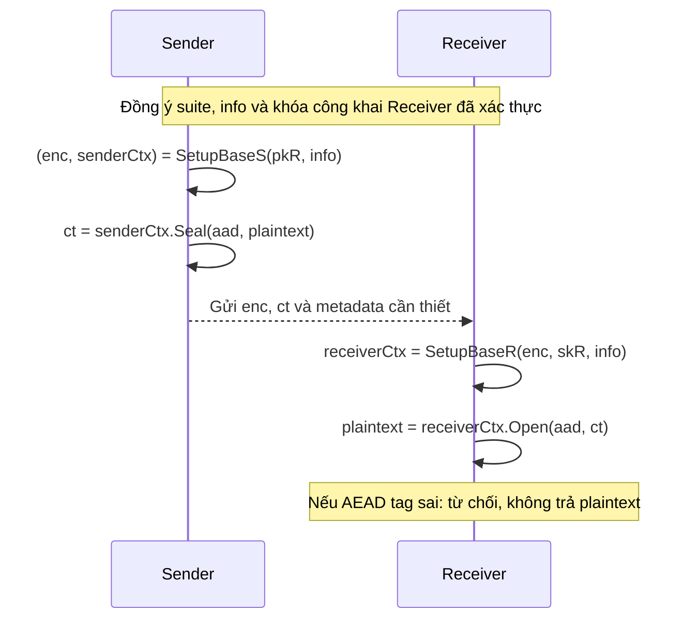
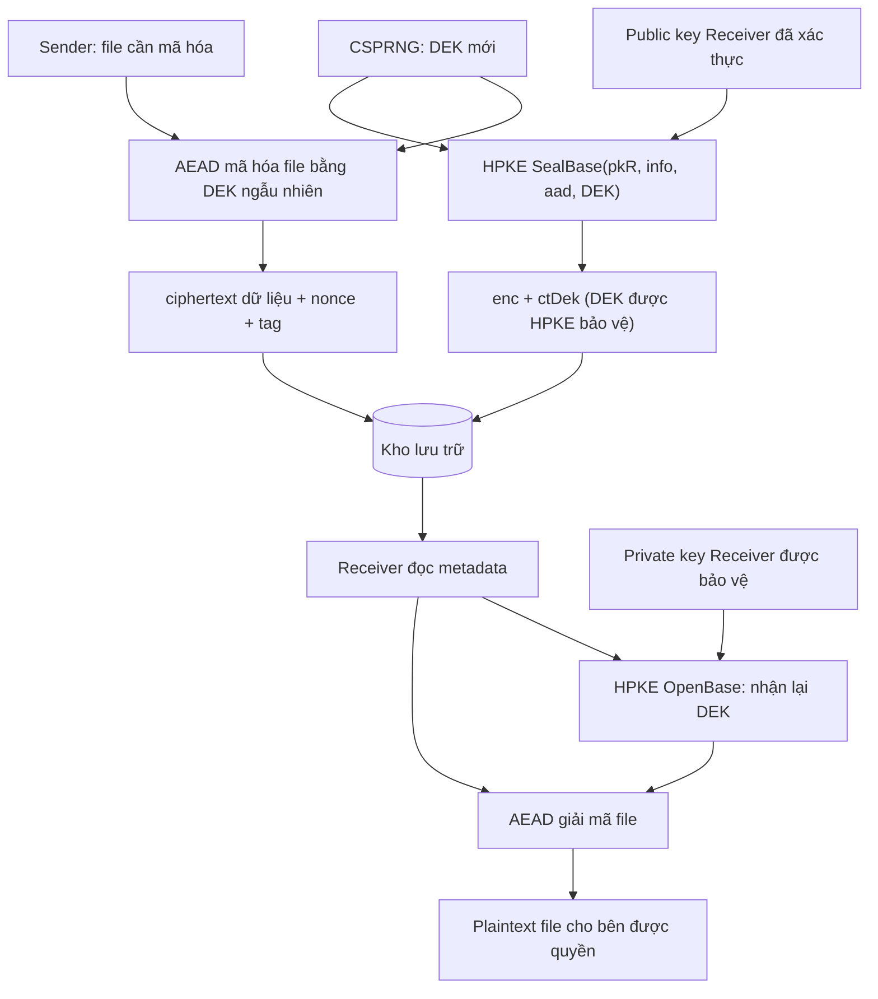

# HPKE (Hybrid Public Key Encryption)

> **Chương:** Mật mã bất đối xứng  
> **Module:** SECURITY_KEY_MANAGEMENT_FUNDAMENTALS — quản lý khóa mật mã trong suốt vòng đời tạo, cấp phát, lưu trữ, sử dụng, xoay vòng, thu hồi và hủy; kết nối mật mã đối xứng, bất đối xứng, chữ ký số, KMS/HSM, envelope encryption, kiểm soát truy cập và kiểm toán.

## 1. Mục tiêu học tập

Sau bài này, bạn có thể:

1. Giải thích **HPKE (Hybrid Public Key Encryption)** và lý do kết hợp mật mã khóa công khai với mã hóa đối xứng, thay vì cố mã hóa dữ liệu lớn trực tiếp bằng RSA/ECC.
2. Mô tả ba thành phần **KEM, KDF, AEAD** và vai trò của khóa công khai/khóa riêng, `enc`, `info`, `aad`, ciphertext và authentication tag.
3. Phân biệt bốn chế độ **Base, PSK, Auth, AuthPSK** theo RFC 9180, đặc biệt là giới hạn về **xác thực người gửi**.
4. Mô tả quy trình tạo và mở ngữ cảnh HPKE, cách thư viện quản lý nonce và sequence number, và những điều kiện an toàn khi mã hóa nhiều thông điệp.
5. Thiết kế mô hình **HPKE bọc DEK + AEAD mã hóa dữ liệu** với metadata, kiểm soát quyền, KMS/HSM và hỗ trợ nhiều người nhận.
6. Lập kế hoạch xoay khóa, xử lý mất khóa hoặc lộ khóa riêng, lưu giữ khóa cũ, khôi phục dữ liệu và kiểm toán.
7. Nhận diện các lỗi bảo mật như tin khóa công khai chưa xác thực, dùng Base mode nhưng tuyên bố đã xác minh người gửi, reuse context sai, xử lý AAD không nhất quán hoặc thiếu chống replay.

## 2. HPKE là gì và giải quyết vấn đề nào?

**HPKE** là một cấu trúc mã hóa khóa công khai dạng lai (*hybrid public key encryption*) được chuẩn hóa trong **RFC 9180**. Thay vì dùng phép toán bất đối xứng trực tiếp để mã hóa toàn bộ dữ liệu, HPKE kết hợp:

- **KEM (Key Encapsulation Mechanism):** dùng khóa công khai của người nhận để tạo hoặc đóng gói một bí mật chung mà người có khóa riêng tương ứng có thể phục hồi.
- **KDF (Key Derivation Function):** từ bí mật chung và ngữ cảnh, dẫn xuất khóa và vật liệu cần cho bước mã hóa.
- **AEAD (Authenticated Encryption with Associated Data):** mã hóa plaintext và xác thực ciphertext cùng dữ liệu liên quan `aad`.

Một ví dụ: hệ thống gửi gói cấu hình bí mật từ dịch vụ **Sender** cho dịch vụ **Receiver**. Sender chỉ cần biết **khóa công khai đã được xác thực** của Receiver. Receiver giữ **khóa riêng** trong ranh giới an toàn. Sender dùng HPKE để tạo ciphertext, chuyển `enc` và ciphertext; Receiver dùng khóa riêng để giải mã.

Không phải tạo trước một khóa đối xứng chung bằng cách trao tay; HPKE cung cấp cách chuẩn hóa việc thiết lập bí mật và mã hóa cho người nhận.

### 2.1. Tại sao gọi là “hybrid”?

Trong mật mã lai, phép toán bất đối xứng đảm nhiệm **thiết lập bí mật**, còn thuật toán đối xứng đảm nhiệm **mã hóa thông điệp**. Các phép toán này giải quyết hai bài toán khác nhau:

| Bài toán | Công cụ phù hợp | Ý nghĩa |
| --- | --- | --- |
| Hai bên chưa chia sẻ khóa nhưng Sender biết khóa công khai Receiver | KEM | Thiết lập một bí mật chỉ bên nhận có khóa riêng phù hợp có thể tính được |
| Từ bí mật thô tạo khóa mã hóa và nonce nền theo cách tách miền | KDF | Tạo vật liệu khóa cho AEAD, gắn với suite và `info` |
| Mã hóa dữ liệu và kiểm tra ciphertext không bị sửa trái phép | AEAD | Bảo vệ tính bí mật và tính toàn vẹn của dữ liệu mã hóa |
| Kiểm tra Sender là ai | Auth mode, PSK phù hợp hoặc xác thực/chữ ký tầng ứng dụng | **Base mode không tự xác minh danh tính người gửi** |

Thuật ngữ **HPKE** không đồng nghĩa “thuật toán ECC” hay “AES với ECDH”; đó là **một giao thức xây dựng đầy đủ** bao gồm các quy tắc encoding, key schedule, domain separation, mode và xử lý ngữ cảnh. Không nên tự ghép ECDH + HKDF + AES-GCM rồi đặt tên là HPKE nếu không tuân thủ RFC 9180.

### 2.2. HPKE dùng ở đâu?

Các tình huống có thể áp dụng gồm:

- Mã hóa thông tin ngắn hoặc khóa bí mật gửi cho một người nhận chỉ công bố **public key**.
- Bọc **DEK (Data Encryption Key)** cho người nhận trong thiết kế envelope encryption.
- Mã hóa cấu hình, bản tin hoặc dữ liệu giữa các dịch vụ khi cần định dạng ciphertext độc lập với giao thức vận chuyển.
- Thiết kế mã hóa nhiều người nhận, trong đó mỗi người nhận có một bản HPKE-wrapped DEK riêng.
- Các hệ thống cần giao tiếp giữa nhiều nền tảng bằng một **cấu trúc có suite ID và test vector chuẩn hóa**.

HPKE **không tự** cung cấp: danh tính PKI đáng tin cậy, giấy chứng nhận quyền truy cập dữ liệu, chống replay ở tầng ứng dụng, truyền tải an toàn trong mọi bối cảnh hay chính sách kiểm toán. Các lớp này vẫn cần được thiết kế.

## 3. Thuật ngữ và thành phần của HPKE

### 3.1. Ký hiệu cơ bản

| Ký hiệu | Ý nghĩa |
| --- | --- |
| `pkR` | Khóa công khai của **Receiver** (người nhận) |
| `skR` | Khóa riêng tương ứng của Receiver, phải được bảo vệ |
| `pkS`, `skS` | Khóa công khai/khóa riêng **Sender** dùng trong Auth/AuthPSK mode |
| `enc` | Dữ liệu **encapsulated key** do KEM tạo; cần gửi kèm để Receiver decapsulate |
| `shared_secret` | Bí mật chung KEM tạo ra và Receiver tính được, không được gửi ở dạng rõ |
| `info` | Ngữ cảnh dùng trong **key schedule** để ràng buộc phiên/scope của HPKE |
| `aad` | Dữ liệu liên quan được AEAD xác thực nhưng không mã hóa |
| `ct` | Ciphertext do AEAD tạo, bao gồm cơ chế kiểm tra toàn vẹn/tag theo định dạng |
| `psk`, `psk_id` | Khóa chia sẻ trước và định danh PSK cho các mode có PSK |
| `suite` | Bộ thuật toán KEM + KDF + AEAD và các mã định danh cần để hai phía dùng cùng cấu hình |

`enc` **không phải** khóa bí mật dạng rõ. Với các DHKEM sử dụng ECDH trong RFC 9180, `enc` thường chứa biểu diễn khóa công khai tạm thời của Sender (định dạng phụ thuộc KEM). Receiver dùng `enc` cùng `skR` để tính bí mật tương ứng.

Không đồng nhất `enc` với `ct`: `enc` hỗ trợ thiết lập khóa, còn `ct` chứa dữ liệu được mã hóa bằng AEAD.

### 3.2. Vai trò KEM

KEM có hai bước khái niệm:

1. **Encap(`pkR`)**: Sender dùng khóa công khai Receiver để tạo `enc` và `shared_secret`.
2. **Decap(`enc`, `skR`)**: Receiver dùng khóa riêng và `enc` để tạo **cùng `shared_secret`** nếu đầu vào hợp lệ.

Các mode có xác thực Sender sử dụng **authenticated KEM** và thêm khóa riêng/công khai Sender theo quy tắc của suite; chúng không chỉ đơn giản là thêm trường “senderId”.

Điểm quan trọng: KEM đảm bảo một dạng **thiết lập bí mật với khóa công khai đúng**, nhưng **không tự chứng minh rằng khóa công khai Receiver thuộc về đúng dịch vụ/đúng người**. Nếu attacker thay thế `pkR` trước khi Sender mã hóa, Sender có thể vô tình mã hóa cho attacker.

### 3.3. Vai trò KDF

KDF nhận bí mật từ KEM cùng những tham số trong **key schedule** để dẫn xuất **AEAD key, base nonce và exporter secret** khi mode/suite áp dụng.

`info` là một chuỗi byte do ứng dụng cấp cho bước setup. Nó hỗ trợ gắn khóa dẫn xuất với phiên, ứng dụng, giao thức hoặc mục đích. Không tự cho rằng `info` đã được giữ bí mật; nó là **ngữ cảnh**, không phải khóa.

RFC 9180 dùng các cấu trúc gắn nhãn và định danh suite để **tách miền sử dụng**; không nên thay thế bằng phép nối chuỗi/tự băm được thiết kế tùy ý.

### 3.4. Vai trò AEAD

Sau key schedule, Sender mã hóa bằng AEAD; Receiver giải mã và xác thực. AEAD bảo vệ:

- **Plaintext:** nội dung thông điệp cần giữ kín.
- **Ciphertext integrity:** người không có khóa khó sửa ciphertext thành nội dung khác mà vẫn vượt kiểm tra xác thực.
- **AAD:** metadata không mã hóa nhưng được ràng buộc vào ciphertext, chẳng hạn loại thông điệp và object ID.

Nếu `aad` hoặc ciphertext/tag bị thay đổi, Receiver phải báo **lỗi xác thực**. Bên nhận không được chấp nhận plaintext hoặc thực hiện tác vụ nhạy cảm trước khi xác thực xong.

**AEAD không tự chứng minh danh tính Sender.** Đây là lỗi tư duy phổ biến: một ciphertext được giải mã thành công ở **Base mode** có thể do **bất kỳ ai biết `pkR`** tạo ra.

## 4. Bộ thuật toán (cipher suite) và RFC 9180

HPKE phân tách ba thành phần để các triển khai có thể dùng bộ thuật toán được tiêu chuẩn hóa. Một suite cụ thể có thể chọn:

| Thành phần | Ví dụ được định nghĩa trong RFC 9180 | Vai trò |
| --- | --- | --- |
| **KEM** | DHKEM(X25519, HKDF-SHA256) | Trao đổi bí mật qua khóa công khai/khóa riêng X25519 |
| **KDF** | HKDF-SHA256 | Dẫn xuất vật liệu cho HPKE key schedule |
| **AEAD** | AES-128-GCM, AES-256-GCM hoặc ChaCha20-Poly1305 | Mã hóa và xác thực nội dung |

Ví dụ mã định danh trong RFC 9180:

| Thành phần | Định danh | ID |
| --- | --- | --- |
| KEM | DHKEM(P-256, HKDF-SHA256) | `0x0010` |
| KEM | DHKEM(X25519, HKDF-SHA256) | `0x0020` |
| KDF | HKDF-SHA256 | `0x0001` |
| AEAD | AES-128-GCM | `0x0001` |
| AEAD | AES-256-GCM | `0x0002` |
| AEAD | ChaCha20-Poly1305 | `0x0003` |

Các giá trị trên chỉ là **một số lựa chọn tiêu biểu**, không phải danh sách hoàn chỉnh hoặc lời khuyên bắt buộc dùng X25519/AES-256 cho mọi hệ thống.

### 4.1. Chọn suite thế nào?

Cần xét:

1. **Thư viện hỗ trợ đúng RFC 9180** và các thuật toán/suite đã chọn; có test vector, kiểm tra input và xử lý lỗi.
2. **Yêu cầu tuân thủ** và khả năng triển khai trên server/mobile/browser, KMS/HSM, hoặc phần cứng tăng tốc.
3. **Độ mạnh tương ứng của KEM, KDF và AEAD:** sức mạnh tổng thể chịu ảnh hưởng bởi thành phần yếu nhất và cách sử dụng khóa.
4. **Khả năng tương tác:** Sender và Receiver phải thống nhất chính xác bộ thuật toán, encoding và format.
5. **Chính sách nâng cấp:** có version, allowlist, kiểm tra chống downgrade; dữ liệu cũ vẫn cần giải mã nếu còn retention.

Không tự động nhận **suite ID bất kỳ** do client hoặc ciphertext khai báo rồi khởi chạy giao thức không được hệ thống phê duyệt. Metadata đầu vào cần được kiểm tra theo allowlist trước, sau đó **ràng buộc có xác thực** với thông điệp hoặc ngữ cảnh.

### 4.2. HPKE có “hậu lượng tử” mặc định không?

**Không.** Các DHKEM cổ điển như X25519/P-256 trong RFC 9180 dựa trên giả định toán học của mật mã đường cong elliptic và **không cung cấp khả năng chống máy tính lượng tử đủ mạnh** khi đối phương có máy lượng tử quy mô lớn có liên quan. Các mô hình KEM/hybrid hoặc các đặc tả mở rộng cần được đánh giá riêng theo chuẩn, phiên bản và khả năng thư viện. Không suy ra có post-quantum security chỉ vì một sản phẩm ghi “HPKE”.

## 5. Bốn chế độ hoạt động: Base, PSK, Auth và AuthPSK

RFC 9180 định nghĩa **bốn mode**, với khác biệt chính về cách ràng buộc bí mật đã chia sẻ hoặc khóa tĩnh Sender vào key schedule.

| Mode | ID | Vật liệu bổ sung | Thuộc tính về Sender | Lưu ý |
| --- | --- | --- | --- | --- |
| **Base** | `0x00` | `pkR`/`skR` | **Không tự xác thực danh tính Sender** | Phù hợp khi bên nhận không cần dựa vào chính HPKE để xác định người gửi |
| **PSK** | `0x01` | `psk` + `psk_id` đã chia sẻ ngoài băng | Có thể ràng buộc các bên biết PSK; **không chứng minh cá nhân nào** nếu nhiều người biết PSK | Quản lý vòng đời PSK và danh tính PSK rất quan trọng |
| **Auth** | `0x02` | Khóa tĩnh Sender `skS`/`pkS` | Có **xác thực Sender bằng cơ chế KEM** khi `pkS` đã được xác thực đúng | Không đồng nghĩa chữ ký số hoặc non-repudiation |
| **AuthPSK** | `0x03` | `skS`/`pkS` và `psk`/`psk_id` | Kết hợp xác thực bằng khóa Sender và PSK | Phức tạp hơn về provisioning và rotation |

### 5.1. Base mode: mã hóa cho Receiver nhưng không biết Sender là ai

Ở Base mode, bất kỳ ai có **khóa công khai Receiver** đều có thể tạo ciphertext hợp lệ gửi Receiver. Việc AEAD giải mã thành công chứng tỏ ciphertext hợp lệ với bí mật của **phiên HPKE đó**, nhưng không cung cấp danh tính người đã tạo nó.

Điều này có thể **đúng yêu cầu** cho hộp thư gửi ẩn danh hoặc giao thức đã xác thực Sender ở tầng khác.

Tuy nhiên, **không** sử dụng Base mode rồi coi “mở ciphertext thành công” là bằng chứng một user/đối tác được cấp phép đã gửi thông điệp. Nếu endpoint cho phép hành động có quyền cao như “cập nhật hợp đồng”, Receiver cần **authorization** độc lập dựa trên danh tính được xác thực hoặc chọn mode/mô hình xác thực phù hợp.

### 5.2. PSK mode: thêm bí mật đã chia sẻ trước

PSK mode kết hợp một **pre-shared key** với bí mật KEM trong key schedule. Nó có thể cung cấp bảo đảm bổ sung khi các bên quản lý PSK đúng và chỉ những người dự kiến biết nó mới có quyền sử dụng.

Các yêu cầu:

- `psk` phải có entropy phù hợp (không dùng mật khẩu yếu/ID đoán được như PSK).
- `psk_id` phải nhận diện đúng PSK; hai phía dùng cùng PSK và ID tương ứng.
- Có cơ chế phân phối/thu hồi/rotation PSK riêng, lưu trong secret manager hoặc ranh giới bảo mật phù hợp.
- Nếu một PSK được chia sẻ cho nhiều máy hoặc người, việc chứng minh “một người gửi cụ thể” vẫn cần kiểm soát danh tính khác.

### 5.3. Auth mode: xác thực bằng khóa riêng Sender

Auth mode sử dụng thêm **khóa tĩnh của Sender**. Receiver cần biết **`pkS` đúng của Sender** trước khi chấp nhận thông điệp là đến từ Sender.

Phân biệt:

- HPKE Auth xác thực **khả năng sử dụng `skS`** trong giao thức dưới những giả định bảo mật phù hợp.
- HPKE Auth **không tự cung cấp chứng thư PKI, xác minh danh tính ngoài đời thực, bằng chứng người ký cho bên thứ ba hoặc không thể chối bỏ** như một cơ chế chữ ký số.
- Nếu **`pkS` chưa được ràng buộc với đúng identity** hoặc attacker có thể thay thế nó, nhãn “Auth” không giải quyết được vấn đề nhận dạng.
- Khi Sender static private key bị lộ, attacker có thể **giả mạo Sender trong các thông điệp mới** cho đến khi khóa bị thay và bên nhận ngừng tin khóa cũ.

Muốn kiểm toán hành động do một user hoặc tổ chức chịu trách nhiệm, có thể cần cơ chế ký số/chứng thư/identity riêng theo yêu cầu nghiệp vụ.

### 5.4. AuthPSK mode: kết hợp hai cơ chế

AuthPSK kết hợp yêu cầu nắm giữ khóa riêng Sender đã đăng ký với PSK. Nó phù hợp khi kiến trúc chủ động quản lý cả hai kiểu bí mật và có chính sách rõ ràng cho vòng đời của từng loại.

**Không tự động chọn mode có nhiều tham số nhất.** Mỗi mode tăng yêu cầu provisioning và quản trị; sự phức tạp không được kiểm soát có thể dẫn đến khóa không khớp, lỗi fallback hoặc mở rộng bí mật ngoài ý muốn.

## 6. Luồng HPKE từ Sender tới Receiver

### 6.1. Mô hình SetupBaseS/SetupBaseR

Với Base mode trong RFC 9180, hai bên chia sẻ `pkR` đã xác thực và cùng lựa chọn `suite`, `info`.



Giải thích:

1. Sender lấy đúng **`pkR`** qua kênh tin cậy hoặc hệ thống PKI/pinning được xác minh.
2. `SetupBaseS` thực hiện encapsulation và tạo ngữ cảnh mã hóa, trả **`enc`**.
3. Sender dùng **`Seal`** mã hóa plaintext và ràng buộc `aad`.
4. Receiver nhận `enc`, `ct` và metadata để biết suite/khóa/ngữ cảnh.
5. `SetupBaseR` dùng `skR` cùng `enc` để tạo ngữ cảnh giải mã tương ứng.
6. Receiver dùng **`Open`** với cùng `aad`; AEAD xác thực thất bại thì không chấp nhận dữ liệu.

RFC 9180 còn cung cấp giao diện **single-shot `SealBase`/`OpenBase`** cho trường hợp muốn đóng gói một thông điệp mà không trực tiếp quản lý ngữ cảnh trong ứng dụng.

### 6.2. Vì sao `enc` phải đi kèm ciphertext?

Với các DHKEM phổ biến, Receiver cần thông tin encapsulation để tái tạo bí mật KEM. Nếu mất `enc`, chỉ giữ `ct` và `skR` thường **không đủ** để giải mã thông điệp HPKE.

Ngược lại, `enc` **không phải bí mật**; ai đọc được `enc` và `ct` nhưng không có `skR` tương ứng vẫn không nên giải mã được khi cấu hình và giả định bảo mật được đáp ứng.

Đừng nhầm `enc` với “khóa AES đã mã hóa dưới RSA”. HPKE định nghĩa một cấu trúc KEM và key schedule cụ thể; `enc` trong DHKEM thường là biểu diễn public key tạm thời, không nhất thiết chứa byte của một DEK.

### 6.3. `info` và `aad` khác nhau như thế nào?

| Thuộc tính | `info` | `aad` |
| --- | --- | --- |
| Được đưa vào bước nào? | **Setup / key schedule** | **Mỗi lần Seal/Open trong AEAD** |
| Mục đích điển hình | Tách giao thức, phiên và ngữ cảnh sử dụng | Xác thực metadata của từng thông điệp |
| Có mã hóa không? | Không phải đối tượng được HPKE bảo mật | Không mã hóa; được xác thực cùng ciphertext |
| Điều gì xảy ra nếu khác phía? | Hai ngữ cảnh không tương ứng, giải mã thường thất bại | AEAD tag không hợp lệ và Open phải thất bại |
| Có thay authorization không? | **Không** | **Không** |

Ví dụ định nghĩa ngữ cảnh ổn định:

```text
info = canonicalEncode(
  protocol = "billing-file-hpke",
  protocolVersion = 1,
  hpkeMode = "base",
  purpose = "wrap-dek"
)

aad = canonicalEncode(
  tenantId = trustedTenantId,
  fileId = trustedFileId,
  encryptionFormat = 2
)
```

Cần dùng một **định dạng byte xác định** (ví dụ encode trường có độ dài cố định hoặc serializer chuẩn hóa có version); không ghép chuỗi mơ hồ như `tenantId + fileId` nếu các cặp giá trị khác nhau có thể tạo ra cùng byte.

Không đưa thông tin bí mật vào `info` hoặc `aad` với suy nghĩ HPKE sẽ tự giấu chúng. Nếu metadata cần giữ kín, hãy mã hóa nó như **plaintext**.

### 6.4. Bảo đảm tính toàn vẹn không đồng nghĩa chống replay

Một attacker có thể gửi lại **nguyên vẹn** gói `enc + ct` từng được tạo hợp lệ. AEAD có thể xác thực thành công vì ciphertext chưa bị sửa.

Ví dụ API “chuyển khoản” nhận một chỉ thị HPKE hợp lệ, nhưng không có message ID, nonce nghiệp vụ hoặc idempotency key. Kẻ tấn công gửi lại cùng ciphertext nhiều lần có thể gây xử lý lại giao dịch.

Vì thế ứng dụng cần cơ chế **chống replay** riêng: message ID, expiry/timestamp có xác minh, sequence ở tầng nghiệp vụ, trạng thái đã xử lý hoặc idempotency bảo đảm trong DB. Dù message ID nằm trong AAD, hệ thống vẫn phải **ghi nhớ/check trạng thái** để từ chối việc dùng lại.

## 7. Context, sequence number và nonce trong HPKE

HPKE không yêu cầu ứng dụng tạo một nonce AES-GCM tùy ý cho từng `Seal` khi dùng **ngữ cảnh HPKE** đúng chuẩn. Thay vào đó, key schedule tạo **base nonce**, và mỗi ngữ cảnh quản lý **sequence number** để tính nonce cho từng bản tin.

Ở mức khái niệm với AEAD nonce dài `Nn` byte:

\[
\text{nonce}_i = \text{base\_nonce} \oplus \mathrm{I2OSP}(i, Nn)
\]

Trong đó `i` là sequence number của ngữ cảnh và `I2OSP` là phép chuyển số nguyên sang chuỗi byte độ dài cố định theo đặc tả.

### 7.1. Những quy tắc không được vi phạm

- **Không khởi tạo lại sequence number về 0 rồi dùng lại cùng ngữ cảnh/AEAD key** để mã hóa thông điệp mới.
- **Không chia sẻ một sender context một cách không an toàn** giữa các worker/thread/process gây trùng sequence number.
- **Không tái sử dụng snapshot của context cũ** sau crash/restart nếu có thể làm nonce trùng.
- **Không bỏ qua giới hạn sequence number** mà thư viện bảo vệ.
- Với một thông điệp đơn lẻ, ưu tiên **single-shot API** nếu thư viện cung cấp; mỗi lần tạo ngữ cảnh mới theo quy tắc chuẩn.
- Với stream nhiều thông điệp, cần thiết kế thứ tự, delivery, message framing, xác thực từng chunk và giải quyết duplicate/reorder ở lớp ứng dụng.

Nếu ứng dụng mã hóa file lớn theo nhiều chunk bằng một HPKE context, nó cần hiểu đầy đủ nonce sequencing, giới hạn AEAD, ràng buộc vị trí chunk và phát hiện thiếu/sai thứ tự. Trong nhiều hệ thống lưu trữ, **HPKE bọc DEK + AEAD chuyên dụng cho object/file** là cấu trúc dễ quản trị hơn.

### 7.2. Context không phải khóa dùng vô hạn

Context có trạng thái mật mã, gồm khóa, base nonce và sequence number; không nên coi nó là đối tượng có thể serialization/restart tùy ý hay giữ vô hạn. Hệ thống phải:

1. Biết mỗi context được dùng cho **bao nhiêu bản tin** và khi nào kết thúc.
2. Kiểm tra giới hạn số thao tác và độ lớn bản tin theo suite/AEAD.
3. Tránh chia sẻ context giữa các tenant, phiên hoặc scope không liên quan.
4. Không log hoặc sao chép secret nội bộ của context để debug.
5. Xóa/giải phóng context khi không còn cần; không khẳng định JVM/runtime có thể xóa mọi bản sao secret trong bộ nhớ.

## 8. HPKE kết nối với DEK, KEK và envelope encryption

HPKE rất phù hợp với một tình huống trong **key management**: gửi một **DEK ngẫu nhiên** cho người nhận sử dụng public key của họ, sau đó mã hóa dữ liệu lớn bằng AEAD riêng.

Hãy phân biệt:

- **Khóa công khai Receiver `pkR`:** dùng cho HPKE encapsulation, **không phải DEK**.
- **Khóa riêng Receiver `skR`:** dùng decapsulation, có thể bảo vệ bằng KMS/HSM nếu giải pháp hỗ trợ HPKE phù hợp.
- **Bí mật KEM và AEAD key nội bộ HPKE:** được tạo/dẫn xuất theo key schedule, không dùng tùy tiện như một DEK ứng dụng.
- **DEK của file:** khóa đối xứng ngẫu nhiên mã hóa file bằng AEAD riêng, được đặt trong **plaintext của một thông điệp HPKE** để gửi an toàn.
- **KEK:** nếu tổ chức có tầng khóa để bọc DEK trong KMS, đó là khái niệm rộng; HPKE cung cấp một cách bảo vệ/đóng gói DEK bằng public key, nhưng **không nhất thiết có một khóa đối xứng cố định tên KEK**.

### 8.1. Luồng “HPKE bọc DEK”



Các bước cụ thể:

1. Chọn hoặc tạo **DEK ngẫu nhiên** phù hợp chính sách; mã hóa file bằng AEAD, dùng nonce và AAD của **lớp mã hóa file**.
2. Chọn suite HPKE đã được phê duyệt, mode phù hợp và `pkR` đúng người nhận.
3. Tạo `(enc, ctDek) = SealBase(pkR, info, aadForWrapping, DEK)`; `ctDek` là ciphertext của **byte DEK**, không phải file.
4. Lưu ciphertext file, tag/nonce file, `enc`, `ctDek`, suite/mode, reference recipient key và version metadata.
5. Khi đọc, Receiver xác thực người dùng và quyền đối tượng, lấy `skR` trong ranh giới an toàn, dùng HPKE OpenBase để lấy DEK, sau đó giải mã và xác thực file.
6. Chỉ trả plaintext khi **cả bước HPKE và AEAD lớp file** đều thành công, và authorization đã đạt.

**Không lưu DEK dạng rõ** cùng `enc`, `ctDek` hay ciphertext file. Không gửi `skR` cho Sender để “giảm số lần gọi API”.

### 8.2. Metadata ví dụ

```json
{
  "formatVersion": 1,
  "payload": {
    "algorithm": "AES-256-GCM",
    "nonce": "<base64-nonce-cua-file>",
    "ciphertextAndTag": "<base64-ciphertext-file>",
    "aadSchema": "document-v1"
  },
  "dekRecipient": {
    "recipientKeyId": "billing-recipient-key-v4",
    "hpkeMode": "base",
    "kemId": "0x0020",
    "kdfId": "0x0001",
    "aeadId": "0x0002",
    "enc": "<base64-hpke-enc>",
    "ctDek": "<base64-hpke-encrypted-dek>"
  },
  "objectId": "doc-9041",
  "tenantId": "tenant-15"
}
```

Đây là cấu trúc **minh họa**. Không phải một định dạng on-wire bắt buộc của RFC 9180; các thuộc tính text và `<base64-...>` chỉ là placeholder. Trong triển khai thật cần quy định byte encoding, version, allowlist suite, cách tạo `info`/`aad`, kiểm tra metadata đáng tin cậy và tính nguyên tử khi ghi dữ liệu.

### 8.3. Khóa riêng Receiver có phải nằm trong HSM không?

Không phải mọi trường hợp đều bắt buộc, nhưng với dữ liệu có mức độ nhạy cảm cao, cần cân nhắc giải pháp bảo vệ khóa riêng bằng KMS/HSM hoặc thiết bị tin cậy.

**Cảnh báo tích hợp quan trọng:** không phải mọi KMS/HSM đều cung cấp API **HPKE theo RFC 9180**. Một API `Decrypt` hỗ trợ RSA-OAEP hoặc “asymmetric decrypt” **không tự động** có nghĩa nó có thể decapsulate `enc` của HPKE X25519. Phải xác minh:

- Nhà cung cấp/thư viện thực sự hỗ trợ **KEM và mode/suite cụ thể**.
- Khóa riêng có được giữ trong module tin cậy qua toàn bộ decapsulation/HPKE API hay không.
- Điều kiện export/import, quyền gọi, log, vùng dự phòng và quy trình khôi phục.
- Ranh giới nơi DEK dạng rõ xuất hiện sau HPKE Open; nếu trả DEK về ứng dụng, bảo vệ bộ nhớ và quyền runtime tương ứng.

Nếu HSM chỉ cung cấp phép toán ECDH thô, việc tự lắp ráp thành HPKE đòi hỏi tuân thủ **đầy đủ** RFC 9180, encoding, validation, KDF và key schedule; ưu tiên thư viện/provider có hỗ trợ chuẩn được kiểm thử.

## 9. Gửi một DEK cho nhiều người nhận

Giả sử một file cần được ba dịch vụ đọc: **Billing**, **Audit** và **Archival**. Có thể mã hóa **file một lần** bằng DEK ngẫu nhiên, sau đó tạo **ba bản HPKE-wrapped DEK** — mỗi bản cho một public key được xác thực.

```text
                             +--> HPKE(pkBilling, DEK) --> enc1 + ctDek1
File --AEAD(DEK)--> Ciphertext
                             +--> HPKE(pkAudit, DEK)   --> enc2 + ctDek2
                             +--> HPKE(pkArchive, DEK) --> enc3 + ctDek3
```

Cần lưu cho mỗi recipient:

- Recipient key ID và phiên bản phù hợp.
- Mode, suite và `info`/AAD schema xác định.
- `enc`, `ctDek` riêng; không tự tái sử dụng encapsulation/context giữa các recipient.
- Chính sách quyền sử dụng khóa riêng, retention và cơ chế thay recipient key.

**Thu hồi một người nhận** bằng cách xóa bản `ctDek` của họ **không thể khiến họ quên DEK** đã giải mã trước đó. Nếu đã chia sẻ DEK và cần loại bỏ hoàn toàn quyền đọc dữ liệu trong tương lai, phải đánh giá **DEK mới, mã hóa lại file và chỉ bọc DEK mới cho những người nhận còn quyền**. Những bản sao plaintext/ciphertext mà người nhận đã lấy được trước đó cũng cần được đánh giá ngoài khả năng mật mã.

Một file mã hóa bằng **một DEK chung cho nhiều người nhận** có blast radius lớn hơn: nếu bất kỳ người nhận nào làm lộ DEK, file có thể bị giải mã. Với dữ liệu cần phân quyền từng phần hoặc tách tenant, có thể phải chia DEK/file scope.

## 10. Ví dụ lập trình theo hướng Java

Java cung cấp các thành phần mật mã như JCA/JCE, nhưng **không nên giả định rằng `Cipher.getInstance("HPKE")` là một API HPKE RFC 9180 luôn có sẵn trên mọi JDK/provider**. Khi dùng HPKE, hãy chọn một thư viện/provider công khai hỗ trợ đúng RFC 9180 và suite dự kiến, có test vector tương thích. Không tự viết HPKE production bằng cách ghép `KeyAgreement`, `Mac` và `Cipher` rồi bỏ qua key schedule chuẩn.

Đoạn sau là **giả mã theo cú pháp Java**, không dùng API của một thư viện xác định và **không thể biên dịch nguyên trạng**. Mục đích là cho thấy cách ứng dụng nên phân tách việc xác thực khóa, metadata và quyền:

```java
// PSEUDOCODE: HpkeLibrary và KeyDirectory đại diện API của thư viện thật.
HpkeSuite suite = approvedSuite(
    "DHKEM(X25519,HKDF-SHA256)",
    "HKDF-SHA256",
    "AES-256-GCM"
);

// Đọc khóa công khai Receiver từ directory được xác thực/pinned.
RecipientPublicKey recipientKey = keyDirectory.getVerifiedKey(
    "billing-recipient", "version-4"
);

// AuthZ nghiệp vụ phải thực hiện trước khi tạo dữ liệu nhạy cảm.
authorizeSenderToShareFile(currentIdentity, fileId, "billing-recipient");

// Ngữ cảnh byte phải được định dạng thống nhất và version hóa.
byte[] info = canonicalEncode("billing-hpke-wrap", 1, suite.id());
byte[] aad = canonicalEncode(tenantId, fileId, "dek-wrap-v1");

// DEK ứng dụng được sinh ngẫu nhiên bằng dịch vụ/quy trình phù hợp.
byte[] dek = secureKeyService.generateNewAes256Dek();

// Mã hóa file bằng AEAD riêng, lưu nonce/tag/metadata để đọc lại.
EncryptedPayload encryptedFile = fileAead.encryptWithFreshNonce(
    dek, plaintextFile, canonicalEncode(tenantId, fileId, "file-v1")
);

// HPKE dùng recipient public key để mã hóa byte DEK.
HpkeSealed hpkeEnvelope = hpkeLibrary.sealBase(
    suite, recipientKey.publicKey(), info, aad, dek
);
// hpkeEnvelope.enc(): encapsulated KEM value
// hpkeEnvelope.ciphertext(): ciphertext và tag chứa DEK

saveAtomically(
    fileId, encryptedFile, recipientKey.id(),
    suite.id(), hpkeEnvelope.enc(), hpkeEnvelope.ciphertext()
);
clearOwnedSecretBuffersIfPossible(dek);
```

Ở phía Receiver:

```java
// PSEUDOCODE: kiểm tra quyền file và khóa trước khi giải mã.
authorizeReceiverToReadFile(currentIdentity, fileId);

EncryptedRecord record = loadRecord(fileId);
HpkeSuite suite = approvedSuiteById(record.hpkeSuiteId());

// Tham chiếu khóa và tenant phải đến từ metadata đã được kiểm tra.
RecipientPrivateKeyHandle handle = keyStore.getAuthorizedPrivateKeyHandle(
    currentIdentity, record.recipientKeyId()
);

byte[] info = canonicalEncode("billing-hpke-wrap", 1, suite.id());
byte[] aad = canonicalEncode(record.tenantId(), fileId, "dek-wrap-v1");

byte[] dek = hpkeLibrary.openBase(
    suite, handle, record.enc(), info, aad, record.ctDek()
);
// Nếu HPKE Open thất bại: ngừng xử lý, không trả DEK/feedback chi tiết.

byte[] plaintext = fileAead.decryptAndVerify(
    dek, record.fileCiphertext(), record.fileNonce(),
    canonicalEncode(record.tenantId(), fileId, "file-v1")
);
// Nếu AEAD file thất bại: ngừng xử lý, không trả plaintext.

clearOwnedSecretBuffersIfPossible(dek);
return plaintext;
```

### 10.1. Những điều ví dụ cố ý không tự triển khai

- Thuật toán KEM/KDF/AEAD, validation khóa công khai và `enc`, key schedule, nonce sequence, exporter secret: **thư viện HPKE chuẩn phải xử lý**.
- Kênh phân phối và xác thực `pkR`, xác thực `pkS` trong Auth mode, xác định quyền tenant/file.
- Lưu trữ `skR`, key handle, IAM/KMS grants, audit và quy trình phản ứng sự cố.
- Xử lý lỗi tập trung, giới hạn kích thước thông điệp, rate limit, chống replay, chống downgrade.
- Trạng thái giao dịch/ghi nguyên tử của dữ liệu và metadata.
- Quản lý bộ nhớ chứa DEK, khóa riêng hoặc plaintext trong JVM; `Arrays.fill` trên buffer ứng dụng **không thể bảo đảm** xóa mọi bản sao thư viện/JVM/native.
- Backup/khôi phục dữ liệu và khóa riêng tương ứng.

Hãy dùng **test vector của RFC 9180**, thử dữ liệu hỏng/mismatch, thử interoperability và xác minh chính sách suite trước khi đưa vào sản xuất. Một bộ test chỉ kiểm tra “encrypt rồi decrypt được” bằng cùng implementation chưa đủ để khẳng định tuân thủ chuẩn.

## 11. Xác thực khóa và quản lý danh tính

### 11.1. Ai bảo đảm `pkR` thuộc đúng người nhận?

HPKE bảo vệ thông điệp cho **khóa công khai được cung cấp**. Nếu hệ thống lấy `pkR` từ một JSON do attacker kiểm soát rồi mã hóa, HPKE sẽ bảo vệ dữ liệu **cho attacker** một cách hợp lệ về mặt mật mã.

Cần nguồn đáng tin cậy:

- Chứng thư, PKI, danh bạ khóa có chữ ký, pinned fingerprint hoặc cơ chế phân phối khóa đã xác thực.
- Liên kết `keyId`, key version, owner, tenant, mục đích và trạng thái khóa.
- Kênh thay đổi khóa có phê duyệt, log và kiểm tra độ mới/không bị rollback.
- Kiểm tra thuật toán/định dạng/cấp khóa và chính sách khi import public key.

**Không nhầm** việc public key có đúng định dạng với việc public key **thuộc đúng identity**. Validation trên đường cong chỉ là một bước của bảo mật mật mã, không giải quyết nhận dạng.

### 11.2. Ai bảo đảm `pkS` thuộc đúng Sender trong Auth mode?

Receiver phải lấy và kiểm tra `pkS` từ nguồn đáng tin cậy, rồi ràng buộc nó với danh tính và quyền thực hiện hành động. Nếu người gửi gửi kèm `pkS` tùy ý và Receiver chấp nhận nó chỉ vì Open thành công, mục tiêu xác thực Sender không được đáp ứng.

Auth mode không tự cung cấp **không thể chối bỏ** như chữ ký số phục vụ bằng chứng cho bên thứ ba. Với thao tác cần bằng chứng ai đã phê duyệt, ký tài liệu hoặc giao dịch, đánh giá cơ chế chữ ký điện tử/số phù hợp ngoài HPKE.

### 11.3. Chữ ký số khác HPKE như thế nào?

| Nhu cầu | HPKE | Chữ ký số |
| --- | --- | --- |
| Giữ bí mật thông điệp cho người nhận | **Có**, với suite/mode và key đúng | **Không** phải mục tiêu của chữ ký |
| Phát hiện ciphertext bị sửa | **Có** qua AEAD | Chữ ký xác minh nội dung được ký |
| Xác thực Sender bằng khóa tĩnh | **Có trong Auth/AuthPSK** theo giả định và key được xác thực | **Có** khi kiểm tra chữ ký và khóa công khai tin cậy |
| Bằng chứng có thể xác minh độc lập bởi bên thứ ba | **Không tự cung cấp** | Có thể cung cấp bằng chứng chữ ký theo hệ thống tin cậy |
| Chống đọc trộm ciphertext | **Có**, trong mô hình bảo mật HPKE | **Không**: chữ ký không mã hóa nội dung |

Trong một số ứng dụng có thể **kết hợp HPKE và chữ ký số**, nhưng cần chuẩn hóa thứ tự ký/mã hóa, metadata được ký, xử lý khóa, chống replay và chính sách xác minh. Không tự coi một flag “auth=true” là tương đương chữ ký.

## 12. Vòng đời khóa HPKE trong hệ thống sản xuất

Đối với Receiver, **khóa riêng `skR`** là một tài sản mật mã quan trọng. Trong Auth mode, **`skS`** của Sender cũng là tài sản cần bảo vệ; trong PSK/AuthPSK, **PSK** có vòng đời riêng.

| Giai đoạn | Thực hành cần có | Bằng chứng/kiểm tra |
| --- | --- | --- |
| **Tạo khóa** | Sinh cặp khóa KEM bằng thư viện/KMS/HSM được phê duyệt, CSPRNG phù hợp, suite đã chọn | Log tạo, type/alg/key ID, cấu hình provider |
| **Cấp phát public key** | Phân phối `pkR`/`pkS` qua kênh đáng tin cậy, kiểm tra identity và phạm vi | Chứng thư/pinning/directory record, ticket phê duyệt |
| **Lưu khóa riêng** | Giữ `skR`/`skS` trong môi trường tin cậy, hạn chế export và quyền đọc | Key-store policy, inventory, hạn chế truy cập |
| **Sử dụng** | Chỉ cho phép tác vụ hợp lệ, kiểm tra tenant/owner, rate limit, giới hạn mode/suite | Log API và authorization, test quyền bị từ chối |
| **Thay khóa** | Tạo key pair mới, phân phối public key mới, chuyển luồng ghi mới, giữ đường đọc cũ khi cần | Kế hoạch migration, key version, test giải mã lịch sử |
| **Thu hồi** | Ngừng tin public key bị lộ/hết hạn, thu hồi quyền dùng private key, vô hiệu credential | Sự kiện disable/revoke, cập nhật directory/policy |
| **Khôi phục** | Bảo đảm dữ liệu lịch sử có thể được giải mã trong DR theo ranh giới tin cậy | Diễn tập restore ciphertext và private-key access |
| **Hủy khóa** | Kiểm kê dữ liệu/backup phụ thuộc, phê duyệt hủy và xác nhận hoàn tất | Inventory, tài liệu retention, log hủy |

### 12.1. Rotation khóa Receiver khác việc đổi DEK

Khi Receiver đổi từ `(pkR-v1, skR-v1)` sang `(pkR-v2, skR-v2)`:

- **Thông điệp mới** nên dùng `pkR-v2` sau khi Sender xác thực khóa mới.
- **Thông điệp cũ** được gửi cho `pkR-v1` thường cần `skR-v1` để decapsulate; `skR-v2` không tự giải mã `enc` cũ.
- Nếu lưu ciphertext/file nhiều năm, phải có kế hoạch **mở gói DEK cũ và bọc lại dưới public key mới** trong vùng tin cậy.
- Không hủy `skR-v1` khi vẫn còn dữ liệu hoặc backup bắt buộc phải đọc bằng khóa đó.

Trong kiến trúc **HPKE bọc DEK**, **re-wrap DEK** có thể được thực hiện mà không mã hóa lại file, vì byte DEK chưa đổi. Nhưng nếu **DEK đã lộ**, việc chỉ rewrap bằng public key mới **không giúp dữ liệu mã hóa bằng DEK đó trở nên an toàn**; cần đánh giá tạo DEK mới và mã hóa lại file.

### 12.2. Rủi ro khi lộ `skR` và tính bí mật quá khứ

Ở Base mode dùng khóa riêng Receiver tồn tại lâu dài, nếu attacker **ghi lại `enc` và ciphertext** từ trước rồi sau đó lấy được **`skR`**, họ có thể có khả năng giải mã những thông điệp lịch sử tương ứng. **Không mặc định HPKE Base có forward secrecy trước việc Receiver long-term private key bị lộ**.

Biện pháp giảm rủi ro tùy nhu cầu:

- Rút ngắn thời hạn tồn tại/khả dụng của khóa riêng theo thiết kế.
- Hạn chế vùng dữ liệu và thời hạn retention mà một key pair bảo vệ.
- Tách khóa theo ứng dụng, tenant hoặc nhóm dữ liệu.
- Thiết kế migration/re-encrypt cho dữ liệu dài hạn.
- Nếu bài toán yêu cầu forward secrecy mạnh hơn, cân nhắc một giao thức trao đổi khóa tương tác hoặc kiến trúc có thuộc tính tương ứng đã được phân tích.

Không tự gọi một hệ thống “forward secure” chỉ vì Sender tạo ephemeral key mỗi lần gửi trong DHKEM.

### 12.3. Khóa Sender và PSK cũng cần rotation

Với Auth/AuthPSK, lộ `skS` tạo nguy cơ **giả mạo Sender** cho thông điệp mới. Cần thu hồi `pkS` khỏi directory tin cậy, cấp khóa mới và điều tra lịch sử xác thực. Với PSK/AuthPSK, lộ PSK cần đổi PSK, `psk_id` và phạm vi phân phối, đánh giá ai đã giữ bí mật đó.

Quản lý khóa phải xét **cả người gửi, người nhận và các bí mật bổ sung**, không chỉ `skR`.

## 13. Lưu trữ, sao lưu và phục hồi khóa HPKE

### 13.1. Mất khóa riêng có thể gây mất dữ liệu

Nếu ciphertext HPKE và `enc` đã lưu nhưng **`skR` không còn**, Receiver thường không thể phục hồi bí mật KEM bằng cặp khóa mới. Mất quyền sử dụng `skR` có thể làm mất khả năng mở gói các DEK và dữ liệu liên quan.

Vì vậy, backup ciphertext **phải đi cùng kế hoạch khả dụng của private key**:

- Nhà cung cấp KMS/HSM có cơ chế dự phòng, nhân bản, escrow hoặc khôi phục được kiểm thử hay không?
- Khóa không xuất được có thể phục hồi bằng phương án nào mà vẫn tuân thủ kiến trúc bảo mật?
- Quy trình break-glass/quorum khi tài khoản quản trị chính mất khả năng truy cập là gì?
- Những version khóa lịch sử nào còn cần để đọc snapshot/backup?
- Đã kiểm thử giải mã dữ liệu cũ từ bản backup ở môi trường DR thực tế chưa?

**Không lưu plaintext private key trong cùng kho ciphertext** chỉ để thuận tiện restore. Hệ thống cần kiểm soát những nơi có bản sao, đối tượng được phép sử dụng và bằng chứng khôi phục.

### 13.2. Multi-region và di chuyển nhà cung cấp

Không mặc định rằng key alias giống nhau ở hai region đại diện cho cùng cặp `pkR/skR`. Nếu một region chỉ có **public key trùng tên** nhưng private key khác, nó sẽ không giải mã `enc` được tạo cho khóa cũ.

Khi migrate, phải:

1. Xác minh đường khôi phục `skR` hoặc sử dụng khóa nguồn trong môi trường đáng tin cậy.
2. Tạo/cấp phát `pkR` mới, xác thực cho tất cả Sender.
3. Nếu cần, giải mã những DEK được bọc bởi khóa cũ và re-wrap bằng public key mới.
4. Đối soát object, backup, key ID, phiên bản, suite và retention.
5. Diễn tập đọc dữ liệu lịch sử trước khi hủy quyền/khóa nguồn.

### 13.3. Cryptographic erasure cần đánh giá phạm vi

Hủy `skR` có thể làm các gói HPKE cũ không thể mở, **nếu** không còn bản sao khóa riêng, DEK dạng rõ, DEK đã bọc theo cách khác hoặc plaintext khác. Nếu Receiver đã từng giải mã và lưu DEK/plaintext ở nơi khác, việc hủy `skR` **không thể xóa các bản đó**.

Trước khi hủy phải xem xét backup, snapshot, retention, nghĩa vụ lưu trữ và bằng chứng nhà cung cấp về trạng thái xóa khóa. Một nút “schedule deletion” có thể có thời gian chờ; không tương đương hủy lập tức.

## 14. Kiểm soát truy cập và kiểm toán

Mật mã đúng không thay thế **authorization**. Các quyền cần tách rõ:

| Quyền | Tài sản/hoạt động | Rủi ro nếu cấp quá rộng |
| --- | --- | --- |
| **Publish recipient public key** | Đăng công khai `pkR` đã xác thực | Bị thay thế có thể mã hóa cho attacker |
| **Read protected object** | Lấy `enc`, ciphertext và metadata | Có thể gây lộ dữ liệu khi kết hợp quyền khóa |
| **Use recipient private key** | Decap/Open HPKE hoặc API tương ứng | Giải mã được nhiều DEK/object đã gửi cho khóa đó |
| **Manage key policy** | Cấp/thu hồi quyền, đổi trạng thái khóa | Có thể tự nâng quyền để dùng private key |
| **Export/backup key material** | Sao chép `skR/skS` nếu được phép | Gia tăng bề mặt tấn công và khó thu hồi |
| **Review audit log** | Điều tra hành vi dùng khóa | Không cần đồng thời có quyền giải mã |

Trong nhiều kiến trúc, `pkR` là **công khai**; giữ bí mật public key không thay thế việc xác thực public key và giới hạn quyền dùng private key.

### 14.1. Những sự kiện nên ghi nhận

- Tạo, đăng ký, rotate, thu hồi hoặc hủy key pair.
- Ai thay `pkR`, key ID, chứng thư hoặc key directory và theo phê duyệt nào.
- Quyền decap/Open, thay policy, thao tác break-glass, export/import nếu được phép.
- Lần gọi giải mã hoặc unwrap theo khả năng API, identity, key reference, thời gian, kết quả và correlation ID.
- Lỗi AEAD tag, suite không được phê duyệt, phiên bản cũ, key ID không khớp, truy cập chéo tenant hoặc tần suất giải mã bất thường.
- Những lần restore/di chuyển key và dữ liệu phụ thuộc.

**Không log `skR`, `skS`, PSK, shared secret, DEK dạng rõ hoặc plaintext nhạy cảm.** Nếu có hoạt động Open trong ứng dụng mà KMS không quan sát được, tổ chức cần audit bổ sung ở lớp ứng dụng.

### 14.2. Những bất thường đáng cảnh báo

- Có khóa công khai Receiver mới được đăng nhưng không có phê duyệt.
- Client đề nghị chuyển về suite yếu/cũ hoặc mode không được phép.
- Một workload bình thường chỉ đọc vài object bỗng gọi Open hàng loạt.
- Đường migrate dữ liệu sử dụng `skR-v1` tăng mạnh sau khi đã cutover.
- Private key handle bị truy cập từ môi trường staging thay vì production.
- Không xuất hiện log sử dụng khóa tại thời điểm hệ thống đáng lẽ đang xử lý dữ liệu.
- Có yêu cầu hủy khóa Receiver nhưng inventory còn rất nhiều `enc`/backup phụ thuộc.

Mỗi cảnh báo nên có owner, ngưỡng, quy trình đánh giá và cách giữ bằng chứng; không phải mọi lỗi tag đều là tấn công, nhưng cũng không nên bỏ qua lượng lỗi tăng đột biến.

## 15. Rủi ro thiết kế HPKE và cách phòng tránh

| Sai sót | Hậu quả | Cách xử lý |
| --- | --- | --- |
| **Tin `pkR` do client/đường truyền chưa xác thực cung cấp** | Sender mã hóa dữ liệu cho public key do attacker thay thế | Xác thực key directory/chứng thư, pin/bind key ID và identity |
| **Dùng Base mode như bằng chứng Sender đã được xác thực** | Attacker có `pkR` cũng tạo được ciphertext hợp lệ | Dùng Auth/PSK khi phù hợp và kiểm tra identity/authorization |
| **Nhận `pkS` bất kỳ trong Auth mode** | Tuyên bố “có xác thực” nhưng không ràng buộc Sender thật | Xác minh `pkS` từ nguồn đáng tin và kiểm tra quyền |
| **Tự ghép ECDH + HKDF + AES-GCM rồi gọi là HPKE** | Sai key schedule/encoding/domain separation, không tương thích hoặc thiếu bảo mật | Thư viện hỗ trợ RFC 9180, test vector và audit |
| **Lạm dụng context, reset counter/reuse nonce** | Có thể phá vỡ bảo đảm của AEAD | Thư viện quản lý sequence; context dùng đúng lifecycle |
| **Không kiểm soát `info`/AAD schema** | Không giải mã được hoặc nhầm scope dữ liệu | Canonical encoding, version, dữ liệu nguồn tin cậy |
| **Không kiểm tra lỗi tag khi Open** | Chấp nhận dữ liệu sai/bị sửa | Fail closed; không xử lý plaintext trước xác thực |
| **Không chống replay** | Thông điệp hợp lệ cũ có thể bị gửi lại nhiều lần | Idempotency, message ID và trạng thái đã xử lý |
| **Không giới hạn suite/mode** | Downgrade hoặc fallback sai chính sách | Allowlists, version và bind metadata phù hợp |
| **Dùng chung `skR` nhiều tenant/môi trường** | Lộ khóa có thể ảnh hưởng rộng | Tách scope key, workload và quản trị theo rủi ro |
| **Cho rằng non-exportable có nghĩa không thể lạm dụng** | Workload có quyền Open có thể giải mã nhiều DEK | Least privilege, rate limit, audit và giám sát |
| **Hủy `skR` cũ khi backup chưa được migrate** | Không thể mở các DEK lịch sử | Key inventory, test restore và phê duyệt hủy |
| **Chỉ rewrap khi DEK bị lộ** | DEK cũ vẫn giải mã được ciphertext | Thay DEK và mã hóa lại phần dữ liệu có rủi ro |
| **Chỉ hủy bản HPKE-wrapped DEK để thu hồi người nhận** | Người nhận vẫn giữ DEK đã giải mã trước đó | Thay DEK/re-encrypt theo yêu cầu, xử lý bản sao ngoài mật mã |
| **Coi HPKE mặc định chống lượng tử** | Đánh giá sai rủi ro dữ liệu lưu trữ dài hạn | Đánh giá KEM/suite thực tế và roadmap PQ/hybrid phù hợp |

### 15.1. Một mô hình đe dọa ngắn

Giả sử hệ thống lưu `enc + ctDek + fileCiphertext` trong database, và `skR` trong HSM hoặc dịch vụ khóa:

- **DB bị đọc trộm:** attacker có ciphertext, `enc` và metadata nhưng chưa chắc giải mã được DEK; cần đánh giá key material/quyền KMS có bị lộ không.
- **Key directory bị thay:** Sender có thể mã hóa DEK cho public key giả mạo; phải bảo vệ đường phân phối khóa.
- **Workload nhận bị xâm nhập:** attacker có thể gọi Open hợp lệ và thu DEK/plaintext nếu runtime có quyền; HSM không sửa được lỗi authorization.
- **`skR` bị lộ:** attacker có `enc`/ciphertext lưu trữ trước đó có thể giải mã các DEK cũ; cần đánh giá dữ liệu lịch sử và backup.
- **Ciphertext bị chỉnh sửa:** Open/AEAD phải phát hiện lỗi, nhưng cần chống replay và xử lý denial-of-service ở lớp ứng dụng.
- **Lộ DEK sau khi Open:** đổi cặp khóa HPKE chỉ bảo vệ bản bọc mới, không vô hiệu hóa byte DEK đã bị sao chép.

Đánh giá bảo mật cần xem **dữ liệu gốc, khóa, quyền, metadata, mạng và log** như một hệ thống duy nhất.

## 16. Case study: chia sẻ tài liệu giữa hai dịch vụ

Dịch vụ **ReportService** tạo báo cáo và cần gửi cho **ArchiveService** lưu trữ dài hạn. Hai dịch vụ nằm ở các vùng triển khai khác nhau; ArchiveService công bố `pkArchive-v3` qua key directory được xác thực.

### 16.1. Lựa chọn thiết kế

**Yêu cầu:**

- Báo cáo nhạy cảm không thể đọc được nếu kẻ tấn công chỉ lấy object storage.
- ArchiveService là người nhận hợp lệ; Sender không cần biết private key.
- Có thể nâng cấp khóa Receiver mà không làm mất quyền đọc báo cáo đã lưu.
- Người gọi giải mã bị kiểm soát và có dấu vết audit.
- ReportService phải biết ArchiveService là đúng đối tác; ArchiveService cần kiểm soát nguồn gửi và chống xử lý trùng.

**Phương án:**

1. ReportService xác thực `pkArchive-v3` qua directory/tin cậy PKI.
2. ReportService tạo DEK mới, mã hóa báo cáo bằng AES-GCM với nonce đúng quy tắc và AAD theo `reportId`/`tenantId`.
3. ReportService gọi HPKE `SealBase` để bọc DEK, dùng suite đã phê duyệt, `info` gắn với protocol và `aad` gắn với báo cáo.
4. ReportService gửi/lưu `enc, ctDek, ciphertextFile, nonceFile, tagFile, formatVersion, suite, recipientKeyId`.
5. ArchiveService xác thực request Sender ở tầng API hoặc dùng Auth mode với `pkS` đã xác thực, đồng thời kiểm tra **quyền báo cáo và trạng thái chống replay**.
6. ArchiveService dùng private key được quản lý để Open HPKE, rồi giải mã file; khi thất bại tag hoặc authorization, không trả plaintext.
7. Key inventory ghi những report đang phụ thuộc `skArchive-v3`, retention, owner và lịch thử restore.

### 16.2. Giải quyết câu hỏi về xác thực Sender

Nếu ReportService và ArchiveService đã dùng **mTLS, workload identity và kiểm tra quyền ở tầng dịch vụ**, Base mode có thể phù hợp **nếu mô hình đe dọa và thiết kế đã đảm bảo** việc chỉ tiếp nhận nội dung từ Sender hợp lệ.

Nếu thông điệp có thể nằm trong queue/storage rồi được xử lý sau, việc mTLS từng tồn tại trên một chặng đường **chưa đủ** chứng minh ai đã tạo ciphertext ban đầu. ArchiveService có thể cần Auth mode, chữ ký số hoặc metadata nguồn được ký/xác minh và liên kết với quyền nghiệp vụ.

### 16.3. Kịch bản đổi khóa Receiver

ArchiveService chuẩn bị `pkArchive-v4`:

- Công bố public key mới qua kênh tin cậy, gắn key version và hiệu lực.
- ReportService bắt đầu dùng v4 cho gói mới.
- Dữ liệu lịch sử dùng `enc` tạo cho v3 vẫn cần `skArchive-v3`.
- Với tài liệu giữ dài hạn, ArchiveService có thể **Open HPKE v3 để lấy DEK rồi SealBase bằng v4**, cập nhật bản `enc + ctDek`; không cần mã hóa lại file nếu DEK và thuật toán file còn an toàn.
- Chạy kiểm thử restore từ backup và đối soát version trước khi hủy v3.

Nếu `skArchive-v3` hoặc một số DEK đã bị lộ, chỉ rewrap có thể không đủ; phải đánh giá lại phạm vi và khả năng thay DEK/mã hóa lại.

## 17. Bài tập tự kiểm tra

**Câu 1.** Sender dùng Base mode để mã hóa gói cập nhật quyền truy cập gửi Receiver. Receiver giải mã thành công và kết luận “gói này chắc chắn từ admin”. Kết luận có đúng không?

**Gợi ý:** Không. Base mode không xác thực Sender; bất kỳ ai có public key Receiver đều có thể tạo ciphertext hợp lệ. Cần xác thực Sender và authorization ở giao thức/ứng dụng hoặc chọn mode thích hợp với khóa Sender đã xác thực.

**Câu 2.** Một ứng dụng lấy `pkR` từ request JSON do client tự gửi và gọi HPKE Seal. Thuật toán hoạt động đúng, nhưng mục tiêu “chỉ đối tác B đọc được” có được bảo đảm?

**Gợi ý:** Không, vì attacker có thể thay `pkR` bằng khóa của họ. Phải xác minh `pkR` từ directory/chứng thư/pinning được tin cậy và ràng buộc với danh tính B.

**Câu 3.** Receiver có `skR` và ciphertext `ct` nhưng làm mất `enc` của gói. Trong DHKEM phổ biến, Receiver có chắc giải mã được không?

**Gợi ý:** Không. `enc` chứa thông tin để decapsulate. Phải lưu/truyền đầy đủ `enc` cùng ciphertext và metadata cần thiết.

**Câu 4.** Ứng dụng serializes HPKE sender context sau lần Seal thứ 50. Sau restart, nó khôi phục trạng thái cũ sau lần thứ 20 và tiếp tục Seal. Có nguy hiểm không?

**Gợi ý:** Có. Có thể tái sử dụng cùng nonce/sequence dưới cùng khóa AEAD, phá vỡ bảo mật. Không khôi phục context theo cơ chế tùy ý; ưu tiên API one-shot hoặc quản lý trạng thái được thư viện hỗ trợ đúng chuẩn.

**Câu 5.** Một tổ chức nâng cấp `pkR-v1` lên `pkR-v2` rồi xóa ngay `skR-v1`. Hệ thống backup vẫn chứa hàng nghìn `enc` cũ. Rủi ro nào xuất hiện?

**Gợi ý:** Có thể mất khả năng decapsulate các gói được tạo cho v1 và không đọc được DEK/file lịch sử. Cần rewrap/migrate và thử restore trước khi hủy.

**Câu 6.** Một file dùng cùng DEK cho ba người nhận. Xóa HPKE-wrapped DEK của người nhận A có khiến A chắc chắn không thể giải mã file nữa?

**Gợi ý:** Không. A có thể đã giữ plaintext DEK hoặc plaintext file trước đó. Khi cần thu hồi quyền mạnh cho phiên bản dữ liệu mới, đánh giá thay DEK, mã hóa lại và phân phối cho những người còn quyền.

**Câu 7.** Một team chọn Auth mode và đính kèm `pkS` do chính Sender tự khai báo, rồi kết luận đã xác thực được công ty X. Có đúng không?

**Gợi ý:** Không. `pkS` phải được Receiver lấy/xác minh từ nguồn đáng tin và ràng buộc với identity X. Auth mode không tự tạo chứng thư, cũng không tương đương chữ ký số cho bên thứ ba.

**Câu 8.** Hệ thống dùng HPKE để bọc DEK, nhưng ứng dụng đọc vẫn có quyền unwrap bất kỳ file nào của mọi tenant. Đã an toàn chưa?

**Gợi ý:** Chưa. Phải hạn chế quyền runtime theo workload/scope, kiểm tra authorization của object/tenant, rate limit và audit. Bảo mật mật mã không thay thế phân quyền.

**Câu 9.** Một attacker sao chép gói `enc+ct` hợp lệ của yêu cầu “tạo đơn hàng” và gửi lại nhiều lần. HPKE AEAD có tự từ chối replay không?

**Gợi ý:** Không. Cần kiểm tra message ID, expiry, idempotency key hoặc trạng thái xử lý ở lớp nghiệp vụ. Ciphertext hợp lệ vẫn hợp lệ khi phát lại nguyên vẹn.

**Câu 10.** Nhóm phát triển gọi code ECDH+HKDF+AES-GCM nội bộ là “HPKE” nhưng không có test vector, không tuân key schedule và mã hóa `enc` theo định dạng riêng. Có thể dựa vào sự có mặt của ba thuật toán để kết luận tương thích RFC 9180 không?

**Gợi ý:** Không. HPKE chuẩn hóa toàn bộ KEM, key schedule, mode, encoding và context. Nên dùng thư viện chuẩn, test vector và kiểm thử interoperability.

## 18. Ghi nhớ

- **HPKE là cấu trúc mã hóa lai theo RFC 9180:** **KEM** thiết lập bí mật qua public key, **KDF** dẫn xuất khóa/nonce, **AEAD** mã hóa và xác thực dữ liệu.
- **`enc` phải đi với ciphertext**, và Receiver cần đúng `skR` để giải mã. `enc` không phải plaintext DEK hoặc private key.
- **Base mode không xác thực Sender.** PSK/Auth/AuthPSK bổ sung các yếu tố xác thực theo giả định tương ứng; muốn nhận dạng người gửi cần xác minh `pkS`/PSK và kiểm tra quyền nghiệp vụ.
- **`info` ràng buộc ngữ cảnh setup, `aad` ràng buộc metadata từng thông điệp.** Cả hai cần encoding/version thống nhất; không tự thay thế authorization.
- **Nonce và sequence number là trạng thái bảo mật của context HPKE.** Không reset/reuse context tùy ý; không bỏ qua lỗi AEAD tag; chống replay ở tầng ứng dụng.
- **HPKE có thể bọc DEK để triển khai envelope encryption**, còn AEAD riêng mã hóa file/object. Khi người nhận thay khóa, cần quản lý khóa cũ hoặc rewrap dữ liệu lịch sử; khi DEK lộ, có thể phải mã hóa lại.
- **Bảo vệ khóa riêng và quyền Open quan trọng như chọn thuật toán:** KMS/HSM, key directory, least privilege, rotation, audit và diễn tập khôi phục đều là thành phần thiết kế.
- **Không tự triển khai HPKE từ các primitive thô** nếu có thư viện chuẩn. Không mặc định HPKE mang tính hậu lượng tử, chống replay hoặc cung cấp chữ ký số.

### Tài liệu tham khảo

- **RFC 9180 — Hybrid Public Key Encryption:** đặc tả gốc của HPKE, định nghĩa KEM/KDF/AEAD, mode, setup, sequence/nonce, exporter và test vector.
- **RFC 5869 — HKDF:** cơ sở cho HKDF được sử dụng bởi nhiều bộ thuật toán HPKE.
- **NIST SP 800-57 Part 1:** nguyên tắc vòng đời khóa, mục đích sử dụng, cryptoperiod và quản trị rủi ro khóa.
- **NIST SP 800-38D:** các yêu cầu bảo mật cho AES-GCM, gồm nonce/IV và xác thực.
- **OWASP Cryptographic Storage Cheat Sheet:** hướng dẫn bảo vệ dữ liệu và lựa chọn primitive/cơ chế mật mã.
- **OWASP Key Management Cheat Sheet:** quản lý khóa từ tạo, cấp phát, lưu trữ, sử dụng đến thu hồi/hủy.

Bài học mô tả cơ chế chung và các quyết định thiết kế. Khi triển khai thực tế, cần kiểm tra đúng phiên bản RFC, suite được thư viện hỗ trợ, yêu cầu tuân thủ, ranh giới tin cậy của KMS/HSM, định dạng và cách giám sát trong hệ thống.
