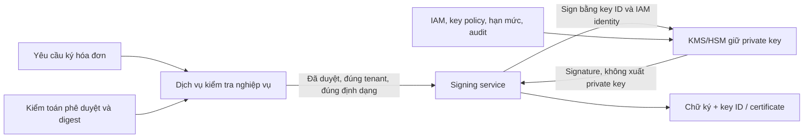
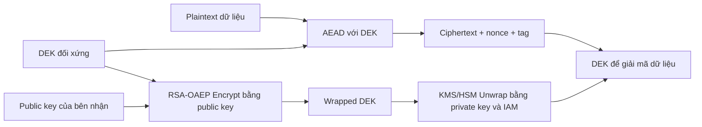
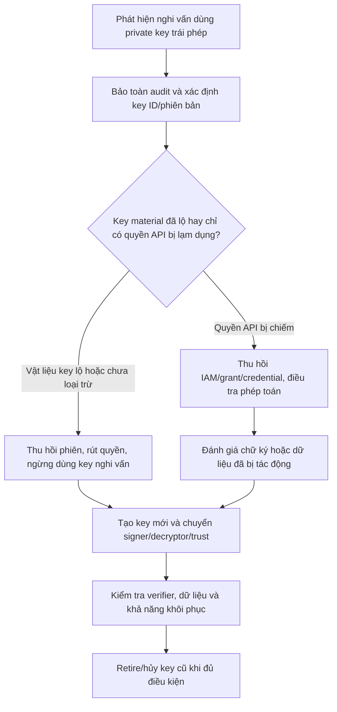

# Giới hạn sử dụng private key trong hệ thống mật mã bất đối xứng

> **Chương:** Mật mã bất đối xứng  
> **Module:** SECURITY_KEY_MANAGEMENT_FUNDAMENTALS

Một **private key (khóa riêng)** trong hệ mật mã bất đối xứng là vật liệu bí mật gắn với một public key (khóa công khai) tương ứng. Tùy thuật toán, private key có thể dùng để **tạo chữ ký số**, **giải mã hoặc mở khóa dữ liệu**, hoặc **tham gia thỏa thuận bí mật chung**. Khả năng thực hiện phép toán không có nghĩa hệ thống nên cho phép dùng private key **với mọi thao tác, mọi dữ liệu, mọi thời điểm và mọi chủ thể**.

**Giới hạn sử dụng private key** là tập hợp các ràng buộc về **mục đích mật mã, quyền truy cập, phạm vi dữ liệu, nơi giữ khóa, thời hạn, tần suất, điều kiện nghiệp vụ và cách thu hồi**. Thiết kế đúng các giới hạn này giúp giảm thiểu việc lộ khóa, lạm dụng quyền ký/giải mã và tác động dây chuyền khi một workload bị xâm phạm. Đây là một quyết định cốt lõi của key management, xuyên suốt vòng đời **tạo → cấp phát → lưu trữ → sử dụng → xoay vòng → thu hồi → hủy**.

Sau bài học, bạn có thể:

- Phân biệt private key dùng cho **ký số**, **giải mã/unwrap** và **key agreement**; không gán phép toán sai cho thuật toán.
- Xác định giới hạn theo **thuật toán**, **key usage**, **IAM/KMS/HSM policy**, **cryptoperiod** và **chính sách nghiệp vụ**.
- Hiểu tại sao quyền gọi `Sign` hoặc `Decrypt` vẫn nguy hiểm dù khóa **không được export**.
- Thiết kế phân quyền và kiểm toán cho private key của TLS, JWT, hóa đơn điện tử hoặc khóa unwrap dữ liệu.
- Lập quy trình rotation, thu hồi quyền và xử lý **private key compromise** mà vẫn giữ khả năng xác minh/giải mã dữ liệu hợp lệ.

## 1. Private key làm được gì, và không làm được gì?

Không phải mọi thuật toán bất đối xứng đều dùng private key theo cùng một cách. **Tên thuật toán và mục đích tạo khóa** quyết định phép toán hợp lệ; public/private key không phải hai mật khẩu có thể hoán đổi cho nhau.

| Thuật toán / loại khóa | Phép toán điển hình với private key | Vai trò của public key | Giới hạn cần nhớ |
|---|---|---|---|
| **RSA-PSS** | Tạo chữ ký RSA-PSS | Xác minh chữ ký | Sử dụng scheme ký và tham số đúng; không dùng như thuật toán mã hóa |
| **RSA-OAEP** | Giải mã hoặc unwrap một lượng dữ liệu nhỏ được mã hóa bằng public key | Mã hóa/wrap dữ liệu nhỏ, ví dụ DEK | Không mã hóa dữ liệu lớn trực tiếp bằng RSA; dùng hybrid/envelope encryption |
| **ECDSA** | Tạo chữ ký ECDSA | Xác minh chữ ký | Không dùng ECDSA để giải mã hoặc ECDH; bảo vệ giá trị ngẫu nhiên/bí mật mỗi chữ ký |
| **Ed25519 (EdDSA)** | Tạo chữ ký Ed25519 | Xác minh chữ ký | Không phải X25519; không dùng khóa Ed25519 làm khóa thỏa thuận bí mật theo cách tùy tiện |
| **ECDH/X25519** | Tính shared secret với public key của peer | Tham gia key agreement | Không có phép “ký số” hoặc “giải mã ciphertext” như RSA; phải có KDF và xác thực peer |
| **Khóa riêng chứng thư TLS** | Thường ký bằng chứng xác thực trong TLS 1.3 | Client xác minh chữ ký/chứng thư | Khóa xác thực khác với khóa phiên (EC)DHE; không tự dùng khóa TLS ký tài liệu nghiệp vụ |

Một private key RSA về mặt cấu trúc có thể tương thích với những loại thao tác khác nhau, nhưng **dùng chung một cặp khóa cho nhiều mục đích thường làm tăng rủi ro**. Chính sách nên buộc mỗi key vào một thuật toán, một purpose và một nhóm workload rõ ràng. Không nhầm việc “dùng private key để giải mã” với “dùng private key để tạo chữ ký”: hai thao tác cần **scheme/padding và quy tắc xác minh khác nhau**. Khái niệm dân gian “mã hóa bằng private key để tạo chữ ký” là mô tả thiếu chính xác, dễ dẫn đến thiết kế sai.

### 1.1. Khóa riêng cần bí mật; khóa công khai cần tính xác thực

Public key có thể được công bố rộng rãi nhưng người xác minh cần biết nó thực sự thuộc về **đúng chủ thể**. Việc gắn public key vào danh tính được thực hiện bằng certificate/PKI, JWKS được quản lý đúng, fingerprint được xác thực hoặc một cơ chế tin cậy phù hợp.

Nếu private key bị sao chép, attacker có thể **tự thực hiện phép toán bên ngoài KMS/HSM**. Nếu private key không xuất được nhưng quyền dùng khóa bị chiếm, attacker vẫn có thể **gọi dịch vụ ký hoặc giải mã trái phép**. Hai loại sự cố này cần biện pháp ứng phó khác nhau.

## 2. Bảy chiều giới hạn sử dụng private key

| Chiều giới hạn | Câu hỏi thiết kế | Ví dụ quy tắc |
|---|---|---|
| **Purpose / thuật toán** | Khóa được tạo để ký, unwrap, decrypt hay derive secret? | Khóa ký hóa đơn chỉ hỗ trợ Sign, không có quyền Decrypt |
| **Chủ thể** | Workload, người dùng, vai trò hoặc service nào được sử dụng? | Chỉ `billing-sign-service` có quyền gọi Sign trên key hóa đơn |
| **Dữ liệu / ngữ cảnh** | Được ký hoặc giải mã dữ liệu thuộc tenant, loại nghiệp vụ nào? | Chỉ ký chứng từ đã được duyệt của tenant hợp lệ |
| **Nơi thực thi** | Private key có được xuất/đọc byte gốc không? | Non-exportable key trong KMS/HSM; client chỉ nhận kết quả phép toán |
| **Thời gian** | Khóa được dùng để tạo chữ ký mới đến khi nào? Khi nào ngừng tin khóa cũ? | Retire khóa ký cũ sau cutover, còn giữ public key để verify lịch sử |
| **Khối lượng / tần suất** | Có hạn mức và phát hiện bất thường hay không? | Cảnh báo hàng nghìn lần Sign mỗi phút ngoài khối lượng dự kiến |
| **Quản trị vòng đời** | Ai được tạo, đổi policy, grant, disable, schedule deletion? | Tách quyền quản trị key khỏi quyền ký trong runtime |

**Giới hạn ở nhiều lớp** hiệu quả hơn một lời hứa “ứng dụng sẽ chỉ dùng đúng”. Có thể ràng buộc thuật toán ở dịch vụ KMS, kiểm soát danh tính bằng IAM, kiểm tra nội dung yêu cầu ở ứng dụng nghiệp vụ, và kiểm toán kết quả theo key ID. Các lớp này xử lý những mối đe dọa khác nhau.

## 3. Giới hạn ở cấp thuật toán và key usage

### 3.1. Key usage không phải nhãn trang trí

Khi sinh khóa, cần xác định trước:

- **SIGN/VERIFY:** dùng private key để tạo chữ ký, public key để xác minh.
- **ENCRYPT/DECRYPT hoặc WRAP/UNWRAP:** thường public key mã hóa/wrap; private key giải mã/unwrap theo thuật toán hỗ trợ.
- **KEY_AGREEMENT/DERIVE:** private key tham gia ECDH/X25519 để tính shared secret, sau đó dùng **KDF** tạo key đối xứng.

Một số KMS yêu cầu chọn **key spec/usage/algorithm** ngay khi tạo và chỉ cho gọi những phép toán tương ứng. HSM có thể cung cấp những thuộc tính cho đối tượng khóa như quyền ký, giải mã, derive và xuất khóa (ví dụ trong các giao diện chuẩn dạng PKCS#11). **Tên API, khả năng khóa và mức cưỡng chế phụ thuộc nhà cung cấp/loại khóa**; không nên mặc định mọi KMS hỗ trợ đầy đủ RSA, Ed25519, ECDH và mọi mode.

### 3.2. X.509 certificate Key Usage và Extended Key Usage

Certificate X.509 có thể chứa extension **Key Usage (KU)** như `digitalSignature`, `keyEncipherment`, `keyAgreement` và **Extended Key Usage (EKU)** như server authentication hoặc client authentication. Đây là tín hiệu/chính sách để **bên xác minh certificate** đánh giá key được phép dùng trong ngữ cảnh nào.

Điểm cần phân biệt:

- **KU/EKU của certificate** quy định ý nghĩa chứng thư và hành vi xác minh theo giao thức/chính sách. Nó **không tự động biến private key thành không thể gọi Sign** trong mọi HSM hoặc thư viện.
- **KMS/HSM key policy** có thể chặn một phép toán cụ thể ở API, nhưng không tự xác minh rằng chữ ký thực sự dành cho “hóa đơn đã được duyệt” nếu không có lớp nghiệp vụ kiểm tra.
- **IAM grant/role** xác định danh tính được phép gọi; quyền IAM rộng hơn không làm certificate EKU hợp lệ cho mục đích khác.

Một mô hình bảo vệ đúng cần phối hợp **đặc tả thuật toán + ràng buộc key object + xác minh certificate/trust + policy nghiệp vụ**.

### 3.3. Không dùng sai padding, hash hoặc key agreement

RSA dùng cho chữ ký nên theo **scheme ký** được chấp nhận như RSA-PSS khi phù hợp, còn RSA dùng để mã hóa/unwrap nên theo **RSA-OAEP** với cấu hình an toàn. Không dùng “textbook RSA” hay biến đổi toán học thô rồi coi là chữ ký/mã hóa hợp lệ.

ECDSA cần quản lý giá trị mỗi chữ ký, đôi khi gọi là nonce \(k\): lặp hoặc lộ nonce có thể làm lộ private key. Ed25519 có quy tắc ký riêng; không chuyển đổi hay dùng lại vật liệu Ed25519 như thể nó là X25519 để bỏ qua khác biệt mục đích.

Với **ECDH/X25519**, shared secret cần qua **KDF** được thiết kế theo giao thức và phải xác thực public key/peer. Key agreement không tự cung cấp xác thực hoặc toàn vẹn thông điệp, và không đồng nghĩa với quyền giải mã dữ liệu đã mã hóa bằng RSA.

## 4. Giới hạn quyền dùng khóa: có thể ký trái phép dù không đọc được private key

Giả sử `billing-service` cần ký hóa đơn. Có hai cách thiết kế:

1. Xuất private key vào file PEM và để ứng dụng đọc, sau đó tự ký. Tiến trình nắm vật liệu khóa; nếu máy hoặc artifact bị lộ, key có thể bị sao chép.
2. Giữ private key trong KMS/HSM hỗ trợ thuật toán ký, chỉ cấp danh tính ứng dụng quyền **Sign** trên **key ID** cụ thể. API trả signature, không trả private key.

Cách thứ hai giảm số bản sao private key, nhưng **không vô hiệu hóa rủi ro signing oracle**: attacker chiếm được workload có quyền Sign vẫn có thể gửi dữ liệu tùy ý để yêu cầu ký.



### 4.1. Vì sao chỉ có IAM là chưa đủ?

IAM có thể giới hạn **ai được gọi Sign với key nào**. Nhưng những điều kiện như “hóa đơn này đã qua phê duyệt”, “số tiền không vượt hạn mức” hay “tenant này thuộc tài khoản hiện tại” cần **authorization ở tầng nghiệp vụ** trước khi gọi Sign. HSM thường không hiểu cấu trúc hóa đơn và không kiểm tra quy trình phê duyệt.

Một chính sách vững chắc có thể yêu cầu:

- Dịch vụ ký chuyên biệt nhận **đối tượng nghiệp vụ đã được kiểm tra**, không phải một digest tùy ý do mọi client gửi.
- Kiểm tra tenant, giao dịch, trạng thái phê duyệt, quyền của người yêu cầu và giới hạn giá trị.
- Định dạng dữ liệu ký **canonical**; có trường domain/purpose, version, issuer, audience và thông tin chống replay khi cần.
- Giới hạn role runtime chỉ được **Sign** bằng đúng key, không được export, sửa key policy hay schedule key deletion.
- Ghi audit cả **business approval ID** và **KMS request ID/key ID** (không ghi private key hoặc dữ liệu nhạy cảm).

### 4.2. Tấn công lạm dụng quyền decrypt

Với private key RSA-OAEP dùng unwrap DEK, một workload có quyền **Decrypt** có thể giải mã các ciphertext/DEK mà nó có quyền tiếp cận. Nếu danh tính workload bị chiếm, attacker có thể lợi dụng API decrypt để lấy plaintext mà không biết byte private key.

Các giới hạn có ích gồm: tách khóa theo tenant/ứng dụng, hạn chế quyền truy cập ciphertext và wrapped DEK, kiểm tra quyền object trước khi decrypt, đặt policy theo principal và giám sát bất thường. KMS decrypt thường chỉ kiểm soát phép toán, **không tự chứng minh người gọi có quyền xem hồ sơ nghiệp vụ cụ thể**.

## 5. Giới hạn vị trí lưu trữ, export và sao chép private key

**Nguyên tắc thiết kế:** private key càng ít xuất hiện bên ngoài ranh giới tin cậy thì càng ít cơ hội bị sao chép. Với private key giá trị cao, nên ưu tiên **non-exportable** trong KMS/HSM hoặc kho khóa có tính chất phù hợp, nếu nền tảng và yêu cầu nghiệp vụ cho phép.

| Hình thức lưu giữ | Lợi ích | Nguy cơ và giới hạn |
|---|---|---|
| **KMS/HSM non-exportable key** | API có thể dùng key mà không cấp raw private key cho workload | Quyền Sign/Decrypt vẫn có thể bị lạm dụng; chi phí, độ trễ và thuật toán phụ thuộc dịch vụ |
| **HSM/key store với quyền export được kiểm soát** | Có thể hỗ trợ một số tích hợp/backup đặc biệt | Quản lý export, wrapping, quyền ủy quyền và bản sao phức tạp hơn |
| **Keystore/PEM trên filesystem** | Tích hợp dễ với thư viện cần private key cục bộ | File, permission, backup, process memory, CI artifact và host compromise là vùng rủi ro |
| **Secrets manager chứa private key** | Quản lý phiên bản, quyền đọc, phân phối raw key có kiểm soát | Sau khi được đọc, key nằm trong bộ nhớ client; không ngăn được việc sao chép nếu client bị chiếm |
| **Private key nhúng trong source/container image** | Không có ưu điểm an ninh đáng kể | Rất khó rotate/thu hồi; key lan qua repository, registry, artifact và máy build |

**Non-exportable** nghĩa là hệ thống khóa được thiết kế để ngăn xuất vật liệu riêng dưới dạng raw key theo giao diện và cam kết bảo mật của dịch vụ; không có nghĩa khóa “không thể bị compromise” dưới mọi tình huống. Cần xem xét khả năng import key, backup, snapshot hoặc tùy chọn provider; chính sách và ranh giới bảo vệ thay đổi theo sản phẩm.

Đối với Java, việc lưu private key trong một `PrivateKey` object không tự bảo đảm key không thể xuất, xóa sạch hoặc không từng tồn tại dưới dạng plaintext. Một số provider chỉ lưu **handle tới khóa ở HSM**, số khác nắm key bytes trong bộ nhớ JVM. Phải hiểu đặc tính key provider và API được sử dụng.

## 6. Giới hạn vòng đời: cryptoperiod, rotation và retire

**Cryptoperiod** là khoảng thời gian khóa được phép dùng cho một hoạt động mật mã nhất định. Với private key, cần phân biệt **thời gian tạo kết quả mới** và **thời gian duy trì khả năng xử lý kết quả cũ**.

| Trạng thái / giai đoạn | Private key ký số | Private key giải mã/unwrap |
|---|---|---|
| **Pre-active** | Tạo khóa, đăng ký public key/certificate, chuẩn bị trust | Tạo khóa, cấu hình key ID và quyền, kiểm thử khôi phục |
| **Active** | Cho tạo chữ ký mới trong mục đích đã phê duyệt | Cho decrypt/unwrap những ciphertext thuộc phạm vi |
| **Rotation/cutover** | Chuyển issuer sang key mới; công bố public key/JWKS/certificate mới | Mã hóa/wrap dữ liệu mới theo kế hoạch; vẫn cần mở dữ liệu cũ |
| **Retired** | Không cho ký mới; verifier có thể vẫn cần public key cũ để xác minh lịch sử | Có thể giữ quyền decrypt cũ có kiểm soát khi migration/retention chưa xong |
| **Disabled/revoked** | Chặn quyền Sign và thay đổi cơ chế trust/thu hồi chứng thư khi phù hợp | Chặn quyền decrypt khi an toàn; kiểm tra tác động tới dữ liệu còn lưu |
| **Destroyed** | Private material bị hủy theo quy trình; public key/chứng cứ xác minh có thể còn cần | Nếu ciphertext chưa chuyển/không còn đường khôi phục, dữ liệu có thể mất vĩnh viễn |

### 6.1. Hết hạn certificate không tương đương hủy private key

Certificate hết hạn khiến việc sử dụng nó trong nhiều quy trình xác minh không còn được chấp nhận cho **chữ ký hoặc phiên mới**, nhưng **không tự xóa byte private key**, không ngăn một ứng dụng tiếp tục gọi Sign, và không quyết định toàn bộ cách xác minh tài liệu ký trong quá khứ. Cần chính sách trust, timestamp, trạng thái chứng thư và tiêu chuẩn xác minh lịch sử.

### 6.2. Rotation không tự ngăn chữ ký cũ được tin

Ví dụ JWT ký bằng private key có `kid=old-key`. Nếu issuer đổi sang `new-key` nhưng verifier vẫn tin public key cũ, một token ký bằng private key cũ vẫn có thể được chấp nhận trong giới hạn quy tắc xác minh. Đây có thể là chủ ý để token cũ hết hạn tự nhiên trong rotation bình thường; **khi private key bị compromise**, cần quyết định ngừng tin key cũ và vô hiệu hóa token/session theo mức độ rủi ro.

Không nên xóa mọi public key cũ ngay sau rotation thông thường nếu còn tài liệu hoặc thông điệp lịch sử hợp lệ cần được xác minh. Ngược lại, không duy trì trust vô thời hạn khi có bằng chứng khóa đã bị xâm phạm.

## 7. Giới hạn liên quan đến TLS, chữ ký số và key agreement

### 7.1. TLS: private key xác thực khác với ephemeral session key

Trong **TLS 1.3 với certificate authentication**, private key của certificate thường dùng để tạo chữ ký chứng minh quyền sở hữu danh tính trong handshake. Bí mật phiên được dẫn xuất bằng cơ chế key agreement và key schedule, thường dùng ephemeral (EC)DHE. Server không “giải mã mọi dữ liệu TLS” bằng private key certificate.

Sự phân biệt này có ý nghĩa khi xử lý compromise: lộ private key xác thực dài hạn có thể tạo nguy cơ **mạo danh server**, nhưng không tự cho phép giải mã mọi bản ghi TLS cũ vốn đã được bảo vệ bằng (EC)DHE với forward secrecy và thực thi đúng. Với những giao thức/chế độ bắt tay cũ, đặc biệt kiểu RSA key transport lịch sử, phạm vi ảnh hưởng có thể khác.

### 7.2. Private key ký JWT: giới hạn đối tượng được tin

Chữ ký JWT chỉ cho biết token được tạo bởi bên nắm private key tương ứng **nếu xác minh đúng**. Verifier còn phải kiểm tra **issuer, audience, expiration, not-before, thuật toán được phép, key ID/trust**, cũng như thông tin nghiệp vụ và trạng thái thu hồi nếu cần.

Private key không tự hạn chế được các claim mà ứng dụng phát hành đưa vào. Vì thế phải quản lý quyền của issuer, bảo vệ signing service, xác minh nội dung trước khi ký và chống lạm dụng quyền ký.

### 7.3. Private key dùng thỏa thuận bí mật

Khóa ECDH/X25519 dùng để **derive shared secret**; nó không mặc nhiên ký, giải mã hay xác minh chữ ký. Phía nhận public share cần xác thực peer theo giao thức để chống man-in-the-middle. Shared secret phải được đưa qua KDF phù hợp trước khi tạo khóa phiên. Với ephemeral private key, giữ vật liệu lâu hơn cần thiết có thể làm giảm lợi ích forward secrecy.

## 8. Envelope encryption và giới hạn private key dùng unwrap

Với mô hình **envelope encryption**, dữ liệu lớn được mã hóa bằng **DEK đối xứng** như AES-GCM; một khóa bảo vệ khác (**KEK**) dùng để wrap DEK. KEK có thể là symmetric key trong KMS hoặc một cặp khóa bất đối xứng khi cơ chế hỗ trợ.

Nếu dùng **RSA-OAEP** để wrap DEK:

1. Bên gửi dùng **public key** được xác thực để mã hóa/wrap một DEK nhỏ.
2. Hệ thống lưu **wrapped DEK, ciphertext dữ liệu, nonce, tag và metadata**.
3. Bên nhận được cấp quyền **RSA-OAEP Decrypt/Unwrap bằng private key** để phục hồi DEK.
4. DEK dùng giải mã dữ liệu đối xứng; plaintext DEK cần được giữ ngắn nhất có thể trong bộ nhớ.



**Giới hạn quan trọng:** RSA-OAEP không được dùng mã hóa trực tiếp một tệp hoặc dữ liệu lớn; kích thước plaintext tối đa phụ thuộc độ dài modulus và hash/padding. KMS/HSM có thể hỗ trợ một số thuật toán wrap hoặc decrypt nhất định; nhiều nền tảng thay vào đó dùng **KEK đối xứng** và API data key.

Với private key unwrap, cần giới hạn chủ thể, môi trường, key ID, loại dữ liệu và quyền đọc ciphertext; không cấp quyền decrypt hàng loạt chỉ vì một service cần đọc một bản ghi. Nếu private key hoặc quyền Decrypt bị lộ, các DEK được bảo vệ bằng key đó có thể chịu ảnh hưởng theo mức độ attacker có ciphertext/wrapped DEK.

## 9. Phân quyền private key theo vai trò và nguyên tắc tối thiểu

**Least privilege** nghĩa là chỉ cấp đúng quyền cần cho công việc và chỉ trong phạm vi cần thiết. Với private key, ràng buộc phải đủ chi tiết ở cả **danh tính**, **key ID** và **phép toán**.

Một ví dụ hệ thống đặt hàng có các thành phần:

| Thành phần | Quyền cần thiết | Quyền cần tránh |
|---|---|---|
| `invoice-signer` | Ký chứng từ đã duyệt bằng khóa ký hóa đơn trong KMS | Decrypt, export khóa, sửa policy, xóa khóa |
| `jwt-issuer` | Ký token bằng khóa ký danh tính được cấp riêng | Ký hóa đơn, dùng khóa TLS, sửa trust store của verifier |
| `jwt-verifier` | Đọc public key/JWKS đáng tin, xác minh signature | Truy cập private key hoặc quyền Sign |
| `orders-reader` | Unwrap DEK đúng phạm vi đơn hàng sau kiểm tra quyền | Ký token, decrypt toàn bộ dữ liệu ngoài phạm vi |
| `key-rotation-operator` | Tạo/chuẩn bị key mới, điều phối cutover theo quy trình | Tự động có quyền ký chứng từ bất kỳ hoặc đọc mọi dữ liệu |
| `security-auditor` | Xem metadata cấu hình/nhật ký sử dụng và biến động policy | Đọc key material, tạo signature hoặc decrypt plaintext |
| `key-admin` | Quản lý vòng đời khóa theo chính sách/phê duyệt | Dùng riêng quyền admin để tự ý ký tài liệu nghiệp vụ |

Chính sách cụ thể có thể khác nhau theo cloud, HSM hoặc thư viện, nhưng **không nên dùng một “admin key” chung cho mọi phép toán và mọi workload**. Danh tính máy nên được cấp theo **workload identity** hoặc cơ chế xác thực ngắn hạn, hạn chế secret tĩnh để gọi KMS.

### 9.1. Ví dụ policy ở dạng mã giả

Đây là **mô tả chính sách khái niệm**, không phải JSON policy áp dụng trực tiếp lên sản phẩm KMS cụ thể:

```yaml
key:
  id: "prod/billing/invoice-sign-v3"
  algorithm: "Ed25519"
  purpose: "digital-signature"
  exportable: false

allow:
  - principal: "workload:prod/invoice-signer"
    action: ["Sign"]
    keyId: "prod/billing/invoice-sign-v3"
    environment: "production"

deny:
  - principal: "workload:*"
    action: ["ExportPrivateKey", "Decrypt", "DeleteKey", "UpdateKeyPolicy"]

operations:
  businessAuthorization: "approved-invoice-only"
  audit: "keyId, workloadId, approvalId, result, requestId"
  requirePrivilegedApprovalFor: ["DisableKey", "ScheduleDeletion"]
```

**Lưu ý:** Một số KMS không hỗ trợ Ed25519, trường `exportable` hoặc điều kiện môi trường đúng như mã giả; cách triển khai phải dựa trên tính năng của sản phẩm. `businessAuthorization` là **kiểm tra bắt buộc của signing service**, không phải thuộc tính mà KMS mặc nhiên thực thi.

### 9.2. Domain separation và ràng buộc nội dung ký

Không nên cho một key ký một dãy byte tùy ý từ mọi nơi rồi hy vọng bên xác minh hiểu đúng ý nghĩa. Trước khi ký, dữ liệu nên được chuẩn hóa và ràng buộc với **mục đích**, **phiên bản**, **tenant**, **issuer**, **loại đối tượng** và các trường bảo vệ nghiệp vụ.

Ví dụ payload ở tầng ứng dụng:

```text
purpose       = "invoice-signature"
version       = "v1"
issuer        = "billing-service"
tenantId      = "tenant-42"
invoiceId     = "INV-2026-0042"
amountMinor   = 750000
currency      = "VND"
approvedRef   = "approval-9812"

bytesToSign = canonicalEncode(purpose, version, issuer,
                              tenantId, invoiceId, amountMinor,
                              currency, approvedRef)
signature = signingService.signAuthorized(bytesToSign)
```

Hàm `canonicalEncode` phải có một định dạng xác định, tránh chữ ký của cùng nội dung nhưng thứ tự field hoặc encoding khác nhau. **Domain separation** ngăn cùng chữ ký bị hiểu nhầm như một loại thông điệp khác; các trường nghiệp vụ cần được verifier kiểm tra. Việc ký **không tự bảo đảm tính mới**: với giao dịch có nguy cơ replay, cần kết hợp transaction ID, sequence, expiry hoặc trạng thái đã xử lý.

## 10. Ví dụ Java 17: ký bằng private key Ed25519, xác minh bằng public key

Ví dụ dưới minh họa cách phân định **private key chỉ tạo chữ ký** và **public key chỉ xác minh**. Java 17 hỗ trợ Ed25519 qua JCA. Code tạo khóa ngay trong tiến trình để học cách dùng API; trong sản phẩm thật, private key giá trị cao có thể được giữ trong KMS/HSM, và ứng dụng gọi API ký nếu dịch vụ hỗ trợ thuật toán.

```java
import java.nio.charset.StandardCharsets;
import java.security.KeyPair;
import java.security.KeyPairGenerator;
import java.security.Signature;
import java.util.Arrays;

public final class PrivateKeyUsageDemo {
    private static final byte[] MESSAGE =
            ("invoice-signature:v1|tenant=42|invoice=INV-0042" +
             "|amountMinor=750000|currency=VND")
                    .getBytes(StandardCharsets.UTF_8);

    public static void main(String[] args) throws Exception {
        // Chỉ để demo. KeyPair sinh trong JVM chưa có KMS policy.
        KeyPairGenerator generator =
                KeyPairGenerator.getInstance("Ed25519");
        KeyPair pair = generator.generateKeyPair();

        // Chỉ thành phần ký được sở hữu private key.
        Signature signer = Signature.getInstance("Ed25519");
        signer.initSign(pair.getPrivate());
        signer.update(MESSAGE);
        byte[] signature = signer.sign();

        // Thành phần xác minh chỉ cần public key đáng tin cậy.
        Signature verifier = Signature.getInstance("Ed25519");
        verifier.initVerify(pair.getPublic());
        verifier.update(MESSAGE);
        boolean valid = verifier.verify(signature);

        byte[] changed = Arrays.copyOf(MESSAGE, MESSAGE.length);
        changed[changed.length - 1] ^= 1; // Thay đổi một byte.

        Signature tamperedVerifier = Signature.getInstance("Ed25519");
        tamperedVerifier.initVerify(pair.getPublic());
        tamperedVerifier.update(changed);
        boolean changedAccepted = tamperedVerifier.verify(signature);

        System.out.println("Signature valid: " + valid);
        System.out.println("Tampered message accepted: " + changedAccepted);

        // Không in private key, không serialize key để ghi log.
        // Ed25519 dùng để ký/xác minh, không dùng làm khóa AES hay RSA.
    }
}
```

Kết quả dự kiến: chữ ký của `MESSAGE` hợp lệ khi xác minh bằng public key tương ứng; khi thay một byte của thông điệp, việc xác minh chữ ký cũ phải thất bại.

**Các giới hạn của ví dụ:**

1. Chương trình **không có hệ thống phân quyền hoặc trust distribution**: bất kỳ ai có quyền với tiến trình đều có thể thao tác với đối tượng private key trong phạm vi quyền process. Việc tạo cặp khóa mới mỗi lần chạy cũng không thích hợp cho dịch vụ cần chữ ký có giá trị lâu dài.
2. Ed25519 là **thuật toán ký**, không phải thuật toán giải mã hay key agreement X25519; tránh suy luận private key Ed25519 có thể dùng cho mọi phép toán bất đối xứng.
3. String dữ liệu minh họa có cấu trúc cố định. Ứng dụng thật phải có **canonical serialization**, kiểm tra nghiệp vụ, chống replay phù hợp, quản lý key ID/version, xác minh public key từ nguồn tin cậy và chính sách khóa hết hạn/thu hồi.
4. Với KMS/HSM, nhiều API ký nhận **message hoặc digest** tùy thuật toán/provider. Không tự hash đầu vào trước khi gửi nếu API mong đợi raw message, và không hash lần hai khi API đã làm; phải tuân theo hợp đồng ký/xác minh chính xác của thuật toán.
5. Khóa có thể được tạo trong JCA provider nhưng **không tự có bảo đảm non-exportable**, zeroization hoặc audit như một HSM. Đoạn code chỉ minh họa phân chia phép toán ký/xác minh và tính toàn vẹn chữ ký.

## 11. Giới hạn số lần sử dụng và hành vi bất thường

Một private key được bảo vệ tốt vẫn có thể bị lạm dụng nếu hệ thống cho phép gọi API không giới hạn. Ví dụ, tài khoản `jwt-issuer` chỉ cần phát hành vài nghìn token mỗi giờ; đột nhiên gửi hàng triệu lệnh ký trong thời gian ngắn là tín hiệu cần điều tra.

Các biện pháp thường dùng:

- **Rate limit/quota** theo workload, key ID, loại phép toán và môi trường; kiểm soát cả luồng retry không mong muốn.
- **Hạn mức nghiệp vụ** cho đối tượng có giá trị lớn: số tiền, số chứng từ, người phê duyệt và thời gian được phép ký.
- **Detection baseline** cho số lần `Sign`, `Decrypt`, thay grant hoặc policy, nguồn gọi và kết quả bị từ chối.
- **Separation of duties:** ứng dụng ký không được đồng thời tự phê duyệt nghiệp vụ nhạy cảm hoặc sửa quyền sử dụng key.
- **Chặn hoặc yêu cầu đánh giá bổ sung** khi có tín hiệu bất thường, đồng thời bảo đảm không khiến dịch vụ quan trọng bị gián đoạn vì cảnh báo quá nhạy.

Hạn mức API của nhà cung cấp nhiều khi chỉ nhằm bảo vệ năng lực hệ thống; **không tự thay thế hạn mức bảo mật/kinh doanh**. Ngoài ra, một chữ ký trái phép đầu tiên có thể đã đủ gây hậu quả, nên chỉ đặt rate limit mà không kiểm tra authorization là chưa đủ.

## 12. Kiểm toán private key: ghi thao tác, không ghi vật liệu khóa

Mục tiêu của audit là có thể trả lời:

1. **Ai** đã gọi phép toán hoặc thay đổi policy?
2. **Khóa nào** được dùng (key ID, phiên bản, môi trường, owner)?
3. **Phép toán gì** đã diễn ra (Sign, Decrypt, Derive, UpdatePolicy, ScheduleDeletion)?
4. **Vào lúc nào**, theo request/transaction/approval nào?
5. **Kết quả** thành công hay bị từ chối, và lý do từ chối ở mức an toàn?
6. **Dữ liệu nào có thể đã bị ảnh hưởng**, dựa vào liên kết với log ứng dụng/kho dữ liệu?

| Nơi ghi nhật ký | Nên ghi | Tránh ghi |
|---|---|---|
| **KMS/HSM** | Key ID, principal, action, thời gian, trạng thái, request ID, policy/grant changes | Private key, plaintext DEK, plaintext dữ liệu và bản sao vật liệu khóa |
| **Signing service** | Request ID, transaction ID, business approval ID, key ID, kết quả ký | Dữ liệu khách hàng nhạy cảm hoặc message/digest không cần thiết để điều tra |
| **Verifier** | Key ID/kid, issuer, thuật toán được phép, kết quả xác minh, lỗi trust/expiry | Token bí mật, private key, thông tin nhạy cảm trong claim không cần thiết |
| **Quản trị vòng đời** | Lý do rotation, cutover, người phê duyệt, thời gian retire/disable/destroy | Key export ở dạng thô hoặc credential quản trị |

Audit cần được **bảo vệ khỏi sửa/xóa trái phép**, có retention phù hợp và liên kết được với trace nghiệp vụ. Không ghi raw JWT có bearer token hợp lệ hoặc toàn bộ nội dung cần ký vào log chỉ vì thuận tiện debug. Tùy dữ liệu, ngay cả digest và key ID cũng có thể là metadata nhạy cảm khi kết hợp với thông tin khác.

**Giới hạn quan trọng:** Nếu private key đã được export và dùng tại máy khác, các lần ký/giải mã ngoài KMS **không nhất thiết xuất hiện trong log KMS**. Không thấy lệnh Sign bất thường không chứng minh private key vẫn an toàn.

## 13. Khi private key hoặc quyền dùng key bị compromise

**Key compromise** có thể là lộ vật liệu khóa, tài khoản có quyền Sign/Decrypt bị chiếm, policy bị sửa hoặc trust/public key bị tráo. Phải xác định chính xác **sự cố thuộc loại nào**, vì việc thu hồi quyền gọi API không thể lấy lại những byte private key đã bị sao chép.

### 13.1. Quy trình phản ứng



**Bước 1 — Ngăn lạm dụng tiếp diễn.** Thu hồi phiên workload hoặc credential bị chiếm, rút grant/policy sai và cô lập host liên quan. Nếu có bằng chứng private key đã lộ, coi tính bí mật của key đó **không thể khôi phục bằng việc đổi mật khẩu KMS**. Chuẩn bị thay key.

**Bước 2 — Khoanh vùng.** Đối chiếu log KMS/HSM, ứng dụng, dữ liệu và verifier. Xác định có bao nhiêu chữ ký bất thường, token có thể bị phát hành giả, ciphertext/DEK có thể đã được giải mã và những nơi còn tin key cũ. Phân biệt phạm vi **có nguy cơ** với phạm vi **đã có bằng chứng bị khai thác**.

**Bước 3 — Thay key theo đúng mục đích.** Với signing key, tạo key/certificate mới, chuyển signer và cập nhật verifier/JWKS/trust. Với unwrap/decrypt key, tạo key mới rồi tổ chức rewrap hoặc mã hóa lại dữ liệu nếu threat model yêu cầu. Không giả định đổi key sẽ xóa bản plaintext hoặc chữ ký giả đã phát tán.

**Bước 4 — Ngừng tin key cũ khi cần.** Với JWT, điều chỉnh whitelist/trust của verifier và chính sách token/session; chỉ đổi `kid` ở issuer có thể chưa đủ. Với certificate, sử dụng cơ chế thu hồi theo PKI và kiểm tra hành vi của client, vì không phải client nào cũng cập nhật trust ngay. Chữ ký số lịch sử có thể cần thời gian ký được xác thực hoặc quy trình đánh giá riêng.

**Bước 5 — Khôi phục và hủy theo thứ tự.** Kiểm tra rằng dữ liệu cần thiết vẫn giải mã được, signer mới hoạt động, verifier đã cập nhật và quyền cũ bị rút. Không hủy vĩnh viễn khóa giải mã trước khi hoàn thành migration hoặc hết yêu cầu lưu giữ. Sau đó tìm nguyên nhân gốc về quyền rộng, export, CI/CD, logging hoặc việc dùng chung key.

### 13.2. Hai loại sự cố không được xử lý như nhau

| Tình huống | Cần làm ngay | Điều không thể giả định |
|---|---|---|
| **Private key PEM bị đưa lên repository** | Thu hồi/rotate key, xử lý bản sao đã phân phối, đổi trust/key ID và kiểm kê phạm vi | Xóa file khỏi commit hiện tại là đủ lấy lại bí mật; Git history/clone vẫn có thể giữ key |
| **Workload có quyền KMS Sign bị chiếm nhưng key không export được** | Thu hồi session, IAM và grant; điều tra những lần Sign; thay key/trust nếu mức độ rủi ro đòi hỏi | Không đọc được byte private key nghĩa là không thể tạo chữ ký giả |
| **Private key unwrap bị xóa nhầm** | Giữ trạng thái sự cố, tìm đường khôi phục được phê duyệt, kiểm kê dữ liệu phụ thuộc | Tạo private key khác sẽ giải mã được ciphertext cũ |
| **Key policy thay đổi trái phép** | Khóa đường quản trị bị chiếm, bảo toàn lịch sử policy, rà soát grant/alias và action đã xảy ra | Chỉ khôi phục policy hiện tại là đủ kết luận không có dữ liệu/chữ ký bị ảnh hưởng |

## 14. Những anti-pattern khiến giới hạn sử dụng mất hiệu lực

| Anti-pattern | Vì sao nguy hiểm | Biện pháp thay thế |
|---|---|---|
| Dùng chung một private key cho TLS, JWT và hóa đơn | Compromise ở một vai trò lan sang các vai trò khác, audit khó tách | Key riêng theo purpose và môi trường |
| Đưa PEM private key vào repository, image hoặc biến môi trường dùng chung | Tăng bản sao và nơi có thể bị đọc | KMS/HSM non-exportable hoặc cơ chế phân phối khóa được kiểm soát khi bắt buộc |
| Mọi service đều có quyền `kms:Sign` trên mọi key | Một workload bị chiếm có thể ký tùy ý | IAM/key policy theo key ID, action, principal |
| Tin certificate EKU đã tự hạn chế mọi lời gọi `Signature.sign()` | KU/EKU không tự cưỡng chế mọi phép toán trong phần mềm | Kiểm tra usage ở verifier, ràng buộc thuật toán/key object và signing API |
| Dịch vụ ký nhận digest tùy ý từ người dùng không qua authorization | Biến KMS thành signing oracle | Kiểm tra nghiệp vụ và canonical payload trước khi ký |
| Dùng public key lấy trực tiếp từ header `kid`/`jku` không kiểm soát nguồn | Attacker có thể điều khiển chọn trust key hoặc thuật toán | Whitelist issuer, thuật toán, JWKS endpoint/key mapping tin cậy |
| Ngừng dùng key cũ ở issuer nhưng verifier vẫn tin vô thời hạn | Token/chữ ký giả bằng key bị lộ có thể tiếp tục được chấp nhận | Kế hoạch cutover, cập nhật trust và thu hồi khi có compromise |
| Hủy private key unwrap ngay sau rotation | Mất khả năng mở dữ liệu cũ | Migrate/rewrap và kiểm chứng trước khi hủy |
| Log private key, raw JWT hoặc plaintext DEK trong môi trường debug | Log trở thành kênh rò rỉ key/credential | Log metadata, request ID, kết quả và phân quyền xem log |
| Dùng khóa RSA-PSS để “decrypt” hoặc khóa Ed25519 làm X25519 tùy ý | Sai mục đích, không tương thích thuật toán, dễ phá vỡ bảo mật | Chọn key spec/algorithm theo chức năng rõ ràng |
| Cho một tài khoản được vừa Sign, vừa sửa policy, vừa xóa key | Khó ngăn và điều tra sự cố từ một danh tính bị chiếm | Phân tách role runtime, admin, rotation và audit |

## 15. Hai tình huống thiết kế hoàn chỉnh

### 15.1. Dịch vụ ký hóa đơn nhiều tenant

Một nền tảng có `invoice-api`, `approval-service` và `signing-service`. Mục tiêu là mỗi hóa đơn được ký đúng bên phát hành, đúng phiên bản tài liệu và theo quy trình phê duyệt.

Thiết kế hợp lý:

1. Chọn thuật toán và cặp key phù hợp với định dạng chữ ký và yêu cầu hệ sinh thái; key chỉ dùng cho **purpose ký hóa đơn**.
2. Private key nằm trong KMS/HSM hoặc signing infrastructure được bảo vệ; chỉ `signing-service` có quyền gọi Sign trên key của tenant/phạm vi tương ứng.
3. `invoice-api` xác thực người gửi, `approval-service` kiểm tra quy trình, còn `signing-service` xác minh approval trước khi xây dựng nội dung cần ký.
4. Nội dung ký có định dạng canonical, ràng buộc tenant, invoice ID, số tiền, currency, version và mục đích sử dụng để giảm nguy cơ ký một dữ liệu nhưng bị diễn giải thành dữ liệu khác.
5. Public key/certificate được phân phối qua cơ chế đáng tin; bên xác minh kiểm tra chữ ký, hiệu lực và chính sách chứng thư, cùng các điều kiện nghiệp vụ.
6. Khi rotate, hệ thống đổi signing key theo phiên bản, cập nhật trust, giữ cơ chế xác minh chữ ký lịch sử theo yêu cầu pháp lý và chính sách. Nếu xảy ra compromise, phải đánh giá chữ ký nghi vấn và ngừng tin key cũ phù hợp.

Điểm cần nhấn mạnh: HSM giúp bảo vệ private key, **signing-service quyết định dữ liệu nào được phép ký**. Cả hai lớp đều cần được kiểm toán.

### 15.2. Dịch vụ mở DEK cho hồ sơ người dùng

Một hệ thống lưu hồ sơ đã mã hóa AES-GCM bằng DEK. DEK được wrap bằng **RSA-OAEP public key** của dịch vụ giải mã. Private key tương ứng thuộc một KMS/HSM.

Thiết kế hợp lý:

1. Mỗi hồ sơ có ciphertext, nonce/tag, wrapped DEK và metadata key ID/version.
2. API đọc hồ sơ kiểm tra người dùng có quyền truy cập đúng record/tenant trước khi gửi yêu cầu unwrap DEK.
3. Workload giải mã chỉ được gọi **Decrypt/Unwrap** bằng key ID phù hợp; không được Sign hoặc sửa key policy.
4. Plaintext DEK và dữ liệu hồ sơ tồn tại trong bộ nhớ càng ngắn càng tốt; không được đưa vào log.
5. Khi rotate private key unwrap, ứng dụng phải giữ khả năng mở DEK cũ hoặc rewrap/migrate trước khi retire key. Nếu DEK/khóa riêng bị lộ, cần đánh giá cả wrapped DEK và ciphertext attacker có thể lấy.

Không nên đánh đồng quyền **dùng private key** với quyền **đọc mọi hồ sơ**. Authorization ở API dữ liệu và policy khóa phải cùng bảo vệ yêu cầu.

## 16. Checklist khi triển khai giới hạn sử dụng private key

1. **Đúng thuật toán:** private key được tạo cho Sign, Decrypt/Unwrap hay KeyAgreement? Có vô tình dùng chung key cho nhiều purpose không?
2. **Đúng chủ thể:** principal/workload nào được phép gọi phép toán? Role có bị chia sẻ giữa môi trường dev/staging/prod không?
3. **Đúng dữ liệu:** signing/decrypting service có kiểm tra quyền tenant, trạng thái phê duyệt và object authorization trước khi gọi KMS không?
4. **Đúng ranh giới:** private key có non-exportable được không? Nếu phải export, ai được phép đọc và các bản sao nằm ở đâu?
5. **Đúng giao thức:** RSA-OAEP/RSA-PSS, ECDSA/Ed25519, ECDH/X25519 được dùng đúng mục đích và tham số chưa? Verifier có kiểm tra thuật toán và trust key không?
6. **Đúng vòng đời:** có active/retire/disable/destroy, cryptoperiod, lịch rotation và cách duy trì xác minh/giải mã lịch sử không?
7. **Đúng quyền quản trị:** runtime Sign/Decrypt có bị tách khỏi key policy admin, rotation và quyền hủy khóa không?
8. **Đúng kiểm toán:** có log key ID, action, principal, request ID, thời gian và business approval mà không rò rỉ key/credential không?
9. **Đúng mức giám sát:** có giới hạn tần suất và phát hiện Sign/Decrypt bất thường, thay grant và policy không?
10. **Đúng ứng phó sự cố:** đã có kế hoạch thay key, cập nhật JWKS/certificate/trust, đánh giá dữ liệu/chữ ký bị ảnh hưởng và migration trước khi hủy chưa?

## 17. Câu hỏi tự kiểm tra

**1. Khi private key ở KMS và được đánh dấu non-exportable, có thể coi là không bao giờ bị lạm dụng không?**  
Không. Key material có thể được giữ kín, nhưng attacker có danh tính được cấp `Sign` hoặc `Decrypt` vẫn có thể gọi phép toán trái phép. Phải bảo vệ IAM, key policy, workload và kiểm tra nghiệp vụ.

**2. Tại sao không dùng một private key RSA chung để vừa ký JWT vừa unwrap DEK?**  
Hai mục đích có scheme và quyền truy cập khác nhau. Dùng chung key làm mở rộng phạm vi compromise, khó tách audit/rotation và tăng nguy cơ dùng sai thuật toán. Nên tách khóa theo purpose và dùng padding/algorithm phù hợp.

**3. Certificate có EKU serverAuth thì đã tự chặn mọi hành vi ký tài liệu bằng private key chưa?**  
Chưa. EKU được bên xác minh certificate diễn giải theo giao thức/chính sách; API ký trong phần mềm hoặc HSM có thể vẫn cần chính sách riêng để chặn hành vi ký sai mục đích.

**4. Private key Ed25519 có dùng để giải mã dữ liệu mã hóa bằng public key X25519 không?**  
Không theo mô hình chuẩn. Ed25519 dùng cho chữ ký; X25519 dùng cho key agreement. Không hoán đổi tùy tiện key material giữa hai thuật toán.

**5. Đổi private key ký JWT nhưng giữ public key cũ trong JWKS thì token giả ký bằng khóa cũ có còn được chấp nhận không?**  
Có thể, nếu verifier vẫn tin public key cũ và token vượt qua các kiểm tra khác. Khi compromise, phải quyết định cắt trust/thu hồi token phù hợp; rotation thông thường có thể có giai đoạn chồng lấn được kiểm soát.

**6. Hủy private key unwrap có làm dữ liệu đã mã hóa trở nên an toàn hơn không?**  
Hủy khóa có thể ngăn sử dụng về sau qua hệ thống, nhưng không thu hồi byte khóa đã lộ hoặc plaintext đã bị lấy. Nếu không còn khóa để unwrap DEK cũ, dữ liệu hợp lệ có thể không thể giải mã; phải lên kế hoạch migration và retention trước.

**7. Chữ ký số hợp lệ có chứng minh hóa đơn được phê duyệt hay không?**  
Chữ ký xác nhận thông điệp không thay đổi và được tạo bằng private key tương ứng với public key đáng tin, theo giả định thuật toán an toàn. Việc hóa đơn **đã được phê duyệt** là điều kiện nghiệp vụ phải được kiểm tra, đưa vào nội dung/chứng cứ ký và xác minh theo quy trình.

## 18. Ghi nhớ

**Giới hạn sử dụng private key là giới hạn năng lực mật mã và quyền truy cập có kiểm soát**, không chỉ là giấu byte khóa. Private key ký số, private key RSA-OAEP giải mã và private key ECDH tham gia key agreement có **vai trò, thuật toán, thời hạn và rủi ro khác nhau**. Key Usage/EKU của certificate, key spec/KMS policy, IAM và authorization nghiệp vụ là các lớp bổ sung cho nhau.

Để bảo vệ khóa trên toàn bộ vòng đời **tạo, cấp phát, lưu trữ, sử dụng, xoay vòng, thu hồi và hủy**, cần ưu tiên **giảm khả năng xuất private key, chỉ cho đúng chủ thể gọi đúng phép toán, giới hạn dữ liệu/ngữ cảnh, tách role quản trị, kiểm toán và lập kế hoạch thay khóa**. KMS/HSM giúp giữ và thực thi khóa trong ranh giới được kiểm soát; ứng dụng vẫn phải xác định **ai được phép ký hoặc giải mã cái gì**. Cách thiết kế này giảm cả nguy cơ **mất bí mật khóa** lẫn **lạm dụng năng lực của một khóa chưa từng bị xuất ra ngoài**.
