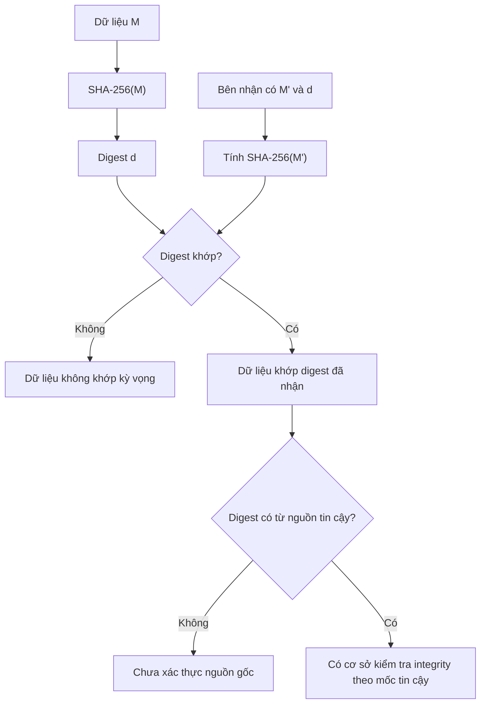
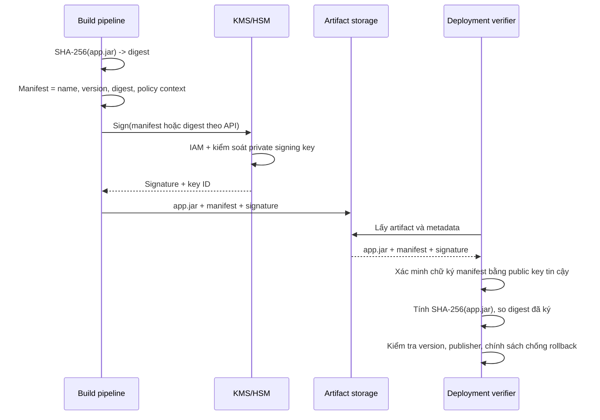

# Cryptographic hash (Hàm băm mật mã)

Trong chương **Hash và MAC** của module **SECURITY_KEY_MANAGEMENT_FUNDAMENTALS**, **cryptographic hash function** (hàm băm mật mã) là thuật toán biến một thông điệp có độ dài bất kỳ trong miền đầu vào cho phép thành một giá trị **digest** có độ dài được quy định. Ví dụ, SHA-256 trả về 256 bit (32 byte) cho cả thông điệp một byte lẫn tệp nhiều gigabyte. Giá trị này hỗ trợ phát hiện thay đổi, định danh nội dung, xây dựng HMAC, chữ ký số và các cơ chế dẫn xuất khóa.

Hàm băm mật mã **không phải thuật toán mã hóa** và bản thân nó **không có khóa bí mật**. Tính chất này tạo ra ranh giới rất quan trọng: chỉ tính lại SHA-256 của một tệp giúp kiểm tra tệp có khớp một digest hay không, nhưng **không chứng minh digest hoặc tệp đến từ nguồn đáng tin** nếu cả hai đều có thể bị kẻ tấn công thay thế. Muốn xác thực nguồn gốc, hệ thống cần **MAC/HMAC có khóa**, **chữ ký số**, hoặc một cơ chế tin cậy độc lập.

Bài học trình bày nguyên lý, tính chất bảo mật, các thuật toán thường gặp, tấn công và sai lầm thiết kế, ví dụ Java, cùng cách hash kết nối với vòng đời khóa đối xứng/bất đối xứng, KMS/HSM, envelope encryption, kiểm soát truy cập và kiểm toán.

## 1. Mục tiêu học tập

Sau bài này, bạn có thể:

- Mô tả digest, tính xác định, độ dài đầu ra, kháng **preimage**, **second-preimage** và **collision**; giải thích ý nghĩa của birthday bound.
- Phân biệt **hash không khóa** với **HMAC**, chữ ký số, mã hóa AES và hàm băm mật khẩu.
- Hiểu khi nào nên dùng SHA-256/SHA-384/SHA-512, SHA-3 hoặc thuật toán khác; vì sao MD5, SHA-1 không phù hợp cho nhiều mục đích đòi hỏi kháng va chạm hiện đại.
- Nhận diện nguy cơ **length-extension**, băm sai biểu diễn dữ liệu, tin digest chưa xác thực, lưu mật khẩu bằng SHA-256 trực tiếp và băm nhầm secret.
- Sử dụng `MessageDigest` trong Java, xử lý tệp theo luồng, biểu diễn digest nhất quán và kiểm tra với giá trị kỳ vọng từ nguồn tin cậy.
- Xác định vị trí của hàm băm trong chữ ký số, HMAC/KDF, KMS/HSM và chính sách quản lý khóa.

## 2. Hash hoạt động như thế nào?

Gọi `H` là hàm băm, `M` là chuỗi byte đầu vào và `d` là digest:

```text
                     Hash function
Input M (n byte)  -------------------->  digest d (độ dài cố định)
            H(M) = d

Ví dụ:
Input  : UTF-8 bytes của "abc"
H      : SHA-256
Output : ba7816bf8f01cfea414140de5dae2223b00361a396177a9cb410ff61f20015ad
          (64 ký tự hex = 32 byte = 256 bit)
```

Hàm băm có các đặc điểm:

1. **Tính xác định:** cùng thuật toán, cùng **chuỗi byte** đầu vào luôn cho cùng digest. Khác encoding, ký tự xuống dòng hoặc thứ tự trường có thể cho digest khác.
2. **Đầu ra độ dài quy định:** SHA-256 luôn trả 256 bit; các họ **extendable-output functions (XOF)** như SHAKE có độ dài đầu ra được chọn theo tham số.
3. **Tính toán hiệu quả:** có thể băm tệp lớn theo luồng mà không cần giữ toàn bộ tệp trong RAM.
4. **Khó đảo ngược theo mô hình mật mã:** digest không được thiết kế để khôi phục đầu vào gốc. Điều này **không đồng nghĩa** digest bảo mật được đầu vào có entropy thấp.
5. **Hiệu ứng lan truyền (avalanche):** thay đổi nhỏ ở đầu vào thường làm nhiều bit digest thay đổi; tuy nhiên hiệu ứng này **không phải bằng chứng đầy đủ** cho tính kháng va chạm.

Cùng một thuật toán, kết quả digest còn phụ thuộc **định dạng byte**. Ví dụ chuỗi Unicode có thể có các cách biểu diễn tương đương về mặt hiển thị, nhưng cho byte UTF-8 khác nhau nếu chưa chuẩn hóa. Khi hai bên cần cùng digest, phải có hợp đồng rõ về UTF-8, Unicode normalization, thứ tự trường, phân tách phần tử và cấu trúc serializer.

### 2.1. Digest, hash, checksum, fingerprint và key ID

| Khái niệm | Ý nghĩa | Điều cần tránh nhầm |
| --- | --- | --- |
| **Hash function** | Thuật toán ánh xạ input thành digest; ví dụ SHA-256. | Không phải một secret hay key. |
| **Digest / hash value** | Kết quả cụ thể của hàm băm trên dữ liệu. | Digest công khai không tự chứng minh nguồn gốc dữ liệu. |
| **Checksum / CRC** | Cơ chế kiểm tra lỗi truyền/lưu trữ, thường tối ưu phát hiện lỗi ngẫu nhiên. | CRC32 không có bảo đảm kháng va chạm có chủ đích như hash mật mã. |
| **Fingerprint / thumbprint** | Giá trị thường tính từ public key, chứng chỉ hoặc artifact để đối chiếu danh tính nội dung. | Muốn xác thực phải so với fingerprint thu được từ kênh đáng tin. |
| **Key ID / `kid`** | Nhãn/tham chiếu chọn khóa trong KMS, JWKS hoặc hệ thống. | Không nhất thiết được tính bằng hash; biết ID không có quyền dùng khóa. |
| **HMAC tag** | MAC được tạo từ **hash kết hợp với khóa bí mật** theo cấu trúc HMAC chuẩn. | Khác digest SHA-256 không khóa; phải giữ key bí mật. |

## 3. Ba thuộc tính bảo mật chính

Các thuộc tính phải được đánh giá trên thuật toán, số bit đầu ra, mô hình đe dọa và nguồn đầu vào. Không nên dùng từ “không thể đảo ngược” theo nghĩa tuyệt đối: một hàm có đầu ra hữu hạn luôn có nhiều đầu vào có thể cùng digest.

### 3.1. Preimage resistance (kháng tìm đầu vào)

Cho trước một digest `h`, kẻ tấn công khó tìm **bất kỳ** `M` sao cho `H(M) = h`. Với hàm lý tưởng cho digest `n` bit, công việc brute force điển hình để tìm preimage vào khoảng `2^n` phép thử.

Nhưng nếu `M` được chọn từ một danh sách nhỏ, ví dụ mật khẩu `123456`, kẻ tấn công có thể tính digest của các ứng viên và so sánh. **Kháng preimage của SHA-256 không biến mật khẩu yếu thành dữ liệu bí mật an toàn chỉ nhờ băm một lần.**

### 3.2. Second-preimage resistance (kháng tìm đầu vào thứ hai)

Cho một thông điệp cụ thể `M_1`, khó tìm `M_2 != M_1` sao cho:

```text
H(M_2) = H(M_1)
```

Thuộc tính này quan trọng khi một bản ghi đã được chốt digest: kẻ tấn công không dễ thay nội dung khác mà vẫn khớp hash cũ, trong giới hạn của thuật toán. Với hash lý tưởng `n` bit, độ phức tạp chung thường xấp xỉ `2^n`; các cấu trúc và phạm vi thông điệp đặc biệt có thể tạo ngoại lệ so với ước lượng đơn giản.

### 3.3. Collision resistance (kháng va chạm)

Khó tìm **bất kỳ hai thông điệp khác nhau** `M_1` và `M_2` thỏa:

```text
M_1 != M_2
H(M_1) = H(M_2)
```

Vì đầu vào nhiều hơn đầu ra nên va chạm **chắc chắn tồn tại theo nguyên lý Dirichlet**; yêu cầu của hash mật mã là kẻ tấn công không dễ tìm được một cặp. Do **birthday paradox**, một hash lý tưởng `n` bit cho mức kháng va chạm xấp xỉ `2^(n/2)` công việc, không phải `2^n`.

| Ví dụ | Độ dài digest | Ước lượng công việc kháng va chạm lý tưởng | Lưu ý |
| --- | --- | --- | --- |
| Digest 64 bit | 64 bit | Khoảng `2^32` thử | Quá nhỏ cho nhiều kịch bản chống kẻ tấn công chủ động. |
| SHA-256 | 256 bit | Khoảng `2^128` thử | Thường được dùng khi cần mức kháng va chạm cổ điển khoảng 128 bit. |
| SHA-384 | 384 bit | Khoảng `2^192` thử | Digest dài hơn, chi phí lưu/trao đổi cao hơn. |
| SHA-512 | 512 bit | Khoảng `2^256` thử | Không có nghĩa mọi hệ thống dùng SHA-512 đều đạt 256 bit an toàn tổng thể. |

Các giá trị chỉ là **ước lượng brute force cho mô hình hàm băm lý tưởng**, không mô tả một cuộc tấn công thành công hay độ mạnh toàn hệ thống. Thuật toán lỗi thời có thể bị tấn công tốt hơn birthday bound.

### 3.4. Vì sao “chỉ thay một ký tự” cũng quan trọng?

Một digest của artifact có thể được dùng để phát hiện lỗi truyền hoặc dữ liệu bị đổi, nhưng tác dụng phụ thuộc việc digest **được xác thực độc lập**. Nếu kẻ tấn công thay `app.jar` và cả `app.jar.sha256` trên cùng server bị chiếm quyền, việc hash lại chỉ chứng minh hai tệp **khớp nhau**, không chứng minh đây là bản phát hành do nhà phát triển phê duyệt.

## 4. Những họ thuật toán hash thường gặp

| Thuật toán | Digest | Tình huống phù hợp | Lưu ý |
| --- | --- | --- | --- |
| **SHA-256 (SHA-2)** | 256 bit | Integrity của artifact, thành phần của HMAC/HKDF/chữ ký theo giao thức, content addressing. | Hỗ trợ rộng và là lựa chọn phổ biến cho nhiều hệ thống mới. |
| **SHA-384, SHA-512 (SHA-2)** | 384, 512 bit | Một số profile chữ ký, chứng chỉ, chính sách an toàn cao hơn, môi trường 64 bit. | Không tự động tốt hơn mọi phương diện; tuân thủ giao thức và mục tiêu độ dài. |
| **SHA3-256, SHA3-512** | 256, 512 bit | Lựa chọn khác họ SHA-2, thiết kế dựa trên sponge. | Không đồng nhất đầu ra với SHA-2 dù số bit bằng nhau. |
| **SHAKE128, SHAKE256** | Độ dài có thể chọn | XOF, một số giao thức mật mã hoặc dẫn xuất theo chuẩn cụ thể. | Phải quy định độ dài, domain separation, API và cách encoding đầu ra. |
| **BLAKE2 / BLAKE3** | Theo biến thể và tham số | Hash hiệu năng cao, content addressing và các ứng dụng hỗ trợ giao thức. | Khả năng có sẵn trong thư viện/provider Java khác nhau; không mặc định có trong JCA. |
| **SHA-1** | 160 bit | Chỉ còn trong một số hệ thống tương thích cũ. | Có tấn công va chạm thực tế; không chọn cho thiết kế mới đòi hỏi collision resistance. |
| **MD5** | 128 bit | Có thể gặp ở mã định danh/checksum lịch sử không có mục tiêu bảo mật. | Không phù hợp cho chữ ký hay integrity chống sửa đổi có chủ đích do va chạm thực tế. |

**Lựa chọn thuật toán** là quyết định theo giao thức, mức rủi ro, hỗ trợ của thư viện và chính sách bảo mật; tránh tự cài đặt primitives. Ví dụ, `SHA256withECDSA` dùng SHA-256 theo định nghĩa chữ ký ECDSA của provider; `Ed25519` có quy trình băm bên trong thuật toán riêng và không nên tùy tiện chèn thêm SHA-256 ở tầng ứng dụng.

**Không đồng nhất hash của mật khẩu với SHA-256.** Argon2id, scrypt, bcrypt hoặc PBKDF2 là các thuật toán **password hashing / key stretching** có tham số chi phí, mục tiêu khác với băm dữ liệu thông thường; xem phần 8.

## 5. Hash chống được điều gì và không chống được điều gì?



| Tình huống | Chỉ SHA-256 có đủ không? | Giải thích |
| --- | --- | --- |
| Kiểm tra một tệp có thay đổi so với **digest đã được tin cậy** | **Có** cho đối chiếu integrity ở mức hash. | Cần bảo đảm digest kỳ vọng chưa bị tráo. |
| Xác thực webhook gửi từ một đối tác | **Không.** | Cần HMAC với secret đã chia sẻ hoặc chữ ký bất đối xứng, kèm chống replay. |
| Xác minh artifact do nhóm release phát hành | **Không, nếu chỉ lấy hash cùng nơi chứa artifact.** | Cần chữ ký trên manifest/hash và trust store/key đúng. |
| Giữ bí mật nội dung hồ sơ | **Không.** | Dùng mã hóa như AES-GCM với DEK được quản lý an toàn. |
| Chứng minh người dùng biết một mật khẩu | **Không, nếu lưu SHA-256(password) trực tiếp.** | Cần password hashing có salt và chi phí phù hợp, kết hợp quy trình xác thực. |
| Tra cứu cache theo nội dung của dữ liệu ít nhạy cảm | **Có thể.** | Hash giúp định danh nội dung nhưng vẫn phải xét rủi ro va chạm, truy cập và lộ metadata. |
| Chứng minh log kiểm toán không bị xóa/reorder | **Không, nếu mỗi dòng chỉ có một hash độc lập.** | Cần cấu trúc hash chain/Merkle tree, mốc tin cậy, chữ ký/MAC, lưu trữ chống sửa và quản trị quyền. |

**Ví dụ rủi ro:** ứng dụng lưu `SHA256(customerEmail)` rồi công bố như một mã ẩn danh. Địa chỉ email có không gian tìm kiếm có cấu trúc; kẻ tấn công có thể thử danh sách email và so digest. Digest vẫn có thể là dữ liệu có khả năng liên kết danh tính. Khi cần bảo vệ định danh, nên đánh giá use case, giảm lưu trữ và dùng cơ chế tokenization hoặc HMAC với khóa được bảo vệ khi phù hợp; ngay cả HMAC cũng không tự giải quyết mọi rủi ro tái nhận diện hay liên kết dữ liệu.

## 6. Vấn đề length-extension và vì sao HMAC khác raw hash

Một số hàm băm kiểu **Merkle–Damgård**, như SHA-256 và SHA-512, có tính chất cấu trúc cho phép kẻ tấn công biết `H(M)` và chiều dài `M` tính tiếp digest tương ứng với `M || padding || extra` mà **không cần biết toàn bộ M**. Đây là cơ sở của **length-extension attack** trong những giao thức xây MAC sai cách.

Ví dụ **không an toàn** về mặt thiết kế:

```text
tag = SHA256(secretKey || message)
```

Nếu server dùng `tag` như MAC và không kiểm soát định dạng/chiều dài, kẻ tấn công có thể mở rộng thông điệp theo cấu trúc của hàm băm trong một số trường hợp. Không tự thiết kế MAC bằng cách ghép secret và message rồi băm; các biến thể ghép khác cũng có bẫy về cấu trúc, độ dài và chuẩn hóa dữ liệu.

**HMAC** là cấu trúc MAC được thiết kế để dùng một hàm băm cùng **khóa bí mật**:

```text
HMAC(K, M) = H((K' XOR opad) || H((K' XOR ipad) || M))
```

Trong đó `K'` là khóa được xử lý theo block size của hàm băm, còn `ipad` và `opad` là các hằng số chuẩn. Công thức giúp hình dung cấu trúc **hai lượt băm có phân tách miền**, nhưng hãy sử dụng `javax.crypto.Mac` / API HMAC chuẩn; không tự triển khai công thức trong ứng dụng.

| Đặc điểm | SHA-256 thuần | HMAC-SHA256 |
| --- | --- | --- |
| Đầu vào bí mật bắt buộc | Không. | Có: secret key `K`. |
| Người quan sát có thể tự tạo giá trị cho thông điệp mới | Có. | Không thể tạo tag hợp lệ nếu không biết hoặc không có quyền dùng khóa. |
| Dùng để kiểm tra thay đổi dữ liệu | Có, nếu digest mốc tin cậy. | Có, đồng thời xác thực bên nắm khóa. |
| Có thể xác định duy nhất ai trong hai bên dùng shared secret đã tạo tag? | Không áp dụng. | Không; bất kỳ bên nào nắm secret đều có thể tạo MAC. |
| Có cần key lifecycle, rotation, thu hồi, IAM? | Không có khóa hash thuần. | **Có**, vì tính bảo mật phụ thuộc secret. |

**Không suy luận rằng mọi ứng dụng dùng HMAC-SHA1 đều bị phá vỡ chỉ vì SHA-1 có tấn công collision**: mục tiêu và cấu trúc bảo mật của HMAC khác raw hash. Tuy vậy, thiết kế mới thường chọn HMAC-SHA256 hoặc thuật toán theo yêu cầu giao thức và chính sách hiện hành.

### 6.1. Hash một lần không bằng chữ ký số

Với **ECDSA/RSA-PSS**, hàm băm thường là một thành phần của thuật toán ký; chữ ký dùng **private signing key**, bên nhận xác minh bằng **public key đáng tin cậy**. Thao tác `SHA256(message)` không thể thay một chữ ký, còn **signature verification** không chỉ là so sánh hai digest.

Với **Ed25519**, thư viện thực hiện quy trình băm đúng theo thuật toán, không tự thêm bước `SHA256` vào nội dung trước khi ký trừ khi giao thức rõ ràng yêu cầu prehash variant tương ứng.

Khi API KMS/HSM hỗ trợ ký, cần đọc chính xác loại đầu vào: có API nhận **message** rồi tự băm, có API nhận **digest** đã băm. Gọi nhầm loại có thể khiến phía xác minh ký/kiểm tra một đối tượng khác hoặc băm hai lần ngoài ý muốn.

## 7. Hash trong kiến trúc chữ ký số, artifact và kiểm toán

### 7.1. Ký manifest thay vì chỉ công bố checksum

Một pipeline phát hành Java có thể tạo SHA-256 của `app.jar` và đưa digest vào manifest, sau đó **ký manifest** bằng signing key trong KMS/HSM:



Kết hợp này tạo chuỗi tin cậy: **chữ ký xác thực manifest**, còn **hash liên kết manifest với byte artifact**. Nếu chỉ có `app.jar` và `app.jar.sha256` trong một kho không đáng tin, kẻ tấn công có thể đổi cả hai. Nếu manifest được ký nhưng pipeline build bị chiếm quyền và có thể ký mã độc, chữ ký vẫn có thể hợp lệ; kiểm soát quá trình build, quyền `Sign`, phê duyệt và audit vẫn rất quan trọng.

### 7.2. Hash chain và Merkle tree cho log

Một **hash chain** có thể liên kết các bản ghi theo thứ tự:

```text
h0 = trustedAnchor
h1 = H(encode(h0, record1))
h2 = H(encode(h1, record2))
h3 = H(encode(h2, record3))
...
```

Khi sửa một record ở giữa, các hash phía sau không còn khớp với chuỗi gốc. Tuy nhiên nếu người tấn công có toàn quyền sửa log và **tự tính lại toàn bộ chain**, họ có thể tạo ra một chain mới hợp lệ. Vì vậy cần neo hash cuối vào **nơi tin cậy độc lập**, ký/MAC checkpoint, lưu trữ append-only hoặc cơ chế bảo vệ tương ứng. Cấu trúc cũng phải giải quyết việc xóa phần đuôi, chèn và đảo thứ tự bản ghi.

**Merkle tree** tổng hợp hash của các phần tử thành một root, cho phép chứng minh một phần tử có thuộc tập đã cam kết hay không bằng đường dẫn hash. Root chỉ có giá trị chứng minh khi đã được nhận qua kênh tin cậy; nó không tự cung cấp xác thực nguồn gốc.

Trong cả hai trường hợp, chuẩn hóa encoding, tách miền **leaf/node**, xử lý chiều dài và dữ liệu thiếu là yêu cầu thiết kế thực sự. Không tự tạo một hệ thống log chống giả mạo chỉ bằng cách nối chuỗi vào SHA-256 nếu có mô hình đe dọa chủ động.

## 8. Hash trong password hashing và key derivation

### 8.1. Vì sao không lưu `SHA256(password)`?

Mật khẩu thường có entropy thấp và người dùng có xu hướng chọn từ điển phổ biến. Hàm SHA-256 được tối ưu để tính **nhanh**, khiến kẻ tấn công có thể thử nhiều mật khẩu mỗi giây khi có bản dump digest.

Quy trình lưu mật khẩu phù hợp hơn:

1. Với mỗi người dùng, tạo **salt ngẫu nhiên riêng** bằng nguồn CSPRNG theo yêu cầu thuật toán.
2. Dùng thuật toán **password hashing chuyên dụng** như Argon2id (khi được hỗ trợ và cấu hình thích hợp), scrypt, bcrypt hoặc PBKDF2 theo chính sách và năng lực hạ tầng.
3. Chọn tham số chi phí (memory/time/iterations/parallelism) đủ chống thử đoán trong giới hạn độ trễ vận hành và phòng chống DoS.
4. Lưu **algorithm ID, version, cost parameters, salt, password hash**; không cần giữ salt bí mật. Có thể dùng **pepper** là secret riêng được quản lý bằng KMS/HSM khi yêu cầu.
5. Khi đăng nhập, tính lại theo metadata và so sánh kết quả một cách an toàn; hỗ trợ nâng cấp tham số/thuật toán dần theo vòng đời mật khẩu.

**Salt** ngăn việc dùng bảng digest dựng sẵn và hạn chế trùng digest giữa người dùng có cùng mật khẩu; salt **không thay cho** thuật toán password hashing chi phí cao. **Pepper** là một bí mật có vòng đời thực sự: phải quản lý quyền, xoay, khôi phục và ảnh hưởng khi bị lộ/hủy.

### 8.2. HKDF: dẫn xuất khóa từ input key material

**HKDF** thường dùng một HMAC bên trong để tạo khóa con từ **input key material (IKM)** có entropy thích hợp. Các đầu vào thường bao gồm salt và `info` chứa nhãn/phạm vi mục đích; output key material được dùng cho các thuật toán khác nhau.

```text
Shared secret từ ECDH hoặc root DEK đủ entropy
       |
       v
HKDF-Extract(salt, IKM) -> PRK
       |
       v
HKDF-Expand(PRK, info="payment/v1/aes-gcm", length) -> K_enc
       |
       + HKDF-Expand(PRK, info="payment/v1/mac", length) -> K_mac
```

Phải quy định rõ serialization của salt, `info`, mục đích và phiên bản. **Không sử dụng cùng khóa con cho AES và HMAC** chỉ vì chúng đều cần secret. Cũng không được coi HKDF là cách “biến mật khẩu yếu thành khóa mạnh” tương đương Argon2id/PBKDF2: HKDF không được thiết kế để làm chậm tấn công đoán mật khẩu.

### 8.3. Hash không thay cho mã hóa

Một khách hàng có mã định danh, địa chỉ và hồ sơ thanh toán cần được bảo mật. Băm SHA-256 có thể giúp kiểm tra **một phiên bản byte của tài liệu**, nhưng không cho phép giải mã dữ liệu để sử dụng về sau. Nếu muốn vừa giữ bí mật vừa kiểm tra toàn vẹn, có thể dùng **AES-GCM** với DEK được quản lý và bọc bằng KEK qua **envelope encryption**. Cách này khác hoàn toàn với việc đưa bản rõ vào SHA-256.

Một số hệ thống lưu **hash của ciphertext** để đối chiếu bản sao hay kiểm tra quá trình truyền. Điều này không thay thế tag của AEAD, kiểm soát truy cập hoặc cơ chế phát hiện rollback; đặc biệt nếu hash và ciphertext cùng ở vùng mà kẻ tấn công sửa được.

## 9. Ví dụ Java 17: SHA-256 trên chuỗi và tệp

**Java Cryptography Architecture (JCA)** có `MessageDigest` cho các thuật toán hash được provider hỗ trợ. Ví dụ này dùng Java 17, UTF-8 và `HexFormat`; minh họa kiểm tra vector SHA-256 chuẩn và tính digest tệp theo luồng:

```java
import java.io.InputStream;
import java.nio.charset.StandardCharsets;
import java.nio.file.Files;
import java.nio.file.Path;
import java.security.MessageDigest;
import java.security.NoSuchAlgorithmException;
import java.util.HexFormat;

public final class Sha256Demo {
    private static final String SHA256_ABC =
            "ba7816bf8f01cfea414140de5dae2223b00361a396177"
          + "a9cb410ff61f20015ad";

    static byte[] sha256(byte[] input) throws NoSuchAlgorithmException {
        MessageDigest md = MessageDigest.getInstance("SHA-256");
        return md.digest(input);
    }

    static byte[] sha256File(Path path) throws Exception {
        MessageDigest md = MessageDigest.getInstance("SHA-256");
        try (InputStream input = Files.newInputStream(path)) {
            byte[] buffer = new byte[64 * 1024];
            int count;
            while ((count = input.read(buffer)) != -1) {
                md.update(buffer, 0, count);
            }
        }
        return md.digest();
    }

    public static void main(String[] args) throws Exception {
        byte[] input = "abc".getBytes(StandardCharsets.UTF_8);
        byte[] digest = sha256(input);
        System.out.println("SHA-256(abc): " + HexFormat.of().formatHex(digest));

        // Giá trị kỳ vọng đã biết trước, KHÔNG nhận từ cùng nguồn
        // không đáng tin với dữ liệu đang kiểm tra.
        byte[] expected = HexFormat.of().parseHex(SHA256_ABC);
        if (!MessageDigest.isEqual(expected, digest)) {
            throw new SecurityException("SHA-256 mismatch");
        }

        byte[] changed = sha256("abd".getBytes(StandardCharsets.UTF_8));
        System.out.println("Different message: " +
                !MessageDigest.isEqual(digest, changed));

        if (args.length == 1) {
            byte[] fileDigest = sha256File(Path.of(args[0]));
            System.out.println("File SHA-256: " +
                    HexFormat.of().formatHex(fileDigest));
        }
    }
}
```

Khi chạy không đối số, digest của `abc` phải đúng vector SHA-256 ở đầu bài và dòng `Different message` sẽ là `true`. Khi truyền đường dẫn tệp, phương thức `sha256File` đọc từng đoạn 64 KiB và cập nhật cùng một `MessageDigest`, không đọc toàn bộ file vào RAM.

**Giới hạn của ví dụ:**

- `SHA256_ABC` là vector kiểm thử cố định, không mô phỏng một kênh phân phối digest đáng tin trong production.
- Việc so sánh digest **không xác thực nguồn gốc** nếu kẻ tấn công có thể thay cả tệp lẫn digest kỳ vọng.
- `MessageDigest` là đối tượng có trạng thái; tránh chia sẻ cùng instance giữa nhiều thread. Tạo instance riêng hoặc quản lý lifecycle chính xác.
- `MessageDigest.isEqual` phù hợp hơn so sánh dừng ngay ở byte khác đầu tiên trong ngữ cảnh cần hạn chế lộ thông tin thời gian, nhưng một phép so digest **không biến SHA-256 thuần thành HMAC**.
- Không đưa digest vào đường dẫn truy cập hay SQL tùy tiện; kiểm tra kích thước tệp, nguồn dữ liệu, quyền truy cập và yêu cầu nghiệp vụ khi triển khai thực tế.
- Với **chữ ký ECDSA**, không tự băm rồi đưa digest vào `SHA256withECDSA` vì provider thường đã băm message bên trong. Với **KMS Sign**, cần kiểm tra API nhận message hay digest để tránh băm sai.

## 10. Hash, KMS/HSM và vòng đời khóa liên quan thế nào?

Bản thân **SHA-256 không có secret key** nên không tồn tại thao tác “xoay khóa SHA-256”. Nhưng hash thường xuất hiện bên trong cấu trúc **có khóa** và **cần quản lý vòng đời**:

| Ứng dụng | Khóa bí mật nằm ở đâu? | Vai trò hash | Những việc quản lý khóa cần thực hiện |
| --- | --- | --- | --- |
| **HMAC-SHA256** cho webhook | Secret key của bên gửi và bên kiểm tra, hoặc trong KMS. | Thành phần tạo MAC/tag. | Sinh secret an toàn, phân phối, giới hạn quyền, xoay, kiểm tra tag cũ trong thời gian chuyển đổi, thu hồi khi lộ. |
| **RSA-PSS / ECDSA** ký manifest | Private signing key trong keystore/KMS/HSM nếu phù hợp. | Băm message theo hợp đồng thuật toán chữ ký. | Bảo vệ private key, phân tách quyền ký/xóa, phát hành public key/cert đáng tin, xoay và xử lý khóa cũ. |
| **ECDH + HKDF** tạo session keys | ECDH private key/IKM và secret trung gian. | HKDF thường xây trên HMAC. | Xác thực peer, giới hạn lifetime của ephemeral private key, dùng salt/info đúng, không log shared secret. |
| **AES-GCM + envelope encryption** | DEK dùng mã hóa dữ liệu; KEK bọc DEK qua KMS/HSM. | Hash có thể hỗ trợ integrity ngoài băng, định danh artifact hoặc thuật toán dẫn xuất. | Quản lý DEK/KEK, nonce/tag, quyền unwrap, rewrap/re-encrypt, backup và hủy. |
| **Password hashing** | Mật khẩu do người dùng biết, pepper nếu có. | Cấu trúc password hashing sử dụng các primitive mật mã theo thiết kế. | Salt/cost/algorithm version, quản lý pepper, không lưu mật khẩu rõ. |
| **Hash chain audit** | Có thể có signing key/MAC key để neo checkpoint. | Liên kết/tổng hợp các bản ghi. | Phân quyền ghi/đọc log, neo mốc tin cậy, xoay signing/MAC key và giữ bằng chứng kiểm toán. |

### 10.1. Quản lý HMAC key đúng vòng đời

Ví dụ đối tác ký webhook bằng **HMAC-SHA256**:

```text
Ngày 1:
  keyId = webhook-v1
  Sender tạo HMAC bằng secret v1
  Receiver xác minh bằng secret v1

Trong rotation:
  Sender chuyển tạo HMAC mới bằng secret v2, gửi keyId=v2
  Receiver tạm chấp nhận v1 và v2 theo thời hạn/chính sách xác định
  Mỗi secret chỉ được cấp đúng phía và phạm vi cần thiết

Sau chuyển đổi:
  Receiver ngừng chấp nhận v1
  Secret v1 bị vô hiệu hóa/hủy theo chính sách và kiểm kê backup
```

Phải xác minh **exact bytes** được ký, `keyId` từ danh mục khóa đáng tin, định dạng HMAC, và có **timestamp/nonce hoặc idempotency key** để chống replay. HMAC hợp lệ trên một thông điệp cũ không tự chặn việc kẻ tấn công gửi lại thông điệp đó. Khi có nhiều tenant/đối tác, không tra khóa chỉ bằng `keyId` do client tự khai nếu thiếu ràng buộc đối tác, môi trường và quyền.

Đối với KMS/HSM, nhà cung cấp có thể hỗ trợ **GenerateMac/VerifyMac** bằng khóa không xuất được, hoặc yêu cầu ứng dụng giữ secret riêng trong secrets manager. Các khả năng khác nhau theo sản phẩm; không suy diễn rằng mọi KMS đều hỗ trợ HMAC hoặc cho phép đưa dữ liệu lớn vào API MAC.

### 10.2. Kiểm toán thao tác hash và thao tác có khóa

Một phép SHA-256 trên dữ liệu nội bộ **không cần cấp quyền sử dụng cryptographic key**. Ngược lại, API `Sign`, `GenerateMac`, `Decrypt`, `DeriveKey` có thể làm lộ giá trị hoặc tạo chứng cứ mật mã nếu bị lạm dụng, nên cần **IAM tối thiểu**, quota/hạn mức và log audit.

Log hữu ích có thể chứa `actor`, `operation`, `keyId`, `keyVersion`, `algorithm`, `requestId`, `outcome` và thời điểm. Không ghi secret, private key, plaintext nhạy cảm, salt/pepper bí mật hoặc raw token không cần thiết. Một hash của secret cũng **không mặc nhiên an toàn để công bố** nếu secret có entropy thấp hoặc có thể bị tra cứu.

## 11. Lỗi thiết kế thường gặp

| Sai lầm | Hệ quả | Hướng xử lý |
| --- | --- | --- |
| Dùng `MD5` hoặc `SHA-1` làm hash kiểm tra artifact chống sửa đổi có chủ đích. | Các tấn công va chạm đã biết có thể phá vỡ giả định. | Dùng SHA-256 hoặc thuật toán hiện đại phù hợp chuẩn và chính sách. |
| Kiểm tra SHA-256 của tệp với digest tải từ **cùng kho không tin cậy**. | Kẻ tấn công có thể thay cả tệp lẫn digest. | Xác minh chữ ký manifest hoặc digest từ kênh độc lập đáng tin. |
| Coi hash như mã hóa hoặc ẩn danh dữ liệu ít entropy. | Có thể đoán/ngược bằng từ điển và liên kết danh tính. | Mã hóa/tokenization hoặc thiết kế bảo vệ định danh có phân tích rủi ro; không dùng raw hash cho bí mật. |
| Lưu `SHA256(password)` không salt, không cost. | Tấn công offline với tốc độ cao, rainbow table/dictionary. | Argon2id/scrypt/bcrypt/PBKDF2 theo chính sách, salt riêng và cost phù hợp. |
| Tự tạo MAC bằng `SHA256(secret || message)`. | Có thể dính length-extension và lỗi cấu trúc. | Dùng HMAC chuẩn hoặc MAC được đánh giá, quản lý khóa riêng. |
| Nghĩ digest khớp đồng nghĩa người gửi hợp lệ. | Không có xác thực nguồn gốc; có thể bị tráo thông điệp và digest. | HMAC hoặc chữ ký số, ràng buộc key/issuer và bối cảnh. |
| Không chuẩn hóa byte khi ký hoặc hash JSON. | Hai bên có digest khác nhau dù nhìn giống nội dung, hoặc bị ambiguity. | Định nghĩa canonical encoding, version, ký đúng chuỗi byte theo giao thức. |
| Tự cắt digest quá ngắn để tiết kiệm lưu trữ. | Giảm mức kháng va chạm theo birthday bound. | Chọn độ dài dựa trên mô hình đe dọa, thuật toán và yêu cầu giao thức. |
| Tự thêm SHA-256 trước `SHA256withECDSA` hoặc dùng sai message/digest API KMS. | Ký nhầm dữ liệu hoặc băm hai lần, lỗi liên thông. | Tuân thủ hợp đồng API và dạng dữ liệu chữ ký được quy định. |
| Chỉ lưu `H(logLine)` và tuyên bố log không thể bị giả. | Người có quyền sửa log có thể tính lại hash. | Hash chain + mốc được ký/MAC hoặc kho log chống sửa đổi, phân quyền và kiểm toán. |
| Xoay HMAC secret nhưng chỉ giữ secret mới dù còn request cũ hợp lệ. | Từ chối giao dịch hợp lệ hoặc mất khả năng xác minh lịch sử. | Thiết kế cửa sổ chuyển đổi, key ID, lifetime, idempotency và chính sách hủy. |
| Dùng lại một secret cho HMAC, AES và dịch vụ khác. | Lộ một miền làm tăng phạm vi tác động; thiếu phân tách mục đích. | Sinh khóa độc lập hoặc dẫn xuất bằng KDF với domain separation rõ ràng. |

## 12. Checklist thiết kế dùng cryptographic hash

1. **Mục đích:** Hash dùng để kiểm tra integrity, làm fingerprint, hỗ trợ chữ ký, HMAC, KDF hay password hashing? Từng mục đích đã chọn primitive phù hợp chưa?
2. **Thuật toán:** SHA-256/SHA-384/SHA-3 hoặc thuật toán tương thích phù hợp chuẩn; có tránh MD5/SHA-1 ở những chỗ cần collision resistance không?
3. **Giá trị mốc tin cậy:** Digest kỳ vọng lấy từ đâu? Nó được ký, MAC hoặc bảo vệ bằng kênh riêng không?
4. **Byte chính xác:** Encoding, normalization, thứ tự trường, dấu phân cách, version và cấu trúc metadata đã được định nghĩa nhất quán chưa?
5. **Mô hình kẻ tấn công:** Có thể sửa cả data và digest, chọn dữ liệu va chạm, phát lại bản tin cũ hoặc thay public key không?
6. **Xác thực:** Nếu cần xác thực nguồn, có dùng HMAC/chữ ký số thay vì raw SHA-256 không? Kiểm tra đúng key ID, issuer, thuật toán và quyền?
7. **Mật khẩu:** Có dùng password hashing với salt/cost và kế hoạch nâng cấp tham số, tránh SHA-256 trực tiếp không?
8. **Bảo vệ khóa:** HMAC/private signing key/KDF IKM có được quản lý bằng IAM, secrets manager, KMS/HSM phù hợp, có lịch xoay và hủy không?
9. **Triển khai:** Có xử lý dữ liệu theo luồng khi lớn, giới hạn tài nguyên, so digest/tag an toàn và không log secret/plaintext không?
10. **Vận hành:** Có audit thao tác có khóa, nguồn tin cậy cho checkpoint, kế hoạch rotation/incident response và kiểm tra khả năng xác minh dữ liệu lịch sử không?

## 13. Câu hỏi tự kiểm tra

1. Tại sao SHA-256 của một tệp lớn vẫn dài 32 byte? Điều đó có nghĩa là không thể có hai tệp khác nhau cùng digest không?
2. Preimage, second-preimage và collision resistance khác nhau về mục tiêu của kẻ tấn công như thế nào? Birthday bound ảnh hưởng ra sao tới digest 256 bit?
3. Vì sao SHA-256 của `app.jar` và một tệp `app.jar.sha256` nằm trên cùng server không đủ chứng minh bản phát hành đáng tin?
4. Tại sao `SHA256(secret || message)` không nên thay cho HMAC-SHA256?
5. Vì sao hash mật khẩu bằng SHA-256 trực tiếp vẫn nguy hiểm ngay cả khi SHA-256 kháng preimage tốt?
6. Một hệ thống dùng ECDSA, HKDF và AES-GCM ở ba chỗ khác nhau. Hash tham gia thế nào, và bí mật/khóa thực sự cần quản lý ở đâu?
7. Khi xoay HMAC secret của webhook, bạn phải tính gì để không nhận lại bản tin bị replay nhưng vẫn cho phép request hợp lệ trong thời gian chuyển đổi?
8. Nếu người quản trị có toàn quyền sửa log, một chuỗi SHA-256 của các dòng log đã đủ chống giả mạo chưa? Muốn tăng niềm tin cần thêm biện pháp nào?

**Ghi nhớ:** cryptographic hash tạo **dấu vân tay mật mã cho chuỗi byte**, có những thuộc tính khó đảo và khó tìm va chạm trong giới hạn thuật toán, nhưng **không tự tạo bí mật, tính xác thực nguồn gốc hoặc quyền truy cập**. Khi kết hợp đúng với HMAC, chữ ký số, KDF và mã hóa có xác thực, hash trở thành thành phần nền tảng của hệ thống quản lý khóa an toàn — nơi secret key phải được bảo vệ, phân quyền, kiểm toán, xoay vòng và hủy theo vòng đời phù hợp.
