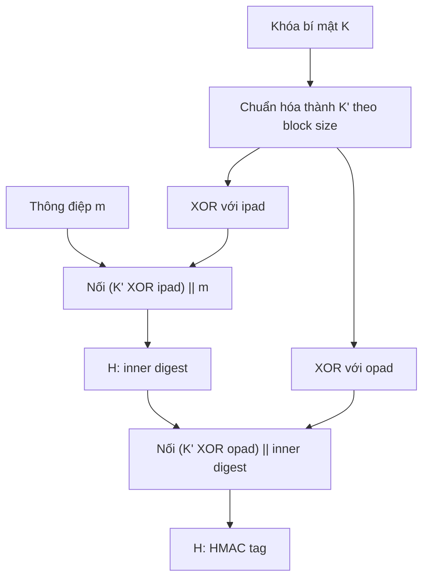
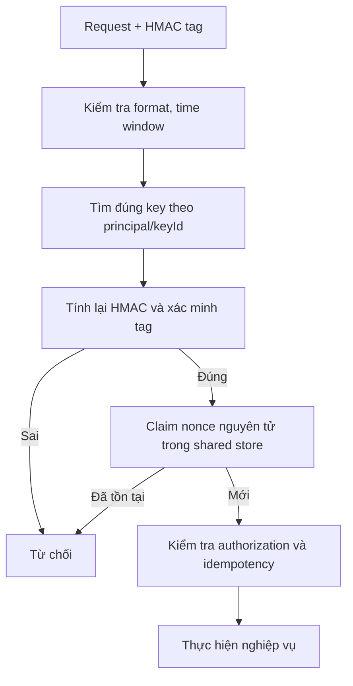
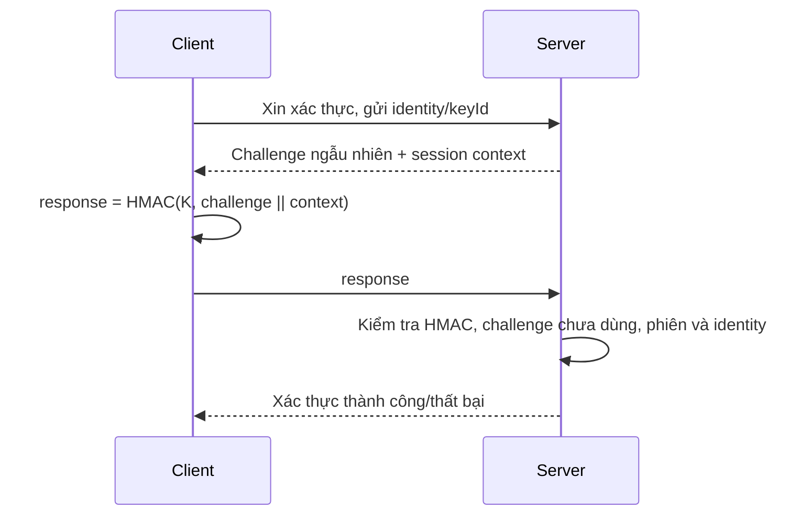
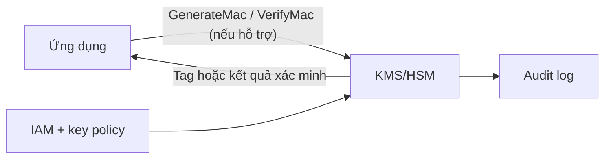

# HMAC: Mã xác thực thông điệp dựa trên hàm băm

> **Chương:** Hash và MAC  
> **Chủ đề:** HMAC  
> **Module:** `SECURITY_KEY_MANAGEMENT_FUNDAMENTALS` — quản lý vòng đời khóa mật mã từ tạo, cấp phát, lưu trữ, sử dụng, xoay vòng, thu hồi đến hủy; liên hệ với mật mã đối xứng, chữ ký số, KMS/HSM, envelope encryption, phân quyền và kiểm toán.

## 1. Vấn đề HMAC giải quyết

Giả sử một cổng thanh toán gửi thông báo thành công đến `Order Service`:

```json
{
  "orderId": "ORD-1024",
  "status": "PAID",
  "amount": 250000
}
```

Dịch vụ nhận phải trả lời hai câu hỏi:

1. **Tính toàn vẹn:** các byte thông điệp có bị thay đổi trên đường truyền hoặc trong quá trình lưu/chuyển tiếp không?
2. **Xác thực theo khóa:** thông điệp có được tạo bởi một bên nắm bí mật mà hệ thống tin cậy không?

Nếu chỉ đính kèm `SHA-256(message)`, người sửa nội dung có thể tính lại SHA-256 rồi thay luôn giá trị băm. Hash thông thường **không chứng minh quyền sở hữu một bí mật**.

**HMAC (Hash-based Message Authentication Code)** là cơ chế tạo **Message Authentication Code (MAC)** từ một **khóa bí mật dùng chung** và thông điệp, sử dụng một hàm băm mật mã được hỗ trợ, ví dụ HMAC-SHA-256. Chỉ bên có quyền sử dụng khóa mới có thể tạo ra một tag hợp lệ với xác suất thành công đáng kể trong giả định bảo mật của cơ chế.

```text
Bên gửi                                     Bên nhận
  Khóa K                                      Khóa K
     |                                            |
  HMAC(K, message) ---- tag + message ------> HMAC(K, message)
                                                   |
                                            So sánh tag an toàn
                                                   |
                                         Hợp lệ / Từ chối
```

HMAC thường xuất hiện trong webhook, request signing, thông điệp giữa microservice, một số cơ chế xác thực challenge–response, token dùng MAC và các KDF như HKDF.

**HMAC không mã hóa dữ liệu.** Trong ví dụ, người nhìn thấy message vẫn có thể đọc `amount`; tag chỉ hỗ trợ phát hiện chỉnh sửa và xác thực thông điệp theo khóa. Nếu cần giữ bí mật payload, dùng thêm TLS, mã hóa hoặc AEAD như AES-GCM tùy mục đích.

### Sau bài học bạn cần làm được

- Phân biệt **hash**, **MAC**, **HMAC**, **chữ ký số** và **AEAD**.
- Giải thích công thức HMAC, vai trò của khóa, hàm băm, `ipad`, `opad` và tag.
- Sinh, bảo vệ, sử dụng và xoay vòng HMAC key đúng vòng đời.
- Tính và xác minh HMAC-SHA-256 trong Java 17 bằng JCA.
- Thiết kế request/webhook signing có canonicalization, timestamp, nonce và chống replay.
- Hiểu ranh giới của KMS/HSM, quyền `GenerateMac`/`VerifyMac`, kiểm toán và phản ứng khi lộ khóa.

---

## 2. Những khái niệm nền tảng

| Khái niệm | Chức năng | Có khóa bí mật không? | Giấu nội dung không? |
|---|---|---|---|
| **Hash mật mã** | Tạo digest cố định từ message, ví dụ SHA-256. | Không. | Không. |
| **MAC** | Tạo tag kiểm tra thông điệp bằng bí mật chung. | Có. | Không. |
| **HMAC** | Một cấu trúc MAC dựa trên hàm băm mật mã và khóa bí mật. | Có. | Không. |
| **Chữ ký số** | Ký bằng private key; xác minh bằng public key tương ứng. | Khóa ký riêng phải bí mật. | Không. |
| **AEAD** | Mã hóa nội dung và tạo tag xác thực trên ciphertext/AAD. | Có khóa mã hóa bí mật. | Có, đối với phần plaintext được mã hóa. |

### 2.1. Hash không phải authentication

Với SHA-256:

\[
d = SHA256(message)
\]

Người nhận có thể tính lại digest và so sánh với `d`. Nhưng **bất kỳ ai** biết thông điệp đều tính được digest tương ứng; một kẻ tấn công thay đổi cả nội dung và digest mà không cần bất kỳ khóa nào.

Hash hữu ích để tra cứu, lập chỉ mục, kiểm tra checksum khi digest được truyền qua **nguồn đã xác thực**, tạo đầu vào cho chữ ký, cây Merkle hoặc những cấu trúc mật mã khác. Bản thân việc đính kèm hash trong cùng kênh không tin cậy **không cung cấp tính xác thực nguồn gửi**.

### 2.2. MAC dùng bí mật chung

Với MAC:

\[
tag = MAC(K, message)
\]

Bên xác minh biết `K` hoặc có khả năng gọi hệ thống kiểm tra MAC dưới `K`. Nếu tag hợp lệ, bên xác minh có bằng chứng rằng thông điệp được tạo bởi **một bên có thể sử dụng khóa đó**, chứ không tự động là một cá nhân cụ thể.

Vì bên kiểm tra cũng có thể biết `K`, HMAC không tạo ra khả năng chứng minh công khai “chính xác ai trong các bên giữ khóa đã tạo message”. Muốn nhiều bên chỉ được xác minh mà không được ký, chữ ký số bất đối xứng thường phù hợp hơn.

### 2.3. HMAC khác SHA-256(message + secret)

Các cấu trúc tự nghĩ ra như:

```text
SHA256(secret || message)
SHA256(message || secret)
SHA256(secret || timestamp || message)
```

**không thay thế HMAC**. Chúng thiếu cấu trúc và phân tích bảo mật của HMAC, đồng thời có thể gặp vấn đề khi dùng hàm băm kiểu Merkle–Damgård hoặc khi các trường được nối nhập nhằng.

Ví dụ với `SHA256(secret || message)`, một số cơ chế băm có tính chất *length extension*: người tấn công có thể tính hash của thông điệp được nối thêm dữ liệu mà không biết secret, trong điều kiện giao thức bất cẩn. HMAC được thiết kế để tránh kiểu sử dụng sai này. Không tự triển khai HMAC bằng cách nối secret thủ công.

## 3. Công thức HMAC hoạt động như thế nào?

Với hàm băm \(H\), khóa bí mật \(K\), thông điệp \(m\):

\[
HMAC(K,m)=H\left((K' \oplus opad)\,\Vert\,H((K' \oplus ipad)\,\Vert\,m)\right)
\]

Trong đó:

- `K'`: khóa đã được đưa về kích thước block của hàm băm. Nếu khóa dài hơn block, khóa được hash trước; nếu ngắn hơn, được đệm byte zero tới kích thước block.
- `ipad`: chuỗi byte `0x36` lặp theo kích thước block.
- `opad`: chuỗi byte `0x5c` lặp theo kích thước block.
- `⊕`: XOR từng byte.
- `||` hoặc `\Vert`: phép nối chuỗi byte.
- `H`: hàm băm được chọn, ví dụ SHA-256.



**HMAC-SHA-256** có một số thông số quan trọng:

| Thông số | Giá trị / ý nghĩa |
|---|---|
| Hàm băm | SHA-256 |
| Block size SHA-256 | **64 byte** (512 bit) |
| Kích thước digest/tag đầy đủ | **32 byte** (256 bit) |
| Khóa HMAC ví dụ | 32 byte ngẫu nhiên (256 bit) |
| `ipad` | 64 byte `0x36` |
| `opad` | 64 byte `0x5c` |
| Tag truyền đi | Thường dùng toàn bộ 32 byte; giao thức có thể quy định rút ngắn theo chính sách bảo mật |

Không nhầm **block size 64 byte** của SHA-256 với **độ dài digest 32 byte**. Với SHA-512, block size là 128 byte và digest đầy đủ dài 64 byte.

### 3.1. Vì sao có bước băm bên trong và bên ngoài?

HMAC bọc thông điệp bằng hai phép xử lý khác nhau liên quan đến khóa:

1. **Inner hash** xử lý khóa đã XOR `ipad` và message.
2. **Outer hash** xử lý khóa đã XOR `opad` và inner digest.

Cấu trúc này có phân tích bảo mật rõ hơn các cách “thêm secret vào trước/sau message”. Hai hằng `ipad`/`opad` giúp tách biệt hai miền xử lý. Nhưng trong ứng dụng, hãy gọi thư viện `Mac` của Java hoặc API KMS/HSM; không tự viết `ipad`, `opad` để tránh sai sót hoặc lộ khóa.

### 3.2. HMAC có chống va chạm SHA-256 tuyệt đối không?

Không có thuật toán bảo mật nào cho phép bỏ qua giả định hoặc giới hạn. Tuy nhiên, tính bảo mật của HMAC **không được suy ra đơn giản từ khẩu hiệu “digest không bao giờ va chạm”**. Nó dựa vào thuộc tính mật mã thích hợp của cấu trúc keyed-hash, chất lượng khóa, thuật toán băm và việc kiểm tra tag đúng cách.

HMAC dùng hàm băm có vấn đề về va chạm có thể vẫn có một số thuộc tính được phân tích, nhưng **không nên chọn HMAC-MD5 hoặc HMAC-SHA-1 cho thiết kế mới** khi có HMAC-SHA-256 hoặc thuật toán được phê duyệt phù hợp. Chọn theo chuẩn và chính sách thực tế.

---

## 4. Những bảo đảm và giới hạn của HMAC

### 4.1. HMAC bảo vệ tính toàn vẹn và tính xác thực theo khóa

Bên gửi tạo:

```text
tag = HMAC-SHA256(K, bytesToAuthenticate)
```

Bên nhận:

```text
expected = HMAC-SHA256(K, bytesToAuthenticate)
accept = constantTimeEqual(expected, receivedTag)
```

Nếu một byte trong `bytesToAuthenticate` bị thay đổi, tag cũ gần như chắc chắn sẽ không còn hợp lệ dưới khóa đúng. Nhưng kết luận bảo mật chỉ áp dụng cho **những byte thực sự được đưa vào MAC**. Nếu chỉ ký body, kẻ tấn công có thể cố thay URL, HTTP method, recipient hoặc metadata mà không làm thay đổi body/tag.

### 4.2. HMAC không bảo vệ tính bí mật

Thông điệp đi cùng HMAC vẫn có thể là plaintext:

```text
message = "account=123&balance=100000"
tag     = HMAC(K, message)
```

Tag không mã hóa `balance`. Dùng TLS cho lưu lượng truyền, AEAD cho dữ liệu cần mã hóa tại ứng dụng hoặc tầng lưu trữ, và phân quyền đọc tương ứng.

### 4.3. HMAC không tự chống replay

Attacker có thể gửi lại **nguyên message và tag cũ**. Nếu khóa còn hợp lệ và verifier chỉ kiểm tra MAC, yêu cầu sẽ được chấp nhận lần nữa.

Ví dụ thao tác:

```text
POST /payments/transfer
{"amount":1000000,"destination":"A"}
```

HMAC hợp lệ không có nghĩa yêu cầu chỉ được thực hiện một lần. Cần timestamp, nonce duy nhất, replay store và/hoặc idempotency ở tầng nghiệp vụ, tùy giao thức.

### 4.4. HMAC không thay thế authentication/authorization nghiệp vụ

Một `keyId` được dùng để chọn HMAC key. Nếu khóa thuộc `merchant-42`, việc MAC đúng có thể chứng minh request đến từ **bên giữ khóa của merchant-42**. Điều đó chưa chứng minh người thao tác được phép hoàn tiền đơn `merchant-7`, hoặc request có thể thay đổi đối tượng mà API chưa xác minh.

Phải liên kết key ID với đúng tenant, workload, môi trường và phạm vi quyền. Kiểm tra authorization sau xác thực thông điệp và trước khi xử lý dữ liệu.

### 4.5. HMAC không phải chữ ký số công khai

Với HMAC, bên tạo và bên kiểm tra MAC thường cùng có bí mật. Vì vậy một trong hai bên cũng có thể tạo tag. Điều này phù hợp hệ thống tin cậy giữa hai dịch vụ, nhưng không đủ cho trường hợp người nhận muốn chứng minh với bên thứ ba rằng **chỉ riêng người gửi** đã ký nội dung.

Nếu cần public verification hoặc tách vai trò ký và kiểm tra, sử dụng chữ ký bất đối xứng với private key/public key và PKI phù hợp; vẫn phải quản lý vòng đời và quyền `Sign`.

## 5. Chọn HMAC key và thuật toán

### 5.1. Độ mạnh của khóa

Một **HMAC key** nên được sinh bằng nguồn ngẫu nhiên đủ mạnh. Với HMAC-SHA-256, khóa ngẫu nhiên **256 bit (32 byte)** là lựa chọn đơn giản và phù hợp trong nhiều hệ thống. Khóa dài hơn không tự động cải thiện bảo mật nếu nguồn sinh yếu hoặc khóa bị lộ.

Không làm:

```java
String key = "admin123";                   // Bí mật dễ đoán
String key = Long.toString(System.nanoTime()); // Dễ suy đoán, không phải CSPRNG
double value = Math.random();              // Không dùng làm nguồn tạo khóa mật mã
```

Tạo khóa bằng `KeyGenerator` hoặc KMS/HSM được cấu hình cho mục đích HMAC.

### 5.2. Khóa HMAC có cần đúng 32 byte không?

Không có yêu cầu chung rằng mọi khóa HMAC-SHA-256 phải dài **chính xác** 32 byte; HMAC có quy tắc xử lý khóa ngắn/dài hơn block. Tuy nhiên, độ mạnh phụ thuộc vào entropy và chính sách. **32 byte ngẫu nhiên an toàn** là mặc định dễ quản lý trong các ví dụ này.

Khóa rất dài vượt block sẽ được băm ở bước chuẩn hóa khóa; vì thế tăng vô hạn độ dài byte không đồng nghĩa tăng vô hạn mức an toàn. Mật khẩu ngắn chuyển thành chuỗi 32 byte bằng padding/nhân bản vẫn có entropy thấp.

### 5.3. Tách khóa theo mục đích, môi trường và danh tính

Không dùng cùng khóa cho:

- HMAC webhook của nhiều đối tác.
- HMAC token phiên nội bộ và API của đối tác.
- AES-GCM mã hóa cơ sở dữ liệu.
- Ký sự kiện kiểm toán.
- Môi trường production và staging.

Ví dụ tên logic:

```text
hmac/webhook/merchant-42/prod/v3
hmac/webhook/merchant-99/prod/v1
hmac/api/orders-internal/prod/v2
aes/dek/orders/prod
```

Đây là **định danh logic**, không phải vật liệu khóa. Hệ thống phải ánh xạ `keyId` đến đúng khóa, chủ sở hữu, thuật toán, trạng thái và quyền.

Nếu phải sinh nhiều khóa từ cùng một bí mật có entropy thích hợp, dùng KDF chuẩn với **domain separation**, ví dụ HKDF với `info` khác nhau cho từng mục đích. Tự dùng `HMAC(master, "orders")` cho mọi trường hợp mà không có key schedule/đặc tả rõ ràng có thể gây lỗi khi giao thức phức tạp.

### 5.4. Tag có thể rút ngắn được không?

Một số giao thức cho phép **truncation** (chỉ lấy một phần đầu của tag) theo đặc tả, nhưng điều này làm thay đổi mức chống giả mạo và phải tính theo số lần thử của attacker, tốc độ query, giới hạn thời gian của khóa và chính sách an ninh.

Với ứng dụng mới không có ràng buộc đặc biệt, cách đơn giản là truyền **đủ 32 byte tag của HMAC-SHA-256**. Verifier phải biết độ dài cố định được phép, từ chối tag thiếu/ngoài format và không tự động chấp nhận tag chỉ khớp tiền tố.

## 6. HMAC trong Java 17: tạo tag và xác minh

Ví dụ tối thiểu dùng `javax.crypto.Mac`, `KeyGenerator` và `MessageDigest.isEqual`. Mục đích là minh họa phần **mật mã lõi**; kiểm tra danh tính, authorization và replay ở những tầng tiếp theo.

```java
import java.nio.charset.StandardCharsets;
import java.security.GeneralSecurityException;
import java.security.MessageDigest;
import java.util.Base64;

import javax.crypto.KeyGenerator;
import javax.crypto.Mac;
import javax.crypto.SecretKey;

public final class HmacSha256Demo {
    private static final String ALGORITHM = "HmacSHA256";
    private static final int TAG_LENGTH_BYTES = 32;

    private HmacSha256Demo() {}

    static SecretKey newKey() throws GeneralSecurityException {
        KeyGenerator generator = KeyGenerator.getInstance(ALGORITHM);
        generator.init(256);
        return generator.generateKey();
    }

    static byte[] sign(SecretKey key, byte[] message)
            throws GeneralSecurityException {
        Mac mac = Mac.getInstance(ALGORITHM);
        mac.init(key);
        return mac.doFinal(message);
    }

    static boolean verify(
            SecretKey key, byte[] message, byte[] receivedTag)
            throws GeneralSecurityException {
        // Giao thức này quy định HMAC-SHA-256 đầy đủ: đúng 32 byte.
        if (receivedTag == null || receivedTag.length != TAG_LENGTH_BYTES) {
            return false;
        }
        byte[] expectedTag = sign(key, message);
        return MessageDigest.isEqual(expectedTag, receivedTag);
    }

    public static void main(String[] args) throws Exception {
        SecretKey key = newKey(); // Demo: sender và verifier có cùng key
        byte[] message = "orderId=1024;status=PAID"
                .getBytes(StandardCharsets.UTF_8);

        byte[] tag = sign(key, message);
        System.out.println("Tag (Base64): "
                + Base64.getEncoder().encodeToString(tag));

        System.out.println("Valid: " + verify(key, message, tag));

        byte[] modified = "orderId=1024;status=FAILED"
                .getBytes(StandardCharsets.UTF_8);
        System.out.println("Modified valid: "
                + verify(key, modified, tag));
    }
}
```

**Kết quả dự kiến:** với cùng khóa/message/tag, `Valid` là `true`; khi message thay đổi nhưng tag không thay đổi, `Modified valid` là `false`.

### 6.1. Giải thích các chi tiết quan trọng

- `KeyGenerator.getInstance("HmacSHA256")` tạo khóa phù hợp cho HMAC theo provider JCA.
- `Mac.getInstance("HmacSHA256")` triển khai HMAC có cấu trúc chuẩn, tránh tự nối secret với message.
- **Tạo `Mac` mới cho từng thao tác** hoặc quản lý đối tượng theo thread đúng API; không chia sẻ bừa một instance `Mac` có trạng thái giữa nhiều request đồng thời.
- `MessageDigest.isEqual` là primitive phù hợp để giảm nguy cơ so sánh tag bị rò qua thời gian. Không dùng `String.equals`, so sánh char từng bước hay trả về ngay khi có byte khác.
- Tag được Base64 chỉ để **mã hóa biểu diễn byte** qua văn bản; Base64 **không mã hóa bí mật**.
- Ví dụ in tag để học tập, **không in key**. Một tag hợp lệ thường có thể đi kèm request, nhưng log đầy đủ nhiều message/tag vẫn cần đánh giá quyền truy cập, dữ liệu nhạy cảm và chi phí lưu trữ.

### 6.2. Không dùng khóa tĩnh trong mã nguồn

Trong production, hai bên phải được cấp khóa qua quy trình được quản trị: kho secret phù hợp, KMS/HSM hoặc cơ chế phân phối an toàn. Không để khóa HMAC dạng chuỗi trong source code, file `.properties` được commit, Docker image hay log debug.

`SecretKey.getEncoded()` có thể trả các byte bí mật nếu provider cho phép xuất khóa. **Không log, serialize tùy tiện hay đưa byte này vào telemetry**. Khóa được giữ trong KMS/HSM có thể là non-exportable và thao tác qua API MAC, thay vì trả byte khóa cho JVM.

### 6.3. Hash message rồi mới đưa vào HMAC có cần không?

HMAC có thể xử lý message với độ dài thực tế theo giới hạn tài nguyên và thư viện. Việc tự `SHA256(message)` rồi HMAC trên digest **thay đổi giao thức**; nó chỉ hợp lệ nếu hai phía đã quy định chính xác việc đó và có ràng buộc đủ metadata.

Với HTTP request lớn, giao thức ký đôi khi dùng `SHA-256(rawBodyBytes)` như **một trường trong canonical request**, sau đó HMAC toàn bộ canonical request. Điều này khác với việc người lập trình ngẫu nhiên thay message gốc bằng digest trong khi bên nhận vẫn nghĩ tag được tính trên message gốc.

---

## 7. Canonicalization: HMAC đúng nhưng ký sai dữ liệu vẫn nguy hiểm

Trong API thực tế, không đủ để gọi `HMAC(key, body)`. Một yêu cầu còn có method, URL, query, timestamp, danh tính người gửi và các trường ảnh hưởng hành vi.

Ví dụ hai yêu cầu có cùng body:

```http
POST /v1/payments/charge
Content-Type: application/json

{"orderId":"1024","amount":250000}
```

```http
POST /v1/payments/refund
Content-Type: application/json

{"orderId":"1024","amount":250000}
```

Nếu HMAC chỉ bảo vệ JSON body và server không có kiểm soát khác, attacker có thể thử **chuyển cùng body/tag sang endpoint khác**. Việc MAC hợp lệ chỉ chứng minh body được ký, không chứng minh đường dẫn/method chưa bị thay đổi.

### 7.1. Đề xuất những trường cần đưa vào chuỗi ký

Một giao thức request signing có thể định nghĩa:

| Trường | Vì sao cần |
|---|---|
| `protocolVersion` | Tách các phiên bản canonicalization và thuật toán. |
| `keyId` | Chọn đúng khóa, ràng buộc signer/tenant với message. |
| `method` | Ngăn chuyển request từ thao tác này sang thao tác khác. |
| `path` và `query` | Bảo vệ đúng tài nguyên và tham số. |
| `authority/host` hoặc `audience` | Tránh dùng chữ ký ở dịch vụ đích khác nếu mô hình cần. |
| `contentType` khi có ý nghĩa | Ràng buộc cách diễn giải body. |
| `timestamp` | Giới hạn thời gian hợp lệ. |
| `nonce/requestId` | Phát hiện request bị phát lại. |
| `bodyDigest` hoặc body bytes | Bảo vệ payload đúng theo giao thức. |

Những giá trị đó phải được đóng gói bằng quy tắc **không nhập nhằng** và thống nhất giữa bên gửi/bên nhận. Ví dụ:

```text
method="AB", path="C" -> "ABC"
method="A",  path="BC" -> "ABC"
```

Nối chuỗi trực tiếp không thể phân biệt hai trường hợp. Giải pháp là dùng **length-prefix**, serialization chuẩn có version, hoặc canonicalization HTTP được đặc tả cẩn thận.

### 7.2. Canonicalization cần định nghĩa tới mức byte

Các khác biệt dễ gặp:

- Chữ hoa/chữ thường của method hoặc header.
- Percent-encoding và việc chuẩn hóa đường dẫn.
- Thứ tự query parameter, tham số trùng tên, `+` và `%20`.
- Unicode normalization và charset.
- JSON có cùng ý nghĩa nhưng thứ tự trường hoặc khoảng trắng khác.
- Proxy/middleware tự thêm hoặc bỏ header.
- Body bị parse rồi serialize lại theo định dạng khác.

Nếu giao thức yêu cầu ký **raw HTTP body**, phải giữ đúng byte đã nhận theo quy định, không dùng chuỗi JSON dựng lại sau parse. Nếu giao thức cho phép canonical JSON, phải áp dụng **cùng một đặc tả** ở mọi bên.

### 7.3. Thông tin key ID phải được xác minh

Key ID do client gửi chỉ giúp tìm một khóa ứng viên. Server phải giới hạn truy cập khóa theo **đối tác, tenant, môi trường và thuật toán được tin cậy**. Không cho người gửi tự chọn bất kỳ key ID nào, hoặc dựa vào `role=admin` trong body đã ký để tự suy ra quyền cao hơn.

Một bước xác minh đúng là ánh xạ `credential/keyId → principal → permissions`, sau đó kiểm tra quyền cụ thể cho request.

## 8. Ví dụ Java 17: đóng gói canonical request chống nhập nhằng

Đoạn mã dưới đây minh họa cách tạo byte để ký. Nó chỉ định **version**, các trường văn bản và độ dài trước mỗi trường, rồi thêm SHA-256 của **chính raw body**. Cách làm này giúp tránh nhập nhằng byte, nhưng không tự xử lý đầy đủ quy tắc chuẩn hóa URL/proxy; hai bên phải thống nhất và xác minh các trường đầu vào.

```java
import java.io.ByteArrayOutputStream;
import java.io.DataOutputStream;
import java.io.IOException;
import java.nio.charset.StandardCharsets;
import java.security.MessageDigest;
import java.security.NoSuchAlgorithmException;

public final class CanonicalRequest {
    private CanonicalRequest() {}

    public static byte[] encode(
            String keyId,
            String method,
            String authority,
            String pathAndQuery,
            String contentType,
            long timestampSeconds,
            byte[] nonce,
            byte[] rawBody)
            throws IOException, NoSuchAlgorithmException {

        if (nonce == null || nonce.length != 16) {
            throw new IllegalArgumentException("Nonce must be 16 bytes");
        }

        byte[] bodyDigest = MessageDigest.getInstance("SHA-256")
                .digest(rawBody);

        ByteArrayOutputStream output = new ByteArrayOutputStream();
        DataOutputStream stream = new DataOutputStream(output);
        field(stream, "hmac-request-v1");
        field(stream, keyId);
        field(stream, method);
        field(stream, authority);
        field(stream, pathAndQuery);
        field(stream, contentType);
        stream.writeLong(timestampSeconds);
        bytes(stream, nonce);
        bytes(stream, bodyDigest);
        stream.flush();
        return output.toByteArray();
    }

    private static void field(DataOutputStream stream, String text)
            throws IOException {
        bytes(stream, text.getBytes(StandardCharsets.UTF_8));
    }

    private static void bytes(DataOutputStream stream, byte[] data)
            throws IOException {
        stream.writeInt(data.length);
        stream.write(data);
    }
}
```

Để ký:

```java
// key là SecretKey HmacSHA256 đã được cấp phát an toàn.
// Không truyền key cùng với request.
byte[] canonicalBytes = CanonicalRequest.encode(
        "merchant-42-v3",
        "POST",
        "api.example.internal",
        "/v1/orders/1024/confirm",
        "application/json",
        timestampSeconds,
        nonce16Bytes,
        rawBodyBytes);

byte[] tag = HmacSha256Demo.sign(key, canonicalBytes);
```

Các biến `key`, `timestampSeconds`, `nonce16Bytes` và `rawBodyBytes` trong đoạn sử dụng được cung cấp bởi ứng dụng/giao thức; không phải một chương trình `main` độc lập. Khi xác minh, server phải **xây dựng cùng byte canonical** từ request thực tế và metadata đáng tin rồi kiểm tra tag theo giao thức.

Đặc biệt, đừng “sửa” những trường không khớp bằng cách lấy giá trị trong header người gửi rồi ép vào request đã được server định tuyến. Ví dụ nếu `authority` được dùng ràng buộc audience, cần xác định từ nguồn tin cậy ở tầng proxy/host validation.

---

## 9. Chống replay: điều HMAC không tự làm được

Một attacker ghi được cặp `(message, tag)` có thể phát lại nguyên vẹn. HMAC sẽ vẫn hợp lệ trong khi khóa còn hiệu lực, nên phải bổ sung cơ chế **tính mới** khi nghiệp vụ cần.

### 9.1. Timestamp và cửa sổ hiệu lực

Ví dụ request có trường:

```text
timestamp = 2026-11-28T02:00:00Z
```

Server có thể chỉ chấp nhận request khi `timestamp` nằm trong một cửa sổ thời gian nhỏ quanh đồng hồ đã đồng bộ. Điều này giảm khả năng dùng lại lâu dài nhưng **không chặn replay trong chính cửa sổ**.

Timestamp phải được đưa vào thông điệp được MAC, không chỉ đặt ở header ngoài mà attacker có thể sửa.

### 9.2. Nonce hoặc request ID

Bên gửi tạo nonce có entropy phù hợp; phía nhận lưu lại nonce đã được **chấp nhận** theo cặp `(principal/keyId, nonce)` trong khoảng thời gian tối thiểu đủ bao phủ cửa sổ timestamp.



**Claim nonce phải nguyên tử**: nếu hai máy cùng nhận bản sao request, thao tác “kiểm tra chưa có rồi thêm” phải diễn ra như một operation không thể bị xen kẽ. Redis `SET key value NX EX ...`, một unique constraint trong database hoặc primitive khác có thể đáp ứng, tùy tính sẵn sàng và mức độ tin cậy mong muốn.

Chỉ nên ghi nonce vào kho chống replay **sau khi MAC được xác minh hợp lệ** để người không có khóa không thể dễ dàng làm đầy kho hoặc chiếm trước nonce hợp lệ. Tuy vậy vẫn cần rate limit và giới hạn đầu vào.

### 9.3. Idempotency không đồng nghĩa nonce

Nonce chống dùng lại cùng bằng chứng xác thực; **idempotency key** và kiểm tra trạng thái nghiệp vụ ngăn xử lý lặp một hành động, kể cả khi client gửi lại request hợp lệ với nonce mới sau lỗi mạng.

Đối với thanh toán hoặc giao dịch thay đổi trạng thái, có thể cần cả hai:

- Chặn replay của request ký cũ.
- Đảm bảo một yêu cầu nghiệp vụ có `operationId` chỉ được thực hiện một lần theo trạng thái lưu bền vững.

## 10. HMAC trong xác thực webhook

Webhook là trường hợp rất phổ biến của HMAC.

Ví dụ nhà cung cấp gửi:

```http
POST /webhooks/payment HTTP/1.1
Content-Type: application/json
X-Event-Key-Id: webhook-prod-v2
X-Event-Timestamp: 1795831200
X-Event-Signature: <base64-hmac-tag>

{"eventId":"evt-908","type":"payment.completed"}
```

Đây là ví dụ minh họa; **tên header và cách tạo chuỗi ký thay đổi theo nhà cung cấp**. Khi tích hợp bên thứ ba, phải tuân thủ đúng tài liệu của họ về chuỗi byte cần ký, encoding, timestamp và cách kiểm tra chữ ký.

Quy trình verifier:

1. Kiểm tra kích thước request, content type và format header.
2. Tìm đúng khóa webhook của nhà cung cấp/môi trường theo ánh xạ tin cậy.
3. Tạo lại **đúng byte** mà giao thức yêu cầu dùng làm HMAC input.
4. Tính HMAC bằng thuật toán được cấu hình; so sánh tag bằng hàm an toàn.
5. Kiểm tra thời hạn, event ID/nonce và chống replay.
6. Chỉ sau đó parse và xử lý event theo trạng thái nghiệp vụ; không suy ra sự kiện chắc chắn được phép chỉ vì MAC hợp lệ.
7. Ghi log metadata phục vụ kiểm toán, tránh raw secret và dữ liệu nhạy cảm.

### 10.1. Hai cách sai thường thấy

**Sai 1 — Parse rồi serialize lại JSON:**

```java
// Pseudocode sai về giao thức nếu nhà cung cấp ký raw body:
String reconstructedJson = jsonSerializer.toJson(parsedObject);
byte[] mac = HmacSha256Demo.sign(
        key, reconstructedJson.getBytes(StandardCharsets.UTF_8));
```

Cùng một JSON object có thể có whitespace/thứ tự field khác; nếu giao thức ký raw bytes, tag sẽ sai. Cần lấy đúng body bytes trước khi middleware biến đổi.

**Sai 2 — Dùng sai khóa khi nhiều webhook:**

Một khóa HMAC cho tất cả merchant làm cho một tenant hoặc một dịch vụ bị lộ có thể ảnh hưởng nhiều bên. Tách khóa theo danh tính nguồn, mục đích và môi trường, hoặc sử dụng cơ chế của nhà cung cấp theo hướng dẫn tích hợp.

### 10.2. Một ví dụ về ranh giới tin cậy

Nếu webhook có MAC hợp lệ báo `payment.completed` cho đơn `ORD-1024`, ứng dụng vẫn cần đối chiếu số tiền, đơn vị tiền tệ, merchant, trạng thái đơn và định danh giao dịch. HMAC chứng minh message được tạo dưới khóa tin cậy, **không tự chứng minh thông tin thanh toán hợp lý theo nghiệp vụ**.

---

## 11. HMAC trong challenge–response và KDF

### 11.1. Challenge–response

Để bên A chứng minh đang nắm khóa mà không gửi khóa trực tiếp:



Challenge phải mới, khó dự đoán, có thời hạn và gắn với phiên/ngữ cảnh phù hợp. Gửi lại một response HMAC cố định cho mọi phiên sẽ dễ dẫn đến replay.

### 11.2. HMAC là thành phần của HKDF

**HKDF (HMAC-based Extract-and-Expand Key Derivation Function)** sử dụng HMAC để trích xuất và mở rộng vật liệu khóa từ một nguồn bí mật có entropy phù hợp.

Mô hình:

```text
Input Keying Material (IKM) + salt
               |
       HKDF-Extract (HMAC)
               |
             PRK
               |
       HKDF-Expand(info, L)
               |
      Khóa dẫn xuất cho mục đích cụ thể
```

- `IKM`: vật liệu khóa đầu vào, ví dụ shared secret của một cơ chế thiết lập khóa.
- `salt`: giá trị bổ trợ; thông thường không cần bí mật.
- `PRK`: *Pseudorandom Key* trung gian, cần bảo vệ.
- `info`: nhãn ngữ cảnh, ví dụ `orders-api/hmac/v1`, giúp phân tách mục đích.
- `L`: độ dài đầu ra cần dẫn xuất theo giới hạn của HKDF.

**HMAC là thành phần xây dựng của HKDF, nhưng gọi một lần HMAC tùy tiện không tự thành giao thức dẫn xuất khóa an toàn.** Nếu dùng HKDF, triển khai theo RFC 5869 hoặc API chuẩn và chọn `info`/salt theo giao thức.

### 11.3. HMAC không phải lựa chọn đơn độc để lưu mật khẩu

HMAC-SHA-256 với một secret chung không tự trở thành phương pháp băm mật khẩu có chi phí cao. Mật khẩu do con người chọn có entropy thấp, cần **password hashing/KDF** như Argon2id, scrypt hoặc PBKDF2 theo yêu cầu chính sách, có salt riêng và tham số chi phí phù hợp.

PBKDF2 có thể sử dụng HMAC làm PRF bên trong; điều đó **không có nghĩa** trực tiếp lưu `HMAC(serverKey, password)` là thiết kế lưu mật khẩu tốt cho ứng dụng mới.

## 12. Quản lý HMAC key bằng KMS/HSM

Một HMAC key là **vật liệu khóa mật mã đối xứng**. Vì người tạo MAC và bên xác minh thường cùng biết khóa, quy trình cấp phát và bảo vệ có rủi ro riêng.

### 12.1. Hai mô hình sử dụng

**Mô hình A — ứng dụng có khóa trong bộ nhớ:**

```text
Key store/KMS/secret delivery -> app lấy HMAC key được phép
                               -> Mac.init(key)
                               -> mac.doFinal(message)
```

Ưu điểm: độ trễ thấp, có thể xử lý nhiều request cục bộ. Nhược điểm: raw key hiện diện trong runtime, heap dump, crash dump hoặc log nếu xử lý sai; quản lý cache/rotation khó hơn.

**Mô hình B — KMS/HSM giữ khóa và cung cấp thao tác MAC:**



Ưu điểm: raw key có thể không rời ranh giới KMS/HSM; quyền tạo MAC và quyền kiểm tra MAC có thể được phân tách theo dịch vụ. Nhược điểm: mạng, độ trễ, quota, chi phí, hạn chế payload và tính sẵn sàng.

**Không phải KMS nào cũng hỗ trợ HMAC keys hoặc `GenerateMac`/`VerifyMac`.** Khả năng này phụ thuộc nhà cung cấp, loại khóa, thuật toán và dịch vụ. Phải kiểm tra tài liệu chính thức và cấu hình IAM thực tế.

### 12.2. Quản trị khóa khác quyền tạo MAC

Bảo vệ byte khóa trong HSM không ngăn một workload bị chiếm quyền **gọi hợp lệ `GenerateMac`** trên nội dung do attacker cung cấp. Vì vậy phải hạn chế:

- Danh tính nào được tạo MAC; danh tính nào chỉ được xác minh.
- Khóa/tenant/môi trường mà danh tính được phép dùng.
- Những API/loại thông điệp nào ứng dụng được phép tạo tag.
- Phạm vi dữ liệu và authorization nghiệp vụ.
- Tần suất gọi, cảnh báo bất thường, truy vết correlation ID.

HMAC key cho các thông điệp lưu trữ cần chiến lược lưu phiên bản và khả năng xác minh cũ; key dùng cho request ngắn hạn có thể dừng xác minh nhanh hơn khi rotation.

### 12.3. HMAC, KEK/DEK và envelope encryption khác vai trò

Một thiết kế hệ thống có thể sử dụng đồng thời:

| Khóa | Thuật toán/chức năng | Vai trò |
|---|---|---|
| **HMAC key** | HMAC-SHA-256 | Xác thực request hoặc message giữa dịch vụ. |
| **DEK** | AES-GCM | Mã hóa/xác thực payload lưu trữ. |
| **KEK** | Wrapping trong KMS | Bảo vệ DEK khi lưu/truyền. |
| **Private signing key** | Ed25519/RSA-PSS/ECDSA tùy chính sách | Ký số khi cần xác minh bằng public key. |

**Không dùng chung byte khóa** giữa HMAC và AES-GCM chỉ vì đều thuộc mật mã đối xứng. Envelope encryption bảo vệ việc lưu DEK; HMAC bảo vệ nguồn gốc/tính toàn vẹn của message; cả hai cần quyền và vòng đời riêng.

Trong một luồng gửi dữ liệu nhạy cảm, có thể có HMAC request và AES-GCM body. Đừng tự xếp chồng chúng thiếu thiết kế: AEAD đã có tag xác thực cho nội dung mã hóa, còn HMAC request có thể ràng buộc method/path/timestamp theo giao thức API. Mục tiêu bảo mật từng lớp phải rõ.

---

## 13. Vòng đời của HMAC key

| Giai đoạn | Quyết định cần đưa ra | Kiểm soát khuyến nghị |
|---|---|---|
| **Tạo khóa** | Thuật toán, độ dài, nguồn entropy, chủ sở hữu. | CSPRNG/KMS/HSM; HMAC-SHA-256 với key đủ mạnh. |
| **Cấp phát** | Bên nào cần tạo MAC, bên nào cần xác minh? | Kênh phân phối bảo mật, workload identity, ít bên nắm raw key. |
| **Lưu trữ** | Khóa ở KMS/HSM, secret store hay RAM ứng dụng? | Mã hóa khi lưu, IAM, hạn chế export, kiểm soát bản sao và backup. |
| **Sử dụng** | Ký chính xác những byte nào? Tag format ra sao? | Canonicalization, compare an toàn, chống replay, authorization. |
| **Xoay vòng** | Khi nào tạo K2? Chấp nhận K1 đến khi nào? | Key ID/version, thời gian chuyển tiếp và test đồng bộ hai phía. |
| **Thu hồi** | Làm sao chặn K1 khi có nghi ngờ lộ khóa? | Disable/revoke policy, dừng xác minh tag K1, loại bỏ cache. |
| **Hủy** | Có cần kiểm tra message lịch sử hoặc phục hồi backup? | Chính sách lưu giữ, kiểm kê bản sao, phê duyệt xóa và khả năng DR. |

### 13.1. Tạo và cấp phát

Khóa đối xứng cần được sinh bằng nguồn ngẫu nhiên mật mã. Với API đối tác, mỗi đối tác nên có khóa riêng, cấp phát qua kênh đã xác thực và bảo mật. Không gửi raw key trong ticket, chat, email thông thường hoặc repository.

Đối với dịch vụ nội bộ, ưu tiên danh tính workload và cơ chế phân phối secret có thời hạn. KMS/HSM có thể kiểm soát thao tác MAC nếu hỗ trợ, giúp hạn chế nơi có khóa dạng rõ.

### 13.2. Xoay vòng hai bên

Với HMAC, người gửi và người xác minh phải phối hợp thay khóa:

```text
T0: Client ký K1; Server xác minh K1
T1: Server biết K1 và K2, giới hạn quyền/phiên bản
T2: Client chuyển ký K2
T3: Server ngừng chấp nhận tag K1 sau cửa sổ chuyển
T4: Thu hồi/hủy K1 theo chính sách và kiểm tra bản sao
```

Trong giai đoạn chuyển tiếp, request mang `keyId` để server chọn đúng phiên bản. **Không thử lần lượt mọi key bí mật** một cách không kiểm soát vì gây tăng bề mặt lỗi, chi phí và mơ hồ về chủ thể.

Giai đoạn chấp nhận K1 phải được giới hạn theo thời gian sống request/token và rủi ro. Khi một khóa bị lộ, cần ưu tiên ngừng chấp nhận khóa cũ theo kế hoạch ứng cứu; không duy trì cửa sổ chuyển tiếp dài chỉ để tiện triển khai.

### 13.3. Thu hồi không lấy lại được tag và khóa đã phát tán

Thu hồi IAM cho một service có thể chặn gọi KMS mới, nhưng nếu raw HMAC key đã được sao chép về máy đó thì attacker vẫn có thể tính HMAC **ngoài KMS**. Phải phối hợp:

- Ngừng chấp nhận `keyId` bị lộ tại verifier.
- Cấp key mới và cập nhật tất cả bên có quyền.
- Thu hồi secret/phiên/quyền truy cập còn tồn tại.
- Kiểm tra các request hoặc event bất thường trong khoảng thời gian rò rỉ.
- Xem xét dữ liệu đã xử lý và nghĩa vụ thông báo sự cố nếu có.

### 13.4. Hủy khóa và xác minh dữ liệu lưu trữ

Khác với chữ ký bất đối xứng (có thể giữ public key để xác minh chữ ký cũ), HMAC yêu cầu **khóa bí mật hoặc khả năng xác minh dưới khóa đó**. Nếu hủy mọi bản sao K1, ứng dụng có thể không còn xác minh lại HMAC của các bản ghi lịch sử.

Vì vậy, phải phân biệt:

- **HMAC ngắn hạn để chấp nhận request:** có thể ngừng xác minh sau cửa sổ sống của request.
- **HMAC cho log, chứng cứ hoặc message lưu trữ dài hạn:** cần chính sách lưu giữ khóa và quyền xác minh tương ứng, hoặc một kiến trúc chữ ký số/đóng dấu thời gian phù hợp nếu cần bằng chứng dài hạn.

Không giữ raw HMAC key vô thời hạn chỉ vì lo mất khả năng xác minh; đó là quyết định thiết kế rủi ro và tuân thủ cần được giải quyết trước khi triển khai.

## 14. Kiểm toán và xử lý sự cố HMAC

### 14.1. Những gì nên ghi audit

- `principal`, `keyId` (hoặc định danh không nhạy cảm tương đương), môi trường, thời gian và correlation ID.
- Kết quả kiểm tra MAC, lỗi quyền, lỗi định dạng và số lần replay.
- Hoạt động tạo, nhập, xoay vòng, vô hiệu hóa, cấp grant hoặc thay policy của khóa.
- Tần suất `GenerateMac`/`VerifyMac` tăng bất thường khi KMS/HSM hỗ trợ.
- Nguồn request, số lượng tag sai tăng đột biến hoặc bất thường giữa các tenant.

Không log raw HMAC key, DEK/private key, bearer token, plaintext nhạy cảm, thông tin thanh toán hoặc toàn bộ encryption context chứa secret. Đảm bảo log được bảo vệ quyền sửa/xóa.

### 14.2. Tình huống lộ HMAC key

**Tình huống:** `merchant-42` để lộ secret webhook trong cấu hình công khai.

1. Xác định key ID, phiên bản, nơi đã phân phối và thời điểm có khả năng bị lộ.
2. Ngừng cho phép secret cũ tạo tag hợp lệ theo quy trình ứng cứu; cấp khóa mới.
3. Thay cấu hình cho các endpoint liên quan, rút ngắn cửa sổ chuyển tiếp phù hợp.
4. Kiểm tra audit các request hợp lệ bất thường trong thời gian phơi lộ.
5. Đối chiếu trạng thái đơn và giao dịch, xử lý các thao tác giả mạo có thể đã thực hiện.
6. Thu hồi bản sao/secret cũ trong runtime, secret store, pipeline và môi trường sao lưu theo chính sách.
7. Xác minh quy trình rotation và giám sát hoạt động bình thường trở lại.

**Không thể chứng minh message đã nhận là do merchant thật gửi chỉ vì nó có HMAC hợp lệ trong giai đoạn khóa đã lộ.** Đây là giới hạn quan trọng của symmetric authentication.

### 14.3. Khi KMS/HSM không sẵn sàng

Nếu ứng dụng phải gọi KMS `VerifyMac`, sự cố mạng/quota có thể khiến request không xác minh được. Không được **chấp nhận message chưa có xác thực** để “giữ dịch vụ chạy”. Có thể dùng retry có giới hạn, backoff, queue, circuit breaker hoặc chế độ từ chối theo chính sách.

Cache raw HMAC key giảm phụ thuộc KMS nhưng kéo dài thời gian bí mật tồn tại trong runtime; cần TTL, phạm vi sử dụng và phản ứng khi thu hồi. Lựa chọn này phụ thuộc mô hình đe dọa và yêu cầu sẵn sàng.

## 15. Sai lầm điển hình khi dùng HMAC

| Sai lầm | Vì sao nguy hiểm | Cách sửa |
|---|---|---|
| Dùng `SHA256(message)` làm chữ ký. | Attacker có thể sửa message rồi tính hash mới. | Dùng HMAC với khóa bí mật hoặc chữ ký số phù hợp. |
| Dùng `SHA256(secret || message)` tự chế. | Không phải HMAC chuẩn, có thể có lỗi length extension/giao thức. | `Mac.getInstance("HmacSHA256")`. |
| Lưu HMAC key trong Git, image hoặc log. | Ai lấy được key có thể tạo tag giả. | KMS/HSM/secret manager phù hợp và cấp quyền runtime. |
| Dùng cùng key cho mọi tenant/môi trường. | Lộ một bên ảnh hưởng nhiều bên. | Khóa riêng theo trust boundary và mục đích. |
| Ký chỉ body, bỏ method/path/audience. | Dễ chuyển tag sang thao tác/ngữ cảnh khác. | Canonical request chứa trường ảnh hưởng ngữ nghĩa. |
| Serialize JSON lại rồi mới verify webhook raw body. | Sai byte ký hoặc tạo khác biệt parser. | Xác minh đúng byte theo đặc tả nhà cung cấp. |
| So sánh tag bằng `String.equals` hoặc vòng lặp thoát sớm. | Có thể rò thông tin qua thời gian. | Primitive so sánh MAC phù hợp và độ dài tag cố định. |
| Chấp nhận tag quá ngắn hoặc chỉ kiểm tra tiền tố. | Tăng xác suất giả mạo. | Độ dài/encoding được cố định, đủ mạnh theo giao thức. |
| Chỉ kiểm tra timestamp. | Replay vẫn thực hiện được trong cửa sổ. | Nonce store nguyên tử, idempotency. |
| Dựa hoàn toàn vào `keyId`/role do client gửi. | Nhầm danh tính và quyền. | Ánh xạ key ID tin cậy, authorization nghiệp vụ. |
| Dùng HMAC để thay AES-GCM. | HMAC không giấu dữ liệu. | AEAD/TLS cho confidentiality. |
| Dùng HMAC khi cần xác minh công khai. | Bên biết secret có thể tự tạo MAC. | Chữ ký bất đối xứng + trust chain khi phù hợp. |
| Rotation xong vẫn chấp nhận K1 vô thời hạn. | Khóa cũ còn cơ hội bị lạm dụng. | Cửa sổ chuyển tiếp rõ ràng, ngừng xác minh phiên bản cũ. |
| Disable KMS key và tin bản sao cũ biến mất. | Raw key đã cache vẫn có thể dùng được. | Ngừng chấp nhận key ID, thu hồi bản sao, kiểm tra runtime. |
| Dùng HMAC trên mật khẩu như password hash thông thường. | Không có chi phí chống đoán mật khẩu đầy đủ. | Password KDF/hash được thiết kế cho mật khẩu. |

## 16. Case study: ký thông báo thanh toán giữa hai dịch vụ Java

### 16.1. Bối cảnh

Một nền tảng đặt hàng có hai dịch vụ:

- `payment-service` thông báo sự kiện thanh toán.
- `order-service` nhận sự kiện và chuyển trạng thái đơn.

Yêu cầu:

- Event không bị sửa nội dung trên đường truyền.
- `order-service` xác minh event được tạo dưới khóa hợp lệ của đúng nguồn.
- Event cũ không được xử lý lặp.
- Khóa có thể rotate mà không dừng toàn hệ thống.
- Không để một tenant hoặc môi trường lộ key ảnh hưởng các bên khác.

### 16.2. Thiết kế đề xuất

**Bước 1 — khóa:** tạo HMAC-SHA-256 key riêng cho `payment-prod → order-prod`, lưu bằng cơ chế được quản trị. Cấp `payment-service` quyền tạo MAC; `order-service` quyền xác minh hoặc truy cập một bản secret được bảo vệ theo thiết kế.

**Bước 2 — định dạng:** mỗi event có `eventId`, `merchantId`, `orderId`, `amount`, `currency`, `timestamp`, `nonce`, `keyId`. Server định nghĩa rõ byte canonical gồm ngữ cảnh nguồn/đích và payload.

**Bước 3 — ký:** payment service tạo tag HMAC từ canonical bytes. Message đi qua TLS. Raw secret **không** đi cùng request.

**Bước 4 — xác minh:** order service tìm đúng key từ `keyId` đã được ánh xạ, kiểm tra timestamp, tính lại HMAC, so sánh tag, claim nonce nguyên tử, kiểm tra event đã xử lý chưa.

**Bước 5 — quyền và nghiệp vụ:** đối chiếu event với đúng merchant/order/currency/amount, kiểm tra trạng thái trước khi xác nhận; lưu kết quả xử lý idempotent.

**Bước 6 — vận hành:** ghi audit metadata, cảnh báo tag sai/replay tăng đột biến; rotate K1→K2 với giai đoạn chuyển tiếp hạn chế; diễn tập sự cố lộ K1.

### 16.3. Phân tích các cuộc tấn công

| Tình huống | HMAC giải quyết được? | Cơ chế bổ sung |
|---|---|---|
| Attacker sửa `amount` nhưng không biết key. | Có: tag không còn hợp lệ nếu `amount` thuộc byte được ký. | Không bỏ qua lỗi verify. |
| Attacker đọc payload được truyền. | Không: HMAC không mã hóa. | TLS và bảo vệ dữ liệu nhạy cảm. |
| Attacker phát lại event cũ nguyên vẹn. | Không: tag cũ vẫn hợp lệ. | Nonce/event ID/idempotency. |
| Attacker thay URL sang endpoint khác. | Chỉ khi URL/method/audience đã được ràng buộc vào MAC và kiểm tra. | Canonicalization đầy đủ. |
| Workload bị lộ HMAC key. | Không còn đảm bảo nguồn gốc. | Thu hồi K1, rotate, điều tra log và dữ liệu. |
| Payment service gửi thông báo sai nghiệp vụ nhưng tag hợp lệ. | HMAC vẫn hợp lệ theo key. | Authorization và kiểm tra nghiệp vụ. |
| Verifier dùng secret chung cho mọi merchant. | Phạm vi ảnh hưởng rất rộng. | Tách key/tenant và quyền KMS. |

### 16.4. Khi nào cân nhắc chữ ký số?

Nếu rất nhiều đối tác cần tự xác minh message nhưng không nên được cấp khả năng tạo MAC, hoặc hệ thống cần lưu trữ bằng chứng xác minh lâu dài bằng public key, có thể cân nhắc **Ed25519/RSA-PSS/ECDSA** và hệ thống phân phối public key phù hợp.

Đây là quyết định kiến trúc dựa trên **quan hệ tin cậy và quản lý khóa**, không đơn thuần dựa trên tốc độ thuật toán. Dù dùng HMAC hay chữ ký số, request vẫn cần chống replay và authorization.

---

## 17. Checklist triển khai HMAC trong production

### Thiết kế mật mã

- [ ] Dùng HMAC chuẩn như `HmacSHA256` với thư viện/provider được kiểm chứng.
- [ ] Không dùng SHA-256 thuần hoặc phép nối secret tự chế để thay MAC.
- [ ] Khóa sinh từ CSPRNG/KMS/HSM, đủ entropy và được tách theo mục đích.
- [ ] Độ dài tag, encoding và thuật toán được cố định theo giao thức, verifier không tự hạ chuẩn.
- [ ] So sánh tag bằng primitive phù hợp, tránh timing leak và xử lý an toàn input sai format.
- [ ] Nhận thức rõ HMAC không mã hóa, không tự chống replay và không phải chữ ký số.

### Giao thức request/webhook

- [ ] Định nghĩa canonical bytes có version và không nhập nhằng.
- [ ] Bảo vệ method, path, query, audience, timestamp, nonce và body theo mô hình đe dọa.
- [ ] Xác minh raw bytes khi giao thức nhà cung cấp quy định, không parse/serialize làm thay đổi.
- [ ] Có timestamp window và nonce/replay store nguyên tử dùng chung giữa instance.
- [ ] Có idempotency và kiểm tra trạng thái nghiệp vụ cho thao tác nhạy cảm.
- [ ] Ánh xạ `keyId` đến identity/tenant/môi trường/thuật toán từ nguồn tin cậy.
- [ ] Kiểm tra authorization trước khi thực thi hành động; không tin mỗi tag.

### Vòng đời khóa và vận hành

- [ ] Raw HMAC key không nằm trong source, log, image, dump không kiểm soát.
- [ ] Định nghĩa rõ ai tạo MAC, ai xác minh, ai rotate, ai được sửa chính sách.
- [ ] Có kế hoạch chuyển khóa K1→K2, thời gian kết thúc chấp nhận K1 và phản ứng khi lộ.
- [ ] Nếu dùng KMS/HSM, xác nhận dịch vụ thật sự hỗ trợ HMAC, key policy và loại API cần dùng.
- [ ] Cache secret nếu có phải có TTL, phạm vi, biện pháp thu hồi và đánh giá rủi ro.
- [ ] Audit thao tác khóa, số lần verify sai, replay và hoạt động bất thường.
- [ ] Có phương án KMS không khả dụng, fail closed, retry và giới hạn tài nguyên phù hợp.
- [ ] Đã xác định có cần xác minh MAC cũ sau khi hủy khóa hay không.

## 18. Câu hỏi tự kiểm tra

**Câu 1.** Vì sao gửi `(message, SHA256(message))` không xác thực được nguồn gửi?

**Gợi ý:** attacker sửa message rồi tự tính lại SHA-256; không có bí mật nào được dùng để chứng minh quyền tạo digest.

**Câu 2.** Hai bên cùng giữ một khóa HMAC. Tag hợp lệ có chứng minh chắc chắn **bên A** đã tạo message không?

**Gợi ý:** không; bên B cũng có thể tạo cùng tag. Cần ràng buộc identity và kiến trúc tin cậy phù hợp.

**Câu 3.** HMAC có che giấu `amount` bên trong một HTTP request không?

**Gợi ý:** không. HMAC xác thực byte dữ liệu, không mã hóa.

**Câu 4.** Một request được MAC hợp lệ lúc 10:00 và bị phát lại lúc 10:00:05. Timestamp 5 phút có ngăn được không?

**Gợi ý:** không. Request vẫn trong cửa sổ; cần nonce/replay store hoặc trạng thái/idempotency tương ứng.

**Câu 5.** Nếu HMAC key của merchant bị lộ, việc thay key ID trong cấu hình mà vẫn chấp nhận khóa cũ có giải quyết vấn đề không?

**Gợi ý:** không. Verifier phải dừng chấp nhận tag K1 và xử lý các bản sao/quyền cũ theo quy trình.

**Câu 6.** Khi nào nên ưu tiên chữ ký số thay vì HMAC?

**Gợi ý:** khi bên xác minh không nên sở hữu bí mật có thể dùng để ký, cần xác minh công khai hoặc có yêu cầu phân tách vai trò ký–xác minh.

**Câu 7.** Vì sao cùng một JSON object nhưng serialize khác thứ tự field có thể làm HMAC sai?

**Gợi ý:** HMAC xử lý **chuỗi byte**, không xử lý ý nghĩa trừu tượng của JSON. Hai bên phải thống nhất canonicalization.

**Câu 8.** Hủy HMAC key có thể ảnh hưởng dữ liệu lịch sử như thế nào?

**Gợi ý:** không còn khóa để xác minh lại tag cũ, trừ khi có một hệ thống giữ khả năng xác minh hợp lệ theo chính sách.

## 19. Ghi nhớ cốt lõi

**HMAC** tạo mã xác thực thông điệp bằng khóa bí mật và hàm băm mật mã. Dùng đúng cách, nó giúp kiểm tra **tính toàn vẹn và xác thực theo khóa** cho các byte được bảo vệ; HMAC không tự mã hóa payload, chống replay, phân quyền người dùng hoặc cung cấp xác minh công khai như chữ ký số.

Trong hệ thống sản xuất, điểm khó thường nằm ngoài lệnh `Mac.doFinal()`: **sinh/cấp phát khóa đủ mạnh, canonicalization đúng từng byte, định danh bên giữ khóa, so sánh tag an toàn, chống replay, rotation và kiểm toán**. KMS/HSM có thể giảm rủi ro lộ vật liệu khóa khi hỗ trợ API MAC, nhưng quyền gọi API vẫn phải được hạn chế. Thiết kế HMAC an toàn là sự kết hợp của primitive mật mã chuẩn, giao thức xác thực đúng và quản lý vòng đời khóa nhất quán.

### Tài liệu tham khảo

- **RFC 2104** — *HMAC: Keyed-Hashing for Message Authentication*.
- **FIPS 198-1** — *The Keyed-Hash Message Authentication Code (HMAC)*.
- **RFC 4231** — *Identifiers and Test Vectors for HMAC-SHA-224, HMAC-SHA-256, HMAC-SHA-384, and HMAC-SHA-512*.
- **RFC 5869** — *HMAC-based Extract-and-Expand Key Derivation Function (HKDF)*.
- **NIST SP 800-57 Part 1** — *Recommendation for Key Management*: phân loại, vòng đời và bảo vệ khóa.
- **OWASP Key Management Cheat Sheet** — thực hành quản lý khóa trong ứng dụng.
