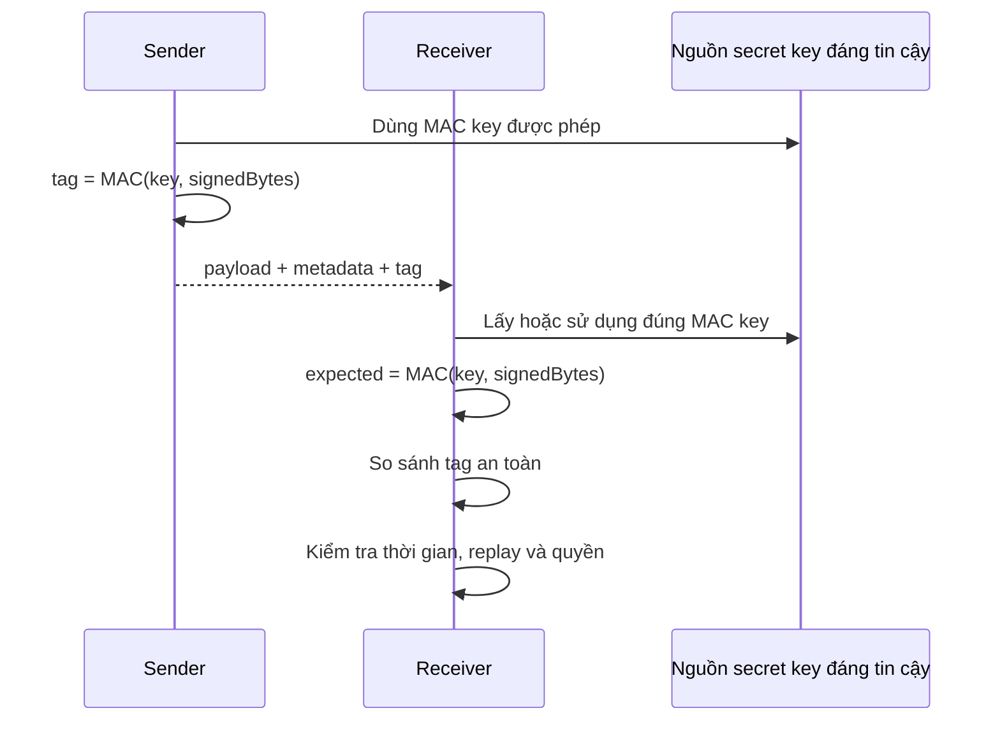
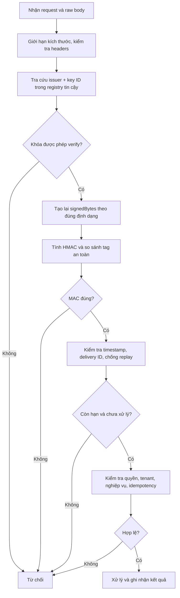
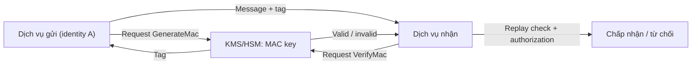
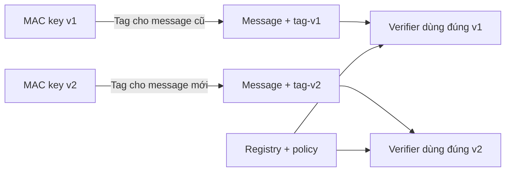
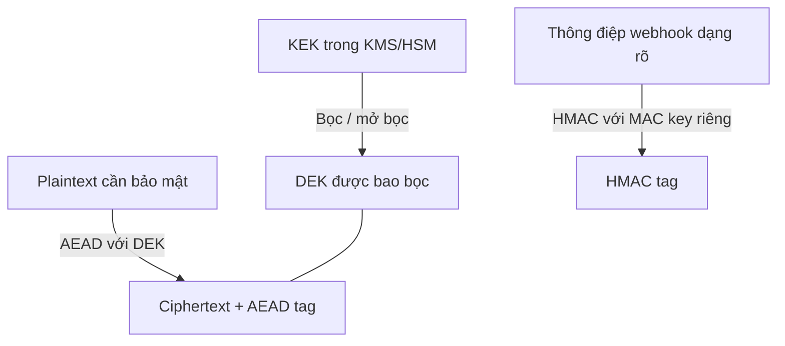

# Message authentication code

## 1. Message authentication code (MAC) là gì?

**Message authentication code (MAC — mã xác thực thông điệp)** là một giá trị kiểm tra được tính từ **thông điệp** và **khóa bí mật dùng chung**. MAC giúp bên nắm giữ khóa kiểm tra rằng dữ liệu không bị thay đổi trái phép và được tạo bởi một bên có khả năng sử dụng khóa đó.

Ví dụ, dịch vụ thanh toán gửi một thông báo webhook kèm MAC. Dịch vụ nhận dùng khóa bí mật đã được cấp phát trước để tính lại MAC trên đúng nội dung yêu cầu. Nếu kết quả trùng khớp theo phép so sánh an toàn, yêu cầu vượt qua bước xác thực mật mã; hệ thống tiếp tục kiểm tra thời gian, định danh sự kiện, quyền và điều kiện nghiệp vụ trước khi xử lý.

MAC thuộc lĩnh vực **mật mã đối xứng** vì các bên tạo và xác minh MAC thường phải biết **cùng một secret key**. Không giống chữ ký số bất đối xứng, người có khóa xác minh MAC về mặt mật mã cũng có thể **tạo MAC hợp lệ**.

Bài thuộc chương **Hash và MAC** trong module `SECURITY_KEY_MANAGEMENT_FUNDAMENTALS`. Hiểu MAC giúp nối các khái niệm hàm băm, mật mã đối xứng, chữ ký số, KMS/HSM, envelope encryption, quản lý khóa, phân quyền và kiểm toán trong toàn bộ vòng đời khóa: **tạo → cấp phát → lưu trữ → sử dụng → xoay vòng → thu hồi → hủy**.

Sau bài học, bạn có thể:

- Giải thích chính xác MAC bảo đảm điều gì và **không** bảo đảm điều gì.
- Phân biệt MAC với **hash thông thường, chữ ký số, mã hóa, AEAD tag** và phép kiểm tra lỗi.
- Hiểu nguyên lý **HMAC**, các lựa chọn như AES-CMAC, GMAC, Poly1305 và điều kiện sử dụng tương ứng.
- Thiết kế quá trình ký/xác minh MAC có **định dạng bytes rõ ràng, chống replay và quản lý key version**.
- Viết ví dụ **HMAC-SHA256 với Java JCA**, gồm phép so sánh tag an toàn.
- Xây dựng chính sách lưu khóa, IAM/KMS/HSM, rotation, kiểm toán và ứng phó khi MAC key bị lộ.

## 2. Cách MAC hoạt động

Ở mức trừu tượng, MAC gồm hai thao tác:

\[
T = \operatorname{MAC}(K,M)
\]

\[
\operatorname{Verify}(K,M,T) =
\begin{cases}
\text{accept} & \text{khi tag hợp lệ với khóa và thông điệp}\\
\text{reject} & \text{khi tag không hợp lệ}
\end{cases}
\]

Trong đó:

| Thành phần | Vai trò | Tính bí mật |
| --- | --- | --- |
| `K` — MAC key | Khóa bí mật dùng để tạo và kiểm tra tag | **Phải giữ bí mật** |
| `M` — message | Chuỗi bytes được xác thực; có thể gồm payload và metadata quan trọng | Có thể công khai hoặc nhạy cảm |
| `T` — authentication tag | Giá trị MAC của `M` dưới khóa `K` | Thường **không cần bí mật** |
| `keyId` / `version` | Tham chiếu khóa trong registry hoặc KMS | Thường là metadata, không phải secret |
| Thuật toán | Quy tắc tính MAC, ví dụ `HmacSHA256` | Thông thường công khai; phải được phê duyệt |



Điều kiện cốt lõi là hai đầu phải thống nhất **chính xác những bytes nào được đưa vào MAC**. Nếu phía tạo MAC ký raw HTTP body nhưng phía kiểm tra parse JSON rồi serialize lại, hai chuỗi bytes có thể khác nhau dù nội dung nhìn giống hệt.

### 2.1. MAC bảo vệ những thuộc tính nào?

MAC đúng chuẩn, dùng khóa bí mật an toàn và giao thức đúng, hỗ trợ:

1. **Toàn vẹn dữ liệu (integrity):** thay đổi trái phép trên bytes được xác thực sẽ khiến tag không hợp lệ, trừ khả năng giả mạo theo mức an toàn của thuật toán.
2. **Xác thực nguồn theo khóa (data-origin authentication):** tag hợp lệ cho thấy người tạo có quyền truy cập khóa bí mật hoặc dịch vụ sử dụng khóa được cho phép, trong giả định khóa không bị lộ.
3. **Phát hiện sửa đổi:** bảo vệ cả các trường metadata được đưa vào đầu vào MAC, không chỉ phần body.

MAC **không tự cung cấp**:

- **Tính bí mật:** payload có MAC vẫn có thể ở dạng rõ; nếu muốn giấu nội dung, cần mã hóa.
- **Chống replay:** kẻ tấn công có thể gửi lại nguyên vẹn payload và tag cũ; cần timestamp, nonce/delivery ID, thời hạn và cơ chế đánh dấu đã xử lý.
- **Không thể chối bỏ (non-repudiation):** mọi bên giữ shared secret có thể tạo tag, nên bên xác minh thường không có bằng chứng mật mã độc lập để chứng minh chính xác bên nào đã tạo.
- **Phân quyền nghiệp vụ:** tag hợp lệ không nói rằng hành động trong thông điệp được phép thực hiện.
- **Bảo mật nếu khóa bị lộ:** khi có `K`, kẻ tấn công có thể tạo MAC hợp lệ cho thông điệp mới.

Điều này rất quan trọng khi thiết kế quy trình phê duyệt: nếu nhiều bộ phận cùng biết một MAC key, không thể dựa **chỉ** vào MAC để chứng minh một bộ phận cụ thể đã phê duyệt giao dịch.

## 3. MAC khác hash, chữ ký số, mã hóa và checksum như thế nào?

| Cơ chế | Cần khóa bí mật? | Chức năng chính | Ai có thể kiểm tra? |
| --- | --- | --- | --- |
| **SHA-256 / SHA-3** (hash thông thường) | Không | Tạo digest, hỗ trợ kiểm tra dữ liệu có đổi nếu digest tham chiếu đã đáng tin cậy | Bất kỳ ai |
| **HMAC-SHA256** (MAC) | **Có, shared secret** | Xác thực toàn vẹn và nguồn theo shared secret | Chỉ bên được phép dùng shared secret hoặc dịch vụ verify tương đương |
| **Chữ ký số Ed25519 / RSA-PSS** | Private key để ký | Tính toàn vẹn và nguồn gốc gắn với cặp khóa bất đối xứng | Bất kỳ ai có **public key đáng tin cậy** |
| **AES-GCM** (AEAD) | **Có, symmetric key** | Mã hóa nội dung, xác thực ciphertext và AAD | Bên có quyền dùng key để giải mã/xác minh |
| **CRC32 / checksum** | Không | Phát hiện lỗi truyền/lưu ngẫu nhiên | Bất kỳ ai; không đủ chống đối thủ chủ động |

### 3.1. Vì sao không gửi SHA-256(payload) thay MAC?

Nếu chỉ gửi:

```text
message = "amount=100000"
digest  = SHA-256(message)
```

thì kẻ tấn công có thể sửa `message`, tự tính lại `digest` rồi gửi tiếp. **Hash không khóa không xác thực nguồn** khi digest và thông điệp đều do cùng một bên không đáng tin cậy cung cấp.

Khi dùng `HMAC(K,message)`, đối thủ không biết `K` không thể tự tạo tag hợp lệ cho một thông điệp mới với xác suất đáng kể nếu thuật toán và tham số được dùng đúng.

### 3.2. MAC có phải digital signature không?

Cả MAC và chữ ký số đều phát hiện việc dữ liệu đã ký bị thay đổi, nhưng **mô hình tin cậy khác nhau**:

- Với **MAC đối xứng**, bên xác minh có cùng khóa bí mật nên về nguyên tắc cũng có thể tạo tag.
- Với **chữ ký số bất đối xứng**, bên phát hành giữ private signing key, còn bên nhận chỉ cần public verification key; public key không cho phép ký.

Ví dụ dịch vụ nội bộ A và B có shared secret có thể sử dụng HMAC khi cả hai đều là các thành phần tin cậy. Nếu hàng triệu khách hàng cần xác minh gói phần mềm mà **không** có khả năng giả mạo gói phát hành, mô hình chữ ký số với public key thường thích hợp hơn.

### 3.3. MAC, AEAD tag và encryption khác nhau ra sao?

Trong **AES-GCM**, thuật toán mã hóa có xác thực tạo ra **ciphertext + authentication tag**. Tag bảo vệ ciphertext và AAD trong ngữ cảnh AEAD, nhưng không nên coi nó là một API MAC tùy ý cho mọi loại thông điệp.

- Khi dữ liệu cần **giữ bí mật và kiểm tra toàn vẹn**, ưu tiên AEAD được phê duyệt như AES-GCM hoặc ChaCha20-Poly1305 theo yêu cầu hệ thống.
- Khi dữ liệu **được phép ở dạng rõ** nhưng cần xác thực theo shared secret (chẳng hạn webhook), HMAC là lựa chọn phổ biến.
- Khi nhiều bên cần xác minh mà **không được phép ký**, cân nhắc chữ ký số bất đối xứng.

Không nên tự kết hợp các thành phần thành một giao thức `encrypt + MAC` nếu đã có AEAD phù hợp. Nếu phải sử dụng sơ đồ **Encrypt-then-MAC** vì yêu cầu tương thích, cần thiết kế rõ khóa riêng cho encryption/MAC, định dạng thông điệp, IV, thuật toán, thứ tự kiểm tra, xác thực metadata và chống lỗi triển khai.

## 4. HMAC là gì và vì sao phổ biến?

**HMAC (Hash-based Message Authentication Code)** là cách xây dựng MAC từ một hàm băm mật mã, được mô tả trong các tiêu chuẩn như RFC 2104 và RFC 4231. HMAC-SHA256 dùng SHA-256 bên trong, nhưng có **quy tắc trộn khóa và băm hai lớp**, không đơn giản là nối khóa với thông điệp rồi băm.

Dạng công thức khái quát:

\[
\operatorname{HMAC}(K,M)=H\Big((K'\oplus opad)\ \|\ H((K'\oplus ipad)\ \|\ M)\Big)
\]

Trong đó:

- `H` là hàm băm được chọn, ví dụ SHA-256.
- `K'` là khóa sau khi chuẩn hóa đến kích thước block của hàm băm.
- `ipad` và `opad` là các hằng padding quy định bởi HMAC.
- `\|` là phép nối các chuỗi bytes; `\oplus` là XOR.

Ứng dụng **không cần tự hiện thực công thức này**: hãy gọi `Mac.getInstance("HmacSHA256")` của Java JCA hoặc thư viện mật mã đã được đánh giá.

### 4.1. Vì sao không tự viết SHA256(key || message)?

Cách tự xây dựng `SHA256(K || M)` có thể chịu **length-extension attack** với các họ hash Merkle–Damgård như SHA-256 khi thiết kế thông điệp và điều kiện khác cho phép. Đối thủ biết digest của một thông điệp có thể lợi dụng cấu trúc hash để tạo digest của thông điệp mở rộng trong một số giao thức **mà không cần biết khóa**.

HMAC có cấu trúc được thiết kế để chống dạng tấn công này khi dùng đúng cách. Việc tự viết một sơ đồ MAC từ hash thô còn có thể mắc lỗi độ dài, domain separation, thuật toán, encoding và so sánh tag.

**Quy tắc:** dùng triển khai HMAC chuẩn; không dùng `hash(secret + message)` tự chế để thay MAC.

### 4.2. HMAC-SHA256 có tham số nào?

| Thuộc tính | HMAC-SHA256 |
| --- | --- |
| Hàm băm nền | SHA-256 |
| Độ dài tag đầy đủ | **32 byte (256 bit)** |
| Kích thước block nội bộ của SHA-256 | **64 byte** |
| Khóa bí mật | Có thể có nhiều độ dài; nên tạo bằng nguồn mật mã an toàn và theo tiêu chuẩn sử dụng |
| Ví dụ khóa | **32 byte ngẫu nhiên** là lựa chọn minh họa thông dụng |
| Đầu vào | Chuỗi bytes bất kỳ, kể cả dữ liệu nhị phân |
| Đầu ra | Tag nhị phân; có thể biểu diễn Base64/hex để truyền tải |

**Khóa HMAC không bắt buộc dài đúng 32 byte** vì cơ chế có chuẩn hóa khóa nội bộ. Tuy nhiên, độ dài khóa phải bảo đảm mức entropy và tuân thủ chính sách; một chuỗi mật khẩu dễ đoán dài 32 ký tự **không tương đương** 32 byte được sinh ngẫu nhiên.

**Cắt ngắn tag** chỉ được phép khi giao thức/tiêu chuẩn quy định rõ độ dài và mô hình đe dọa chấp nhận được. Không tự ý giảm tag xuống vài byte cho “gọn”; nguy cơ thử giả mạo tăng khi tag ngắn. Đối với ví dụ trong bài này, sử dụng **đủ 32 byte**.

### 4.3. Một số họ MAC khác

| Thuật toán/cơ chế | Nền tảng | Điều kiện cần lưu ý |
| --- | --- | --- |
| **HMAC-SHA256 / HMAC-SHA384** | Hàm băm mật mã | Phổ biến, thích hợp cho nhiều giao thức xác thực thông điệp; chọn bản theo tiêu chuẩn ứng dụng. |
| **AES-CMAC** | AES block cipher | Có chuẩn CMAC riêng; cần thư viện hỗ trợ và key purpose được quản lý rõ. |
| **GMAC** | Cơ chế xác thực từ GCM | **Yêu cầu nonce không được lặp với cùng khóa** theo giới hạn chuẩn; không coi là HMAC không nonce. |
| **Poly1305** | Universal-hash MAC | Key dùng cho Poly1305 độc lập có yêu cầu sử dụng **một lần**; thực tế thường phối hợp với cơ chế như ChaCha20-Poly1305 để dẫn xuất khóa phù hợp mỗi thông điệp. |
| **KMAC** | Sponge/cSHAKE và SHA-3 family | Là MAC có khóa theo chuẩn riêng; cần kiểm tra hỗ trợ và cách định dạng tham số. |

HMAC có thể tiện lợi với Java và giao thức HTTP vì API đơn giản, không yêu cầu nonce mật mã để tính tag, và thích hợp khi nhiều thông điệp được xác thực dưới cùng khóa trong giới hạn chính sách. **Không phải MAC nào cũng có thể lặp cùng khóa/nonce theo cách HMAC**, vì vậy không chuyển mã sử dụng từ HMAC sang GMAC/Poly1305 mà giữ nguyên giả định.

## 5. Thiết kế thông điệp được MAC xác thực

MAC bảo vệ **chính xác chuỗi bytes đầu vào**. Muốn bảo vệ một request gồm body, HTTP method, resource, timestamp và delivery ID, phải định nghĩa **định dạng ký** không mơ hồ.

Ví dụ webhook:

```text
POST /webhooks/payment
X-Key-Id: webhook-prod-v3
X-Timestamp: 1795800000
X-Delivery-Id: evt_8f4a9b
X-Signature: <Base64(HMAC-SHA256(secret_v3, signedBytes))>

Body (raw UTF-8 bytes):
{"orderId":"o-123","status":"paid"}
```

Các giá trị là **ví dụ giao thức nội bộ**, không phải chuẩn webhook chung của mọi nhà cung cấp. `X-Signature` là tag, không được đưa chính trường signature vào chuỗi cần ký theo vòng lặp.

### 5.1. Những trường nào nên được xác thực?

Tùy threat model, cần xem xét đưa vào signed input:

- **HTTP method** nếu cùng endpoint có nhiều phương thức.
- **Path và query** nếu quyết định định tuyến hoặc quyền dựa vào chúng; quy tắc chuẩn hóa URL phải nhất quán.
- **Timestamp** để tạo giới hạn thời gian chấp nhận request.
- **Delivery ID / request ID** để chống replay qua cơ chế lưu trạng thái.
- **Key ID / signature version** để ràng buộc định dạng và khóa tương ứng, tránh tráo phiên bản.
- **Raw body bytes** để bảo vệ payload.
- **Issuer/tenant identifier** nếu một khóa hoặc endpoint phục vụ nhiều bên theo chính sách.

Không thể chỉ ký body rồi kỳ vọng tag tự bảo vệ timestamp hoặc tenant nằm ngoài body. Những trường ảnh hưởng đến quyết định bảo mật cần **được ký hoặc được ràng buộc bằng cơ chế tin cậy khác**.

### 5.2. Cần tránh mơ hồ khi nối chuỗi

Ví dụ nối không có phân định:

```text
tenant="ab", record="c"  -> "abc"
tenant="a",  record="bc" -> "abc"
```

Hai bộ giá trị khác nhau có thể tạo cùng chuỗi được MAC. Nếu ứng dụng diễn giải chúng theo hai ý nghĩa, MAC trên chuỗi đó không phân biệt được ngữ cảnh.

Nên dùng **length-prefix**, định dạng nhị phân được chỉ rõ, canonical JSON có quy tắc ổn định hoặc một định dạng đã được tiêu chuẩn hóa. Nếu dùng dấu phân cách, phải quy định escape/validation và tránh dữ liệu người dùng chứa dấu phân cách gây nhập nhằng.

Ví dụ encoding có length-prefix:

```text
int32(byteLength(keyId)) || UTF8(keyId)
int64(timestampEpochSeconds)
int32(byteLength(deliveryId)) || UTF8(deliveryId)
int32(byteLength(body)) || rawBodyBytes
```

Ở đây số nguyên dùng **big-endian**, `int32` là 4 byte và `int64` là 8 byte; giá trị được giới hạn kích thước hợp lý trước khi tạo bytes. Hai đầu phải thống nhất định nghĩa này.

### 5.3. Raw body quan trọng với JSON

Hai JSON sau có thể mang cùng dữ liệu logic nhưng **khác bytes**:

```json
{"orderId":"o-123","status":"paid"}
```

```json
{ "status": "paid", "orderId": "o-123" }
```

Nếu bên gửi ký body thứ nhất, bên nhận parse JSON rồi serialize thành body thứ hai trước khi tính HMAC, MAC sẽ khác. Vì thế, khi giao thức quy định ký **raw HTTP body**, hãy đọc raw body qua cơ chế của framework trước khi bị middleware thay đổi; tránh giải mã rồi ký lại một bản JSON khác.

Trong một số giao thức, message được canonicalize theo chuẩn riêng; lúc đó hai bên **bắt buộc tuân theo cùng chuẩn canonicalization**, không tự chọn cách phù hợp tại từng service.

## 6. Xác minh webhook: MAC hợp lệ vẫn chưa đủ

Một webhook an toàn cần ít nhất ba tầng:

1. **Kiểm tra tính toàn vẹn và nguồn theo khóa:** so sánh MAC bằng khóa được cấp cho đúng issuer, môi trường và phiên bản.
2. **Chống replay:** timestamp trong khoảng chấp nhận được và delivery ID/nonce chưa được xử lý trước đó, theo chính sách lưu trạng thái.
3. **Kiểm tra nghiệp vụ:** loại sự kiện, trạng thái đơn hàng, tenant, idempotency, quyền và điều kiện chuyển trạng thái hợp lệ.



### 6.1. Chống replay phải có trạng thái

Giả sử một sự kiện thanh toán đã được xác thực:

```text
deliveryId = evt-101
timestamp  = 1795800000
body       = {"orderId":"o-123","status":"paid"}
tag        = HMAC(secret, signedBytes)
```

Kẻ tấn công có thể gửi lại nguyên **request cũ** trong thời hạn MAC còn được chấp nhận. HMAC sẽ vẫn hợp lệ, vì dữ liệu không thay đổi.

Một phương án phổ biến là:

- Chỉ chấp nhận timestamp trong một **cửa sổ thời gian** được quy định rõ (ví dụ 5 phút trong hệ thống minh họa).
- Có kho trạng thái ghi `issuer + deliveryId` đã tiếp nhận hoặc xử lý, với thao tác **kiểm tra và ghi nhận nguyên tử** để tránh hai request đồng thời cùng qua.
- Thiết kế xử lý nghiệp vụ **idempotent** theo event/order ID để retry hợp lệ không gây nhân đôi giao dịch.
- Kiểm soát độ lệch đồng hồ giữa các service; nếu có retry trễ, thiết kế cơ chế xác thực và xử lý retry phù hợp thay vì vô hiệu hóa kiểm tra thời gian.

Cửa sổ 5 phút chỉ là **ví dụ**, cần dựa trên độ trễ, cơ chế retry và đánh giá rủi ro thực tế. Timestamp tự nó không ngăn replay trong cửa sổ được phép.

### 6.2. Không để request chỉ định tùy ý khóa dùng verify

Nếu header có `X-Key-Id`, chỉ dùng nó **để tra cứu trong tập khóa đã được gắn với issuer/môi trường đáng tin cậy**. Không cho header dẫn tới tên file, đường dẫn mạng, bucket hoặc một secret bất kỳ mà ứng dụng có quyền đọc.

Khi nhiều tenant dùng chung endpoint, cần tránh lỗi **cross-tenant key confusion**: request của tenant A không được chọn secret của tenant B dù cả hai có `keyId` trùng chuỗi. Danh tính issuer phải được giới hạn bởi cấu hình endpoint, kết nối hoặc giao thức được xác thực, rồi mới cho phép tra cứu khóa tương ứng.

### 6.3. So sánh tag an toàn

Không dùng `String.equals` để so sánh hex/Base64 tag hoặc một vòng lặp dừng ngay tại byte đầu tiên khác nhau. Các phương pháp này có thể bộc lộ thông tin qua thời gian chạy trong một số mô hình tấn công.

Với Java, `MessageDigest.isEqual(byte[], byte[])` là phương án phù hợp để **so sánh các tag nhị phân có độ dài cố định** mà không dừng vì byte nội dung khác nhau. Cần kiểm tra định dạng Base64/hex, độ dài tag đúng chuẩn, giới hạn kích thước đầu vào; **không khẳng định toàn bộ endpoint là constant-time** vì parsing, lỗi, lookup key và luồng xử lý vẫn có thể khác nhau.

## 7. Java 17+: tạo và xác minh HMAC-SHA256

Ví dụ sau chỉ sử dụng **Java Cryptography Architecture (JCA)** và Java SE. Nó minh họa một kiểu dữ liệu có `keyId`, timestamp, delivery ID, payload và HMAC, trong đó đầu vào MAC được mã hóa **length-prefix** để tránh nhập nhằng giữa các trường.

**Đây là mã minh họa nguyên lý.** Trong hệ thống thật, secret cần nằm trong KMS/HSM hoặc secret manager được phê duyệt, hệ thống phải xác thực issuer/tenant, kiểm tra timestamp, xử lý replay/idempotency và có giới hạn tài nguyên.

```java
import java.io.ByteArrayOutputStream;
import java.io.DataOutputStream;
import java.io.IOException;
import java.nio.charset.StandardCharsets;
import java.security.MessageDigest;
import java.util.Arrays;
import javax.crypto.KeyGenerator;
import javax.crypto.Mac;
import javax.crypto.SecretKey;

public class MessageAuthenticationCodeDemo {
    private static final String ALGORITHM = "HmacSHA256";
    private static final String TRUSTED_KEY_ID = "webhook-prod-v3";

    record SignedMessage(
        String keyId,
        long timestampSeconds,
        String deliveryId,
        byte[] body,
        byte[] tag
    ) {}

    // Demo: sinh key cục bộ. Production: quản lý qua KMS/HSM hoặc
    // hệ thống secret được phê duyệt, có owner, rotation và quyền rõ ràng.
    static SecretKey newKey() throws Exception {
        KeyGenerator generator = KeyGenerator.getInstance(ALGORITHM);
        generator.init(256);
        return generator.generateKey();
    }

    static byte[] signedBytes(
        String keyId,
        long timestampSeconds,
        String deliveryId,
        byte[] rawBody
    ) throws IOException {
        byte[] keyBytes = keyId.getBytes(StandardCharsets.UTF_8);
        byte[] deliveryBytes = deliveryId.getBytes(StandardCharsets.UTF_8);

        ByteArrayOutputStream buffer = new ByteArrayOutputStream();
        try (DataOutputStream output = new DataOutputStream(buffer)) {
            output.writeInt(keyBytes.length);
            output.write(keyBytes);
            output.writeLong(timestampSeconds);
            output.writeInt(deliveryBytes.length);
            output.write(deliveryBytes);
            output.writeInt(rawBody.length);
            output.write(rawBody);
        }
        return buffer.toByteArray();
    }

    static byte[] hmac(SecretKey key, byte[] message) throws Exception {
        Mac mac = Mac.getInstance(ALGORITHM);
        mac.init(key);
        return mac.doFinal(message);
    }

    static SignedMessage sign(
        SecretKey key,
        long timestampSeconds,
        String deliveryId,
        byte[] rawBody
    ) throws Exception {
        byte[] tag = hmac(key, signedBytes(
            TRUSTED_KEY_ID, timestampSeconds, deliveryId, rawBody
        ));
        return new SignedMessage(
            TRUSTED_KEY_ID, timestampSeconds, deliveryId,
            rawBody.clone(), tag
        );
    }

    static boolean verify(
        SecretKey trustedKey,
        SignedMessage received
    ) throws Exception {
        if (!TRUSTED_KEY_ID.equals(received.keyId())
                || received.body() == null
                || received.tag() == null
                || received.tag().length != 32
                || received.deliveryId() == null) {
            return false;
        }

        byte[] expected = hmac(trustedKey, signedBytes(
            received.keyId(),
            received.timestampSeconds(),
            received.deliveryId(),
            received.body()
        ));
        return MessageDigest.isEqual(expected, received.tag());
    }

    public static void main(String[] args) throws Exception {
        SecretKey key = newKey();
        byte[] body = "{\"orderId\":\"o-123\",\"status\":\"paid\"}"
            .getBytes(StandardCharsets.UTF_8);

        SignedMessage signed = sign(
            key, 1795800000L, "evt-101", body
        );
        System.out.println("Valid: " + verify(key, signed)); // true

        byte[] modifiedBody = signed.body().clone();
        modifiedBody[0] ^= 1; // Thay một byte nhưng giữ nguyên tag.
        SignedMessage tampered = new SignedMessage(
            signed.keyId(),
            signed.timestampSeconds(),
            signed.deliveryId(),
            modifiedBody,
            signed.tag()
        );
        System.out.println("Tampered: " + verify(key, tampered)); // false

        SecretKey wrongKey = newKey();
        System.out.println("Wrong key: " + verify(wrongKey, signed)); // false
    }
}
```

**Giải thích những điểm quan trọng:**

- `newKey()` tạo một secret ngẫu nhiên ở phạm vi demo; **không** tạo key mới mỗi lần khởi động nếu cần kiểm tra các thông điệp cũ. Production cần kho khóa bền vững và có quyền truy cập được kiểm soát.
- `signedBytes()` quy định rõ thứ tự, độ dài và encoding từng trường; cả bên gửi và nhận **phải dùng chung định dạng**.
- `hmac()` tạo đối tượng `Mac` mới cho từng thao tác, tránh chia sẻ trạng thái của một `Mac` giữa các luồng.
- `verify()` chỉ chấp nhận key ID kỳ vọng và **32 byte tag đầy đủ**; đối với nhiều keys/issuers, triển khai registry riêng có kiểm soát và tra cứu trước khi verify.
- `MessageDigest.isEqual()` so sánh tag nhị phân theo nội dung mà không dừng tại byte khác đầu tiên.
- Ví dụ thử nghiệm cho thấy thay body hoặc dùng secret khác đều làm verify thất bại.

**Phần cố ý chưa triển khai:** kiểm tra timestamp và chênh lệch đồng hồ, chống replay nguyên tử theo `deliveryId`, xác thực issuer/tenant, giới hạn độ dài trường và body, mã hóa/truyền tag Base64, bảo vệ khóa trong KMS/HSM, key rotation, rate limiting, truy vết và xử lý lỗi production. Mảng bytes trong record có thể bị sửa nếu giữ tham chiếu; triển khai thật cần sao chép defensively ở các ranh giới API hoặc dùng cấu trúc dữ liệu bất biến phù hợp.

### 7.1. Dùng HMAC trên bytes hay String?

`Mac.doFinal()` hoạt động với **bytes**. Chuỗi `String` chỉ là một cách biểu diễn:

```java
byte[] payloadBytes = payload.getBytes(StandardCharsets.UTF_8);
byte[] tag = hmac(secretKey, payloadBytes);
```

Nếu đầu bên kia sử dụng UTF-16, một normalization Unicode khác, hoặc thêm dấu xuống dòng, tag sẽ thay đổi. Với HTTP webhook, nên căn cứ vào **giao thức ký raw body** hoặc canonical bytes đã định nghĩa, không dựa vào biểu diễn văn bản tùy thư viện.

### 7.2. Có nên trả về tag dạng hex/Base64?

Có thể truyền tag dưới dạng hex hoặc Base64, miễn là giao thức quy định nhất quán. Trước khi so sánh:

1. Kiểm tra header hiện diện và có kích thước tối đa hợp lý.
2. Giải mã Base64/hex theo đúng alphabet và định dạng (Base64 thông thường khác Base64url).
3. Kiểm tra độ dài **bytes tag** đúng với phiên bản thuật toán được chấp nhận.
4. Tính HMAC trên raw signed bytes và so sánh **hai mảng bytes**, không so sánh chuỗi biểu diễn.

Không đưa secret key vào header hay response. Header chỉ chứa **tag** và metadata phù hợp như `keyId` hoặc phiên bản giao thức.

## 8. Quản lý MAC key trong KMS/HSM

Dù MAC không mã hóa dữ liệu, **MAC key vẫn là vật liệu mật mã nhạy cảm**: ai có khóa hoặc quyền tạo MAC tương đương có thể giả mạo thông điệp.

Trong hệ thống quản lý khóa, MAC key cần có **owner, mục đích, thuật toán, phạm vi ứng dụng/môi trường, trạng thái, cryptoperiod, quyền thao tác, kế hoạch rotation và bằng chứng kiểm toán**.

### 8.1. Sinh và lưu khóa MAC

- Sinh bằng **CSPRNG**, `KeyGenerator` đáng tin cậy hoặc API sinh khóa của KMS/HSM; không tạo từ chuỗi cứng, timestamp, UUID hay `Random`.
- Không đưa secret vào mã nguồn, commit Git, container image, log, ticket hoặc biến môi trường phát tán rộng. Chọn cơ chế phân phối secret được tổ chức phê duyệt.
- Tách khóa theo **mục đích, ứng dụng, môi trường, issuer/tenant** theo mức độ rủi ro. Không dùng cùng một secret để vừa ký webhook production vừa tạo HMAC cho test, hoặc làm key trực tiếp cho AES.
- Khi dùng KDF từ master secret có đủ entropy, phải có **domain separation** và thông tin dẫn xuất rõ ràng. Không dùng một phép băm đơn giản của mật khẩu người dùng làm MAC key; nguồn mật khẩu cần xử lý bằng cơ chế dẫn xuất chống đoán phù hợp.
- Có cơ chế khôi phục/lưu giữ đúng nhu cầu. Mất MAC key có thể khiến không kiểm chứng được thông điệp lịch sử nếu không còn đường xác minh hợp lệ.

### 8.2. KMS/HSM cung cấp những khả năng nào?

Một số KMS/HSM hỗ trợ **tạo và xác minh MAC trong dịch vụ**, ví dụ API tương đương `GenerateMac` và `VerifyMac`; một số nền tảng chỉ cung cấp quản lý secret hoặc các thuật toán khác. **Không được mặc định mọi KMS đều hỗ trợ HMAC key non-exportable hoặc VerifyMac.** Cần kiểm tra thuật toán, key type, chức năng API, chính sách và giới hạn của nhà cung cấp.



Mô hình này giúp hạn chế bản sao secret trong ứng dụng. Tuy nhiên, nếu danh tính A bị chiếm và có quyền `GenerateMac` quá rộng, kẻ tấn công vẫn có thể **tạo tag giả qua API** mà không cần xuất key material. Nếu bên nhận có quyền `VerifyMac`, phải giới hạn tần suất, mục đích và truy cập để không trở thành công cụ dò tìm tag ngoài dự kiến.

Khi nhiều hệ thống thuộc các miền tin cậy khác nhau cần xác minh, việc phải cấp cho tất cả quyền dùng shared secret hoặc quyền gọi KMS VerifyMac có thể không phù hợp; **chữ ký số** sẽ tách quyền ký khỏi quyền xác minh rõ ràng hơn.

### 8.3. Quyền tối thiểu và tách nhiệm vụ

| Vai trò | Quyền minh họa | Kiểm soát |
| --- | --- | --- |
| **MAC producer** | Tạo MAC cho dữ liệu thuộc đúng dịch vụ/mục đích | Chỉ được `GenerateMac` hoặc truy cập secret theo phạm vi được duyệt. |
| **MAC verifier** | Xác minh MAC cho issuer và luồng được cấp quyền | Chỉ được `VerifyMac` hoặc dùng secret được phân phối hợp lệ; áp dụng kiểm soát nghiệp vụ. |
| **Key administrator** | Tạo/xoay/disable/hủy key theo quy trình | Không mặc nhiên có quyền gọi MAC cho giao dịch hoặc xem dữ liệu nhạy cảm. |
| **Security owner** | Duyệt thuật toán, key policy, retention, ngoại lệ | Không tự động được đọc secret rõ. |
| **Auditor** | Đọc metadata, log và bằng chứng thay đổi | Không được sửa key policy hoặc tạo tag. |

**Giới hạn cốt lõi:** nếu verifier có chính secret bytes để tự tính HMAC, verifier cũng có thể **tạo tag**. Ngay cả khi API KMS tách quyền `GenerateMac`/`VerifyMac`, chứng cứ không thể chối bỏ theo nghĩa chữ ký số vẫn không tự xuất hiện: mô hình tin cậy phải xét quyền và đường truy cập của từng danh tính.

## 9. Rotation, key version và khả năng xác minh dữ liệu cũ

Một MAC key có thể được **xoay vòng** theo chính sách, hết cryptoperiod hoặc sự kiện rủi ro. Sau khi thay `v1` bằng `v2`, các thông điệp mới nên dùng `v2`; nhưng thông điệp cũ được tạo với `v1` **không thể được xác minh bằng `v2`**.



### 9.1. Rotation không gián đoạn

Quy trình mẫu:

1. **Kiểm kê:** xác định issuer, service, topic/queue, các webhook pending, bản lưu và những consumer đang cần `v1`.
2. **Tạo `v2`:** dùng nguồn sinh khóa an toàn; đăng ký owner, thuật toán, mục đích và quyền.
3. **Chuẩn bị verifier:** cho phép nhận `v2` ở các thành phần đáng tin cậy; nếu giao thức dùng `keyId`, cập nhật mapping.
4. **Chuyển bên gửi:** tạo tag cho message mới bằng `v2`, giám sát error rate và đợt chuyển tiếp.
5. **Giữ `v1` có kiểm soát:** chỉ cho phép xác minh các message cũ **trong thời hạn hợp lệ**, tránh tiếp tục ký mới với `v1`.
6. **Kết thúc chuyển tiếp:** khi không còn message còn hiệu lực hoặc nghĩa vụ kiểm tra phụ thuộc `v1`, vô hiệu hóa/hủy theo chính sách và bằng chứng kiểm kê.
7. **Kiểm tra:** xác minh không có consumer tiếp tục tạo MAC mới bằng `v1`; kiểm tra backup, hàng đợi và cron job hiếm khi chạy.

Khác với chữ ký số, verifier của HMAC biết hoặc có quyền sử dụng shared secret; **giữ khóa cũ để verify cũng giữ một phần khả năng giả mạo tag cho thông điệp cũ**. Do đó nên giới hạn chặt điều kiện tiếp nhận message `v1`, đặc biệt là tuổi, mục đích, issuer và quyền thao tác.

### 9.2. Khi MAC key bị lộ

Kẻ tấn công có secret hoặc quyền tạo MAC có thể ký **thông điệp giả** với tag hợp lệ. Rotation chỉ bảo vệ các message mới khi bên nhận đã ngừng tin key bị lộ; nó **không thu hồi** các tag giả hoặc thông điệp được tạo trong thời gian bị ảnh hưởng.

Quy trình ứng cứu cần:

- Cô lập danh tính, thu hồi quyền tạo/xác minh không cần thiết và ngừng sử dụng key bị nghi lộ theo mức rủi ro.
- Tạo key mới từ nguồn sạch, phân phối qua đường tin cậy.
- Rà soát log sự kiện, các request, webhook, tác vụ và giao dịch trong khoảng có thể bị ảnh hưởng.
- Thiết lập điều kiện chấp nhận key cũ hoặc **từ chối hoàn toàn** nếu mất tin cậy; đánh giá tác động với retry/queue.
- Xử lý khả năng giả mạo ở tầng nghiệp vụ, ví dụ đối chiếu trạng thái thanh toán với nguồn độc lập.
- Ghi bằng chứng điều tra, thông báo theo quy định và cập nhật kiểm soát.

Không được coi “`v3` đã là active” đồng nghĩa các giao dịch `v2` từng được chấp nhận đều đáng tin cậy.

## 10. MAC và envelope encryption trong quản lý khóa

**Envelope encryption** thường dùng:

- **DEK (Data Encryption Key)** để mã hóa dữ liệu bằng AES-GCM hoặc AEAD được phê duyệt.
- **KEK (Key Encryption Key)** trong KMS/HSM để bao bọc DEK.
- **MAC key** (nếu có nhu cầu xác thực thông điệp độc lập) để bảo vệ một thông điệp hay luồng truyền rõ theo protocol.



**Không dùng cùng một khóa bí mật tùy tiện cho cả MAC, AES-GCM và bao bọc DEK.** Đó là các mục đích và thuật toán khác nhau, cần tách khóa hoặc dùng phương pháp dẫn xuất có domain separation được phê duyệt.

Nếu dùng AES-GCM, authentication tag của AES-GCM đã xác thực ciphertext và AAD trong cơ chế AEAD. Không mặc định cần gắn thêm HMAC chỉ để “có toàn vẹn”; hãy phân tích chính xác mối đe dọa và mục đích. Nếu cần xác thực **thông điệp điều khiển** ngoài ciphertext, hoặc một giao thức riêng yêu cầu HMAC, hãy dùng MAC key riêng với định dạng ký đã thống nhất.

## 11. Logging, monitoring và kiểm toán MAC

Các sự kiện cần theo dõi:

| Sự kiện | Dữ liệu kiểm toán nên có | Cảnh báo quan trọng |
| --- | --- | --- |
| Tạo/đăng ký MAC key | Owner, thuật toán, môi trường, key ID, phiên bản, thời gian | Khóa không có owner hoặc tạo ngoài quy trình. |
| Cấp/đổi quyền | Actor, danh tính được cấp, thao tác, key ID, ticket/phê duyệt | Quyền quá rộng hoặc grant chéo môi trường. |
| Yêu cầu tạo MAC qua KMS | Caller identity, key ID, timestamp, result, request ID | Tần suất bất thường, nguồn không mong đợi. |
| Xác minh MAC thất bại | Issuer, key ID, signature version, loại lỗi, correlation ID | Tăng đột biến `invalid tag`, `unknown key`. |
| Replay hoặc message quá hạn | Delivery ID, tuổi message, loại cảnh báo | Retry bất thường hoặc nhiều lần gửi cùng ID. |
| Rotation/disable/destroy | Key version cũ/mới, actor, thời điểm, phê duyệt | Verifier còn sử dụng khóa đã bị thu hồi. |

**Không ghi secret MAC, private key, token đầy đủ, plaintext nhạy cảm hoặc dữ liệu cá nhân** vào log để điều tra. Tag MAC và delivery ID có thể được xem là metadata, nhưng vẫn cần kiểm soát thời hạn lưu và nguy cơ lộ thông tin qua correlation.

Giám sát hữu ích bao gồm: tỷ lệ lỗi xác minh theo issuer/key version, độ trễ cấp phát key, số key vượt ngày đánh giá, số phiên bản cũ vẫn phát sinh MAC mới, tỷ lệ replay/duplicate và số thay đổi IAM chưa được phê duyệt.

### 11.1. Tách lỗi kỹ thuật khỏi kết quả nghiệp vụ

Một request có thể có MAC hợp lệ nhưng bị từ chối vì:

- Event đã được xử lý (duplicate).
- Timestamp ngoài cửa sổ.
- Người gửi hoặc tenant không có quyền.
- Trạng thái giao dịch không cho phép chuyển tiếp.
- Payload vi phạm schema hoặc policy.

Đừng gộp tất cả vào kết luận “MAC sai”. Khi điều tra, cần biết đây là lỗi mật mã, lỗi quản trị khóa hay lỗi nghiệp vụ; phản hồi ra phía ngoài vẫn nên tránh tiết lộ quá nhiều chi tiết về key registry hoặc secret.

## 12. Case study: webhook thanh toán cho nhiều tenant

Hệ thống `payment-events` nhận webhook từ hai đối tác `partner-A` và `partner-B`. Mỗi đối tác có một secret HMAC riêng, còn ứng dụng quản lý key theo môi trường production/staging.

### 12.1. Thiết kế sai

```text
1. Lấy keyId từ request.
2. Tìm một secret bất kỳ theo keyId trong tất cả tenant.
3. HMAC(payload), so sánh với tag.
4. Nếu trùng, cập nhật thanh toán theo orderId do body khai báo.
```

Rủi ro:

- `keyId` không ràng buộc tenant/issuer có thể tạo lỗ hổng **cross-tenant**.
- Chỉ ký body khiến timestamp, event ID hoặc path không được bảo vệ.
- Không chống replay khiến cùng thông báo được xử lý nhiều lần.
- Không xác thực quyền nghiệp vụ cho `orderId` có thể cập nhật đơn hàng không thuộc đối tác.
- Nếu secret dùng chung nhiều đối tác, một bên bị lộ có thể ảnh hưởng bên khác.

### 12.2. Thiết kế cải thiện

```text
1. Nhận diện đối tác bằng cấu hình endpoint/danh tính đã được xác thực.
2. Chỉ tra cứu keyId trong key registry của đúng đối tác và môi trường.
3. Xây signedBytes từ method/path, issuer, timestamp, deliveryId và raw body.
4. Dùng HMAC-SHA256 với đúng phiên bản secret và so sánh tag an toàn.
5. Kiểm tra timestamp trong cửa sổ, deliveryId chưa được xử lý, chống replay nguyên tử.
6. Xác minh orderId thuộc đối tác, kiểm tra trạng thái và idempotency.
7. Ghi kết quả, metadata audit và xử lý retry theo thiết kế.
```

Khi `partner-A` xoay key từ `v1` sang `v2`, chỉ registry của partner A có giai đoạn chồng lấn phù hợp. Partner B không cần thay khóa, và key ID của partner B không được phép định tuyến sang khóa của partner A.

### 12.3. Nếu secret của một đối tác bị lộ

Hệ thống phải ngừng hoặc thu hẹp việc tin secret cũ của đối tác đó, phối hợp cấp secret mới, giới hạn quyền và kiểm tra các sự kiện trong cửa sổ nghi ngờ. Ngoài MAC, có thể đối chiếu **trạng thái thanh toán từ API chính thức** hoặc nguồn dữ liệu độc lập để xác minh những giao dịch rủi ro cao; việc MAC hợp lệ từ secret bị lộ không đủ cho quyết định cuối cùng.

## 13. Những sai lầm thường gặp

| Sai lầm | Tác động | Cách xử lý |
| --- | --- | --- |
| Dùng `SHA256(payload)` làm MAC | Bất kỳ ai cũng tính lại digest khi sửa payload. | Dùng HMAC hoặc thuật toán MAC chuẩn với secret. |
| Tự viết `SHA256(secret || payload)` | Có thể mắc lỗi xây dựng MAC, gồm length-extension trong một số cách sử dụng. | Dùng HMAC-SHA256 chuẩn. |
| Dùng mật khẩu dễ đoán làm MAC key | Dễ tấn công dò khóa ngoài luồng. | Sinh key đủ entropy bằng CSPRNG/KMS. |
| So sánh tag bằng chuỗi thông thường | Có thể lộ thông tin qua thời gian xử lý theo mô hình đe dọa. | So sánh bytes có độ dài kiểm soát bằng API phù hợp. |
| Chỉ MAC body nhưng tin header timestamp/tenant | Metadata ngoài MAC có thể bị sửa. | Định nghĩa signed input chứa các trường quyết định bảo mật. |
| Parse rồi serialize JSON trước khi verify raw-body MAC | MAC không khớp dù JSON logic giống nhau. | Xác minh đúng bytes theo protocol. |
| MAC hợp lệ là đủ chống replay | Request đã ký có thể bị gửi lại nguyên vẹn. | Timestamp + delivery ID/nonce + lưu trạng thái/idempotency. |
| Dùng key ID do client gửi để đọc bất kỳ secret | Truy cập khóa sai tenant, sai môi trường hoặc lộ key mapping. | Trusted registry và ràng buộc issuer/tenant/key purpose. |
| Verifier giữ shared secret nhưng coi là không thể tạo MAC | Bên xác minh vẫn có khả năng tạo tag với cùng secret. | Dùng chữ ký số nếu phải tách quyền ký/xác minh. |
| Dùng khóa HMAC đồng thời làm khóa AES | Trộn mục đích và tăng ảnh hưởng khi khóa bị lộ. | Tách key hoặc dẫn xuất có domain separation. |
| Dùng GMAC với nonce lặp hoặc Poly1305 với khóa một lần bị tái sử dụng | Có thể phá vỡ bảo đảm xác thực. | Tuân thủ quy tắc nonce/key riêng từng thuật toán. |
| Xóa secret cũ ngay khi xoay | Không xác minh được message hợp lệ đang ở hàng đợi. | Kế hoạch chuyển tiếp và retention có giới hạn. |
| Tin mọi message cũ khi HMAC key đã lộ | Kẻ tấn công có thể đã tạo tag giả. | Thu hồi lòng tin, điều tra và đối chiếu nghiệp vụ. |

## 14. Checklist thiết kế MAC cho production

Trước khi triển khai, hãy trả lời:

1. **Mục đích:** MAC cần bảo vệ thông điệp nào? Có cần bí mật nội dung (AEAD) hoặc tách quyền ký–xác minh (chữ ký số) thay vì MAC không?
2. **Thuật toán:** HMAC-SHA256, AES-CMAC hay cơ chế khác? Tag length, key length và giới hạn dùng khóa đã được phê duyệt chưa?
3. **Key generation:** Secret được tạo bằng CSPRNG/KMS/HSM với entropy đủ chưa?
4. **Key ownership:** Có owner, key ID/version, mục đích, môi trường, issuer/tenant và cryptoperiod rõ chưa?
5. **Secret distribution:** Những danh tính nào được biết key bytes hoặc được quyền gọi GenerateMac/VerifyMac? Có ngăn xuất secret ngoài phạm vi không?
6. **Signed bytes:** Định dạng chính xác cho body, method/path, timestamp, delivery ID, issuer/tenant và version đã được mô tả và kiểm thử giữa hai phía chưa?
7. **Verification:** Có giới hạn nguồn khóa và thuật toán, kiểm tra độ dài tag, so sánh an toàn và từ chối lỗi xác thực chưa?
8. **Replay:** Có kiểm tra cửa sổ thời gian, delivery ID nguyên tử và idempotency không?
9. **Authorization:** Có kiểm tra quyền nghiệp vụ, trạng thái giao dịch và ranh giới tenant sau xác minh mật mã không?
10. **Rotation:** Có kế hoạch public metadata/key version, overlap, ngừng ký mới bằng secret cũ và hủy khi hết phụ thuộc không?
11. **Incident:** Nếu MAC key hoặc danh tính gọi API MAC bị lộ, có thể cô lập, thay khóa, đánh giá các event và phục hồi lòng tin không?
12. **Audit:** Có log quản trị key, key grant, kết quả verify và cảnh báo bất thường mà không rò rỉ secret không?
13. **Testing:** Đã thử thay một byte payload, sai key, sai tenant, sai `keyId`, tag thiếu/sai độ dài, timestamp cũ, replay, JSON formatting khác, rotation overlap và verify sau thu hồi chưa?

**Ghi nhớ:** **Message authentication code** chứng thực **tính toàn vẹn và nguồn gốc theo shared secret**, nhưng không tự mã hóa nội dung, không chống replay và không mang tính không thể chối bỏ như mô hình chữ ký số. HMAC-SHA256 là ví dụ phổ biến: thiết kế an toàn phải bảo vệ MAC key, xác định chính xác bytes được ký, xác minh tag đúng cách, ràng buộc issuer/tenant, thực thi kiểm soát truy cập, chống replay và quản lý vòng đời khóa với KMS/HSM cùng kiểm toán.
