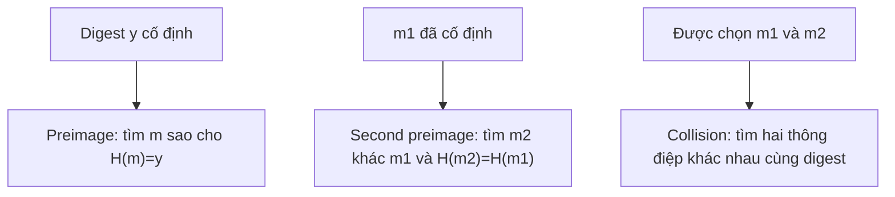
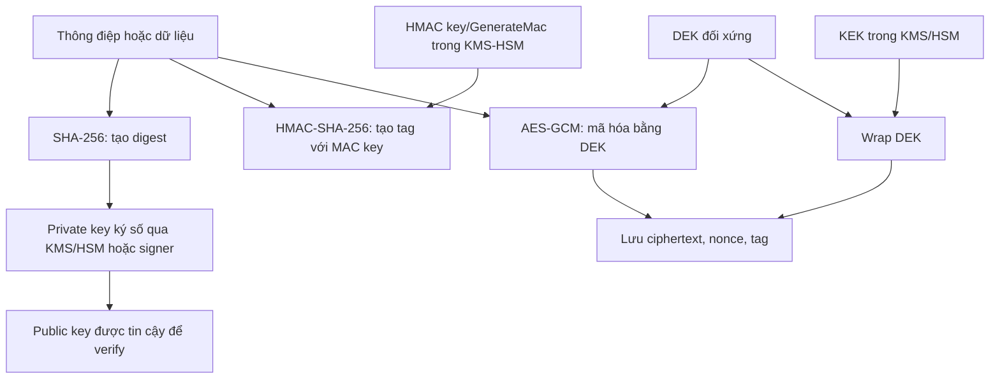

# Preimage resistance: tính kháng tìm ảnh ngược của hàm băm mật mã

> **Chương:** Hash và MAC  
> **Module:** SECURITY_KEY_MANAGEMENT_FUNDAMENTALS

**Preimage resistance (tính kháng tìm ảnh ngược)** là thuộc tính của một **hàm băm mật mã** khiến việc tìm được một đầu vào phù hợp từ **giá trị băm đã biết** trở nên khó khả thi về mặt tính toán. Đây là một trong những nền tảng để xây dựng hệ thống kiểm tra tính toàn vẹn, hàm dẫn xuất khóa, mã xác thực thông điệp và chữ ký số. Tuy nhiên, thuộc tính này thường bị hiểu sai thành “có hash thì không bao giờ tìm được dữ liệu gốc”, hoặc “dùng SHA-256 là đủ an toàn cho mật khẩu”.

Trong module **SECURITY_KEY_MANAGEMENT_FUNDAMENTALS**, hiểu preimage resistance giúp phân biệt **hàm băm không cần khóa** với **MAC sử dụng khóa bí mật**, từ đó quản lý đúng vòng đời khóa của HMAC, KMS/HSM, chữ ký số và envelope encryption. Việc quản lý khóa an toàn từ **tạo → cấp phát → lưu trữ → sử dụng → xoay vòng → thu hồi → hủy** phải đi cùng lựa chọn thuật toán và mô hình đe dọa đúng.

Sau bài học, bạn có thể:

- Định nghĩa chính xác **preimage**, **second preimage** và **collision resistance**; phân biệt mục tiêu của kẻ tấn công trong từng trường hợp.
- Giải thích độ khó tấn công tổng quát đối với hàm băm \(n\) bit và ảnh hưởng của việc cắt ngắn digest.
- Phân biệt **khả năng chống tìm ảnh ngược của thuật toán** với **độ khó đoán của đầu vào** như mã PIN, mật khẩu và token.
- Chỉ ra vì sao hash thuần không tự cung cấp **xác thực**, **bảo mật dữ liệu** hoặc **chống phát lại**.
- Sử dụng SHA-256 và HMAC-SHA-256 trong Java 17 ở mức minh họa; nhận biết giới hạn bảo mật của code.
- Liên hệ việc bảo vệ **HMAC key, KDF, KMS/HSM, digital signature** và quản lý quyền/kiểm toán với preimage resistance.

## 1. Định nghĩa toán học và trực giác

Một hàm băm mật mã nhận đầu vào có độ dài thay đổi và trả về digest độ dài cố định. Với một hàm có đầu ra \(n\) bit:

\[
H:\{0,1\}^{*}\rightarrow\{0,1\}^{n}
\]

Ví dụ, SHA-256 trả về **256 bit (32 byte)** bất kể đầu vào là một chuỗi ngắn hay một tệp lớn trong giới hạn hỗ trợ của thuật toán.

**Bài toán preimage:** biết **digest đích \(y\)**, tìm một thông điệp \(m\) bất kỳ sao cho:

\[
H(m)=y.
\]

Một hàm băm được gọi là **preimage-resistant** khi kẻ tấn công với tài nguyên khả thi không tìm được một \(m\) như vậy với xác suất thành công đáng kể trong mô hình an ninh tương ứng.

Hai chi tiết rất quan trọng:

1. Người tấn công chỉ cần tìm **một đầu vào bất kỳ** cho cùng digest, không nhất thiết khôi phục chính xác bản gốc đã được băm.
2. Vì miền đầu vào lớn hơn miền đầu ra, nhiều đầu vào **về nguyên tắc có thể có cùng digest**; hàm băm không phải phép mã hóa có khóa để đảo ngược một cách đơn trị.

### 1.1. Ví dụ trực quan

Giả sử một hệ thống công bố:

```text
message = "approve-invoice-2026"
digest  = SHA-256(message)

Kẻ tấn công chỉ biết digest.
Mục tiêu preimage: tìm messageCandidate bất kỳ sao cho
SHA-256(messageCandidate) == digest.
```

Với thông điệp được chọn ngẫu nhiên, đủ entropy và hàm băm mạnh, không có cách tổng quát khả thi để dựng đầu vào từ digest. Nhưng nếu thông điệp thuộc **một danh sách nhỏ có thể đoán**, kẻ tấn công chỉ cần **thử các phần tử trong danh sách**, băm từng phần tử và so sánh với digest đã biết. Điều này không phá thuật toán SHA-256.

## 2. Phân biệt ba thuộc tính bảo mật của hàm băm

Ba bài toán có vẻ giống nhau nhưng mục tiêu khác nhau. Với \(H\) là hàm băm mật mã:

| Thuộc tính | Kẻ tấn công được cho biết hoặc được chọn gì? | Mục tiêu |
|---|---|---|
| **Preimage resistance** | Một digest đích \(y\) | Tìm **bất kỳ** \(m\) sao cho \(H(m)=y\) |
| **Second-preimage resistance** | Một thông điệp \(m_1\) **đã cố định** | Tìm \(m_2\ne m_1\) sao cho \(H(m_2)=H(m_1)\) |
| **Collision resistance** | Được tự chọn **cả hai thông điệp** | Tìm \(m_1\ne m_2\) sao cho \(H(m_1)=H(m_2)\) |

### 2.1. Tại sao thứ tự này quan trọng?

**Preimage:** giả sử người kiểm tra có một digest đích cố định; attacker muốn tìm dữ liệu tương ứng.

**Second preimage:** có bản tài liệu hợp lệ và digest của nó; attacker muốn tạo bản tài liệu khác nhưng vẫn có cùng digest.

**Collision:** attacker chủ động dựng hai bản tài liệu khác nhau có cùng digest, có thể yêu cầu hệ thống ký hoặc tin bản lành rồi thay bằng bản độc hại. Vì người tấn công được chọn cả hai phía, bài toán collision trong mô hình tổng quát thường dễ hơn rất nhiều so với preimage.



Không suy luận rằng một thuật toán có **tấn công collision** thì mặc nhiên đã có **tấn công preimage** cùng độ phức tạp. Ví dụ, các kết quả tấn công collision thực tế vào SHA-1 là lý do quan trọng khiến SHA-1 không phù hợp cho nhiều ứng dụng chữ ký mới; điều đó không đồng nghĩa mọi digest SHA-1 có thể bị đảo ngược dễ dàng. Đối với thiết kế mới, nên chọn họ hash hiện đại phù hợp như SHA-256/SHA-384/SHA-512 hoặc SHA-3 theo chuẩn và yêu cầu hệ thống.

## 3. Độ khó tấn công: vì sao kích thước digest quan trọng?

Với một hàm băm lý tưởng có digest \(n\) bit, đầu ra phân bố phù hợp và mục tiêu được chọn theo mô hình tổng quát, các mốc thường dùng là:

| Loại tấn công tổng quát | Công sức kỳ vọng theo bậc độ lớn | Đối với digest 256 bit |
|---|---|---|
| **Preimage** | \(O(2^n)\) lần thử | Cỡ \(2^{256}\) |
| **Second preimage** | \(O(2^n)\) trong trường hợp tổng quát thông thường | Cỡ \(2^{256}\) |
| **Collision** (birthday attack) | \(O(2^{n/2})\) | Cỡ \(2^{128}\) |

Đây là **mốc lý thuyết/độ phức tạp tổng quát**, không phải lời hứa tốc độ thực tế hay bảo đảm tuyệt đối cho mọi độ dài thông điệp, cấu trúc thuật toán và biến thể tấn công. Một số họ hash có các trường hợp tấn công second-preimage đặc biệt khi thông điệp cực dài hoặc điều kiện phân tích khác với mô hình lý tưởng.

### 3.1. Minh họa chênh lệch preimage và collision

- **Preimage**: cần khớp **một đích cụ thể** trong khoảng \(2^n\) giá trị đầu ra.
- **Collision**: được thử nhiều thông điệp và chỉ cần **hai đầu ra bất kỳ trùng nhau**. Theo hiệu ứng sinh nhật, có thể xuất hiện sau khoảng \(2^{n/2}\) mẫu.

Do đó với SHA-256, không nên nói “256 bit nghĩa là mọi tính chất đều có mức an toàn 256 bit”: **độ bền chống collision tổng quát** tương ứng với mức khoảng **128 bit**, còn **preimage** trong mô hình lý tưởng có mức khoảng **256 bit**.

### 3.2. Cắt ngắn digest làm thay đổi mức an toàn

Ví dụ một ứng dụng chỉ lưu **64 bit đầu tiên** của SHA-256 để làm mã đối chiếu:

\[
H_{64}(m)=\operatorname{Truncate}_{64}(\operatorname{SHA256}(m)).
\]

Khi đánh giá đầu ra 64 bit đã bị cắt ngắn, mốc tổng quát là **preimage khoảng \(2^{64}\)** và **collision khoảng \(2^{32}\)**, chứ không còn mức của digest 256 bit đầy đủ. Đối với MAC bị cắt ngắn, việc đoán tag còn phải xét số lần thử, giới hạn truy vấn, chính sách từ chối và thiết kế cụ thể.

Không lấy một vài byte digest SHA-256 rồi mặc định tất cả mục tiêu bảo mật đều giữ nguyên độ mạnh của SHA-256.

## 4. Preimage resistance không có nghĩa đầu vào khó đoán

Đây là điểm thường gây sai sót lớn nhất khi lưu thông tin xác thực.

**SHA-256 có thể chống tìm preimage rất mạnh trong mô hình tổng quát**, nhưng nếu đầu vào là một **mã PIN bốn chữ số**, attacker chỉ phải kiểm tra tối đa **10.000 khả năng**. Họ không cần tìm lỗ hổng toán học của SHA-256.

Ví dụ:

```text
Hệ thống lưu: SHA-256("0427")
Attacker có digest đã lưu.

for pin in "0000" .. "9999":
    if SHA-256(pin) == storedDigest:
        print("Tìm được ứng viên:", pin)
        break

=> Mọi khả năng của miền 10.000 PIN đều có thể kiểm tra nhanh.
```

Một hash không làm tăng entropy vốn có của đầu vào. Nếu đầu vào được chọn từ bộ từ điển nhỏ, tên thông dụng, mẫu có thể đoán hoặc mật khẩu yếu, việc thử lần lượt vẫn khả thi.

### 4.1. Ba tầng cần phân biệt

| Tầng bảo mật | Câu hỏi | Biện pháp |
|---|---|---|
| **Độ mạnh của hash** | Có thể tìm preimage tổng quát nhanh hơn brute force nhiều không? | Thuật toán mật mã hiện đại, kích thước digest thích hợp |
| **Entropy của đầu vào** | Attacker có thể đoán từ một tập nhỏ không? | Mật khẩu đủ mạnh, secret/token từ CSPRNG và chính sách cấp phát |
| **Chi phí cho mỗi lần đoán** | Nếu lấy được digest, attacker có thể thử hàng tỷ ứng viên mỗi giây không? | Password hashing/KDF được thiết kế chuyên biệt, salt và tham số chi phí phù hợp |

**Hash một token ngẫu nhiên 256 bit** để lưu giá trị kiểm tra thường có tính chất khác rất xa việc **hash một mật khẩu do người dùng chọn**. Token đủ entropy có thể khiến việc đoán preimage bất khả thi; mật khẩu yếu không được “tự tăng entropy” bằng SHA-256.

## 5. Password hashing: vì sao không dùng SHA-256 thuần?

Với mật khẩu do người dùng chọn, đối thủ có thể đánh cắp cơ sở dữ liệu chứa digest rồi thử các ứng viên **ngoại tuyến** mà không chịu rate limit đăng nhập. SHA-256 được thiết kế chạy nhanh, vì vậy không phải lựa chọn thích hợp để lưu mật khẩu.

Nên dùng hàm **password hashing** chuyên dụng, chẳng hạn **Argon2id** với tham số bộ nhớ, thời gian và độ song song được lựa chọn theo môi trường, hoặc thuật toán/chế độ được hệ sinh thái và chính sách phù hợp chấp nhận (ví dụ scrypt, bcrypt, PBKDF2 với tham số an toàn).

Quy trình khái niệm:

```text
Đăng ký:
    salt = CSPRNG.randomSalt()             // Salt riêng từng mật khẩu
    verifier = Argon2id(password, salt, costParameters)
    database.save(salt, costParameters, verifier)

Đăng nhập:
    stored = database.load(userId)
    candidate = Argon2id(passwordInput,
                         stored.salt,
                         stored.costParameters)
    accept = constantTimeCompare(candidate, stored.verifier)
```

**Salt** thường được lưu công khai cùng verifier. Salt riêng từng mật khẩu làm giảm hiệu quả precomputation/rainbow table và tránh việc các mật khẩu giống nhau có cùng verifier khi thông số như nhau. Salt **không thay thế** chi phí của password hashing, cũng không cần giữ bí mật như key. **Pepper**, nếu có, là một **secret toàn hệ thống** cần được quản lý trong secrets manager/KMS/HSM theo cách triển khai cụ thể, tách khỏi cơ sở dữ liệu lưu verifier.

Không đưa password plaintext vào log, không tự tạo biến thể “SHA-256 lặp vài lần” nếu đã có thư viện password hashing chuẩn. Tham số chi phí phải được đo theo năng lực máy và nâng cấp khi cần, đồng thời có cơ chế giới hạn thử đăng nhập trực tuyến.

### 5.1. Preimage resistance không bảo vệ dữ liệu gốc khỏi đoán bằng từ điển

Ngay cả khi một digest không đảo ngược được bằng phép toán, attacker vẫn có thể **đoán đầu vào rồi băm so sánh**. Đây là lý do cần đặt câu hỏi “đầu vào có bao nhiêu entropy?” trước khi tuyên bố việc công bố digest là an toàn.

Một email, số điện thoại hoặc mã khách hàng dễ đoán cũng có thể bị xác định bằng so sánh hash với danh sách ứng viên. Hash các định danh nhạy cảm **không tự biến chúng thành dữ liệu ẩn danh**; cần phân tích khả năng liên kết/re-identification và mô hình truy cập.

## 6. Hash không phải mã hóa, MAC hay chữ ký số

| Cơ chế | Có dùng key bí mật không? | Mục tiêu chính | Điều nó không tự bảo đảm |
|---|---|---|---|
| **SHA-256/SHA-3 hash** | Không | Digest để so sánh/phát hiện khác biệt, nền tảng cho xây dựng mật mã | Không cho tính xác thực nguồn, không mã hóa nội dung |
| **AES-GCM** | Có, khóa đối xứng | Bí mật và toàn vẹn/xác thực dữ liệu dưới khóa đã chia sẻ | Không tự chứng minh danh tính người gửi trong hệ nhiều bên biết key; không tự chống replay |
| **HMAC-SHA-256** | Có, khóa bí mật HMAC | Xác thực thông điệp/toàn vẹn với các bên cùng chia sẻ key | Không tạo chữ ký công khai/không chối bỏ; không mã hóa nội dung |
| **Chữ ký số** (Ed25519, RSA-PSS, ECDSA) | Private key để ký, public key để xác minh | Xác thực và toàn vẹn có thể kiểm tra bằng public key tin cậy | Không tự bảo mật plaintext; trust và quy trình cấp key/certificate vẫn cần |

**Hash không phải encryption:** không có “decrypt SHA-256”. Khi dữ liệu cần khôi phục nội dung, phải dùng **mã hóa** với khóa và metadata phù hợp. Khi cần kiểm tra một đối tượng có bị bên thứ ba sửa không, chỉ so sánh hash lấy từ **cùng một kho không đáng tin** thường không đủ: attacker có thể thay cả dữ liệu lẫn digest.

Ví dụ tải một tệp và một chuỗi SHA-256 từ **cùng máy chủ đã bị chiếm**: nếu attacker sửa được cả tệp và chuỗi hash, bước đối chiếu vẫn cho kết quả khớp. Digest cần được phân phối qua **kênh tin cậy** hoặc được **ký/MAC** theo thiết kế an toàn nếu mục tiêu là chống sửa đổi có chủ đích.

## 7. Quan hệ giữa preimage, second preimage và chữ ký số

Trong nhiều cơ chế chữ ký, thông điệp được băm trước hoặc được thuật toán ký xử lý nội bộ bằng hàm băm. Một hệ thống ký tài liệu phải quan tâm nhiều thuộc tính của hàm băm, chứ không chỉ preimage resistance:

- **Second-preimage resistance** giúp ngăn việc thay một tài liệu đã biết bằng tài liệu khác có cùng digest.
- **Collision resistance** giúp ngăn attacker chủ động tạo hai tài liệu có cùng digest trước khi lấy được chữ ký cho một tài liệu.
- **Preimage resistance** có vai trò trong những cấu trúc mật mã nhất định và không tự suy ra tính an toàn của toàn bộ chữ ký.

**Chữ ký số còn cần thuật toán ký an toàn, key đúng mục đích, public key gắn với danh tính đáng tin và kiểm tra đầy đủ định dạng/thông điệp.** Không thể kết luận “SHA-256 chống preimage nên giao thức ký an toàn” nếu bỏ qua collision, scheme ký, key management hoặc khả năng tráo public key.

## 8. Ví dụ Java 17: SHA-256 và bài toán kiểm tra digest

Trong Java 17, `MessageDigest` cung cấp hàm băm; **SHA-256 là hàm không có khóa**:

```java
import java.nio.charset.StandardCharsets;
import java.security.MessageDigest;
import java.util.HexFormat;

public final class Sha256Demo {
    static byte[] sha256(String input) throws Exception {
        MessageDigest md = MessageDigest.getInstance("SHA-256");
        return md.digest(input.getBytes(StandardCharsets.UTF_8));
    }

    public static void main(String[] args) throws Exception {
        byte[] digest = sha256("approve-invoice-2026");
        System.out.println(HexFormat.of().formatHex(digest));
        System.out.println("Digest bits: " + digest.length * 8);
    }
}
```

Code chỉ chứng minh cách **tính digest**. Không thể suy luận dữ liệu đầu vào “không đoán được” chỉ từ việc digest dài 256 bit. Khi cần đối chiếu hai digest bí mật hoặc MAC, chọn hàm so sánh có đặc tính thời gian phù hợp; với SHA-256 của file công khai, việc so sánh byte theo kiểu thông thường còn tùy mô hình đe dọa.

### 8.1. Minh họa sự khác nhau giữa preimage và thử từ điển

```java
import java.nio.charset.StandardCharsets;
import java.security.MessageDigest;
import java.util.Locale;

public final class SmallSearchSpaceDemo {
    private static byte[] hash(String value) throws Exception {
        return MessageDigest.getInstance("SHA-256")
                .digest(value.getBytes(StandardCharsets.UTF_8));
    }

    public static void main(String[] args) throws Exception {
        // Mục tiêu minh họa: một PIN 4 chữ số rất ít entropy.
        byte[] target = hash("0427");

        for (int candidate = 0; candidate < 10_000; candidate++) {
            String guess = String.format(Locale.ROOT, "%04d", candidate);
            if (MessageDigest.isEqual(target, hash(guess))) {
                System.out.println("Tim duoc ung vien: " + guess);
                break;
            }
        }
    }
}
```

Ví dụ dùng dữ liệu giả, minh họa **miền ứng viên quá nhỏ**, không phải tấn công phá SHA-256. Không áp dụng cách lưu `SHA-256(password)` cho mật khẩu thật; dùng password hashing chuẩn như Argon2id/PBKDF2 có tham số phù hợp.

## 9. Preimage resistance và HMAC liên quan như thế nào?

**HMAC** (*hash-based message authentication code*) là cách xây dựng **MAC có khóa bí mật** dựa trên một hàm băm mật mã. Ví dụ, **HMAC-SHA-256** dùng SHA-256 bên trong nhưng mục tiêu chính của nó là tạo một **authentication tag** mà bên không biết khóa rất khó giả mạo.

Khác với hash thuần:

```text
Hash:
  digest = SHA-256(message)          // Bất kỳ ai đều tính được

HMAC:
  tag    = HMAC-SHA256(key, message)  // Cần biết khóa bí mật
  valid  = verifyHmac(key, message, tag)
```

Ngay cả khi message và tag đều công khai, đối thủ không được có khả năng tạo tag hợp lệ cho **một message mới** với xác suất đáng kể nếu HMAC được cấu hình đúng và khóa vẫn bí mật.

### 9.1. Preimage resistance không đồng nghĩa MAC unforgeability

Đây là điểm phân biệt quan trọng:

| Tính chất | Đối tượng | Câu hỏi bảo mật |
|---|---|---|
| **Preimage resistance** | Hàm băm không khóa \(H\) | Biết \(y\), có tìm được \(m\) sao cho \(H(m)=y\) không? |
| **MAC unforgeability** | Cơ chế MAC với khóa \(K\) | Không biết \(K\), có tạo được tag được chấp nhận cho message mới không? |
| **Key recovery resistance** | Cơ chế dùng khóa | Từ các message/tag đã biết, có tìm được \(K\) hoặc đủ thông tin để làm giả không? |

Preimage resistance của SHA-256 **không tự chứng minh** mọi công thức gắn thêm khóa sẽ trở thành MAC an toàn. Ví dụ cấu trúc tự chế `SHA-256(secretKey || message)` chịu rủi ro **length-extension** trong những điều kiện sử dụng phù hợp với cấu trúc Merkle–Damgård của SHA-256: kẻ tấn công có thể mở rộng một thông điệp được MAC theo dạng này và tính giá trị tương ứng mà không cần biết khóa, nếu giao thức xử lý thông điệp mở rộng theo cách có thể khai thác.

**HMAC-SHA-256** được thiết kế chuẩn để tránh kiểu vấn đề đó và có phân tích bảo mật riêng. Dùng HMAC chuẩn hoặc MAC tích hợp trong AEAD thay vì tự tạo công thức kiểu `hash(key + message)`.

### 9.2. HMAC không mã hóa và không tạo chữ ký số công khai

Message được MAC vẫn có thể ở dạng plaintext. HMAC chỉ giúp bên biết cùng khóa kiểm tra **tính toàn vẹn và tính xác thực theo khóa chia sẻ**. Vì bên kiểm tra cũng nắm khóa, họ có thể tự tạo tag hợp lệ: HMAC **không tạo bằng chứng chữ ký có thể xác minh độc lập bằng public key** như Ed25519, ECDSA hoặc RSA-PSS.

Nếu nhiều đối tác đều phải tự xác minh webhook, một khóa HMAC chia sẻ với nhiều nơi làm tăng rủi ro lộ. Có thể dùng **khóa HMAC riêng theo đối tác** hoặc chữ ký số với public key phân phối an toàn khi mô hình phù hợp.

## 10. Ví dụ Java 17: HMAC-SHA-256 và kiểm tra tag

Ví dụ dưới cho thấy sự khác biệt giữa **SHA-256 ai cũng tính được** và **HMAC cần khóa bí mật**. Khóa HMAC được sinh bằng CSPRNG và code dùng `Mac` có sẵn trong JCA:

```java
import java.nio.charset.StandardCharsets;
import java.security.MessageDigest;
import java.security.SecureRandom;
import java.util.Arrays;
import javax.crypto.Mac;
import javax.crypto.spec.SecretKeySpec;

public final class HmacSha256Demo {
    private static final String ALGORITHM = "HmacSHA256";

    private static byte[] calculateTag(byte[] key, byte[] message)
            throws Exception {
        Mac mac = Mac.getInstance(ALGORITHM);
        mac.init(new SecretKeySpec(key, ALGORITHM));
        return mac.doFinal(message);
    }

    public static void main(String[] args) throws Exception {
        byte[] key = new byte[32]; // 256-bit HMAC key cho demo
        new SecureRandom().nextBytes(key);

        byte[] message = "webhook:v1|order=42|paid=true"
                .getBytes(StandardCharsets.UTF_8);
        byte[] tag = calculateTag(key, message);

        // Bên xác minh dùng cùng khóa bí mật.
        byte[] expectedTag = calculateTag(key, message);
        boolean valid = MessageDigest.isEqual(tag, expectedTag);

        byte[] changed = "webhook:v1|order=42|paid=false"
                .getBytes(StandardCharsets.UTF_8);
        byte[] changedTag = calculateTag(key, changed);
        boolean tamperedAccepted =
                MessageDigest.isEqual(tag, changedTag);

        System.out.println("Tag hợp lệ: " + valid);
        System.out.println("Tag cũ chấp nhận dữ liệu sửa: "
                + tamperedAccepted);

        // Có thể ghi đè mảng ứng dụng nắm giữ, nhưng provider
        // vẫn có thể giữ bản sao key trong bộ nhớ.
        Arrays.fill(key, (byte) 0);
    }
}
```

Kết quả dự kiến: tag ứng với message ban đầu được chấp nhận; tag đó **không hợp lệ** cho message đã sửa với xác suất rất cao.

**Giới hạn và lưu ý khi triển khai:**

1. Bên phát và bên xác minh phải dùng **cùng byte của message**, cùng chuẩn encoding, thuật toán, key version và tag length. JSON được serialize khác thứ tự field có thể sinh tag khác dù nghiệp vụ xem là cùng đối tượng.
2. `MessageDigest.isEqual` giúp giảm một số rủi ro so sánh theo thời gian; vẫn cần kiểm tra độ dài/tag format và thiết kế chống timing ở cả ứng dụng.
3. Demo **không có chống phát lại**. Attacker gửi lại nguyên message và tag hợp lệ vẫn có thể qua kiểm tra MAC. Với webhook thực tế, cần **timestamp, nonce/message ID, TTL, trạng thái đã xử lý** và kiểm tra chúng ở verifier; ràng buộc các trường đó vào nội dung được MAC.
4. Khóa HMAC dài hạn cần key ID, phân quyền, rotation và lưu trữ phù hợp. Không hard-code key hoặc để key trong log, source repository, container image.
5. `Mac` không nên được chia sẻ vô điều kiện giữa nhiều thread như đối tượng bất biến; tạo instance cho từng thao tác hoặc dùng cơ chế thread-safety phù hợp. Code chỉ là minh họa, không phải framework xác thực production.
6. Việc ghi đè một mảng `byte[]` không cam kết xóa tất cả bản sao key bên trong provider/JVM. Giảm thời gian giữ key và số bản sao càng nhiều càng tốt.

## 11. Một HMAC tag có thể bị đoán không?

Nếu dùng MAC đủ mạnh, kẻ không biết key vẫn có thể **đoán tag ngẫu nhiên** và gửi thử. Với tag \(t\) bit lý tưởng, xác suất đoán đúng cho **một lần thử độc lập** vào khoảng \(2^{-t}\), trước khi xét giới hạn cụ thể của cơ chế và số lần thử.

Nếu hệ thống chỉ giữ **32 bit đầu** của HMAC-SHA-256 để tiết kiệm băng thông, attacker có thể có xác suất thành công mỗi lần đoán vào khoảng \(2^{-32}\) trong mô hình lý tưởng, và nhiều lần thử làm tăng nguy cơ. Không được đánh đồng “HMAC dùng SHA-256” với “tag chỉ có 32 bit vẫn có an toàn 256 bit”.

Chọn độ dài tag theo **chuẩn/giao thức và mô hình đe dọa**, đồng thời giới hạn số lần thử, theo dõi lỗi xác minh và chặn brute force khi phù hợp. Một số giao thức quy định tag truncation hợp lệ và giới hạn vòng đời khóa; đừng tự giảm tag tùy tiện.

### 11.1. Chống giả mạo không đồng nghĩa chống phát lại

Giả sử đối thủ không tạo được tag mới nhưng ghi lại được:

```text
message = "transfer|order=42|amount=100000"
tag = HMAC(key, message)
```

Việc gửi lại **đúng message và tag** vẫn có thể hợp lệ về mặt HMAC. Cần một lớp **replay protection** để ngăn xử lý lần thứ hai. Đây là vấn đề giao thức/ứng dụng, không phải việc SHA-256 thiếu preimage resistance.

## 12. Key management cho HMAC khác gì quản lý hash?

Hash SHA-256 thuần không có **key bí mật** để lưu giữ, phân phối hay xoay vòng. **HMAC có key**, nên vòng đời và chính sách bảo vệ tương tự các khóa đối xứng khác.

| Giai đoạn | SHA-256 không khóa | HMAC-SHA-256 có khóa |
|---|---|---|
| **Tạo** | Chọn thuật toán, input/encoding và độ dài digest | Sinh key ngẫu nhiên đủ entropy bằng CSPRNG/KMS/HSM; chọn phạm vi sử dụng |
| **Cấp phát** | Không phân phối khóa | Cấp quyền GenerateMac/VerifyMac hoặc phân phối key theo mô hình tin cậy |
| **Lưu trữ** | Chỉ có dữ liệu/digest và metadata | Bảo vệ HMAC key trong KMS/HSM hoặc secret store được kiểm soát |
| **Sử dụng** | Bất kỳ bên nào cũng tính digest cùng input | Chỉ bên có key/quyền API phù hợp mới được tạo/kiểm tra tag |
| **Xoay vòng** | Có thể chuyển thuật toán/format digest khi cần | Tạo key version mới, chuyển phía phát và phía xác minh theo kế hoạch |
| **Thu hồi** | Không có key để revoke | Rút quyền API, vô hiệu hóa key version hoặc ngừng chấp nhận tag cũ |
| **Hủy** | Xóa digest theo chính sách dữ liệu | Chỉ hủy key sau khi hết nhu cầu xác minh lịch sử và retention phù hợp |

### 12.1. Sinh key với entropy đủ mạnh

Với HMAC-SHA-256, một key ngẫu nhiên **32 byte** là lựa chọn thực tế phổ biến khi cần mức bảo vệ mạnh. Không lấy mật khẩu người dùng yếu làm HMAC key rồi nghĩ SHA-256 sẽ tự bảo vệ key. Khi đầu vào ban đầu chỉ là mật khẩu, cần KDF phù hợp với độ entropy và mục đích.

Nên **tách khóa theo mục đích, ứng dụng và môi trường**: key cho webhook không nên kiêm key dẫn xuất phiên hoặc key dùng cho tenant khác. Việc dùng lại một key ở quá nhiều bối cảnh làm mở rộng phạm vi ảnh hưởng nếu key bị compromise.

### 12.2. Non-exportable HMAC key và KMS/HSM

Một số KMS/HSM hỗ trợ các phép toán **GenerateMac/VerifyMac** hoặc chức năng MAC tương đương bằng key được bảo vệ trong ranh giới dịch vụ, tùy sản phẩm và loại key. Khi API hỗ trợ, workload có thể **yêu cầu sinh/xác minh MAC mà không nhận byte HMAC key**.

Nếu một dịch vụ nhận raw key và tự tính HMAC, key sẽ xuất hiện trong bộ nhớ của tiến trình đó. Khi workload bị chiếm quyền, đối thủ có thể sao chép key và sử dụng **ngoài** KMS. Vì vậy phải hiểu rõ **quyền gọi API** và **quyền đọc vật liệu key** là hai quyền khác nhau.

**Non-exportable** không có nghĩa không thể bị lạm dụng: attacker lấy được IAM identity có quyền `GenerateMac` vẫn có thể yêu cầu dịch vụ tạo tag trái phép. IAM/key policy, phân quyền nghiệp vụ và kiểm toán số lần sử dụng vẫn quan trọng.

### 12.3. Tách role của bên phát và bên kiểm tra

Nếu hai đối tác phải tự tính/kiểm tra HMAC bằng cùng key, cả hai đều nắm bí mật và đều có khả năng tạo tag. Khi yêu cầu bên xác minh **không thể tự ký thay bên phát**, cân nhắc **chữ ký số bất đối xứng**: bên phát giữ private key, bên xác minh chỉ cần public key tin cậy.

Nếu API KMS/HSM có quyền riêng **GenerateMac** và **VerifyMac**, có thể cấp riêng hai thao tác cho các workload trong cùng vùng tin cậy; mức bảo đảm cụ thể phụ thuộc việc key có thể xuất và đường thao tác mà provider hỗ trợ.

## 13. KDF, HKDF và giới hạn của preimage resistance

**Key derivation function (KDF)** dùng để tạo các khóa hoặc secret mới từ input key material và ngữ cảnh. Một ví dụ phổ biến là **HKDF**, thường dùng HMAC trong hai bước **Extract** và **Expand**.

```text
input key material --HKDF-Extract(salt)--> pseudorandom key
pseudorandom key --HKDF-Expand(info, length)--> derived key
```

- **Salt** của HKDF thường có thể công khai; **info/context** giúp tách khóa theo ứng dụng, mục đích, hướng truyền hoặc phiên bản.
- HKDF có thể làm đầu ra phù hợp cho key derivation **khi input có entropy thích hợp** và dùng đúng thiết kế, nhưng **không tự tăng entropy** của mật khẩu yếu.
- **HKDF không phải password hashing KDF** chuyên chống đoán mật khẩu ngoại tuyến; muốn xử lý mật khẩu thường cần Argon2id/scrypt/PBKDF2 với cost phù hợp trước hoặc theo kiến trúc được kiểm chứng.
- Key được dẫn xuất phải được đặt đúng **mục đích và vòng đời**: khóa mã hóa AES-GCM cần quản lý nonce; HMAC key cần quản lý quyền tạo MAC; DEK/KEK cần bản khôi phục và rotation hợp lý.

Chỉ biết rằng hàm băm nền tảng có preimage resistance **chưa đủ** để suy ra một quy trình dẫn xuất khóa an toàn nếu input entropy thấp, thiếu domain separation hoặc bị lộ dữ liệu trung gian.

## 14. Kết hợp hash, MAC, chữ ký số và envelope encryption

Một nền tảng quản lý dữ liệu thường phải giải quyết **ba nhu cầu khác nhau**: xác thực ai đã tạo thông điệp, bảo mật nội dung dữ liệu, và quản lý key dùng cho các phép toán.



Sơ đồ mô tả **các khả năng thiết kế**, không hàm ý một hệ thống phải vừa dùng HMAC vừa ký số vừa mã hóa cho mọi message. Chọn công cụ theo nhu cầu:

- **SHA-256**: fingerprint/digest cho dữ liệu, kiểm tra tính toàn vẹn khi digest đến từ kênh đáng tin; thường là thành phần bên trong chữ ký/KDF/MAC.
- **HMAC**: các bên chia sẻ một key bí mật để xác thực message; thích hợp với webhook, liên lạc dịch vụ có mô hình chia sẻ khóa rõ ràng.
- **Chữ ký số**: một bên giữ private key, nhiều bên dùng public key xác minh; phù hợp khi cần xác thực công khai và tách quyền signer/verifier.
- **AES-GCM/envelope encryption**: bảo vệ **tính bí mật và toàn vẹn của dữ liệu**, dùng DEK cho dữ liệu và KEK để bảo vệ DEK.

Không mã hóa dữ liệu bằng SHA-256. Không lấy digest của plaintext làm “bản mã”. Không dùng HMAC key thay cho DEK và không dùng key ký số như key AES. Mỗi khóa phải có **purpose, thuật toán, quyền, cryptoperiod và audit** được quản lý phù hợp.

## 15. Tình huống thực tế: xác thực webhook thanh toán

Giả sử hệ thống thanh toán gửi webhook cho `orders-service`. Hai bên dùng một **HMAC key** chia sẻ cho một đối tác cụ thể, được rotate theo phiên bản.

Luồng thiết kế:

1. Bên gửi và bên nhận thống nhất thuật toán **HMAC-SHA-256**, chuẩn encoding, canonical message format, cách gắn `keyId`, timestamp và message ID.
2. Bên gửi xây message đúng định dạng, tính HMAC bằng key đang active, gửi message và tag qua HTTPS.
3. Bên nhận tìm key từ **keyId đã được ràng buộc với đối tác đáng tin**, kiểm tra timestamp/TTL, tính lại HMAC trên **chính byte gốc nhận được**, so sánh tag theo cách phù hợp.
4. Bên nhận kiểm tra **message ID chưa xử lý** hoặc replay window trước khi thực hiện thay đổi nghiệp vụ, và kiểm tra trạng thái order/transaction.
5. Kết quả xác minh được ghi log bằng metadata: partner, keyId, request ID, timestamp, trạng thái. Không ghi raw HMAC key, token, plaintext credential.

Ví dụ biểu diễn dữ liệu được MAC:

```text
stringToAuthenticate =
    "webhook:v1" + "\n" +
    partnerId + "\n" +
    keyId + "\n" +
    timestamp + "\n" +
    messageId + "\n" +
    rawBodyBytes

tag = HMAC-SHA256(partnerKey, canonicalBytes)
```

Đây là **mã giả về bố cục message**; khi triển khai cần định nghĩa rõ byte encoding, độ dài/trật tự các trường và cách phân cách để tránh nhập nhằng. Với raw body, không được chuyển đổi JSON tùy ý làm lệch byte giữa hai bên. Key ID là tham số chọn key, **không tự là bằng chứng người gửi hợp lệ**; chỉ chọn từ danh mục key/partner đã cấu hình.

Khi rotate, bên gửi chuyển sang key mới; bên nhận có thể tạm chấp nhận **phiên bản cũ trong khoảng ngắn được kiểm soát** để xử lý các thông điệp đang chuyển tiếp. Khi key bị compromise, phải ngừng tin key cũ theo rủi ro thay vì đợi hết grace period. **HMAC không tự chống replay** dù tag dài 256 bit.

## 16. Sự cố thường gặp và cách ứng phó

| Sự cố | Tài sản có nguy cơ | Hành động cần ưu tiên |
|---|---|---|
| Database lộ verifier tạo bằng SHA-256 của PIN 4 số | PIN yếu có thể đoán offline | Chặn truy cập, xác định ảnh hưởng, buộc thay PIN/credential, chuyển sang password hashing phù hợp |
| Digest SHA-256 của dữ liệu ít entropy bị công bố | Nội dung có thể được suy ra bằng từ điển | Xem lại mô hình bảo mật, hạn chế công bố digest hoặc dùng cơ chế có khóa khi phù hợp |
| HMAC key bị ghi ra log/repository | Người có key có thể tạo MAC hợp lệ | Thu hồi/rotate key, xử lý bản sao, đổi cấu hình và rà soát tag giả |
| IAM role có quyền `GenerateMac` bị chiếm | MAC được tạo trái phép dù key non-exportable | Thu hồi phiên/grant, kiểm tra audit MAC, cô lập workload; thay key khi rủi ro yêu cầu |
| Tag HMAC bị cắt xuống vài byte | Tăng nguy cơ đoán tag nếu cho thử nhiều lần | Dùng độ dài theo chuẩn, giới hạn thử, đổi giao thức/tag version khi cần |
| Bên nhận chấp nhận webhook lặp | Giao dịch bị xử lý hai lần dù MAC hợp lệ | Replay window, message ID, trạng thái đã xử lý, idempotency |
| Chỉ đối chiếu SHA-256 từ cùng nguồn không tin cậy | Đối thủ thay dữ liệu và digest cùng lúc | Digest qua kênh đáng tin hoặc chữ ký/MAC |
| Dùng thuật toán hash yếu về collision cho chữ ký mới | Nguy cơ thay đổi thông điệp được ký theo các kiểu tấn công phù hợp | Migrate sang hash/scheme được chấp nhận và đánh giá chữ ký lịch sử |

**Lưu ý về thu hồi:** xóa key khỏi secret store hoặc sửa IAM không khiến người đã sao chép HMAC key **mất khả năng tính MAC**. Phải thay key và cập nhật verifier ngừng tin tag tạo bằng key cũ theo mức rủi ro. Ngược lại, **hủy key kiểm tra MAC quá sớm** có thể làm mất khả năng xác minh thông điệp/hồ sơ cần lưu giữ.

## 17. Anti-pattern cần tránh

| Anti-pattern | Vì sao sai? | Hướng xử lý |
|---|---|---|
| “SHA-256 không đảo được nên lưu password bằng SHA-256” | Password yếu vẫn bị thử từ điển nhanh | Password hashing có salt và cost như Argon2id |
| “Hash một email là chắc chắn ẩn danh” | Email có miền giá trị dễ liệt kê/liên kết | Phân tích re-identification, giảm dữ liệu hoặc dùng cơ chế bảo vệ phù hợp |
| Tự tạo MAC bằng `SHA256(key || message)` | Công thức thiếu bảo đảm MAC chuẩn và có thể bị length extension | Dùng HMAC hoặc MAC được chuẩn hóa |
| Dùng một HMAC key cho mọi đối tác, tenant, môi trường | Một điểm lộ ảnh hưởng diện rộng | Key riêng theo purpose/partner, phiên bản và quyền |
| In HMAC key hoặc token vào log để debug | Log thành nguồn rò rỉ khóa/credential | Ghi metadata, hạn chế truy cập và bảo vệ log |
| Trả về lỗi so sánh tag tiết lộ thông tin không cần thiết | Tạo thêm tín hiệu cho attacker, rủi ro timing/side channel | So sánh tag phù hợp, lỗi chung và rate limit |
| Cho mọi service quyền GenerateMac trên mọi key KMS | Workload bị chiếm có thể tạo tag trái phép | Least privilege theo principal, key ID, action |
| Đọc `kid` do client gửi rồi lấy key bất kỳ trên internet | Attacker thao túng nguồn/key được tin | Bản đồ keyId–partner được kiểm soát, whitelist trust |
| Cắt digest/tag xuống quá ngắn rồi vẫn tuyên bố an toàn 256 bit | Mức chống đoán/collision thay đổi theo bit thực tế | Đánh giá chiều dài tag/digest theo threat model |
| Dùng HMAC để “mã hóa” dữ liệu | MAC không che plaintext | AEAD như AES-GCM khi cần bí mật |
| Chỉ dùng digest để xác thực tệp trong nguồn đã bị chiếm | Attacker có thể thay cả tệp và hash | Chữ ký số/MAC hoặc kênh công bố digest độc lập đáng tin |
| Dùng HMAC mà không có chống replay | Tag hợp lệ cũ vẫn có thể được gửi lại | Timestamp, nonce/message ID, replay window và kiểm soát nghiệp vụ |

## 18. Checklist khi thiết kế hash hoặc MAC

1. **Mục tiêu là gì?** Tìm kiếm digest, phát hiện thay đổi, xác thực thông điệp, lưu mật khẩu hay bảo mật dữ liệu? Chọn hash, HMAC, password KDF, chữ ký hoặc encryption đúng mục đích.
2. **Đầu vào có đủ entropy không?** Token ngẫu nhiên khác hoàn toàn password/PIN do con người chọn; đừng lấy preimage resistance để che giấu miền giá trị quá nhỏ.
3. **Thuật toán nào?** Có chọn hash/MAC hiện đại phù hợp chính sách, tránh công thức tự chế và giới hạn tag/digest quá ngắn không?
4. **Message được biểu diễn ra sao?** Có canonical encoding, độ dài trường, domain separation và cùng byte đầu vào giữa signer/verifier không?
5. **Có secret key không?** Nếu dùng HMAC, key được sinh từ CSPRNG/KMS, lưu ở đâu, ai được quyền đọc hay gọi GenerateMac/VerifyMac?
6. **Có giới hạn phạm vi key không?** Tách key theo đối tác, tenant, purpose, môi trường; tránh một key dùng quá nhiều chức năng.
7. **Làm sao rotate key?** Có key ID/version, grace period khi phù hợp, chiến lược thu hồi lúc compromise và khả năng verify lịch sử không?
8. **Có kiểm soát phát lại không?** HMAC/tag đúng chưa đủ; có timestamp, message ID, replay window hoặc idempotency?
9. **Có bảo vệ quá trình kiểm tra không?** So sánh tag phù hợp, rate limit, không tiết lộ key hoặc dữ liệu qua log/lỗi?
10. **Có audit đầy đủ không?** Lưu danh tính workload, key ID, action, trạng thái và sự kiện quản trị; không ghi raw key/password/token.
11. **Có liên hệ với mã hóa và chữ ký không?** Khi cần bí mật dùng AEAD, khi cần xác minh công khai dùng chữ ký; khi cần bảo vệ DEK dùng KMS/HSM và envelope encryption.
12. **Có kịch bản ứng phó không?** Thử trường hợp HMAC key lộ, verifier cũ còn hoạt động, hash dữ liệu ít entropy bị công bố và tài khoản IAM lạm dụng KMS.

## 19. Câu hỏi tự kiểm tra

**1. Preimage resistance nói rằng SHA-256 không thể đảo ngược tuyệt đối, đúng không?**  
Không. Thuộc tính này mô tả **độ khó tính toán** để tìm một đầu vào cho digest đã cho. Không thể suy ra tính bất khả thi tuyệt đối hay bảo vệ được mọi đầu vào ít entropy.

**2. Preimage và collision có cùng độ khó tổng quát với digest 256 bit không?**  
Không. Trong mô hình lý tưởng, preimage khoảng \(2^{256}\) phép thử, còn collision dùng hiệu ứng sinh nhật khoảng \(2^{128}\).

**3. SHA-256(password) có phù hợp để lưu mật khẩu không?**  
Không. SHA-256 thuần quá nhanh trước tấn công đoán password ngoại tuyến. Sử dụng password hashing chuyên dụng với salt và tham số chi phí phù hợp.

**4. Có thể dùng SHA-256(message) như chữ ký xác thực người gửi không?**  
Không. Ai biết message đều tính được hash. Cần HMAC với secret key hoặc chữ ký số với private key và public key đáng tin.

**5. HMAC-SHA-256 có bảo mật plaintext của webhook không?**  
Không. HMAC chỉ xác thực/tăng khả năng phát hiện sửa đổi; muốn che nội dung cần cơ chế mã hóa thích hợp như TLS cho dữ liệu truyền hoặc AEAD cho dữ liệu cần mã hóa.

**6. HMAC key không xuất được trong HSM thì hệ thống không thể bị giả mạo tag, đúng không?**  
Không. Tài khoản có quyền `GenerateMac` bị chiếm vẫn có thể yêu cầu tạo tag trái phép. Cần IAM, kiểm soát nghiệp vụ, audit và ứng phó sự cố.

**7. Vì sao không chỉ dùng HMAC để chặn webhook gửi trùng?**  
Vì bản tin và tag hợp lệ có thể bị gửi lại nguyên vẹn; cần kiểm tra tính mới và trạng thái đã xử lý ngoài việc xác minh MAC.

**8. Khi rotate HMAC key, có nên hủy key cũ ngay không?**  
Tùy chính sách và nhu cầu xác minh dữ liệu lịch sử. Rotation bình thường có thể cần giai đoạn chuyển tiếp được kiểm soát; khi key bị compromise cần đánh giá ngừng tin key cũ nhanh hơn. Không giữ key cũ quá lâu hoặc hủy trước khi xác định các phụ thuộc hợp lệ.

## 20. Ghi nhớ

**Preimage resistance** nghĩa là khó tìm một đầu vào bất kỳ tạo ra digest đích đã biết; nó **khác** với **second-preimage resistance** và **collision resistance**. Với hash \(n\) bit lý tưởng, các mốc tổng quát lần lượt khoảng \(2^n\), \(2^n\) và \(2^{n/2}\), nhưng **entropy thật của đầu vào** và cấu hình hệ thống có thể khiến việc đoán dữ liệu dễ hơn rất nhiều.

Đừng coi SHA-256 là cơ chế mã hóa, password hashing hoàn chỉnh hay xác thực thông điệp có chủ thể. **HMAC** bổ sung **khóa bí mật** để kiểm tra tính xác thực, còn **chữ ký số** dùng private/public key cho việc xác minh công khai; **AES-GCM/envelope encryption** dành cho bảo vệ dữ liệu cần bí mật. Khi dùng HMAC, hãy quản lý key bằng CSPRNG, KMS/HSM khi phù hợp, kiểm soát truy cập, phân tách mục đích, audit, rotation và thu hồi. Kết nối đúng thuộc tính hàm băm với **vòng đời khóa mật mã** giúp thiết kế hệ thống vừa an toàn về mặt thuật toán vừa có khả năng vận hành và xử lý sự cố thực tế.
