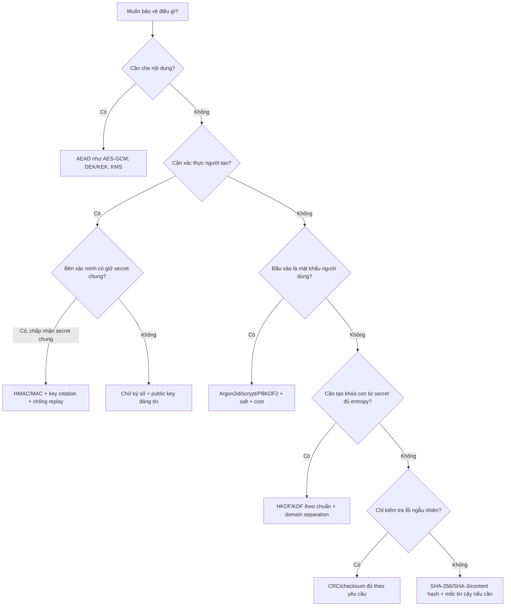
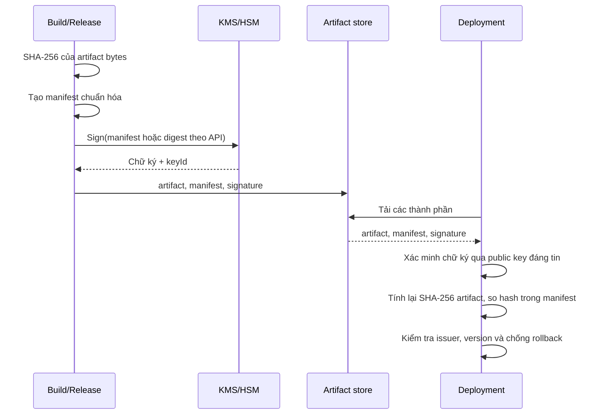

# Chọn hash theo mục đích

Trong chương **Hash và MAC** thuộc module **SECURITY_KEY_MANAGEMENT_FUNDAMENTALS**, câu hỏi quan trọng không đơn giản là “SHA-256 hay SHA-512 mạnh hơn?”, mà là **hệ thống cần bảo vệ tính chất nào, trước đối thủ nào, và giá trị băm sẽ được tin cậy bằng cách nào?** Một hàm băm mật mã như SHA-256 biến dữ liệu thành *digest*, nhưng bản thân digest không giữ bí mật nội dung và không xác thực người tạo. Khi cần xác thực nguồn gốc, lưu mật khẩu, dẫn xuất khóa hoặc ký số, phải chọn **cấu trúc mật mã phù hợp**, không chỉ thay tên thuật toán hash.

Bài này tập trung vào **quy trình lựa chọn hash theo mục đích sử dụng**, liên kết với mật mã đối xứng/bất đối xứng, chữ ký số, HMAC, password hashing, HKDF, KMS/HSM, envelope encryption, kiểm soát truy cập và kiểm toán. Mục tiêu là thiết kế hệ thống có thể vận hành và xoay vòng khóa an toàn, tránh rủi ro do dùng hash sai mục đích.

## 1. Mục tiêu học tập

Sau bài học, bạn có thể:

- Phân biệt yêu cầu **phát hiện lỗi**, **kiểm tra toàn vẹn**, **xác thực nguồn gốc**, **chống sửa dữ liệu**, **lưu mật khẩu**, **dẫn xuất khóa**, **ẩn danh hóa** và **bảo mật nội dung**.
- Chọn họ thuật toán và primitive phù hợp: SHA-2, SHA-3, SHAKE, HMAC, chữ ký số, Argon2id/scrypt/PBKDF2, HKDF hoặc AEAD.
- Giải thích vì sao **độ dài digest**, *collision resistance*, *preimage resistance*, chi phí tính toán và chuẩn giao thức ảnh hưởng đến lựa chọn.
- Nhận diện các bẫy: digest từ nguồn không đáng tin, MD5/SHA-1 cho chữ ký mới, tự thiết kế MAC, hash mật khẩu quá nhanh, cắt ngắn digest tùy tiện, băm dữ liệu ít entropy.
- Áp dụng lựa chọn vào Java, quản lý khóa mật mã và vận hành KMS/HSM.

## 2. Bước đầu tiên: xác định điều cần bảo vệ

Ví dụ một dịch vụ nhận tệp qua mạng. Nếu chỉ muốn biết dữ liệu **có bị lỗi ngẫu nhiên** trong lúc truyền hay không, checksum có thể đủ. Nếu muốn biết tệp có khớp **một digest đã nhận từ nguồn tin cậy**, dùng hash mật mã như SHA-256. Nhưng nếu đối thủ có thể thay **cả tệp lẫn tệp chứa digest**, hai bên cần một cơ chế xác thực độc lập, chẳng hạn chữ ký số trên manifest.

| Mục đích chính | Đối thủ/vấn đề | Primitive nên cân nhắc | Không nên kết luận |
| --- | --- | --- | --- |
| Kiểm tra lỗi ngẫu nhiên trong truyền/lưu | Nhiễu hoặc lỗi kỹ thuật không chủ đích | CRC/checksum theo giao thức | Checksum không có collision resistance trước kẻ chủ động. |
| Kiểm tra file khớp digest đã được xác thực | Tệp bị thay đổi sau khi mốc tin cậy được công bố | SHA-256, SHA-384 hoặc hash hiện đại được chuẩn hỗ trợ | Hash thuần không xác thực mốc digest. |
| Xác thực webhook giữa hai bên chia sẻ secret | Kẻ ngoài giả mạo/sửa yêu cầu | **HMAC-SHA256** hoặc MAC chuẩn theo giao thức, cộng chống replay | `SHA256(message)` không phải MAC. |
| Ký artifact/tài liệu để nhiều bên xác minh | Kẻ giả mạo nhà phát hành; verifier không giữ khóa ký | **Chữ ký số** RSA-PSS/ECDSA/Ed25519 theo giao thức | Một digest công khai không tương đương chữ ký số. |
| Lưu thông tin kiểm tra mật khẩu | Kẻ có bản dump thử mật khẩu offline | **Argon2id** hoặc password hashing/KDF thích hợp với salt và cost | SHA-256 một lần quá nhanh cho mật khẩu người dùng. |
| Dẫn xuất nhiều khóa con từ secret đủ entropy | Khóa con bị dùng nhầm mục đích hoặc trùng nhau | **HKDF** (thường dựa trên HMAC) với `info`/domain separation | `SHA256(secret)` tùy tiện không thay hợp đồng KDF. |
| Tìm kiếm/đối chiếu nội dung ít nhạy cảm | Cần ID ổn định theo byte nội dung | Content hash như SHA-256, cùng định dạng đầu vào chuẩn | Content hash không có quyền truy cập hay xác thực nguồn. |
| Pseudonym hóa trường dễ đoán như email | Kẻ thử danh sách ứng viên và liên kết bản ghi | Tokenization hoặc **HMAC có khóa tách riêng**, tùy mô hình rủi ro | Hash email không salt không phải ẩn danh an toàn. |
| Giữ bí mật và toàn vẹn bản ghi | Kẻ đọc/sửa dữ liệu lưu trữ | **AEAD** như AES-GCM với DEK/KEK được quản lý | Hash không mã hóa, cũng không che plaintext. |

**Quy tắc:** chọn *loại công cụ mật mã* trước, rồi mới chọn thuật toán băm và độ dài đầu ra.

### 2.1. Sơ đồ chọn nhanh



Sơ đồ là công cụ định hướng, không thay phân tích rủi ro. Một trường hợp có thể cần **nhiều lớp**: ví dụ artifact được hash bằng SHA-256, manifest được ký bằng Ed25519, và đường tải qua TLS.

## 3. Các tiêu chí kỹ thuật khi chọn một hash mật mã

### 3.1. Bảo đảm cần chống loại tấn công nào?

Ba thuộc tính của hash mật mã thường gặp:

- **Preimage resistance:** cho một digest `h`, khó tìm thông điệp `M` có `H(M)=h`.
- **Second-preimage resistance:** cho một thông điệp `M1` đã biết, khó tìm `M2 != M1` có cùng digest.
- **Collision resistance:** khó chủ động tìm *bất kỳ* cặp thông điệp khác nhau `M1, M2` có digest giống nhau.

Với hash lý tưởng có đầu ra `n` bit, chi phí tìm preimage thường cỡ `2^n` phép thử, còn tìm collision cỡ `2^(n/2)` do birthday bound. Đây là ước lượng **lý tưởng cho tấn công cổ điển**, không bảo đảm thuật toán cụ thể chưa có điểm yếu.

Ví dụ, SHA-256 tạo digest 256 bit và mức kháng va chạm lý tưởng khoảng 128 bit. Nếu cắt digest xuống 64 bit, mức kháng va chạm lý tưởng chỉ còn khoảng `2^32` phép thử — quá thấp cho nhiều tình huống có đối thủ chủ động.

**Ngữ cảnh quyết định thuộc tính nào quan trọng:**

- Khi hai phía so sánh tệp với digest đã được công bố đáng tin, cần quan tâm tính kháng thay thế dữ liệu và tính xác thực của **mốc digest**.
- Khi kẻ tấn công có thể chủ động chuẩn bị hai phiên bản tài liệu rồi thuyết phục bên ký ký một phiên bản, **collision resistance** đặc biệt quan trọng.
- Khi digest được dùng như commitment với định dạng đầu vào đã cố định, cần phân tích cả việc đối thủ có thể chọn thông điệp trước/sau và các giả định của protocol.
- Khi dữ liệu có entropy thấp, chẳng hạn mã PIN hoặc địa chỉ email, ngay cả hash kháng preimage tốt vẫn có thể bị khôi phục **bằng cách thử tất cả đầu vào khả dĩ**.

### 3.2. Độ dài đầu ra và việc cắt ngắn

| Digest / ví dụ | Kích thước đầu ra | Mức kháng va chạm lý tưởng | Ghi chú lựa chọn |
| --- | --- | --- | --- |
| SHA-256 | 256 bit / 32 byte | Khoảng 128 bit | Mặc định phổ biến cho integrity và nhiều giao thức. |
| SHA-384 | 384 bit / 48 byte | Khoảng 192 bit | Khi profile yêu cầu hash dài hơn, ví dụ một số bộ chữ ký/chứng chỉ. |
| SHA-512 | 512 bit / 64 byte | Khoảng 256 bit | Không tự đồng nghĩa toàn bộ hệ thống đạt an toàn 256 bit. |
| SHA-512/256 | 256 bit / 32 byte | Khoảng 128 bit | Biến thể SHA-512 với IV xác định riêng, **không phải** chỉ cắt SHA-512 xuống 256 bit. |
| SHA3-256 | 256 bit / 32 byte | Khoảng 128 bit | Cấu trúc sponge khác SHA-2; digest không tương thích với SHA-256. |
| SHAKE256 | Do giao thức chọn | Phụ thuộc độ dài đầu ra và mục tiêu tấn công | XOF: cần đặc tả số byte đầu ra, domain separation và định dạng. |

**Không cắt digest theo cảm tính.** Một giao thức có thể cho phép truncation khi đã phân tích mức an toàn và áp dụng nhất quán; đối với định danh dữ liệu ngắn, phải xét xác suất trùng ở quy mô thực tế và nguy cơ va chạm có chủ đích. Truncate một MAC tag cũng giảm mức chống giả mạo: nếu giao thức cho phép, độ dài tag, giới hạn số lần thử và key rotation phải được thiết kế cùng nhau.

### 3.3. Tương thích và tuân thủ giao thức

Đôi khi không có quyền tự chọn hash:

- **JWS RS256 / ES256** định nghĩa thuật toán chữ ký và hash theo profile; không thay SHA-256 bằng SHA-3 vì nghĩ “mạnh hơn”.
- **Ed25519** có quy trình hash nội tại trong thuật toán; không tự SHA-256 message trước khi ký nếu giao thức không quy định biến thể prehash riêng.
- **TLS, PKI, KMS/HSM** chỉ hỗ trợ một số suite/algorithm/curve và định dạng nhất định.
- Các môi trường có yêu cầu tiêu chuẩn, kiểm định hay quy định ngành cần lựa chọn từ tập thuật toán/triển khai được cho phép; một thuật toán mật mã tốt về lý thuyết vẫn có thể không phù hợp mục tiêu tương thích/tuân thủ.

Không đổi hash trong một protocol đang dùng mà chưa làm rõ cách phân biệt phiên bản, cách xác minh dữ liệu cũ và quy trình di chuyển.

### 3.4. Hiệu năng, bộ nhớ và kích thước dữ liệu

Hash thường như SHA-256 được thiết kế tính toán hiệu quả và hỗ trợ xử lý **streaming**; phù hợp tệp lớn và checksum bảo mật. SHA-512 có thể nhanh trên một số kiến trúc 64 bit, nhưng không thể khẳng định luôn nhanh hơn SHA-256. BLAKE2/BLAKE3 có thể đem lại lợi ích trong một số bài toán hashing dữ liệu lớn, song thư viện và yêu cầu chuẩn phải được xét trước.

Trái lại, **password hashing nên cố ý tốn tài nguyên**, đặc biệt bộ nhớ đối với Argon2id/scrypt, để làm chậm việc thử mật khẩu offline. Vì vậy **chọn hash nhanh cho mật khẩu là chọn sai mục đích**.

## 4. Chọn thuật toán: SHA-2, SHA-3, SHAKE và các lựa chọn khác

| Họ | Khi phù hợp | Điểm cần ghi rõ trong thiết kế |
| --- | --- | --- |
| **SHA-2: SHA-256/384/512** | Integrity, input cho một số chữ ký, HMAC/HKDF, fingerprint, quy trình phổ biến. | Tên thuật toán chính xác; định dạng byte; độ dài digest; chuẩn giao thức. |
| **SHA-512/256** | Muốn digest 256 bit, có hỗ trợ biến thể này và yêu cầu tương thích rõ. | Nó khác SHA-256 và cũng khác `SHA-512` cắt 32 byte đầu. |
| **SHA-3: SHA3-256/512** | Yêu cầu hoặc cần đa dạng cấu trúc so với SHA-2; hệ thống có triển khai được kiểm thử. | Tên hash, độ dài, khác biệt đầu ra và khả năng tích hợp. |
| **SHAKE128/SHAKE256** | Giao thức dùng *extendable-output function* với độ dài tùy chỉnh. | Xác định độ dài byte, phiên bản, cách phân tách miền và tham số của giao thức. |
| **BLAKE2/BLAKE3** | Hash nội dung hiệu suất cao khi hệ sinh thái, threat model và chính sách cho phép. | Tránh nhầm các biến thể/độ dài/khả năng keyed hash; kiểm tra mức hỗ trợ Java/provider. |
| **MD5, SHA-1** | Chỉ gặp trong hệ thống cũ hoặc ứng dụng không đòi hỏi tính kháng va chạm với đối thủ chủ động. | Đã có tấn công va chạm thực tế; **không chọn cho chữ ký và integrity mới cần chống sửa có chủ đích**. |

Các thuật toán hash có thể hỗ trợ **chế độ có khóa** trong một số API (ví dụ keyed BLAKE2/BLAKE3), nhưng không được mặc định đó là tương đương HMAC-SHA256 trong mọi tiêu chuẩn và protocol. Khi giao tiếp giữa hệ thống, **chọn đúng thuật toán MAC quy định**, bao gồm key length, output length, encoding và cách kiểm tra tag.

Một điểm quan trọng: **SHA-3 không tự làm mã hóa hay chữ ký trở nên an toàn** nếu hệ thống dùng sai nonce AES-GCM, bị rò private key hoặc cấp quyền KMS quá rộng. Thực thi và vòng đời khóa thường quyết định rủi ro hơn sự khác nhau nhỏ giữa các hash hiện đại.

## 5. Chọn hash cho integrity của tệp và phần mềm

**Tình huống A — so sánh tệp với một mốc đáng tin.** Một ứng dụng tải bản backup rồi so SHA-256 với digest đã được lưu trong bản ghi metadata bảo vệ chống sửa. Nếu hash không khớp, dữ liệu không đúng bản đã cam kết. Nếu khớp, có cơ sở tin rằng *byte dữ liệu khớp digest*, nhưng mức tin cậy vẫn phụ thuộc nguồn metadata.

**Tình huống B — artifact được phát hành trên một kho không đáng tin.** Nếu kẻ tấn công đổi `app.jar` và `app.jar.sha256` cùng lúc, digest tự tính lại sẽ khớp. Cần **chữ ký số trên manifest** chứa artifact name, version, hash, mục đích và thông tin cần xác thực.



Chữ ký xác thực manifest **chỉ khi** public key được ràng buộc với nhà phát hành đáng tin và private signing key không bị lạm dụng. Một pipeline build bị chiếm quyền có thể ký artifact độc hại bằng khóa hợp lệ, do đó cần cả chính sách phát hành, kiểm soát quyền `Sign`, review và audit.

Đối với dữ liệu lớn, có thể hash theo luồng. Nếu muốn kiểm tra chunk độc lập, cần định nghĩa giao thức như **Merkle tree với root đáng tin** hoặc MAC/tag từng chunk. Chỉ lấy SHA-256 từng chunk rồi lưu cạnh chunk trong cùng kho không tự chống thao túng.

## 6. Chọn HMAC/MAC để xác thực thông điệp

Khi **bên gửi và bên nhận chia sẻ một bí mật**, HMAC thường là lựa chọn rõ ràng, ví dụ xác thực webhook. HMAC-SHA256 cung cấp tag mật mã dựa trên hash và key; người không có bí mật không dễ tự tạo tag hợp lệ.

```text
Sender:
  messageBytes = canonicalEncode(version, timestamp, requestId, body)
  tag = HMAC-SHA256(secretKey, messageBytes)
  gửi version, keyId, timestamp, requestId, body, tag

Receiver:
  xác định đối tác/tenant từ kênh đã xác thực
  tra secret theo (partnerId, keyId) trong danh mục được phép
  tái tạo chính xác messageBytes
  kiểm tra tag bằng phép so sánh thích hợp
  kiểm tra timestamp, requestId/idempotency, quyền nghiệp vụ
  chỉ xử lý khi tất cả thành công
```

**Không tự chế MAC** bằng `SHA256(secret || message)` hoặc `SHA256(message || secret)`. Với một số họ hash cấu trúc Merkle–Damgård, cách ghép secret phía trước có thể dính **length-extension** và nhiều lỗi định dạng khác. Dùng HMAC theo chuẩn hoặc MAC được giao thức hỗ trợ.

**HMAC khác chữ ký số:** cả hai bên biết cùng secret đều có thể tạo MAC, nên bên nhận không thể dùng HMAC để chứng minh cho một bên thứ ba rằng *chỉ* bên gửi đã tạo tag. Nếu bên xác minh không được phép ký, nên cân nhắc chữ ký bất đối xứng.

**Chống replay là yêu cầu riêng:** một thông điệp cũ có HMAC hợp lệ vẫn hợp lệ về mặt mật mã; phải kiểm tra timestamp/nonce, request ID, cửa sổ thời gian hoặc trạng thái giao dịch theo threat model.

### 6.1. Chọn độ dài HMAC tag và khóa

HMAC-SHA256 sinh 32 byte tag khi dùng toàn bộ digest. Một số giao thức cho phép cắt tag, nhưng **không được tự ý cắt** nếu chuẩn không cho phép. Nếu có truncation, thiết kế phải tính đến độ dài tag, số lần đối thủ được thử và chính sách từ chối/giới hạn truy vấn. Sử dụng key ngẫu nhiên đủ entropy, phân tách purpose và tenant; tránh dùng một key cho cả HMAC và AES.

KMS/HSM có thể hỗ trợ **GenerateMac/VerifyMac** bằng key không xuất được, hoặc workload dùng secret được cấp từ kho bảo mật. Phân quyền, cách lưu key, tần suất rotation và khả năng tương thích phụ thuộc API cụ thể, không thể suy từ việc một dịch vụ được gọi là “KMS”.

## 7. Chọn password hashing: đầu vào entropy thấp cần thuật toán tốn tài nguyên

Không lưu `SHA256(password)`, kể cả thêm một salt rồi SHA-256 một lần, vì người tấn công có database digest vẫn có thể thử lượng lớn mật khẩu offline.

| Phương án | Khi phù hợp | Chú ý vận hành |
| --- | --- | --- |
| **Argon2id** | Lựa chọn hiện đại được ưu tiên trong nhiều hệ thống khi có thư viện được duy trì và chính sách cho phép. | Chọn memory/time/parallelism theo phần cứng và mục tiêu chống tấn công; kiểm thử tài nguyên và DoS. |
| **scrypt** | Hệ thống hỗ trợ scrypt đáng tin cậy hoặc ràng buộc tương thích. | Điều chỉnh tham số chi phí bộ nhớ và CPU; lưu metadata. |
| **bcrypt** | Hệ thống hiện hữu hoặc yêu cầu tương thích đã rõ. | Lưu ý giới hạn đầu vào và encoding; chọn cost và phương án nâng cấp. |
| **PBKDF2-HMAC-SHA256** | Có yêu cầu tương thích hay chuẩn/kiểm định được áp dụng, ví dụ các nền tảng chỉ hỗ trợ PBKDF2. | Chọn số vòng phù hợp chính sách và hiệu năng; không nhầm với HMAC một lần. |
| **SHA-256 đơn thuần** | **Không phù hợp** để lưu mật khẩu do người dùng chọn. | Tốc độ quá nhanh cho các cuộc thử đoán offline. |

Mỗi bản ghi cần **salt ngẫu nhiên riêng**, lưu algorithm ID, version, salt và tham số chi phí để có thể verify về sau. Salt **không phải secret**, nhưng nếu dùng thêm **pepper**, pepper là một secret thực sự, cần KMS/secrets manager, phân quyền, sao lưu/khôi phục và kế hoạch xoay. Mất pepper có thể làm dữ liệu xác thực hiện có khó hoặc không thể kiểm tra.

Cost không có một con số cố định đúng cho mọi hệ thống. Phải đo trên phần cứng thật, cân bằng độ trễ đăng nhập với mức chống thử đoán và kiểm soát DoS. Khi nâng cấp, có thể rehash theo quy trình an toàn khi người dùng đăng nhập hoặc theo chiến lược di chuyển đã được đánh giá.

## 8. Chọn KDF: hash không thay thế quy trình dẫn xuất khóa

Trong vòng đời khóa, nhiều hệ thống cần tạo các khóa con khác nhau từ một root secret hoặc shared secret ECDH. Khi secret đầu vào có entropy phù hợp, **HKDF** là cách dẫn xuất phổ biến dựa trên HMAC:

```text
IKM (shared secret / high-entropy root key)
   |
   v
HKDF-Extract(salt, IKM) -> PRK
   |
   +--> HKDF-Expand(PRK, info="app/v1/encryption", 32 byte) -> K_enc
   |
   +--> HKDF-Expand(PRK, info="app/v1/authentication", 32 byte) -> K_mac
```

Các nhãn `info` là ví dụ về **domain separation**: mỗi mục đích nhận một khóa con khác nhau. KDF và encoding đầu vào phải được quy định thống nhất. `HKDF-SHA256` không có nghĩa là “chỉ lấy SHA-256 của secret”, và không thay thế password hashing được thiết kế để xử lý mật khẩu dễ đoán.

**Với ECDH/X25519**, bí mật chung cần được đưa qua KDF và ràng buộc ngữ cảnh giao thức; public key phía đối tác vẫn phải được xác thực nếu cần chống MITM. **Với envelope encryption**, DEK có thể dùng trực tiếp cho AES-GCM hoặc được dẫn xuất thành các khóa riêng theo thiết kế; KEK dùng bọc DEK phải được quản lý KMS/HSM. Rotation KEK thường có thể rewrap DEK, còn khi DEK bị lộ có thể cần re-encrypt dữ liệu bằng DEK mới.

## 9. Chọn hash cho fingerprint, định danh và dữ liệu riêng tư

### 9.1. Fingerprint của khóa và chứng chỉ

Hash như SHA-256 thường được dùng để tính fingerprint của **public key**, chứng chỉ hoặc artifact. Khi so khớp, phải biết chính xác **đối tượng byte nào được băm**: toàn bộ chứng chỉ DER, phần SubjectPublicKeyInfo hay một dạng JWK chuẩn hóa sẽ cho digest khác nhau.

Fingerprint chỉ hữu ích để xác nhận danh tính khi giá trị kỳ vọng đã có từ **kênh đáng tin**. Một SHA-256 fingerprint do chính máy chủ chưa xác thực gửi kèm public key **không chứng minh** public key thuộc nhà phát hành mong muốn. Với PKI còn cần kiểm tra chứng chỉ, đường tin cậy, hostname/issuer, mục đích và trạng thái thu hồi phù hợp.

### 9.2. Content-addressed storage và deduplication

Một kho dữ liệu có thể dùng SHA-256 làm định danh theo nội dung: cùng byte tệp có cùng digest. Nhưng **tính duy nhất tuyệt đối không được bảo đảm** và các API nhạy cảm cần xử lý xung đột theo thiết kế. Đừng cho rằng hash thay được kiểm tra quyền: nếu ID nội dung đoán được, việc có hash không cấp quyền xem nội dung.

Khi deduplication liên quan dữ liệu nhạy cảm, khả năng đoán file thông qua hash hoặc hành vi “đã tồn tại” có thể tiết lộ thông tin. Có thể cần phân vùng tenant, kiểm soát truy cập và tránh tiết lộ metadata hoặc trạng thái tồn tại cho bên không có quyền.

### 9.3. Pseudonym hóa giá trị dễ đoán

Ví dụ `SHA256(email)` thường dễ bị tra từ danh sách địa chỉ email phổ biến; nó cũng cho phép các hệ thống độc lập liên kết cùng một email nếu dùng cùng phép băm. Salt riêng theo bản ghi giảm khả năng đối chiếu trực tiếp nhưng không tự giải quyết mọi rủi ro đoán dữ liệu.

Nếu bắt buộc có ID nhất quán cho một loại dữ liệu dễ đoán, có thể cân nhắc **HMAC(key, canonicalValue)** với khóa riêng theo mục đích/miền dữ liệu, kiểm soát quyền và xác định trước tác động của rotation (ID thay đổi nếu key đổi). Khi nhu cầu là che danh tính có thể đảo ngược bằng quyền riêng, **tokenization** hoặc mã hóa có thể phù hợp hơn. Không gọi bất kỳ kỹ thuật trên là “ẩn danh tuyệt đối” chỉ vì không lưu giá trị gốc ở một bảng cụ thể.

## 10. Java 17: so sánh SHA-256 với HMAC-SHA256

Ví dụ sau minh họa hai yêu cầu khác nhau: **SHA-256** dùng so sánh thông điệp với digest đã biết, còn **HMAC-SHA256** dùng secret ngẫu nhiên để tạo/kiểm tra tag. Đây là ví dụ trên dữ liệu ngắn và chạy độc lập; production cần bổ sung bảo vệ secret, xử lý giao thức, key ID, chống replay và logging phù hợp.

```java
import java.nio.charset.StandardCharsets;
import java.security.MessageDigest;
import java.security.SecureRandom;
import java.util.HexFormat;
import javax.crypto.Mac;
import javax.crypto.spec.SecretKeySpec;
import java.util.Arrays;

public final class HashPurposeDemo {
    static byte[] sha256(byte[] data) throws Exception {
        return MessageDigest.getInstance("SHA-256").digest(data);
    }

    static byte[] hmacSha256(byte[] key, byte[] data) throws Exception {
        Mac mac = Mac.getInstance("HmacSHA256");
        mac.init(new SecretKeySpec(key, "HmacSHA256"));
        return mac.doFinal(data);
    }

    static boolean verifyHmac(
            byte[] key, byte[] data, byte[] receivedTag) throws Exception {
        if (receivedTag == null || receivedTag.length != 32) {
            return false; // Ứng dụng này yêu cầu tag HMAC-SHA256 đầy đủ
        }
        byte[] actual = hmacSha256(key, data);
        return MessageDigest.isEqual(actual, receivedTag);
    }

    public static void main(String[] args) throws Exception {
        byte[] message = "record=42;status=approved"
                .getBytes(StandardCharsets.UTF_8);

        byte[] digest = sha256(message);
        System.out.println("SHA-256: " + HexFormat.of().formatHex(digest));

        byte[] key = new byte[32];
        new SecureRandom().nextBytes(key);
        try {
            byte[] tag = hmacSha256(key, message);
            System.out.println("HMAC valid: " + verifyHmac(key, message, tag));

            byte[] altered = "record=42;status=rejected"
                    .getBytes(StandardCharsets.UTF_8);
            System.out.println("HMAC altered valid: " +
                    verifyHmac(key, altered, tag));
            Arrays.fill(altered, (byte) 0);
        } finally {
            Arrays.fill(key, (byte) 0);
            Arrays.fill(message, (byte) 0);
        }
    }
}
```

Kết quả: `HMAC valid: true` và `HMAC altered valid: false`. Dòng SHA-256 chỉ in digest công khai, **không xác thực ai đã tạo thông điệp**. HMAC có bảo đảm tốt hơn về xác thực thông điệp **khi secret chưa bị lộ**.

Một số lưu ý khi triển khai:

- `MessageDigest` và `Mac` có trạng thái; không chia sẻ một instance có thể thay đổi giữa nhiều thread khi thiếu đồng bộ.
- `MessageDigest.isEqual` phù hợp để giảm việc so sánh dừng ngay ở byte sai đầu tiên, nhưng **không giải quyết timing leakage ở toàn bộ đường xử lý** (ví dụ xử lý `keyId`, tra cứu kho khóa, thông báo lỗi).
- Chỉ ghi HMAC key vào memory trong thời gian cần thiết; `Arrays.fill` không bảo đảm xóa mọi bản sao trong heap/provider.
- Trong production, key nên được cấp/phục hồi qua KMS, HSM hoặc secrets manager theo chính sách; không sinh một key mới mỗi lần chạy nếu ứng dụng cần xác minh dữ liệu từ lần chạy trước.
- Cần chuẩn hóa **chính xác bytes** được ký/MAC, gồm version, tenant, timestamp, body và encoding, tránh chuỗi ghép mơ hồ.
- Không so raw hash hoặc MAC tag bằng cách chỉ kiểm tra vài ký tự đầu; length và thuật toán phải do giao thức quyết định.

## 11. Lựa chọn hash gắn với vòng đời khóa mật mã

Một **hash không khóa** không có key material để xoay hay thu hồi. Nhưng nhiều ứng dụng chọn “hash” thực chất là **cấu trúc có khóa**, và khi đó key lifecycle quyết định an toàn.

| Mục đích | Key material | Xử lý vòng đời cần có |
| --- | --- | --- |
| SHA-256 của tệp và digest tin cậy | Không cần khóa cho phép hash; nếu manifest được ký, có **signing key** riêng. | Quản lý phiên bản thuật toán/digest và độ tin cậy của mốc; xoay signing key, giữ public key xác minh dữ liệu cũ khi cần. |
| HMAC webhook | Shared secret key giữa các phía hoặc key trong KMS hỗ trợ MAC. | Sinh/cấp phát an toàn, lưu secret, tách tenant/purpose, `keyId`, rotation, thời gian hỗ trợ key cũ, thu hồi và audit. |
| Chữ ký số RSA-PSS/ECDSA/Ed25519 | Private signing key và public verification key. | Hạn chế quyền `Sign`, bảo vệ private key, công bố public key đáng tin, xử lý trust/PKI/JWKS và chữ ký lịch sử. |
| HKDF cho khóa mã hóa/MAC | IKM/PRK và các khóa con. | Không log IKM/PRK, tách nhãn mục đích, bảo vệ trong bộ nhớ, xoay root/DEK theo nhu cầu. |
| Password hashing có pepper | Pepper là secret; salt thường công khai. | Quản lý pepper bằng hệ thống secrets/KMS, backup, quyền và kế hoạch đổi pepper/rehash. |
| AES-GCM envelope encryption | DEK mã hóa dữ liệu, KEK bọc DEK trong KMS/HSM. | Phân quyền `Encrypt`/`Decrypt`/`GenerateDataKey`, rewrap hay re-encrypt theo loại khóa lộ, audit và phục hồi. |

Đừng coi **xoay thuật toán hash** và **xoay secret key** là cùng một hành động. Ví dụ chuyển dữ liệu từ SHA-1 sang SHA-256 có thể cần tạo lại và ký lại metadata; còn xoay HMAC key làm tag mới khác đi dù thuật toán vẫn là SHA-256. Chỉ đổi chuỗi `keyId` không tạo secret mới.

### 11.1. Kịch bản xoay HMAC key

Giả sử một API dùng HMAC-SHA256:

```text
Trước rotation:
  keyId=partner-v1 -> dùng secret v1 tạo/xác minh tag mới

Trong chuyển đổi được kiểm soát:
  Sender chuyển tạo tag mới bằng secret v2
  Receiver cho phép v2, và v1 trong cửa sổ ngắn theo chính sách
  Mỗi request mang keyId, timestamp và requestId được xác thực trong MAC input

Sau chuyển đổi:
  Chặn request mới với v1
  Vô hiệu hóa/hủy v1 khi không còn phụ thuộc
  Kiểm tra backup và nhật ký thao tác, điều tra nếu có dấu hiệu lộ
```

Nếu v1 bị lộ, không nên giữ cửa sổ chấp nhận thông thường như thể chỉ xoay định kỳ; cần điều chỉnh chính sách và ứng phó sự cố. Bên xác minh phải giới hạn key lookup theo **đối tác/tenant đã nhận diện**, chứ không tin tùy ý `keyId` từ request.

### 11.2. Ghi log và kiểm toán

Khi kiểm toán thao tác có khóa, nên lưu `actor`, `operation`, `keyId`, `keyVersion`, `algorithm`, `result`, thời gian và `requestId`. Không log HMAC key, pepper, private signing key, plaintext, input nhạy cảm hoặc shared secret.

Việc tạo SHA-256 thuần có thể chạy ngay trong ứng dụng; không cần gọi KMS vì không có secret. Trong khi đó, `Sign`, `GenerateMac`, `VerifyMac`, `Decrypt` và thao tác key policy có thể cần IAM, giám sát số lần gọi, phân tách nhiệm vụ và audit ở cả ứng dụng lẫn KMS/HSM.

## 12. Sai lầm hay gặp khi “chọn hash”

| Chọn sai | Vì sao nguy hiểm | Lựa chọn đúng hơn |
| --- | --- | --- |
| `SHA256(body)` để xác thực webhook. | Ai biết body đều tự tính lại digest. | HMAC hoặc chữ ký số, cùng chống replay. |
| SHA-256 một lần để lưu mật khẩu. | Tấn công từ điển/offline nhanh, dù hash có kháng preimage. | Argon2id/scrypt/PBKDF2/bcrypt với salt và tham số được đánh giá. |
| MD5/SHA-1 cho chữ ký tài liệu mới. | Đã có tấn công va chạm thực tế. | Thuật toán hash và chữ ký được tiêu chuẩn hiện hành chấp thuận. |
| Dùng checksum tải từ cùng server để chứng minh artifact đáng tin. | Đối thủ đổi được cả hai. | Manifest được ký, trust store độc lập và xác minh publisher. |
| Băm email/số điện thoại rồi gọi là anonymous. | Không gian đầu vào dễ đoán, có thể liên kết dữ liệu. | Phân tích mục tiêu riêng tư, tokenization hoặc HMAC có khóa và ràng buộc phạm vi. |
| Cắt SHA-256 xuống vài byte làm ID bảo mật. | Giảm độ khó va chạm theo birthday bound. | Chọn độ dài theo rủi ro, lượng dữ liệu, giao thức; xử lý collision. |
| Tự tạo `hash(secret || message)` làm MAC. | Nguy cơ length-extension/cấu trúc không an toàn. | HMAC chuẩn hoặc MAC đã được đánh giá. |
| Thay SHA-256 bằng SHA3-256 trong một protocol cố định. | Chữ ký hoặc hệ thống đối tác không tương thích. | Tuân thủ suite đã định, phiên bản hóa khi di chuyển. |
| Dùng HKDF để lưu mật khẩu trực tiếp. | HKDF không được thiết kế làm chậm thử đoán. | Password hashing chuyên dụng. |
| Dùng hash để “mã hóa” hồ sơ cần đọc lại. | Hash không khôi phục plaintext, không giấu dữ liệu ít entropy. | AEAD như AES-GCM và quản lý DEK/KEK. |
| Tự băm trước `SHA256withECDSA` trong Java. | API thường đã hash message; làm sai signing input. | Đọc hợp đồng chữ ký/KMS, xác định message hay digest. |
| Xoay HMAC key nhưng không giữ metadata key ID cho tag cũ. | Không thể xác minh request/đối tượng hợp lệ trong giai đoạn chuyển tiếp. | Key ID/version, thời hạn hỗ trợ key cũ, quy trình thu hồi và kiểm toán. |

## 13. Checklist quyết định trước khi triển khai

1. **Mục tiêu an ninh:** cần kiểm tra lỗi, integrity, xác thực nguồn, password verification, dẫn xuất khóa hay confidentiality?
2. **Threat model:** đối thủ có thể chọn thông điệp, đổi digest, quan sát nhiều tag, đoán secret, phát lại bản tin hay thao túng public key không?
3. **Primitive:** SHA-256 thuần đã đủ hay thực sự cần HMAC, chữ ký số, password hashing, HKDF hoặc AEAD?
4. **Thuật toán:** có nằm trong chuẩn và chính sách hiện hành, được thư viện/provider hỗ trợ và tương thích đối tác không?
5. **Độ dài:** digest/tag/salt/key có đủ theo mức an toàn, số lượng dữ liệu và số lần thử không? Có cắt ngắn ngoài giao thức không?
6. **Dữ liệu đầu vào:** đã thống nhất byte encoding, canonicalization, length prefix, version, tenant và domain separation chưa?
7. **Mốc tin cậy:** hash kỳ vọng, public key hoặc manifest được xác thực qua nguồn nào?
8. **Khóa bí mật:** HMAC key, signing private key, pepper, IKM và DEK/KEK có owner, quyền, lưu trữ an toàn, rotation, backup, thu hồi không?
9. **Vận hành:** có chống replay/rollback, logging không lộ secret, giới hạn tài nguyên, kiểm toán và xử lý sự cố không?
10. **Di chuyển:** có cách chuyển thuật toán/phiên bản mà vẫn xác minh được dữ liệu lịch sử và hủy an toàn các khóa không còn cần không?

## 14. Câu hỏi tự kiểm tra

1. Vì sao đối chiếu SHA-256 với digest lấy từ **cùng server không tin cậy** không đủ xác thực bản phát hành?
2. Nếu phải chọn giữa SHA-256 và HMAC-SHA256 cho webhook, tiêu chí về **secret key** và **người có quyền tạo tag** là gì?
3. Vì sao mật khẩu cần Argon2id hoặc password hashing chi phí cao, còn SHA-256 nhanh lại phù hợp tính hash của file lớn?
4. Khi nào bạn cần collision resistance và khi nào cần preimage resistance? Tại sao cắt digest 256 bit xuống 64 bit làm yếu hệ thống?
5. Dịch vụ dùng ECDSA ký một manifest chứa hash của artifact. Hash, private key và public key giữ vai trò nào?
6. Sự khác nhau giữa HKDF và password hashing là gì? Vì sao `SHA256(rootKey)` không tự động là KDF cho nhiều mục đích?
7. Một HMAC key bị lộ: đổi từ SHA-256 sang SHA-512 với cùng key có phải biện pháp xử lý đầy đủ không?
8. Vì sao `SHA256(email)` có thể bị đoán và liên kết giữa các nguồn dữ liệu dù không lưu email gốc?
9. Khi xoay HMAC secret hoặc private signing key, những thông tin lịch sử nào cần giữ và khi nào có thể thu hồi/hủy khóa cũ?
10. Khi thiết kế hệ thống chứa dữ liệu khách hàng, tại sao hash không thay cho AES-GCM với envelope encryption?

**Ghi nhớ:** **chọn hash theo mục đích nghĩa là chọn đúng bảo đảm bảo mật trước khi chọn tên thuật toán**. SHA-256/SHA-3 phù hợp nhiều bài toán digest; HMAC xác thực thông điệp khi có secret chung; chữ ký số dùng private/public key; Argon2id và các cơ chế chuyên dụng bảo vệ mật khẩu; HKDF dẫn xuất khóa; AEAD bảo vệ bí mật và toàn vẹn dữ liệu. Với mọi cấu trúc có khóa, sự an toàn còn phụ thuộc cấp phát, lưu trữ, phân quyền, kiểm toán, xoay vòng, thu hồi và hủy key material đúng vòng đời.
