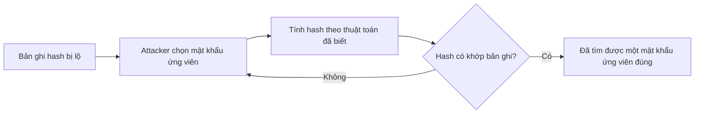
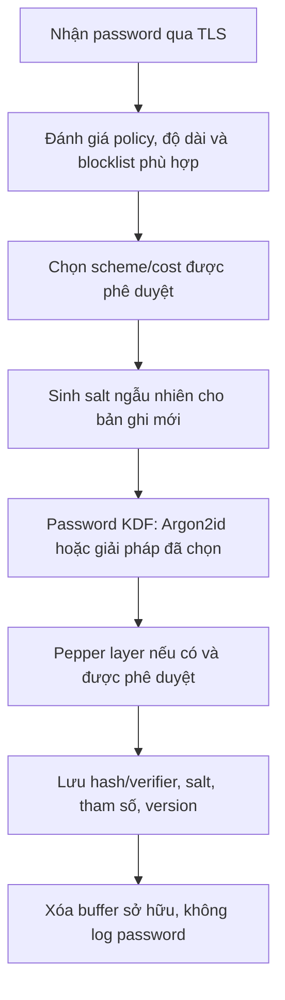
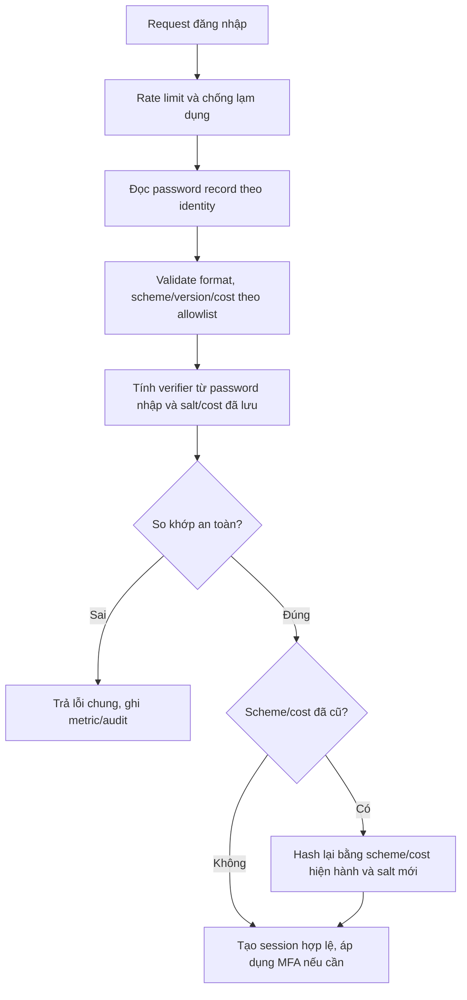
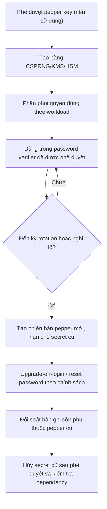

# Không dùng hash nhanh cho password

> **Chương:** Hash và MAC  
> **Module:** SECURITY_KEY_MANAGEMENT_FUNDAMENTALS — quản lý vòng đời khóa mật mã từ tạo, cấp phát, lưu trữ, sử dụng, xoay vòng đến thu hồi và hủy; kết nối mật mã đối xứng, bất đối xứng, chữ ký số, KMS/HSM, envelope encryption, kiểm soát truy cập và kiểm toán để bảo vệ khóa an toàn.

## 1. Mục tiêu học tập

Sau bài này, bạn có thể:

1. Giải thích vì sao **hash nhanh như MD5, SHA-1, SHA-256 hay SHA-512** không thích hợp để lưu mật khẩu khi chỉ dùng trực tiếp một vài lần.
2. Mô tả **tấn công đoán mật khẩu ngoại tuyến (offline cracking)** sau khi cơ sở dữ liệu chứa hash bị lộ, và phân biệt với tấn công đăng nhập trực tuyến.
3. Phân biệt **hash thông thường**, **HMAC**, **password hashing/KDF**, **mã hóa đối xứng** và **chữ ký số** theo mục đích sử dụng.
4. Giải thích vai trò của **salt**, **work factor**, **memory cost**, **pepper** và định dạng bản ghi có version trong lưu trữ mật khẩu.
5. Đánh giá lựa chọn **Argon2id**, **scrypt**, **bcrypt** và **PBKDF2-HMAC**, kể cả các giới hạn và đánh đổi khi vận hành.
6. Hiểu ví dụ Java với `PBKDF2WithHmacSHA256` và cách tích hợp một thư viện Argon2id chuẩn mà không tự viết thuật toán.
7. Thiết kế luồng đăng ký, xác minh, nâng cấp hash cũ, thay đổi mật khẩu, khôi phục tài khoản và bảo vệ pepper bằng KMS/HSM.
8. Xây dựng kế hoạch kiểm thử và kiểm toán để chống cả tấn công ngoại tuyến lẫn đăng nhập trực tuyến.

## 2. Vấn đề: hash nhanh được thiết kế cho công việc khác

**Hàm băm mật mã (cryptographic hash)** chuyển dữ liệu đầu vào thành chuỗi byte có độ dài cố định, ví dụ `SHA-256("message")` tạo ra digest 256 bit.

Các hàm băm như SHA-256 được thiết kế để tính toán **hiệu quả và nhanh**. Đó là đặc tính có ích khi kiểm tra toàn vẹn file, làm thành phần của HMAC, chữ ký số hoặc một số giao thức mật mã. Tuy nhiên, **mật khẩu do con người chọn thường có entropy thấp**, tức attacker có thể thử các khả năng dễ đoán trước khi phải xét hết mọi chuỗi ký tự.

Khi bảo vệ mật khẩu lưu trong cơ sở dữ liệu, điều cần thiết không chỉ là “không lưu plaintext”. Hệ thống phải khiến việc **thử một lượng lớn mật khẩu ứng viên trở nên tốn chi phí** ngay cả khi attacker đã sao chép được tất cả các hash và salt.

### 2.1. Ví dụ thiết kế sai

Một ứng dụng lưu:

```text
username          password_hash
--------          -----------------------------
alice             SHA256("Summer2026!")
bob               SHA256("correct-horse-example")
charlie           SHA256("Summer2026!")
```

Ví dụ trên chỉ là ký hiệu, không phải hash thật.

Nếu database bị lộ, attacker có thể tính `SHA256(candidate)` cho hàng triệu hoặc hàng tỷ mật khẩu ứng viên bằng phần cứng thích hợp, rồi so sánh với các hash đã lấy được. **Họ không cần biết khóa bí mật**, vì SHA-256 không cần khóa; cũng không cần gửi request đăng nhập tới server.

Hai người dùng có cùng mật khẩu sẽ có cùng hash khi ứng dụng không dùng salt. Attacker còn có thể biết hai tài khoản đang dùng cùng giá trị và tận dụng bảng băm tính sẵn hoặc danh sách mật khẩu bị lộ.

### 2.2. Tại sao SHA-256 không thể “giải ngược” mà vẫn bị đoán mật khẩu?

Một hàm băm mật mã phù hợp khó bị **đảo ngược theo cách tổng quát**. Nhưng tấn công mật khẩu thường không cần giải một bài toán đảo hàm băm: attacker **chủ động tạo các ứng viên** rồi thử.



Nếu có danh sách các mật khẩu phổ biến, biến thể tên người dùng hoặc mật khẩu từng bị rò rỉ, attacker thường thử các giá trị ấy trước. **Độ mạnh của SHA-256 không làm cho một mật khẩu yếu trở nên khó đoán** nếu mỗi phép thử vẫn rất nhanh.

**Điểm mấu chốt:** thuật toán dùng để kiểm tra digest nhanh thường **không nên được dùng một mình** làm cơ chế lưu trữ mật khẩu.

## 3. Mô hình đe dọa: tấn công trực tuyến và ngoại tuyến

| Đặc điểm | Tấn công trực tuyến (online) | Tấn công ngoại tuyến (offline) |
| --- | --- | --- |
| Attacker có gì? | Endpoint đăng nhập, tài khoản mục tiêu, danh sách mật khẩu ứng viên | Hash/salt và tham số từ database hoặc backup bị lộ |
| Mỗi lần thử | Gửi request tới hệ thống | Tự tính toán trên thiết bị của attacker |
| Giới hạn bởi | Rate limit, lockout phù hợp, bot detection, MFA, giám sát | Tốc độ phần cứng, chi phí thuật toán, entropy của mật khẩu |
| Có cần gọi server sau khi trộm dữ liệu? | Có | **Không** |
| Biện pháp chính | Chống credential stuffing, kiểm soát phiên và MFA | **Password hashing chậm/có chi phí bộ nhớ**, salt, chính sách mật khẩu, bảo vệ dữ liệu |

Trong trường hợp offline, biện pháp **giới hạn 5 lần đăng nhập mỗi phút** gần như không ảnh hưởng đến tốc độ thử mật khẩu của attacker. Chỉ có kiểm soát mật khẩu ban đầu, **cơ chế lưu trữ** và chi phí tính toán mới trực tiếp làm chậm quá trình thử đoán trên bản sao dữ liệu.

Ngược lại, password hashing mạnh **không thay thế** rate limiting hay MFA: nếu attacker đã biết mật khẩu người dùng từ vụ lộ dữ liệu khác, họ có thể đăng nhập bằng mật khẩu đúng mà không cần crack hash trong database này.

### 3.1. Vì sao gọi là tấn công GPU/ASIC?

Hàm băm nhanh thường có thể được tính song song ở quy mô lớn. GPU hoặc phần cứng chuyên dụng có thể kiểm tra rất nhiều ứng viên khi mỗi phép thử chỉ yêu cầu ít tài nguyên. Khả năng thực tế phụ thuộc thuật toán, thiết bị, cách triển khai và độ phức tạp của mật khẩu.

**Password hashing hiện đại** tăng chi phí cho mỗi ứng viên bằng cách dùng **thời gian tính toán**, và với một số thuật toán, **bộ nhớ đáng kể**. Điều đó làm tấn công ngoại tuyến tốn tài nguyên hơn, dù **không thể bảo đảm** mọi mật khẩu đều không thể crack.

### 3.2. Vì sao hash lại không phải encryption?

Mục tiêu xác thực mật khẩu thông thường là **kiểm tra mật khẩu người dùng vừa nhập có khớp bản ghi**; hệ thống **không cần khôi phục mật khẩu gốc**.

- **Mã hóa** được thiết kế để có thể giải mã nếu có khóa phù hợp.
- **Hash thông thường** tạo digest, không có khóa để giải mã.
- **Password hashing** sử dụng salt và chi phí công việc để tạo giá trị kiểm tra mật khẩu; vẫn **không dùng cơ chế giải mã mật khẩu gốc**.
- **HMAC** dùng một khóa bí mật và hàm băm để xác thực nguồn gốc/tính toàn vẹn của thông điệp, hoặc làm thành phần của một KDF; **HMAC-SHA256(password)** thuần cũng không tự trở thành password hashing chậm.
- **Chữ ký số** dùng cặp khóa bất đối xứng để chứng minh tính xác thực một thông điệp; không phải giải pháp lưu mật khẩu.

Nếu ứng dụng có chức năng “gửi lại mật khẩu hiện tại cho người dùng”, đó là dấu hiệu hệ thống có thể đang lưu **plaintext hoặc bản có thể giải mã** — không phù hợp với mục tiêu lưu trữ mật khẩu xác thực thông thường. Quy trình đúng là **đặt lại mật khẩu** sau khi xác minh danh tính và token khôi phục.

## 4. Vì sao MD5, SHA-1, SHA-256 và SHA-512 trực tiếp đều không phù hợp?

Cần phân biệt hai vấn đề:

1. **Độ an toàn mật mã của hàm băm:** MD5 và SHA-1 không còn phù hợp cho nhiều mục đích cần chống collision; SHA-256/SHA-512 vẫn là thành phần mật mã quan trọng.
2. **Chi phí đoán mật khẩu:** một lần SHA-256 hoặc SHA-512 vẫn được thiết kế để nhanh. Dùng thuật toán hash được xem là mạnh về chống collision **không thay thế** password hashing/KDF thích hợp.

| Thiết kế | Có nên dùng để lưu password mới? | Vấn đề |
| --- | --- | --- |
| `MD5(password)` | **Không** | Hash nhanh; MD5 còn có các yếu điểm mật mã khác |
| `SHA1(password)` | **Không** | Hash nhanh; SHA-1 có các giới hạn bảo mật hiện đại |
| `SHA256(password)` | **Không** | Hash nhanh, dễ thử đoán hàng loạt |
| `SHA512(salt || password)` | **Không** nếu chỉ một/few lần | Salt hữu ích nhưng phép thử vẫn rất nhanh |
| `SHA256(SHA256(password))` | **Không** | Vài vòng hash nhanh không tạo work factor đủ rõ hoặc memory hardness |
| `HMAC-SHA256(key, password)` thuần | **Không xem là đủ** | Có thể hữu ích khi làm pepper layer, nhưng không tự có chi phí đoán mật khẩu tương đương password KDF |
| `AES_encrypt(password)` | **Không** | Có thể giải mã nếu khóa bị lộ; không phải cơ chế kiểm tra mật khẩu được thiết kế chuyên biệt |
| **Argon2id với salt và tham số hợp lý** | **Có, thường ưu tiên khi được hỗ trợ** | Cần thư viện và cấu hình bộ nhớ/thời gian phù hợp |
| **scrypt với salt và tham số hợp lý** | **Có, khi phù hợp** | Memory-hard; phải benchmark và kiểm soát tài nguyên |
| **bcrypt với cost và xử lý đầu vào đúng** | **Có trong bối cảnh phù hợp/legacy** | Giới hạn đầu vào, cần quản lý cost và nguy cơ truncate |
| **PBKDF2-HMAC với nhiều vòng phù hợp** | **Có, khi đáp ứng yêu cầu hệ thống** | Chuẩn hóa rộng; không memory-hard như Argon2id/scrypt |

**Không sửa hệ thống chỉ bằng cách đổi tên thuật toán từ SHA-256 sang SHA-512**. Cần thay cách lưu password thành **password hashing scheme** có salt, cost, version và khả năng nâng cấp.

## 5. Salt: duy nhất theo từng password, không phải một bí mật

**Salt** là chuỗi byte ngẫu nhiên được tạo riêng cho mỗi **bản ghi hash mật khẩu**, rồi đưa vào password hashing scheme.

Với hai người dùng chọn cùng một mật khẩu, việc dùng salt khác nhau sẽ tạo giá trị hash khác nhau (với cùng thuật toán và tham số). Điều này:

- Ngăn việc nhìn hash để kết luận hai người dùng có cùng password.
- Làm giảm hiệu quả của các bảng hash tính sẵn dùng chung cho nhiều tài khoản.
- Buộc attacker đánh giá mỗi salt/mục tiêu thay vì chia sẻ toàn bộ kết quả tính toán trên nhiều salt.
- **Không làm mật khẩu yếu trở nên mạnh về entropy**, và không làm SHA-256 một vòng đủ an toàn.

### 5.1. Quy tắc dùng salt

1. Sinh salt bằng **CSPRNG** (ví dụ `SecureRandom` trong Java), độ dài đủ lớn theo yêu cầu scheme; 16 byte ngẫu nhiên là ví dụ phổ biến.
2. Dùng salt mới khi tạo password hash mới, bao gồm lần đổi hoặc reset mật khẩu.
3. Salt **không cần giữ bí mật**; có thể lưu cùng hash.
4. Không dùng username, timestamp, user ID hoặc email đơn thuần làm salt “ngẫu nhiên”. Các giá trị đó có thể đoán được hoặc trùng.
5. Không dùng một salt chung cho toàn bộ hệ thống.
6. Khi đổi tham số hoặc thuật toán và rehash, sinh **salt mới** theo scheme được chọn.
7. Với thư viện Argon2id/bcrypt chuyên dụng, hãy dùng API tự tạo/quản lý salt đúng chuẩn, tránh tự ghép chuỗi nếu không cần.

### 5.2. Salt không thay pepper

| Thuộc tính | Salt | Pepper |
| --- | --- | --- |
| Bí mật? | **Không** | **Có** |
| Phạm vi | Thường riêng cho mỗi bản ghi password | Thường một bí mật dịch vụ/nhóm tài khoản theo chính sách |
| Nơi lưu | Cùng bản ghi hash | **Tách khỏi database chứa hash**, ví dụ secret manager/KMS/HSM |
| Mục tiêu | Ngăn hash trùng và bảng hash tính sẵn dùng chung | Tăng rào cản nếu chỉ database bị đánh cắp |
| Vòng đời | Tạo mới khi rehash password | Quản lý cấp quyền, version, rotation và ứng phó lộ secret |
| Có thay password KDF không? | **Không** | **Không** |

**Pepper là tùy chọn bổ sung**, không thay thế Argon2id/PBKDF2/scrypt/bcrypt và không thể biện minh cho việc chỉ dùng `SHA256(password)`.

## 6. Password hashing hiện đại: làm chậm có chủ đích

Một **password hashing function** được thiết kế để hệ thống hợp lệ vẫn xác minh được mật khẩu trong thời gian có thể chấp nhận, nhưng attacker phải trả chi phí đáng kể cho mỗi mật khẩu ứng viên.

Ba nhóm tham số cần hiểu:

- **Time cost / iterations:** số vòng hoặc mức công việc tính toán cần thực hiện cho một lần hash.
- **Memory cost:** lượng bộ nhớ cần dùng trong lúc tính hash, gây khó khăn cho tính toán hàng loạt trên phần cứng có giới hạn bộ nhớ.
- **Parallelism:** mức song song nội bộ do thuật toán cho phép; tác động đến hiệu năng và tài nguyên mỗi lần xác minh.

**Không chọn cost chỉ vì thấy một con số trong bài viết cũ.** Tham số nên dựa trên khuyến nghị hiện hành của scheme, yêu cầu tuân thủ và **benchmark trên hạ tầng thực tế**. Phải xét lưu lượng đăng nhập đồng thời, giới hạn RAM/CPU, container, khả năng bị DoS và kế hoạch tăng cost trong tương lai.

### 6.1. Argon2id: lựa chọn ưu tiên trong nhiều hệ thống mới

**Argon2id** là biến thể Argon2 kết hợp đặc tính của Argon2i và Argon2d. Nó được thiết kế để chống đoán mật khẩu và có thể cấu hình **bộ nhớ, số lần xử lý, độ song song**.

Một định dạng lưu hash thường gặp là **PHC string**, ví dụ minh họa:

```text
$argon2id$v=19$m=65536,t=3,p=1$<salt-encoded>$<hash-encoded>
```

Ý nghĩa:

- `argon2id`: thuật toán.
- `v=19`: phiên bản Argon2 biểu diễn trong định dạng.
- `m`: memory cost, thường tính theo KiB trong kiểu biểu diễn này.
- `t`: time cost.
- `p`: parallelism.
- Hai trường cuối lưu salt và hash đã mã hóa thành chuỗi.

**Các giá trị trong ví dụ chỉ minh họa cách đọc tham số, không phải cấu hình áp dụng chung.** Chính sách triển khai phải chọn/bảo trì cost theo điều kiện cụ thể và hướng dẫn mới nhất.

Ưu điểm chính của Argon2id là **memory-hard**: nhiều ứng viên song song cần thêm tài nguyên bộ nhớ, không chỉ CPU. Tuy nhiên, memory-hard không đồng nghĩa không thể crack; attacker vẫn có thể thử đoán, đặc biệt với password yếu hoặc từ danh sách rò rỉ.

Đối với Java, dùng **thư viện Argon2id đã được kiểm thử**, xác minh nguồn và version; `MessageDigest.getInstance("Argon2id")` không phải API mặc định có thể giả định tồn tại trên mọi JDK.

### 6.2. scrypt: một lựa chọn memory-hard

**scrypt** là password-based KDF có cost CPU và bộ nhớ. Nó hữu ích nếu Argon2id không được hỗ trợ hoặc khi hệ thống có lý do kỹ thuật, tương thích hay chính sách để sử dụng scrypt.

Khi triển khai phải chọn và lưu chính xác các tham số như `N`, `r`, `p` theo API/thư viện; benchmark bộ nhớ và thời gian. Không sao chép tham số “có vẻ lớn” rồi bỏ qua rủi ro hàng nghìn request xác minh cùng lúc làm cạn RAM.

### 6.3. bcrypt: sử dụng thận trọng với giới hạn đầu vào

**bcrypt** được dùng rộng rãi và có hệ số cost. Với các thư viện/định dạng bcrypt phổ biến, đầu vào mật khẩu có thể bị **giới hạn ở 72 byte**; phần vượt quá có thể bị cắt hoặc thư viện từ chối. Đây là giới hạn **byte**, không phải số ký tự Unicode.

Ví dụ một password Unicode dài 50 ký tự vẫn có thể dài hơn 72 byte ở UTF-8. Hệ thống phải xác định và kiểm thử chính sách xử lý đầu vào; không âm thầm cắt password rồi coi hai giá trị khác nhau là tương đương.

Không tùy tiện **pre-hash password bằng SHA-256 trước bcrypt** để “né giới hạn” nếu chưa dựa vào một sơ đồ được thẩm định và xử lý đúng binary/encoding, NUL, domain separation và migration. Trong nhiều hệ thống mới có khả năng dùng Argon2id, đây là lựa chọn dễ tránh giới hạn này hơn.

### 6.4. PBKDF2-HMAC: tương thích và tuân thủ

**PBKDF2** sử dụng hàm PRF như HMAC-SHA256 lặp nhiều lần để dẫn xuất một chuỗi byte từ password và salt. PBKDF2 được chuẩn hóa, có hỗ trợ trong Java JCA/JCE và có thể phù hợp với một số yêu cầu tương thích/tuân thủ khi triển khai bằng module đã được phê duyệt.

Nhược điểm: PBKDF2 **không có memory-hardness như Argon2id hoặc scrypt**. Vì vậy khi chọn PBKDF2 cần đặc biệt quan tâm tới số vòng, hiệu năng phần cứng đoán password và các hướng dẫn an ninh hiện hành.

**Không thể lấy một con số iterations của PBKDF2 đem áp trực tiếp cho Argon2id**: các tham số có ý nghĩa và chi phí khác nhau.

### 6.5. So sánh lựa chọn trong thực tế

| Tiêu chí | Argon2id | scrypt | bcrypt | PBKDF2-HMAC |
| --- | --- | --- | --- | --- |
| Thiết kế chuyên cho password | Có | Có | Có | Có |
| Có tham số bộ nhớ đáng kể | **Có** | **Có** | Không theo cùng mô hình memory-hard hiện đại | Không |
| Tham số thường cần lưu | Memory, time, parallelism, version | N/r/p hoặc tương đương | Cost, version/prefix | PRF, iterations, salt, output length |
| Vấn đề cần lưu ý | Memory/latency và thư viện | Memory/latency và cấu hình | Giới hạn đầu vào thường 72 byte, cost | Iteration cao, không memory-hard |
| Khi nào xem xét | Hệ thống mới có thư viện hỗ trợ | Thay thế phù hợp nếu cần memory-hard | Hệ thống đang dùng và có chính sách nâng cấp | Tương thích hoặc yêu cầu tuân thủ xác định |

**Lựa chọn cần xuất phát từ yêu cầu bảo vệ password và năng lực vận hành**, không từ sự tiện lợi của một hàm `hash()` sẵn có.

## 7. Lưu bản ghi password hash sao cho có thể nâng cấp

Một bản ghi tốt không chỉ chứa một chuỗi hash không rõ thuật toán. Nó cần có **dữ liệu đủ để xác minh và nâng cấp** trong tương lai.

Ví dụ về thiết kế metadata:

```json
{
  "userId": "u-4825",
  "passwordScheme": "argon2id",
  "passwordHash": "$argon2id$v=19$m=...$<salt>$<hash>",
  "passwordUpdatedAt": "2026-11-01T10:00:00Z",
  "pepperVersion": "pepper-2"
}
```

Các dấu `...` và `<...>` là placeholder, không phải định dạng hoàn chỉnh để import trực tiếp.

Nếu định dạng hash chuẩn đã **nhúng thuật toán, salt và tham số**, tránh lặp metadata mâu thuẫn. Trường `pepperVersion` chỉ cần nếu hệ thống thực sự sử dụng pepper. Các thông tin như `passwordUpdatedAt` phục vụ chính sách vận hành, không tham gia password KDF trừ khi thiết kế nói rõ.

### 7.1. Những thông tin nên tồn tại trong storage

- Thuật toán và phiên bản scheme.
- Salt riêng cho bản ghi (hoặc salt nằm trong hash string).
- Work factor, memory cost, parallelism hoặc tham số tương ứng.
- Derived hash/output và độ dài theo scheme.
- Pepper version nếu áp dụng, nhưng **không lưu pepper** cạnh hash.
- Lịch sử thay đổi mật khẩu phục vụ kiểm soát, không lưu plaintext password.
- Metadata migration/legacy tối thiểu để biết bản ghi nào còn cần nâng cấp.

Hash và salt vẫn là **dữ liệu bảo mật cần kiểm soát truy cập**. Việc chúng không phải plaintext không có nghĩa có thể công khai database/backup chứa chúng.

### 7.2. Vì sao cần versioning?

Tham số phù hợp hôm nay có thể trở nên quá yếu sau vài năm; yêu cầu tuân thủ hoặc thư viện cũng có thể đổi.

Với mỗi bản ghi, hệ thống cần biết nó được tạo bởi Argon2id, PBKDF2 hay cơ chế cũ nào. Khi người dùng đăng nhập thành công, dịch vụ có thể **rehash mật khẩu vừa nhập theo cấu hình hiện hành**, dùng salt mới rồi thay bản ghi cũ.

Không chọn thuật toán dựa vào dữ liệu client gửi mà không có allowlist phía server; cũng không cho người dùng tự yêu cầu giảm cost bằng cách thay tham số hash trên request.

## 8. Ví dụ Java: PBKDF2-HMAC-SHA256 đúng vai trò

Ví dụ sau minh họa cách dùng **JCA/JCE** tạo salt ngẫu nhiên, dẫn xuất hash bằng PBKDF2-HMAC-SHA256 và so sánh kết quả khi đăng nhập. Đây là **ví dụ học tập về API PBKDF2**, không phải tuyên bố PBKDF2 luôn tốt hơn Argon2id hoặc cấu hình cost đã phù hợp production.

**Lý do dùng PBKDF2 trong đoạn Java:** Java có `SecretKeyFactory` với `PBKDF2WithHmacSHA256` ở những môi trường hỗ trợ transformation này. Argon2id nên được gọi qua **thư viện chuẩn được lựa chọn và kiểm thử**, tránh tự triển khai thuật toán chỉ để có mã demo.

```java
import java.security.GeneralSecurityException;
import java.security.MessageDigest;
import java.security.SecureRandom;
import java.util.Arrays;
import java.util.Objects;
import javax.crypto.SecretKeyFactory;
import javax.crypto.spec.PBEKeySpec;

public final class Pbkdf2PasswordStorage {
    private static final String ALGORITHM = "pbkdf2-sha256";
    private static final String JCA_NAME = "PBKDF2WithHmacSHA256";
    private static final int SALT_BYTES = 16;
    private static final int HASH_BITS = 256;

    // Chỉ là giới hạn an toàn khi parse record, không phải mức cost
    // được đề xuất cho mọi hệ thống. Chính sách thực tế do đội an ninh
    // cấu hình và được đo benchmark trên môi trường triển khai.
    private static final int MAX_ITERATIONS = 2_000_000;

    private static final SecureRandom RANDOM = new SecureRandom();

    private Pbkdf2PasswordStorage() {}

    public record PasswordRecord(
            String algorithm,
            int iterations,
            byte[] salt,
            byte[] derivedHash
    ) {
        public PasswordRecord {
            Objects.requireNonNull(algorithm);
            Objects.requireNonNull(salt);
            Objects.requireNonNull(derivedHash);
            salt = salt.clone();
            derivedHash = derivedHash.clone();
        }

        @Override
        public byte[] salt() {
            return salt.clone();
        }

        @Override
        public byte[] derivedHash() {
            return derivedHash.clone();
        }
    }

    public static PasswordRecord create(char[] password, int workFactor)
            throws GeneralSecurityException {
        Objects.requireNonNull(password);
        validateIterations(workFactor);

        byte[] salt = new byte[SALT_BYTES];
        RANDOM.nextBytes(salt); // Mỗi lần tạo hash có salt riêng.

        byte[] derived = derive(password, salt, workFactor);
        try {
            return new PasswordRecord(ALGORITHM, workFactor, salt, derived);
        } finally {
            Arrays.fill(derived, (byte) 0); // Xóa buffer do hàm sở hữu.
        }
    }

    public static boolean verify(char[] password, PasswordRecord record)
            throws GeneralSecurityException {
        Objects.requireNonNull(password);
        Objects.requireNonNull(record);

        if (!ALGORITHM.equals(record.algorithm())) {
            return false; // Không tự fallback sang scheme yếu.
        }
        validateIterations(record.iterations());

        byte[] salt = record.salt();
        byte[] expected = record.derivedHash();
        if (salt.length != SALT_BYTES || expected.length != HASH_BITS / 8) {
            return false; // Từ chối record không đúng định dạng.
        }

        byte[] actual = derive(password, salt, record.iterations());
        try {
            return MessageDigest.isEqual(actual, expected);
        } finally {
            Arrays.fill(actual, (byte) 0);
            Arrays.fill(expected, (byte) 0);
        }
    }

    private static byte[] derive(char[] password, byte[] salt, int iterations)
            throws GeneralSecurityException {
        PBEKeySpec spec = new PBEKeySpec(
                password, salt, iterations, HASH_BITS);
        try {
            return SecretKeyFactory.getInstance(JCA_NAME)
                    .generateSecret(spec)
                    .getEncoded();
        } finally {
            spec.clearPassword();
        }
    }

    private static void validateIterations(int iterations) {
        if (iterations <= 0 || iterations > MAX_ITERATIONS) {
            throw new IllegalArgumentException("Invalid PBKDF2 iterations");
        }
    }
}
```

### 8.1. Các bước tích hợp vào ứng dụng

Tạo tài khoản:

```text
1. Nhận mật khẩu qua HTTPS/TLS và áp dụng kiểm tra chính sách đầu vào.
2. Server chọn work factor từ cấu hình an ninh đã benchmark.
3. hashRecord = Pbkdf2PasswordStorage.create(password, workFactor)
4. Lưu algorithm + iterations + salt + derivedHash vào database.
5. Không log plaintext password, không ghi password vào analytics/tracing.
6. Dọn char[] do ứng dụng sở hữu khi không còn cần.
```

Xác minh đăng nhập:

```text
1. Áp dụng rate limiting/chống bot trước khi làm phép tính KDF đắt.
2. Tìm password record theo tài khoản; dùng luồng lỗi chung khi không tồn tại.
3. Đọc algorithm/parameters từ record, đối chiếu allowlist server.
4. ok = Pbkdf2PasswordStorage.verify(password, record)
5. Nếu ok: phát hành phiên hợp lệ và kiểm tra cần rehash hay không.
6. Nếu sai: trả lỗi đăng nhập chung, ghi audit đủ dùng nhưng không lộ password.
```

**Không lưu password như một `String` sống lâu trong JVM nếu có thể tránh được**. Java `String` bất biến, khó chủ động xóa; `char[]` thuận tiện hơn cho việc xóa buffer do ứng dụng trực tiếp quản lý. Tuy nhiên, xóa một `char[]` **không bảo đảm** mọi bản sao mật khẩu trong thư viện, request parser, heap dump hoặc native memory đã bị xóa.

### 8.2. Giới hạn của ví dụ Java

1. `MAX_ITERATIONS` ở trên chỉ là **giới hạn parse trong minh họa**, không phải công bố mức cost tối thiểu đủ an toàn. Trong production cần chính sách **min/current/max** cho các bản ghi được hỗ trợ, chống record bị can thiệp để yêu cầu tính toán quá lớn (DoS).
2. Record trong ví dụ chỉ chứa dữ liệu cấu trúc. Cần thiết kế **serialization chuẩn hóa**, giới hạn độ dài salt/hash/base64, hạn chế dữ liệu đầu vào và quản lý lỗi.
3. KDF chạy trên dữ liệu nhạy cảm. Kết quả phụ thuộc bộ provider được cài và chính sách crypto/JDK; cần kiểm thử sự tương thích trong các phiên bản deploy.
4. Biến `password` phải được kiểm soát ở tầng HTTP và service; việc gọi `spec.clearPassword()` chỉ xóa một bản sao nội bộ.
5. `MessageDigest.isEqual` có cách so sánh phù hợp hơn `Arrays.equals` cho dữ liệu mật mã, nhưng **không bảo đảm toàn bộ giao thức không có timing side-channel**. Cần quản lý lỗi, account enumeration, rate limit và thực thi đồng nhất ở mức ứng dụng.
6. Ví dụ chưa triển khai pepper, MFA, lockout, kiểm tra mật khẩu bị lộ, migration legacy, metric, backup hoặc audit.
7. Khi ứng dụng có thể triển khai Argon2id một cách đáng tin cậy, hãy cân nhắc **Argon2id làm scheme mới** và duy trì PBKDF2 cho những record cần tương thích theo chính sách.

## 9. Ví dụ Argon2id ở lớp dịch vụ

Vì Java không cung cấp một API Argon2id thống nhất trên tất cả JDK, đoạn sau là **pseudocode**, không đại diện cho một thư viện cụ thể và **không thể biên dịch nguyên trạng**. Nó thể hiện những trách nhiệm mà ứng dụng cần có.

```java
// PSEUDOCODE: chọn thư viện Argon2id đã được thẩm định.
PasswordHasher hasher = PasswordHasher.argon2id(
    approvedMemoryCost,
    approvedTimeCost,
    approvedParallelism
);

char[] password = readPasswordFromRequest();
try {
    // Hash string bao gồm phiên bản, salt ngẫu nhiên, cost và hash.
    String storedHash = hasher.hash(password);
    passwordRepository.save(userId, storedHash);

    // Khi đăng nhập:
    boolean matches = hasher.verify(storedHashFromDatabase, password);
    if (matches && hasher.needsRehash(storedHashFromDatabase)) {
        String upgraded = hasher.hash(password);
        passwordRepository.compareAndSwapHash(
            userId, storedHashFromDatabase, upgraded
        );
    }
} finally {
    clearApplicationOwnedPasswordBuffer(password);
}
```

Những điểm cần kiểm tra với thư viện thật:

- `hash` có tự sinh salt ngẫu nhiên riêng không; định dạng output có đúng PHC và chứa tham số không.
- `verify` có **xác minh phiên bản và từ chối input không hợp lệ** theo chính sách không.
- `needsRehash` đánh giá thuật toán/phiên bản và cost hiện hành đúng cách không.
- Memory/time/parallelism có thể cấu hình dựa trên benchmark không.
- Khi sai password hoặc record lỗi, API có tạo timing/error khác biệt quá lớn dẫn tới account enumeration không.
- Thư viện có phiên bản, test vector, lịch cập nhật và hỗ trợ các nền tảng runtime đang triển khai không.

**Không tự viết Argon2id bằng cách lặp SHA-256 hoặc cấp phát một mảng RAM lớn**. Memory-hard password KDF là thuật toán có đặc tả, không phải “hash chậm do sleep”.

## 10. Pepper: lớp bảo vệ bổ sung và vòng đời bí mật

**Pepper** là một bí mật do server giữ, bổ sung vào quá trình tạo/xác minh bản ghi password. Mục tiêu là tăng rào cản đối với attacker **chỉ lấy được database chứa hash và salt**, chưa lấy được pepper.

Một cách thiết kế ở mức khái niệm là dùng một **HMAC có khóa pepper** trên đầu ra password KDF, với cơ chế version hóa và kiểm soát định dạng:

```text
password + salt
      |
      v
Argon2id / password KDF
      |
      v
derived password hash
      |
      +-- HMAC(pepper key, derived hash + context/version)
      |
      v
stored verifier + salt + cost + pepperVersion
```

Đây là **sơ đồ tư duy**, không phải đặc tả giao thức phải áp dụng nguyên văn. Nếu sử dụng, hãy chọn kiến trúc pepper đã được đánh giá, có **domain separation**, xử lý version và lỗi; không tự nghĩ ra một phép cộng/ghép khóa để thay password KDF.

### 10.1. Pepper nên đặt ở đâu?

- Không lưu pepper trong cùng bảng, cùng backup dễ đọc hoặc cùng quyền truy cập với password hash.
- Bảo vệ bằng **secret manager, KMS/HSM hoặc hạ tầng quản lý bí mật** tương ứng.
- Hạn chế quyền sử dụng theo workload identity và môi trường; không cho admin DB mặc nhiên đọc pepper.
- Ghi audit khi thay quyền, truy cập secret hoặc dùng API mật mã theo khả năng nền tảng.
- Có kế hoạch dự phòng, khôi phục và rotation phù hợp với tính sẵn sàng của dịch vụ đăng nhập.

**KMS không tự biến mọi pepper thành khóa non-exportable.** Nếu ứng dụng lấy pepper dạng rõ qua API secret manager, runtime có thể tiếp cận bí mật. Nếu HSM/KMS thực hiện HMAC ở bên trong, cần kiểm tra API, latency, quota và ranh giới dữ liệu. Việc đưa HMAC vào đường login có thể ảnh hưởng lớn tới thời gian và lượng request tới dịch vụ quản lý khóa.

### 10.2. Rotation pepper không đơn giản

Một password hash là hàm của **mật khẩu gốc**, salt, cost và những bí mật bổ sung. Khi **không còn plaintext password**, hệ thống thường **không thể tái tạo một verifier mới dưới pepper khác** chỉ từ hash/metadata đã lưu, trừ khi thiết kế có lớp biến đổi cho phép làm như vậy.

Chiến lược khả thi tùy kiến trúc:

1. Duy trì các pepper version **được kiểm soát** trong giai đoạn chuyển đổi.
2. Khi user đăng nhập thành công, xác minh bằng pepper cũ rồi tạo verifier mới dưới pepper hiện hành, với salt và cost được cập nhật.
3. Đặt thời hạn migration; với tài khoản ít đăng nhập có thể cần **reset password** theo chính sách.
4. Nếu pepper **bị lộ**, đánh giá phạm vi khẩn cấp và khả năng buộc reset mật khẩu; không coi việc chỉ đổi phiên bản là đã khắc phục tất cả.
5. Không giữ pepper cũ vô hạn chỉ để tránh tác động vận hành.

**Phân biệt pepper bị lộ với salt bị lộ:** salt được thiết kế để công khai. Pepper là bí mật, cần được quản trị vòng đời như một tài sản khóa mật mã.

## 11. Quy trình tạo, xác minh và nâng cấp password hash

### 11.1. Đăng ký hoặc đổi mật khẩu



**Quan trọng:** kiểm tra password mạnh nên ưu tiên **độ dài cho phép đủ lớn**, hỗ trợ password manager/passphrase và so sánh với danh sách password đã lộ hoặc quá phổ biến theo chính sách. Không tự động yêu cầu những quy tắc phức tạp (bắt buộc một ký tự đặc biệt, chữ hoa, chữ số…) mà đánh đổi trải nghiệm và khiến người dùng chọn mẫu dễ đoán.

Password hash **không được tái sử dụng** như một khóa AES/DEK, HMAC key hoặc khóa ký. Nếu dùng password để bảo vệ một data key trong hệ thống mã hóa đầu cuối, đó là **thiết kế password-based key derivation/encryption riêng**, có mô hình đe dọa và quy tắc khôi phục khác, không đơn thuần lấy verifier đăng nhập làm encryption key.

### 11.2. Xác minh đăng nhập



Để hạn chế **account enumeration**, hệ thống nên dùng thông báo lỗi tương đương cho user không tồn tại và sai password. Có thể áp dụng một phép xác minh KDF giả với record giả hợp lệ khi tài khoản không tồn tại, theo thiết kế đã benchmark để giảm khác biệt thời gian; cần thận trọng với DoS và không coi đó là giải pháp duy nhất.

**Không so sánh password plaintext** với giá trị nào trong DB. Luồng đúng là **tính verifier mới theo record** rồi so khớp kết quả, chỉ tạo session sau khi mọi bước xác thực bắt buộc đạt.

### 11.3. Vì sao upgrade-on-login hữu ích?

Khi đội an ninh muốn tăng cost hoặc chuyển `bcrypt`/`PBKDF2` sang `Argon2id`:

- User nhập password trong một lần đăng nhập thành công.
- Server **đang có password gốc trong bộ nhớ** để xác minh.
- Sau khi xác minh record cũ, server tạo **hash mới bằng scheme hiện hành và salt mới**.
- Ghi bản mới bằng update có điều kiện (*compare-and-swap*) để không ghi đè password vừa thay trên request khác.
- Lần đăng nhập sau chỉ cần đường xác minh scheme mới.

Đây là cách giảm nhu cầu yêu cầu toàn bộ người dùng reset password một lúc. Nhưng tài khoản **không đăng nhập** sẽ chưa được nâng cấp; cần chính sách thời hạn, theo dõi và kế hoạch reset đối với những record legacy còn lại.

## 12. Nâng cấp từ MD5/SHA-1/SHA-256 cũ sang password KDF

Một hệ thống legacy có thể đang lưu `SHA256(password)`, `MD5(password)` hoặc một biến thể SHA có salt nhưng chỉ một vài vòng. Không thể đổi sang Argon2id bằng cách “thay tên cột” hoặc biến đổi chắc chắn tất cả bản ghi thành hash password gốc mà không có password.

### 12.1. Lộ trình migration

| Bước | Hành động | Điều kiện thành công |
| --- | --- | --- |
| **Kiểm kê** | Xác định scheme legacy, định dạng, charset, salt và nguồn dữ liệu/backup | Biết bản ghi nào dùng thuật toán nào |
| **Ưu tiên bảo vệ** | Bổ sung rate limit, MFA khi phù hợp, theo dõi credential stuffing | Giảm rủi ro online trong lúc di chuyển |
| **Chọn scheme mới** | Argon2id/scrypt hoặc phương án đã phê duyệt, benchmark tham số | Đạt hiệu năng, an toàn và khả năng vận hành |
| **Version hóa record** | Phân biệt `legacy_sha256`, `bcrypt`, `argon2id` rõ ràng | Không dựa vào đoán độ dài/hash prefix mơ hồ |
| **Verify legacy đúng hạn chế** | Chỉ dùng đường cũ để xác minh bản ghi cũ, có rate limit và log | Không tạo thêm bản ghi password mới bằng thuật toán cũ |
| **Rehash sau xác minh** | Tạo hash mới với salt/params hiện hành, ghi thay có điều kiện | Record được nâng cấp, không mất khả năng đăng nhập |
| **Xử lý tài khoản im lặng** | Nhắc/ép đổi password sau thời hạn rủi ro phù hợp | Giảm dần số record legacy |
| **Loại bỏ code cũ** | Khi không còn dependency hợp lệ, xóa đường hash legacy và cập nhật runbook | Không có path mới quay về SHA/MD5 trực tiếp |
| **Khôi phục/backup** | Kiểm thử restore, đồng bộ schema và policy migration | Không làm backup trở nên không dùng được |

### 12.2. Vì sao không chỉ tính Argon2id(SHA256(password))?

Có thể nghĩ “lấy hash cũ từ DB làm input Argon2id rồi lưu kết quả là đủ”. Cách này **không tương đương** `Argon2id(password)`:

- Đầu vào cuối cùng là **hash legacy**; ai đã lấy được hash SHA-256 cũ có thể dùng chính giá trị đó làm một dạng bí mật để đối chiếu hoặc đăng nhập tùy cách triển khai.
- Những giới hạn và khả năng đoán của cơ chế cũ không tự biến mất; nếu attacker đã crack mật khẩu trước đó, mật khẩu gốc vẫn bị lộ.
- Luồng xác minh và version trở nên phức tạp, có nguy cơ không kiểm soát kiểu đầu vào.
- Không tạo sự bảo đảm rằng người dùng đã chọn password mới mạnh hơn.

Có những thiết kế **bọc lại hash legacy tạm thời** để giảm rủi ro trong quá trình chuyển đổi, nhưng phải được đánh giá riêng và ghi rõ trạng thái trung gian; ưu tiên **rehash mật khẩu gốc sau khi đăng nhập thành công** hoặc yêu cầu reset password khi cần.

### 12.3. Không ép reset hàng loạt theo cách thiếu kiểm soát

Nếu vụ lộ hash có nguy cơ cao hoặc thuật toán quá yếu, tổ chức có thể cần **buộc reset mật khẩu**, nhưng phải thiết kế cơ chế token ngắn hạn, một lần, đủ entropy, giới hạn số lần thử và ngăn lộ qua log/URL/analytics. Quy trình reset cũng phải kiểm soát takeover qua email/điện thoại, thông báo sự kiện bảo mật và vô hiệu phiên cũ khi phù hợp.

**Không gửi password mới dạng plaintext qua email** hoặc lưu token reset không có TTL/rate limit. Password reset là một thành phần của vòng đời xác thực, không phải cách để khôi phục plaintext password đã hash.

## 13. Kiểm soát tài nguyên và nguy cơ denial-of-service

Password KDF càng tốn CPU/RAM thì mỗi request đăng nhập càng tiêu tốn tài nguyên. Attacker có thể lợi dụng chính đặc tính này để gửi lượng lớn request và làm cạn tài nguyên.

### 13.1. Chọn cost theo benchmark

Trước khi cấu hình production:

1. Benchmark trên **môi trường triển khai thực tế** (CPU, RAM, container/VM, số lượng request đồng thời).
2. Xác định ngân sách latency cho p50, p95/p99 của login, signup và reset.
3. Giới hạn request xác minh theo IP, account, thiết bị/risk signal theo chính sách; bổ sung hàng đợi/concurrency limit.
4. Xác định giới hạn **RAM per hash** và số phép hash có thể chạy đồng thời; với Argon2id/scrypt, đây là biến số quan trọng.
5. Đặt ngưỡng tham số tối đa có thể chấp nhận từ **record lưu trữ** để tránh dữ liệu bị can thiệp kích hoạt cost quá cao.
6. Giám sát CPU, memory, GC, timeout, lỗi KMS/secret manager nếu dùng pepper và tốc độ xác minh thất bại.
7. Rà soát/tăng cost khi hạ tầng và bối cảnh tấn công thay đổi, kèm lộ trình rehash.

**Không dùng `Thread.sleep(...)` để thay password hashing chậm.** Delay ở tầng ứng dụng có thể hạn chế một số hành vi online, nhưng attacker đã lấy được hash vẫn tính toán offline bằng thuật toán ban đầu mà không cần chờ.

### 13.2. Giới hạn kích thước password có chủ đích

Cho phép password dài có lợi cho passphrase và password manager. Tuy nhiên cần có **giới hạn độ dài đầu vào hợp lý và công khai** để tránh request nhiều megabyte gây tiêu tốn tài nguyên/memory hoặc đánh vào parser.

Đừng tự cắt byte/Unicode âm thầm. Nếu chuẩn hóa Unicode (normalization), phải có chính sách nhất quán và version hóa; thay đổi cách chuẩn hóa sau khi tạo hash có thể khiến người dùng không đăng nhập được dù tưởng đang nhập cùng mật khẩu.

Với bcrypt, kiểm tra giới hạn **byte** của implementation; với PBKDF2 hoặc thư viện KDF khác, kiểm tra cách chuyển đổi `char[]`/`String` thành byte và khả năng tương thích giữa các provider.

## 14. Password hash, pepper và vòng đời khóa mật mã

Chủ đề password storage liên quan trực tiếp tới **key management** của hệ thống.

### 14.1. Các tài sản mật mã cần phân loại đúng

| Tài sản | Có bí mật không? | Quản lý thế nào? |
| --- | --- | --- |
| **Password plaintext** | **Có** | Chỉ tồn tại khi nhập/xác minh trong phạm vi cần thiết; không lưu hoặc log |
| **Salt** | Không | CSPRNG, riêng mỗi bản ghi, lưu cùng hash |
| **Password hash/verifier** | Không phải bí mật tương đương password plaintext, nhưng là dữ liệu nhạy cảm | Hạn chế đọc/export database và backup, kiểm toán |
| **Pepper key (nếu dùng)** | **Có** | KMS/HSM/secret manager, quyền tối thiểu, rotation, backup/DR |
| **DEK mã hóa database/backup** | **Có** | Khóa đối xứng cho mã hóa dữ liệu lưu trữ; quản lý qua KEK/KMS và vòng đời riêng |
| **KEK/master key** | **Có** | Bảo vệ DEK; chính sách cấp quyền và kiểm toán |
| **Khóa ký số/TLS** | Khóa riêng **bí mật** | Dùng xác thực/ký/bảo vệ kênh truyền; không làm password KDF |
| **Reset token** | **Có** trong thời gian hiệu lực | Ngẫu nhiên mạnh, TTL, one-time, hạn chế log, thu hồi sau dùng |

**Không dùng password hash làm DEK** để mã hóa thông tin khách hàng, hoặc dùng một pepper key cùng lúc cho nhiều mục đích không được thiết kế. Phân tách mục đích và quyền sử dụng là nguyên tắc quan trọng của key management.

### 14.2. Mã hóa database không thay password hashing

Nhiều hệ thống dùng **transparent database encryption (TDE)** hoặc encryption at rest bằng DEK/KEK trong KMS/HSM. Điều đó giúp giảm một số nguy cơ như mất ổ đĩa hoặc backup không được cấp quyền, nhưng **không bảo vệ đủ** nếu attacker lấy được bản xuất database đã được giải mã qua tài khoản có quyền.

Vì vậy vẫn phải dùng password KDF thích hợp. Hai lớp phòng vệ giải quyết **hai đường tấn công khác nhau**:

- **At-rest encryption:** bảo vệ dữ liệu khi thiếu quyền giải mã ở tầng lưu trữ.
- **Password hashing:** tăng chi phí phục hồi mật khẩu từ **verifier bị lộ**.

Pepper được bảo vệ trong KMS/HSM là lớp bổ sung thứ ba khi mô hình vận hành phù hợp, nhưng không loại bỏ trách nhiệm bảo vệ database hoặc giới hạn quyền sử dụng pepper.

### 14.3. Vòng đời pepper và dữ liệu đi kèm



**Sao lưu, khôi phục và hủy pepper** phải xét khả năng đăng nhập của người dùng. Nếu pepper cũ bị mất mà verifier còn phụ thuộc vào nó, hệ thống có thể **không xác minh được password** của tài khoản đó. Phải thiết kế DR, số phiên bản tạm duy trì và kế hoạch reset phù hợp.

### 14.4. Vai trò của KMS/HSM

- **KMS/secret manager** có thể lưu pepper dưới dạng secret và cấp cho một workload được phép; lúc này secret có thể xuất hiện dạng rõ trong bộ nhớ ứng dụng.
- **HSM** hoặc API KMS có thể thực hiện HMAC bằng key không xuất được nếu dịch vụ hỗ trợ, giúp giảm việc lộ byte khóa; nhưng ứng dụng có quyền gọi API vẫn có thể **lạm dụng chức năng** nếu IAM quá rộng.
- **Envelope encryption** có thể bảo vệ bản sao lưu chứa password verifier bằng DEK và KEK, nhưng không phải phương thức thay thế password hashing.
- **Chữ ký số** có thể xác minh tính toàn vẹn của gói phân phối cấu hình/password policy, nhưng không có tác dụng khiến `SHA256(password)` chậm hơn.

Kiểm toán cần ghi sự kiện quản trị khóa/secret, thay IAM, dùng API mật mã ở mức metadata khi được hỗ trợ và thay chính sách password KDF. **Không log password, pepper, khóa DEK hay input của KDF**.

## 15. Những lỗ hổng thường gặp

| Lỗi | Tác động | Cách sửa |
| --- | --- | --- |
| **`SHA256(password)` một lần** | Thử đoán offline rất nhanh | Dùng password KDF có cost, salt riêng |
| **`SHA512(globalSalt + password)`** | Salt chung và hash nhanh | Salt riêng bằng CSPRNG + Argon2id hoặc scheme phù hợp |
| **Dùng vòng lặp SHA tùy ý** | Không bảo đảm đặc tính password hashing hiện đại | Dùng thuật toán chuẩn/thư viện được kiểm thử |
| **Đổi MD5 sang SHA-256 rồi coi là đủ** | Vẫn giữ tấn công từ dictionary | Migration sang password KDF |
| **Lưu password được mã hóa bằng AES có khóa chung** | Mất khóa giải mã làm lộ toàn bộ password | Không lưu dạng có thể giải mã; hash để xác minh |
| **Nhầm salt là secret** | Kiến trúc phụ thuộc bí mật không cần thiết, rotation khó | Lưu salt cùng hash, bảo vệ pepper riêng nếu cần |
| **Lưu pepper trong cùng DB với hash** | DB leak lấy cả pepper và verifier | Tách lưu trữ và quyền bằng KMS/HSM/secret manager |
| **Argon2id cost quá thấp không benchmark** | Offline cracking vẫn dễ hơn mục tiêu bảo mật | Chọn cost bằng benchmark và rà soát định kỳ |
| **Argon2id memory quá lớn không giới hạn concurrency** | Tấn công login gây cạn RAM | Rate limit, concurrency cap, giới hạn input/cost |
| **bcrypt âm thầm cắt ở 72 byte** | Hai password khác nhau có thể được xác minh tương đương | Kiểm tra giới hạn byte của thư viện và policy |
| **Không lưu algorithm/params/version** | Không thể rehash/migrate an toàn | Dùng PHC format hoặc metadata rõ ràng |
| **Không kiểm tra password hash record trước verify** | Dữ liệu bị can thiệp có thể gây DoS hoặc fallback | Validate format, allowlist scheme và giới hạn cost |
| **Đăng nhập sai trả thông báo quá chi tiết** | Lộ sự tồn tại của tài khoản | Dùng lỗi chung và giám sát |
| **Không chống credential stuffing** | Hash mạnh vẫn bị vượt qua khi attacker biết password | MFA, risk controls, rate limit |
| **Log password ở request/exception/tracing** | Rò rỉ trực tiếp, bypass hash an toàn | Redact dữ liệu nhạy cảm xuyên pipeline |
| **Không kiểm thử restore pepper** | Khóa bị mất dẫn đến hàng loạt login fail | Diễn tập DR, quản lý version và reset policy |
| **Rehash bằng SHA256(passwordHash) và gọi là Argon2id migration** | Không tương đương hash từ password gốc | Rehash lúc login hợp lệ hoặc reset |
| **Nghĩ hash mạnh đủ để ngăn password yếu** | Người dùng chọn password phổ biến vẫn có thể bị đoán | Password blocklist, passphrase và MFA thích hợp |

## 16. Case study: nâng cấp dịch vụ đăng nhập từ SHA-256

Một ứng dụng quản lý kho có 200.000 tài khoản. Nhiều năm trước, hệ thống lưu `SHA256(password)` trong database, không có salt. Nhóm phát triển muốn chuyển sang cơ chế mới mà không chặn đăng nhập của toàn bộ người dùng.

### 16.1. Đánh giá ban đầu

Nguy cơ chính:

1. Hai người dùng có cùng password có cùng hash.
2. Database/backup bị lộ có thể tạo điều kiện cho attacker crack nhiều password bằng thử đoán offline.
3. Rate limit hiện tại chỉ hạn chế request login online, không làm chậm attacker đã lấy được DB.
4. Một số tài khoản lâu ngày không đăng nhập sẽ chưa được nâng cấp nếu chỉ dùng upgrade-on-login.
5. Hệ thống có thể lưu `SHA256` trong nhiều nơi (main DB, báo cáo, snapshot, backup và dịch vụ đồng bộ) cần kiểm kê.
6. Nếu password bị crack và người dùng tái sử dụng ở dịch vụ khác, hậu quả có thể lan ngoài hệ thống này.

### 16.2. Thiết kế mục tiêu

- **Đăng ký/đổi password mới:** chỉ tạo record bằng Argon2id (hoặc scheme đã được duyệt), salt riêng, cost đã benchmark và version chuẩn.
- **Đăng nhập bản ghi legacy:** xác minh bằng đường SHA-256 cũ chỉ khi record đúng loại legacy; sau khi thành công, hash lại password vừa nhập bằng scheme mới và salt mới.
- **Tài khoản không tồn tại:** phản hồi không tiết lộ sự tồn tại tài khoản và có biện pháp giới hạn request.
- **MFA/password blocklist:** cải thiện khả năng chống lạm dụng online và password yếu.
- **Theo dõi migration:** metric số record legacy còn lại và lịch xử lý tài khoản lâu không đăng nhập.
- **Backup và quản trị:** bảo vệ DB/verifier bằng quyền truy cập, log và at-rest encryption; không sao chép pepper vào backup nếu có pepper.
- **Nếu nghi DB đã lộ:** tổ chức xử lý theo mức rủi ro, thông báo/khuyến nghị reset password và đánh giá tác động tới credential reuse; không chỉ âm thầm nâng cost.

### 16.3. Luồng migrate minh họa

```text
login(username, password):
    enforceRateLimitAndRiskControls(username)

    record = database.findUser(username)
    if record not found:
        runApprovedDummyVerification()
        return genericAuthenticationFailure

    if record.scheme == "legacy-sha256":
        valid = legacyVerifySha256(password, record.hash)
    else if record.scheme == "argon2id":
        valid = argon2idVerify(record.hash, password)
    else:
        return genericAuthenticationFailure

    if not valid:
        auditFailureWithoutSecrets()
        return genericAuthenticationFailure

    if record.scheme != "argon2id" or needsRehash(record):
        newRecord = argon2idHashWithFreshSalt(password, currentPolicy)
        database.compareAndSwapPasswordRecord(
            username, record.version, newRecord
        )

    enforceMfaIfRequired()
    createSessionAfterAllChecks()
```

Đoạn này là **pseudocode**, không triển khai các chi tiết production như mã hóa password theo Unicode, transaction, phương thức thu hồi phiên, các ngưỡng chính sách, đường xử lý legacy hoặc tình trạng cạnh tranh cập nhật. Trong triển khai thật, **đường SHA-256 legacy phải bị giới hạn theo loại bản ghi và loại bỏ theo kế hoạch**; không cho phép người dùng yêu cầu fallback về scheme yếu.

### 16.4. Tiêu chí hoàn thành

- Không còn account mới lưu raw SHA/MD5, không còn path ghi dữ liệu bằng legacy scheme.
- Mọi password record có version/salt/params và khả năng xác minh sau deploy, restore.
- Số lượng record legacy giảm theo báo cáo; có kế hoạch reset phần còn lại.
- Kết quả benchmark phù hợp latency/CPU/RAM dưới lưu lượng dự kiến và tải bất thường.
- Đường đăng nhập có rate limiting, MFA/risk controls, logging không lộ bí mật.
- Bản ghi cũ và mới được kiểm thử tương thích; không có login bypass do fallback/parse lỗi.
- Chính sách bảo vệ pepper (nếu có) được đánh giá, kiểm thử khôi phục và quản lý quyền.

## 17. Kiểm thử và kiểm toán triển khai

### 17.1. Bộ kiểm thử cần thiết

| Kiểm thử | Kỳ vọng |
| --- | --- |
| Cùng password, hai salt ngẫu nhiên | Hash/encoded record khác nhau |
| Password đúng | Verify thành công |
| Password sai một ký tự | Verify thất bại |
| Record bị sửa salt/hash/cost | Reject hoặc lỗi xác minh theo chính sách |
| Record có iterations/memory vượt giới hạn | Reject an toàn trước khi cấp phát tài nguyên quá lớn |
| Unicode password và ký tự nhiều byte | Cùng input hợp lệ xác minh nhất quán trên mọi phiên bản |
| Password rất dài/vượt giới hạn | Chính sách xử lý rõ ràng, không silent truncation |
| bcrypt password dài hơn 72 byte (nếu dùng) | Hành vi thư viện được biết và kiểm thử |
| Tài khoản không tồn tại | Không tiết lộ rõ account qua lỗi/timing ngoài khả năng kiểm soát |
| Hàng loạt login sai | Rate limit, resource cap và cảnh báo hoạt động |
| Thành công với hash legacy | Rehash bằng salt mới, scheme mới, update có điều kiện |
| Login nhiều request đồng thời | Không ghi đè password record mới hơn |
| Pepper version cũ | Verify/migrate hoặc reset theo kế hoạch |
| Khôi phục database/secret manager | Đăng nhập và xác minh record lịch sử hoạt động trong môi trường DR |
| Dump log/tracing | Không chứa plaintext password, pepper hoặc khóa nhạy cảm |

### 17.2. Những chỉ số nên theo dõi

- Tỷ lệ bản ghi theo `algorithm/version/cost`, đặc biệt là số record legacy.
- Latency p50/p95/p99 của thao tác hash/verify và áp lực CPU/RAM.
- Lượng request lỗi theo tài khoản/IP/risk signal để phát hiện password spraying.
- Lượng request bị rate limit/deny trước khi tiêu tốn KDF.
- Số lần rehash sau login và lỗi migration.
- Lỗi sử dụng pepper/KMS/HSM (nếu có) và tình trạng khôi phục.
- Thay đổi policy, thư viện hoặc version password hashing.
- Độ phủ của backup/restore và thời gian xử lý tài khoản yêu cầu reset.

**Không cần log password hoặc hash đầy đủ** để theo dõi các chỉ số này. Có thể lưu metadata thuật toán, thời gian, mã lỗi phi bí mật, ID yêu cầu được kiểm soát và các tập hợp thống kê.

### 17.3. Quyền và trách nhiệm

| Vai trò | Trách nhiệm | Không nên có |
| --- | --- | --- |
| **Application developer** | Triển khai scheme, encoding, verify/rehash, test | Quyền đọc pepper production chỉ để debug |
| **Security engineer** | Chọn policy/cost, đánh giá rủi ro, phê duyệt migration | Bỏ qua audit khi cần truy xuất |
| **Platform/SRE** | Đo hiệu năng, rate limit, khả dụng dịch vụ KMS/secret manager | Ghi password hay pepper vào telemetry |
| **DB administrator** | Vận hành backup và kiểm soát truy cập dữ liệu | Mặc nhiên có quyền đọc pepper hoặc password plaintext |
| **Auditor/SOC** | Theo dõi thay chính sách, bất thường và bằng chứng | Không cần quyền giải mã/cấp password |
| **Incident responder** | Điều tra DB/secret leak, thu hồi quyền, phối hợp reset/rotation | Truy cập secret vượt phạm vi sự cố |

## 18. Bài tập tự kiểm tra

**Câu 1.** Hệ thống lưu `SHA256(password)` nhưng tất cả tài khoản đều có MFA. Có thể bỏ qua vấn đề hash nhanh không?

**Gợi ý:** Không. MFA giúp giảm rủi ro online nhưng hash bị lộ vẫn cho attacker thử đoán offline. Người dùng có thể tái sử dụng password ở dịch vụ khác; cần password KDF phù hợp.

**Câu 2.** Hai tài khoản dùng cùng password nhưng salt riêng và đều lưu Argon2id. Hash có bắt buộc giống nhau không?

**Gợi ý:** Không. Salt khác nhau sẽ tạo verifier khác nhau theo thiết kế, dù password giống nhau. Salt không cần bí mật.

**Câu 3.** Nhóm vận hành thêm `salt = username` rồi dùng `SHA256(salt || password)` một lần. Vấn đề lớn nhất đã được giải quyết chưa?

**Gợi ý:** Chưa. Username dự đoán được và SHA-256 vẫn rất nhanh. Cần salt ngẫu nhiên riêng và password KDF với cost phù hợp.

**Câu 4.** Một đội chọn Argon2id với 2 GiB memory cost cho mỗi phép verify, trong khi server có hàng nghìn request login đồng thời. “Càng nhiều RAM càng an toàn” có đúng không?

**Gợi ý:** Không hoàn toàn. Chi phí quá cao có thể gây DoS và mất khả năng phục vụ. Cần benchmark cost, concurrency cap, rate limit và giới hạn tài nguyên.

**Câu 5.** Database chứa hash và pepper key nằm trong cùng backup với cùng quyền truy cập. Pepper có còn lợi ích đáng kể khi backup bị lấy trộm không?

**Gợi ý:** Lợi ích bị suy giảm đáng kể, vì attacker có thể lấy cả verifier và bí mật. Cần tách quyền/nơi lưu pepper và bảo vệ backup.

**Câu 6.** Một hệ thống dùng bcrypt và chấp nhận password dài 100 ký tự Unicode mà không kiểm tra số byte. Có rủi ro gì?

**Gợi ý:** Một số triển khai bcrypt có giới hạn 72 byte; password có thể bị cắt hoặc từ chối, làm thay đổi semantics xác minh. Cần chính sách xử lý rõ và kiểm thử thư viện.

**Câu 7.** Tổ chức nâng cost từ PBKDF2 cũ lên Argon2id. Có thể biến toàn bộ hash cũ thành Argon2id(password) mà không biết plaintext password không?

**Gợi ý:** Không. Thường cần password gốc lúc đăng nhập để rehash, hoặc quy trình reset. Bọc hash cũ không tự tương đương hash password gốc bằng scheme mới.

**Câu 8.** Một user nhập password đúng và server xác minh thành công. Bản ghi vẫn dùng cost thấp. Thời điểm nào phù hợp để nâng cấp?

**Gợi ý:** Sau khi xác minh thành công, trong cùng luồng hoặc tác vụ an toàn với plaintext password còn sẵn, rehash bằng policy mới và salt mới; update có điều kiện để không ghi đè thay đổi mới hơn.

**Câu 9.** Nếu ứng dụng mã hóa toàn bộ database bằng AES-256 và KEK nằm trong HSM, có thể lưu MD5(password) vì at-rest encryption đã đủ không?

**Gợi ý:** Không. Nếu người có quyền DB hoặc bản xuất dữ liệu đã giải mã làm lộ verifier, attacker vẫn crack MD5 ngoại tuyến. At-rest encryption và password KDF giải quyết các rủi ro khác nhau.

**Câu 10.** Một phiên bản mới triển khai pepper nhưng không có kế hoạch rotation và phục hồi. Có nguy cơ vận hành gì?

**Gợi ý:** Mất pepper có thể làm nhiều tài khoản không đăng nhập được; lộ pepper khó xử lý nếu không có version, migration/reset. Phải quản lý pepper như bí mật có vòng đời đầy đủ.

**Câu 11.** Vì sao `HMAC-SHA256(password)` với một khóa bí mật không tự động thay thế Argon2id?

**Gợi ý:** HMAC là primitive xác thực có khóa, thiết kế để nhanh. Nếu khóa HMAC lộ, các phép thử password vẫn rất nhanh. Có thể dùng HMAC đúng cách làm một lớp pepper bổ sung, nhưng cần password KDF chuyên biệt.

**Câu 12.** Nếu hash và salt được lưu cùng record, attacker có thể đọc được salt, vậy salt “vô dụng” phải không?

**Gợi ý:** Không. Salt **được thiết kế là công khai**. Nó ngăn hash trùng và bảng hash tính sẵn dùng chung, nhưng không phải rào cản duy nhất; password KDF cung cấp chi phí mỗi lần thử.

## 19. Ghi nhớ

1. **Không dùng hash nhanh đơn thuần cho password**. MD5, SHA-1, SHA-256 hoặc SHA-512 trực tiếp vẫn cho phép thử đoán mật khẩu offline với chi phí thấp; nhiều vòng hash tự chế không thay thế password KDF.
2. **Password hashing là bài toán riêng của hash/MAC**: chọn **Argon2id** khi phù hợp, hoặc scrypt, bcrypt, PBKDF2-HMAC theo ràng buộc hệ thống; lưu **salt riêng, tham số, phiên bản và derived verifier**.
3. **Salt không cần bí mật, pepper phải được quản lý như khóa bí mật**. Pepper chỉ là lớp bổ sung; nếu có, hãy tách nơi lưu, giới hạn quyền, ghi audit, chuẩn bị rotation và DR.
4. **Work factor phải được benchmark**, xét cả CPU/RAM, số login đồng thời, khả năng DoS và lộ trình tăng cost; không sao chép một con số cố định cho mọi môi trường.
5. **Không lưu hoặc khôi phục plaintext password**. Chỉ xác minh bằng KDF; reset password phải có cơ chế token/identity phù hợp. Không log password qua ứng dụng, proxy hoặc telemetry.
6. **Nâng cấp legacy theo version**, verify scheme cũ có kiểm soát, rehash bằng password gốc sau lần login hợp lệ hoặc reset tài khoản cần xử lý.
7. **Hash mạnh không thay MFA/rate limit**. Chống offline cracking, credential stuffing và password spraying là các phần khác nhau của hệ thống xác thực.
8. **Key management và kiểm toán vẫn quan trọng**: bảo vệ DEK/KEK cho backup, bảo vệ pepper trong KMS/HSM nếu dùng, theo dõi IAM và cập nhật chính sách khi công nghệ thay đổi.

### Tài liệu tham khảo để đào sâu

- **RFC 9106 — Argon2 Memory-Hard Function for Password Hashing and Proof-of-Work Applications:** đặc tả Argon2, các biến thể và tham số bảo mật.
- **RFC 7914 — The scrypt Password-Based Key Derivation Function:** mô hình và tham số scrypt.
- **RFC 8018 — PKCS #5: Password-Based Cryptography Specification Version 2.1:** cơ sở chuẩn hóa của PBKDF2 và các cấu trúc password-based.
- **NIST SP 800-63B — Digital Identity Guidelines, Authentication and Lifecycle Management:** các nguyên tắc bảo vệ verifier và xác thực theo phiên bản hiện hành.
- **OWASP Password Storage Cheat Sheet:** hướng dẫn lựa chọn Argon2id, scrypt, bcrypt, PBKDF2, salt/pepper và nâng cấp.
- **OWASP Authentication Cheat Sheet:** kiểm soát đăng nhập, lỗi xác thực, chống lạm dụng và chính sách password.
- **NIST SP 800-57 Part 1:** nguyên tắc quản lý vòng đời khóa và bí mật liên quan.

Khi triển khai thực tế, cần đọc **phiên bản mới nhất** của các tài liệu tham chiếu, đánh giá khả năng của thư viện/JDK, ràng buộc tuân thủ và benchmark trên hạ tầng đang chạy. Nội dung bài học là khung kỹ thuật; chi phí và tham số password KDF phải được xác nhận theo chính sách của hệ thống.
