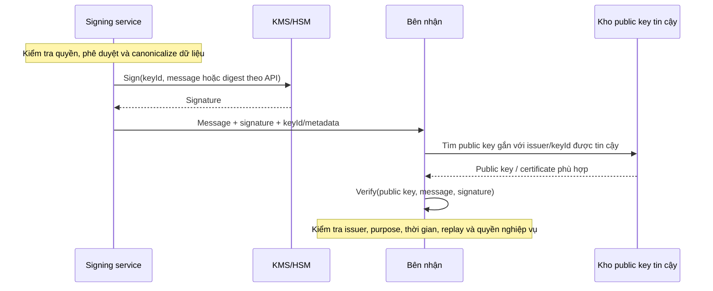
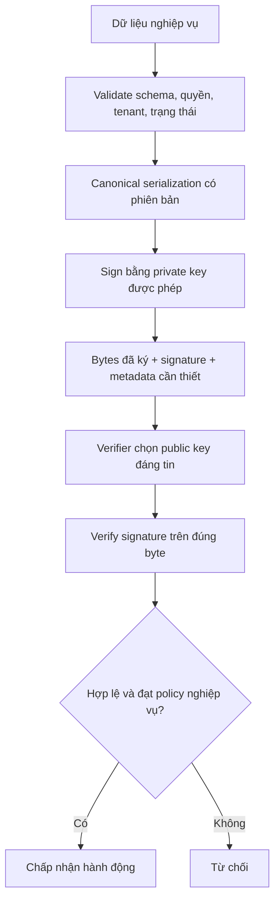
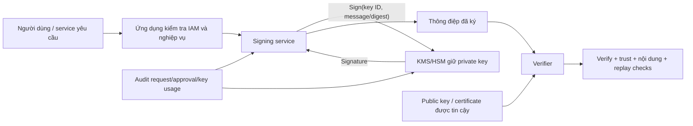
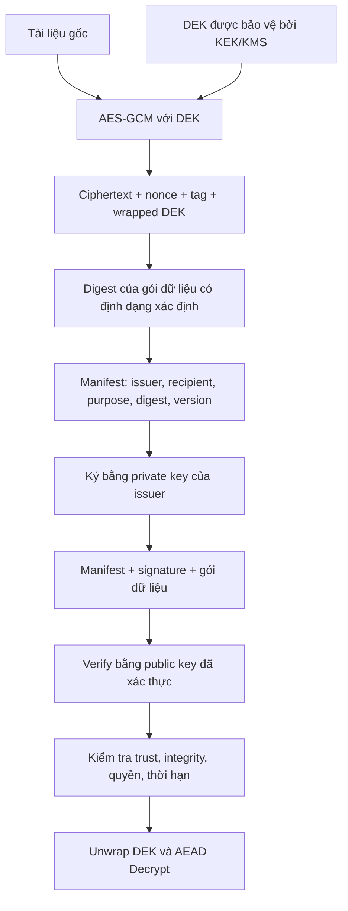
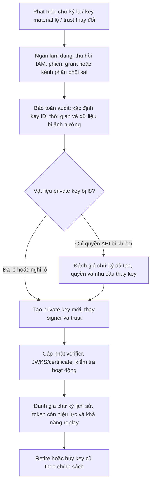

# Integrity và authenticity trong chữ ký số

> **Chương:** Chữ ký số  
> **Module:** SECURITY_KEY_MANAGEMENT_FUNDAMENTALS

Khi một ứng dụng nhận được hóa đơn điện tử, bản cập nhật phần mềm hoặc lệnh giao dịch, hai câu hỏi bảo mật xuất hiện: **“Nội dung có bị thay đổi không?”** và **“Nội dung thực sự đến từ chủ thể nào?”**. Hai câu hỏi này tương ứng với **integrity (tính toàn vẹn)** và **authenticity (tính xác thực)**. Chữ ký số (*digital signature*) là một công cụ quan trọng để hỗ trợ cả hai thuộc tính, nhưng kết quả xác minh chữ ký chỉ đáng tin khi **thuật toán**, **public key**, **danh tính chủ sở hữu khóa**, **định dạng thông điệp** và **chính sách sử dụng khóa** đều được kiểm soát.

Trong module **SECURITY_KEY_MANAGEMENT_FUNDAMENTALS**, chủ đề này gắn trực tiếp với quản lý vòng đời khóa mật mã từ **tạo, cấp phát, lưu trữ, sử dụng, xoay vòng đến thu hồi và hủy**, cùng KMS/HSM, mật mã bất đối xứng, hash/MAC, envelope encryption, kiểm soát truy cập và kiểm toán. Một private key được bảo vệ tốt giúp giảm nguy cơ giả mạo; tuy nhiên, nếu ứng dụng cho phép bất kỳ workload nào gọi API `Sign` hoặc tin một public key chưa xác thực, chữ ký vẫn có thể bị lạm dụng.

Sau bài học, người học có thể:

- Phân biệt rõ **integrity**, **authenticity**, **confidentiality**, **freshness**, **authorization** và giới hạn của **non-repudiation**.
- Giải thích quy trình ký và xác minh chữ ký với **private key/public key**, hash và thuật toán ký đúng mục đích.
- Phân tích tại sao xác minh signature thành công **chưa đủ để xác minh danh tính người ký** nếu thiếu trust binding.
- Chọn khi nào cần **hash**, **HMAC**, **digital signature**, **AEAD/TLS** và khi nào cần kết hợp các cơ chế.
- Nhận diện lỗi trong canonicalization, phân phối public key, kiểm tra JWT, rotation, replay và xử lý certificate.
- Minh họa chữ ký Ed25519 bằng Java 17 và xây dựng chính sách sử dụng/kiểm toán khóa ký an toàn.

## 1. Integrity: tính toàn vẹn của dữ liệu là gì?

**Integrity** là thuộc tính cho phép phát hiện dữ liệu hoặc thông điệp đã bị sửa đổi ngoài dự kiến, bao gồm thay nội dung, thêm hoặc xóa byte, đổi thứ tự trường dữ liệu hay thay phần metadata được bảo vệ. Trong ngữ cảnh chữ ký số, tính toàn vẹn thường có nghĩa:

> Nếu thông điệp được ký thay đổi sau khi ký, chữ ký gắn với thông điệp gốc sẽ **không còn xác minh hợp lệ**, trừ khi kẻ tấn công có thể phá giả định mật mã hoặc tạo một chữ ký được tin cậy khác.

Ví dụ hệ thống gửi hóa đơn có số tiền **750.000 VND** đã ký. Attacker đổi thành **7.500.000 VND** mà không có private key tương ứng. Nếu cả số tiền và các trường cần thiết được ký đúng cách, bên nhận sẽ phát hiện vì **Verify** thất bại.

Tuy nhiên, chữ ký số không chứng minh rằng số tiền gốc **chính xác về nghiệp vụ**. Một hóa đơn sai được ký hợp lệ vẫn là hóa đơn đã được ký mà nội dung chưa bị sửa. Chữ ký bảo vệ sự nhất quán giữa **nội dung được xác minh** với **nội dung đã được ký**, không thay công tác phê duyệt hoặc kiểm tra logic.

### 1.1. Integrity không nhất thiết đòi hỏi giữ bí mật nội dung

Thông điệp và chữ ký thường được gửi hoặc lưu ở dạng công khai:

```text
Invoice content:   invoiceId, tenantId, amount, currency, createdAt
Signature:         bytes do private key tạo ra
Public key:        dữ liệu khóa dùng để Verify

Bên nhận có thể đọc toàn bộ nội dung mà vẫn kiểm tra được chữ ký.
```

Nếu cần **bảo mật nội dung**, phải bổ sung mã hóa hoặc một giao thức bảo vệ kênh. Chữ ký **không phải** phép mã hóa. Ngược lại, mã hóa dữ liệu mà không có cơ chế xác thực thích hợp cũng chưa chắc cung cấp đầy đủ bảo vệ tính toàn vẹn.

## 2. Authenticity: xác thực nguồn gốc là gì?

**Authenticity** trong chữ ký số là mức tin cậy rằng chữ ký của một thông điệp được tạo bằng **private key tương ứng với public key đã được chấp nhận**. Để đi từ “đúng cặp khóa” đến “đúng tổ chức/người ký”, hệ thống phải có một **mối liên kết đáng tin giữa public key và danh tính** (*identity binding*).

Một chữ ký hợp lệ xác nhận về mặt mật mã rằng:

1. Chữ ký phù hợp với thông điệp đang xác minh theo thuật toán và tham số đã chọn.
2. Chữ ký tương ứng với private key của public key đang dùng, giả định thuật toán ký an toàn.

Nó **chưa tự xác nhận**:

- Ai là chủ thể thực sự kiểm soát private key, nếu public key chỉ được nhận từ nguồn tùy ý.
- Chủ thể đó có được **ủy quyền** ký loại tài liệu hoặc hành động này không.
- Nội dung đã được **người dùng phê duyệt** hay chỉ do một tiến trình bị chiếm quyền ký.
- Chữ ký được tạo vào **thời điểm** nào, nếu thời gian chỉ là trường do người ký tự điền.
- Giao dịch có **mới** hay chỉ là bản sao được gửi lại.

### 2.1. Ví dụ cùng chữ ký hợp lệ nhưng độ tin cậy khác nhau

Attacker tự sinh cặp khóa Ed25519, ký file giả và gửi kèm **public key của chính mình**. Nếu ứng dụng chỉ gọi `Verify(file, signature, publicKeyFromAttacker)`, kết quả có thể là **true**. Điều đó chỉ chứng minh chữ ký khớp với key attacker đưa ra, **không chứng minh file được công ty phát hành**.

Ngược lại, nếu ứng dụng dùng public key/certificate đã xác thực là thuộc đúng nhà phát hành, được phép ký loại dữ liệu này và còn thỏa mãn chính sách tin cậy, chữ ký hợp lệ mới cung cấp **authenticity theo danh tính được xác nhận**.

### 2.2. Bảng phân biệt integrity và authenticity

| Tiêu chí | Integrity | Authenticity |
|---|---|---|
| Câu hỏi | Nội dung đã bị thay đổi chưa? | Ai hoặc khóa thuộc chủ thể nào đã tạo/chấp nhận nội dung? |
| Cơ chế cơ bản | Hash, MAC, chữ ký số, AEAD tùy mô hình | MAC với shared key, chữ ký số với public key đã tin cậy |
| Một hash SHA-256 công khai có đủ? | Phát hiện thay đổi **khi digest nhận từ nguồn tin cậy** | **Không**, ai cũng tính được hash |
| Chữ ký số có đủ? | Có thể cung cấp integrity cho các byte được ký | Cần **xác thực public key**, xác minh danh tính/usage và chính sách |
| Thất bại điển hình | Một trường không được ký nên bị sửa mà vẫn Verify thành công | App tin key bất kỳ do attacker gửi kèm |

## 3. Chữ ký số phối hợp hai thuộc tính như thế nào?

Hệ chữ ký số có ba hoạt động chính: **tạo cặp khóa**, **ký thông điệp**, **xác minh thông điệp**.

- **KeyGen** tạo cặp `(privateKey, publicKey)` theo thuật toán và nguồn ngẫu nhiên phù hợp.
- **Sign(privateKey, message)** tạo chữ ký. Thuật toán có thể băm thông điệp trong quá trình ký hoặc xử lý message theo quy tắc riêng.
- **Verify(publicKey, message, signature)** trả kết quả hợp lệ hoặc không hợp lệ.



Trong thực tế, không phải hệ thống nào cũng dùng KMS/HSM, nhưng nên **giới hạn nơi private key xuất hiện**. Với khóa ký có giá trị cao, một KMS/HSM hỗ trợ thuật toán có thể giữ private key dưới dạng không xuất được, còn ứng dụng chỉ gọi phép toán ký. Dù vậy, kẻ chiếm quyền `Sign` vẫn có thể yêu cầu tạo chữ ký trái phép; lớp phê duyệt nghiệp vụ và IAM vẫn cần thiết.

### 3.1. Integrity có hiệu lực với đúng những byte được ký

Giả sử request chứa:

```json
{
  "invoiceId": "INV-014",
  "tenantId": "T-42",
  "amountMinor": 750000,
  "currency": "VND",
  "bankAccount": "VN1234..."
}
```

Nếu hệ thống **chỉ ký `amountMinor`**, attacker có thể thay `bankAccount` mà chữ ký trên `amountMinor` vẫn hợp lệ. Chữ ký không thể bảo vệ những trường **nằm ngoài phạm vi ký**. Nếu bên nhận dùng metadata để quyết định quyền, định tuyến hay chuyển tiền, cần bảo đảm metadata được bao phủ bởi chữ ký hoặc được ràng buộc bằng cơ chế đáng tin tương đương.

Lỗi này thường xảy ra khi ứng dụng ký **một dạng biểu diễn** nhưng bên nhận diễn giải **một dạng khác**. Ví dụ việc bỏ qua trường, thay đổi thứ tự JSON, biểu diễn số, Unicode, khoảng trắng, thời gian hoặc trường lặp có thể dẫn đến lỗi chuẩn hóa và khai thác.

## 4. Vai trò của hash trong chữ ký số

Nhiều thuật toán chữ ký làm việc với **digest của thông điệp**, hoặc có một cách xử lý băm được định nghĩa trong chính thuật toán. Hàm băm giúp liên kết thông điệp có độ dài bất kỳ với giá trị kích thước cố định và phục vụ bảo mật của scheme chữ ký.

| Thuộc tính của hash | Ý nghĩa liên quan đến chữ ký |
|---|---|
| **Collision resistance** | Hạn chế việc tạo hai thông điệp khác nhau có cùng digest để đánh tráo đối tượng được ký |
| **Second-preimage resistance** | Hạn chế tìm thông điệp mới khớp digest của một thông điệp đã cố định |
| **Preimage resistance** | Hạn chế tìm đầu vào cho một digest đích; quan trọng trong các cấu trúc mật mã nhưng **không đủ một mình** để kết luận chữ ký an toàn |

Không xem chữ ký số là “mã hóa digest bằng private key” cho mọi thuật toán. RSA-PSS, ECDSA và Ed25519 có **quy tắc tính chữ ký khác nhau**. Một số API ký nhận message và tự thực hiện băm; API khác chấp nhận digest đã tính sẵn và yêu cầu người gọi chọn đúng scheme/độ dài.

**Không tự băm hai lần hoặc bỏ băm** chỉ vì muốn tối ưu. Phải theo chính xác hợp đồng của thuật toán và API được sử dụng.

### 4.1. So sánh một digest công khai với chữ ký

Giả sử server phát hành file nhị phân và kèm SHA-256 digest của file trên **cùng một máy chủ đã bị xâm nhập**. Kẻ tấn công có thể thay cả file lẫn digest; người tải lại vẫn thấy hash khớp. Đây là **kiểm tra tính nhất quán nội bộ**, không phải một cơ chế xác thực nhà phát hành đáng tin.

Nếu nhà phát hành ký **manifest** chứa digest/phiên bản/tên file bằng private key được bảo vệ, còn người nhận xác minh bằng public key đáng tin, attacker khó thay file và digest của manifest mà không làm hỏng chữ ký. Cần ký đầy đủ thông tin định danh và tránh dùng thuật toán hash không phù hợp cho mục đích chữ ký mới.

## 5. Hash, HMAC, chữ ký số và AEAD: dùng lúc nào?

| Cơ chế | Khóa bí mật nằm ở đâu? | Bảo vệ được gì? | Hạn chế |
|---|---|---|---|
| **SHA-256 digest** | Không có khóa | Phát hiện khác biệt khi digest được lấy từ nguồn tin cậy | Không tự xác thực nguồn, không giấu nội dung |
| **HMAC-SHA-256** | Các bên tạo/xác minh cùng dùng khóa đối xứng | Integrity và authentication **theo khóa chia sẻ** | Bên kiểm tra có thể tự tạo tag; không là chữ ký xác minh công khai |
| **Ed25519 / ECDSA / RSA-PSS** | Private key ở bên ký, public key tin cậy ở bên xác minh | Integrity và authenticity theo chủ sở hữu private key, khi trust hợp lệ | Không mã hóa; không tự chống replay hoặc chứng minh phê duyệt nghiệp vụ |
| **AES-GCM / ChaCha20-Poly1305** | Các bên được phép mã hóa/giải mã có khóa đối xứng | Confidentiality và integrity/authentication dưới khóa đối xứng | Không cung cấp bằng chứng danh tính signer độc lập và không tự chống replay |
| **TLS được cấu hình đúng** | Khóa phiên, cơ chế xác thực endpoint theo giao thức | Bảo vệ dữ liệu **trên kênh truyền** | Khi dữ liệu ra khỏi kênh/TLS termination, bảo vệ ở tầng thông điệp có thể cần thêm |

**HMAC** thích hợp nếu hai dịch vụ chia sẻ một secret và cần kiểm tra thông điệp, chẳng hạn webhook. **Chữ ký số** thích hợp khi bên phát giữ private key còn nhiều bên xác minh chỉ nắm public key; ví dụ phần mềm phát hành, tài liệu hoặc sự kiện cần xác thực độc lập.

**AEAD** bảo vệ nội dung và tính toàn vẹn bằng khóa đối xứng, trong khi chữ ký bảo vệ nguồn gốc đối với thông điệp cụ thể. Một hệ thống có thể cần **TLS để truyền**, **AES-GCM để mã hóa at rest** và **chữ ký số để xác minh tài liệu lâu dài**; chức năng của mỗi lớp khác nhau.

### 5.1. Tại sao authenticity của MAC khác của chữ ký số?

Với HMAC, bất kỳ bên nào giữ key có thể tạo một MAC hợp lệ. Vì vậy, bên thứ ba **không phân biệt được** tag do bên A hay bên B tạo nếu cả hai nắm cùng key. Chữ ký bất đối xứng giúp tách bên ký giữ private key khỏi bên xác minh chỉ giữ public key. Dẫu vậy, cần quản lý tin cậy public key và rủi ro private key bị lộ.

## 6. Public key phải được xác thực trước khi tin chữ ký

Đây là điều kiện quyết định **authenticity**. Nếu verifier nhận public key do người gửi không đáng tin tự cung cấp, chữ ký hợp lệ chưa ràng buộc được với danh tính kỳ vọng.

Các mô hình phân phối public key thường gặp:

1. **Pin public key/fingerprint:** ứng dụng giữ sẵn key đã xác minh qua kênh an toàn, thích hợp trong phạm vi đối tác được kiểm soát; cần cơ chế thay key có xác thực.
2. **PKI và chứng thư X.509:** certificate gắn public key với danh tính qua chữ ký CA và chain đến trust anchor được công nhận theo chính sách.
3. **JWKS hoặc key registry:** một endpoint/kho phân phối public key cho issuer; ứng dụng phải cấu hình rõ issuer và nguồn JWKS đáng tin, không đi theo URL tùy ý từ input attacker.
4. **Kho khóa nội bộ có phiên bản:** server định danh key theo ID và tenant, cấp metadata qua kênh được bảo vệ, quản lý phát hành, thu hồi và audit thay đổi.

Mỗi mô hình cần trả lời **“ai được phép thay public key được tin?”**. Nếu attacker có thể sửa kho trust, chiếm endpoint JWKS hoặc đưa key giả vào whitelist, họ có thể làm cho chữ ký của chính mình được hệ thống chấp nhận.

### 6.1. Xác minh certificate không chỉ là kiểm tra một chữ ký

Nếu dùng PKI, verifier cần đánh giá phù hợp với mục đích sử dụng:

- **Certificate chain** hợp lệ đến trust anchor được chấp nhận theo chính sách.
- **Thời hạn** chứng thư và các điều kiện cấp phát/định danh tương ứng với ngữ cảnh.
- **Tên chủ thể** hoặc tên dịch vụ khớp đích cần xác thực; với TLS thường liên quan SAN/hostname.
- **Key Usage / Extended Key Usage** và các ràng buộc certificate cho phép tác vụ cần xác minh.
- **Thu hồi** theo chính sách (CRL, OCSP hoặc cơ chế khác) và giới hạn thực tế của từng client.
- **Thuật toán và độ mạnh khóa** được chính sách cho phép.

Certificate có chữ ký CA hợp lệ **không tự cho phép** dùng nó để ký mọi hóa đơn hoặc mọi JWT. Mục đích và authorization nghiệp vụ vẫn phải được đánh giá riêng. Với chữ ký tài liệu dài hạn, việc xác minh tại thời điểm hiện tại có thể cần bằng chứng về **thời điểm ký đáng tin** và trạng thái chứng thư lịch sử.

### 6.2. Ràng buộc thuật toán và key ID

Nếu một thông điệp có trường `alg`, `kid` hoặc đường dẫn tới khóa, các giá trị này không được tự quyết định chính sách tin cậy:

- **Algorithm allowlist:** verifier chỉ chấp nhận thuật toán phù hợp với loại key và use case, không tự tin bất kỳ thuật toán do client yêu cầu.
- **Key allowlist/trust binding:** `kid` chỉ được chọn key trong tập thuộc đúng issuer/tenant đã cấu hình; bản thân `kid` **không chứng minh danh tính**.
- **Tránh algorithm confusion:** không được lấy public key bất đối xứng rồi diễn giải như secret của thuật toán HMAC vì input thông điệp khai báo như vậy.
- **Không tải JWKS/key từ URL tùy ý do attacker chỉ định** nếu không có chính sách ràng buộc chặt.

Đặc biệt với JWT, việc Verify signature thành công vẫn phải theo sau bởi kiểm tra `iss`, `aud`, `exp`, `nbf`, loại token, quyền và các yêu cầu của ứng dụng.

## 7. Canonicalization: ký đúng byte mà bên nhận sẽ hiểu

Chữ ký số ký **dữ liệu ở cấp byte**. Hai biểu diễn khác nhau của một nội dung có thể có byte khác nhau, dẫn tới chữ ký khác nhau; nguy hiểm hơn, hai thành phần có thể **diễn giải khác nhau** từ cùng một payload.

Ví dụ JSON có thể được serialize theo thứ tự field khác, khoảng trắng khác, định dạng số khác hoặc Unicode khác. Không thể giả định `JSON.stringify` của mọi môi trường luôn tạo cùng byte theo một quy ước bảo mật.

### 7.1. Quy trình xử lý thông điệp



Nội dung cần ký nên bao gồm hoặc ràng buộc bằng cơ chế tương đương những trường quyết định cách thông điệp được xử lý: **purpose, schema version, issuer, tenant ID, object ID, amount, currency, recipient, expiry** hoặc các trường khác tùy nghiệp vụ. Đưa trường `purpose` vào nội dung là một hình thức **domain separation** để tránh chữ ký hợp lệ cho một loại tác vụ bị sử dụng như chữ ký của tác vụ khác.

**Không dùng dữ liệu đã ký để mặc nhiên cấp quyền.** Bên xác minh vẫn phải kiểm tra rằng tenant, issuer, transaction và người yêu cầu có quyền thực hiện hành động. Chữ ký hợp lệ chứng minh tính toàn vẹn của nội dung được ký, không chứng minh quy tắc nghiệp vụ là đúng.

### 7.2. Định dạng gói dữ liệu có chữ ký

```text
SignedRecord {
  formatVersion: 1
  purpose: "invoice-approval"
  issuer: "billing-service"
  keyId: "billing-sign-v3"
  algorithm: "Ed25519"
  payloadBytes: <canonical bytes của đối tượng đã duyệt>
  signature: <signature bytes>
}
```

Các trường quyết định security context có thể được **đưa vào payloadBytes đã ký**, hoặc được ràng buộc thông qua định dạng giao thức đảm bảo tính toàn vẹn. Không nên cho phép thay `purpose`, tenant hay account sau khi ký mà verifier vẫn hiểu chữ ký cũ hợp lệ cho hành động mới.

**Không phải mọi metadata đều nhất thiết nằm trong message bytes**, nhưng điều quan trọng là không tồn tại metadata **chưa được xác thực** có thể làm thay đổi ý nghĩa của chữ ký hoặc đối tượng được xác minh.

## 8. Integrity và authenticity không đồng nghĩa freshness, authorization hay confidentiality

Một chữ ký hợp lệ được tạo hôm qua có thể vẫn xác minh hợp lệ hôm nay. Vì vậy phải đặt riêng các mục tiêu sau:

| Thuộc tính | Câu hỏi | Cơ chế bổ sung |
|---|---|---|
| **Integrity** | Dữ liệu có đổi so với nội dung đã ký không? | Verify chữ ký đúng byte |
| **Authenticity** | Khóa được tin thuộc đúng issuer/người ký không? | Public-key trust, PKI, issuer policy |
| **Freshness** | Đây có phải yêu cầu mới, trong thời gian cho phép không? | Timestamp/nonce/sequence và ràng buộc vào dữ liệu đã ký |
| **Replay resistance** | Yêu cầu hợp lệ cũ có bị xử lý lần nữa không? | Message ID, replay window, trạng thái đã xử lý, idempotency |
| **Authorization** | Chủ thể có được phép thực hiện hành động này không? | IAM/RBAC/ABAC, phê duyệt nghiệp vụ, quyền đối tượng |
| **Confidentiality** | Người ngoài có đọc được dữ liệu không? | TLS, AES-GCM, envelope encryption |
| **Availability** | Dịch vụ còn hoạt động và khóa còn cần thiết không? | Backup, retention, migration và kiểm soát xóa khóa |

### 8.1. Replay vẫn có thể xảy ra khi chữ ký hợp lệ

```text
Yêu cầu gốc:
  transferId = "TR-17"
  amount = 100000
  signature = Sign(privateKey, canonicalRequest)

Verifier kiểm tra thành công và xử lý chuyển tiền.
Attacker phát lại chính request và signature hợp lệ.
Nếu server không lưu transferId đã xử lý, giao dịch có thể bị xử lý lần hai.
```

Chữ ký **không tự nhớ** đã kiểm tra một message trước đó. Giải pháp là đưa các trường cần thiết vào nội dung đã ký, sau đó **kiểm tra tính mới và trạng thái sử dụng** ở bên nhận. Chỉ thêm timestamp nhưng không giới hạn độ lệch thời gian, không kiểm tra ID hoặc không bảo vệ timestamp trong chữ ký cũng chưa đủ.

### 8.2. Chữ ký không bảo đảm người ký đã chủ động đồng ý

Nếu private key được sử dụng bởi một tiến trình bị chiếm, chữ ký có thể vẫn hoàn toàn hợp lệ về mặt toán học. Chữ ký một mình không chứng minh người chủ khóa đã trực tiếp nhìn thấy, hiểu hoặc phê duyệt nội dung.

Để hỗ trợ lập luận trách nhiệm hoặc *non-repudiation* (*khó chối bỏ*) trong quy trình cần thiết, còn phải xét **quản lý danh tính, quyền sở hữu khóa, kiểm soát người ký, audit, phê duyệt, thời gian tin cậy, quy trình và luật áp dụng**. Đây là thuộc tính ở mức hệ thống và bối cảnh pháp lý, không thể tuyên bố tuyệt đối chỉ từ `Verify == true`.

## 9. Java 17: ký và xác minh bằng Ed25519

Java 17 cung cấp chữ ký **Ed25519** qua JCA. Ví dụ dưới minh họa ba tình huống: xác minh đúng thông điệp, phát hiện sửa đổi và phân biệt **xác minh bằng khóa đúng** với **xác minh bằng một khóa bất kỳ**.

```java
import java.nio.ByteBuffer;
import java.nio.charset.StandardCharsets;
import java.security.KeyPair;
import java.security.KeyPairGenerator;
import java.security.PublicKey;
import java.security.Signature;

public final class IntegrityAuthenticityDemo {
    private static byte[] canonicalInvoice(long amountMinor) {
        // Chỉ minh họa định dạng byte cố định của một schema cụ thể.
        // Hệ thống thật phải có schema, canonical encoding và version rõ ràng.
        byte[] context = (
                "purpose=invoice-approval:v1\n" +
                "issuer=billing-service\n" +
                "tenant=T-42\n" +
                "invoiceId=INV-014\n" +
                "currency=VND\n")
                .getBytes(StandardCharsets.UTF_8);
        return ByteBuffer.allocate(context.length + Long.BYTES)
                .put(context)
                .putLong(amountMinor)
                .array();
    }

    private static byte[] sign(KeyPair issuer, byte[] message)
            throws Exception {
        Signature signer = Signature.getInstance("Ed25519");
        signer.initSign(issuer.getPrivate());
        signer.update(message);
        return signer.sign();
    }

    private static boolean verify(PublicKey key, byte[] message,
                                  byte[] signature) throws Exception {
        Signature verifier = Signature.getInstance("Ed25519");
        verifier.initVerify(key);
        verifier.update(message);
        return verifier.verify(signature);
    }

    public static void main(String[] args) throws Exception {
        KeyPairGenerator generator =
                KeyPairGenerator.getInstance("Ed25519");
        KeyPair trustedIssuer = generator.generateKeyPair();
        KeyPair attacker = generator.generateKeyPair();

        byte[] original = canonicalInvoice(750_000L);
        byte[] signature = sign(trustedIssuer, original);

        System.out.println("Original signature valid: " +
                verify(trustedIssuer.getPublic(), original, signature));

        // Integrity: thay số tiền => chữ ký gốc không còn hợp lệ.
        byte[] tampered = canonicalInvoice(7_500_000L);
        System.out.println("Tampered accepted: " +
                verify(trustedIssuer.getPublic(), tampered, signature));

        // Khóa không khớp => chữ ký của issuer không hợp lệ.
        System.out.println("Wrong public key accepted: " +
                verify(attacker.getPublic(), original, signature));

        // Một attacker có thể tự ký và xác minh bằng public key của họ.
        byte[] fakeSignature = sign(attacker, original);
        System.out.println("Attacker signature with own key valid: " +
                verify(attacker.getPublic(), original, fakeSignature));

        // Ứng dụng thật chỉ tin public key đã xác thực đúng issuer.
        System.out.println("Attacker signature trusted by issuer key: " +
                verify(trustedIssuer.getPublic(), original, fakeSignature));
    }
}
```

Kết quả dự kiến theo thứ tự:

| Phép kiểm tra | Kết quả |
|---|---|
| Message gốc + chữ ký issuer + public key issuer | `true` |
| Message thay số tiền + chữ ký cũ | `false` |
| Chữ ký issuer + public key attacker | `false` |
| Chữ ký attacker + public key attacker | `true` |
| Chữ ký attacker + public key issuer đáng tin | `false` |

Hàng thứ tư cho thấy điểm then chốt: **một chữ ký có thể hợp lệ với khóa của attacker mà vẫn không có authenticity đối với issuer kỳ vọng**.

### 9.1. Giới hạn và các điểm phải bổ sung trong sản phẩm thật

1. Demo tạo cặp khóa trong bộ nhớ JVM mỗi lần chạy. Hệ thống sản xuất cần **nguồn public key đáng tin**, key ID/version và quản lý private key ổn định cho mục đích ký.
2. `canonicalInvoice` cố định một ví dụ schema nhỏ; với dữ liệu từ bên ngoài phải **validate loại dữ liệu, độ dài, phiên bản, escaping, Unicode và quy tắc canonicalization**. Định dạng phải tránh việc hai bộ trường khác nhau cho ra cùng một chuỗi byte.
3. **Phê duyệt nghiệp vụ không được thực hiện trong demo**. Trước khi ký hóa đơn thật cần xác thực người yêu cầu, kiểm tra tenant, quyền ký, trạng thái phê duyệt, hạn mức và nội dung.
4. **Public key không được lấy tùy ý từ chính đối tượng bị kiểm tra**. Phải gắn issuer/key ID với trust store, PKI hoặc registry đã xác thực.
5. Ed25519 là thuật toán ký/xác minh, **không phải thuật toán mã hóa hay key agreement X25519**. Không dùng lại key material tùy tiện giữa các mục đích.
6. Ví dụ không chứa timestamp tin cậy, kiểm tra hạn dùng, chống replay, certificate validation hay xử lý dữ liệu ký dài hạn.
7. Với khóa ký giữ trong KMS/HSM, cách gọi `Sign`, loại đầu vào (message hoặc digest) và thuật toán hỗ trợ phụ thuộc nhà cung cấp; không giả định mọi KMS hỗ trợ Ed25519.

## 10. Mô hình KMS/HSM để bảo vệ integrity và authenticity

**KMS (Key Management Service)** giúp quản lý key ID, chính sách, quyền sử dụng và API mật mã; **HSM (Hardware Security Module)** có thể bảo vệ key material trong ranh giới phần cứng chuyên dụng. Một KMS có thể dựa trên HSM hoặc cơ chế bảo vệ khác tùy sản phẩm.

Trong hệ thống ký số, cách phân tách phổ biến:



**KMS có thể giúp ngăn export private key**, nhưng ứng dụng bị chiếm quyền vẫn có thể yêu cầu `Sign` trái phép nếu IAM và luồng nghiệp vụ quá rộng. Không cần biết byte private key để giả mạo chữ ký khi attacker có được quyền sử dụng nó như **signing oracle**.

### 10.1. Thiết kế phân quyền theo vai trò

| Vai trò | Quyền phù hợp | Không nên mặc định cấp |
|---|---|---|
| **Signing service** | `Sign` với key ID cụ thể; chỉ ký payload đã được chấp nhận | `Decrypt`, export private key, đổi policy, schedule deletion |
| **Verifier** | Đọc public key/certificate đáng tin và `Verify` | Đọc private key hoặc gọi `Sign` |
| **Rotation operator** | Tạo và đưa key mới vào trạng thái dùng được, điều phối cutover | Tự ký mọi tài liệu nghiệp vụ |
| **Key administrator** | Quản lý key policy, trạng thái theo quy trình phê duyệt | Tự động có quyền truy cập dữ liệu nhạy cảm và ký trái phép |
| **Security auditor** | Xem audit, key metadata và thay đổi quyền | Đọc private key, plaintext DEK hoặc token |

Áp dụng **least privilege** theo workload identity, đúng key ID, môi trường và action; tách quyền quản trị khỏi quyền runtime. Nếu chức năng ký được yêu cầu duyệt nhiều bên, chính sách nghiệp vụ có thể bổ sung quy trình **dual control** hoặc phê duyệt trước khi gọi Sign, tùy mức rủi ro.

### 10.2. Kiểm soát nội dung trước khi ký

KMS thường kiểm tra **ai được gọi thuật toán nào trên key nào**, nhưng **không hiểu** hóa đơn đã được duyệt, số tiền có hợp lệ hoặc tenant có được dùng key đó hay không. Signing service phải xác minh:

- Identity của caller và quyền trên đối tượng nghiệp vụ.
- Payload sau khi chuẩn hóa phù hợp schema, mục đích và key usage.
- Trạng thái approval có liên hệ với nội dung cần ký, không thể thay nội dung sau phê duyệt.
- Chính sách ký: loại tài liệu, hạn mức, số lần gọi và khả năng phát lại.
- Định danh key và version chính xác, không cho client chọn mọi key tùy ý.

**Quyền ký hợp lệ về IAM** chỉ là một điều kiện; **sự cho phép ký thông điệp cụ thể** là điều kiện riêng.

## 11. Vòng đời khóa ký số và tác động đến hai thuộc tính

Một chữ ký được tạo hôm nay có thể cần xác minh sau nhiều năm. Do đó việc quản lý khóa ký phải phân biệt **khả năng ký mới** và **khả năng kiểm tra chữ ký lịch sử**.

| Giai đoạn key management | Công việc quan trọng với integrity/authenticity |
|---|---|
| **Tạo khóa** | Chọn Ed25519/ECDSA/RSA-PSS theo yêu cầu, dùng CSPRNG/KMS/HSM và key size/scheme phù hợp |
| **Cấp phát/đăng ký** | Gán key ID, owner, purpose, version; phân phối public key qua PKI/JWKS/registry đáng tin; cấp role Sign đúng phạm vi |
| **Lưu trữ** | Bảo vệ private key, hạn chế export và backup; quản lý bản sao/trust store của public key |
| **Sử dụng** | Ký đúng byte sau kiểm tra nghiệp vụ, xác minh bằng trusted public key, audit từng lệnh Sign |
| **Xoay vòng** | Tạo key mới, đổi signer, cập nhật verifier; kiểm soát giai đoạn hai key được chấp nhận |
| **Thu hồi/vô hiệu hóa** | Rút quyền Sign/grant, ngừng tin key cũ khi nguy cơ yêu cầu, cập nhật chứng thư/JWKS và hệ thống phụ thuộc |
| **Hủy** | Hủy private key sau khi hết nhu cầu hợp lệ; giữ bằng chứng/public key cần cho việc xác minh lịch sử theo retention |

### 11.1. Rotation bình thường và rotation khẩn cấp

**Rotation theo lịch** thường cho phép một giai đoạn chuyển tiếp: issuer ký bằng key mới; verifier vẫn chấp nhận chữ ký hợp lệ từ key cũ cho tài liệu/token chưa hết hiệu lực, theo chính sách. Giai đoạn này phải có ngày kết thúc, key version và audit rõ ràng.

**Rotation do compromise** khác: nếu private key bị lộ, attacker có thể tạo chữ ký mới bằng key cũ; để tiếp tục tin chữ ký cũ phải **đánh giá mốc thời gian và bằng chứng lịch sử**. Chỉ đổi key ở issuer rồi giữ public key cũ tin cậy vô hạn không giải quyết rủi ro.

### 11.2. Public key cũ có cần giữ lại?

Nhiều tài liệu đã ký cần được kiểm tra trong tương lai. Việc xóa toàn bộ public key/certificate cũ có thể khiến verifier không xác minh được chữ ký lịch sử. Một hệ thống lưu trữ dài hạn có thể duy trì **public key và chain/certificate, thông tin thu hồi, timestamp đáng tin và chính sách đánh giá theo thời điểm ký**.

Đối với JWT ngắn hạn, chính sách ngừng chấp nhận key cũ có thể dựa trên thời gian token còn hiệu lực và kế hoạch transition; đối với chữ ký hợp đồng lưu lâu dài, yêu cầu xác minh lịch sử phức tạp hơn. Không dùng một chính sách expiration duy nhất cho mọi loại chữ ký.

### 11.3. Thời điểm ký là một vấn đề riêng

Một trường `signedAt: "2026-11-28T..."` bên trong tài liệu **do signer tự khai báo** không tự là bằng chứng thời gian độc lập. Muốn chứng minh chữ ký đã tồn tại tại một thời điểm đáng tin, có thể cần **trusted timestamping**, nhật ký append-only được bảo vệ hoặc cơ chế bằng chứng khác theo chính sách.

Nếu private key bị compromise, thời điểm ký tin cậy có thể giúp phân biệt chữ ký có trước một mốc sự cố; tuy nhiên việc xác định tính hợp lệ và trách nhiệm còn phụ thuộc chứng cứ, chính sách chứng thư và quy định áp dụng.

## 12. Chữ ký số với JWT: integrity không có nghĩa token được phép dùng

JWT là trường hợp dễ nhầm giữa ba tầng: **chữ ký hợp lệ**, **danh tính issuer đáng tin** và **quyền của token đối với API**.

Giả sử API nhận JWT có chữ ký EdDSA hoặc RS256:

1. API xác định **issuer được phép** từ cấu hình đáng tin, không dựa duy nhất vào chuỗi mà client khai báo.
2. Chọn **algorithm allowlist** đúng với issuer và key type; chỉ lấy public key từ JWKS/registry đáng tin của issuer.
3. Xác minh chữ ký trên **chính các byte mà định dạng JWT quy định**, không serialize lại JSON theo ý thích.
4. Kiểm tra claim `iss`, `aud`, `exp`, `nbf` và loại token; áp dụng tolerance thời gian nếu chính sách yêu cầu.
5. Kiểm tra scope/role, subject, tenant, session/revocation và authorization theo resource, không dùng chữ ký như giấy phép truy cập mọi tài nguyên.

Ví dụ:

```text
JWT hợp lệ về chữ ký:
  issuer = auth.example
  audience = payments-api
  scope = "read:orders"

Endpoint thực tế:
  POST /payments/transfer

=> Chữ ký có thể hợp lệ, nhưng token không được phép chuyển tiền.
```

Một token có chữ ký hợp lệ của **issuer khác** cũng không mặc nhiên được API chấp nhận. Khi private key issuer bị lộ, cần đánh giá khả năng attacker tạo các token có claim tùy ý, cập nhật verifier/trust và xử lý token/session đã phát hành.

## 13. Ví dụ kết hợp chữ ký số và envelope encryption

Giả sử hệ thống chuyển tài liệu nhạy cảm giữa hai tổ chức. Mục tiêu là **giữ bí mật nội dung**, đồng thời giúp bên nhận xác minh **file đến từ nhà phát hành đúng** và **không bị sửa**.

Thiết kế có thể gồm hai lớp:

1. **Bảo mật dữ liệu:** sinh **DEK** đối xứng, dùng AES-GCM mã hóa tài liệu; wrap DEK bằng **KEK/KMS** hoặc dùng public key của người nhận theo scheme được phép. Lưu ciphertext, nonce, tag, wrapped DEK và metadata cần giải mã.
2. **Integrity + authenticity:** bên phát hành tạo **manifest** chứa danh tính tài liệu, hash của ciphertext/gói lưu trữ, phiên bản, mục đích, key identifier và thông tin cần ràng buộc; ký manifest bằng private key ký số trong signing service/KMS/HSM.
3. **Bên nhận:** trước hết lấy public key đáng tin của issuer, xác minh chữ ký manifest, kiểm tra purpose/receiver/version và quyền; sau đó kiểm tra sự khớp của gói ciphertext và giải mã bằng DEK được phép.



Với cách này, **AES-GCM** bảo vệ bí mật và tính toàn vẹn dưới DEK, còn chữ ký trên manifest có thể cung cấp **nguồn gốc của gói dữ liệu** tới các verifier tin public key của issuer. Tuy nhiên thiết kế phải quyết định rõ **phạm vi chữ ký**: nếu metadata quan trọng nằm ngoài manifest được ký, attacker có thể thay metadata đó mà không làm sai chữ ký.

Không phải mọi ứng dụng đều cần **cả chữ ký số lẫn AEAD**. Nếu chỉ cần mã hóa dữ liệu nội bộ, AEAD có thể đủ; nếu cần công bố bản cập nhật phần mềm không bí mật nhưng có xác thực nhà phát hành, chữ ký số có thể là lớp trọng tâm.

## 14. Khi chữ ký vẫn hợp lệ nhưng hệ thống không an toàn

### 14.1. Signing oracle: private key không lộ nhưng attacker ký được

Một ứng dụng có quyền gọi `KMS.Sign` cho khóa hóa đơn. Kẻ tấn công chiếm được workload identity của ứng dụng và gửi digest của một hóa đơn tự tạo vào KMS. KMS trả chữ ký hợp lệ vì quyền IAM còn hiệu lực.

Ở đây:

- **Integrity** của hóa đơn giả đối với chữ ký đã tạo vẫn được bảo vệ theo thuật toán ký.
- **Authenticity theo khóa** có thể xác minh thành công, bởi chữ ký thực sự do private key hợp lệ tạo ra.
- **Authorization và phê duyệt nghiệp vụ** đã bị vượt qua. Không thể dựa vào `Verify == true` để kết luận hóa đơn được phép phát hành.

Phản ứng cần thu hồi phiên/quyền lạm dụng, điều tra yêu cầu ký trong giai đoạn bị chiếm, đánh giá đối tượng đã được bên khác tin, và thay khóa/trust nếu cần theo phạm vi rủi ro. Về dài hạn, signing service phải **kiểm tra nội dung và phê duyệt trước khi gọi KMS**, giới hạn action/key ID và có audit liên kết với giao dịch.

### 14.2. Tráo public key: signature hợp lệ nhưng sai issuer

Attacker thay JWKS endpoint, ghi đè key registry hoặc làm ứng dụng tin public key do JWT header đề xuất. Attacker ký thông điệp bằng private key của họ, và verifier dùng public key tương ứng bị tráo nên **Verify thành công**.

**Bài học:** điều kiện xác thực nguồn phải được xây dựng **trước** phép Verify. Cần giới hạn issuer, public key source, certificate/trust chain, `kid` và thuật toán. Public key không phải secret, nhưng **tính toàn vẹn của ánh xạ key với danh tính** phải được bảo vệ.

### 14.3. Mã độc được ký hợp lệ

Trong pipeline phát hành phần mềm, một build agent bị chiếm quyền có thể tạo gói cài đặt chứa mã độc và đưa qua quy trình ký nếu hệ thống không kiểm tra nguồn, phê duyệt và tính toàn vẹn của artifact trước bước Sign.

Người dùng cuối xác minh chữ ký có thể nhận kết quả hợp lệ, nhưng điều đó **không chứng minh phần mềm không có mã độc**. Code signing giúp xác thực nhà phát hành và phát hiện bản phân phối bị sửa **sau khi ký**; an ninh chuỗi cung ứng còn cần kiểm soát mã nguồn, build, artifact provenance, kiểm duyệt và phân quyền signer.

### 14.4. Metadata không được ký bị thay

Một hợp đồng được ký chỉ trên trường `documentBody`, trong khi `recipientAccount` hoặc `attachmentId` nằm ngoài nội dung ký. Attacker đổi trường ngoài phạm vi; signature vẫn hợp lệ cho phần body. Để bảo vệ toàn bộ hành động, cần xác định rõ **toàn bộ vùng dữ liệu có ý nghĩa bảo mật** và ràng buộc chúng vào chữ ký.

## 15. Ứng phó khi private key ký hoặc trust key bị compromise

**Key compromise** có thể là lộ vật liệu private key, lạm dụng quyền `Sign` khi key non-exportable, sửa key policy hoặc tráo public key được tin. Tác động chính thường là **mất tính xác thực nguồn**, và có thể khiến đối tượng giả mạo có chữ ký hợp lệ về mặt toán học.

### 15.1. Quy trình phản ứng có thứ tự



**Bước 1 — Containment.** Rút credential/grant/phiên bị chiếm, cách ly signing workload, ngừng dùng khóa nghi vấn để ký mới. Nếu private key đã **bị sao chép**, việc chỉ rút quyền IAM sẽ không ngăn attacker dùng byte khóa bên ngoài KMS/HSM.

**Bước 2 — Khoanh vùng.** Xác định key ID/version, issuer, certificate, tập verifier đang tin key, những yêu cầu `Sign` đã thực hiện, tài liệu/token có nguy cơ và khoảng thời gian nghi vấn. Kết hợp log KMS/HSM, signing service, artifact registry, IAM changes và log nghiệp vụ. Không thấy `Sign` bất thường ở KMS **không chứng minh an toàn** khi key đã được export.

**Bước 3 — Thay khóa và điều chỉnh trust.** Tạo key mới trong môi trường đáng tin, công bố public key/certificate bằng kênh tin cậy, chuyển issuer sang key mới, rút khả năng Sign của key cũ và cập nhật verifier. Nếu cần thu hồi certificate, dùng cơ chế PKI phù hợp và đánh giá client có thực sự kiểm tra revocation hay không.

**Bước 4 — Đánh giá chữ ký cũ.** Không thể xác định mọi chữ ký cũ là giả chỉ vì key sau đó bị compromise; cũng không thể tin vô điều kiện các chữ ký được tạo trong giai đoạn nghi vấn. Cần đối chiếu timestamp đáng tin, approval log, artifact provenance và chính sách xác minh lịch sử.

**Bước 5 — Xác nhận khôi phục.** Kiểm tra signer chỉ dùng key mới, public key mới được phân phối đúng, verifier từ chối chữ ký cần ngừng tin, token đã bị vô hiệu hóa khi cần, audit hoạt động và người dùng liên quan nhận được quy trình xử lý phù hợp. Chỉ hủy private key cũ sau khi xem xét phụ thuộc và retention; không xóa bằng chứng xác minh lịch sử cần giữ.

### 15.2. Phân biệt các loại compromise

| Tình huống | Rủi ro chính | Hành động quan trọng |
|---|---|---|
| Private key PEM lộ trên repository | Bất kỳ ai có bản sao có thể ký ở ngoài KMS | Thay key, ngừng trust key cũ theo rủi ro, xử lý bản sao và xác minh phát tán |
| IAM role có quyền Sign bị chiếm | KMS ký nội dung trái phép dù key không export | Rút phiên/quyền, kiểm tra ký bất thường, sửa approval flow |
| JWKS/registry bị tráo public key | Verifier tin chữ ký attacker | Khôi phục nguồn key đáng tin, khóa đường sửa trust, điều tra token/tài liệu đã được chấp nhận |
| Certificate hết hạn | Mức tin cậy cho sử dụng mới thay đổi theo chính sách | Gia hạn hoặc thay certificate/key; phân biệt xác minh lịch sử |
| Private key bị xóa nhầm | Không thể ký mới bằng key đó; khó khôi phục nếu không có phương án backup | Chuyển key mới có kiểm soát; kiểm tra dữ liệu/bằng chứng lịch sử |

**Không thể “thu hồi chữ ký đã phát tán” bằng một thao tác xóa file.** Cần thay đổi chính sách tin của verifier, kiểm soát vòng đời token/tài liệu và xử lý hậu quả nghiệp vụ phù hợp.

## 16. Ví dụ thực tế: phát hành bản cập nhật phần mềm đã ký

Một nhà cung cấp phát hành ứng dụng desktop. Mục tiêu là để client chỉ cài bản cập nhật đã được phép phát hành, không bị thay nội dung trên CDN.

### 16.1. Thiết kế luồng an toàn

1. **Build:** pipeline tạo một artifact xác định và ghi metadata version, platform, architecture, danh sách thành phần, hash của từng tệp.
2. **Approval:** kiểm tra artifact và thông tin phát hành, xác nhận người hoặc hệ thống có quyền approve đúng phiên bản.
3. **Sign:** signing service nhận **manifest canonical** đã được duyệt và gọi KMS/HSM để ký bằng private key phát hành; không cho mọi build job ký digest tùy ý.
4. **Publish:** phân phối artifact, manifest, signature, key ID và chain/chứng cứ trust phù hợp qua CDN hoặc artifact registry.
5. **Verify:** client lấy public key/certificate được pin hoặc xác thực theo trust store, kiểm tra chữ ký manifest, kiểm tra digest của artifact, version/platform/channel, và chính sách rollback/downgrade.
6. **Install:** chỉ giải nén/chạy artifact sau khi xác minh thành công; quản lý phiên bản đã cài và chống phát lại bản cập nhật cũ theo chính sách.

```text
SignedManifest {
  purpose: "software-update"
  product: "my-app"
  channel: "stable"
  platform: "windows-x64"
  version: "4.2.1"
  artifactDigest: SHA-256(releaseBinary)
  minimumAllowedVersion: "4.0.0"
}

signature = Sign(releasePrivateKey, canonicalManifest)
```

Bên tải cần xác minh **manifest** với key đáng tin, sau đó đối chiếu artifact digest; việc manifest tự khai **minimumAllowedVersion** vẫn cần tương thích chính sách chống rollback được client duy trì, tránh attacker phát lại một manifest cũ có chữ ký hợp lệ.

### 16.2. Điều gì được và chưa được bảo đảm?

- **Integrity:** client phát hiện artifact khác digest đã được ký.
- **Authenticity:** client có căn cứ artifact thuộc luồng phát hành dùng khóa của nhà cung cấp, nhờ trust binding.
- **Chưa bảo đảm:** artifact không chứa bug/malware, approval ban đầu không bị lạm dụng, hay bản phát hành là mới nhất nếu không có chống rollback.

Mô hình này cho thấy rõ chữ ký số là **một mắt xích của quản lý phát hành đáng tin**, phụ thuộc vào quyền Sign, kiểm toán artifact và cơ chế xác minh phía client.

## 17. Anti-pattern và cách sửa

| Anti-pattern | Rủi ro | Cách sửa |
|---|---|---|
| Tin public key do sender gửi cùng signature | Attacker tự ký và đưa public key của họ | Chọn key từ trust store/issuer đã xác thực |
| Chỉ kiểm tra hash SHA-256 của file từ cùng nguồn có thể bị sửa | Attacker thay cả file và hash | Ký manifest hoặc phân phối digest qua kênh tin cậy độc lập |
| Ký một số trường nhưng xử lý thêm trường chưa ký | Metadata nhạy cảm bị thay mà Verify vẫn đúng | Ràng buộc toàn bộ dữ liệu có ý nghĩa bảo mật vào chữ ký |
| Ký JSON tùy cách serialize của từng framework | Hai bên hiểu/encode khác nhau | Canonical serialization, version và schema rõ ràng |
| Dùng `Verify == true` để bỏ qua IAM/phê duyệt | Chữ ký hợp lệ cho hành động trái phép | Kiểm tra authorization trước Sign và khi Verify |
| Cho mọi workload quyền `Sign` trên mọi KMS key | Một danh tính bị chiếm có thể ký rộng rãi | Least privilege theo principal, action, key ID và purpose |
| Lưu private key trong source/container image | Khó thu hồi và dễ lan truyền vật liệu khóa | KMS/HSM hoặc kho khóa được kiểm soát khi phù hợp |
| Tải JWKS từ `jku` do JWT bất kỳ chỉ định | Attacker điều khiển nguồn public key được tin | Whitelist issuer/JWKS endpoint, ràng buộc `kid` với issuer |
| Tin `alg` do client khai báo và tự chuyển chế độ | Algorithm confusion, có thể dùng sai loại key | Algorithm allowlist độc lập với input chưa tin |
| Không kiểm tra `iss`, `aud`, `exp`, scope | Token đúng chữ ký nhưng sai API/đã hết hạn | Claim validation, quyền trên resource và thời hạn |
| Chỉ có chữ ký mà không có replay protection | Yêu cầu cũ hợp lệ được xử lý lần nữa | Timestamp, message ID, replay window/idempotency |
| Dùng thời gian tự khai để “chứng minh đã ký trước ngày X” | Mốc thời gian có thể do signer sửa tùy ý | Timestamp/nhật ký chứng cứ đáng tin theo yêu cầu |
| Đổi signing key nhưng verifier tin key bị lộ mãi | Chữ ký giả bằng private key cũ vẫn được chấp nhận | Kế hoạch cutover, cập nhật trust và thu hồi |
| Ký artifact mà bỏ kiểm soát nguồn build | Mã độc vẫn có thể mang signature hợp lệ | Artifact provenance, approval và bảo vệ CI/CD |
| Xem chữ ký số là encryption | Plaintext vẫn bị người khác đọc | TLS/AEAD/envelope encryption khi cần confidentiality |

## 18. Checklist triển khai integrity và authenticity

1. **Xác định mục tiêu:** cần phát hiện sửa đổi, xác thực issuer, bảo mật thông tin, chống replay hay chứng cứ lịch sử? Cần những cơ chế nào?
2. **Chọn thuật toán:** Ed25519, ECDSA hoặc RSA-PSS theo tính tương thích/chính sách; hash và thông số ký có được hỗ trợ đúng không?
3. **Định nghĩa dữ liệu ký:** đầy đủ purpose, version, tenant, issuer, đối tượng, nội dung và metadata quan trọng chưa?
4. **Canonicalization:** hai bên có tạo/kiểm tra chính xác cùng byte, tránh parser ambiguity/field injection không?
5. **Bảo vệ private key:** key có thể non-exportable trong KMS/HSM không? Ai được quyền tạo, đọc, ký hoặc thay chính sách?
6. **Authorization:** service ký có kiểm tra quyền và phê duyệt đối với nội dung cụ thể trước khi gọi Sign không?
7. **Trust public key:** verifier tin nguồn public key nào, gắn key ID với issuer/tenant ra sao, cập nhật key thế nào?
8. **Xác minh certificate:** nếu dùng PKI, có path validation, purpose/KU/EKU, tên chủ thể, thời hạn và revocation phù hợp không?
9. **Thông tin giao thức:** có algorithm allowlist, issuer/audience, expiry, token type, scope và chống algorithm confusion không?
10. **Freshness/replay:** có timestamp đáng tin khi cần, message ID, sequence/nonce và trạng thái đã xử lý không?
11. **Key lifecycle:** có kế hoạch rotation, overlap, retire, kiểm tra chữ ký cũ, ngừng trust khi compromise và hủy key không?
12. **Audit:** có ghi principal, key ID, phép toán, approval/transaction ID, thời gian và kết quả mà không lộ private key hoặc token không?
13. **Xử lý sự cố:** có cách thu hồi IAM/grant, thay signing key, cập nhật verifier, điều tra chữ ký giả và giữ bằng chứng lịch sử không?
14. **Bảo mật dữ liệu:** nếu cần confidentiality, đã có TLS/AEAD và bảo vệ DEK/KEK, nonce/tag, quyền KMS phù hợp chưa?

## 19. Câu hỏi tự kiểm tra

**1. Một chữ ký số hợp lệ chứng minh thông điệp không bị sửa và đến từ đúng công ty, phải không?**  
Chữ ký hợp lệ giúp chứng minh dữ liệu khớp chữ ký và được tạo bằng private key tương ứng với **public key dùng khi Verify**. Muốn xác thực **đúng công ty**, phải chứng minh public key đó gắn với công ty qua trust được xác minh, đồng thời kiểm tra purpose và chính sách.

**2. Attacker tự tạo cặp khóa, ký file rồi gửi kèm public key. Vì sao Verify có thể trả true?**  
Vì chữ ký đúng với chính cặp khóa attacker tạo. **Verify true không phải bằng chứng danh tính** nếu public key chưa được một nguồn tin cậy ràng buộc với issuer kỳ vọng.

**3. Một hóa đơn sai số tiền được ký bằng private key thật có mất integrity không?**  
Không nhất thiết. Hóa đơn có thể vẫn toàn vẹn kể từ lúc ký. Sai số tiền là **vấn đề đúng đắn nghiệp vụ/authorization**, cần được phát hiện trước Sign hoặc bằng kiểm tra nghiệp vụ ở bên nhận.

**4. Chữ ký số có tự mã hóa nội dung không?**  
Không. Cần TLS hoặc AEAD/envelope encryption nếu muốn giữ bí mật dữ liệu.

**5. Tại sao HMAC không thay thế mọi trường hợp của chữ ký số?**  
Vì bên tạo và bên kiểm tra HMAC đều giữ shared key, đều có thể tạo MAC; bên thứ ba không phân biệt được ai là người tạo tag. Chữ ký số cho phép bên xác minh chỉ giữ public key.

**6. JWT đã xác minh chữ ký thành công có đủ để cho phép chuyển tiền không?**  
Không. Phải kiểm tra issuer, audience, thời hạn, loại token, scope/role, tenant, quyền trên giao dịch, trạng thái session và các điều kiện nghiệp vụ.

**7. Nếu KMS không cho export private key, có thể bỏ kiểm soát quyền ký không?**  
Không. Workload có quyền gọi Sign bị chiếm vẫn có thể tạo chữ ký trái phép. KMS bảo vệ vật liệu khóa, còn IAM và signing service bảo vệ **quyền dùng khóa với nội dung cụ thể**.

**8. Chữ ký cũ hợp lệ có tự chống việc gửi lặp lại giao dịch không?**  
Không. Replay cần message ID, nonce/sequence, thời hạn, trạng thái đã xử lý và kiểm tra nghiệp vụ. Chữ ký vẫn có thể hợp lệ khi message được phát lại nguyên vẹn.

**9. Private key ký bị lộ thì có nên tin mọi chữ ký được tạo trước đó không?**  
Không kết luận tuyệt đối. Cần đánh giá mốc thời gian nghi vấn, audit và bằng chứng thời gian đáng tin. Một số chữ ký lịch sử có thể được tin theo chính sách; những chữ ký trong khoảng compromise cần điều tra.

**10. Vì sao phải giữ public key hoặc certificate cũ sau rotation?**  
Để có thể xác minh chữ ký lịch sử còn cần thiết. Tuy nhiên khi private key bị compromise, verifier phải áp dụng chính sách tin cậy phù hợp thay vì mặc nhiên chấp nhận mọi chữ ký mới bằng key cũ.

## 20. Ghi nhớ

**Integrity** cho biết nội dung được xác minh có còn khớp nội dung đã ký; **authenticity** liên quan đến nguồn ký và chỉ được khẳng định theo **public key đã được gắn với danh tính đáng tin**. Chữ ký số kết hợp private key để ký, public key để xác minh và thuật toán mật mã phù hợp; hash giúp xử lý thông điệp nhưng một digest công khai tự nó không bảo đảm authenticity.

Muốn chữ ký thực sự hữu ích, hệ thống phải **ký đúng các byte cần bảo vệ, xác thực public key, kiểm tra mục đích/ủy quyền, chống replay khi cần, giới hạn quyền Sign và kiểm toán đầy đủ**. Private key nên được bảo vệ theo vòng đời **tạo → cấp phát → lưu trữ → sử dụng → xoay vòng → thu hồi → hủy**, với KMS/HSM khi phù hợp; public key, certificate và trust registry phải được bảo vệ tính xác thực. **Chữ ký hợp lệ là bằng chứng mật mã về thông điệp và khóa**, còn quyết định chấp nhận hành động cần thêm danh tính, chính sách, thời gian và ngữ cảnh nghiệp vụ.
