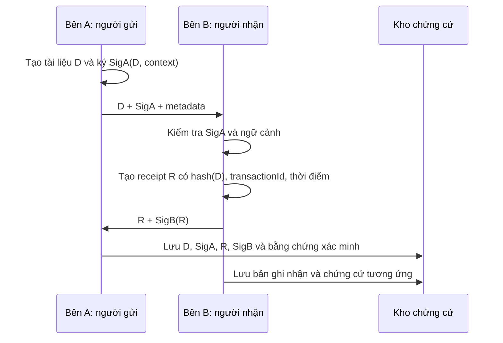
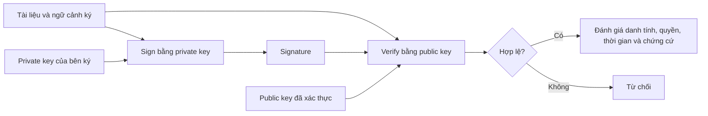
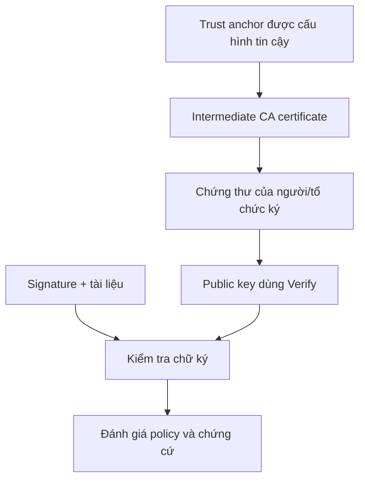
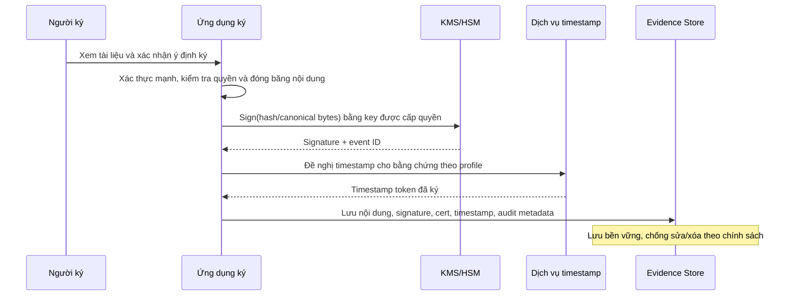
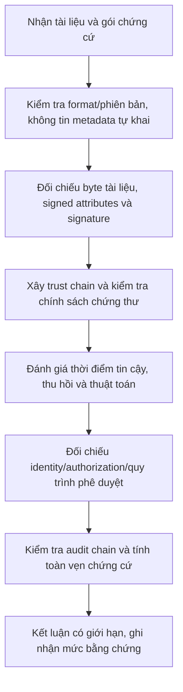
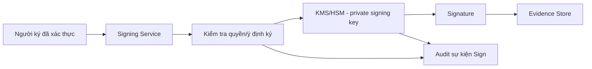
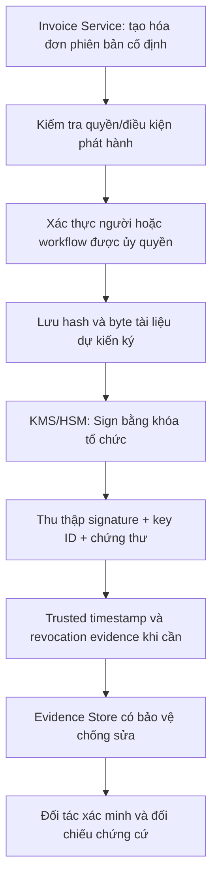

# Non-repudiation: Chống chối bỏ trong hệ thống chữ ký số

> **Chương:** Chữ ký số  
> **Bài:** Non-repudiation  
> **Phạm vi module:** `SECURITY_KEY_MANAGEMENT_FUNDAMENTALS` — hiểu vòng đời khóa mật mã từ tạo, cấp phát, lưu trữ, sử dụng, xoay vòng đến thu hồi và hủy; kết nối mật mã bất đối xứng, chữ ký số, KMS/HSM, envelope encryption, kiểm soát truy cập và kiểm toán để bảo vệ khóa an toàn.

## 1. Non-repudiation là gì?

**Non-repudiation** (thường dịch là **tính chống chối bỏ** hoặc **khả năng chống phủ nhận**) là mục tiêu an ninh trong đó một hệ thống tạo ra và duy trì **bằng chứng đủ tin cậy** để một bên không thể dễ dàng phủ nhận một hành vi đã thực hiện, chẳng hạn tạo/gửi một thông điệp, ký một tài liệu hoặc nhận một thông điệp.

Ví dụ: một nhà cung cấp gửi hóa đơn điện tử đã ký số cho đối tác. Sau đó xảy ra tranh chấp: “Tôi chưa từng phê duyệt hóa đơn này.” Hệ thống cần cung cấp chứng cứ về **nội dung đã ký**, **khóa dùng ký**, **chủ thể được gắn với khóa**, **thời gian**, **quyền và quy trình phê duyệt**, cũng như **tính toàn vẹn** của chứng cứ từ lúc tạo đến lúc kiểm tra.

Chữ ký số là **công cụ mật mã cốt lõi** để xây dựng bằng chứng chống chối bỏ nguồn gốc. Tuy nhiên:

> **Một chữ ký xác minh hợp lệ không tự chứng minh tuyệt đối rằng một con người cụ thể đã tự nguyện ký, cũng không tự xác lập hiệu lực pháp lý.** Muốn có bằng chứng mạnh cần kết hợp quản lý private key, xác minh danh tính, quy trình phê duyệt, chứng thư/PKI khi phù hợp, dấu thời gian đáng tin cậy, kiểm toán và chính sách lưu giữ.

Trong kỹ thuật, cụm “không thể chối bỏ” không có nghĩa một bên **bị ngăn phát biểu lời phủ nhận**. Nó nghĩa là hệ thống có khả năng cung cấp chứng cứ mà bên kiểm chứng có thể đánh giá độc lập theo mô hình tin cậy và quy tắc đã thống nhất.

### Mục tiêu học tập

Sau bài học, bạn có thể:

1. Phân biệt non-repudiation với **authentication**, **integrity**, **confidentiality** và **authorization**.
2. Giải thích tại sao chữ ký bất đối xứng hỗ trợ chống chối bỏ tốt hơn HMAC trong nhiều kịch bản.
3. Phân tích vai trò của **private signing key**, **public key**, chứng thư, chuỗi tin cậy, trạng thái thu hồi và dấu thời gian.
4. Xây dựng **chuỗi bằng chứng (evidence chain)** cho một sự kiện ký tài liệu.
5. Viết ví dụ Java 17 với Ed25519 để ký/xác minh **đúng các byte và ngữ cảnh** của một thông điệp.
6. Xây dựng chính sách KMS/HSM, phân quyền, rotation, thu hồi, lưu trữ chứng cứ và phản ứng với tranh chấp.
7. Nhận diện những trường hợp chữ ký đúng về mật mã nhưng không đủ chứng minh hành động nghiệp vụ.

---

## 2. Bốn câu hỏi an ninh thường bị nhầm

| Thuộc tính | Câu hỏi | Cơ chế điển hình | Chưa tự bảo đảm điều gì? |
|---|---|---|---|
| **Integrity (toàn vẹn)** | Nội dung có bị chỉnh sửa mà không được phát hiện không? | MAC, chữ ký số, AEAD. | Ai đã đồng ý hoặc được phép thao tác. |
| **Authentication (xác thực)** | Đối tượng đang giao tiếp, hoặc khóa tạo bằng chứng, có đúng với danh tính kỳ vọng không? | Challenge–response, chứng thư, mTLS, chữ ký số. | Hành vi cụ thể có được phê duyệt về nghiệp vụ không. |
| **Authorization (phân quyền)** | Chủ thể có được phép thực hiện hành động trên tài nguyên không? | IAM, RBAC/ABAC, chính sách nghiệp vụ. | Hành vi thực sự đã xảy ra và được lưu bằng chứng bền vững. |
| **Non-repudiation (chống chối bỏ)** | Sau này có đủ chứng cứ đáng tin để đối chiếu việc đã ký/gửi/nhận hoặc một hành vi xác định không? | Chữ ký số, định danh, thời gian tin cậy, audit và chuỗi chứng cứ. | Bằng chứng luôn có hiệu lực pháp lý trong mọi hoàn cảnh. |
| **Confidentiality (bí mật)** | Bên không có quyền có đọc được dữ liệu không? | AES-GCM, TLS, envelope encryption. | Ai đã ký hay chấp thuận tài liệu. |

Một tài liệu có chữ ký số **vẫn có thể đọc công khai** vì chữ ký không phải mã hóa. Nếu cần bí mật, phải mã hóa riêng bằng cơ chế phù hợp. Ngược lại, một tệp đã mã hóa AES-GCM đúng vẫn không tự chứng minh một tổ chức cụ thể đã ký nó.

### Ví dụ ba khẳng định khác nhau

```text
1. "Các byte hóa đơn không đổi từ lúc ký."
   -> Kiểm tra chữ ký trên chính tài liệu đã ký.

2. "Chữ ký hợp lệ dưới public key gắn với Công ty A."
   -> Xác minh chữ ký + nguồn public key/chứng thư đáng tin.

3. "Đại diện có thẩm quyền của Công ty A đã chủ động phê duyệt."
   -> Cần bằng chứng bổ sung: định danh người ký, quyền đại diện,
      xác nhận ý chí, quy trình ký, thiết bị/khóa và chứng cứ vận hành.
```

Ba khẳng định không đồng nhất. Sai lầm phổ biến là từ câu (1) nhảy thẳng đến câu (3).

## 3. Những dạng bằng chứng chống chối bỏ

Non-repudiation không chỉ có một loại. Trong hệ thống gửi tài liệu, giao dịch hoặc trao đổi liên thông, có thể quan tâm:

| Dạng bằng chứng | Sự kiện cần chứng minh | Ví dụ |
|---|---|---|
| **Non-repudiation of origin** | Một thông điệp/tài liệu có nguồn phát hành được gắn với một thực thể nhất định. | Bên phát hành ký hóa đơn bằng khóa ký đã được xác thực. |
| **Non-repudiation of submission** | Một thông điệp đã được nộp cho hệ thống tiếp nhận. | Cổng nhận ký/ghi biên nhận nộp hồ sơ. |
| **Non-repudiation of delivery** | Thông điệp đã được chuyển đến điểm nhận được xác định. | Dịch vụ chuyển phát tạo chứng cứ phát tài liệu. |
| **Non-repudiation of receipt** | Bên nhận đã nhận hoặc xác nhận nhận thông điệp theo giao thức. | Bên nhận ký một receipt chứa hash tài liệu và ID giao dịch. |

**Không được suy ra bằng chứng nhận từ một chữ ký của bên gửi.** Chữ ký của A trên tài liệu chỉ là một thành phần bằng chứng về nguồn phát hành. Muốn chứng minh B đã nhận, thường cần **biên nhận đáng tin cậy từ B** hoặc một bên dịch vụ tin cậy theo quy trình đã thống nhất.

### Ví dụ: giao dịch có hai chữ ký



Trong thiết kế này:

- Chữ ký của A hỗ trợ bằng chứng nguồn gốc tài liệu.
- Chữ ký của B trên receipt hỗ trợ bằng chứng nhận.
- Việc B **đọc, hiểu hoặc đồng ý với mọi điều khoản** không tự suy ra chỉ từ việc gửi receipt; phải quy định rõ ý nghĩa pháp lý/nghiệp vụ của hành động xác nhận.

---

## 4. Chữ ký số tạo bằng chứng như thế nào?

Chữ ký số sử dụng một **cặp khóa bất đối xứng**:

- **Private signing key:** khóa riêng của bên ký, phải được giữ kín và kiểm soát quyền sử dụng.
- **Public verification key:** khóa công khai tương ứng; bên kiểm tra có thể dùng để xác minh.
- **Signature:** kết quả của thuật toán ký trên các byte được xác định rõ.
- **Signed message/document:** dữ liệu được ràng buộc bởi chữ ký; thay đổi dữ liệu thường làm xác minh thất bại.



Một công thức khái niệm:

\[
\sigma \leftarrow \operatorname{Sign}(sk,m)
\]
\[
\operatorname{Verify}(pk,m,\sigma)\in\{\mathrm{true},\mathrm{false}\}
\]

`m` phải là **đúng chuỗi byte** của dữ liệu và ngữ cảnh theo giao thức. Không đủ để một bên ký “ý nghĩa của JSON” còn bên kia kiểm tra JSON được serialize lại theo thứ tự khác, hoặc ký một file trước khi phần mềm chỉnh sửa metadata của file đó.

### 4.1. Tại sao bất đối xứng có ích cho chống chối bỏ?

Khác với HMAC, việc biết **public verification key** không cho phép bên kiểm tra tạo chữ ký hợp lệ dưới private key tương ứng, khi thuật toán an toàn và khóa không bị lộ. Do đó, nhiều bên có thể xác minh mà không phải chia sẻ bí mật có quyền ký.

Nhưng **không phải mọi bằng chứng chữ ký đều quy được đến một con người**:

- Nếu toàn bộ bộ phận cùng có quyền `Sign` bằng một khóa, không thể từ chữ ký đơn độc biết nhân viên nào đã kích hoạt.
- Nếu private key bị đánh cắp, người khác có thể tạo chữ ký hợp lệ.
- Nếu server ký tự động theo request có quyền quá rộng, chữ ký có thể hợp lệ mà người đại diện không hề thấy tài liệu.
- Nếu public key bị tráo, verifier có thể kiểm tra chữ ký do kẻ tấn công tạo.
- Nếu thời điểm ký không đáng tin, khó kết luận chữ ký đã được tạo trước khi khóa bị thu hồi hoặc trước khi chứng thư hết hạn.

### 4.2. HMAC có cung cấp non-repudiation không?

Một MAC với shared secret `K` có thể xác thực thông điệp **theo bên biết K**, nhưng hai phía cùng biết K thường **đều tạo được MAC hợp lệ**. Vì vậy HMAC một mình **không cung cấp bằng chứng có thể kiểm chứng độc lập rằng chỉ bên A đã tạo tag** nếu bên B cũng giữ khóa.

Đối với giao tiếp nội bộ có chung vùng tin cậy, HMAC có thể đủ để xác thực request và kiểm tra toàn vẹn; non-repudiation mạnh hơn có thể cần chữ ký riêng theo chủ thể và chuỗi chứng cứ. Không dùng HMAC như một “chữ ký số” trong văn bản có yêu cầu kiểm chứng bởi bên thứ ba nếu không có hệ thống chứng cứ và quy ước khác làm cơ sở.

### 4.3. Chữ ký số khác chữ ký điện tử

“Chữ ký điện tử” là khái niệm rộng trong nhiều hệ thống/pháp luật; có thể là một thao tác chấp thuận, quy trình xác thực hoặc phương thức điện tử khác. “Chữ ký số” thường chỉ cơ chế mật mã bất đối xứng tạo và xác minh signature.

Một hình ảnh chữ ký dán vào PDF, checkbox “Tôi đồng ý” hoặc OTP **không tự trở thành chữ ký số mật mã**. Ngược lại, chữ ký số xác minh được về mặt thuật toán **không tự bảo đảm tất cả điều kiện công nhận theo luật áp dụng**. Cần tra cứu quy định pháp lý, hợp đồng và tiêu chuẩn tin cậy tương ứng khi triển khai thực tế.

## 5. Điều kiện để bằng chứng chữ ký có sức thuyết phục

Hãy đặt câu hỏi: nếu xảy ra tranh chấp **sau 5 năm**, hệ thống phải đưa ra được những gì?

### 5.1. Nội dung gốc và phạm vi đã ký

- Chính xác byte nào đã được ký?
- Người ký có biết phiên bản và nội dung được trình bày hay không?
- Có bao gồm phụ lục, file đính kèm, trường biểu mẫu, metadata quan trọng không?
- Một số trường có thể thay đổi **sau khi ký** theo format tài liệu không?
- Có thể tái tạo bản hiển thị mà người ký đã xem hay không?

Với PDF, các tiêu chuẩn chữ ký của định dạng có cơ chế chọn byte range; việc tùy ý sửa file sau ký có thể làm hỏng hoặc thay đổi ý nghĩa chữ ký. Nếu cần kiểm tra lâu dài, nên dùng thư viện hỗ trợ chuẩn chữ ký tài liệu thay vì tự định nghĩa một cấu trúc PDF không tương thích.

### 5.2. Khóa xác minh và danh tính chủ thể

Một `PublicKey` chỉ chứa thông số toán học. Để khẳng định chữ ký gắn với tổ chức/người ký, cần bằng chứng ánh xạ:

- Chứng thư số liên kết public key với danh tính theo chính sách của tổ chức cấp chứng thư.
- Chuỗi chứng thư tới một **trust anchor** được chấp nhận.
- Thời hạn chứng thư, mục đích sử dụng khóa và các extension có liên quan.
- Thông tin xác minh chứng thư và trạng thái thu hồi.
- Bằng chứng về quy trình cấp phát, đăng ký và quyền sử dụng private key.

**Chứng thư hợp lệ chỉ là một mắt xích.** Cần đánh giá bên cấp chứng thư, chính sách trust và mức bảo đảm định danh phù hợp với nghiệp vụ.

### 5.3. Kiểm soát private key

Một private key xuất được rồi chia sẻ trên nhiều máy thường tạo bằng chứng yếu hơn khóa được kiểm soát trong **KMS/HSM**, khi những bên khác có thể sử dụng cùng khóa.

Cần hỏi:

- Ai tạo private key và ở đâu?
- Private key có thể xuất ra dưới dạng raw bytes không?
- Ai có thể yêu cầu ký, với quyền nào?
- Có yêu cầu xác thực mạnh hoặc phê duyệt riêng cho từng lần ký không?
- Dữ liệu nào được hiển thị để người ký phê duyệt?
- Hệ thống có ghi nhận request, danh tính, kết quả, mốc thời gian và băm tài liệu không?
- Nếu workload hay nhân viên có quyền ký bị chiếm quyền, làm sao phát hiện và thu hồi?

**Non-exportable key** làm giảm rủi ro sao chép bí mật nhưng không ngăn lạm dụng API `Sign` khi attacker có quyền. HSM không thể tự kết luận người ký đã đọc và đồng ý với nội dung.

### 5.4. Bằng chứng thời gian

Chữ ký thường có trường thời gian do ứng dụng hoặc người gửi khai báo. Trường đó có thể được ký để chống sửa, nhưng **không tự chứng minh thời gian là đúng**.

Ví dụ:

```text
claimedSigningTime = 2026-11-28T08:30:00Z
```

Nếu bên ký kiểm soát đồng hồ, họ có thể ký một thời gian sai. Khi thời gian có ý nghĩa quan trọng, sử dụng **trusted timestamp** (dấu thời gian từ dịch vụ đáng tin cậy) với chính sách và cơ chế xác minh phù hợp, ví dụ theo RFC 3161. Dấu thời gian có thể gắn với hash của signature hoặc dữ liệu chứng cứ theo định dạng được quy định, giúp chứng minh một giá trị đã tồn tại **không muộn hơn** một mốc thời gian đã được chứng nhận.

Đừng nhầm dấu thời gian đáng tin cậy với timestamp nằm trong JSON/header do client tự gửi.

### 5.5. Chứng cứ có khả năng kiểm tra lâu dài

Một chữ ký ký hôm nay có thể cần được xác minh nhiều năm sau. Khi đó:

- Chứng thư có thể hết hạn.
- CA có thể thay đổi hoặc ngừng hoạt động.
- URL OCSP/CRL có thể không còn truy cập được.
- Thuật toán có thể trở nên yếu theo thời gian.
- Khóa có thể đã bị thu hồi hoặc bị nghi ngờ lộ.
- Dịch vụ lưu trữ chứng cứ có thể bị sửa/xóa.

Giải pháp là **lưu chứng cứ tại thời điểm thích hợp**, có quy trình xác minh/archival/renewal và định dạng phục vụ xác minh lâu dài. Không thể chỉ lưu `(document, signature)` rồi cho rằng 10 năm sau sẽ luôn xác minh đủ ngữ cảnh.

---

## 6. PKI và chứng thư: từ chữ ký hợp lệ đến danh tính đáng tin

### 6.1. Chuỗi tin cậy của chứng thư

Một chứng thư X.509 có thể chứa public key, subject, issuer, serial number, thời hạn, thông tin thuật toán, key usage và các extension. Để tin chứng thư, ứng dụng cần xây dựng và kiểm tra chuỗi tin cậy phù hợp:



**Thứ tự kiểm tra khái niệm:**

1. Chọn trust anchor tin cậy theo chính sách, không tự tin bất kỳ root certificate nào do gói gửi kèm.
2. Kiểm tra chuỗi chứng thư và chữ ký chứng thư.
3. Kiểm tra thời hạn phù hợp với **mốc thời gian đánh giá**, cùng các điều kiện của policy.
4. Kiểm tra mục đích dùng khóa, ví dụ `digitalSignature` và các yêu cầu `extendedKeyUsage` nếu chính sách/loại chứng thư quy định.
5. Kiểm tra tình trạng thu hồi bằng CRL/OCSP hoặc bằng chứng lịch sử đáng tin, theo chính sách.
6. Kiểm tra thuật toán/độ dài khóa đủ mạnh.
7. Liên kết danh tính trong chứng thư với **đúng chủ thể nghiệp vụ** mà hệ thống cần xác minh.
8. Kiểm tra signature trên **chính nội dung** với public key đã tin cậy.

**Lưu ý:** Java `Signature.verify(...)` **không tự kiểm tra** các bước PKI này.

### 6.2. Chứng thư hết hạn và bị thu hồi có khác nhau?

Có. Chứng thư hết hạn có nghĩa thời gian hiệu lực công bố đã kết thúc; chứng thư bị thu hồi là một trạng thái có thể chỉ ra khóa hoặc quan hệ chứng nhận không còn được chấp nhận theo chính sách.

Để đánh giá một chữ ký trong quá khứ, không thể đơn giản nói: “Chứng thư hết hạn hôm nay, nên mọi chữ ký trước đây đều vô hiệu.” Cần có bằng chứng đáng tin về thời điểm ký và chính sách xác minh lịch sử.

Ngược lại, cũng **không thể** chỉ dựa vào trường thời gian do người ký tự khai để nói chữ ký chắc chắn được tạo trước thời điểm thu hồi. Cần hiểu lý do thu hồi, mốc tin cậy, chứng cứ thu hồi và quy tắc áp dụng.

### 6.3. OCSP/CRL và long-term validation

- **CRL (Certificate Revocation List):** danh sách chứng thư bị thu hồi do CA phát hành theo cơ chế được quy định.
- **OCSP (Online Certificate Status Protocol):** giao thức truy vấn trạng thái chứng thư.
- **LTV (Long-Term Validation):** cách lưu/đánh giá chữ ký cùng chứng cứ cần thiết để phục vụ xác minh về sau, tùy chuẩn tài liệu và chính sách.

Đối với PDF, có các profile/cấu trúc phục vụ kiểm tra lâu dài như **PAdES**; với định dạng XML có **XAdES**; với CMS có **CAdES**. Sử dụng thư viện/tiêu chuẩn phù hợp nếu cần xuất tài liệu có thể được nhiều bên kiểm tra độc lập. Một ví dụ Java gọi `Signature` đơn thuần không tự tạo ra PAdES/XAdES/CAdES.

### 6.4. Đừng tin chứng thư chỉ vì gói tin mang theo nó

Kẻ tấn công có thể tự tạo một cặp khóa và chứng thư tự ký rồi gửi kèm chữ ký. Nếu verifier chỉ gọi:

```text
verify(publicKeyFromUntrustedPacket, message, signature)
```

thì kết quả có thể là `true` — nhưng chỉ chứng minh message được ký bởi khóa **do chính gói tin cung cấp**. Điều đó không chứng minh khóa thuộc tổ chức mà gói tin tự tuyên bố.

Phải xác thực public key/chứng thư bằng một nguồn tin cậy **ngoài gói tin không đáng tin** hoặc chuỗi trust được kiểm tra đúng.

---

## 7. Chuỗi bằng chứng (evidence chain) cho non-repudiation

Một bằng chứng có sức thuyết phục thường là **tập hợp hiện vật và sự kiện**, không chỉ một mảng byte chữ ký.

| Thành phần | Cần lưu gì? | Giá trị chứng minh |
|---|---|---|
| **Tài liệu/bản thông điệp chính xác** | Byte gốc, định dạng, version và hash để lập chỉ mục. | Xác định nội dung đã được ký. |
| **Signature** | Byte chữ ký, thuật toán, key ID, tham số, phiên bản. | Kiểm tra ràng buộc mật mã với nội dung. |
| **Public key/chứng thư và chain** | Chứng thư và metadata nguồn tin cậy, chuỗi liên quan. | Liên kết khóa với danh tính được công nhận trong mô hình. |
| **Bằng chứng thời gian** | Timestamp token/attestation theo dịch vụ tin cậy, ID giao dịch. | Đánh giá thứ tự và thời điểm tồn tại của chữ ký/chứng cứ. |
| **Bằng chứng thu hồi** | OCSP/CRL hoặc snapshot có thể xác minh theo chính sách. | Xác minh trạng thái chứng thư tại thời điểm có liên quan. |
| **Bằng chứng phê duyệt** | Identity session, bước xác thực mạnh, phê duyệt, phiên bản nội dung hiển thị. | Hỗ trợ chứng minh hành vi có chủ ý của chủ thể. |
| **Audit vận hành** | Ai gọi `Sign`, lúc nào, nguồn nào, kết quả, policy/grant liên quan. | Hỗ trợ điều tra sự kiện và khả năng lạm dụng khóa. |
| **Chứng cứ lưu giữ** | Log chống sửa, hash chain/đóng dấu nếu áp dụng, lịch sử chuyển lưu trữ. | Đánh giá tính toàn vẹn từ thời điểm tạo đến khi tranh chấp. |

Một **hash tài liệu** hỗ trợ đối chiếu nội dung, nhưng bản thân hash không đủ chứng minh danh tính hay thời gian. Một audit log dạng text tự do cũng không tự chứng minh chống sửa nếu người quản trị hệ thống có thể sửa/xóa log mà không để lại dấu vết.

### 7.1. Từ hành động đến gói chứng cứ



Trong một số dịch vụ ký từ xa, **dịch vụ ký** áp chính sách xác thực trực tiếp với người ký, còn ứng dụng không lấy private key. Kiến trúc nào cũng phải mô tả rõ ranh giới trách nhiệm: ứng dụng xác định tài liệu, IdP xác thực người dùng, KMS/HSM giữ khóa, TSA xác nhận thời điểm, kho chứng cứ giữ hiện vật.

### 7.2. Quy trình xác minh chứng cứ



Kết quả nên phân biệt rõ:

- **Cryptographic signature verification:** pass/fail.
- **Certificate/path validation:** pass/fail/unknown theo thời gian và policy.
- **Evidence completeness:** đủ/thiếu, ví dụ không có timestamp tin cậy hoặc không còn dữ liệu OCSP/CRL.
- **Business authorization and consent evidence:** có/thiếu/mâu thuẫn.
- **Legal assessment:** đánh giá riêng theo văn bản pháp luật/hợp đồng áp dụng và chứng cứ cụ thể.

Đừng trả một boolean `nonRepudiation=true` chỉ vì bước đầu tiên thành công.

## 8. Ví dụ Java 17: ký đúng tài liệu và ngữ cảnh bằng Ed25519

Đoạn mã sau minh họa **chữ ký mật mã**, không phải một dịch vụ chứng thực định danh hoặc giải pháp non-repudiation production hoàn chỉnh.

Thiết kế mẫu:

- Tạo một cặp khóa **Ed25519** bằng JCA của Java 17.
- Ký một chuỗi byte **không nhập nhằng** gồm phiên bản giao thức, mục đích, `documentId`, `signerId`, `keyId`, thời điểm được khai báo, nonce và **toàn bộ byte tài liệu**.
- Xác minh bằng **public key nhận từ nguồn đã tin cậy**, không dùng public key tự khai trong gói.
- Từ chối metadata khác với kỳ vọng trước khi xác minh.
- Nhắc rõ rằng `claimedSigningTime` chỉ là thời gian do ứng dụng khai báo; nếu cần chứng minh thời điểm, cần trusted timestamp riêng.

```java
import java.io.ByteArrayOutputStream;
import java.io.DataOutputStream;
import java.io.IOException;
import java.nio.charset.StandardCharsets;
import java.security.GeneralSecurityException;
import java.security.KeyPair;
import java.security.KeyPairGenerator;
import java.security.PrivateKey;
import java.security.PublicKey;
import java.security.SecureRandom;
import java.security.Signature;
import java.time.Instant;
import java.util.Arrays;

public final class NonRepudiationSignatureDemo {
    private static final String SIGNATURE_ALGORITHM = "Ed25519";
    private static final String CONTEXT = "invoice-approval/v1";
    private static final SecureRandom RANDOM = new SecureRandom();

    private NonRepudiationSignatureDemo() {}

    public record SignedEvidence(
            String keyId,
            String signerId,
            String documentId,
            long claimedSigningTime,
            byte[] nonce,
            byte[] signature) {

        public SignedEvidence {
            nonce = nonce.clone();
            signature = signature.clone();
        }

        @Override public byte[] nonce() {
            return nonce.clone();
        }

        @Override public byte[] signature() {
            return signature.clone();
        }
    }

    public static SignedEvidence sign(
            PrivateKey signingKey,
            String keyId,
            String signerId,
            String documentId,
            byte[] documentBytes)
            throws GeneralSecurityException, IOException {

        long now = Instant.now().getEpochSecond();
        byte[] nonce = new byte[16];
        RANDOM.nextBytes(nonce);

        byte[] input = signingInput(
                keyId, signerId, documentId, now, nonce, documentBytes);

        Signature signer = Signature.getInstance(SIGNATURE_ALGORITHM);
        signer.initSign(signingKey);
        signer.update(input);
        byte[] signature = signer.sign();

        return new SignedEvidence(
                keyId, signerId, documentId, now, nonce, signature);
    }

    public static boolean verify(
            PublicKey trustedSignerPublicKey,
            SignedEvidence evidence,
            String expectedKeyId,
            String expectedSignerId,
            String expectedDocumentId,
            byte[] documentBytes)
            throws GeneralSecurityException, IOException {

        // Các expected... đến từ mapping danh tính và policy đáng tin.
        if (!expectedKeyId.equals(evidence.keyId())
                || !expectedSignerId.equals(evidence.signerId())
                || !expectedDocumentId.equals(evidence.documentId())) {
            return false;
        }
        if (evidence.nonce().length != 16) {
            return false;
        }

        byte[] input = signingInput(
                evidence.keyId(),
                evidence.signerId(),
                evidence.documentId(),
                evidence.claimedSigningTime(),
                evidence.nonce(),
                documentBytes);

        Signature verifier = Signature.getInstance(SIGNATURE_ALGORITHM);
        verifier.initVerify(trustedSignerPublicKey);
        verifier.update(input);
        return verifier.verify(evidence.signature());
    }

    private static byte[] signingInput(
            String keyId,
            String signerId,
            String documentId,
            long claimedSigningTime,
            byte[] nonce,
            byte[] documentBytes) throws IOException {

        // Length-prefix tránh nhập nhằng các trường.
        ByteArrayOutputStream buffer = new ByteArrayOutputStream();
        DataOutputStream out = new DataOutputStream(buffer);
        writeText(out, CONTEXT);
        writeText(out, SIGNATURE_ALGORITHM);
        writeText(out, keyId);
        writeText(out, signerId);
        writeText(out, documentId);
        out.writeLong(claimedSigningTime);
        writeBytes(out, nonce);
        writeBytes(out, documentBytes);
        out.flush();
        return buffer.toByteArray();
    }

    private static void writeText(
            DataOutputStream out, String text) throws IOException {
        writeBytes(out, text.getBytes(StandardCharsets.UTF_8));
    }

    private static void writeBytes(
            DataOutputStream out, byte[] value) throws IOException {
        out.writeInt(value.length);
        out.write(value);
    }

    public static void main(String[] args) throws Exception {
        // Demo: sinh khóa cục bộ. Production: KMS/HSM và trust chain.
        KeyPairGenerator generator =
                KeyPairGenerator.getInstance(SIGNATURE_ALGORITHM);
        KeyPair pair = generator.generateKeyPair();

        byte[] document = "Invoice INV-1007;amount=250000"
                .getBytes(StandardCharsets.UTF_8);

        SignedEvidence evidence = sign(
                pair.getPrivate(),
                "invoice-signing-v3",
                "company-a-signer",
                "INV-1007",
                document);

        boolean ok = verify(
                pair.getPublic(),
                evidence,
                "invoice-signing-v3",
                "company-a-signer",
                "INV-1007",
                document);
        System.out.println("Signature valid: " + ok);

        byte[] modified = "Invoice INV-1007;amount=950000"
                .getBytes(StandardCharsets.UTF_8);
        System.out.println(
                "Modified document valid: "
                + verify(pair.getPublic(), evidence,
                        "invoice-signing-v3",
                        "company-a-signer",
                        "INV-1007",
                        modified));

        Arrays.fill(document, (byte) 0);
        Arrays.fill(modified, (byte) 0);
    }
}
```

### 8.1. Kết quả dự kiến

Khi chạy với provider hỗ trợ Ed25519:

```text
Signature valid: true
Modified document valid: false
```

Thay `documentBytes` làm xác minh thất bại. Tương tự, dùng public key không khớp, `documentId` khác hoặc một chữ ký bị sửa sẽ không tạo bằng chứng hợp lệ trong kiểm thử bình thường.

### 8.2. Tại sao phải ký cả ngữ cảnh?

Nếu chỉ ký byte `"APPROVED"`, kẻ tấn công có thể thử chuyển cùng chữ ký sang một hóa đơn hoặc một loại hành động khác. Trong ví dụ, signature ràng buộc:

| Trường | Lý do |
|---|---|
| `invoice-approval/v1` | **Domain separation:** không dùng chữ ký của giao thức khác vào phê duyệt hóa đơn. |
| `Ed25519` | Chỉ rõ loại bằng chứng được kỳ vọng theo định dạng mẫu. |
| `keyId` | Gắn bằng chứng với phiên bản khóa được quy định. |
| `signerId` | Gắn với danh tính **được hệ thống mong đợi**, cần kiểm tra bằng nguồn ngoài gói. |
| `documentId` | Ngăn dùng chữ ký của tài liệu này cho tài liệu khác. |
| `claimedSigningTime` | Chống sửa thời gian đã khai báo, **không chứng minh đồng hồ đúng**. |
| `nonce` | Phân biệt từng thao tác ký và hỗ trợ đối chiếu; **không tự chống replay**. |
| `documentBytes` | Ràng buộc chữ ký với đúng byte nội dung đã ký. |

Phương pháp này minh họa ý tưởng. Với tài liệu PDF/XML/JSON dùng trong trao đổi liên tổ chức, nên dùng một **định dạng và profile chữ ký chuẩn hóa** để nhiều hệ thống hiểu và kiểm tra cùng một phạm vi byte.

### 8.3. Các giới hạn bảo mật cố ý của ví dụ

- **Không xác thực con người:** `signerId` là chuỗi. Code không có đăng nhập, MFA, xác nhận ý chí hay kiểm tra thẩm quyền người ký.
- **Không có PKI:** public key trong `main` là public key vừa sinh, không có chứng thư, chain, revocation hoặc trust anchor. Trong thực tế, `trustedSignerPublicKey` phải được xác thực từ nguồn tin cậy.
- **Không có timestamp đáng tin:** thời điểm được đọc từ đồng hồ ứng dụng. Một attacker có quyền ký có thể tạo timestamp khai báo sai.
- **Không có quy trình KMS/HSM:** private key trong JVM có thể xuất được tùy provider. HSM có thể yêu cầu gọi SDK/API `Sign`, không có giao diện `PrivateKey` tương đương.
- **Không có chống replay:** một `SignedEvidence` hợp lệ có thể được gửi lại; ứng dụng cần ledger hoặc trạng thái đã xử lý.
- **Chưa có lưu chứng cứ:** không lưu document, chữ ký, trạng thái chứng thư, log hay bằng chứng kiểm toán lâu dài.
- **Chưa có streaming file lớn:** code tạo byte array cho toàn bộ tài liệu; production nên dùng API signature theo luồng và giới hạn tài nguyên hợp lý.
- **Không phải kết luận pháp lý:** `verify()==true` chỉ chứng minh chữ ký hợp lệ dưới public key được truyền cho verifier.

### 8.4. Những mẫu sai cần tránh

```java
// Sai về trust: lấy public key không xác thực từ cùng packet
// rồi tuyên bố đã xác minh được người ký.
// verifier.initVerify(packet.getPublicKey());

// Sai về ngữ cảnh: chỉ ký một từ "APPROVED"
// mà không gắn tài liệu, hành động, identity, version.
// signature.update("APPROVED".getBytes(StandardCharsets.UTF_8));

// Sai về thời gian: coi timestamp do client gửi là chứng cứ
// thời điểm đã được xác nhận bởi bên thứ ba.
// boolean provedAtTime = (packet.claimedTime() < deadline);

// Sai về thẩm quyền: chữ ký đúng nhưng không kiểm tra quyền ký.
// if (verify(signature)) approveContract();
```

Một cặp khóa được tạo đúng và thuật toán Ed25519 an toàn **không cứu được giao thức thiếu ngữ cảnh, quyền và bằng chứng**.

---

## 9. Thuật toán chữ ký và lựa chọn trong Java/KMS

| Thuật toán | Đặc điểm | Điều cần lưu ý |
|---|---|---|
| **Ed25519** | Chữ ký theo EdDSA, có hỗ trợ JCA trên Java 17. | Chỉ dùng khi provider, KMS/HSM và hệ thống xác minh đều hỗ trợ; không thay thế kiểm tra PKI. |
| **ECDSA** | Chữ ký trên đường cong elliptic, phổ biến trong chứng thư và giao thức. | Cần sinh nonce ký an toàn hoặc cách triển khai chuẩn, không tự viết thuật toán; chú ý encoding chữ ký. |
| **RSA-PSS** | Chữ ký RSA với padding PSS được chuẩn hóa. | Cấu hình hash, MGF1, salt length và modulus phải tương thích giữa các bên. |
| **RSA PKCS#1 v1.5 signature** | Cơ chế cũ còn tồn tại trong nhiều hệ thống. | Với thiết kế mới nên đánh giá cơ chế hiện đại/phù hợp chính sách; không tự động thay thuật toán làm mất tương thích. |
| **HMAC-SHA-256** | MAC với khóa đối xứng dùng chung, **không phải chữ ký bất đối xứng**. | Bên xác minh có secret cũng tạo được tag; không có xác minh công khai theo mô hình này. |

Trong Java, `Signature.getInstance("RSASSA-PSS")` đòi hỏi cấu hình `PSSParameterSpec` phù hợp để tránh lệch thông số; `Signature.getInstance("SHA256withECDSA")` có encoding chữ ký theo provider/giao thức. Không đổi tên thuật toán trong payload mà không đổi cách ký/xác minh.

**Kích thước khóa lớn hơn không giải quyết private key bị lộ hoặc quyền `Sign` quá rộng.** Lựa chọn thuật toán là một phần của thiết kế, không thay thế quản trị khóa và bằng chứng.

## 10. KMS/HSM giúp gì cho non-repudiation?

### 10.1. Bảo vệ vật liệu khóa riêng

HSM có thể giữ private signing key trong ranh giới bảo mật của thiết bị. KMS quản lý định danh khóa, policy, phiên bản, quyền sử dụng và audit; một số KMS được hỗ trợ bằng HSM bên dưới.



Một private key **không cho xuất** giúp giảm nguy cơ sao chép vào Git, file hoặc heap, nhưng một ứng dụng có quyền `Sign` vẫn có thể tạo chữ ký hợp lệ trên dữ liệu mà nó gửi tới thiết bị. **Quyền dùng khóa** và **quyền phê duyệt nghiệp vụ** phải được thiết kế đồng thời.

### 10.2. Phân quyền theo vai trò

| Vai trò | Quyền hợp lý | Tránh cấp mặc định |
|---|---|---|
| **Signing Service** | Gọi `Sign` cho một key/purpose cụ thể sau kiểm tra quy trình. | Xuất private key, xóa key, sửa IAM/policy. |
| **Verification Service** | Lấy public key/chứng thư và `Verify`. | Quyền `Sign` nếu không cần. |
| **Key Custodian** | Tạo, rotate, disable theo phân quyền/phê duyệt. | Quyền tự ký chứng từ nghiệp vụ nếu không được giao. |
| **Security Auditor** | Đọc metadata, log, lịch sử quyền và thay đổi policy. | Đọc raw private key, sửa/xóa chứng cứ. |
| **Evidence Archivist** | Lưu và kiểm tra tính toàn vẹn của gói chứng cứ. | Thay tài liệu đã ký hoặc tạo chữ ký thay người khác. |
| **Emergency Operator** | Quyền tạm thời theo quy trình có giám sát. | Quyền rộng và tồn tại lâu dài. |

Với thao tác rủi ro cao, có thể yêu cầu **multi-party approval**, xác thực mạnh vừa đủ, trình bày tài liệu cho người ký trước khi ký, hạn mức giao dịch và cách ly quyền tạo/chấp nhận lệnh. Nhưng không có cấu hình chung nào đúng cho mọi tổ chức.

### 10.3. Chữ ký KMS có chứng minh con người thực hiện không?

**Không tự động.** Nếu service có quyền `Sign` tự động ký mọi hóa đơn khi hàng đợi phát sự kiện, chữ ký chỉ chứng minh khóa doanh nghiệp đã được sử dụng dưới chính sách hiện tại. Không thể từ riêng signature suy ra một nhân viên đã nhấp “Đồng ý”.

Nếu cần chứng minh hành vi của cá nhân, phải bổ sung và lưu bằng chứng về **xác thực người đó, quyền lúc ký, nội dung được hiển thị, hành động xác nhận ý chí và mối liên hệ giữa hành động với yêu cầu `Sign`**.

### 10.4. HMAC, DEK/KEK và signing key là các vai trò khác nhau

Trong hệ thống quản lý khóa:

- **Private signing key** tạo chữ ký số phục vụ kiểm chứng bằng public key.
- **HMAC key** tạo MAC đối xứng cho thông điệp giữa các bên nắm shared secret.
- **DEK** dùng mã hóa dữ liệu bằng AES-GCM.
- **KEK** dùng bảo vệ DEK trong envelope encryption.

Không tái sử dụng private key ký cho chức năng giải mã chỉ vì cùng là khóa RSA, và không dùng DEK AES của cơ sở dữ liệu làm HMAC key để “tiết kiệm quản lý”. Mục đích, quyền, thời hạn và phạm vi ảnh hưởng của từng loại phải được tách rõ.

## 11. Vòng đời khóa ký ảnh hưởng trực tiếp đến bằng chứng

### 11.1. Sinh khóa và đăng ký danh tính

- Sinh cặp khóa bằng provider/thiết bị có nguồn ngẫu nhiên thích hợp.
- Chọn thuật toán, mức bảo mật và mục đích `Sign` theo policy.
- Giữ private key bí mật và hạn chế xuất; bảo vệ bản sao nếu có.
- Xác minh danh tính chủ thể trước khi liên kết public key/chứng thư với danh tính đó.
- Ghi lại key ID, thuật toán, owner, cryptoperiod, ngày kích hoạt và quyền.

**Đăng ký một public key do client gửi không chứng minh người gửi sở hữu private key**, trừ khi quy trình có bước xác thực danh tính và/hoặc chứng minh sở hữu khóa (*proof of possession*) phù hợp. Nhưng ngay cả proof of possession cũng chưa chứng minh người gửi có thẩm quyền pháp lý hay đã chấp nhận một hợp đồng cụ thể.

### 11.2. Cấp phát và sử dụng

Đối với khóa ký từ xa:

1. Người dùng/workload xác thực bằng cơ chế phù hợp.
2. Ứng dụng xác nhận quyền thực hiện loại hành động cần ký.
3. Nội dung và ngữ cảnh được đóng băng ở phiên bản xác định.
4. Người ký có cơ hội xác nhận tài liệu đúng phiên bản, nếu nghiệp vụ yêu cầu.
5. Service gọi KMS/HSM `Sign` theo policy.
6. Lưu chứng cứ, gồm signature và dữ liệu để xác minh về sau.
7. Ghi audit mà không tiết lộ khóa hoặc thông tin không cần thiết.

### 11.3. Rotation và key version

Khi sinh key pair mới `v4` thay `v3`, cần:

- Công bố public key/chứng thư mới theo kênh đáng tin.
- Chuyển hoạt động **ký mới** sang `v4`.
- Dừng hoặc giới hạn `Sign` dưới `v3` theo kế hoạch.
- Giữ khả năng **xác minh chữ ký lịch sử của `v3`** bằng public key/chứng thư/chứng cứ tương ứng.
- Lưu phiên bản khóa ký với mỗi chữ ký, kiểm tra cache key và hệ thống đối tác.
- Đảm bảo metadata của chứng cứ không tự đổi khi alias trỏ từ `v3` sang `v4`.

**Không cần private key cũ để xác minh chữ ký cũ** trong sơ đồ bất đối xứng thông thường. Điều cần giữ là public key đáng tin, chứng cứ về danh tính/trạng thái và dữ liệu chữ ký. Nhưng nếu xóa private key cũ, phải xem nó còn dùng cho mục đích khác, chẳng hạn decrypt; tốt nhất không dùng chung khóa cho ký và giải mã.

### 11.4. Thu hồi và sự cố lộ khóa

Nếu nghi ngờ private key bị lộ:

1. Thu hồi/quản lý quyền `Sign` ngay theo mức độ sự cố; dừng ký mới nếu cần.
2. Kiểm tra các yêu cầu ký, audit IAM, phiên hoạt động, hệ thống phê duyệt và dữ liệu đã phát hành.
3. Thông báo và cập nhật trạng thái chứng thư/khóa theo cơ chế thu hồi phù hợp.
4. Tạo khóa thay thế và cấp chứng thư mới nếu cần.
5. Đánh giá chữ ký được tạo trước/trong/sau khoảng nghi bị lộ; **không mặc định mọi chữ ký đều đáng tin hoặc đều giả**.
6. Bảo toàn chứng cứ thời gian, trạng thái thu hồi và log phục vụ điều tra.
7. Phối hợp với các bên xác minh và bộ phận pháp lý/tuân thủ nếu có tranh chấp.

**Điểm khó:** một private key bị lộ cho phép attacker tạo chữ ký đúng về mật mã. Khi đó, hệ thống phải dựa nhiều hơn vào **chứng cứ thời gian, kiểm soát truy cập, ý định ký và các log đáng tin** để phân biệt hoạt động hợp lệ và hoạt động giả mạo.

### 11.5. Hủy khóa và lưu chứng cứ

Hủy private key cũ có thể phù hợp sau khi cryptoperiod kết thúc và các nghiệp vụ cần ký bằng nó đã dừng. Nhưng **không được hủy cả bằng chứng xác minh** nếu nghĩa vụ lưu giữ còn hiệu lực.

Ví dụ:

```text
Private key v3: có thể ngừng dùng, hủy theo chính sách.
Public key/certificate v3: cần giữ phục vụ verify lịch sử.
Signature của v3: cần lưu nguyên vẹn.
Tài liệu gốc đã ký: cần lưu đúng bytes.
Timestamp/revocation evidence: cần giữ hoặc gia hạn phù hợp.
Audit/approval evidence: cần lưu theo quy định.
```

Nếu bên ký cần chứng cứ dài hạn, vòng đời **khóa ký** và vòng đời **bằng chứng** là hai lịch trình có liên quan nhưng không trùng nhau.

---

## 12. Vòng đời chứng cứ từ lúc ký đến tranh chấp

| Giai đoạn | Việc cần làm | Rủi ro nếu bỏ qua |
|---|---|---|
| **Chuẩn bị nội dung** | Cố định tài liệu, version, người ký, phạm vi và hành động. | Ký nhầm nội dung hoặc không chứng minh người ký đã nhìn thấy gì. |
| **Xác thực/phê duyệt** | Kiểm tra danh tính, thẩm quyền, ý định và quyền. | Khóa ký dùng hợp lệ nhưng hành vi không có phê duyệt. |
| **Ký số** | Gọi thuật toán/key đúng policy, lưu signature. | Nhầm khóa, nhầm thuật toán, mất ranh giới trách nhiệm. |
| **Ghi nhận thời gian** | Lấy nguồn thời gian/timestamp tin cậy theo nhu cầu. | Không chứng minh thời điểm trong tranh chấp. |
| **Thu thập chứng cứ** | Chứng thư, chain, revocation info, audit và metadata. | Sau nhiều năm không thể xác minh hoàn chỉnh. |
| **Lưu trữ** | Chống sửa/xóa trái phép, kiểm tra hash, backup và DR. | Bằng chứng bị mất hoặc không còn đáng tin. |
| **Gia hạn/chuyển đổi** | Đánh giá thuật toán, chuẩn lưu giữ và nhu cầu timestamp gia hạn. | Thuật toán/trust chain cũ mất khả năng chấp nhận. |
| **Xác minh trong tranh chấp** | Tái dựng chuỗi tin cậy, thời điểm, quyền và quá trình ký. | Chỉ có boolean verify, không giải thích được bối cảnh. |
| **Kết thúc lưu giữ** | Hủy chứng cứ theo chính sách và yêu cầu pháp lý áp dụng. | Giữ quá mức dữ liệu nhạy cảm hoặc xóa sớm. |

### 12.1. Lưu chứng cứ chống sửa

Một số kỹ thuật hỗ trợ:

- **Append-only/WORM storage:** giảm khả năng chỉnh sửa dữ liệu đã ghi; cấu hình quyền và thời hạn phải đúng.
- **Hash chaining/Merkle structure:** giúp phát hiện sửa đổi trong một chuỗi nhật ký nếu các mốc/root hash được bảo vệ đáng tin.
- **Signed audit events:** ký các sự kiện hoặc checkpoint bằng khóa riêng của hệ thống kiểm toán.
- **Object versioning:** giữ bản cũ và lịch sử thay đổi.
- **Backup/DR có kiểm thử:** đảm bảo chứng cứ vẫn có thể được phục hồi và xác minh.

Không nên nói “đã dùng hash chain nên log không thể bị xóa” nếu người vận hành có thể xóa luôn toàn bộ chain và checkpoint. Phải có **mốc tin cậy nằm ngoài vùng người tấn công kiểm soát**, quyền tách biệt hoặc giải pháp lưu trữ có bằng chứng chống sửa tương ứng.

### 12.2. Bằng chứng không đồng nghĩa dữ liệu được lưu vô hạn

Bộ chứng cứ có thể chứa dữ liệu cá nhân, nội dung kinh doanh và nhật ký định danh. Thiết kế phải cân bằng khả năng điều tra với quyền riêng tư, yêu cầu lưu giữ và xóa dữ liệu theo luật/chính sách áp dụng. Mã hóa chứng cứ khi lưu bằng DEK/KEK và KMS là phù hợp khi cần bí mật, nhưng **phải bảo vệ khả năng khôi phục khóa** trong toàn bộ thời hạn lưu giữ chứng cứ.

## 13. Khi nào chữ ký đúng vẫn chưa đủ?

### Tình huống A — dịch vụ tự động ký hóa đơn

Một service có quyền `Sign` dưới khóa tổ chức. Nó tự động ký hóa đơn khi nhận event từ hàng đợi. Chữ ký Ed25519 hợp lệ.

**Đánh giá:** Có bằng chứng khóa tổ chức đã ký nội dung. Nhưng không có bằng chứng nhân viên cụ thể đã xem và phê duyệt từng hóa đơn nếu luồng nghiệp vụ không ghi nhận bước đó.

**Kiểm soát:** chính sách ký tự động rõ ràng, điều kiện đầu vào, phê duyệt theo ngưỡng, audit source event, IAM tách biệt và điều kiện phát hành.

### Tình huống B — tài liệu bị thay trước khi ký

Người ký thấy “chuyển 10 triệu đồng”, nhưng UI gửi vào HSM chuỗi byte đại diện “chuyển 100 triệu đồng”.

**Đánh giá:** Chữ ký mật mã trên 100 triệu có thể hợp lệ, nhưng đây là **lỗi ràng buộc ý định và tài liệu được hiển thị**.

**Kiểm soát:** cơ chế trusted display/transaction confirmation phù hợp, hash của tài liệu được xác nhận, so khớp nội dung màn hình với byte ký và review đường dữ liệu.

### Tình huống C — private key bị đánh cắp

Attacker có private key và tạo chữ ký mới có dạng hợp lệ.

**Đánh giá:** Chữ ký `Verify=true` không phân biệt tự động chữ ký do chủ sở hữu hay attacker tạo. Lúc này chứng cứ về thời gian lộ khóa, thu hồi, audit và hành vi thực tế trở nên quyết định.

**Kiểm soát:** HSM non-exportable, MFA/phê duyệt thao tác, giám sát `Sign`, xác thực nguồn và quy trình khẩn cấp.

### Tình huống D — public key do attacker cấp

Verifier nhận `(document, signature, publicKey)` trực tiếp từ một gói không đáng tin, rồi xác minh thành công.

**Đánh giá:** Chữ ký đúng dưới public key trong gói nhưng **chưa xác minh được chủ thể**.

**Kiểm soát:** trust anchor, certificate path validation hoặc mapping public key đáng tin cậy.

### Tình huống E — chứng thư hết hạn và không có dấu thời gian

Một tài liệu được cho là ký cách đây nhiều năm; hôm nay chứng thư hết hạn và không còn thông tin thu hồi lịch sử.

**Đánh giá:** Có thể vẫn xác minh toán học, nhưng chứng cứ về hiệu lực chứng thư tại lúc ký có thể không đủ.

**Kiểm soát:** timestamp đáng tin, dữ liệu OCSP/CRL tại thời điểm phù hợp, profile xác minh lâu dài và cơ chế gia hạn.

### Tình huống F — chữ ký được phát lại ở giao dịch khác

Một lệnh ký “APPROVE” không ràng buộc `transactionId`, `amount` hoặc `recipient` được chép sang giao dịch khác.

**Đánh giá:** Một chữ ký hợp lệ không đảm bảo ngữ nghĩa đúng nếu giao thức ký thiếu các trường có ảnh hưởng.

**Kiểm soát:** ký byte có domain separation, transaction ID, version, audience, nonce và xác minh thông điệp đầy đủ.

### Tình huống G — người nhận phủ nhận đã nhận tài liệu

Bên A có chữ ký của A trên file và log “sent”, nhưng không có biên nhận từ B.

**Đánh giá:** Chưa chắc đủ chứng minh B thực sự đã nhận; log phía A chủ yếu cho biết hành vi phía A.

**Kiểm soát:** receipt có chữ ký của B hoặc cơ chế dịch vụ chuyển phát đáng tin theo quy trình đã thống nhất, cùng mốc thời gian và nội dung được liên kết.

---

## 14. Case study: ký và lưu hóa đơn điện tử trong hệ thống Java

### 14.1. Bối cảnh

Một doanh nghiệp có:

- `Invoice Service` tạo nội dung hóa đơn.
- `Signing Service` điều phối ký điện tử.
- KMS/HSM giữ private signing key.
- PKI/certificate service hỗ trợ liên kết public key–danh tính.
- Evidence Store lưu chữ ký, trạng thái chứng thư và audit.
- Hệ thống đối tác đọc/xác minh hóa đơn.

Yêu cầu: hóa đơn không bị sửa sau ký, đối tác xác minh nguồn phát hành, có thể kiểm tra chứng cứ khi tranh chấp, và không để mọi nhân viên có khả năng ký tùy tiện.

### 14.2. Thiết kế luồng nghiệp vụ



**Tách ba danh tính:**

1. **Danh tính tổ chức sở hữu khóa ký** trong chứng thư/key registry.
2. **Danh tính workload** gọi API KMS/HSM `Sign`.
3. **Danh tính con người hoặc workflow** phê duyệt nội dung.

Ba danh tính có thể khác nhau. Hệ thống phải giữ bằng chứng liên kết chúng theo policy thay vì xem một key ID là đủ cho mọi câu hỏi.

### 14.3. Bộ chứng cứ tối thiểu được đề xuất

Ví dụ một record logic:

```json
{
  "evidenceVersion": 1,
  "documentId": "INV-1007",
  "documentVersion": "v1",
  "documentDigestAlgorithm": "SHA-256",
  "documentDigest": "<base64-digest>",
  "signatureAlgorithm": "Ed25519",
  "signature": "<base64-signature>",
  "signingKeyId": "invoice-signing-prod-v3",
  "signerIdentity": "organization-A",
  "approvalEventId": "approval-8f29",
  "claimedSigningTime": "2026-11-28T08:30:00Z",
  "trustedTimestampToken": "<encoded-token-if-used>",
  "certificateAndRevocationEvidence": "<refs-or-encoded-evidence>",
  "auditCorrelationId": "trace-5512"
}
```

**Đây chỉ là sơ đồ minh họa**, không phải gói chứng cứ đạt chuẩn PAdES/XAdES/CAdES hay đáp ứng quy định pháp lý. Một implementation phải lưu đúng byte, định dạng chính thức, dữ liệu chứng thư và timestamp theo profile đã chọn.

`documentDigest` giúp nhận diện tài liệu nhưng không tự thay thế việc lưu/khôi phục **tài liệu nguyên bản** hoặc phạm vi byte mà chữ ký thực sự bảo vệ.

### 14.4. Ai được làm gì?

| Chủ thể | Quyền | Không nên có |
|---|---|---|
| Invoice Service | Tạo bản dự thảo, yêu cầu ký theo workflow. | Quyền `Sign` mọi key mà không qua phê duyệt. |
| Signing Service | Thực hiện `Sign` dưới key được chỉ định sau kiểm tra policy. | Export private key, tự sửa tài liệu sau bước duyệt. |
| Approver | Phê duyệt nội dung trong phạm vi vai trò. | Sửa IAM/KMS policy hoặc tự thay key/certificate. |
| Key Custodian | Quản lý vòng đời key và chứng thư. | Quyền tự phát hành hóa đơn mà không qua workflow. |
| Evidence Store | Ghi và lưu chứng cứ có kiểm soát. | Sửa chứng cứ đã chốt hoặc tạo chữ ký thay signer. |
| Auditor | Xem sự kiện, chứng cứ và kết quả verify. | Quyền dùng private key ký nếu không cần. |

### 14.5. Kiểm tra khi nhận tài liệu

Đối tác cần:

1. Lấy đúng tài liệu, signature và chứng cứ.
2. Kiểm tra toàn vẹn bằng thuật toán và byte phạm vi đã ký.
3. Xác minh signature bằng public key đã xác thực, không chỉ từ payload tự khai.
4. Kiểm tra chain, thời hạn và mục đích chứng thư theo policy.
5. Đánh giá timestamp/thu hồi theo mốc thời gian đáng tin.
6. Xác nhận danh tính tổ chức phát hành phù hợp với đối tác/ngữ cảnh hợp đồng.
7. Quyết định chấp nhận theo quyền và quy trình nghiệp vụ của bên nhận.
8. Lưu kết quả kiểm tra và nguồn chứng cứ để tra cứu về sau.

Đừng để `signatureValid=true` tự động chuyển thành `invoiceApproved=true` nếu còn điều kiện nghiệp vụ chưa thỏa.

## 15. Kiểm toán và giám sát chứng cứ chống chối bỏ

### 15.1. Audit cần đủ để tái dựng sự kiện

Nên có:

- `eventId`, `documentId`, version, digest, signing key ID.
- Principal người phê duyệt, phương thức xác thực, vai trò/quyền và thời gian.
- Workload gọi KMS/HSM, kết quả `Sign` và correlation ID.
- Chính sách khóa/cert version được áp dụng.
- Timestamp/trust evidence đã thu thập.
- Bằng chứng chuyển trạng thái workflow.
- Sự kiện rotate, disable, revoke hoặc thay quyền ký.
- Sự kiện kiểm tra chứng cứ, mất dữ liệu hoặc lỗi đồng bộ.

**Không ghi private key, raw DEK, mật khẩu, OTP, token đăng nhập hoặc nội dung nhạy cảm chỉ để phục vụ debug.** Các hash/document ID có thể vẫn là metadata nhạy cảm, cần cấp quyền và bảo vệ log.

### 15.2. Phát hiện lạm dụng khóa ký

Những tín hiệu nên cảnh báo:

- Đột biến số lượng `Sign` từ một workload.
- Yêu cầu ký ngoài khung giờ hoặc ngoài chính sách dự kiến.
- Sự kiện ký không có `approvalEventId` hợp lệ.
- `documentDigest` khác dữ liệu đã được phê duyệt.
- Thay đổi IAM/grant hoặc certificate mapping bất thường.
- Nhiều lần ký cùng `documentId` nhưng version/nguồn phê duyệt mâu thuẫn.
- Thao tác ký từ môi trường staging dưới key production.
- Dấu thời gian không nhất quán, mất bằng chứng OCSP/CRL hoặc lỗi lưu Evidence Store.

Audit chỉ mạnh nếu người có quyền ký **không dễ dàng xóa/sửa được audit**. Cần tách vai trò quản lý log và vận hành khóa khi mô hình đe dọa yêu cầu.

## 16. Non-repudiation và mã hóa dữ liệu chứng cứ

Chứng cứ đôi khi cần bảo mật: hợp đồng, hóa đơn, danh tính người ký và audit log có thể chứa dữ liệu nhạy cảm. Có thể kết hợp:

```text
Document + Signature + Evidence
              |
        AES-GCM(DEK, AAD)
              |
     Encrypted evidence object
              |
      Wrapped DEK by KMS KEK
```

Điều này tạo hai lớp trách nhiệm:

- **Chữ ký số và chuỗi chứng cứ:** hỗ trợ tính toàn vẹn, nguồn gốc và non-repudiation.
- **AEAD + KMS envelope encryption:** bảo vệ tính bí mật của chứng cứ và quyền truy cập.

Đừng nhầm mã hóa chứng cứ với việc “làm chữ ký đáng tin hơn” theo nghĩa danh tính. Mã hóa không sửa được public key sai nguồn hoặc quy trình phê duyệt thiếu chứng cứ.

### Rủi ro phục hồi lâu dài

Nếu phải giữ chứng cứ 10 năm nhưng KEK bị xóa sau 2 năm, evidence object có thể không giải mã được dù chữ ký vẫn đúng toán học. Chính sách lưu giữ phải đồng bộ **dữ liệu chứng cứ, DEK/KEK, backup, khả năng phục hồi và thời hạn luật định**. Kiểm thử khôi phục nên bao gồm cả giải mã và xác minh chữ ký sau khi phục hồi.

## 17. Các lỗi thiết kế thường gặp

| Sai lầm | Hậu quả | Cách phòng tránh |
|---|---|---|
| Dùng HMAC rồi gọi là bằng chứng chống chối bỏ công khai. | Bên nhận có shared key cũng tạo được MAC hợp lệ. | Chữ ký bất đối xứng + trust model phù hợp khi cần quy trách nhiệm riêng. |
| Chỉ kiểm tra `Signature.verify()` rồi kết luận người ký đã đồng ý. | Không có bằng chứng định danh, quyền và ý định ký. | Thu thập identity/consent/workflow evidence. |
| Tin public key do cùng payload cung cấp. | Attacker tự ký bằng khóa của mình và tự cung cấp key. | Certificate path hoặc mapping key–identity được xác thực. |
| Ký dữ liệu không ràng buộc `documentId`/purpose/version. | Chữ ký có thể bị tái sử dụng khác ngữ cảnh. | Canonical bytes có domain separation và định danh đầy đủ. |
| Cho mọi service quyền `Sign` một key quan trọng. | Bất kỳ workload bị chiếm quyền nào cũng có thể ký. | IAM ít quyền, phê duyệt và scope theo hành động. |
| Cho rằng private key non-exportable đủ bảo đảm ý định người ký. | API `Sign` vẫn bị gọi trái mục đích. | Xác thực mạnh, approval, audit và chính sách nội dung. |
| Lấy timestamp từ máy người ký làm thời gian tin cậy. | Người có quyền ký có thể khai thời gian tùy ý. | Trusted timestamp hoặc chứng cứ thời gian độc lập khi cần. |
| Không lưu chứng thư, chain và trạng thái thu hồi. | Xác minh lịch sử có thể thiếu căn cứ. | Thu thập evidence phù hợp lúc ký/lúc kiểm tra. |
| Mất bản gốc hoặc serialize lại JSON/PDF. | Signature không còn khớp byte tài liệu. | Lưu đúng byte và định dạng đã ký, version hóa. |
| Xóa public key/chứng cứ khi rotate private key. | Không còn dữ liệu xác minh chữ ký cũ. | Phân tách vòng đời private key với vòng đời chứng cứ. |
| Xóa/chỉnh sửa audit log dễ dàng. | Không tái dựng được sự kiện khi tranh chấp. | Append-only/WORM, kiểm soát quyền, checkpoint tin cậy. |
| Dùng chữ ký số thay mã hóa. | Nội dung vẫn đọc được. | AES-GCM/TLS/envelope encryption khi cần bảo mật. |
| Chữ ký hợp lệ được coi như authorization cho mọi tenant. | Vượt quyền truy cập nghiệp vụ. | Kiểm tra principal, audience, tenant và policy riêng. |
| Lưu chứng cứ mã hóa nhưng hủy KEK quá sớm. | Không thể phục hồi chứng cứ lâu dài. | Quản lý retention, key backup và DR có kiểm thử. |
| Cam kết “không thể tranh chấp pháp lý” chỉ nhờ một chữ ký. | Khẳng định vượt quá bằng chứng có thật. | Nêu rõ mức bảo đảm, tiêu chuẩn và luật áp dụng. |

---

## 18. Checklist đưa giải pháp chống chối bỏ vào production

### Chữ ký và định danh

- [ ] Mục tiêu bằng chứng được xác định: nguồn gốc, nộp, gửi, giao hay nhận.
- [ ] Thuật toán chữ ký và mức an toàn phù hợp, provider được kiểm chứng.
- [ ] Private key được bảo vệ bằng KMS/HSM hoặc biện pháp tương ứng theo rủi ro.
- [ ] Người/đơn vị sở hữu khóa, workload sử dụng khóa và người phê duyệt được phân biệt rõ.
- [ ] Public key được xác thực từ nguồn tin cậy; có policy chứng thư và trust anchor.
- [ ] Có kiểm tra chứng thư, thời hạn, key usage và thu hồi khi mô hình PKI yêu cầu.
- [ ] Chữ ký ràng buộc đúng tài liệu, version, purpose, ID giao dịch và ngữ cảnh.
- [ ] Có quy trình chứng minh người ký đã được hiển thị nội dung và đã chấp thuận nếu nghiệp vụ cần.

### Thời gian và chứng cứ

- [ ] Đã xác định có cần dấu thời gian đáng tin cậy thay cho đồng hồ ứng dụng.
- [ ] Lưu đúng byte tài liệu và chữ ký theo format đã công bố.
- [ ] Thu thập certificate chain, revocation evidence và timestamp theo profile cần thiết.
- [ ] Có kho chứng cứ chống sửa/xóa và quyền tách biệt khi phù hợp.
- [ ] Có kế hoạch lưu giữ/archival/renewal cho chữ ký dài hạn.
- [ ] Có quy trình kiểm tra chứng cứ tại thời điểm lịch sử, không chỉ tại thời điểm hiện tại.
- [ ] Đã phân định “xác minh toán học”, “định danh tin cậy”, “đủ chứng cứ” và “hiệu lực pháp lý”.

### Quản lý khóa và vận hành

- [ ] Quyền `Sign`, `Verify`, quản trị key, cấp grant và xóa key được tách biệt.
- [ ] Có giám sát lạm dụng `Sign` và thay đổi quyền bất thường.
- [ ] Khi rotation, còn khả năng xác minh chữ ký lịch sử bằng public key/chứng cứ cũ.
- [ ] Có kế hoạch sự cố lộ private key hoặc chiếm quyền workload `Sign`.
- [ ] Audit ghi metadata cần thiết mà không lộ private key, token hay plaintext nhạy cảm.
- [ ] Không nhầm chữ ký số với mã hóa; chứng cứ nhạy cảm được mã hóa khi lưu nếu cần.
- [ ] Backup/DR được kiểm thử cả phục hồi bản rõ chứng cứ lẫn xác minh chữ ký.
- [ ] Có quy trình giải quyết tranh chấp và đánh giá yêu cầu pháp luật/hợp đồng áp dụng.

## 19. Câu hỏi tự kiểm tra

**Câu 1.** Chữ ký Ed25519 xác minh hợp lệ có chứng minh chắc chắn một người dùng cụ thể đã nhấn “Đồng ý” không?

**Gợi ý:** không. Nó chỉ xác minh signature được tạo dưới private key tương ứng cho byte đã ký. Cần evidence định danh, quyền và hành động chấp thuận.

**Câu 2.** Tại sao dùng HMAC cho biên bản giữa hai bên thường không đủ làm bằng chứng nguồn gốc độc lập?

**Gợi ý:** cả bên gửi và bên nhận cùng biết secret nên đều có thể tạo MAC hợp lệ.

**Câu 3.** Một chứng thư ký đã hết hạn hôm nay. Chữ ký tạo trong thời hạn chứng thư có mặc nhiên không còn giá trị không?

**Gợi ý:** không thể kết luận chỉ từ ngày hết hạn hiện tại. Phải xét thời điểm ký đáng tin, trạng thái thu hồi, chính sách xác minh và luật áp dụng.

**Câu 4.** HSM không cho xuất private key có loại bỏ rủi ro giả mạo chữ ký không?

**Gợi ý:** giảm rủi ro sao chép khóa, nhưng attacker có quyền gọi API `Sign` vẫn có thể tạo chữ ký hợp lệ.

**Câu 5.** Muốn chứng minh bên B đã nhận tài liệu do A gửi, chữ ký của A có đủ không?

**Gợi ý:** thường không. Cần receipt hoặc chứng cứ chuyển phát/nhận được liên kết với B theo giao thức đáng tin cậy.

**Câu 6.** Vì sao việc chỉ lưu `(document, signature)` có thể chưa đủ khi tranh chấp sau 10 năm?

**Gợi ý:** có thể thiếu chứng thư và trust chain, revocation history, timestamp, bằng chứng ý định ký và tính toàn vẹn của quá trình lưu chứng cứ.

**Câu 7.** Nếu dịch vụ ký tài liệu ở production nhưng nhân viên đọc được chữ ký trong audit, có cần giấu signature không?

**Gợi ý:** bản thân chữ ký không phải private key, nhưng audit và tài liệu liên quan có thể nhạy cảm. Cần bảo vệ nội dung và quyền truy cập phù hợp, không nhầm chữ ký với bí mật khóa.

**Câu 8.** Vì sao re-encrypt evidence store bằng DEK mới không tự làm chữ ký cũ đáng tin hơn?

**Gợi ý:** mã hóa cải thiện bí mật khi lưu, không sửa lỗi quy trình ký, định danh, dấu thời gian hoặc trust chain.

## 20. Ghi nhớ

**Non-repudiation** là khả năng tạo và duy trì **bằng chứng đáng tin** về một hành vi như ký, gửi hoặc nhận dữ liệu. Chữ ký số bất đối xứng là nền tảng quan trọng vì bên kiểm tra có thể xác minh bằng public key mà không cần nắm private key. Nhưng **`Signature.verify()==true` chỉ là bước kiểm tra mật mã**, không phải kết luận tự động về danh tính, ý định, thẩm quyền hay hiệu lực pháp lý.

Một hệ thống bảo vệ khóa an toàn cần liên kết **byte nội dung đã ký → private key được quản lý đúng → public key/chứng thư tin cậy → thời gian và trạng thái thu hồi → quy trình phê duyệt → audit và kho chứng cứ lâu dài**. KMS/HSM giúp bảo vệ và kiểm soát thao tác với khóa; IAM, chính sách nghiệp vụ, timestamp và kiểm toán giúp chứng cứ có giá trị sử dụng thực tế.

### Tài liệu nền

- **NIST SP 800-57 Part 1**, *Recommendation for Key Management* — mục đích, vòng đời, cryptoperiod và quản lý khóa.
- **NIST FIPS 186-5**, *Digital Signature Standard (DSS)* — các họ thuật toán chữ ký số được chuẩn hóa.
- **RFC 8032**, *Edwards-Curve Digital Signature Algorithm (EdDSA)* — Ed25519/Ed448.
- **RFC 5280**, *Internet X.509 Public Key Infrastructure Certificate and Certificate Revocation List (CRL) Profile* — chứng thư, chuỗi tin cậy và CRL.
- **RFC 6960**, *X.509 Internet Public Key Infrastructure Online Certificate Status Protocol – OCSP* — truy vấn trạng thái chứng thư.
- **RFC 3161**, *Internet X.509 Public Key Infrastructure Time-Stamp Protocol (TSP)* — dấu thời gian được chứng thực.
- **OWASP Key Management Cheat Sheet** — bảo vệ và quản trị khóa mật mã.
