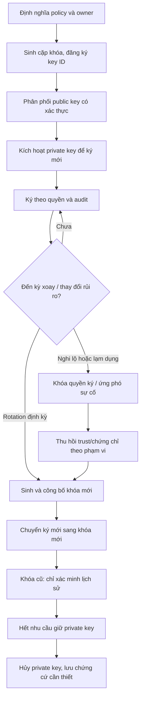
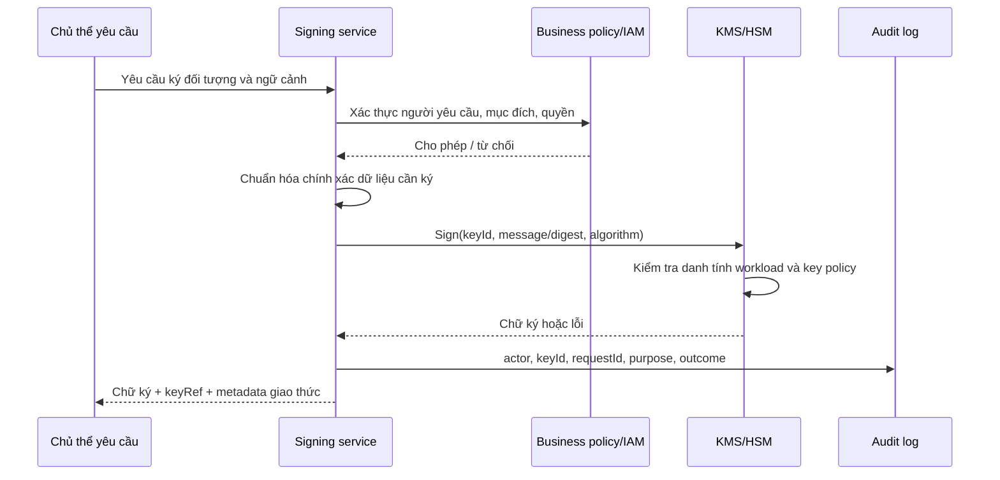
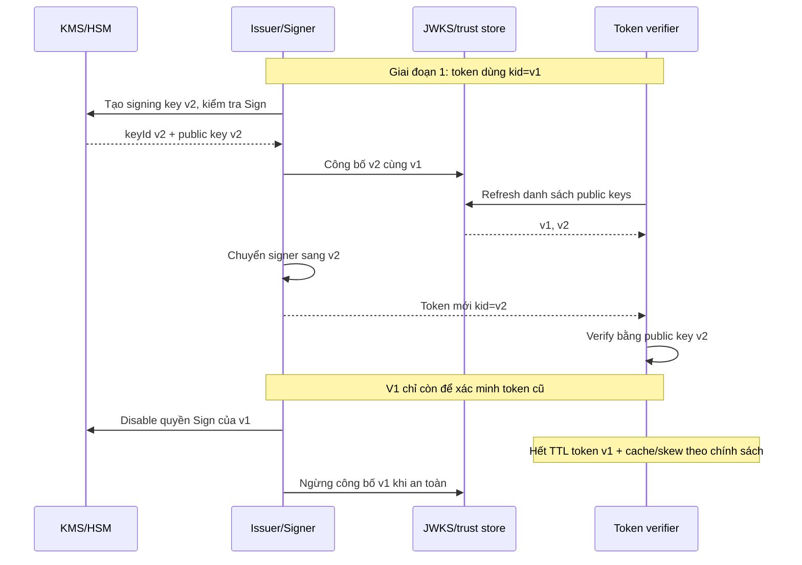

# Signature key lifecycle (Vòng đời khóa ký số)

Trong chương **Chữ ký số** của module **SECURITY_KEY_MANAGEMENT_FUNDAMENTALS**, *signature key lifecycle* là quá trình quản lý **cặp khóa phục vụ chữ ký số** từ lúc xác định mục đích, tạo khóa, phân phối khóa công khai, kích hoạt và sử dụng khóa riêng, đến xoay vòng, ngừng ký, thu hồi và hủy. Vòng đời còn bao gồm khả năng **kiểm chứng chữ ký đã phát hành trong quá khứ**, kể cả khi khóa riêng đã được ngừng sử dụng.

Chữ ký số giúp phát hiện thay đổi đối với dữ liệu đã ký và kiểm tra rằng chữ ký phù hợp với một **khóa công khai đã được tin cậy**. Nó không tự mã hóa dữ liệu, không tự chứng minh người ký được phép thực hiện giao dịch, và không đảm bảo ý nghĩa pháp lý hoặc tính chống chối bỏ nếu thiếu cơ chế quản lý danh tính, thời điểm ký, quyền sử dụng khóa và bằng chứng kiểm toán. Trong thiết kế hệ thống, khóa ký riêng là tài sản nhạy cảm: lộ khóa riêng hoặc bị lạm dụng quyền gọi API ký có thể tạo ra chữ ký giả trông hoàn toàn hợp lệ về mặt mật mã.

Bài này liên kết chữ ký bất đối xứng với mật mã đối xứng, **KMS/HSM**, phân quyền, chứng chỉ số và **PKI**, `kid`/JWKS, kiểm toán, khôi phục sự cố và khả năng nâng cấp thuật toán. Phần **envelope encryption** được dùng để đối chiếu vòng đời khóa ký với vòng đời khóa mã hóa.

## 1. Mục tiêu học tập

Sau bài học, bạn có thể:

- Phân biệt **private signing key**, **public verification key**, key ID, chứng chỉ số, trust anchor và các trạng thái vòng đời.
- Thiết kế luồng cấp quyền ký, phát hành và xác minh, bao gồm khóa trong **KMS/HSM**, bảo vệ nội dung được ký và nhật ký kiểm toán.
- Lập kế hoạch **rotation** không làm gián đoạn việc xác minh token, tài liệu và artifact đã ký bằng khóa cũ.
- Giải thích sự khác nhau giữa **retire/disable**, **revoke certificate**, **compromise** và **destroy private key**.
- Đánh giá rủi ro khi khóa riêng bị lộ, workload có quyền `Sign` bị chiếm quyền, hoặc thông tin `kid`/public key không được xác thực.
- Xác định metadata và bằng chứng cần lưu để xác minh chữ ký lịch sử, ứng phó sự cố và hủy khóa đúng lúc.

## 2. Khóa ký nằm ở đâu trong hệ mật mã?

Một cặp khóa ký số gồm **private key dùng tạo chữ ký** và **public key dùng xác minh**. Private key phải bí mật; public key có thể công bố, nhưng người xác minh phải chắc chắn khóa công khai đó gắn với **đúng danh tính hoặc issuer**.

| Đối tượng | Chức năng | Quy tắc vòng đời |
| --- | --- | --- |
| **Private signing key** | Tạo chữ ký mới. | Tạo an toàn, giữ bí mật, cấp quyền `Sign` chặt chẽ, ngừng ký khi đến hạn, hủy theo chính sách. |
| **Public verification key** | Xác minh chữ ký theo thuật toán. | Công bố qua kênh tin cậy, có thể cần giữ lâu hơn private key để xác minh lịch sử. |
| **Key ID / `kid`** | Chọn khóa/phiên bản ứng viên. | Phải gắn với namespace/issuer; không tự chứng minh khóa đáng tin hoặc cấp quyền sử dụng. |
| **Certificate X.509** | Ràng buộc public key với danh tính theo cơ chế PKI. | Quản lý thời hạn, key usage, chuỗi chứng chỉ và trạng thái thu hồi riêng với vật liệu khóa. |
| **Signature** | Kết quả ký các byte dữ liệu theo giao thức. | Cần lưu hoặc truyền kèm thuật toán/định danh khóa/định dạng phù hợp để xác minh. |
| **Audit record** | Ghi sự kiện tạo, sử dụng, xoay, đổi policy và hủy khóa. | Bảo vệ tính toàn vẹn và thời gian lưu, không chứa private key hay bí mật nhạy cảm. |

Đối chiếu với các loại khóa khác:

- **Encryption key** (AES DEK, RSA/EC recipient key trong cơ chế mã hóa phù hợp) bảo vệ **bí mật nội dung**, khác mục đích với signing key.
- **KEK** trong **envelope encryption** bảo vệ DEK được dùng để mã hóa dữ liệu; vòng đời KEK/DEK có thể cần **rewrap** hoặc **re-encrypt** dữ liệu. Xoay signing key thường cần **chuyển thao tác ký mới và quản lý khóa xác minh lịch sử**, không phải mã hóa lại toàn bộ tài liệu đã ký.
- **HMAC key** là bí mật đối xứng dùng chung để tạo/kiểm tra MAC. Ai có secret cũng có thể tạo MAC, nên HMAC không cung cấp cách phân tách người ký và người xác minh như chữ ký số bất đối xứng.

Không tái sử dụng một private key cho nhiều mục đích không tương thích. Ví dụ khóa Ed25519 được tạo để ký, không dùng trực tiếp làm khóa AES hoặc khóa X25519 chỉ vì tên thuật toán có liên quan.

## 3. Mô hình vòng đời và trạng thái logic

Một vòng đời thực tế có thể mô hình hóa như sau:



Không phải dịch vụ nào cũng đặt tên và hỗ trợ chuyển trạng thái giống nhau. Bảng sau là **mô hình logic** để thiết kế chính sách, không phải API chuẩn của mọi KMS.

| Trạng thái logic | Có ký mới không? | Có xác minh chữ ký cũ không? | Giải thích |
| --- | --- | --- | --- |
| `PENDING` | Không | Có thể chưa có chữ ký | Khóa đã được tạo nhưng chưa kích hoạt; có thể công bố trước public key. |
| `ACTIVE` | Có, nếu được cấp quyền | Có | Được dùng đúng mục đích, đúng phạm vi và thời hạn. |
| `VERIFY_ONLY` / `RETIRED` | Không | Có thể có | Ngừng tạo chữ ký mới; vẫn giữ public key/trust cần thiết cho chữ ký lịch sử. |
| `SUSPENDED` / `DISABLED` | Không | Phụ thuộc policy | Khóa tạm dừng để điều tra hoặc phục vụ sự cố; không mặc nhiên kết luận mọi chữ ký cũ sai. |
| `COMPROMISED` | Không | Cần đánh giá bằng chứng | Có dấu hiệu private key bị lộ/lạm dụng; có thể không xác định chắc chữ ký nào là thật. |
| `REVOKED` | Không | Phụ thuộc loại hệ thống, thời gian và bằng chứng | Thu hồi chứng chỉ/trust/quyền theo cơ chế phù hợp; không tương đương thao tác xóa vật liệu khóa. |
| `DESTROYED` | Không | Có thể có bằng public key | Private key đã bị loại bỏ theo phạm vi đã kiểm soát; public key và chứng cứ có thể còn cần giữ. |

**Hai thời hạn khác nhau:** *thời gian được phép tạo chữ ký mới* (*signing/usage cryptoperiod*) thường kết thúc sớm hơn *thời gian cần xác minh chữ ký lịch sử*. Không lấy ngày hết hạn khóa ký mới làm ngày xóa toàn bộ public key hoặc chứng chỉ liên quan.

## 4. Giai đoạn 1 — Chính sách và phân loại signing key

Trước khi tạo cặp khóa, cần xác định chính xác **chữ ký bảo vệ đối tượng nào** và ai có quyền yêu cầu ký.

1. **Mục đích:** JWT/JWS, ký artifact, chữ ký tài liệu, chữ ký giao dịch, sự kiện kiểm toán, chứng chỉ CA hay khóa ký nội bộ. Mỗi loại có mô hình tin cậy khác nhau.
2. **Owner và phạm vi:** ứng dụng nào sở hữu, môi trường dev/test/prod, tenant, danh tính workload, miền quyền hạn và người phê duyệt.
3. **Thuật toán/profile:** chẳng hạn Ed25519, ECDSA P-256, RSA-PSS hoặc thuật toán được giao thức/chuẩn cho phép; quy định định dạng chữ ký và cách tạo signing input.
4. **Cryptoperiod:** khi kích hoạt, mốc xoay, thời điểm ngừng ký, thời gian giữ public key/certificate và quy trình lưu chứng cứ.
5. **Vòng đời sự cố:** cách khóa `Sign` ngay khi bị nghi lộ, truyền thông báo đến verifier, đánh giá token/tài liệu đã ký và cập nhật trust store.
6. **Sẵn sàng và phục hồi:** nếu HSM/KMS lỗi thì hệ thống có phải từ chối ký? Có cần nhiều vùng sẵn sàng, cơ chế sao lưu hoặc khóa thay thế được phê duyệt không?

Ví dụ một khóa dùng ký **JWT truy cập ngắn hạn** có cửa sổ xác minh khác một khóa dùng ký **hồ sơ lưu trữ hàng chục năm**. Đừng áp dụng cứng một lịch xoay hoặc chính sách hủy cho tất cả.

### 4.1. Chính sách algorithm và định dạng signing input

Việc ký bảo vệ **một chuỗi byte cụ thể**, không trực tiếp bảo vệ “ý nghĩa” của JSON/XML hay tài liệu. Nếu hai bên serialize khác nhau, chữ ký có thể không hợp lệ.

- Chỉ định chính xác dữ liệu nào được ký, encoding UTF-8, canonicalization, thứ tự trường, version và domain separation.
- Gắn ngữ cảnh như `purpose`, `issuer`, `tenant`, `documentType`, `protocolVersion` vào nội dung ký nếu giao thức cho phép.
- Với API `Sign`, làm rõ đầu vào là **message** hay **digest**, để tránh hash hai lần hoặc ký một thứ khác với dữ liệu verifier kiểm tra.
- Cố định **thuật toán được chấp nhận** ở phía verifier, không để header do đối thủ gửi tự quyết định loại khóa/thuật toán.

Ví dụ JWS ES256 dùng định dạng chữ ký ECDSA `R || S` với số byte cố định, trong khi một số API Java JCA trả ECDSA ASN.1 DER. Phải sử dụng thư viện JOSE hoặc chuyển định dạng chính xác; hai kiểu byte không được tráo đổi cho nhau.

## 5. Giai đoạn 2 — Sinh khóa và đăng ký định danh

**Generation** quyết định liệu khóa riêng có đủ mạnh ngay từ đầu. Khóa riêng phải được tạo bằng CSPRNG, cơ chế tạo khóa được đánh giá hoặc HSM/KMS phù hợp; không dựng private key từ timestamp, UUID dễ đoán, seed dùng lại hay `java.util.Random`.

| Việc cần làm | Mục đích |
| --- | --- |
| Sinh cặp khóa đúng thuật toán, độ dài và tham số chuẩn. | Tránh khóa yếu hoặc không phù hợp profile chữ ký. |
| Ưu tiên tạo private key bên trong KMS/HSM nếu yêu cầu non-exportable. | Giảm số nơi vật liệu khóa riêng xuất hiện. |
| Gán key ID bất biến/namespace và, nếu hỗ trợ, version. | Truy vết chữ ký theo khóa và phiên bản, tránh tra nhầm tenant/môi trường. |
| Gắn `purpose`, owner, trạng thái, thời điểm tạo, thời điểm kích hoạt/ngừng. | Hỗ trợ policy, rotation, báo cáo và kiểm toán. |
| Kiểm chứng cặp khóa bằng thao tác ký/xác minh thử trong phạm vi cho phép. | Xác minh hệ thống vận hành được trước khi phát hành. |

Một key ID thường là **nhãn tham chiếu**. Nó không nên chứa private key hay quyền truy cập. **Alias động** có thể trỏ đến khóa ký đang hoạt động, nhưng chữ ký được phát hành cần mang định danh hoặc cơ chế truy vết **khóa thực tế**, vì alias có thể chuyển sang khóa khác sau rotation.

Không được đồng nhất **số sê-ri chứng chỉ** với key ID: một cặp khóa có thể được gắn với chứng chỉ mới hoặc nhiều chứng chỉ tùy chính sách; khi gia hạn chứng chỉ cũng có thể đồng thời thay cặp khóa nhưng đó là hai quyết định quản trị riêng.

## 6. Giai đoạn 3 — Lưu private key, công bố public key và cấp quyền

### 6.1. Lưu trữ khóa riêng

Private signing key là thông tin mật và thường có quyền lực cao. Cơ chế bảo vệ phù hợp tùy mức độ nhạy cảm:

- **HSM/KMS:** sử dụng private key không xuất được khi dịch vụ hỗ trợ; workload gọi `Sign` qua danh tính đã xác thực. Một KMS có thể dùng HSM phía dưới, nhưng bảo đảm phần cứng, khả năng backup và API tùy sản phẩm.
- **Keystore và secret store:** nếu buộc đặt khóa ở phía ứng dụng, phải có quyền truy cập tối thiểu, khóa được bảo vệ khi lưu, cơ chế cấp phát runtime, kiểm soát backup và giới hạn xuất ra bộ nhớ.
- **Không nhúng khóa riêng** vào source, Git history, image container, config công khai, log, telemetry, dump lỗi hoặc ticket hỗ trợ.
- **Sao lưu/khôi phục:** với private key non-exportable, dùng cơ chế dự phòng của nhà cung cấp hoặc chiến lược thay khóa, không giả định file backup thông thường có thể khôi phục được. Diễn tập quy trình trước sự cố.

Giữ private key trong HSM ngăn được nhiều rủi ro **trích xuất vật liệu khóa**, nhưng không ngăn một workload bị chiếm quyền sử dụng quyền `Sign` đang có để phát hành chữ ký thật. Vì vậy **quản lý nội dung ký** và quyền API quan trọng ngang với vị trí lưu khóa.

### 6.2. Phân phối public key đúng miền tin cậy

Có ba mô hình thường gặp:

| Mô hình | Cách bên xác minh nhận khóa | Kiểm tra bắt buộc |
| --- | --- | --- |
| **JWKS** cho issuer JWT/JWS | Tải tập public key từ endpoint được cấu hình tin cậy, chọn ứng viên theo `kid`. | Ràng buộc issuer, thuật toán, mục đích, `aud`/`exp`/`nbf`, chính sách cache, không tin URL/key do token tự đưa vào. |
| **PKI X.509** | Dùng chứng chỉ của signer và chuỗi CA/trust anchor. | Chữ ký chứng chỉ, đường tin cậy, tên/danh tính, key usage/EKU, thời hạn và thu hồi thích hợp. |
| **Pinning/trust store nội bộ** | Public key/fingerprint đã phân phối qua cấu hình, kênh triển khai được bảo vệ. | Quản lý phiên bản, cập nhật đồng bộ, chống rollback và phân quyền đổi trust store. |

**Public key không cần giữ bí mật, nhưng bắt buộc phải xác thực.** Nếu ứng dụng tùy tiện tin một public key gửi kèm chữ ký, kẻ tấn công có thể tạo cặp khóa riêng rồi tự ký và tự gửi public key.

## 7. Giai đoạn 4 — Kích hoạt và sử dụng khóa ký

Một thao tác ký an toàn cần cả **ủy quyền nghiệp vụ** lẫn **quyền sử dụng khóa mật mã**. Quy trình tham khảo:



Cần phân chia quyền:

| Vai trò | Quyền phù hợp | Quyền không cấp mặc định |
| --- | --- | --- |
| Signing workload | `Sign` bằng đúng khóa và mục đích. | Xuất private key, thay IAM/policy, xóa khóa. |
| Verification service | Đọc public key đáng tin và xác minh chữ ký. | `Sign` hoặc lấy private key. |
| Security/key admin | Tạo, xoay, vô hiệu hóa, lên lịch hủy theo xét duyệt. | Ký giao dịch nghiệp vụ tùy ý. |
| Business approver | Phê duyệt đối tượng được ký và hạn mức. | Đọc hoặc xuất private key nếu không cần. |
| Auditor | Xem log, metadata, chính sách và biến động quyền. | Ký, đổi policy hoặc xóa chứng cứ kiểm toán. |

**Nhật ký ký** có thể gồm `keyId`, `algorithm`, `actor`, `requestId`, `operation`, thời điểm và kết quả; khi cần truy nguyên nội dung, có thể lưu digest của **dữ liệu đã chuẩn hóa** hoặc tham chiếu giao dịch theo chính sách. Không log private key, API credentials hay plaintext nhạy cảm không cần thiết.

**Hạn chế lạm dụng API:** ràng buộc loại dữ liệu được ký, xác thực giao dịch, giới hạn tốc độ, phê duyệt cho thao tác giá trị cao và cảnh báo gia tăng ký bất thường. Mỗi chữ ký phải phù hợp với quyền của chủ thể nghiệp vụ, không chỉ IAM của service.

### 7.1. Ví dụ Java 17: ký và xác minh Ed25519

Đoạn mã dùng JCA để minh họa **hai quyền khác nhau**: tạo chữ ký cần private key, xác minh dùng public key. Đây là ví dụ đơn tiến trình với cặp khóa ngắn hạn trong bộ nhớ, **không phải** giải pháp lưu private key production.

```java
import java.nio.charset.StandardCharsets;
import java.security.KeyPair;
import java.security.KeyPairGenerator;
import java.security.Signature;

public class SigningLifecycleDemo {
    static byte[] sign(KeyPair pair, byte[] message) throws Exception {
        Signature signer = Signature.getInstance("Ed25519");
        signer.initSign(pair.getPrivate());
        signer.update(message);
        return signer.sign();
    }

    static boolean verify(
            java.security.PublicKey publicKey, byte[] message, byte[] signature)
            throws Exception {
        Signature verifier = Signature.getInstance("Ed25519");
        verifier.initVerify(publicKey);
        verifier.update(message);
        return verifier.verify(signature);
    }

    public static void main(String[] args) throws Exception {
        KeyPair pair = KeyPairGenerator.getInstance("Ed25519").generateKeyPair();
        byte[] original = "type=release;version=4;artifact=app.jar"
                .getBytes(StandardCharsets.UTF_8);
        byte[] signature = sign(pair, original);

        System.out.println("Original valid: "
                + verify(pair.getPublic(), original, signature));

        byte[] changed = "type=release;version=5;artifact=app.jar"
                .getBytes(StandardCharsets.UTF_8);
        System.out.println("Changed valid: "
                + verify(pair.getPublic(), changed, signature));
    }
}
```

Với Java/provider hỗ trợ Ed25519, kết quả dự kiến là `true` và `false`. Để dùng trong production còn cần **xác minh public key thuộc về signer được phép**, xử lý key ID/phiên bản, policy cho đúng loại message, chống replay khi giao thức yêu cầu và log. Không suy ra rằng việc tạo chữ ký thành công tự động khiến giao dịch hợp lệ.

Khi chuyển sang KMS/HSM, code có thể **không nhận được đối tượng private key có thể xuất**. Thay vào đó ứng dụng gọi API `Sign` với key ID, thuật toán và message/digest theo hợp đồng dịch vụ; public key được xuất/phát hành qua API phù hợp để bên nhận kiểm tra.

## 8. Giai đoạn 5 — Xoay vòng (rotation) và triển khai không gián đoạn

Rotation tạo cặp khóa ký mới và **chuyển việc ký mới** sang khóa mới. Xoay vòng định kỳ khác xử lý **khóa đã bị lộ**: khi nghi ngờ lộ, việc chỉ chờ đến hết chu kỳ bình thường có thể khiến kẻ tấn công tiếp tục phát hành chữ ký giả.

Một quy trình xoay an toàn:

1. **Prepare:** tạo private/public key mới, đăng ký `keyId` mới (hoặc version theo KMS), kiểm tra policy và phân phối public key đến nguồn tin cậy.
2. **Publish-before-use:** đảm bảo các verifier có thể lấy public key mới trước khi signer bắt đầu dùng. Tính đến cache, propagation và vùng triển khai.
3. **Switch signing:** chuyển signer sang dùng key mới cho mọi đối tượng mới; giữ log mốc chuyển và key ID trong metadata chữ ký.
4. **Verification overlap:** bên xác minh có thể chấp nhận public key cũ và mới trong cửa sổ có giới hạn nếu chữ ký cũ vẫn còn giá trị sử dụng.
5. **Retire old signing key:** thu hồi quyền `Sign` trên private key cũ; loại bỏ đường ký cũ khỏi alias động, pipeline và quyền fallback.
6. **Retain evidence:** tiếp tục lưu public key/chứng chỉ, metadata, thông tin tin cậy và bằng chứng cần thiết để xác minh lịch sử.
7. **Dispose:** chỉ hủy private key cũ khi đã xử lý nhu cầu dự phòng, điều tra sự cố, backup và chính sách lưu giữ.



### 8.1. Ví dụ: vòng đời JWT và JWKS

Ví dụ issuer `https://id.example.test/` phát JWT có `kid=auth-2026-a`. Khi xoay sang `kid=auth-2026-b`, signer cần công bố public key `b` **trước** lúc phát hành token có `kid=b`.

Verifier cần cố định **issuer tin cậy** và nguồn JWKS; dùng `kid` chỉ để tìm khóa **trong tập đã tin**, kiểm tra signature, `alg` được chấp nhận, `aud`, `iss`, `exp`, `nbf` và các điều kiện ứng dụng. Không tải public key từ URL tự do do token cung cấp qua `kid`, `jku` hoặc `x5u` không được ràng buộc bởi chính sách.

Cửa sổ overlap không có công thức duy nhất. Cần tính từ **thời hạn token tối đa**, độ lệch đồng hồ, thời gian phân phối, cache JWKS và trường hợp verifier mất kết nối; phía issuer cũng có thể cần ràng buộc thời điểm ngừng ký khóa cũ. Không nên giữ public key cũ vô thời hạn trong bộ trust của token nếu không còn lý do nghiệp vụ.

### 8.2. Ví dụ: artifact hoặc tài liệu có chữ ký lâu dài

Một file release `app.jar` có thể được ký qua manifest chứa SHA-256 của artifact, version, publisher và policy. Sau nhiều năm, private signing key ban đầu đã hủy nhưng hệ thống kiểm toán có thể vẫn cần:

- byte manifest đã ký và chữ ký gốc;
- public key/chứng chỉ tương ứng, thuật toán, key ID và định dạng ký;
- chứng cứ đường tin cậy tại thời điểm có liên quan;
- thông tin về thời điểm ký đáng tin cậy (nếu yêu cầu), trạng thái chứng chỉ, CRL/OCSP/bằng chứng được lưu theo quy trình;
- hồ sơ audit liên hệ chữ ký với một quy trình phát hành được phê duyệt.

Một timestamp do **người ký tự khai** không tự tạo bằng chứng về thời điểm đã ký; trường hợp cần chứng minh thời điểm có thể phải dùng dịch vụ dấu thời gian đáng tin hoặc quy trình ghi nhận độc lập phù hợp.

## 9. Giai đoạn 6 — Retire, revoke và hủy private key

Các khái niệm dễ bị nhầm:

| Hành động | Thực sự làm gì? | Không tự làm gì? |
| --- | --- | --- |
| **Retire / disable signing key** | Ngăn tạo chữ ký mới bằng private key cũ. | Không xóa chữ ký đã phát hành hoặc tự thông báo cho mọi verifier. |
| **Revoke certificate** | Công bố việc chứng chỉ không còn được tin theo chính sách PKI. | Không tự hủy private key trên mọi bản sao hoặc tự xóa dữ liệu đã ký. |
| **Remove public key from JWKS** | Verifier dùng JWKS hiện hành có thể không còn chọn khóa đó. | Không tự hủy private key hoặc xử lý mọi verifier đang cache key cũ. |
| **Destroy private key** | Loại bỏ vật liệu khóa trong phạm vi kiểm soát (và xử lý các bản sao liên quan). | Không xóa được những chữ ký giả hoặc dữ liệu mà kẻ tấn công đã lấy trước đó. |
| **Retain verification evidence** | Giữ public key/chứng chỉ và chứng cứ cần để xác minh lịch sử. | Không cho phép dùng private key cũ để ký thêm. |

Nếu dùng PKI, việc đánh giá chữ ký lịch sử có thể phụ thuộc thời điểm ký, thời điểm thu hồi, chính sách xác minh và mức tin cậy vào bằng chứng thời gian. **Không mặc định rằng tất cả chữ ký cũ đều không hợp lệ sau khi một chứng chỉ bị thu hồi**, cũng không mặc định mọi chữ ký cũ vẫn đáng tin khi private key đã bị lộ. Phải phân tích nguy cơ giả mạo trong khoảng thời gian liên quan.

Hủy private key quá sớm có thể gây mất khả năng phục hồi hệ thống ký hoặc ảnh hưởng quy trình điều tra; hủy quá muộn duy trì bề mặt tấn công. Cần kiểm kê key replicas, vùng dự phòng, backup, tài khoản có quyền dùng key, môi trường test/prod và ràng buộc lưu trữ. Với KMS/HSM, thao tác hủy và thời gian chờ có thể phụ thuộc nhà cung cấp.

## 10. Giai đoạn 7 — Ứng phó lộ khóa hoặc lạm dụng quyền ký

Có hai tình huống riêng:

**Tình huống A: private signing key bị xuất/lộ.** Đối thủ có thể ký bên ngoài hệ thống; audit của KMS có thể **không thấy** những chữ ký đó. Chỉ khóa API `Sign` ở KMS là chưa đủ nếu đối thủ đã giữ bản sao private key.

**Tình huống B: private key vẫn non-exportable trong HSM nhưng workload có quyền ký bị chiếm quyền.** Đối thủ không có private key thô nhưng có thể gọi `Sign` hợp lệ. Audit, phê duyệt nội dung ký và hạn mức trở thành nguồn điều tra quan trọng.

Một quy trình ứng phó tối thiểu:

1. **Cô lập:** chặn danh tính workload bị chiếm quyền, thu hồi token/credential và vô hiệu hóa thao tác ký bằng key nghi vấn khi phù hợp mức độ sự cố.
2. **Khoanh vùng:** xác định `keyId`/version, hệ thống, issuer, tenant, certificate, signed object, thời gian nghi lộ và phạm vi chữ ký đã phát hành; đối chiếu audit ứng dụng và KMS.
3. **Phát hành khóa mới:** tạo cặp khóa mới, bảo vệ private key, công bố public key bằng kênh tin cậy; chuyển ký mới.
4. **Thu hồi tin cậy:** với PKI dùng cơ chế thu hồi chứng chỉ; với JWT/JWKS cần kế hoạch thay đổi trust, vô hiệu hóa token hoặc giảm cửa sổ chấp nhận; với artifact cần công bố cảnh báo và thay bằng bản phát hành được tin cậy.
5. **Đánh giá lịch sử:** tìm chữ ký đáng nghi, đối chiếu dấu thời gian độc lập, log, yêu cầu nghiệp vụ và dữ liệu đối tượng; không coi mọi chữ ký khớp key cũ là chứng cứ đủ về người ký.
6. **Khôi phục và phòng tái diễn:** sửa điểm xâm nhập, phân quyền lại, bổ sung giám sát, xác minh hệ thống và ghi lại kết quả điều tra.

**Không thể “thu hồi một chữ ký” đã được sao chép chỉ bằng thay key ID**. Điều có thể làm là điều chỉnh **chính sách chấp nhận**, revoke certificate, cập nhật trust anchor, phản hồi sự cố và xử lý những đối tượng đã bị ký trái phép.

### 10.1. Một sự cố có ảnh hưởng đến chữ ký lịch sử không?

Câu trả lời phụ thuộc thời điểm và chứng cứ. Nếu private key bị lộ ở thời điểm không xác định, kẻ tấn công có thể tạo chữ ký giả và gắn timestamp tùy ý trong nội dung. Chứng cứ thời điểm ký từ nguồn đáng tin, nhật ký chống sửa, bản ghi phát hành và cơ chế xác minh dài hạn có thể giúp đánh giá chữ ký được tạo **trước** hay **sau** rủi ro.

Không đưa ra quy tắc đơn giản rằng “chữ ký có ngày trước thu hồi thì chắc chắn hợp lệ”: ngày trong tài liệu có thể do bên ký tự khai; PKI và nghiệp vụ có quy tắc xác minh khác nhau. Cũng không đồng nhất dấu thời gian đáng tin với xác minh quyền nghiệp vụ.

## 11. Ví dụ thiết kế: ký chứng từ thanh toán

Một ứng dụng gồm `transaction-service`, `signing-service`, KMS/HSM và `verification-service`.

Khi một yêu cầu thanh toán được duyệt, `transaction-service` gửi đối tượng ký gồm các trường như:

```json
{
  "schemaVersion": 2,
  "purpose": "approved-payment",
  "transactionId": "tx-7821",
  "amountMinor": 250000,
  "currency": "VND",
  "tenantId": "t-17",
  "approvedAt": "2026-11-28T02:00:00Z"
}
```

Đây là **dữ liệu nghiệp vụ minh họa**, không phải định dạng ký chuẩn. Hệ thống cần một quy tắc serialization duy nhất (canonical JSON hoặc định dạng đã định), và `approvedAt` ở đây chỉ là trường nghiệp vụ; không tự chứng minh thời điểm ký đáng tin.

Luồng triển khai:

```text
1. transaction-service xác thực người yêu cầu, quyền duyệt và hạn mức.
2. signing-service kiểm tra purpose, tenant, phiên bản schema và trạng thái duyệt.
3. signing-service chuẩn hóa byte ký và chọn alias hiện hành theo policy.
4. KMS kiểm tra quyền Sign và tạo chữ ký với private key không xuất được.
5. Hệ thống lưu signature, actualKeyId, alg, schemaVersion,
   canonical payload reference, requestId và audit record.
6. verifier lấy public key từ trust store đã kiểm soát, kiểm tra signature.
7. verifier kiểm tra giao dịch chưa hết hiệu lực, không bị replay,
   chưa bị hủy ở cấp nghiệp vụ và nằm trong phạm vi tenant cho phép.
```

Khi xoay `key-a` sang `key-b`, đối tượng cũ tiếp tục mang `actualKeyId=key-a` hoặc định dạng tương đương để có thể xác minh. Không lưu **chỉ** alias `current-signing-key` làm tham chiếu duy nhất vì alias có thể đổi đích.

Một registry khóa ký có thể quản lý metadata như sau:

| Trường | Ví dụ | Vai trò |
| --- | --- | --- |
| `keyId` | `payments-sign-v2` | Định danh khóa thực tế trong namespace đã xác định. |
| `purpose` | `approved-payment` | Ngăn dùng khóa để ký loại đối tượng khác. |
| `algorithm` | `Ed25519` | Ràng buộc thuật toán và định dạng verifier cần dùng. |
| `state` | `ACTIVE` hoặc `VERIFY_ONLY` | Quyết định có còn cấp quyền ký mới không. |
| `activeFrom` / `signUntil` | Mốc theo policy | Kiểm soát thời hạn dùng private key cho chữ ký mới. |
| `publicKeyRef` | URI trong trust store | Giúp verifier tìm public key đã được xác thực. |
| `certificateRef` | Tham chiếu chứng chỉ nếu dùng PKI | Theo dõi chuỗi tin cậy, thời hạn, trạng thái thu hồi. |
| `owner` / `tenantScope` | `payments-prod` / `t-17` | Phân tách trách nhiệm và phạm vi quyền. |

Metadata có thể khác giữa sản phẩm và giao thức; mục tiêu là **đọc hiểu chữ ký lịch sử và truy vết quyền**, không phải áp đặt cùng schema lên mọi nền tảng.

## 12. Phân biệt các chiến lược vòng đời theo loại chữ ký

| Ngữ cảnh | Cửa sổ xác minh cũ | Cơ chế phân phối public key | Điểm cần chú ý |
| --- | --- | --- | --- |
| **JWT truy cập ngắn hạn** | Thường gắn với TTL token + cache/skew. | JWKS gắn với issuer. | Rotation trước khi dùng, kiểm tra `iss`, `aud`, `exp`, `alg`; ứng phó lộ key bằng chính sách token. |
| **Artifact/software release** | Có thể lâu, qua nhiều lần triển khai. | Public key/trust store, chứng chỉ ký mã. | Ký manifest và hash artifact, chống rollback, giữ provenance và bằng chứng thời điểm. |
| **Tài liệu lưu trữ lâu dài** | Có thể dài hơn lifetime chứng chỉ hoặc thuật toán. | PKI/certificate chain và bằng chứng tin cậy được lưu. | Timestamp đáng tin, thông tin thu hồi tại thời điểm liên quan, thay đổi thuật toán theo thời gian. |
| **Giao dịch ứng dụng** | Theo thời gian lưu chứng từ và nghĩa vụ nghiệp vụ. | Trust registry theo tenant/issuer. | Quyền giao dịch, canonical payload, chống replay, audit từng yêu cầu ký. |
| **Thông điệp giữa dịch vụ** | Theo TTL message và chính sách giao thức. | Service identity, certificate/trust store. | Xác thực workload, mục đích chữ ký, rotation đồng bộ và clock skew. |

Cùng một thuật toán Ed25519 hoặc ECDSA có thể phục vụ nhiều ngữ cảnh, nhưng **không nhất thiết cùng một cặp khóa**. Tách key theo purpose và môi trường giới hạn phạm vi thiệt hại nếu một ứng dụng bị xâm nhập.

## 13. Những sai lầm điển hình

| Sai lầm | Hậu quả | Cách phòng tránh |
| --- | --- | --- |
| Lưu private signing key trong Git, image hoặc log. | Kẻ có bản sao khóa có thể ký ngoài KMS. | Non-exportable khi phù hợp; secret management, kiểm tra rò rỉ và thay key khi lộ. |
| Một workload có cả quyền `Sign`, `Disable`, `Delete`, `UpdatePolicy`. | Lạm dụng quyền và khó truy vết. | Phân tách nhiệm vụ, IAM tối thiểu, phê duyệt thao tác nguy hiểm. |
| Tin public key gửi kèm chữ ký mà không kiểm tra nguồn. | Có thể chấp nhận chữ ký giả bằng khóa của đối thủ. | Trust store/issuer/cert chain đáng tin; `kid` chỉ chọn khóa ứng viên. |
| Không công bố public key mới trước khi chuyển signer. | Token/chữ ký mới không được verifier nhận. | Chuẩn bị JWKS/trust/cert, tính cache và kiểm tra rollout. |
| Xóa public key cũ ngay khi rotate. | Chữ ký/token chưa hết hạn không xác minh được. | Quy định verification overlap và giữ lịch sử khi cần. |
| Cho private key cũ tiếp tục ký vô thời hạn. | Tăng bề mặt tấn công và khó tách giai đoạn key. | Chuyển mới và retire private key cũ theo policy. |
| Đổi alias hoặc tên key mà không thay key material. | Vật liệu khóa nghi bị lộ vẫn còn sử dụng. | Sinh cặp khóa thật sự mới; cập nhật trust và quyền ký. |
| Coi KMS/HSM đủ để chống ký trái phép. | Workload bị chiếm quyền vẫn gọi `Sign` hợp lệ. | Kiểm tra đầu vào, phân quyền nghiệp vụ, hạn mức và audit. |
| Không phân biệt `Sign(message)` với `Sign(digest)`. | Băm hai lần hoặc ký dữ liệu không tương thích. | Theo hợp đồng API, cố định algorithm và signing input. |
| Dùng chung key cho JWT, thanh toán, ký artifact. | Sự cố một miền lan sang nhiều ứng dụng. | Tách key theo purpose/tenant/issuer khi phù hợp. |
| Coi trường ngày tự khai là timestamp chứng cứ. | Không chứng minh được thời điểm ký thật khi có tranh chấp. | Thu thập dấu thời gian và log đáng tin khi cần xác minh dài hạn. |
| Revoke certificate rồi cho rằng mọi bản sao private key đã bị xóa. | Khóa vẫn có thể bị lạm dụng ở nơi còn bản sao. | Kết hợp thu hồi trust với vô hiệu hóa/xóa vật liệu theo phạm vi. |
| Hủy private key nhận mã hóa và private signing key theo cùng chính sách. | Có thể mất khả năng giải mã dữ liệu cũ hoặc giữ private key ký quá lâu. | Phân loại mục đích: ký cần public key để verify; mã hóa có thể cần khóa riêng để decrypt. |

## 14. Checklist vận hành một signature key lifecycle

1. **Định danh:** từng signing key có owner, purpose, issuer/tenant, environment, key ID/version và thuật toán rõ ràng?
2. **Sinh khóa:** private key được tạo với CSPRNG/KMS/HSM phù hợp, có quy tắc export/backup và kiểm thử cặp khóa?
3. **Phân quyền:** ai được `Sign`, ai được quản trị/xóa, ai xác minh? Có chính sách phê duyệt nội dung ký không?
4. **Trust:** public key/JWKS/certificate được phân phối qua nguồn có xác thực, không nhận tùy tiện từ input chưa tin?
5. **Signing input:** định dạng byte, version, hashing, encoding, thuật toán và domain separation đã được định nghĩa?
6. **Audit:** có log lần ký, thao tác quản trị, key ID, actor, request ID và cảnh báo bất thường mà không lộ secret?
7. **Rotation:** khóa mới được công bố trước, ký mới đã chuyển, khóa cũ bị ngừng ký và verifier còn kiểm tra được chữ ký hợp lệ cũ?
8. **Revocation:** có cách ứng phó lộ private key, thu hồi certificate/trust, vô hiệu hóa token hoặc artifact theo từng giao thức?
9. **Historical verification:** có giữ public key, cert chain, chứng cứ thời gian/trạng thái thu hồi và hồ sơ nghiệp vụ phù hợp chính sách?
10. **Destruction:** đã kiểm kê key copies, backup, phụ thuộc và phê duyệt trước khi hủy private key?
11. **Khả năng khôi phục:** đã diễn tập lỗi KMS/HSM và cơ chế chuyển sang khóa mới khi dịch vụ ký bị gián đoạn?
12. **Khả năng nâng cấp:** có kế hoạch thay đổi thuật toán và định dạng khi chuẩn bảo mật hoặc yêu cầu thời gian lưu thay đổi?

## 15. Câu hỏi tự kiểm tra

1. Vì sao private signing key có thể bị hủy trong khi public verification key vẫn cần được lưu lại?
2. Điểm khác biệt giữa xoay signing key và rewrap DEK khi xoay KEK trong envelope encryption là gì?
3. Một JWT có `kid` khớp với khóa trong JWKS. Những bước nào vẫn cần làm để quyết định token hợp lệ?
4. Vì sao nên công bố public key mới trước khi signer bắt đầu ký bằng private key mới?
5. Khi HSM không cho xuất private key, vì sao một workload bị chiếm quyền vẫn có thể tạo chữ ký trái phép?
6. Thu hồi chứng chỉ, ngừng quyền `Sign`, xóa key khỏi JWKS và hủy private key khác nhau thế nào?
7. Nếu private key ký tài liệu bị lộ nhưng không biết chính xác thời điểm, có thể mặc định mọi chữ ký cũ đều đáng tin không? Cần loại chứng cứ nào?
8. Tại sao chỉ lưu alias `current` với chữ ký cũ có thể gây lỗi sau rotation?
9. Với tài liệu lưu dài hạn, vì sao `signedAt` do signer tự khai không đủ làm bằng chứng thời điểm ký?
10. Làm sao tách quyền ký giao dịch, quyền quản trị KMS và quyền kiểm toán để giảm tác động khi một danh tính bị xâm nhập?

**Ghi nhớ:** bảo vệ chữ ký số nghĩa là bảo vệ **toàn bộ vòng đời của quyền ký và độ tin cậy của khóa xác minh**. Tạo khóa mạnh chỉ là khởi đầu; hệ thống phải kiểm soát chủ thể và nội dung được ký, lưu khóa riêng an toàn, công bố khóa công khai đã xác thực, xoay khóa có giai đoạn chuyển tiếp, xử lý lộ khóa, lưu bằng chứng lịch sử và hủy private key đúng thời điểm.
