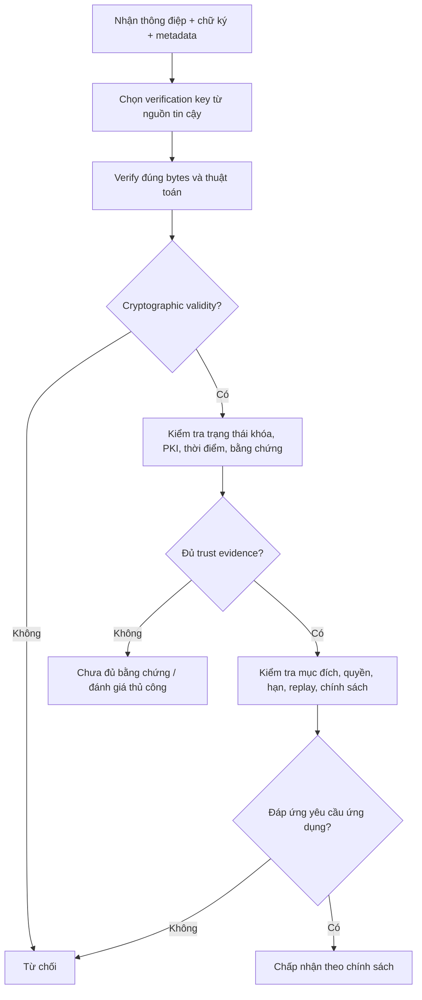
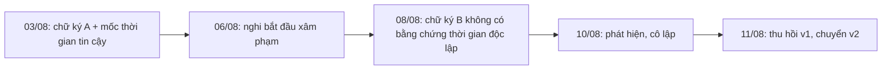
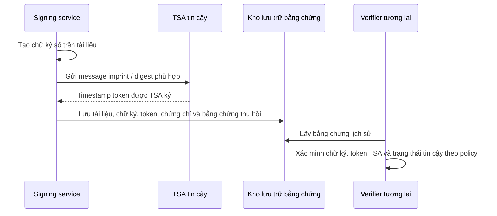
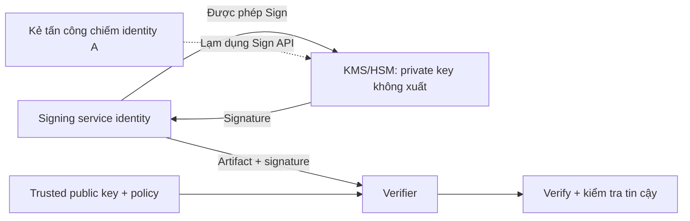
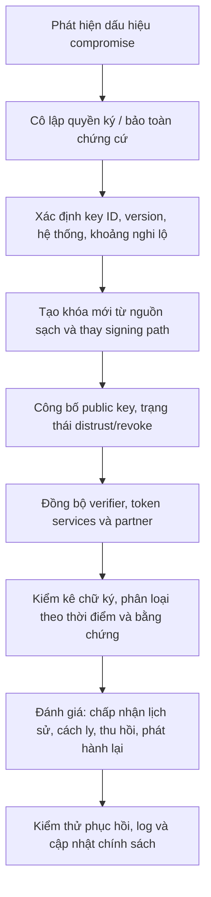

# Key compromise và signature validity

## 1. Khi khóa ký bị lộ, chữ ký số còn hợp lệ không?

**Key compromise (khóa bị xâm phạm)** là tình huống khả năng giữ bí mật hoặc kiểm soát một khóa mật mã không còn được bảo đảm. Đối với **chữ ký số**, điều đặc biệt nguy hiểm là **private signing key (khóa riêng dùng ký)** có thể bị đánh cắp, sao chép, suy ra hoặc bị sử dụng trái phép thông qua một dịch vụ ký. Khi đó, một đối tượng không được ủy quyền có thể tạo chữ ký trông giống chữ ký của chủ sở hữu hợp pháp.

**Signature validity (tính hợp lệ của chữ ký)** cần được đánh giá ở **nhiều tầng**. Sau khi private key bị lộ, một chữ ký cũ vẫn có thể **xác minh đúng về mặt toán học**, nhưng điều đó **không tự chứng minh** chữ ký được tạo bởi chủ thể hợp pháp hoặc được tạo trước khi xảy ra xâm phạm. Việc có tiếp tục tin tưởng và chấp nhận chữ ký hay không còn phụ thuộc thời điểm, bằng chứng độc lập, trạng thái chứng chỉ/khóa, chính sách và mục đích sử dụng.

Ví dụ: hệ thống ký hợp đồng sử dụng private key `signing-v1`. Ngày 10/08, tổ chức phát hiện một tài khoản có quyền ký đã bị chiếm từ ngày 06/08. Khi dùng public key `verification-v1`, chữ ký của hợp đồng lập ngày 02/08 vẫn có thể trả về `Verify = true`. Nhưng một hợp đồng giả được kẻ tấn công ký ngày 08/08 cũng có thể trả về `Verify = true`. Bộ xác minh không thể chỉ nhìn hai kết quả này để khẳng định hợp đồng nào do chủ thể hợp pháp phát hành.

Bài học thuộc chương **Chữ ký số** của module `SECURITY_KEY_MANAGEMENT_FUNDAMENTALS`. Nội dung kết nối mật mã bất đối xứng, quản lý vòng đời khóa (tạo, cấp phát, lưu trữ, sử dụng, xoay vòng, thu hồi, hủy), KMS/HSM, kiểm soát truy cập, kiểm toán; đồng thời giải thích vai trò của mật mã đối xứng, MAC và envelope encryption trong việc bảo vệ hệ thống có chữ ký số.

Sau bài học, bạn có thể:

- Phân biệt **chữ ký hợp lệ về mặt mật mã** với **chữ ký được tin cậy/chấp nhận**.
- Phân tích ảnh hưởng của private key bị xâm phạm đến chữ ký **trước, trong và sau** thời điểm nghi bị lộ.
- Giải thích vai trò của **trusted timestamp**, chứng chỉ X.509, PKI, CRL/OCSP, key registry và bằng chứng lưu trữ dài hạn.
- Thiết kế **key rotation, revocation, re-issuance** và quá trình ứng cứu khi nghi ngờ khóa ký bị lộ.
- Áp dụng chính sách xác minh phù hợp với **JWT/JWS, tài liệu ký số, artifact phần mềm** và giao dịch nghiệp vụ.
- Hiểu ví dụ Java phân tách bước **xác minh chữ ký Ed25519** và bước **đánh giá lòng tin**.

## 2. Ba lớp cần kiểm tra khi đánh giá một chữ ký

Một kết quả `verify(signature) = true` là bước cần thiết nhưng thường chưa đủ để kết luận chữ ký có thể được chấp nhận.

| Lớp đánh giá | Câu hỏi cần trả lời | Ví dụ |
| --- | --- | --- |
| **1. Cryptographic validity — hợp lệ mật mã** | Chữ ký có khớp với **đúng bytes thông điệp**, thuật toán và public key đang xét không? | Ed25519 verification trả về `true`. |
| **2. Trust validity — hợp lệ theo nguồn tin cậy** | Public key thuộc chủ thể nào; chứng chỉ/issuer có được tin cậy; khóa có bị thu hồi, xâm phạm hoặc ngoài phạm vi sử dụng không? | Public key của nhà phát hành lấy từ key registry hoặc chuỗi chứng chỉ tin cậy. |
| **3. Application/business validity — hợp lệ theo chính sách** | Người ký có được phép phát hành loại hiện vật này, dữ liệu còn hạn, quyền và ngữ cảnh có đúng, hiện vật có bị thu hồi/phát lại không? | JWT có `aud` phù hợp, chưa hết hạn và không nằm trong danh sách thu hồi. |

Nếu chữ ký không vượt lớp 1 thì phải từ chối ở bước mật mã. Nếu vượt lớp 1 nhưng thiếu bằng chứng ở lớp 2 hoặc lớp 3, hệ thống **không được tự động suy ra “đáng tin cậy”**.



**Lưu ý về thuật ngữ:** trong một số sản phẩm, từ `valid` chỉ nói về phép toán chữ ký; trong sản phẩm khác nó gộp cả chuỗi chứng chỉ, trạng thái thu hồi và các yêu cầu khác. Khi đọc log hoặc API, phải xác định rõ `valid` có ý nghĩa **ở tầng nào**, tránh coi một cờ Boolean là kết luận cuối cùng cho mọi trường hợp.

### 2.1. Chữ ký số không phải mã hóa hay HMAC

- **Chữ ký số bất đối xứng**: private key tạo chữ ký; public key tương ứng xác minh. Public key thường không bí mật nhưng phải lấy từ nguồn đáng tin cậy.
- **Mã hóa đối xứng**: cùng DEK có thể dùng AES-GCM để mã hóa/giải mã dữ liệu; KEK trong KMS/HSM bảo vệ DEK. Chúng **không phải** khóa ký/chứng chỉ của chữ ký số.
- **HMAC/MAC**: các bên biết shared secret có thể cùng tạo và kiểm tra MAC; mô hình quy thuộc người ký khác chữ ký bất đối xứng.
- **AEAD authentication tag**: bảo vệ ciphertext và AAD theo khóa mã hóa; không thay thế chữ ký số khi cần nhiều bên xác minh mà không được phép ký.

Một hệ thống có thể đồng thời dùng **AES-GCM + envelope encryption** để giữ bí mật tài liệu và **Ed25519/RSA-PSS/ECDSA** để ký bản manifest hoặc tài liệu đã mã hóa. Nếu private signing key bị lộ, việc **xoay KEK** của tầng mã hóa không tự giải quyết mất tin cậy của chữ ký; phải xử lý đúng loại khóa đang bị xâm phạm.

## 3. Các dạng key compromise và đường tấn công

“Khóa bị lộ” không chỉ là tệp private key xuất hiện trên Git. Cần phân biệt **vật liệu khóa bị chiếm** và **quyền sử dụng khóa bị chiếm**:

| Tình huống | Khả năng của kẻ tấn công | Biện pháp ưu tiên |
| --- | --- | --- |
| **Private key bytes/seed bị sao chép** | Có thể ký bên ngoài hệ thống, kể cả sau khi đã thu hồi quyền API; có thể ký giả với khóa cũ nếu verifier còn tin khóa đó. | Dừng tin hoặc thu hồi khóa theo chính sách, thay cặp khóa, phân tích thời điểm và hiện vật. |
| **Service account có quyền `Sign` bị chiếm** | Có thể gọi KMS/HSM tạo chữ ký trong phạm vi quyền dù private key non-exportable. | Chặn danh tính/phiên truy cập, điều tra log gọi `Sign`, hạn chế luồng phê duyệt. |
| **Key policy/IAM bị sửa trái phép** | Có thể cấp quyền ký cho danh tính khác, ngắt kiểm toán hoặc thao túng vòng đời. | Thu hồi grant, bảo vệ quản trị đặc quyền, phục hồi policy và rà soát lịch sử. |
| **Trusted public-key registry/JWKS bị sửa** | Có thể làm verifier chấp nhận chữ ký ký bằng một cặp khóa khác do kẻ tấn công quản lý. | Phục hồi registry từ nguồn tin cậy, kiểm toán thay đổi trust anchor và phạm vi token. |
| **CA hoặc trust anchor bị xâm phạm** | Có thể ảnh hưởng rộng đến độ tin cậy của nhiều chứng chỉ/issuer, không chỉ một khóa ứng dụng. | Theo quy trình xử lý sự cố PKI, phân tích chuỗi tin cậy và phân phối anchor thay thế. |
| **Hệ thống ký bị can thiệp đầu vào** | Có thể khiến private key hợp lệ ký nội dung không được chủ thể mong muốn, dù khóa không bị xuất. | Xác thực nội dung/ý định trước khi ký, xác minh phê duyệt và lưu chứng cứ giao dịch. |

**HSM và non-exportable private key** giảm nguy cơ sao chép key material, nhưng không ngăn được mọi hành vi **ký trái phép qua API**. Chính sách cần bảo vệ khóa, danh tính sử dụng khóa, đường phê duyệt nội dung ký và quyền cập nhật public key được tin cậy.

Các dấu hiệu đáng chú ý: lưu lượng `Sign` tăng bất thường, request ngoài giờ/nguồn mạng quen thuộc, quyền `Sign` mới không có phê duyệt, xuất khóa ngoài quy trình, key registry bị đổi, firmware ký từ pipeline lạ hoặc chữ ký cho nội dung không có đơn hàng/giao dịch hợp lệ.

### 3.1. Suspected compromise và confirmed compromise

- **Suspected compromise — nghi ngờ bị xâm phạm:** có tín hiệu đáng ngờ nhưng chưa đủ bằng chứng xác nhận vật liệu hoặc quyền ký đã bị chiếm. Cần áp dụng biện pháp cô lập theo mức rủi ro, đồng thời bảo toàn bằng chứng.
- **Confirmed compromise — xác nhận xâm phạm:** đã có bằng chứng đáng tin cậy rằng key material bị lộ hoặc quyền ký bị lạm dụng. Cần đánh giá lại phạm vi tin cậy và thực thi kế hoạch thu hồi/thay thế tương ứng.
- **Unknown compromise time — không rõ mốc bắt đầu:** phải đánh giá theo **khoảng thời gian khả dĩ** và mức độ tin cậy của từng nguồn chứng cứ, không tự lấy ngày phát hiện làm ngày bắt đầu bị lộ.

Một sự kiện có thể chỉ liên quan đến tài khoản gọi ký chứ chưa chứng minh private key đã bị sao chép. Tuy nhiên, các chữ ký được tạo trong khoảng tài khoản bị chiếm vẫn có thể không đáng tin cậy về mặt **ủy quyền**, dù HSM bảo vệ vật liệu bí mật thành công.

## 4. Mốc thời gian xâm phạm ảnh hưởng thế nào đến chữ ký?

Xét một tình huống minh họa:

```text
01/08  Private key v1 được sử dụng bình thường.
03/08  Tài liệu A được ký; có trusted timestamp độc lập ngay lúc ký.
06/08  Mốc sớm nhất có bằng chứng cho thấy quyền ký có thể bị chiếm.
08/08  Tài liệu B xuất hiện, tự khai báo "ký ngày 02/08".
10/08  Tổ chức phát hiện sự cố, chặn quyền và bắt đầu điều tra.
11/08  Khóa v1 bị thu hồi/đánh dấu không tin cậy; bắt đầu dùng v2.
```



Các chữ ký A và B có thể **cùng xác minh toán học thành công** với public key v1. Nhưng:

- **Tài liệu A** có bằng chứng thời gian độc lập, đáng tin cậy trước mốc nghi xâm phạm; có **cơ sở để đánh giá** chữ ký lịch sử theo chính sách nếu những điều kiện về thuật toán, chuỗi tin cậy, tình trạng chứng chỉ và bằng chứng liên quan đều đạt.
- **Tài liệu B** chỉ có trường ngày do chính tài liệu khai báo. Kẻ tấn công có private key v1 có thể ghi ngày cũ rồi ký sau khi đã chiếm khóa. **Ngày tự khai báo không chứng minh** chữ ký được tạo trước ngày 06/08.
- **Chữ ký sau khi thu hồi** có thể vẫn `Verify = true`, nhưng thường phải bị từ chối trong các luồng tin cậy mới, trừ khi có cơ chế/policy đặc biệt được đánh giá và cho phép.

Không thể suy ra “mọi chữ ký trước ngày phát hiện đều hợp lệ” hoặc “mọi chữ ký lịch sử bị vô hiệu ngay khi CA phát hành trạng thái thu hồi”. Hai kết luận cực đoan này đều bỏ qua **thời gian, bằng chứng và chính sách**.

### 4.1. Cryptographic validity không đổi chỉ vì revoke

Một phép xác minh Ed25519 có thể được mô tả:

\[
\operatorname{Verify}(pk, M, S) = \text{true}
\]

Nếu public key `pk`, bytes thông điệp `M` và chữ ký `S` không đổi, việc cập nhật một danh sách thu hồi hoặc trạng thái IAM **không làm phép toán đó tự đổi thành false**.

Điều thay đổi là **quyết định tin cậy** đối với `pk` và việc có chấp nhận chữ ký `S` trong ngữ cảnh cụ thể hay không. Tách bạch hai tầng này giúp kiểm toán chính xác và tránh thiết kế hệ thống xác minh chỉ có một cờ `signatureValid` mang nghĩa mơ hồ.

### 4.2. Mốc ký được tự khai báo không phải bằng chứng thời gian độc lập

Trường `signedAt`, `iat`, một ngày trong PDF, giờ của máy ký hoặc timestamp do ứng dụng signer tự tạo đều có thể bị kiểm soát bởi thực thể đã chiếm private key hoặc tài khoản ký.

Ngay cả khi trường `signedAt` được **bao gồm trong dữ liệu đã ký**, kẻ tấn công có khóa vẫn có thể ký một trường ngày tháng giả. Vì vậy, khi đánh giá chữ ký bị ảnh hưởng bởi compromise, **cần bằng chứng thời gian từ nguồn độc lập và đáng tin cậy**, chứ không chỉ một chuỗi thời gian được private key bị lộ xác nhận.

## 5. Trusted timestamp và bằng chứng chữ ký tồn tại trước sự cố

**Trusted timestamp (dấu thời gian tin cậy)** là bằng chứng do một bên/cơ chế thời gian được tin cậy cung cấp, ràng buộc một digest hoặc hiện vật với một mốc thời gian theo giao thức xác định. Ví dụ, mô hình **Time-Stamp Authority (TSA)** trong RFC 3161 có thể phát hành một token được ký để xác nhận một dấu vết dữ liệu đã tồn tại vào thời điểm liên quan.

Một quy trình khái niệm:



**Trusted timestamp không “chữa” một private key đã bị lộ.** Nếu timestamp độc lập được tạo **sau khi** kẻ tấn công đã có quyền ký, kẻ tấn công vẫn có thể tạo chữ ký giả rồi xin dấu thời gian hợp lệ cho chính chữ ký giả đó. Giá trị của timestamp nằm ở khả năng **giới hạn thời điểm hiện vật đã tồn tại** và đối chiếu với chứng cứ về khoảng xâm phạm.

Muốn sử dụng bằng chứng thời gian, verifier cần kiểm tra tối thiểu:

1. Token timestamp có được tạo đúng cho **chữ ký/hiện vật cần đánh giá** hay không.
2. Chữ ký và thuật toán của TSA có hợp lệ; chứng chỉ/nguồn TSA có thuộc tập tin cậy theo chính sách không.
3. Token có thời gian, cấu trúc và chuỗi tin cậy phù hợp với giao thức và thời điểm đánh giá không.
4. Mốc thời gian có **trước khoảng bắt đầu xâm phạm đáng tin cậy** hay không.
5. Không có bằng chứng TSA, khóa của TSA, dữ liệu nguồn hoặc kho lưu trữ bằng chứng cũng đã bị can thiệp.

Có trường hợp dấu thời gian được gắn vào **chữ ký**, có trường hợp đóng dấu lên **tài liệu** hoặc một cấu trúc bằng chứng khác. Việc đánh giá phụ thuộc chính xác **đối tượng được timestamp bảo vệ**; không mặc định mọi kiểu dấu thời gian có ý nghĩa như nhau.

### 5.1. Không phải log timestamp nào cũng đáng tin cậy

Log ứng dụng kiểu `signed_at=...` hữu ích để điều tra, nhưng nếu một tài khoản bị chiếm có thể sửa log, nó khó trở thành bằng chứng độc lập. Các yếu tố nâng độ tin cậy gồm đồng bộ thời gian, ghi log tập trung ít quyền sửa, lưu giữ chống chỉnh sửa, chữ ký/chứng thực log, nhật ký được sao chép sang miền tin cậy khác và đối chiếu với biên nhận giao dịch.

Tuy vậy, **không có một nguồn bằng chứng duy nhất luôn đủ**. Cần đánh giá sự độc lập, khả năng sửa đổi, thời gian tạo, tính toàn vẹn và chính sách chấp nhận của từng loại bằng chứng.

### 5.2. Lưu trữ chữ ký dài hạn (Long-Term Validation — LTV)

Tài liệu ký số có thể cần kiểm chứng sau nhiều năm, khi chứng chỉ ký đã hết hạn hoặc đường truy cập OCSP/CRL ban đầu không còn hoạt động. Để phục vụ đánh giá lịch sử, một số hồ sơ chữ ký dài hạn lưu:

- Chữ ký, tài liệu/bytes đã ký và **định dạng chữ ký**.
- Chứng chỉ của người ký và **chuỗi chứng chỉ liên quan**, tùy tiêu chuẩn.
- Bằng chứng trạng thái chứng chỉ tại thời điểm cần đánh giá: **CRL, OCSP** hoặc cơ chế khác theo giao thức.
- Trusted timestamp và bằng chứng xác minh timestamp.
- Thông tin thuật toán, key ID/version, policy, lần gia hạn bằng chứng và nguồn tin cậy.

Với các định dạng như PAdES, XAdES hoặc CAdES, cách đóng gói bằng chứng và quy tắc xác minh dài hạn phụ thuộc profile cụ thể. **LTV không chỉ là giữ một file PDF có chữ ký.** Nếu thuật toán hoặc hàm băm suy yếu theo thời gian, có thể cần phương án gia hạn bằng chứng hoặc lưu trữ có chứng thực theo tiêu chuẩn áp dụng.

## 6. Chứng chỉ X.509, revocation và ảnh hưởng của key compromise

Trong hệ thống PKI, chứng chỉ X.509 liên kết **public key** với một danh tính/thuộc tính dưới chữ ký của CA. Kiểm tra chữ ký tài liệu có chứng chỉ thường đòi hỏi đánh giá cả **chuỗi tin cậy**, thời hạn, mục đích sử dụng và trạng thái thu hồi.

### 6.1. Revocation nghĩa là gì?

**Certificate revocation (thu hồi chứng chỉ)** là việc CA hoặc hệ thống có thẩm quyền công bố một chứng chỉ **không nên tiếp tục được tin cậy** theo các điều kiện của chính sách. Một lý do thu hồi có thể liên quan đến **key compromise**; các lý do khác có thể là chấm dứt hoạt động, thay thế hoặc thay đổi quyền.

Các kênh thông dụng để lấy trạng thái gồm:

- **CRL (Certificate Revocation List):** danh sách chứng chỉ bị thu hồi do CA công bố và ký.
- **OCSP (Online Certificate Status Protocol):** cơ chế truy vấn/trả lời trạng thái chứng chỉ; phản hồi cần được xác thực và đánh giá hạn dùng của dữ liệu trạng thái.
- **Key registry/JWKS status:** đối với hệ thống không dùng chứng chỉ, tổ chức có thể quản lý trạng thái khóa ký trong nguồn tin cậy nội bộ; cách thể hiện và tác dụng khác PKI truyền thống.

Một phản hồi `good` trong OCSP không phải bằng chứng tuyệt đối private key chưa từng bị lộ, và trạng thái `revoked` cần được diễn giải theo **chính sách thời điểm xác minh**. Cũng không được đồng nhất ngày công bố thu hồi với ngày chính xác khóa đã bắt đầu bị lộ.

### 6.2. Revocation time, compromise time và signing time

| Thời điểm | Ý nghĩa | Giới hạn |
| --- | --- | --- |
| **Signing time** | Thời điểm chữ ký được tạo theo bằng chứng hiện có | Giá trị tự khai báo có thể bị giả mạo; cần phân biệt với trusted timestamp. |
| **Compromise time** | Thời điểm bắt đầu nghi ngờ hoặc xác định khóa/quyền ký bị chiếm | Thường **không biết chính xác**; có thể chỉ xác định khoảng thời gian. |
| **Detection time** | Thời điểm tổ chức nhận biết sự cố | Có thể muộn hơn thời điểm thực tế bị lộ nhiều ngày. |
| **Revocation time** | Mốc trạng thái thu hồi được CA/issuer công bố hoặc có hiệu lực theo giao thức | Không nhất thiết trùng thời điểm bắt đầu compromise. |
| **Verification time** | Thời điểm một verifier hiện tại thực hiện phép xác minh | Cần xác định đang đánh giá **tại hiện tại** hay **tại thời điểm lịch sử**. |

Một số hệ sinh thái cung cấp thông tin bổ sung về mốc khóa trở nên không còn hợp lệ, chẳng hạn trường thể hiện ngày nghi bị xâm phạm trong thông báo thu hồi. Việc có sử dụng được hay không phụ thuộc CA, profile, độ tin cậy dữ liệu và quy tắc xác minh. Không giả định toàn bộ thư viện PKI sẽ tự đưa ra kết luận chính xác về chữ ký lịch sử từ một CRL đơn lẻ.

### 6.3. Khi nào chữ ký trước compromise có thể được chấp nhận?

Một chữ ký có thể tiếp tục được **đánh giá là đáng tin cậy cho mục đích lịch sử** nếu, theo chính sách áp dụng:

1. Chữ ký hợp lệ về mật mã trên đúng bytes và thuật toán.
2. Public key/chứng chỉ được gắn với đúng chủ thể và mục đích.
3. Có bằng chứng tin cậy cho thấy chữ ký đã tồn tại **trước thời điểm xâm phạm có cơ sở đáng tin cậy**.
4. Trạng thái chứng chỉ, chuỗi tin cậy, thời hạn và các điều kiện tại mốc lịch sử liên quan đều thỏa.
5. Không có bằng chứng khác cho thấy người ký bị ép buộc, hệ thống ký bị sử dụng trái phép hoặc tài liệu bị thao túng.
6. Chính sách pháp lý, ngành nghề, tổ chức hoặc giao thức cho phép chấp nhận chữ ký lịch sử đó.

Đây là **điều kiện đánh giá**, không phải cam kết rằng mọi chữ ký có timestamp trước mốc nghi compromise đều tự động hợp lệ. Tùy loại chữ ký, tiêu chuẩn và quy định áp dụng, hệ thống có thể phải từ chối hoặc yêu cầu điều tra bổ sung.

### 6.4. Xác minh khi nguồn CRL/OCSP không sẵn có

Verifer cần có chính sách **xử lý thiếu dữ liệu trạng thái**: từ chối, tạm hoãn đánh giá, sử dụng bằng chứng lưu trữ phù hợp hoặc áp dụng phương thức được tiêu chuẩn cho phép. Không mặc định việc OCSP timeout có nghĩa chứng chỉ `good` hoặc tự quyết định `valid` để tránh lỗi vận hành.

Cần theo dõi thời gian hiệu lực của CRL/OCSP, nguồn phát hành, chữ ký xác thực, tình trạng cache, khả năng khôi phục dữ liệu và quyết định đối với sự cố mất kết nối. Những điều này phải phù hợp **giao thức và mức rủi ro**, không nên tự tạo quy tắc chung cho mọi chữ ký số.

## 7. Ma trận quyết định sau khi phát hiện private key compromise

Ma trận dưới đây là **hướng xử lý kỹ thuật minh họa**; hệ thống thực phải áp dụng tiêu chuẩn tin cậy và chính sách cụ thể.

| Trường hợp | Verify toán học | Bằng chứng thời gian/tin cậy | Hướng xử lý |
| --- | --- | --- | --- |
| Chữ ký bị sửa payload | **Fail** | Không thể cứu phép verify bằng timestamp | **Từ chối** chữ ký. |
| Chữ ký trước mốc nghi compromise, có trusted timestamp độc lập và đủ trạng thái lịch sử | Có thể **Pass** | Có cơ sở đánh giá chữ ký đã tồn tại trước sự cố | **Đánh giá theo policy lịch sử**, có thể chấp nhận nếu mọi điều kiện khác đạt. |
| Chữ ký ghi ngày trước compromise nhưng chỉ có `signedAt` tự khai báo | Có thể **Pass** | Không chứng minh ngày tạo thực tế | **Chưa đủ bằng chứng**; điều tra hoặc từ chối theo policy. |
| Chữ ký trong khoảng nghi compromise | Có thể **Pass** | Có rủi ro được ký trái phép | **Cách ly/đánh giá riêng**; không mặc định đáng tin cậy. |
| Chữ ký sau mốc khóa bị tuyên bố không còn tin cậy | Có thể **Pass** | Trust policy đã thay đổi | **Từ chối trong luồng mới** theo policy, trừ xử lý ngoại lệ được phép. |
| Chữ ký trước compromise nhưng issuer/chain không được tin cậy | Có thể **Pass** | Không gắn được với chủ thể được phép | **Từ chối hoặc chưa đủ bằng chứng**. |
| Chữ ký đúng và được timestamp trước compromise, nhưng chứng cứ TSA bị xâm phạm | Có thể **Pass** | Mốc thời gian mất độ tin cậy | **Đánh giá lại** bằng bằng chứng độc lập. |

**Điểm cần nhớ:** `CRYPTO_VALID`, `TRUSTED_AT_SIGNING_TIME`, `AUTHORIZED`, `REVOKED`, `UNKNOWN` là các trạng thái có ý nghĩa khác nhau. Nếu một API chỉ trả Boolean, ứng dụng vẫn cần lớp kiểm tra policy và metadata riêng.

## 8. KMS/HSM có ngăn được chữ ký giả sau khi khóa bị lộ không?

KMS/HSM giúp bảo vệ private signing key và thực thi quyền sử dụng, nhưng phạm vi bảo vệ phụ thuộc kiến trúc:



Có ba ranh giới khác nhau cần kiểm soát:

1. **Bảo vệ vật liệu khóa:** private key được tạo/lưu trong module được bảo vệ; hạn chế xuất, sao chép, backup không kiểm soát.
2. **Bảo vệ quyền sử dụng:** IAM/key policy chỉ cho phép `Sign` theo đúng danh tính, khóa, mục đích, môi trường, thời gian và luồng phê duyệt.
3. **Bảo vệ nội dung được ký:** ngay cả một yêu cầu `Sign` từ danh tính hợp lệ cũng phải đáp ứng chính sách phát hành: số tiền, loại hợp đồng, phiên bản phần mềm, chữ ký phê duyệt bổ sung hoặc giới hạn giao dịch nếu cần.

Nếu kẻ tấn công chỉ chiếm quyền API ký, việc thu hồi danh tính có thể chặn **ký mới qua dịch vụ** mà chưa nhất thiết phải kết luận key material đã bị xuất. Tuy nhiên, chữ ký được tạo trong khoảng bị chiếm vẫn có thể trái phép. Cần xác minh audit, log request, chủ thể gọi và bằng chứng phê duyệt để quyết định có tiếp tục tin những chữ ký đó hay không.

### 8.1. Khác biệt giữa key rotation và key revocation

| Thao tác | Mục đích | Hạn chế |
| --- | --- | --- |
| **Rotation** | Chuyển ký mới sang cặp khóa/phiên bản mới. | Không khiến chữ ký giả đã tạo bằng khóa cũ tự biến mất hoặc hết hợp lệ toán học. |
| **Disable signing** | Ngừng cho private key cũ thực hiện `Sign` qua KMS/HSM. | Không chặn kẻ tấn công đã sao chép private key ra ngoài. |
| **Revoke/distrust key hoặc certificate** | Thay đổi chính sách tin cậy ở verifier, PKI/registry hoặc hệ thống token. | Cần phân phối và thực thi trạng thái thu hồi nhất quán; chữ ký lịch sử cần đánh giá riêng. |
| **Reissue/re-sign** | Phát hành lại hiện vật bằng khóa mới và quy trình tin cậy mới. | Cần quy định liên hệ phiên bản, thời gian, danh tính và tránh hiểu là xác thực hồi tố cho chữ ký cũ. |
| **Destroy private key** | Loại bỏ khả năng tiếp tục dùng vật liệu bí mật trong phạm vi quản lý. | Không lấy lại bản sao đã bị đánh cắp; cần giữ public key/bằng chứng để xác minh lịch sử khi cần. |

Khóa ký bất đối xứng và **KEK/DEK** của envelope encryption có mục đích khác nhau. Nếu private key dùng **ký** bị compromise, phải đánh giá trust của chữ ký; nếu DEK dùng **mã hóa** bị compromise, phải đánh giá **tính bí mật dữ liệu** và có thể tái mã hóa. Cùng là “key rotation”, nhưng **mục tiêu khắc phục** khác nhau.

## 9. JWT/JWS: key compromise ảnh hưởng signature validity ra sao?

Với JWT ký theo JWS, server phát hành token bằng private signing key; resource server xác minh qua public key được lấy từ **JWKS hoặc registry đáng tin cậy**. Token có thể mang `kid` để chọn key:

```json
{
  "alg": "EdDSA",
  "typ": "JWT",
  "kid": "auth-signing-v3"
}
```

Ngay cả khi `Verify = true`, ứng dụng vẫn phải kiểm tra `iss`, `aud`, `exp`, `nbf`, loại token, scope/role, tenant và trạng thái thu hồi khi áp dụng.

### 9.1. Khi private key phát hành JWT bị lộ

Kẻ tấn công có private key có thể tạo token giả với chữ ký hợp lệ, bao gồm token khai báo thời gian `iat` cũ hoặc quyền cao. Việc xác minh public key không tự biết token đó do bên phát hành thật hay kẻ tấn công tạo.

Ứng cứu thường cần:

- Ngừng phát hành bằng private key bị ảnh hưởng và chuyển sang key version mới từ nguồn sạch.
- Công bố public key mới từ **issuer/JWKS tin cậy** trước hoặc đồng thời với cutover phù hợp.
- **Không còn chấp nhận** token từ key bị lộ ở verifier theo quyết định sự cố, kể cả token chưa hết `exp`, nếu không thể bảo đảm lòng tin.
- Điều phối cập nhật JWKS cache, resource server, gateway và đối tác để trạng thái distrust được áp dụng đồng nhất.
- Rà soát sự kiện đăng nhập, quyền truy cập và hành động nhạy cảm trong khoảng có thể bị giả mạo.
- Nếu giao thức hỗ trợ, kết hợp phiên/refresh-token revocation, token introspection hoặc denylist; đánh giá hậu quả đến người dùng hợp lệ.

**Chỉ xoay khóa phát hành token mới không đủ** nếu verifier vẫn tin public key cũ và token giả vẫn được chấp nhận. Ngược lại, gỡ public key cũ khỏi JWKS có thể gây gián đoạn token hợp lệ; khi có compromise nghiêm trọng, gián đoạn đó có thể là quyết định bảo mật có chủ đích cần được truyền thông và xử lý.

### 9.2. JWT khác tài liệu ký số lưu trữ dài hạn

JWT access token thường **ngắn hạn** và mục tiêu xác minh là **quyền truy cập tại thời điểm yêu cầu**. Khi signing key bị lộ, việc thu hồi tin cậy đối với token cũ có thể là biện pháp cần thiết.

Tài liệu hợp đồng đã ký có thể cần **được kiểm tra nhiều năm sau**. Một chữ ký lịch sử có trusted timestamp độc lập và bằng chứng PKI phù hợp có thể được xem xét khác một token dùng cho truy cập tức thời. **Không sao chép nguyên quy tắc chấp nhận chữ ký lịch sử của tài liệu sang JWT** hoặc ngược lại.

### 9.3. Tránh algorithm confusion và key substitution

Trong JWS, header token trước xác minh là **dữ liệu chưa được tin cậy**. Không để `alg`, `kid`, `jku` hoặc `x5u` từ token tự quyết định tập khóa, nguồn URL hoặc thuật toán nằm ngoài chính sách.

- Ràng buộc **issuer → thuật toán cho phép → public key/curve phù hợp**.
- Chỉ chọn `kid` bên trong registry/JWKS thuộc issuer được cấu hình.
- Không chấp nhận `alg=none` hoặc chuyển từ RSA/EdDSA sang HMAC theo yêu cầu của người gửi.
- Giới hạn JWKS refresh và kiểm thử tình huống cache không đồng bộ khi thu hồi.

Một verifier có thể vẫn gặp lỗi tin cậy ngay cả khi phép xác minh Ed25519/RSA-PSS được thư viện thực hiện hoàn toàn đúng.

## 10. Tài liệu ký số, phần mềm đã ký và các mức độ rủi ro khác nhau

### 10.1. Tài liệu hợp đồng/hóa đơn điện tử

Giả sử một hợp đồng ký bởi khóa trong HSM. Sau vài ngày, tổ chức phát hiện có nhân sự đã lạm dụng tài khoản được cấp quyền ký.

Cần phân biệt:

- Hợp đồng được ký qua **quy trình phê duyệt hợp lệ**, có biên bản và dấu thời gian độc lập trước sự cố.
- Hợp đồng có chữ ký đúng nhưng **không có bằng chứng người có thẩm quyền đã duyệt**.
- Hợp đồng khai báo ngày cũ nhưng được đưa vào hệ thống trong khoảng có dấu hiệu bị chiếm quyền.
- Hợp đồng có chứng chỉ bị thu hồi do key compromise và chính sách yêu cầu đánh giá lại.

Việc giữ **audit trail, yêu cầu phê duyệt, danh tính gọi Sign API, timestamp, CRL/OCSP lịch sử** có thể mang ý nghĩa quyết định để phân biệt các trường hợp này. Tính hợp lệ pháp lý của hợp đồng/chữ ký phụ thuộc quy định và tiêu chuẩn áp dụng; một kết quả `Verify=true` **không phải ý kiến pháp lý**.

### 10.2. Phát hành phần mềm/firmware

Với artifact phần mềm, chữ ký số thường được dùng để xác minh **nguồn phát hành và tính toàn vẹn**. Nếu signing key bị lộ, kẻ tấn công có thể tạo gói cập nhật độc hại vẫn xác minh đúng bằng public key cũ.

Một bản cập nhật an toàn cần kiểm tra thêm:

1. Public key thuộc **root of trust** hoặc publisher tin cậy.
2. Chữ ký bảo vệ đúng manifest/digest của artifact.
3. Version và product/channel đúng; **không rollback** sang bản có lỗ hổng.
4. Trạng thái khóa chưa bị distrust tại thời điểm cài đặt theo chính sách.
5. Mốc phát hành và evidence/provenance phù hợp với quy trình release.

Khi khóa bị lộ, cần cơ chế phân phối **khóa mới và trạng thái thu hồi** qua kênh vẫn còn được tin cậy. Nếu hệ thống chỉ có một root signing key duy nhất và không có đường phục hồi trust anchor, sự cố có thể rất khó khắc phục. Vì vậy, thiết kế key rollover và root recovery cần có từ trước.

### 10.3. MAC/HMAC không dùng cùng quy tắc public verification

Nếu một hệ thống dùng **HMAC** thay chữ ký bất đối xứng, cả producer và verifier có thể biết shared secret nên không thể áp dụng trực tiếp lập luận “public key chỉ verify, không sign”. Nếu shared secret bị lộ, mọi bên có nó đều có thể tạo MAC giả. Khi đánh giá sự cố, cần thu hồi secret, phiên bản và tập bên sử dụng; không giả vờ rằng việc HMAC hợp lệ chứng minh một người ký duy nhất.

## 11. Quy trình ứng cứu key compromise từ phát hiện đến khôi phục

Một quy trình thực tế cần phân biệt xử lý **sự cố đang diễn ra** và đánh giá **tính tin cậy của chữ ký lịch sử**.



### 11.1. Bước 1 — Cô lập và bảo toàn bằng chứng

- Khóa hoặc thu hồi tài khoản, access token, service account, key grant hay policy bị nghi dùng trái phép, theo phạm vi rủi ro.
- Nếu cần, disable key/phiên bản để chặn **ký mới qua KMS/HSM**; đánh giá ảnh hưởng hoạt động trước khi áp dụng rộng.
- Bảo toàn audit log, bản ghi request `Sign`, phê duyệt, metadata chứng chỉ, sự kiện IAM, dữ liệu registry/JWKS, lịch sử CI/CD và mốc thời gian độc lập.
- Ghi rõ **thời điểm quan sát, thời điểm nghi bị lộ, thời điểm vô hiệu hóa**; không đồng nhất chúng.

Không nên xóa toàn bộ khóa, log hoặc container bị xâm phạm ngay lập tức nếu hành động đó làm mất chứng cứ quan trọng. Cần tuân thủ quy trình ứng cứu và lưu trữ bằng chứng phù hợp.

### 11.2. Bước 2 — Đánh giá phạm vi và mức độ

Kiểm kê:

- Private key bytes có từng được **export** hay sao chép không?
- Có dấu hiệu lạm dụng **quyền Sign** dù khóa non-exportable không?
- Những danh tính, tenant, service, CI/CD pipeline và môi trường nào có quyền sử dụng khóa?
- Có public key registry, chứng chỉ hoặc trust anchor nào bị thay đổi trái phép?
- Có bao nhiêu tài liệu, JWT, firmware/package hoặc giao dịch được ký trong khoảng nghi ngờ?
- Có timestamp, CRL/OCSP, log bất biến, approval hoặc bằng chứng độc lập nào chứng minh chữ ký được tạo trước sự cố?
- Các verifier hiện tại đang cache key/issuer nào? Có hệ thống ngoại tuyến phải cập nhật riêng không?

Từ đó chia hiện vật thành **không bị ảnh hưởng đã có bằng chứng**, **cần điều tra**, **có khả năng giả mạo**, **đã bị thu hồi** và **đã phát hành lại** theo chính sách, tránh kết luận đồng loạt thiếu căn cứ.

### 11.3. Bước 3 — Thay khóa và thu hồi sự tin cậy

- Sinh cặp khóa ký mới từ nguồn sạch, chọn thuật toán và môi trường bảo vệ phù hợp.
- Cấp quyền `Sign` tối thiểu; tách quyền quản trị khỏi quyền ký.
- Phân phối public key/chứng chỉ mới qua nguồn được tin cậy.
- Thu hồi chứng chỉ cũ hoặc đánh dấu `distrusted` trong registry/JWKS theo quyết định của tổ chức và quy tắc giao thức.
- Kiểm tra các verifier đã thực thi cập nhật; test cả phiên bản online, cache, đối tác và thiết bị ngoại tuyến.
- Quyết định reissue/re-sign/từ chối hiện vật bị ảnh hưởng; không chỉ thay `kid` trong header của chữ ký cũ.

**Không thể làm “chữ ký cũ thành chữ ký của key mới” bằng cách đổi metadata.** Muốn phát hành chữ ký mới, phải có quy trình ký lại nội dung/hiện vật hợp lệ, giữ liên kết phiên bản và bằng chứng phù hợp. Việc ký lại **không tự chứng minh** tính hợp lệ hồi tố của chữ ký cũ.

### 11.4. Bước 4 — Hậu kiểm và phòng ngừa tái diễn

- Kiểm tra root cause: rò rỉ private key, cấp quyền IAM rộng, secret trong CI, giả mạo phê duyệt, lỗi cập nhật registry hay thiếu kiểm soát log.
- Thực hiện least privilege, tách nhiệm vụ, xác thực mạnh, quản lý phiên đặc quyền, giám sát ký bất thường.
- Diễn tập key rollover và trust revocation; kiểm tra khả năng ngăn tiếp tục chấp nhận key cũ.
- Đánh giá retention của private key, public key, chứng chỉ, timestamp, log và các bản sao lưu.
- Cập nhật runbook, ngưỡng cảnh báo và quy trình thông báo sự cố cho đối tác/người dùng khi áp dụng.

## 12. Ví dụ Java: verify toán học đúng nhưng quyết định tin cậy chưa đủ

Ví dụ Java 17+ dưới đây cố ý **tách riêng** hai kết quả:

1. Phép toán Ed25519 trả về đúng/sai dựa trên **bytes, signature và public key**.
2. Hệ thống trả một trạng thái trung gian `CRYPTO_VALID_NEEDS_TRUST_REVIEW` khi chữ ký đúng; logic PKI, timestamp, compromise window và nghiệp vụ cần đánh giá ở tầng khác.

Đây là ví dụ học tập. Nó sử dụng một cặp khóa tạm trong cùng tiến trình để thể hiện nguyên lý; **không** mô phỏng một hệ thống CA hay timestamp tin cậy.

```java
import java.nio.charset.StandardCharsets;
import java.security.GeneralSecurityException;
import java.security.KeyPair;
import java.security.KeyPairGenerator;
import java.security.PublicKey;
import java.security.Signature;
import java.util.Map;

public class CompromisedSigningKeyDemo {
    enum Assessment {
        INVALID_SIGNATURE,
        UNKNOWN_OR_UNTRUSTED_KEY,
        CRYPTO_VALID_NEEDS_TRUST_REVIEW
    }

    // Chỉ công bố public key đã được kiểm soát; không tin khóa từ request.
    record TrustedKey(PublicKey publicKey, String purpose) {}

    private static byte[] sign(
            java.security.PrivateKey privateKey, byte[] message)
            throws GeneralSecurityException {
        Signature signer = Signature.getInstance("Ed25519");
        signer.initSign(privateKey);
        signer.update(message);
        return signer.sign();
    }

    private static Assessment assessCryptography(
            String keyId,
            byte[] message,
            byte[] signatureBytes,
            Map<String, TrustedKey> trustedRegistry)
            throws GeneralSecurityException {
        TrustedKey key = trustedRegistry.get(keyId);
        if (key == null || !"document-signing".equals(key.purpose())
                || message == null || signatureBytes == null) {
            return Assessment.UNKNOWN_OR_UNTRUSTED_KEY;
        }

        Signature verifier = Signature.getInstance("Ed25519");
        verifier.initVerify(key.publicKey());
        verifier.update(message);

        if (!verifier.verify(signatureBytes)) {
            return Assessment.INVALID_SIGNATURE;
        }

        // Đúng toán học, nhưng chưa kiểm tra compromise, timestamp,
        // chứng chỉ, revocation, quyền ký hoặc business policy.
        return Assessment.CRYPTO_VALID_NEEDS_TRUST_REVIEW;
    }

    public static void main(String[] args) throws Exception {
        KeyPair pair = KeyPairGenerator.getInstance("Ed25519")
                .generateKeyPair();
        String keyId = "document-signing-v1";

        Map<String, TrustedKey> registry = Map.of(
                keyId, new TrustedKey(
                        pair.getPublic(), "document-signing")
        );

        byte[] document = "contract:2026-008"
                .getBytes(StandardCharsets.UTF_8);
        byte[] signature = sign(pair.getPrivate(), document);

        System.out.println(assessCryptography(
                keyId, document, signature, registry));
        // CRYPTO_VALID_NEEDS_TRUST_REVIEW

        // Mô phỏng khác biệt giữa chữ ký cũ và chữ ký được tạo
        // sau khi quyền dùng cùng private key bị chiếm:
        byte[] unauthorizedDocument = "contract:forged"
                .getBytes(StandardCharsets.UTF_8);
        byte[] unauthorizedSignature = sign(
                pair.getPrivate(), unauthorizedDocument);

        System.out.println(assessCryptography(
                keyId, unauthorizedDocument, unauthorizedSignature, registry));
        // Vẫn CRYPTO_VALID_NEEDS_TRUST_REVIEW!

        byte[] changedDocument = "contract:tampered"
                .getBytes(StandardCharsets.UTF_8);
        System.out.println(assessCryptography(
                keyId, changedDocument, signature, registry));
        // INVALID_SIGNATURE
    }
}
```

**Bài học từ đoạn mã:** cả hai chữ ký được tạo từ cùng một private key đều xác minh toán học thành công. Máy tính **không thể nhìn vào chữ ký để biết ý định hoặc quyền của người đã thao tác**. Vì vậy, không viết logic kiểu:

```java
if (verifySignature(publicKey, document, signature)) {
    approveContract(); // SAI: còn thiếu kiểm tra tin cậy và nghiệp vụ!
}
```

Thay vào đó, một API thực cần kết hợp nhiều bước; **pseudocode** sau chỉ mô tả cấu trúc quyết định:

```text
verification = verifyCryptographicSignature(artifact, trustedKeyRegistry)
if verification != CRYPTO_VALID:
    reject

evidence = evaluateTimestampAndHistoricalTrust(
    artifact, certificateChain, revocationEvidence, incidentTimeline
)
if evidence == INSUFFICIENT:
    quarantineForReview
if evidence == UNTRUSTED:
    reject

if not authorizedSignerForPurpose(artifact, trustedPolicy):
    reject
if not currentBusinessRulesSatisfied(artifact):
    reject

acceptAccordingToPolicy
```

### 12.1. Những điểm cần có khi triển khai thực tế

- Key registry/chứng chỉ phải được cấu hình từ **nguồn tin cậy**, có mapping issuer, key ID, thuật toán, purpose, version và trạng thái.
- Đối với JWT/JWS, dùng thư viện xác minh chuẩn **JWS signing input**, đừng tự parse JSON rồi ký lại tùy ý.
- Đối với chứng chỉ X.509, sử dụng engine xác minh PKI phù hợp với policy; ví dụ `Signature.verify()` **không triển khai kiểm tra chuỗi chứng chỉ, CRL/OCSP, timestamp**.
- Tách **thời điểm tin cậy có chứng cứ** khỏi trường `signedAt` do signer tự khai báo.
- Không trả `TRUSTED` khi OCSP/CRL timeout hoặc bằng chứng lịch sử chưa đủ, trừ khi chính sách đánh giá rủi ro quy định rõ và cho phép.
- Kiểm tra quyền và hiện vật nghiệp vụ sau bước xác minh mật mã. Đánh dấu trạng thái có thể audit, thay vì chỉ lưu một Boolean.
- Đặt giới hạn kích thước payload, xử lý lỗi định dạng, timeout/rate limit, cache key và giám sát các tín hiệu bất thường.

### 12.2. Ví dụ metadata nên lưu cùng kết quả xác minh

```json
{
  "artifactId": "contract-2026-008",
  "signatureAlgorithm": "Ed25519",
  "keyId": "document-signing-v1",
  "cryptoVerification": "VALID",
  "trustedTimeEvidence": "PRESENT_AND_VALIDATED",
  "signingTimePolicy": "HISTORICAL_TRUST_REVIEW",
  "compromiseAssessment": "BEFORE_KNOWN_RISK_WINDOW",
  "certificateStatusAssessment": "CHECKED_AS_REQUIRED",
  "authorizationAssessment": "APPROVED",
  "finalDecision": "ACCEPTED_UNDER_POLICY",
  "decisionPolicyVersion": "signature-trust-policy-2026-03"
}
```

Đây là **ví dụ schema**, không phải kết quả xác minh thực tế. Các giá trị như `BEFORE_KNOWN_RISK_WINDOW` chỉ được đặt khi có **bằng chứng độc lập và quy trình đánh giá phù hợp**. Không lưu private key hoặc thông tin nhạy cảm trong bản ghi đánh giá.

## 13. Kiểm toán và đo lường mức độ an toàn của hệ thống chữ ký số

Một hệ thống quản lý khóa đúng phải có thể trả lời **ai được ký, đã ký gì, dùng khóa nào, được phê duyệt lúc nào và các verifier đã cập nhật trạng thái khóa đến đâu**.

| Nhóm bằng chứng | Thông tin cần lưu | Giá trị khi điều tra compromise |
| --- | --- | --- |
| **Key inventory** | Key ID, version, loại khóa, thuật toán, owner, mục đích, môi trường, trạng thái, ngày tạo | Xác định phạm vi và các hiện vật phụ thuộc khóa bị lộ. |
| **IAM/key policy** | Các danh tính có quyền `Sign`, quyền quản trị, thay đổi grant và phê duyệt | Phát hiện con đường lạm dụng dịch vụ ký. |
| **Signing audit** | Actor, key ID/version, operation, timestamp, request ID, kết quả; tham chiếu hiện vật | Đối chiếu những lần ký được ủy quyền hay bất thường. |
| **Trust registry/PKI** | Lịch sử keyset, chain, chứng chỉ, revocation, JWKS publish, trust anchor | Xem verifier đã tin khóa nào và khi nào. |
| **Timestamp & evidence archive** | Token TSA, bằng chứng trạng thái chứng chỉ, hash/định danh hiện vật, lưu trữ bảo vệ tính toàn vẹn | Kiểm tra chữ ký đã tồn tại vào thời điểm nào. |
| **Verifier decision log** | Crypto result, trust result, policy version, final decision, correlation ID | Giải thích vì sao hiện vật được chấp nhận/từ chối. |
| **Incident response** | Timeline, biện pháp cô lập, rotation, revoke, thông báo, phê duyệt ngoại lệ | Chứng minh sự cố đã được xử lý và hệ thống đã phục hồi. |

Nên hạn chế log toàn bộ tài liệu mật, private key, seed, access token hoặc thông tin cá nhân. Với những hệ thống ký nội dung nhạy cảm, chỉ ghi **hash/định danh hiện vật và metadata tối thiểu** khi phù hợp, kiểm soát truy cập log và retention riêng.

Các tín hiệu đáng giám sát:

- Số yêu cầu `Sign` tăng bất thường theo key ID/danh tính/nguồn.
- Private key hoặc chứng chỉ sắp hết hạn, key vượt cryptoperiod.
- Grant quyền ký rộng, đặc biệt trên production hoặc nhiều tenant.
- JWKS/trust anchor đổi ngoài quy trình.
- Số verifier chưa nhận trạng thái thu hồi hoặc keyset mới.
- Số artifact trong khoảng nghi compromise chưa được phân loại.
- Kết quả kiểm tra restore bằng chứng lịch sử; tỷ lệ thiếu CRL/OCSP/timestamp khi cần.

Đếm “đã xoay khóa bao nhiêu lần” **không đủ** để đo mức an toàn. Một hệ thống xoay khóa nhưng để token giả vẫn hợp lệ hoặc không còn khả năng kiểm chứng tài liệu lịch sử có thể vẫn thất bại.

## 14. Case study: lộ khóa ký hợp đồng điện tử

### 14.1. Bối cảnh

Hệ thống `contract-sign-prod` dùng private key `contract-v2` trong KMS/HSM để ký hợp đồng. Người nhận kiểm tra chữ ký bằng public key/chứng chỉ tương ứng. Dịch vụ lưu hồ sơ có các bằng chứng timestamp và phê duyệt giao dịch.

Ngày 20/09, đội bảo mật phát hiện một service account có quyền `Sign` bị chiếm. Nhật ký cho thấy có request bất thường từ ngày 16/09; chưa có bằng chứng private key được xuất khỏi HSM.

Có ba hợp đồng:

- **Hợp đồng A:** đã ký ngày 12/09, có trusted timestamp được xác minh và log phê duyệt độc lập.
- **Hợp đồng B:** tự khai báo ký ngày 14/09 nhưng chỉ xuất hiện trong hệ thống ngày 18/09; thiếu bằng chứng thời gian độc lập.
- **Hợp đồng C:** được tạo qua API `Sign` trong ngày 18/09 bởi phiên làm việc đáng ngờ và không có phê duyệt nghiệp vụ.

### 14.2. Hướng đánh giá

| Hợp đồng | Crypto verify với public key v2 | Bằng chứng | Quyết định kỹ thuật khuyến nghị |
| --- | --- | --- | --- |
| **A** | Có thể `true` | Trusted timestamp và phê duyệt trước khoảng nghi xâm phạm | Đánh giá theo policy lịch sử; có thể tiếp tục chấp nhận nếu PKI và điều kiện khác đạt. |
| **B** | Có thể `true` | Ngày tự khai báo, không có timestamp độc lập | Đưa vào diện **cần điều tra**, chưa đủ cơ sở kết luận được ký trước sự cố. |
| **C** | Có thể `true` | Log chỉ ra sử dụng API bất thường và thiếu ủy quyền | Đánh dấu **nghi giả mạo/trái phép**, không chấp nhận theo nghiệp vụ cho đến khi xử lý. |

Điểm quan trọng: HSM có thể đã hoàn thành nhiệm vụ **giữ bí mật private key** trong cả ba trường hợp. Nhưng tài khoản bị chiếm đã sử dụng **khả năng ký** mà hệ thống trao. Vì thế, việc chỉ hỏi “private key có export được không?” chưa đủ để đánh giá hiệu lực/chữ ký.

### 14.3. Hành động khắc phục

1. Thu hồi service account, điều tra toàn bộ request `Sign` và bảo toàn log.
2. Tạo cặp khóa `contract-v3` từ nguồn sạch; giới hạn IAM, áp dụng phê duyệt hai bước cho lệnh ký rủi ro cao.
3. Phối hợp xử lý trạng thái chứng chỉ/key registry của v2 và công bố v3 qua kênh tin cậy.
4. Đánh dấu các hợp đồng thuộc khoảng nghi ảnh hưởng; đối chiếu với timestamp, approval và bằng chứng từ đối tác.
5. Xử lý B và C theo chính sách: điều tra, xác minh lại với các bên, hủy/thu hồi nghiệp vụ hoặc phát hành lại khi có căn cứ.
6. Kiểm tra verifier không còn tự động tin mọi chữ ký của v2 ở luồng hiện hành, đồng thời hỗ trợ đánh giá bằng chứng lịch sử đúng chuẩn.
7. Cập nhật runbook, log và cảnh báo quyền ký.

**Không nên** đơn giản gắn `contract-v3` vào chữ ký của B/C hoặc ký lại không có quy trình, vì hành động đó không chứng minh việc người có thẩm quyền đã chấp thuận hợp đồng trước sự cố.

## 15. Những hiểu nhầm thường gặp

| Hiểu nhầm | Điều đúng cần nhớ |
| --- | --- |
| “Khóa bị lộ thì `Signature.verify()` tự trả `false`.” | Phép verify chỉ phụ thuộc bytes, signature, public key và thuật toán; revocation là kiểm tra **tin cậy riêng**. |
| “Chữ ký toán học đúng thì chắc chắn do chủ sở hữu hợp pháp tạo.” | Người có private key hoặc quyền `Sign` bị chiếm cũng có thể tạo chữ ký hợp lệ. |
| “Chứng chỉ bị revoke nghĩa là mọi chữ ký trong quá khứ đều không bao giờ hợp lệ.” | Chữ ký lịch sử cần đánh giá theo **thời điểm, bằng chứng, tiêu chuẩn và chính sách**; không kết luận tự động. |
| “Ngày `signedAt` được ký bằng khóa là bằng chứng không thể sửa.” | Kẻ tấn công có khóa vẫn có thể ký một giá trị ngày giả; cần nguồn thời gian độc lập. |
| “Trusted timestamp luôn bảo đảm signer thật ký.” | Timestamp hỗ trợ chứng minh hiện vật tồn tại tại thời điểm nhất định; không tự chứng minh ủy quyền hay an toàn khóa lúc đó. |
| “Ngày phát hiện compromise chính là ngày key bắt đầu bị lộ.” | Thời điểm thực tế có thể sớm hơn; nên dùng **khoảng nguy cơ**. |
| “Dùng HSM thì không thể xuất hiện chữ ký giả.” | Danh tính được cấp phép `Sign` vẫn có thể bị chiếm và lạm dụng API ký. |
| “Rotation là đủ để thu hồi toàn bộ chữ ký giả.” | Rotation chỉ chuyển thao tác ký mới; cần distrust/revoke và đánh giá hiện vật cũ. |
| “Xóa public key cũ sẽ vô hiệu khóa mọi chữ ký lịch sử.” | Dữ liệu lịch sử có thể cần public key và bằng chứng để tiếp tục đánh giá; cần chính sách retention. |
| “CRL/OCSP timeout thì xem như chứng chỉ tốt.” | Phải xử lý trạng thái không xác định theo chính sách/giao thức, không tự fail-open. |
| “Bản JWT có `iat` trước sự cố là token hợp lệ.” | Kẻ tấn công có signing private key có thể tự tạo token và khai báo `iat` cũ. |
| “Xoay KEK/DEK sẽ sửa vấn đề private signing key bị lộ.” | Khóa mã hóa và khóa ký có mục đích khác nhau; phải xử lý đúng loại khóa và loại rủi ro. |

## 16. Checklist thiết kế và vận hành signature validity khi key compromise

Trước khi đưa chức năng ký/xác minh vào production, hãy trả lời được:

1. **Danh tính và mục đích:** Ai được quyền ký, với private key/algorithm nào, cho loại dữ liệu nào? Public key được ràng buộc với issuer/tenant bằng nguồn tin cậy nào?
2. **Phân quyền:** Có tách key administrator, signing service, verifier, auditor và người phê duyệt nội dung ký không?
3. **Bảo vệ khóa:** Private key được sinh, lưu, sử dụng trong KMS/HSM/secret custody phù hợp; có kiểm soát export, backup và quyền API không?
4. **Thuật toán và định dạng:** Có xác minh đúng bytes, đúng thuật toán/curve, key ID/version và encoding của chữ ký không?
5. **Trust chain:** Nếu dùng X.509, có kiểm tra đường chứng chỉ, mục đích, thời hạn và trạng thái thu hồi theo profile không?
6. **Thời gian:** Có phân biệt `signedAt` tự khai báo với timestamp độc lập, tin cậy; có lưu bằng chứng để đánh giá lịch sử không?
7. **Compromise timeline:** Khi có sự cố, có thể xác định **mốc phát hiện**, **mốc nghi bắt đầu** và khoảng ảnh hưởng không?
8. **Verifier policy:** Có trạng thái riêng cho `CRYPTO_VALID`, `TRUST_UNKNOWN`, `REVOKED`, `AUTHORIZED` và `FINAL_DECISION` không?
9. **Rotation:** Có quy trình tạo cặp khóa mới, phân phối public key, cutover, cache và kiểm tra các verifier không?
10. **Revocation:** Có cách thu hồi chứng chỉ hoặc đánh dấu public key không còn tin cậy; các hệ thống ngoại tuyến sẽ cập nhật thế nào?
11. **Ứng cứu hiện vật:** Có thể liệt kê những JWT, hợp đồng, artifact hoặc giao dịch được ký trong khoảng nguy cơ và quyết định thu hồi/điều tra/phát hành lại không?
12. **Chữ ký dài hạn:** Có kế hoạch giữ public key, timestamp, CRL/OCSP, chain và bằng chứng phù hợp khi thuật toán hoặc dịch vụ thay đổi không?
13. **Kiểm toán:** Có log `Sign`, grant, key rotation, registry change và decision log đầy đủ, chống sửa và hạn chế dữ liệu nhạy cảm không?
14. **Kiểm thử:** Đã thử chữ ký sai bytes, key sai, compromised key vẫn verify đúng về toán học, timestamp tự khai báo, revoked certificate, OCSP unavailable, JWKS stale và token replay chưa?
15. **Khôi phục:** Khi root signer/CA/trust anchor bị xâm phạm, có đường phục hồi lòng tin đã diễn tập không?

**Ghi nhớ:** **Key compromise không nhất thiết làm chữ ký sai về mặt toán học; nó làm suy giảm hoặc mất cơ sở tin cậy vào người đã tạo chữ ký.** Để đánh giá **signature validity** đúng, phải kết hợp phép xác minh mật mã với **danh tính khóa, bằng chứng thời gian độc lập, trạng thái thu hồi, chính sách nghiệp vụ và hồ sơ kiểm toán**. Quản lý cặp khóa qua toàn bộ vòng đời, hạn chế quyền `Sign` trong KMS/HSM, chuẩn bị rotation và ứng cứu trước khi có sự cố là điều kiện để hệ thống chữ ký số tiếp tục đáng tin cậy.
