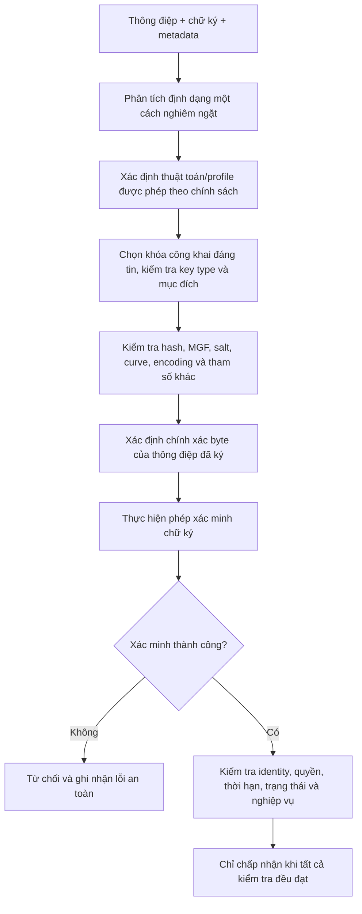
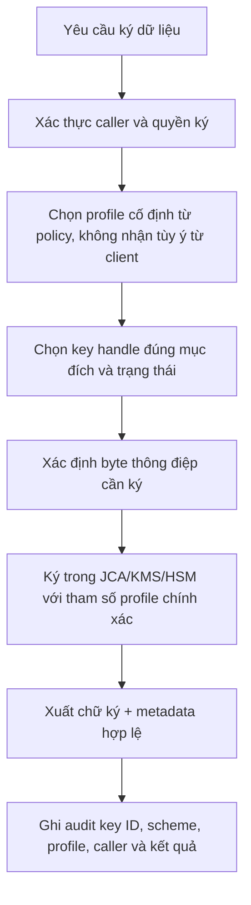
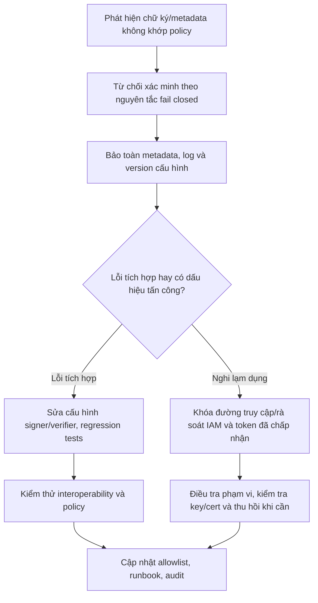

# Kiểm tra algorithm parameters trong chữ ký số

> **Chương:** Chữ ký số  
> **Module:** SECURITY_KEY_MANAGEMENT_FUNDAMENTALS — quản lý vòng đời khóa mật mã từ tạo, cấp phát, lưu trữ, sử dụng, xoay vòng đến thu hồi và hủy; liên hệ mật mã đối xứng, bất đối xứng, KMS/HSM, envelope encryption, phân quyền và kiểm toán để bảo vệ khóa an toàn.

## 1. Mục tiêu học tập

Sau bài này, bạn có thể:

1. Giải thích **algorithm parameters** trong chữ ký số là gì và tại sao việc `Signature.verify(...)` trả `true` **chưa đủ** để kết luận giao dịch hoặc tài liệu đáng tin.
2. Kiểm tra sự nhất quán giữa **signature scheme, hash, padding, MGF, salt length, curve, key type, signature encoding** và chính sách an ninh.
3. Phân biệt các tham số của **RSA-PSS**, **RSA PKCS#1 v1.5**, **ECDSA** và **Ed25519/EdDSA**.
4. Nhận diện lỗi **algorithm confusion**, **downgrade**, bỏ qua tham số trong metadata, xử lý ASN.1 sai và tin khóa công khai chưa được xác thực.
5. Áp dụng cách cấu hình **RSA-PSS rõ ràng bằng Java JCA/JCE**; hiểu yêu cầu validate metadata và khóa trước khi xác minh.
6. Thiết kế quy trình xác minh chữ ký trong **JWS/JWT, chứng thư X.509 và file ký số**, tránh dựa vào dữ liệu do kẻ tấn công tự khai báo.
7. Kết nối việc kiểm tra tham số với **vòng đời khóa ký**, quản lý khóa KMS/HSM, kiểm toán và phản ứng sự cố.

## 2. Algorithm parameters là gì?

Chữ ký số thường gồm **khóa riêng để ký** và **khóa công khai để xác minh**. Tuy nhiên, câu lệnh “kiểm tra chữ ký bằng khóa công khai” còn thiếu thông tin: chương trình phải biết **đúng cơ chế chữ ký, cách xử lý thông điệp và định dạng chữ ký**.

Ví dụ một gói dữ liệu có thể cung cấp:

```text
message
signature bytes
key reference / certificate
signature algorithm identifier
algorithm parameters / profile
metadata về phiên bản và định dạng thông điệp
```

**Algorithm parameters** là các giá trị hoặc cấu hình giúp xác định chính xác cách thực hiện thuật toán, chẳng hạn:

- RSA-PSS: hàm băm của thông điệp, **mask generation function (MGF)** và hash của MGF, độ dài salt, trailer field.
- ECDSA: nhóm/đường cong elliptic của khóa, hash được dùng cho thông điệp, định dạng cặp số `(r, s)`.
- EdDSA: biến thể **Ed25519, Ed448** và quy tắc dùng thông điệp theo chế độ cụ thể; không tự thêm tham số hash tùy ý.
- Giao thức chứa chữ ký: ánh xạ định danh như `PS256`, `ES256` hay `EdDSA` thành một cấu hình chính xác; phiên bản, các trường được bảo vệ và cách serialize dữ liệu.

**Không phải mọi tham số đều là trường độc lập được truyền trong chữ ký.** Một số được xác định bởi chuẩn/profile hoặc được ràng buộc vào kiểu khóa. Nhiệm vụ của verifier là **xác minh tổ hợp thực tế được dùng** có đúng chính sách và định dạng giao thức hay không.

### 2.1. Một chữ ký có nhiều tầng cần kiểm tra



Giá trị `true` của phép xác minh mật mã chỉ xác nhận rằng **chữ ký phù hợp với một khóa và thuật toán trên một chuỗi byte nhất định**. Nó **không tự** chứng minh khóa thuộc đúng người, chứng thư chưa bị thu hồi, người ký có quyền thực hiện thao tác hoặc thông điệp chưa bị phát lại.

### 2.2. Ví dụ lỗi khi “để thư viện tự đoán”

Giả sử chính sách yêu cầu đối tác ký bằng **RSA-PSS với SHA-256, MGF1-SHA-256 và salt 32 byte**. Nếu ứng dụng chỉ đọc chuỗi `"RSA"` rồi khởi tạo verifier mặc định, kết quả có thể:

- Dùng sai scheme (RSA PKCS#1 v1.5 thay vì RSA-PSS).
- Không kiểm tra hash hoặc MGF được yêu cầu.
- Dùng default salt length không khớp policy.
- Chấp nhận key type hoặc độ dài khóa ngoài phạm vi cho phép.
- Ghi log “RSA signature valid” nhưng không biết verifier đã thực sự kiểm tra scheme nào.

Việc **làm rõ và xác nhận tham số** là một bước an ninh, không chỉ là cấu hình lập trình.

## 3. Phân biệt algorithm, scheme, parameters, key và encoding

| Khái niệm | Ví dụ | Câu hỏi cần trả lời |
| --- | --- | --- |
| **Thuật toán nền** | RSA, đường cong elliptic | Phép toán/loại khóa nào đang được sử dụng? |
| **Signature scheme** | RSASSA-PSS, RSASSA-PKCS1-v1_5, ECDSA, Ed25519 | Cơ chế ký và xác minh chính xác là gì? |
| **Hash/message processing** | SHA-256, SHA-384, quy tắc nội bộ Ed25519 | Byte của thông điệp được xử lý như thế nào? |
| **Scheme parameters** | RSA-PSS MGF1/hash/saltLen; ECDSA curve theo khóa | Những giá trị nào ảnh hưởng tới việc ký và xác minh? |
| **Public key** | RSA 3072-bit, EC P-256, Ed25519 | Khóa có đúng loại, độ mạnh và được gắn với đúng identity? |
| **Signature encoding** | ASN.1 DER `SEQUENCE(r,s)`; raw `r || s` | Byte chữ ký cần parse theo định dạng nào? |
| **Protocol identifier** | JWS `PS256`/`ES256`, X.509 AlgorithmIdentifier | Chuẩn nào ánh xạ metadata thành bộ tham số hợp lệ? |
| **Trust policy** | Chỉ cho `PS256` với key của issuer được phê duyệt | Tổ hợp nào **được phép** trong bối cảnh này? |

Một lỗi thường gặp là thấy **RSA-2048** hoặc **P-256** rồi cho rằng đã biết toàn bộ chữ ký. Thực tế, cùng khóa RSA có thể gắn với nhiều signature scheme; cùng EC key có thể được sử dụng với hash khác nhau tùy chuẩn, nhưng ứng dụng vẫn phải giới hạn chính sách và định dạng.

### 3.1. Hash của chữ ký không phải password hash

**SHA-256** là thành phần phù hợp trong nhiều scheme chữ ký số. Lời khuyên “không dùng SHA-256 một lần để lưu password” không đồng nghĩa cấm SHA-256 trong chữ ký.

- Khi lưu password, cần **password hashing/KDF tốn chi phí** như Argon2id do password entropy thấp.
- Trong chữ ký, hash được sử dụng theo **đặc tả signature scheme**, thường cần tính nhanh và chống các kiểu tấn công mật mã thích hợp.
- Không tự thay SHA-256 bằng Argon2id bên trong RSA-PSS, ECDSA hoặc EdDSA.

## 4. RSA-PSS: nhóm tham số phải khớp chính xác

**RSA-PSS (RSASSA-PSS)** là scheme chữ ký RSA có cấu trúc encoding xác suất, dùng hàm băm và cơ chế sinh mặt nạ (MGF) theo tham số cụ thể. Các tham số **phải được hiểu và áp dụng đồng nhất giữa bên ký, metadata và bên xác minh**.

| Tham số | Ví dụ trong một profile `PS256` | Mục đích |
| --- | --- | --- |
| Signature scheme | RSASSA-PSS | Chọn cơ chế ký/xác minh |
| Message hash | SHA-256 | Hash thông điệp theo scheme |
| MGF | MGF1 | Sinh mask cho cấu trúc PSS |
| MGF1 digest | SHA-256 | Hash nội bộ MGF1 |
| Salt length | 32 byte | Độ dài salt của PSS trong profile này |
| Trailer field | `0xBC`, thường biểu diễn là `1` trong API | Quy tắc kết thúc encoding PSS |
| RSA key | Public/private key đủ độ mạnh | Khóa phải khớp scheme và chính sách |

**`PS256` trong JWS** quy định RSASSA-PSS với SHA-256, MGF1 dùng SHA-256 và salt length bằng độ dài digest SHA-256, tức **32 byte**. Những con số này gắn với profile `PS256`; không có nghĩa mọi trường hợp RSA-PSS độc lập đều bị buộc dùng cùng salt length.

### 4.1. Hash của message và hash của MGF1 có thể bị nhầm

Một cách cấu hình sai thường gặp là:

```text
message digest = SHA-256
MGF = MGF1
MGF1 digest = SHA-1       <-- khác chính sách PS256
salt length = 32
```

Nếu mã triển khai chỉ kiểm tra `message digest`, nó có thể **bỏ sót MGF1 digest**. Hai tham số là những giá trị khác nhau và phải được xác minh theo profile. Cách an toàn là chọn **đủ tổ hợp** theo chuẩn đã phê duyệt, thay vì để thư viện tự đặt MGF1 mặc định.

### 4.2. Salt của RSA-PSS khác salt trong password hashing

Đây là hai khái niệm riêng:

- **RSA-PSS salt:** thành phần của **encoding chữ ký**; có độ dài do scheme/profile quy định. Verifier có thể cần biết salt length khi kiểm tra chữ ký.
- **Password hashing salt:** giá trị riêng cho mỗi password verifier để chống bảng hash tính sẵn và hash trùng nhau; liên quan Argon2id/PBKDF2.

Không áp dụng chính sách “salt phải 16 byte cho password” sang `PSSParameterSpec`. Với JWS `PS256`, salt length 32 byte được quy định bởi profile, không phải do lựa chọn ngẫu nhiên trong ứng dụng.

### 4.3. Default ASN.1 không đồng nghĩa policy hiện đại

Trong cấu trúc `RSASSA-PSS-params` của PKCS #1 / RFC 8017, các giá trị mặc định ASN.1 về mặt đặc tả liên quan tới **SHA-1, MGF1 với SHA-1, saltLength 20 và trailerField 1**. Nếu một parser áp dụng default do trường bị lược bỏ, những giá trị đó **không tự động đáp ứng** chính sách yêu cầu SHA-256/MGF1-SHA-256/salt 32.

Với chứng thư X.509 và `AlgorithmIdentifier`, phải theo **RFC 4055 và profile tương ứng** về sự hiện diện/cách encoding tham số của `id-RSASSA-PSS`. Không suy luận rằng mọi trường vắng mặt đều có thể tự thay bằng cấu hình do hệ thống muốn dùng.

**Quy tắc thực hành:** parser phải trích xuất đúng tham số, verifier phải kiểm tra với allowlist/profile, và bên ký phải xuất metadata phù hợp. Việc **parse thành công** không chứng minh tham số được phép.

### 4.4. PSS signature không thể xác minh bằng “SHA256withRSA” tùy tiện

Trong nhiều JCA provider, `SHA256withRSA` chỉ **RSASSA-PKCS1-v1_5** với SHA-256, không phải PSS. Đối với RSA-PSS, hãy dùng `RSASSA-PSS` cùng `PSSParameterSpec` rõ ràng hoặc một provider API có cấu hình tương đương, sau khi kiểm tra khả năng hỗ trợ.

Không thử nhiều scheme liên tiếp đến khi một scheme cho `verify = true`. Hành vi fallback kiểu “thử PKCS#1 v1.5 trước, không được thì thử PSS” làm mất ý nghĩa chính sách thuật toán và tạo rủi ro confusion/downgrade.

## 5. RSA PKCS#1 v1.5: không nhầm padding và hash

**RSASSA-PKCS1-v1_5** là một signature scheme khác với RSA-PSS. Nó xác định cách mã hóa hash message thành cấu trúc `DigestInfo` trước phép toán RSA.

Ví dụ **`SHA256withRSA`** trong Java thường trỏ tới ký/xác minh PKCS#1 v1.5 dùng SHA-256.

Cần kiểm tra:

1. **Scheme** là PKCS#1 v1.5 nếu đó là profile cho phép; không nhầm với RSA-PSS hay RSA encryption `RSA/ECB/OAEP...`.
2. **Digest** là giá trị đúng theo policy, không cho SHA-1/MD5 nếu bị cấm trong trường hợp đó.
3. **Key type và modulus length** đáp ứng yêu cầu.
4. **Định dạng và parser** đúng RFC, không tự chấp nhận các cấu trúc `DigestInfo` bị cắt, có byte thừa hoặc kiểm tra padding lỏng lẻo.
5. Chuỗi byte của thông điệp được xác minh **đúng** với thông điệp đã ký.

**Không tự viết “RSA decrypt signature rồi so sánh hash”** để thay `Signature.verify`. Cấu trúc padding và encoding của chữ ký phải được kiểm tra bởi thư viện mật mã được thẩm định.

### 5.1. Có được dùng RSA PKCS#1 v1.5 không?

Một số hệ thống/chứng thư hiện có vẫn sử dụng nó. Việc chấp nhận hay không phải dựa trên **giao thức, chuẩn áp dụng, chính sách rủi ro và yêu cầu tương thích**. Đối với hệ thống mới, có thể ưu tiên profile RSA-PSS được hỗ trợ và chuẩn hóa; tuy nhiên không được “đổi tên” chữ ký cũ thành PSS hoặc tự fallback để duy trì tương thích.

## 6. ECDSA: kiểm tra curve, digest và cách encode chữ ký

**ECDSA** sử dụng cặp khóa trên đường cong elliptic và tạo chữ ký gồm hai số nguyên `r` và `s`. Bên xác minh cần biết đường cong/nhóm của khóa, cách xử lý thông điệp và định dạng chữ ký.

### 6.1. Một số profile thường gặp

| Profile | Key/curve mong đợi | Digest | Encoding theo JWS |
| --- | --- | --- | --- |
| `ES256` | EC P-256 / `secp256r1` | SHA-256 | Raw `r || s`, 64 byte |
| `ES384` | EC P-384 / `secp384r1` | SHA-384 | Raw `r || s`, 96 byte |
| `ES512` | EC P-521 / `secp521r1` | SHA-512 | Raw `r || s`, 132 byte |

Độ dài JWS `ES512` là **132 byte**, vì mỗi thành phần `r` và `s` có độ dài **66 byte** ở curve P-521. Không suy ra “512” trong `ES512` là kích thước khóa hoặc chữ ký 512 bit.

Trong X.509, CMS và API mật mã khác, mapping/encoding có thể khác. Verifier phải **theo định dạng của giao thức**, không áp đặt encoding JWS cho mọi chữ ký ECDSA.

### 6.2. ASN.1 DER khác raw `r || s`

Nhiều API ECDSA trong Java JCA, ví dụ `Signature.getInstance("SHA256withECDSA")`, làm việc với encoding ASN.1 DER:

```text
ECDSA-Sig-Value ::= SEQUENCE {
    r INTEGER,
    s INTEGER
}
```

Trong JWS `ES256`, byte chữ ký lại là **32 byte r + 32 byte s**, không phải DER. Nếu đưa raw `r||s` trực tiếp vào API Java chờ DER, phép xác minh có thể thất bại, dù chữ ký hợp lệ theo JWS.

Cần chuyển đổi **đúng, chặt chẽ và không mơ hồ** giữa hai định dạng. Khi parse DER:

- Từ chối INTEGER âm, `r`/`s` không hợp lệ hoặc encoding không canonical khi chuẩn yêu cầu.
- Kiểm tra đúng cấu trúc và **không chấp nhận byte thừa** phía sau.
- Kiểm tra `1 <= r < n` và `1 <= s < n` theo quy tắc của scheme; để thư viện đã kiểm thử làm phần toán học này.
- Chỉ chuyển đổi từ JWS raw có **độ dài chính xác** của từng profile.

Không viết parser ASN.1 bằng cách lấy vài byte cố định từ chuỗi DER mà không hiểu length encoding và biểu diễn INTEGER có thể cần byte `0x00` ở đầu để giữ số không âm.

### 6.3. Xác minh curve không chỉ bằng độ dài bit

Kiểm tra “khóa EC 256 bit” **không đủ** để chứng minh nó là **P-256** theo profile `ES256`. Curve phải được nhận diện bằng **tham số/định danh đáng tin cậy**, không chỉ bằng độ dài trường tọa độ.

Đối với khóa EC nhập từ nguồn ngoài, phải sử dụng thư viện/thiết bị kiểm tra **định dạng, điểm public key và membership trên đường cong** theo quy tắc được hỗ trợ. Không tự chấp nhận public key bất kỳ chỉ vì tọa độ có đủ byte.

Key store, chứng thư và chính sách xác minh cần thống nhất một danh mục curve được phép. Không tự fallback từ `P-256` sang một curve khác có số bit tương tự.

### 6.4. ECDSA nonce là trách nhiệm cực kỳ quan trọng của bên ký

ECDSA dùng giá trị bí mật tạm thời **`k` (nonce per-signature)**. Nếu bên ký tái sử dụng `k` hoặc tạo `k` có thể đoán được trong những điều kiện nguy hiểm, **khóa riêng ECDSA có thể bị suy ra** từ các chữ ký.

Đây không phải `nonce` dạng công khai của AES-GCM, cũng không phải `salt` của RSA-PSS.

- Ưu tiên thư viện ký có CSPRNG thích hợp hoặc cơ chế deterministic ECDSA được chuẩn hóa, ví dụ RFC 6979 theo profile phù hợp.
- Không tự tạo `k` từ timestamp, counter dễ đoán, `Math.random()` hoặc nguồn entropy yếu.
- Kiểm thử và giám sát implementation/HSM, không tự suy luận an toàn chỉ vì chữ ký xác minh được.

Verifier thường **không thể chứng minh** từ một chữ ký hợp lệ rằng nonce đã được tạo đúng. Do đó việc kiểm tra algorithm parameters phải đi kèm kiểm soát triển khai **ở phía ký**.

### 6.5. “Low-S” và canonical signature

Với ECDSA, trong một số hệ thống có thể tồn tại nhiều biểu diễn chữ ký toán học hợp lệ liên quan đến `s` và `n - s`. Một số giao thức yêu cầu quy tắc **low-S** để có biểu diễn canonical; quy định này **không tự áp dụng cho tất cả** ECDSA.

Nếu giao thức yêu cầu low-S, verifier cần kiểm tra theo đúng profile. Nếu không có yêu cầu, không tùy tiện từ chối chữ ký hợp lệ của giao thức chỉ vì thư viện trả biểu diễn khác.

## 7. Ed25519 và EdDSA: không tự gắn SHA-256 hay tham số sai

**EdDSA** là họ cơ chế chữ ký trên các đường cong Edwards; **Ed25519** và **Ed448** là các thuật toán cụ thể. Chúng có quy tắc xử lý thông điệp/khóa và encoding riêng.

### 7.1. Ed25519 khác RSA-PSS và ECDSA

Ed25519 không yêu cầu ứng dụng khai báo một bộ `hash + MGF1 + saltLen` như RSA-PSS. Một lời gọi như:

```java
Signature verifier = Signature.getInstance("Ed25519");
```

chọn **thuật toán Ed25519** theo khả năng của provider, không phải “ECDSA + SHA-512”. Không giả định API có tên `SHA256withEd25519` hợp lệ và không tự hash nội dung trước rồi gọi Ed25519 nếu protocol dùng Ed25519 thông thường (*pure Ed25519*).

### 7.2. Ed25519, Ed25519ph và context không thể tráo đổi

RFC 8032 phân biệt các biến thể như:

- **Ed25519** thông thường.
- **Ed25519ph**: biến thể có xử lý prehash được đặc tả, **không tương đương** với việc ứng dụng tự tính `SHA512(message)` rồi ký bằng Ed25519 thông thường.
- **Ed25519ctx**: cơ chế context theo đặc tả.

Nếu giao thức yêu cầu Ed25519 thông thường, chỉ chấp nhận đúng biến thể ấy. Việc phần mềm nào đó tự thêm prehash hoặc context có thể gây **sai chữ ký, lẫn giao thức hoặc không tương thích**.

### 7.3. AlgorithmIdentifier trong X.509/PKIX

Theo RFC 8410, khi dùng định danh thuật toán **Ed25519 hoặc Ed448** trong cấu trúc AlgorithmIdentifier thuộc profile tương ứng, **parameters phải vắng mặt (absent)**; biểu diễn `NULL` không phải giá trị thay thế tương đương.

Đây là một ví dụ quan trọng: “không có tham số” đôi khi chính là **quy tắc bắt buộc**, khác hoàn toàn với RSA-PSS vốn cần hiểu các tham số cấu thành scheme.

### 7.4. Xác minh public key và encoding

Ed25519 có encoding public key và signature đặc trưng. Thư viện/provider phải kiểm tra đúng điều kiện hợp lệ, canonical encoding và các quy tắc xác minh theo chuẩn/profile. Không tùy tiện chấp nhận key có độ dài đúng nhưng định dạng sai, hoặc trộn dữ liệu của curve/algorithm khác.

Trong JWS, tên thuật toán lịch sử `EdDSA` có thể dùng với khóa `OKP` có `crv` như `Ed25519` theo profile tương ứng. Phải kiểm tra **`alg` và `crv` cùng lúc**, không chỉ thấy “EdDSA” rồi chấp nhận bất kỳ public key nào.

## 8. So sánh những tham số cần kiểm tra theo scheme

| Scheme | Tham số/thuộc tính quan trọng | Lỗi dễ gặp |
| --- | --- | --- |
| **RSA-PSS** | Digest, MGF, MGF digest, salt length, trailer, RSA key | MGF1 dùng SHA-1 khi message hash SHA-256; salt length sai |
| **RSA PKCS#1 v1.5** | Digest, chuẩn `DigestInfo`/padding, RSA key | Dùng parser padding lỏng; lẫn với PSS |
| **ECDSA** | Named curve, digest/profile, encoding `r,s`, key validation | Nhầm DER với `r||s`; chọn curve theo số bit |
| **Ed25519** | Đúng Ed25519 mode, định dạng key/signature, tham số X.509 absent | Thêm `NULL`, tự prehash, dùng sai biến thể |
| **Ed448** | Đúng Ed448 mode và encoding theo profile | Nhầm kích thước với Ed25519 |
| **JWS/JWT layer** | `alg`, `kid`, key type, `crv`, protected header, profile | Tin `alg` do attacker khai báo; chấp nhận `none` hoặc HS/RS confusion |
| **X.509 layer** | AlgorithmIdentifier, public key info, CA chain, KU/EKU, trust | Parse được chữ ký nhưng không kiểm tra chain/usage |

**Không có một “tham số hash” áp dụng chung cho mọi scheme.** Verifier cần ánh xạ **tổ hợp cụ thể** vào chính sách được phê duyệt.

## 9. Algorithm confusion và downgrade

**Algorithm confusion** xảy ra khi hệ thống sử dụng hoặc diễn giải sai thuật toán, key type hay encoding do metadata hoặc API không được kiểm soát. **Downgrade** là việc một bên bị dẫn tới dùng cấu hình yếu hơn hoặc ngoài chính sách dự định.

### 9.1. Lỗi `alg: none` hoặc HS256/RS256 trong JWT

Một ví dụ kinh điển của verifier JWT thiếu kiểm tra chính sách:

1. Ứng dụng kỳ vọng token được ký bằng RSA với public key đáng tin.
2. Attacker sửa header `alg` thành `none` hoặc `HS256`.
3. Một thư viện/cấu hình sai có thể bỏ qua kiểm tra chữ ký hoặc dùng **public key RSA làm secret HMAC**.
4. Token bị chấp nhận dù không có chữ ký RSA hợp lệ từ issuer.

Đây là nhóm lỗi **triển khai và chọn thuật toán**, không phải điểm yếu toán học của RSA hoặc HMAC.

Phòng tránh:

- Ấn định **allowlist thuật toán** cho từng issuer, tenant, khóa và loại token.
- Không lấy `alg` từ token rồi dùng nó làm quyết định tin cậy duy nhất.
- Không dùng cùng key material cho kiểu thao tác không tương thích (RSA public key **không phải HMAC secret**).
- Không chấp nhận `none` cho token nghiệp vụ cần chữ ký.
- Kiểm tra `alg`, `kty`, `crv`/key size và key usage nhất quán; không tự thử hết khóa/scheme.

### 9.2. `kid` không phải bằng chứng đáng tin

`kid` (*key ID*) có thể giúp tìm khóa công khai trong danh bạ khóa của issuer, nhưng **chỉ là tham chiếu**, không phải chữ ký hoặc quyền truy cập.

Nếu ứng dụng tin `kid` do attacker cung cấp rồi đọc tùy tiện URL/file hoặc nạp một public key do token tự nhúng mà không có chính sách, attacker có thể điều khiển lựa chọn khóa.

**Cách xử lý đúng:** dùng `kid` để **tra cứu trong bộ khóa đã được ràng buộc với issuer/trust domain**, sau đó kiểm tra key usage, key type, thuật toán và phép verify. Không dùng `kid` làm đường dẫn file/URL tùy ý hoặc cho phép token tự quyết định root of trust.

### 9.3. PS256 và RS256 không được thay thế lẫn nhau

| JWS `alg` | Scheme | Hash | Ghi chú |
| --- | --- | --- | --- |
| `RS256` | RSASSA-PKCS1-v1_5 | SHA-256 | Không phải RSA-PSS |
| `PS256` | RSASSA-PSS | SHA-256 | MGF1-SHA-256; salt length 32 |
| `ES256` | ECDSA P-256 | SHA-256 | JWS raw 64-byte `r||s` |
| `EdDSA` | EdDSA theo khóa/profile | Quy tắc riêng | Phải kiểm tra key `crv` và profile |

Một token tuyên bố `PS256` nhưng verifier khởi tạo `SHA256withRSA` là **lỗi cấu hình scheme**. Verifier phải từ chối hoặc cấu hình đúng `RSASSA-PSS` với các tham số đã được phê duyệt, không thay thuật toán để “làm cho token chạy được”.

## 10. AlgorithmIdentifier trong chứng thư X.509

Một chứng thư X.509 chứa những trường có ý nghĩa liên quan tới thuật toán, ví dụ:

- `subjectPublicKeyInfo.algorithm`: định danh **loại khóa công khai và tham số của khóa**.
- `tbsCertificate.signature`: định danh thuật toán chữ ký dùng cho phần `tbsCertificate`.
- `certificate.signatureAlgorithm`: định danh thuật toán chữ ký ở phần ngoài chứng thư.
- `signatureValue`: byte của chữ ký thực tế.

Cần phân biệt **algorithm của public key** với **signatureAlgorithm** của chữ ký chứng thư. Một khóa public RSA không có nghĩa chữ ký của chứng thư nhất định dùng RSASSA-PSS; có thể là scheme khác được profile cho phép.

### 10.1. Kiểm tra nhất quán và parse nghiêm ngặt

Verifier/parser X.509 cần:

1. Parse **ASN.1 DER** chặt chẽ, không chấp nhận encoding mơ hồ, byte thừa hoặc length sai.
2. Kiểm tra `tbsCertificate.signature` và `certificate.signatureAlgorithm` **phù hợp theo quy định của RFC 5280 và profile**.
3. Ánh xạ thuật toán/parameters theo chuẩn liên quan, chẳng hạn RSA-PSS theo RFC 4055 hoặc Ed25519 theo RFC 8410.
4. Kiểm tra key type, key size, curve, quyền sử dụng và những hạn chế được chứng thư thể hiện.
5. Xác minh chữ ký của từng bước trong **certificate path** theo trust anchor được cấu hình.
6. Kiểm tra thời hạn, tên danh tính, policy, **KeyUsage/ExtendedKeyUsage** theo mục đích và trạng thái thu hồi khi hệ thống yêu cầu.
7. Chỉ chấp nhận chứng thư sau khi các điều kiện mật mã **và** chính sách tin cậy đều đạt.

**Certificate signature valid** không có nghĩa người dùng được phép ký tài liệu nghiệp vụ bất kỳ. Cần kiểm tra chứng thư được cấp cho mục đích gì, subject nào và ứng dụng có tin issuer đó không.

### 10.2. RSA-PSS AlgorithmIdentifier cần cách hiểu theo chuẩn

Khi X.509 sử dụng `id-RSASSA-PSS`, các tham số phải được diễn giải theo cấu trúc được tiêu chuẩn hóa. Có thể có trường được mã hóa tường minh hoặc chịu quy tắc default/hiện diện theo profile.

Không nên:

- Tự hiểu giá trị không có như “SHA-256 mặc định”.
- Chỉ đọc OID RSA-PSS rồi bỏ qua hash/MGF/salt.
- Chấp nhận tham số không hợp lệ chỉ vì provider `Signature.verify` vẫn cho kết quả.
- Cho phép một signatureAlgorithm ở ngoài khác với thuật toán của `tbsCertificate` mà không kiểm tra profile.

### 10.3. Mismatch giữa dấu hiệu thuật toán và trust policy

Giả sử cơ quan phát hành yêu cầu mọi chứng thư trung gian dùng chữ ký với hash SHA-256 trở lên, nhưng một certificate chain có chữ ký SHA-1 được parser vẫn giải mã thành công. **Chữ ký đúng về mặt toán học không tự cho phép ngoại lệ chính sách.** Đường kiểm tra phải từ chối theo policy áp dụng, đồng thời xử lý tương thích với lịch sử, trust anchor và trường hợp ngoại lệ được phê duyệt.

## 11. JWS/JWT: ràng buộc `alg` với khóa và signed bytes

Trong JWS Compact Serialization, một chữ ký thông thường bảo vệ dữ liệu dạng:

```text
BASE64URL(protectedHeader) + "." + BASE64URL(payload)
```

Cần xác minh chữ ký trên **chính xác chuỗi byte được chuẩn định nghĩa**, không trên một JSON được parse rồi serialize lại theo thứ tự trường khác. Những extension như unencoded payload có quy tắc riêng; không tự suy đoán.

Ví dụ header minh họa:

```json
{
  "alg": "PS256",
  "kid": "issuer-a-2026-05",
  "typ": "JWT"
}
```

**Header là đầu vào chưa đáng tin cho đến khi kiểm tra**, dù nó nằm trong phần được ký. `alg` và `kid` là tín hiệu để **chọn ứng viên trong một chính sách đã tin cậy**, không phải quyền quyết định thuật toán/khóa bất kỳ.

### 11.1. Quy trình xác minh JWT đúng thứ tự

1. Chọn **issuer/trust domain** từ cấu hình và ngữ cảnh nghiệp vụ đã được kiểm soát; không tự tin `iss` trước khi verify.
2. Parse token với giới hạn kích thước/định dạng; từ chối header không hợp lệ, thuật toán hoặc extension ngoài allowlist.
3. Tra cứu `kid` trong key set **được tin cậy của issuer**; không fetch URL tùy ý từ header.
4. Kiểm tra `alg` được issuer chấp thuận, key `kty`/`crv`/size/usage tương thích và không bị disable.
5. Xác minh chữ ký bằng **profile chính xác** trên byte JWS signing input.
6. Sau khi signature valid, kiểm tra `iss`, `aud`, `exp`, `nbf`, `iat`, `typ` và các claim/authorization khác theo ứng dụng.
7. Chỉ tạo session hoặc cấp quyền khi cả xác minh mật mã **và** kiểm tra nghiệp vụ thành công.

**Chú ý:** JWT/JWS không tự mã hóa payload. Bên nhìn thấy token có thể đọc các claim nếu token không được bảo vệ thêm. Chữ ký giúp xác minh nguồn gốc/tính toàn vẹn theo khóa và chính sách, không phải bảo mật nội dung.

### 11.2. Phần header được bảo vệ và phần không được bảo vệ

Trong các định dạng có `protected header` và `unprotected header`, phải theo đúng quy tắc chuẩn. Những thuộc tính quyết định cách xác minh thuật toán **không được diễn giải một cách mơ hồ** hoặc ghi đè bằng metadata không được ký.

Ngoài ra cần xử lý `crit`/critical extensions theo quy định: nếu token yêu cầu extension mà verifier không hiểu hoặc không cho phép, không được lờ đi rồi coi chữ ký đã đủ.

## 12. Java JCA: cấu hình RSA-PSS cụ thể và kiểm tra policy

Ví dụ sau minh họa **xác minh chữ ký RSA-PSS với SHA-256, MGF1-SHA-256, salt 32 byte và trailer field 1**. Những tham số này là **profile ví dụ phù hợp `PS256`**, không tự chứng minh mọi bên gửi đều phải dùng PS256.

Mã **không parse JWS/X.509** và giả định tầng phía trên đã chọn khóa công khai **đúng issuer/identity**, xác thực chứng thư nếu cần, xác định chính xác message bytes và kiểm tra metadata theo allowlist. Không nhận một chuỗi `algorithm` bất kỳ từ request rồi truyền thẳng vào `Signature.getInstance(...)`.

```java
import java.security.GeneralSecurityException;
import java.security.InvalidKeyException;
import java.security.PublicKey;
import java.security.Signature;
import java.security.interfaces.RSAPublicKey;
import java.security.spec.MGF1ParameterSpec;
import java.security.spec.PSSParameterSpec;
import java.util.Objects;

public final class RsaPssVerifier {
    private static final int POLICY_MIN_RSA_BITS = 2048; // Mốc minh họa,
                                                           // phải theo policy thực tế.
    private static final PSSParameterSpec PS256_SPEC = new PSSParameterSpec(
        "SHA-256",
        "MGF1",
        MGF1ParameterSpec.SHA256,
        32,
        PSSParameterSpec.TRAILER_FIELD_BC
    );

    private RsaPssVerifier() {}

    public static boolean verifyPs256(
            byte[] exactSignedBytes,
            byte[] signatureBytes,
            PublicKey trustedPublicKey)
            throws GeneralSecurityException {

        Objects.requireNonNull(exactSignedBytes);
        Objects.requireNonNull(signatureBytes);
        Objects.requireNonNull(trustedPublicKey);

        if (!(trustedPublicKey instanceof RSAPublicKey rsaKey)) {
            throw new InvalidKeyException("PS256 requires an RSA public key");
        }
        if (rsaKey.getModulus().bitLength() < POLICY_MIN_RSA_BITS) {
            throw new InvalidKeyException("RSA key below configured policy");
        }

        Signature verifier = Signature.getInstance("RSASSA-PSS");
        verifier.initVerify(rsaKey);
        verifier.setParameter(PS256_SPEC); // Digest, MGF, saltLen, trailer.
        verifier.update(exactSignedBytes);

        // false = chữ ký không hợp lệ; các lỗi định dạng/cấu hình có thể throw.
        return verifier.verify(signatureBytes);
    }
}
```

### 12.1. Cách dùng đúng bên ngoài hàm

```text
metadata = parseStrictly(receivedEnvelope)
policy = trustedPolicyFor(issuer, documentType)

if metadata.algorithm != "PS256":
    reject("Disallowed signature algorithm")

trustedKey = trustedKeyDirectory.find(issuer, metadata.keyId)
validateKeyIdentityUsageLifetimeAndStrength(trustedKey, policy)

signedBytes = reconstructExactSignedBytes(metadata, receivedEnvelope)

ok = RsaPssVerifier.verifyPs256(
    signedBytes,
    metadata.signature,
    trustedKey.publicKey
)

if not ok:
    reject("Invalid signature")

checkBusinessAuthorizationAndReplayProtection(...)
accept(...)
```

Pseudocode này nhấn mạnh rằng **`verifyPs256(...)` không tự hoàn thành tất cả kiểm tra**. Cụ thể:

- `metadata.algorithm` và `keyId` là đầu vào do bên gửi khai báo; phải đối chiếu chính sách/trust directory.
- `signedBytes` là **byte nguyên gốc đúng quy định giao thức**; không parse JSON tùy ý rồi đổi thứ tự khi tạo lại.
- `trustedKey` đã qua kiểm tra identity, mục đích, thời hạn, revocation khi áp dụng.
- Mức `POLICY_MIN_RSA_BITS` là **minh họa**, không phải khuyến nghị duy nhất; chính sách thực tế có thể yêu cầu độ mạnh khác hoặc loại RSA khỏi một số use case.
- Mọi ngoại lệ từ provider, key không hỗ trợ, sai tham số hoặc chữ ký hỏng đều phải dẫn tới **từ chối an toàn**, không có fallback sang scheme yếu.

### 12.2. Kiểm tra đúng tham số được parse từ bên ngoài

Nếu đầu vào là một chữ ký ASN.1 có **AlgorithmIdentifier** và `RSASSA-PSS-params`, tầng parser cần đọc **từng tham số** rồi so với profile `PS256`. Chỉ việc cấu hình verifier local đúng PSS không có nghĩa metadata của gói được kiểm tra.

Ví dụ kiểm tra ở tầng policy:

```text
require scheme         == RSASSA-PSS
require messageHash    == SHA-256
require mgf            == MGF1
require mgfHash        == SHA-256
require saltLength     == 32
require trailerField   == 1
require keyType        == RSA
require rsaModulusBits >= policyMinimum
require keyId          belongsTo trustedIssuerAndPurpose
```

Khi các trường mã hóa ASN.1 có default hoặc optional, parser phải **giải nghĩa theo chuẩn/profile**, sau đó so **giá trị đã chuẩn hóa**, thay vì so chuỗi text chưa parse hoặc tự lấp giá trị mong muốn.

### 12.3. Ví dụ Ed25519 ngắn trong Java

Khi ứng dụng đã có **public key Ed25519 được xác thực** và thông điệp byte chính xác:

```java
import java.security.GeneralSecurityException;
import java.security.PublicKey;
import java.security.Signature;

public final class Ed25519Verifier {
    public static boolean verify(
            PublicKey trustedEd25519Key,
            byte[] signedBytes,
            byte[] signatureBytes)
            throws GeneralSecurityException {
        // Tầng bên ngoài PHẢI xác định key này là Ed25519 tin cậy
        // và profile chỉ cho phép Ed25519 thông thường (không phải ph/ctx).
        Signature verifier = Signature.getInstance("Ed25519");
        verifier.initVerify(trustedEd25519Key);
        verifier.update(signedBytes);
        return verifier.verify(signatureBytes);
    }
}
```

**Không tự tính `SHA256(signedBytes)` rồi chuyển kết quả vào hàm trên**, trừ khi đó là nội dung thực sự được giao thức xác định cần ký. Với Ed25519 thông thường, thư viện xử lý thông điệp theo đặc tả Ed25519.

Đoạn mã không thay thế xác minh `AlgorithmIdentifier`, certificate path, identity, curve/profile và authorization ở lớp ứng dụng.

### 12.4. Không dùng API ký thô để “khôi phục hash”

Một số HSM/KMS phân biệt API ký **thông điệp đầy đủ** và API ký **digest đã tính trước (prehashed)**. Nếu thư viện tự hash một lần và ứng dụng hash trước một lần nữa, kết quả có thể là **double-hashing** không tương thích hoặc sai profile.

Trước khi tích hợp, cần trả lời:

- API nhận **message** hay **digest**?
- Digest algorithm nào và ai thực hiện bước hash?
- RSA-PSS salt/MGF được cấu hình ở đâu?
- ECDSA output là **DER** hay raw `r||s`?
- Private key có bị export ra ứng dụng hay thao tác ký diễn ra trong HSM?
- Chính sách key usage, IAM, audit của API là gì?

## 13. Algorithm parameter validation khi ký

Bên **ký (signer)** cũng phải kiểm soát tham số, không chỉ bên verify.



Không để caller có thể yêu cầu dùng một khóa production quan trọng với bất kỳ hash, MGF, curve hoặc scheme nào do caller tự chọn. Key policy cần giới hạn **allowed algorithms** và key purposes.

### 13.1. ECDSA và nguồn ngẫu nhiên ở bên ký

Chất lượng ECDSA nonce nằm trong vùng tin cậy của signer/HSM. Dù verifier nhận chữ ký toán học hợp lệ, hệ thống ký vẫn có thể nguy hiểm nếu reuse nonce.

Kiểm soát gồm thư viện/provider được kiểm thử, source of randomness phù hợp, cấu hình HSM, rà soát firmware và tiêu chuẩn triển khai. Khi có sự cố nghi lộ khóa ECDSA do nonce, phải xử lý như **nghi lộ private key**, không chỉ thay cấu hình hash.

### 13.2. EdDSA và ký đúng thông điệp

Không tự thêm bước prehash hoặc thay context để “tăng an toàn”. Chỉ chọn Ed25519, Ed25519ph/ctx hoặc Ed448 nếu **giao thức và API** yêu cầu đúng biến thể. Chữ ký được tạo trên một byte sequence cụ thể; nếu đầu nhận chuẩn hóa Unicode/JSON khác, chữ ký có thể không khớp.

## 14. Kiểm tra thuật toán không thay quản lý danh tính và khóa

Một hệ thống có thể kiểm tra đúng `PS256` nhưng vẫn bị lừa nếu **khóa công khai do attacker đưa vào** hoặc **khóa bị dùng sai mục đích**.

### 14.1. Kiểm soát quyền sử dụng khóa

| Đối tượng | Kiểm soát cần có | Nếu bỏ qua |
| --- | --- | --- |
| **Public key** | Nguồn tin cậy, identity/issuer, loại khóa, độ mạnh, trạng thái | Verify thành công với khóa của attacker |
| **Private signing key** | KMS/HSM khi phù hợp, non-exportable, workload identity, phân tách nhiệm vụ | Key bị sao chép hoặc API ký bị lạm dụng |
| **Signature policy** | Allowlist algorithm, profile, key usage, version, exception | Downgrade/confusion |
| **KMS/HSM API** | Signature algorithm được phép, input type, audit, limits | Ký sai scheme hoặc ký ngoài mục đích |
| **Certificate** | Chain, validity, KU/EKU, revocation, name/policy | Tin chứng thư sai đối tượng hoặc hết hiệu lực |
| **Signed content** | Byte canonical/profile, chống replay, semantic validation | Xác minh đúng byte nhưng hành động nghiệp vụ sai |
| **Audit trail** | Ai ký, lúc nào, key ID, algorithm, kết quả và correlation ID | Khó điều tra khi khóa hoặc chính sách bị lạm dụng |

### 14.2. Non-exportable không có nghĩa không thể bị lạm dụng

Một khóa ký trong HSM có thể không xuất được, nhưng nếu workload bị chiếm quyền có thể gọi `Sign` tùy ý, attacker vẫn tạo được chữ ký hợp lệ mà không cần biết byte khóa riêng.

Vì vậy phải giới hạn:

- Workload nào được gọi `Sign`, cho loại message/tài liệu nào.
- Các thuật toán/profile và key handles được phép.
- Tần suất, khối lượng ký và cơ chế phê duyệt nghiệp vụ.
- Sự phân tách giữa quyền **ký** và quyền **thay policy/hủy khóa**.
- Nhật ký API và cảnh báo khi có hành vi bất thường.

## 15. Vòng đời khóa chữ ký và thay đổi thuật toán

Chủ đề algorithm parameters liên hệ trực tiếp với vòng đời khóa trong module key management.

### 15.1. Tạo khóa và cấp phát

Khi tạo cặp khóa ký, cần ghi rõ:

1. **Key type và strength**: RSA modulus size, EC named curve hoặc Ed25519/Ed448.
2. **Allowed signature schemes/profiles**: ví dụ chỉ RSA-PSS/SHA-256/MGF1-SHA-256/salt32 cho một ứng dụng cụ thể.
3. **Owner, issuer, tenant, environment và purpose**.
4. **Key usage và policy**: ký tài liệu, ký phần mềm, ký token, ký chứng thư hoặc giao dịch; không dùng chéo nếu không có thiết kế.
5. **KMS/HSM hoặc phần mềm giữ khóa**, khả năng export/import và DR.
6. **Public key distribution**: chứng thư, pinned keys, directory/JWKS đã xác thực và version.
7. **Audit và kế hoạch rotation/revocation**.

### 15.2. Rotation và tương thích chữ ký cũ

Khi chuyển từ `RSA-PKCS1-v1_5` sang `RSA-PSS` hoặc từ RSA sang Ed25519, không thể chỉ sửa tên thuật toán trên các chữ ký đã tồn tại. Mỗi chữ ký lịch sử được tạo bằng **key/scheme/parameters xác định**.

Một kế hoạch hợp lý:

- Với **chữ ký mới**, chỉ cho phép profile mới theo ngày cutover.
- Với **chữ ký lịch sử**, giữ metadata đầy đủ để xác minh đúng scheme, nếu policy lịch sử còn cho phép.
- Giữ public key, certificate chain và bằng chứng tin cậy liên quan.
- Phân biệt **xác minh chữ ký lịch sử** với **chấp nhận chữ ký mới** bằng thuật toán cũ.
- Nếu khóa riêng bị lộ, đánh giá thời điểm xảy ra và giá trị của bằng chứng thời gian tin cậy; không tự kết luận mọi chữ ký trước đó đều hợp lệ hoặc đều vô hiệu.
- Thu hồi/disable key ký mới đúng quyền; quản lý thời gian lưu giữ bằng chứng theo nghiệp vụ và quy định.

**Chữ ký số không giống envelope encryption.** Rotation KEK/rewrap DEK trong hệ thống mã hóa **không** đồng nghĩa “rewrap một chữ ký” để đổi từ RSA-PSS sang Ed25519. Với chữ ký, thay scheme thường cần **ký lại nội dung** theo quy trình được phép và có thể cần duy trì chữ ký/bằng chứng cũ.

### 15.3. Khóa ký và khóa mã hóa có vòng đời khác nhau

- **DEK**: mã hóa/giải mã dữ liệu; có thể được bọc dưới KEK bằng envelope encryption.
- **KEK/master key**: bảo vệ DEK và có quyền quản trị vòng đời riêng.
- **Private signing key**: tạo chữ ký; ngừng sử dụng cho ký mới hoặc lộ khóa ảnh hưởng đến **niềm tin vào chữ ký**.
- **Public verification key**: dùng xác minh; có thể cần lưu lâu hơn private key để kiểm tra tài liệu lịch sử.

Không dùng cùng một khóa cho cả ký và giải mã dữ liệu chỉ vì thuộc nhóm “bất đối xứng”. Phải tuân **key usage**, mục đích mật mã và chính sách riêng.

## 16. Kiểm toán và phản ứng khi phát hiện algorithm mismatch

### 16.1. Ghi log gì?

Log nên tập trung vào **metadata không bí mật**:

- Key reference/fingerprint đã được quản lý, issuer, workload identity, hành động và timestamp.
- Scheme/profile mong đợi và scheme nhận được (nếu có) theo cách an toàn.
- Mã lỗi: `DISALLOWED_ALG`, `PSS_PARAMS_MISMATCH`, `UNTRUSTED_KEY`, `INVALID_SIGNATURE`, `ENCODING_ERROR`, `CERT_PATH_INVALID`.
- Version của policy, provider và cấu hình được dùng.
- Correlation ID, nguồn request, số lượng lỗi hoặc mức tăng bất thường.
- Các thay đổi quyền ký, enable/disable, rotation và tình trạng khóa.

**Không log private key, seed, plaintext bí mật, HSM credential, DEK hay dữ liệu nhạy cảm của tài liệu**. Chữ ký và digest cũng cần được xử lý theo chính sách dữ liệu, không mặc định có thể công khai bất kỳ thông điệp đã ký.

### 16.2. Phân biệt lỗi để điều tra, nhưng phản hồi phải an toàn

Tầng vận hành cần phân biệt “không hỗ trợ thuật toán”, “PSS salt length sai”, “khóa của issuer khác” và “chữ ký sai” để tìm lỗi cấu hình hoặc hành vi bất thường. Tuy nhiên API công khai không nhất thiết phải trả từng chi tiết cho attacker; một phản hồi từ chối chung có thể phù hợp, còn log nội bộ chứa mã lỗi có kiểm soát.

### 16.3. Khi phát hiện downgrade/algorithm confusion



Không “chữa nóng” bằng cách bật tất cả algorithm để hệ thống hết lỗi. Nếu phải có ngoại lệ tương thích, cần **phê duyệt, giới hạn issuer/khóa/thời gian**, giám sát và kế hoạch loại bỏ.

## 17. Ví dụ thiết kế: ký bản phát hành phần mềm

Giả sử **ReleaseService** tạo manifest gồm checksum và metadata bản phát hành. **DeploymentService** phải xác minh chữ ký trước khi triển khai.

### 17.1. Yêu cầu

- Chỉ chữ ký từ ReleaseService có quyền mới được phép phát hành.
- Không chấp nhận hash/signature scheme ngoài profile hiện hành.
- Có thể thay khóa ký mà deployment vẫn xác minh bản phát hành cũ theo policy lưu giữ.
- Chống tráo file manifest và thay thuật toán trong metadata.
- Có audit để điều tra khi xuất hiện chữ ký không hợp lệ hoặc key bị lộ.

### 17.2. Chính sách minh họa

```yaml
name: release-manifest-signature-policy
policyVersion: 2
purpose: production-release
trustedIssuer: ReleaseService
acceptedProfilesForNewReleases:
  - profile: PS256
    keyType: RSA
    messageHash: SHA-256
    mgf: MGF1
    mgfHash: SHA-256
    saltLengthBytes: 32
    trailerField: 1
    minimumRsaBits: 3072
keySource: approved-release-key-directory
allowedKeyUsage: digitalSignature
signatureEncoding: protocol-defined
legacyVerification:
  enabled: true
  scope: archived-releases-only
  requiresHistoricalPolicyAndKeyEvidence: true
audit:
  verifyFailures: true
  keyPolicyChanges: true
  privateKeyExport: forbidden
```

Đây là **mẫu policy học tập**, không phải YAML cấu hình áp dụng trực tiếp cho KMS hay Java. Giá trị `minimumRsaBits: 3072` minh họa một quyết định quản trị; cần chọn theo tiêu chuẩn và thời hạn bảo vệ áp dụng.

### 17.3. Luồng ký và xác minh

**Ký manifest:**

1. ReleaseService được xác thực và có quyền tạo phát hành.
2. Hệ thống serialize manifest theo định dạng byte được chuẩn hóa và **chống chỉnh sửa**.
3. KMS/HSM ký bằng khóa riêng được phép, profile `PS256` đầy đủ tham số.
4. Hệ thống phát hành manifest cùng chữ ký, key reference và protected metadata theo định dạng.
5. Ghi audit về identity, key ID, profile, version, thời gian và kết quả.

**Xác minh:**

1. DeploymentService parse envelope nghiêm ngặt, chọn policy đã cấu hình.
2. Chỉ chấp nhận `PS256` cho bản phát hành mới.
3. Lấy public key của ReleaseService từ trust directory; xác minh trạng thái/key usage.
4. Kiểm tra scheme/hash/MGF/salt/encoding/key type và modulus.
5. Tạo lại **đúng byte đã ký** và gọi verifier đã cấu hình profile.
6. Kiểm tra manifest thực sự chỉ định những artifact được triển khai và checksum khớp các artifact đó.
7. Chống phát lại **phiên bản phát hành cũ** hoặc rollback không được phép bằng policy nghiệp vụ.
8. Chỉ triển khai sau khi mọi kiểm tra đạt.

### 17.4. Hai sự cố khác nhau

**Sự cố A — Bên gửi dùng salt length 20 khi policy yêu cầu 32.** Đây là **mismatch profile RSA-PSS**. Dù nhà cung cấp có thể hỗ trợ một cấu hình RSA-PSS khác, DeploymentService phải từ chối bản phát hành theo policy; nhóm tích hợp sửa signer, không hạ điều kiện verifier.

**Sự cố B — Attacker lấy được quyền gọi API KMS Sign bằng khóa ReleaseService.** Các tham số có thể **hoàn toàn hợp lệ** và chữ ký xác minh thành công, nhưng attacker vẫn có thể phát hành manifest trái phép. Cần điều tra IAM, quyền nghiệp vụ, log ký, thay/thu hồi khóa và các bản phát hành đã tạo. **Algorithm parameter validation là điều kiện cần, không phải toàn bộ hệ thống tin cậy.**

## 18. Checklist kiểm tra algorithm parameters

| Mục kiểm tra | Câu hỏi bắt buộc | Bằng chứng phù hợp |
| --- | --- | --- |
| **Profile** | Ứng dụng cho phép những signature scheme nào? | Allowlist theo issuer/purpose/version |
| **Metadata** | Thuật toán đã parse từ định dạng có hợp lệ và được bảo vệ không? | Parser tests, ký đúng protected fields |
| **RSA-PSS** | Digest, MGF, MGF digest, saltLen, trailer có đúng profile? | Parsed parameters + test vector |
| **RSA v1.5** | Scheme và digest đúng, provider kiểm tra `DigestInfo`/padding đầy đủ? | Library/provider validation |
| **ECDSA** | Named curve, hash, key validation và `r,s` encoding đúng? | Key/cert metadata + DER/JWS tests |
| **EdDSA** | Đúng Ed25519/Ed448 biến thể và quy tắc AlgorithmIdentifier? | RFC/profile compliance tests |
| **Public key** | Có nguồn tin cậy, độ mạnh, key usage, owner, trạng thái? | Trust directory, certificate path |
| **Signed bytes** | Byte được verify có khớp chính xác với format? | Canonicalization/framing tests |
| **Protocol** | `alg`/`kid` có bị client điều khiển ngoài allowlist không? | JWT/JWS threat tests |
| **Business auth** | Chữ ký đúng có thuộc đúng actor và hành động được phép? | Authorization tests |
| **Lifetime** | Có kiểm tra key/cert version, revocation và historical policy? | Key inventory, policy archive |
| **Operations** | KMS/HSM có kiểm soát mode, tham số, quyền ký và audit? | IAM/policy review, audit evidence |
| **Errors** | Mismatch có fail closed và không fallback? | Negative tests, log review |

## 19. Bài tập tự kiểm tra

**Câu 1.** Một JWT header ghi `alg: PS256` nhưng ứng dụng gọi `Signature.getInstance("SHA256withRSA")`. Có vấn đề gì?

**Gợi ý:** Hai scheme khác nhau: `PS256` là RSASSA-PSS với MGF1 và salt length được quy định; `SHA256withRSA` thường là PKCS#1 v1.5. Verifier phải dùng đúng profile, không thử scheme khác để làm chữ ký “pass”.

**Câu 2.** Một signature RSA-PSS có message hash SHA-256, salt length 32, nhưng MGF1 dùng SHA-1. Có đáp ứng `PS256` không?

**Gợi ý:** Không. `PS256` yêu cầu MGF1 dùng SHA-256. Phải kiểm tra tất cả tham số, không chỉ hash thông điệp.

**Câu 3.** Vì sao không nên lấy tham số default từ ASN.1 rồi mặc nhiên coi đó là cấu hình RSA-PSS an toàn hiện đại?

**Gợi ý:** Các default lịch sử trong cấu trúc RSA-PSS có thể liên quan SHA-1/salt length 20. Phải diễn giải đúng profile và so với chính sách, không lấy default làm tiêu chuẩn an toàn tự động.

**Câu 4.** Một thư viện nhận `ES256`, nhưng key object là EC curve khác P-256 có cùng kích thước bit. Được chấp nhận không?

**Gợi ý:** Không. `ES256` yêu cầu P-256. Cần kiểm tra curve/nhóm bằng nguồn metadata và key validation đáng tin cậy, không chỉ field size.

**Câu 5.** Tại sao đưa chữ ký `ES256` raw 64 byte trực tiếp vào Java JCA `SHA256withECDSA` có thể thất bại?

**Gợi ý:** JWS ES256 dùng raw `r||s`; JCA provider thường mong định dạng ASN.1 DER. Phải chuyển đổi đúng, chặt chẽ, kiểm tra kích thước và tính canonical.

**Câu 6.** Một chứng thư Ed25519 có AlgorithmIdentifier kèm trường `parameters = NULL`. Điều gì cần kiểm tra?

**Gợi ý:** Trong profile RFC 8410, tham số cho Ed25519 phải **vắng mặt**, không phải `NULL`. Parser/validator cần áp dụng quy tắc của đúng chuẩn thay vì chấp nhận mọi biểu diễn ASN.1 có thể parse.

**Câu 7.** Một service dùng `Ed25519` nhưng trước khi gọi `Signature.update` luôn tính SHA-512 của thông điệp. Có đúng là tự động tương đương `Ed25519ph`?

**Gợi ý:** Không. Ed25519ph là một biến thể được định nghĩa cụ thể, không tương đương “prehash tùy ý rồi gọi Ed25519 thường”.

**Câu 8.** Token JWT có chữ ký hợp lệ với public key attacker gửi trong một trường `jwk` của header. Có nên cho phép đăng nhập?

**Gợi ý:** Không. Verify với khóa do attacker chọn không chứng minh token đến từ issuer đáng tin. Phải lấy khóa từ trust domain/issuer đã định cấu hình, kiểm tra identity và claims.

**Câu 9.** Một bản ký số đúng algorithm parameters nhưng certificate đã bị thu hồi theo chính sách, hoặc người ký không có quyền phê duyệt thanh toán. Chấp nhận giao dịch không?

**Gợi ý:** Không. Signature verification chỉ là một bước; cần xác thực chain, trạng thái khóa/chứng thư và authorization nghiệp vụ.

**Câu 10.** Một hệ thống thay khóa RSA cũ bằng Ed25519 mới rồi xóa public key cũ, trong khi phải kiểm tra chữ ký tài liệu từ năm trước. Rủi ro gì?

**Gợi ý:** Không còn đủ vật liệu và metadata tin cậy để xác minh chữ ký lịch sử. Phải lưu public key/chứng thư, profile và bằng chứng liên quan theo retention trước khi hủy.

**Câu 11.** KMS bảo vệ private signing key trong HSM, nhưng mọi workload có quyền `Sign` cho bất kỳ digest. Algorithm parameters đã kiểm tra đúng. Hệ thống an toàn chưa?

**Gợi ý:** Chưa. Attacker chiếm workload có thể lạm dụng API ký. Cần giới hạn mục đích ký, quyền, workload identity, rate limit, kiểm toán và phê duyệt nghiệp vụ.

**Câu 12.** Tại sao cùng `verify = true` có thể chưa đủ để tin một file cập nhật phần mềm?

**Gợi ý:** Cần khóa của đúng publisher, scheme được phép, đúng byte manifest/artifact, kiểm tra version/rollback, nguồn chứng thư và chính sách phát hành. Một chữ ký đúng với khóa sai hoặc nội dung sai mục đích không đủ.

## 20. Ghi nhớ

1. **Algorithm parameters quyết định chính xác phép xác minh chữ ký.** Không chỉ kiểm tra tên thuật toán; phải ràng buộc đúng scheme, digest, padding, MGF/salt, curve, encoding và key type theo profile.
2. **RSA-PSS có nhiều tham số dễ bị bỏ sót**. Với `PS256`: SHA-256, MGF1-SHA-256, salt length 32 và trailer field phù hợp. Tránh dựa vào default không rõ hoặc fallback sang PKCS#1 v1.5.
3. **ECDSA cần đúng curve, digest và định dạng `r,s`**. JWS raw `r||s` khác ASN.1 DER; bên ký phải bảo vệ nonce `k` để tránh lộ private key.
4. **Ed25519/Ed448 có quy tắc riêng.** Không thêm hash tùy ý; Ed25519ph không đồng nghĩa hash trước rồi dùng Ed25519 thường. Trong RFC 8410, AlgorithmIdentifier của Ed25519 phải vắng tham số.
5. **Metadata và public key từ đầu vào đều phải được kiểm soát.** `alg`/`kid` không phải quyền quyết định trust; verifier dùng allowlist và key directory đã xác thực, chống confusion/downgrade.
6. **`verify = true` không chứng minh đủ identity hay authorization.** Kiểm tra chuỗi chứng thư, KeyUsage/EKU, trạng thái khóa, phạm vi dữ liệu, chống replay và nghiệp vụ trước khi chấp nhận.
7. **KMS/HSM bảo vệ khóa nhưng không sửa được sai sót policy hoặc bị lạm dụng API Sign.** Least privilege, separation of duties, kiểm toán, rotation và diễn tập sự cố là thiết yếu.
8. **Vòng đời chữ ký khác vòng đời mã hóa dữ liệu.** Rotation khóa ký không biến chữ ký cũ thành chữ ký bằng algorithm mới; phải lưu khóa công khai, tham số và bằng chứng phù hợp cho xác minh lịch sử.

### Tài liệu tham khảo

- **RFC 8017 — PKCS #1: RSA Cryptography Specifications:** RSASSA-PSS, RSASSA-PKCS1-v1_5 và cấu trúc tham số.
- **RFC 4055 — Additional Algorithms and Identifiers for RSA Cryptography for use in PKIX:** quy tắc AlgorithmIdentifier RSA-PSS trong chứng thư/PKIX.
- **FIPS 186-5 — Digital Signature Standard:** yêu cầu/chú ý triển khai các scheme chữ ký số được chuẩn hóa.
- **RFC 6979 — Deterministic Usage of DSA and ECDSA:** cơ chế deterministic ECDSA nonce.
- **RFC 8032 — Edwards-Curve Digital Signature Algorithm (EdDSA):** Ed25519, Ed448 và các biến thể liên quan.
- **RFC 8410 — Algorithm Identifiers for Ed25519, Ed448, X25519, and X448 for use in PKIX:** biểu diễn tham số/khóa theo PKIX.
- **RFC 5280 — Internet X.509 PKI Certificate and CRL Profile:** chuỗi chứng thư, thuật toán và kiểm tra chứng thư.
- **RFC 7515 — JSON Web Signature (JWS)** và **RFC 7518 — JSON Web Algorithms (JWA):** định dạng chữ ký, định danh `RS256`, `PS256`, `ES256` và các profile.
- **RFC 8725 — JSON Web Token Best Current Practices:** các nguy cơ và thực hành phòng chống algorithm confusion và lỗi xác minh token.
- **NIST SP 800-57 Part 1:** key usage, cryptoperiod, vòng đời khóa và kiểm soát quản lý khóa.

Tài liệu này là hướng dẫn kỹ thuật mang tính khái niệm và triển khai mẫu. Khi xây dựng sản phẩm thực tế, phải áp dụng đúng profile giao thức, chính sách hiện hành, khả năng của thư viện/provider và tiêu chuẩn/tuân thủ của tổ chức; bước QA chuyên môn có thể tiếp tục rà soát các trường hợp biên theo hệ thống mục tiêu.
