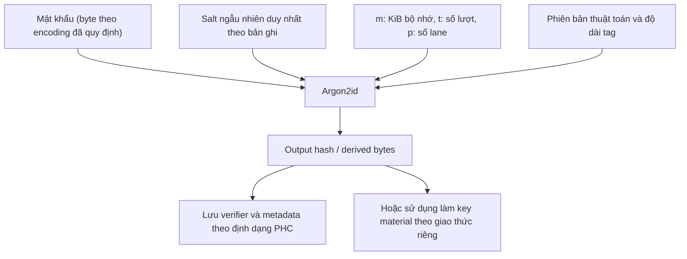
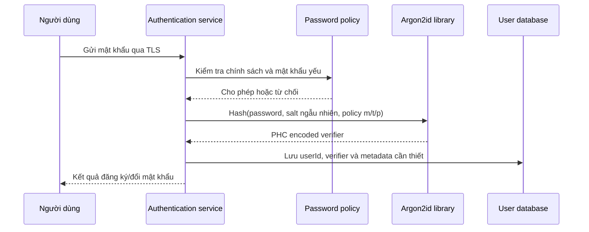
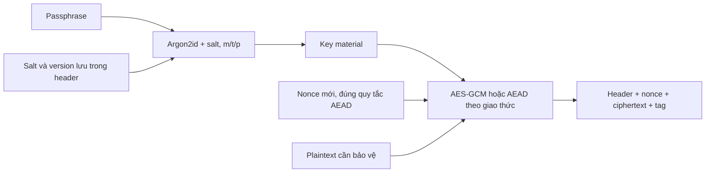
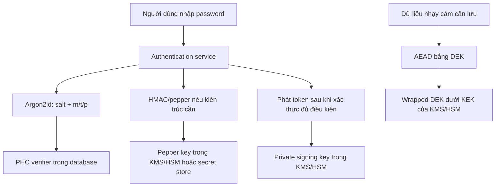

# Argon2 — hàm dẫn xuất khóa và băm mật khẩu có chi phí bộ nhớ

Trong chương **KDF và mật khẩu** của module **SECURITY_KEY_MANAGEMENT_FUNDAMENTALS**, **Argon2** là họ thuật toán *password hashing* và *password-based key derivation* được thiết kế để khiến việc thử đoán mật khẩu trên quy mô lớn trở nên tốn kém cả **thời gian tính toán** lẫn **bộ nhớ**. Khác với SHA-256 đơn thuần, Argon2 có các tham số điều chỉnh chi phí, giúp hệ thống cân bằng giữa độ trễ xử lý hợp lệ và khả năng chống tấn công đoán mật khẩu ngoại tuyến.

Argon2 **không phải thuật toán mã hóa**, không phải chữ ký số và cũng không thay thế **KMS/HSM**. Khi lưu mật khẩu, ứng dụng lưu **giá trị verifier đã băm và metadata**, không lưu mật khẩu rõ hay khóa có thể giải mã ngược. Khi Argon2 được dùng để tạo khóa từ mật khẩu bảo vệ một tệp, đầu ra lại đóng vai trò **key material** và phải được đưa vào vòng đời quản lý khóa, mã hóa có xác thực, sao lưu và phục hồi một cách thích hợp.

Bài học kết nối Argon2 với hash, MAC/HMAC, KDF, mật mã đối xứng, chữ ký số, kiểm soát truy cập, kiểm toán, envelope encryption và quản lý khóa trong hệ thống thực.

## 1. Mục tiêu học tập

Sau bài này, bạn có thể:

- Giải thích vì sao mật khẩu cần **password hashing có chi phí** thay vì SHA-256 hoặc HMAC một lần.
- Phân biệt **Argon2d**, **Argon2i** và **Argon2id**, chọn biến thể theo mô hình đe dọa.
- Hiểu vai trò của **salt**, độ dài đầu ra, phiên bản thuật toán và ba tham số quan trọng `m` (memory), `t` (time/passes), `p` (parallelism).
- Đọc cấu trúc một chuỗi hash theo kiểu **PHC string**, thực hiện đăng ký, đăng nhập, xác minh và nâng cấp tham số đúng cách.
- Thiết kế hệ thống chống tấn công offline mà không gây kiệt tài nguyên khi có nhiều yêu cầu đăng nhập.
- Phân biệt **salt**, **pepper**, **DEK/KEK**, HMAC key và secret được quản lý trong KMS/HSM.
- Áp dụng Argon2id trong Java với thư viện bên ngoài đã được chọn lọc, đồng thời nắm rõ các giới hạn của ví dụ học tập.

## 2. Vấn đề gốc: mật khẩu thường có entropy thấp

Khi một hệ thống lưu `SHA256(password)`, kẻ đánh cắp cơ sở dữ liệu có thể tính SHA-256 của hàng triệu mật khẩu ứng viên rồi so sánh với các digest đã lưu. SHA-256 có khả năng kháng preimage mạnh đối với **đầu vào ngẫu nhiên đủ entropy**, nhưng mật khẩu do con người lựa chọn thường không ngẫu nhiên như một khóa AES-256.

Ví dụ:

```text
Người dùng nhập:      password = "mau-khau-de-doan"
Thiết kế sai:         stored = SHA256(password)

Sau sự cố lộ database:
Attacker thử:         SHA256("123456"), SHA256("password"), ...
Nếu khớp stored:      đoán được mật khẩu mà không cần hỏi server.
```

Thêm một salt ngẫu nhiên rồi băm nhanh một lần giúp hạn chế việc tái sử dụng bảng hash dựng sẵn, nhưng **không làm từng phép thử trở nên đủ tốn kém**. Argon2 giải quyết bằng cơ chế *memory-hard* và các tham số có thể hiệu chỉnh.

| Tình huống | Bài toán bảo mật | Primitive phù hợp hơn |
| --- | --- | --- |
| Lưu password verifier khi đăng ký tài khoản | Chống thử đoán ngoại tuyến nếu database bị lộ | **Argon2id** hoặc password hashing được chính sách cho phép |
| Chứng minh một request đến từ đối tác nắm shared secret | Xác thực thông điệp và chống sửa đổi | **HMAC-SHA256** hoặc MAC theo giao thức, cộng chống replay |
| Ký JWT hoặc manifest phần mềm | Xác thực chữ ký bởi public key đáng tin | **RSA-PSS, ECDSA hoặc Ed25519** theo giao thức |
| Kiểm tra một tệp khớp digest đáng tin | Đối chiếu integrity của byte dữ liệu | **SHA-256/SHA-3** hoặc hash hiện đại phù hợp |
| Dẫn xuất khóa con từ một root secret đủ entropy | Phân tách khóa theo mục đích | **HKDF** theo giao thức |
| Mã hóa dữ liệu có thể cần giải mã lại | Giữ bí mật và bảo vệ tính toàn vẹn | **AES-GCM/AEAD**, DEK/KEK, envelope encryption |

**Không dùng Argon2 thay mọi phép hash:** cố ý tiêu tốn bộ nhớ và CPU khiến Argon2 không phù hợp để hash mọi khối tệp lớn hoặc mọi request dữ liệu thông thường. Nó hướng tới bài toán có đầu vào bí mật dễ đoán hoặc bài toán dẫn xuất khóa từ mật khẩu.

## 3. Argon2 hoạt động ở mức khái niệm

Argon2 nhận một mật khẩu và salt cùng các tham số, sau đó điền và truy cập một vùng bộ nhớ làm việc theo quy tắc của thuật toán. Đầu ra là một chuỗi byte có độ dài được chỉ định. Việc sử dụng đáng kể bộ nhớ làm tăng chi phí của kẻ tấn công muốn chạy nhiều phép đoán song song trên GPU/ASIC hoặc hạ tầng thuê ngoài.



Argon2 sử dụng một cấu trúc bộ nhớ chia thành các *lane* để xử lý. Việc tăng tham số bộ nhớ `m` thường tăng yêu cầu RAM của mỗi phép hash; tăng `t` thường tăng thời gian tính toán; `p` quy định độ song song ở cấp thuật toán. Ba tham số **tương tác với nhau**, không thể chỉ chọn một giá trị lớn nhất mà bỏ qua hiệu năng và giới hạn hạ tầng.

Argon2 không hứa chống mọi GPU, ASIC, side channel hoặc cách tối ưu hóa của đối thủ. Mục tiêu là tạo **chi phí kinh tế đáng kể cho mỗi phép thử**, trong khi hệ thống hợp lệ vẫn đáp ứng mục tiêu độ trễ và thông lượng.

### 3.1. Argon2d, Argon2i và Argon2id

| Biến thể | Kiểu truy cập bộ nhớ | Ưu điểm/giới hạn | Phạm vi sử dụng |
| --- | --- | --- | --- |
| **Argon2d** | Chủ yếu phụ thuộc vào dữ liệu đang xử lý (*data-dependent*). | Tăng khó khăn cho một số chiến lược tính toán song song, nhưng có thể tạo nguy cơ side-channel từ mẫu truy cập bộ nhớ. | Không phải lựa chọn mặc định cho password hashing khi có đối thủ quan sát môi trường thực thi. |
| **Argon2i** | Truy cập bộ nhớ không phụ thuộc dữ liệu bí mật ở những phần được thiết kế theo dạng *data-independent*. | Hướng tới giảm rủi ro side-channel, có sự đánh đổi về đặc tính bảo mật/hiệu năng theo cấu hình. | Một số trường hợp có mô hình tấn công side-channel cụ thể. |
| **Argon2id** | Kết hợp truy cập *data-independent* trong phần đầu và *data-dependent* ở phần sau. | Cân bằng bảo vệ trước side-channel và chi phí thử đoán offline. | **Lựa chọn phổ biến, thường được khuyến nghị cho password hashing mới.** |

**Argon2id là tên biến thể, không phải một phiên bản nhỏ của Argon2i.** Trong phần đầu của lượt điền bộ nhớ đầu tiên, Argon2id sử dụng truy cập không phụ thuộc dữ liệu; các phần còn lại có tính chất phụ thuộc dữ liệu theo thuật toán. Vì vậy không nên mô tả Argon2id là “hoàn toàn constant-time” hoặc không có bất kỳ nguy cơ side-channel nào.

Các lựa chọn cần tuân theo profile/tiêu chuẩn và khả năng của thư viện đã chọn. Không tự thay đổi chi tiết thuật toán để tạo “Argon2id riêng của công ty”.

### 3.2. Tham số `m`, `t`, `p` là gì?

| Tham số | Đơn vị và ý nghĩa | Tác động khi thay đổi | Lưu ý |
| --- | --- | --- | --- |
| **`m` — memory cost** | Thường được cấu hình bằng **KiB** vùng bộ nhớ làm việc. | Tăng RAM cần cho mỗi phép hash, có thể tăng chi phí đối với kẻ tấn công. | `m=65536` là **64 MiB**, không phải 65.536 MiB. |
| **`t` — time cost** | Số lượt xử lý (*passes/iterations*) qua vùng nhớ theo thuật toán. | Tăng công việc tính toán và thường tăng thời gian xử lý. | Không đồng nghĩa “số vòng SHA-256” như PBKDF2. |
| **`p` — parallelism** | Số *lane* song song ở cấp thuật toán. | Ảnh hưởng cách thuật toán chia và xử lý bộ nhớ; có thể tăng throughput một phép hash trên phần cứng hỗ trợ. | Không phải số HTTP request đồng thời; **`m` là ngân sách bộ nhớ tổng của một phép hash**, không tự nhân `p` lần. |
| **Salt length** | Số byte salt ngẫu nhiên. | Đảm bảo các bản ghi dùng salt khác nhau với xác suất rất cao. | Một lựa chọn phổ biến là **16 byte salt** từ CSPRNG. |
| **Output/tag length** | Số byte đầu ra. | Quyết định độ dài kết quả dùng làm verifier hoặc key material. | Ví dụ **32 byte**; chọn theo giao thức/thư viện. |
| **Algorithm version** | Phiên bản định dạng/toán học Argon2. | Phải tương thích với bản ghi lưu trước đây. | PHC thường dùng `v=19` (số thập phân của phiên bản `0x13`). |

Thông số minh họa **`m=65536`, `t=3`, `p=1`** nghĩa là khoảng **64 MiB vùng làm việc**, ba lượt và một lane. Đây là **cấu hình ví dụ để hiểu tham số**, không phải ngưỡng bảo mật cố định cho mọi hệ thống năm 2026. Cần hiệu chỉnh trên phần cứng, tải, quy tắc tuân thủ và mô hình rủi ro cụ thể.

### 3.3. Chọn tham số theo điều kiện thực tế

Quy trình nên có:

1. Xác định mục tiêu **thời gian xử lý cho một lần đăng nhập** và khả năng chịu tải trong điều kiện cao điểm.
2. Thử các cấu hình Argon2id với nhiều mức `m` và `t`, dựa trên một profile đã được đánh giá thay vì tự chọn số ngẫu nhiên.
3. Đo trên đúng môi trường production hoặc môi trường gần tương đương: CPU, RAM, container limit, số instance, NUMA/hypervisor và cách scheduler cấp tài nguyên.
4. Kiểm tra cả **P95/P99 latency**, số đăng nhập đồng thời, mức sử dụng RAM, mức swap và thời gian hàng đợi.
5. Chọn cấu hình đủ tốn kém với đối thủ nhưng vẫn có **giới hạn concurrency** để chống người ngoài dùng chính endpoint đăng nhập gây DoS.
6. Lưu phiên bản và tham số vào verifier, để có thể tăng chi phí an toàn khi phần cứng và khuyến nghị thay đổi.

Ví dụ 100 phép Argon2 đồng thời ở cấu hình 64 MiB có thể yêu cầu tối thiểu khoảng **6,25 GiB vùng nhớ làm việc** chỉ cho các phép băm, chưa tính ứng dụng, runtime và thư viện. **Số yêu cầu đồng thời** mới làm tăng tổng RAM theo cấp hệ thống; không nên nhầm nó với `p` của mỗi phép hash.

Không để client tự quyết định `m`, `t`, `p` cho endpoint đăng ký/xác minh. Nếu nhận PHC hash từ nguồn ngoài hoặc từ database có thể bị thao túng, phải **kiểm tra phạm vi tham số được phép trước khi cấp phát RAM**, tránh một chuỗi `m` cực lớn gây kiệt bộ nhớ.

## 4. Salt, pepper và password verifier

### 4.1. Salt ngẫu nhiên riêng cho từng bản ghi

**Salt** là giá trị ngẫu nhiên được đưa vào hàm password hashing để hai người dùng có cùng mật khẩu thường có **hash khác nhau**. Salt không cần bí mật; thông thường được lưu **cùng verifier**.

```text
Account A:
  password = cùng một mật khẩu
  salt = 16 byte ngẫu nhiên #A
  Argon2id(password, salt A, params) -> hash A

Account B:
  password = cùng một mật khẩu
  salt = 16 byte ngẫu nhiên #B
  Argon2id(password, salt B, params) -> hash B

Kết quả: hash A thường khác hash B.
```

Không dùng salt cố định cho toàn bộ hệ thống, không dùng email hoặc user ID làm **nguồn ngẫu nhiên thay thế**, không tái sử dụng salt cũ khi chủ động đổi mật khẩu. Dùng **CSPRNG** và để thư viện password hashing an toàn tạo salt theo API đã chọn khi phù hợp.

Salt chống tra cứu bằng bảng dựng sẵn và hạn chế sự liên kết trực tiếp giữa các bản ghi, nhưng **không giấu được mật khẩu yếu** trước người có khả năng thử từng ứng viên trên chính salt đã lưu.

### 4.2. Pepper là bí mật có vòng đời

**Pepper** là secret bổ sung ở cấp máy chủ hoặc một miền quản lý, được lưu **tách khỏi database**. Pepper có thể làm tăng rào cản cho kẻ chỉ lấy được bản dump password verifier nhưng chưa lấy được secret ở nơi khác.

Một cấu trúc minh họa thường dùng:

```text
password, random salt
          |
          v
   Argon2id(password, salt, params) -> derived verifier
          |
          v
HMAC(pepperKey, domain || derived verifier) -> stored verifier tag
```

Đây là **sơ đồ khái niệm**; khi triển khai phải có thiết kế chuẩn về định dạng, lưu metadata, phiên bản khóa pepper và cơ chế xác minh, đồng thời chọn thư viện/kiến trúc phù hợp. Một số thư viện Argon2 có tham số **secret** hoặc *associated data* trong API thấp hơn; không phải wrapper nào cũng hỗ trợ. Không tự giả định một API hash password phổ biến có thể nhận pepper.

Lưu ý:

- Pepper **cần bí mật**, được cấp quyền tối thiểu, có thể lưu qua secrets manager hoặc KMS/HSM thích hợp; **không lưu cùng database với hash** nếu mục tiêu là phân tách vùng bảo vệ.
- Nếu pepper bị lộ, phải đánh giá lại nguy cơ **tấn công offline**, quy trình thay pepper và yêu cầu reset/rehash.
- Nếu pepper bị mất mà chỉ còn verifier được bảo vệ bằng nó, việc xác minh các mật khẩu cũ có thể **không thể thực hiện** cho đến khi người dùng đặt lại mật khẩu hoặc quy trình di chuyển được thiết kế trước.
- Không vì có pepper mà bỏ qua Argon2id, salt, kiểm soát đăng nhập hoặc bảo vệ bản sao lưu.
- Nếu KMS/HSM thực hiện HMAC bằng khóa non-exportable, workload cần quyền gọi HMAC; workload bị chiếm quyền vẫn có thể lạm dụng quyền này, nên IAM và audit vẫn cần thiết.

### 4.3. PHC string lưu gì?

Nhiều thư viện xuất verifier theo **định dạng PHC string** (*Password Hashing Competition string*). Cấu trúc ví dụ:

```text
$argon2id$v=19$m=65536,t=3,p=1$<salt-base64>$<hash-base64>
```

Trong đó:

| Trường | Ý nghĩa |
| --- | --- |
| `argon2id` | Biến thể Argon2 được dùng. |
| `v=19` | Phiên bản thuật toán (giá trị thập phân). |
| `m=65536` | Bộ nhớ yêu cầu, thường tính bằng KiB. |
| `t=3` | Số lượt xử lý. |
| `p=1` | Số lane song song. |
| `salt-base64` | Salt được mã hóa cho lưu trữ, thường không bí mật. |
| `hash-base64` | Giá trị đầu ra được mã hóa cho lưu trữ. |

Các chuỗi trong dấu `<...>` chỉ là **placeholder**; không phải verifier có thể xác minh. Khi tạo verifier thật, dùng API thư viện sinh salt và PHC, không tự ghép chuỗi bằng tay. Thư viện cũng có thể thêm thông tin hoặc dùng profile khác; hệ thống cần lưu **đầy đủ chuỗi** và không cắt bớt các trường.

Nếu một hệ thống dùng pepper **ngoài** Argon2, định dạng PHC thông thường **không tự chứa key ID của pepper**; cần thiết kế metadata quản lý pepper version riêng, tránh làm lộ secret và tránh tạo cách xác minh mơ hồ.

## 5. Quy trình đăng ký và xác minh mật khẩu

### 5.1. Đăng ký hoặc đổi mật khẩu



Điểm cốt lõi: **server không lưu plaintext**; tạo salt mới khi hash mật khẩu mới; thông số được chọn từ cấu hình **phía server**, không từ input của người dùng. Khi đổi mật khẩu, xác thực chủ thể theo quy trình nghiệp vụ, thay verifier và xử lý phiên đăng nhập/tokens theo chính sách.

**Chính sách độ dài/encoding:** quy định rõ cách chuyển mật khẩu thành byte, ví dụ UTF-8, quy tắc Unicode normalization nếu được áp dụng và cách xử lý khoảng trắng. Không tự động `trim()` hoặc biến đổi mật khẩu theo cách không công bố, vì có thể khiến những mật khẩu khác nhau bị coi là giống nhau. Giới hạn kích thước input để giảm DoS mà không vô cớ hạn chế mật khẩu dài hợp lệ; mọi ngưỡng cần gắn với thiết kế sản phẩm và thư viện.

### 5.2. Xác minh khi đăng nhập

```text
1. Nhận identifier và password qua kết nối được bảo vệ.
2. Tìm verifier của tài khoản (hoặc xử lý người dùng không tồn tại
   theo chính sách chống user enumeration).
3. Đọc algorithm/version/m/t/p/salt từ verifier đã lưu.
4. Kiểm tra dữ liệu/verifier và giới hạn tham số trước khi thực hiện hash.
5. Tính Argon2id trên password vừa nhập theo metadata hợp lệ.
6. So sánh output với stored verifier bằng API verify đáng tin cậy.
7. Nếu đúng: kiểm tra MFA, trạng thái account, rate-limit, risk controls.
8. Nếu cần nâng cấp tham số: rehash password vừa xác minh thành công,
   lưu verifier mới theo thao tác cập nhật có kiểm soát.
9. Không log plaintext password, không trả chi tiết giúp đoán account.
```

**Không** so sánh:

```text
hashPassword(newRandomSalt, suppliedPassword) == storedPHCString
```

vì salt mới sẽ cho kết quả khác. Hàm `verify(storedPHCString, suppliedPassword)` của thư viện dùng salt và tham số đã lưu **sau khi đã qua kiểm tra hợp lệ**.

Không lẫn **xác thực mật khẩu** với **ủy quyền**. Hash trùng chỉ chứng minh người gọi biết mật khẩu được dùng để tạo verifier, chưa đủ để bỏ qua MFA, thiết bị đáng tin, khóa tài khoản, session policy hay phân quyền truy cập dữ liệu.

### 5.3. Chống user enumeration và timing leak

Một dịch vụ không nên cho bên ngoài dễ dàng phân biệt “tài khoản không tồn tại” và “mật khẩu sai” bằng thông báo hoặc độ trễ. Một số hệ thống dùng **dummy password hash** với thông số đã kiểm soát cho nhánh user không tồn tại, song phải cân bằng với ngân sách tài nguyên; dummy hash không thay rate limiting.

**Không tự so sánh các byte hash bằng vòng lặp dừng ngay ở byte đầu tiên sai**. Dùng API `verify` của thư viện, sau đó kiểm tra trạng thái tài khoản theo policy. Độ trễ tổng thể còn đến từ lookup DB, cache, network và nhánh lỗi; một phép so sánh constant-time không có nghĩa toàn bộ endpoint miễn nhiễm side channel.

## 6. Ví dụ Java: Argon2id với thư viện bên ngoài

Java JDK chuẩn **không cung cấp Argon2 qua `MessageDigest` hay `SecretKeyFactory` mặc định**. Cần một thư viện được duy trì và kiểm tra kỹ phiên bản. Đoạn Java sau minh họa API của **argon2-jvm (`de.mkammerer.argon2`)** ở những phiên bản hỗ trợ các phương thức được dùng; khả năng chạy thực tế phụ thuộc dependency/provider/native library trong dự án.

```java
import de.mkammerer.argon2.Argon2;
import de.mkammerer.argon2.Argon2Factory;
import java.util.Arrays;

public final class Argon2idPasswordDemo {
    // Ví dụ đào tạo, KHÔNG phải thông số áp dụng đại trà.
    private static final int ITERATIONS = 3;
    private static final int MEMORY_KIB = 65_536; // 64 MiB
    private static final int PARALLELISM = 1;

    public static String registerPassword(char[] password) {
        Argon2 argon2 = Argon2Factory.create(Argon2Factory.Argon2Types.ARGON2id);
        try {
            // Library sinh salt an toàn và đưa parameters vào PHC string.
            return argon2.hash(ITERATIONS, MEMORY_KIB, PARALLELISM, password);
        } finally {
            Arrays.fill(password, '\0');
        }
    }

    public static boolean verifyPassword(String storedPhc, char[] attempt) {
        // Production cần validate giới hạn algorithm/version/m/t/p/salt
        // theo server policy trước khi cho thư viện cấp phát bộ nhớ.
        Argon2 argon2 = Argon2Factory.create(Argon2Factory.Argon2Types.ARGON2id);
        try {
            return argon2.verify(storedPhc, attempt);
        } finally {
            Arrays.fill(attempt, '\0');
        }
    }

    public static void main(String[] args) {
        // Demo nhỏ; production không hard-code passwords trong source.
        char[] chosenPassword = {'D','e','m','o','-','P','a','s','s','!','9'};
        String encoded = registerPassword(chosenPassword);
        System.out.println("PHC uses Argon2id: " +
                encoded.startsWith("$argon2id$"));

        char[] correct = {'D','e','m','o','-','P','a','s','s','!','9'};
        System.out.println("Correct: " + verifyPassword(encoded, correct));

        char[] wrong = {'D','e','m','o','-','P','a','s','s','!','8'};
        System.out.println("Wrong: " + verifyPassword(encoded, wrong));
    }
}
```

Kết quả kỳ vọng là `true` cho mật khẩu đúng và `false` cho mật khẩu sai. Code **không in PHC string**, không lưu password rõ vào database và không tự quản lý salt.

**Các giới hạn phải xử lý trước production:**

- Cài dependency phiên bản đã được đánh giá, kiểm tra hỗ trợ Argon2id trên môi trường triển khai; **không chạy test Java trong bước viết bài này**.
- Hàm `verifyPassword` minh họa API, **chưa triển khai bộ phân tích PHC an toàn** để giới hạn `m/t/p` trước khi cấp phát RAM; đây là nhiệm vụ bắt buộc nếu dữ liệu có thể bị sửa hoặc trở thành đầu vào không đáng tin.
- Không tự sử dụng `String` để giữ password lâu dài. `char[]` giúp chủ động xóa buffer mà ứng dụng sở hữu, nhưng không bảo đảm xóa mọi bản sao trong JVM/native provider.
- Không tự chuyển sang `SHA-256` nếu Argon2id lỗi hoặc thiếu thư viện. Nên **fail closed** hoặc dùng chiến lược migration được phê duyệt.
- Không cho phép attacker kiểm soát memory budget, không chạy số lượng công việc Argon2 không giới hạn.
- Khi xác thực thành công, ứng dụng còn cần kiểm tra rate limit, trạng thái tài khoản, MFA/session và cơ chế audit.
- Không dùng chung một object `Argon2` giữa nhiều thread nếu chưa xác nhận thư viện hỗ trợ; quản lý vòng đời thư viện theo hướng dẫn cụ thể.
- Nếu thư viện có phương thức xóa password buffer riêng, có thể dùng theo tài liệu phiên bản; không mặc định mọi phiên bản có cùng API.

### 6.1. Đừng tự tạo PHC bằng cách nối chuỗi

Chuỗi kết quả thường có dạng:

```text
$argon2id$v=19$m=65536,t=3,p=1$SALT_BASE64$HASH_BASE64
```

Ví dụ ở đây thay hai trường cuối bằng chữ đại diện để tránh nhầm với output thật. Salt, hash, version và các tham số phải được viết/đọc bởi **cùng định dạng mà thư viện hỗ trợ**; việc cắt ngắn trường, đổi encoding Base64, bỏ version hoặc bỏ dấu phân cách có thể khiến verifier không hoạt động hay tạo lỗ hổng về parsing.

## 7. Hiệu năng, chi phí và phòng chống DoS

Argon2id được thiết kế để **tốn tài nguyên**; đó là tính năng bảo mật, đồng thời là một bề mặt rủi ro vận hành.

Một máy chủ có 4 GiB RAM không thể dành toàn bộ RAM cho password hashing. Nếu `m=64 MiB` mỗi phép, 32 yêu cầu đồng thời có thể chiếm xấp xỉ **2 GiB vùng làm việc**, trước khi tính memory của ứng dụng, database connection, JVM heap và native overhead. Mức tốn tài nguyên thực tế phụ thuộc thư viện và môi trường, vì vậy phải đo đạc thay vì cộng trừ lý thuyết rồi khẳng định an toàn.

Các lớp phòng thủ:

1. **Rate limiting:** giới hạn theo tài khoản, IP, thiết bị hoặc danh tính rủi ro; tránh cơ chế đơn giản khiến kẻ tấn công dễ khóa tài khoản của người khác.
2. **Concurrency cap:** dùng queue/semaphore/bounded worker pool để giới hạn số phép hash có thể chạy cùng lúc.
3. **Admission control:** từ chối hoặc trì hoãn khi tài nguyên cạn; không hạ `m/t` **động trên request** vì lúc quá tải có thể tạo verifier yếu.
4. **Input bounds:** giới hạn độ dài password ở mức hợp lý, kiểm tra PHC và tham số trước khi cấp phát; có chính sách với đầu vào bất thường.
5. **Monitoring:** theo dõi P50/P95/P99 latency, RSS/heap, memory pressure, swap, failed logins và tỷ lệ lỗi.
6. **Kịch bản sự cố:** đánh giá DoS phân tán, tăng instance, thay đổi pool, đặt circuit breaker và kiểm tra quá trình trở lại bình thường.

**Đừng chọn tham số dựa trên benchmark một request duy nhất.** Một cấu hình ấn tượng khi đo đơn luồng có thể khiến đăng nhập của tất cả người dùng bị nghẽn hoặc OOM khi cao điểm.

## 8. Migration và nâng cấp tham số qua thời gian

Không thể thay đổi `m/t/p` của một bản ghi cũ bằng cách sửa các con số trong PHC string. Để tạo verifier với cấu hình mới, hệ thống cần **mật khẩu gốc được người dùng cung cấp lại**, hoặc một quy trình tái thiết lập đáng tin cậy.

### 8.1. Nâng cấp khi đăng nhập thành công

```text
Stored verifier: Argon2id, version X, params old
       |
       v
Người dùng nhập password
       |
       v
Verify theo stored verifier hợp lệ
       |
       +-- sai --> từ chối, không rehash
       |
       +-- đúng --> kiểm tra policy hiện hành
                       |
                       +-- params đủ --> giữ nguyên
                       |
                       +-- params cũ --> tạo salt mới,
                                         hash lại password với params mới,
                                         ghi cập nhật có kiểm soát
```

Nên có **version/policy ID phía server** để xác định bản ghi nào cần nâng cấp; chỉ dựa vào “chuỗi chứa m nhỏ hơn” có thể bỏ qua sự thay đổi thuật toán hoặc cách chuẩn hóa password. Cập nhật verifier nên được thực hiện nguyên tử hoặc có kiểm soát đồng thời để tránh ghi đè khi người dùng đổi mật khẩu song song.

### 8.2. Chuyển từ bcrypt/PBKDF2 sang Argon2id

Khi chưa có plaintext password, không thể lấy một **bcrypt hash** hay **PBKDF2 verifier** rồi chuyển thành verifier Argon2id của **cùng mật khẩu** chỉ bằng phép hash lại output cũ, nếu không thay đổi semantics và quy trình verify.

Cách thường dùng:

1. Giữ metadata để verify bản ghi cũ bằng thuật toán cũ theo chính sách chuyển đổi.
2. Khi người dùng đăng nhập thành công, tạo verifier Argon2id mới từ **mật khẩu vừa nhập**, salt mới và tham số được phê duyệt.
3. Chuyển cập nhật trạng thái của tài khoản, đảm bảo không làm mất khả năng đăng nhập giữa chừng.
4. Đặt mốc ngừng hỗ trợ thuật toán cũ, có thể yêu cầu reset mật khẩu đối với tài khoản lâu không đăng nhập hoặc trường hợp bắt buộc về rủi ro.

Không thêm đường dự phòng `SHA256(password)` khi Argon2id lỗi. Thất bại thư viện/config phải được ghi nhận là lỗi vận hành, không tự làm yếu password hashing.

### 8.3. Pepper rotation và kế hoạch dự phòng

Với pepper, phải xác định:

- Pepper có `keyId`/version riêng hay không?
- Có thể xác minh bằng pepper cũ và rehash khi người dùng đăng nhập không?
- KMS/HSM có khả năng phục hồi, sao lưu và mở khóa đúng vai trò không?
- Khi pepper bị lộ, khoảng thời gian tồn tại của dữ liệu bị ảnh hưởng là bao lâu?
- Nếu cần hủy ngay pepper cũ, tài khoản cũ sẽ reset password hay có quy trình xác minh khác?

**Không gọi rotate pepper là thành công** khi chỉ đổi alias sang một secret mới mà verifier lịch sử vẫn cần secret cũ nhưng ứng dụng đã làm mất nó. Mỗi kế hoạch rotation phải bao gồm cả **khả năng xác minh tài khoản đang tồn tại** và phạm vi hỗ trợ secret cũ.

## 9. Khi nào Argon2 là KDF cho mã hóa dữ liệu?

Argon2 cũng có thể dùng để dẫn xuất một khóa từ **passphrase** cho trường hợp như khóa bảo vệ tệp, ví điện tử hoặc kho dữ liệu cá nhân. Đây là **ngữ cảnh khác** với việc lưu password verifier cho đăng nhập.

Ví dụ minh họa:



Các yêu cầu bắt buộc:

- **Không dùng PHC verifier string đang lưu trong database làm AES key.** Một verifier không phải secret an toàn để phân phối như khóa mã hóa; và password verification là mục đích khác với mã hóa dữ liệu.
- Dẫn xuất khóa mã hóa trong **giao thức có version**, salt ngẫu nhiên và `m/t/p` được xác định; lưu metadata cần để có thể tái tạo khóa khi người dùng nhập lại passphrase.
- Dùng **AEAD** để xác thực ciphertext và header quan trọng; nonce phải thỏa yêu cầu của chế độ mã hóa. Argon2id **không tự tạo nonce hay tag**.
- Nếu cần nhiều khóa con, dùng **domain separation** hoặc một KDF tiếp theo được thiết kế đúng như HKDF, không tự chia một chuỗi hash bằng các cách tùy tiện.
- Khi đổi passphrase, phải có kế hoạch **mã hóa lại hoặc rewrap** phần dữ liệu chịu ảnh hưởng. Không thể sửa password verifier rồi mong ciphertext cũ tự giải mã được.
- Nếu người dùng mất passphrase và không có phương án khôi phục được thiết kế, dữ liệu có thể **không thể giải mã**. Đừng hứa phục hồi dữ liệu nếu không có chìa khóa hoặc cơ chế thay thế.
- Đặt giới hạn tham số Argon2 trong header trước khi cấp phát bộ nhớ, vì tệp mã hóa nhận từ nguồn ngoài cũng có thể cố tình ghi `m` cực lớn để gây DoS.

### 9.1. Argon2 và HKDF không có cùng vai trò

| Đầu vào | Mục đích | Công cụ |
| --- | --- | --- |
| Password/passphrase do người dùng chọn, entropy không bảo đảm cao | Làm tốn tài nguyên mỗi phép đoán, có salt và cost | **Argon2id** theo thiết kế |
| Shared secret của ECDH hoặc root DEK đủ entropy | Tạo khóa con ổn định theo ngữ cảnh, không cần cố tình tốn RAM | **HKDF** |
| Dữ liệu lưu trữ cần bí mật và toàn vẹn | Mã hóa/xác thực bản rõ | **AES-GCM/AEAD** |
| DEK cần được lưu an toàn | Bảo vệ DEK bằng KEK | **KMS/HSM**, envelope encryption phù hợp |

Dẫn xuất khóa từ password bằng Argon2 không tự biến mật khẩu yếu thành khóa có 256 bit entropy. **Độ khó tấn công vẫn bị giới hạn bởi khả năng đoán mật khẩu và chi phí thử đoán**; một output 32 byte không chứng minh đã có 256 bit an toàn thực tế.

## 10. Argon2 liên quan gì tới KMS/HSM và quản lý khóa?

Phần lớn hệ thống không gửi mọi mật khẩu thô lên KMS để yêu cầu hash. Argon2id thường chạy trong **authentication service** với thư viện password hashing; KMS/HSM xuất hiện ở những thành phần **có khóa bí mật khác**:



**Ranh giới của từng loại khóa:**

- **Argon2 verifier:** dữ liệu có thể lưu trong database, nhưng vẫn là tài sản nhạy cảm vì cho phép tấn công offline nếu lộ; **không phải private key**.
- **Pepper key:** secret thực sự, cần vòng đời cấp phát, giới hạn quyền, rotate, revoke, backup và audit như các secret khác.
- **Token signing key:** private key ký JWT/session metadata, không thay bằng password hash hay HMAC pepper nếu giao thức cần chữ ký số.
- **DEK/KEK:** khóa mã hóa và bọc dữ liệu; cần phân biệt rewrap KEK với tạo DEK mới rồi re-encrypt.
- **Salt:** giá trị ngẫu nhiên không bí mật, cần đủ duy nhất; không có “quy trình thu hồi salt” tương đương với khóa mật mã.

### 10.1. Kiểm soát truy cập và phân tách nhiệm vụ

| Vai trò | Quyền nên có | Quyền không cấp mặc định |
| --- | --- | --- |
| Authentication service | Đọc/ghi password verifier theo quy trình xác thực, sử dụng pepper khi được phép. | Xuất pepper, quản trị/xóa mọi KMS key, xem private signing key. |
| Identity service / token issuer | Yêu cầu `Sign` token bằng signing key được phép. | Tải private signing key, thay khóa MAC/DEK tùy ý. |
| KMS/security admin | Quản lý key policy, rotation, khôi phục theo phê duyệt. | Đọc plaintext password hoặc cấp quyền ứng dụng ngoài nhu cầu. |
| Auditor | Xem sự kiện quản lý pepper/key và thay đổi quyền, kết quả xác thực tổng hợp. | Đọc mật khẩu, pepper, private key hoặc sinh verifier giả. |
| Backup operator | Sao lưu database và cấu hình theo chính sách. | Truy cập pepper cùng backup verifier không kiểm soát, thao tác `Sign`/Decrypt rộng. |

Nhật ký có thể lưu `userId` dạng phù hợp chính sách, thời gian, kết quả đăng nhập, risk indicator, `algorithmVersion`, `policyId` và `requestId` theo nhu cầu kiểm toán. **Không log password, PHC string đầy đủ, pepper, derived encryption key, token còn hiệu lực hoặc secret nội bộ.** Dù PHC không chứa mật khẩu rõ, công bố hàng loạt verifier vẫn tạo cơ hội cho tấn công offline.

### 10.2. Xoay vòng và xử lý sự cố

Nếu chỉ **database hash bị lộ**, kẻ tấn công có thể thử password offline; phản ứng cần dựa trên rủi ro, tham số hash và chính sách tài khoản (ví dụ tăng giám sát, bảo vệ MFA, thông báo/đổi mật khẩu khi phù hợp). Không giả định Argon2 làm password vĩnh viễn không thể đoán.

Nếu **pepper bị lộ**, thêm quy trình thay pepper và xử lý các verifier phụ thuộc, không chỉ thay cấu hình một môi trường. Nếu **signing key JWT bị lộ**, phải thay private/public key và chính sách chấp nhận token; điều này khác với xoay pepper. Nếu **DEK bị lộ**, chỉ rewrap dưới KEK mới không loại bỏ rủi ro, cần cân nhắc re-encrypt dữ liệu.

Tách rõ rủi ro theo từng loại khóa giúp tránh phản ứng sai: **đổi thuật toán password hashing không có nghĩa đã vô hiệu hóa chữ ký JWT giả**, và **xoay KEK không làm database verifier hết khả năng bị thử đoán**.

## 11. Những sai lầm thường gặp

| Sai lầm | Hậu quả | Hướng xử lý |
| --- | --- | --- |
| Chọn Argon2d như mặc định cho password hashing trong môi trường chia sẻ tài nguyên. | Mẫu truy cập dữ liệu có thể tạo nguy cơ side channel. | Thường ưu tiên Argon2id theo profile/threat model đã đánh giá. |
| Chọn `m/t/p` theo ví dụ internet mà không benchmark. | Login chậm hoặc quá tải, chi phí tấn công chưa được đánh giá đúng. | Đo trên môi trường thật, đặt latency/concurrency budget và quan sát tài nguyên. |
| Cấu hình `m` quá thấp để “cho nhanh” mà không có lý do. | Giảm chi phí offline cracking. | Chọn profile được khuyến nghị phù hợp chính sách và tăng khi hạ tầng cho phép. |
| Cấu hình `m` quá cao nhưng không giới hạn requests đồng thời. | DoS/OOM qua endpoint đăng nhập. | Rate limiting, concurrency cap, admission control và tài nguyên dự phòng. |
| Dùng salt cố định hoặc dùng email làm salt thay CSPRNG. | Hash trùng và tạo cơ hội đối chiếu/rainbow table theo cấu hình yếu. | Salt ngẫu nhiên độc lập theo verifier; thường 16 byte. |
| Lưu pepper trong cùng database với PHC string. | Mất lợi ích phân tách vùng bảo vệ khi database bị lộ. | Giữ pepper trong KMS/secrets store được phân quyền riêng. |
| Tự hash `SHA256(password)` rồi coi tương đương Argon2id. | Hash quá nhanh, không có memory hardness, khả năng thử đoán cao. | Dùng Argon2id trực tiếp theo thư viện chuyên dụng. |
| Dùng `SHA256(password + salt)` như fallback khi Argon2 lỗi. | Tạo đường xác thực yếu và khó phát hiện. | Fail closed, xử lý lỗi môi trường và migration có kiểm soát. |
| Tạo salt mới trong lúc `verify` rồi so chuỗi hash. | Password đúng vẫn bị từ chối. | Dùng `verify(storedPHC, suppliedPassword)` theo thư viện. |
| Tin `m/t/p` từ PHC chưa được kiểm soát mà không đặt giới hạn. | Kẻ tấn công có thể buộc server cấp RAM/CPU quá lớn. | Validate profile và resource budget **trước** khi chạy verify. |
| Lưu chỉ kết quả hash mà không có version, salt, params. | Không xác minh và nâng cấp an toàn được. | Lưu đầy đủ PHC/verifier metadata. |
| Khi đổi tham số, chỉ sửa `m/t/p` của chuỗi cũ. | Verifier không còn tương ứng password cũ. | Rehash từ password vừa được xác minh thành công, salt mới. |
| Dùng PHC verifier làm khóa AES hoặc giữ derived key trong log. | Lẫn mục đích, lộ vật liệu và phá vỡ thiết kế mã hóa. | Có KDF/key hierarchy riêng, AEAD và KMS/DEK/KEK phù hợp. |
| Cho rằng Argon2id thay MFA/rate limiting. | Vẫn có brute force online, credential stuffing và phishing. | MFA, kiểm soát đăng nhập, phát hiện bất thường và policy. |
| Hủy pepper cũ không có kế hoạch xác minh tài khoản hiện hữu. | Người dùng không đăng nhập được. | Migrate/rehash khi đăng nhập, version key và quy trình reset nếu cần. |

## 12. Checklist trước khi đưa Argon2id vào production

1. **Mục đích:** lưu password verifier hay dẫn xuất khóa cho mã hóa? Hai mục đích có mô hình dữ liệu và recovery khác nhau.
2. **Biến thể:** dùng Argon2id theo thư viện/profile phù hợp, không tự tạo thuật toán.
3. **Tham số:** đã benchmark `m`, `t`, `p`, salt length, output length trên hạ tầng thật và tải đồng thời?
4. **Đầu vào:** encoding, normalization, password length và xử lý whitespace đã được định nghĩa rõ?
5. **Salt:** tạo salt mới bằng CSPRNG cho mỗi verifier, không đặt ở nơi cần bí mật?
6. **PHC:** lưu toàn bộ algorithm/version/params/salt/hash, xác thực format và **chặn tham số ngoài ngưỡng** trước khi cấp phát RAM?
7. **Đăng nhập:** gọi verify của thư viện, không tính hash mới bằng salt khác rồi so chuỗi?
8. **Online security:** có rate limit, MFA, chống enumeration, session policy và giám sát DoS?
9. **Pepper:** nếu dùng, có KMS/secrets store riêng, IAM, backup, key ID/version, rotation và phương án mất/lộ secret?
10. **Migration:** có phát hiện bản ghi params/algorithm cũ và rehash khi đăng nhập thành công, không làm mất khả năng xác minh tài khoản?
11. **Kiểm toán:** không log plaintext/password/pepper/verifier hàng loạt, có audit thay đổi policy và hành vi bất thường?
12. **Khôi phục:** đã kiểm thử lỗi thư viện, lỗi KMS, rollback deployment, khôi phục database/backup và không làm yếu hash khi có sự cố?
13. **Crypto separation:** signing key, DEK/KEK, HMAC key và password-derived keys có được phân tách mục đích, quyền và vòng đời?

## 13. Câu hỏi tự kiểm tra

1. Vì sao SHA-256 rất phù hợp hash tệp nhưng không phù hợp lưu password verifier nếu dùng một lần?
2. Khác nhau quan trọng giữa Argon2d, Argon2i và Argon2id là gì? Vì sao Argon2id thường được chọn cho mật khẩu?
3. Với `m=65536,t=3,p=1`, `m` tương đương bao nhiêu MiB? `p=1` có nghĩa server chỉ được xử lý một request đăng nhập không?
4. Salt có cần bí mật không? Vì sao hai người dùng có cùng mật khẩu vẫn nên có hash khác nhau?
5. PHC string chứa những trường nào? Nếu chỉ tăng `m` trong chuỗi đã lưu thì có nâng cấp thành công verifier không?
6. Khi attacker kiểm soát trường `m` trong PHC string, điều gì có thể xảy ra nếu server thực thi verify mà không kiểm tra tham số?
7. Pepper khác salt thế nào? Khi mất pepper, việc đăng nhập bằng verifier cũ có thể gặp vấn đề gì?
8. Làm sao nâng cấp từ bcrypt sang Argon2id mà không biết plaintext password của người dùng đang không đăng nhập?
9. Vì sao Argon2id không thay cho rate limiting, MFA và chống credential stuffing?
10. Nếu dùng Argon2id để dẫn xuất AES key từ passphrase, cần thêm những thành phần nào để mã hóa và giải mã an toàn?
11. Khi xoay KEK trong envelope encryption, vì sao việc rewrap DEK khác với việc đổi mật khẩu và rehash Argon2id?
12. Một hệ thống bật pepper trong KMS/HSM: tại sao giữ pepper non-exportable vẫn không đảm bảo ứng dụng có quyền HMAC không thể bị lạm dụng?

**Ghi nhớ:** **Argon2id là công cụ bảo vệ mật khẩu và dẫn xuất khóa từ mật khẩu bằng chi phí bộ nhớ có thể điều chỉnh, không phải phép mã hóa hay cơ chế xác thực toàn diện.** Một hệ thống an toàn còn cần salt đúng cách, tham số được benchmark, kiểm soát tải và đăng nhập, version/migration, bảo vệ pepper nếu có, phân quyền KMS/HSM và vòng đời các khóa ký, khóa mã hóa, DEK/KEK độc lập với password verifier.
