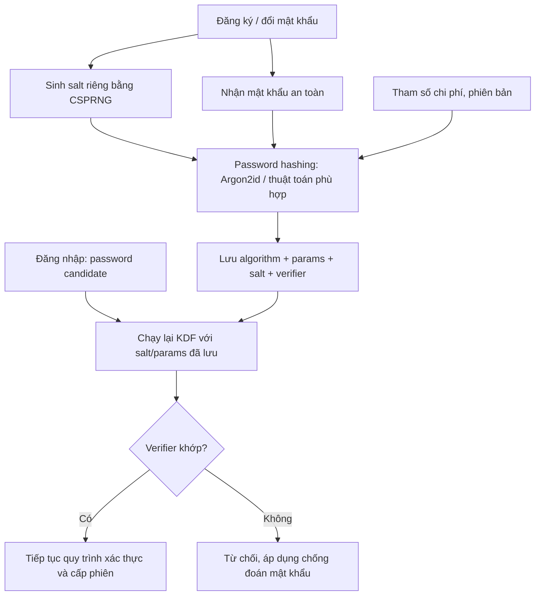
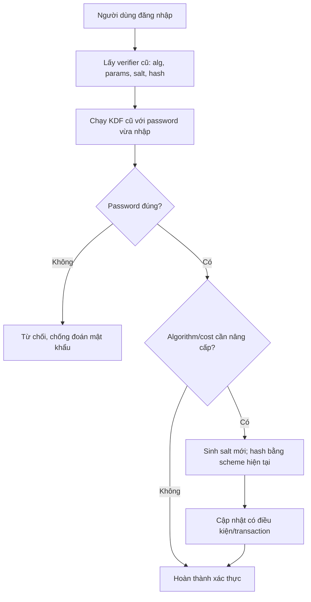
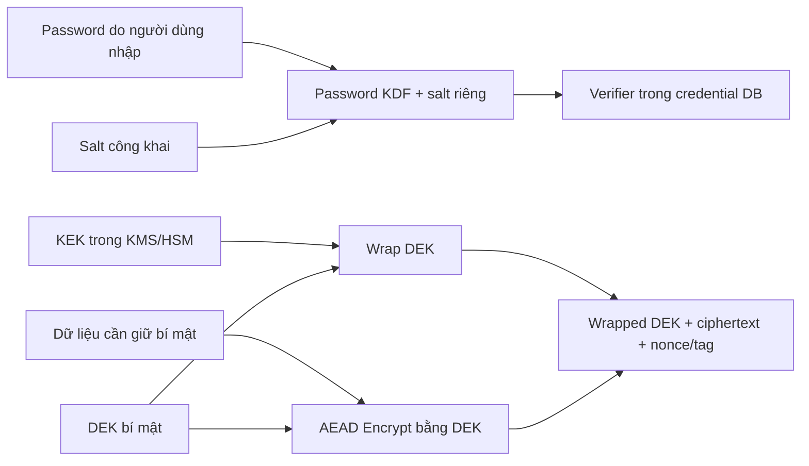

# Password salt: vì sao mỗi mật khẩu cần một salt riêng?

> **Chương:** KDF và mật khẩu  
> **Module:** SECURITY_KEY_MANAGEMENT_FUNDAMENTALS

Khi lưu mật khẩu, hệ thống không nên lưu plaintext hay một giá trị có thể giải mã ngược thành mật khẩu. Cách tiếp cận phổ biến là lưu **password verifier** được tạo bằng hàm băm mật khẩu chuyên dụng (*password hashing function*) với **salt** và tham số chi phí. **Password salt** là một giá trị, thường được tạo ngẫu nhiên, đưa vào quá trình băm mật khẩu để mỗi lần tạo verifier có ngữ cảnh riêng. Hai tài khoản đặt **cùng một mật khẩu** nên có **hai salt khác nhau**, từ đó có hai verifier khác nhau.

Salt thường **không phải secret** và có thể lưu ngay cạnh password verifier. Giá trị của salt nằm ở khả năng ngăn tái sử dụng hàng loạt kết quả băm được tính trước và khiến kẻ tấn công phải xử lý từng salt, chứ không nằm ở việc giấu salt.

Trong phạm vi **SECURITY_KEY_MANAGEMENT_FUNDAMENTALS**, cần phân biệt password salt với **khóa đối xứng, private key, HMAC key và KEK/DEK**. Khóa mật mã đòi hỏi vòng đời tạo, cấp phát, lưu trữ, sử dụng, xoay vòng, thu hồi, hủy; salt không có quyền ký/giải mã để cấp cho ứng dụng, nhưng việc quản lý đúng salt, verifier và secret tùy chọn như **pepper** vẫn là một phần của hệ thống xác thực an toàn.

Sau bài này, bạn có thể:

- Giải thích password salt bảo vệ điều gì và **không bảo vệ điều gì** khi bảng mật khẩu bị đánh cắp.
- Phân biệt **salt**, **pepper**, **password**, **password verifier**, **nonce/IV** và **salt của HKDF**.
- Thiết kế cấu trúc lưu **thuật toán, phiên bản, tham số, salt và hash**, hỗ trợ nâng cấp theo thời gian.
- Hiểu khác biệt giữa **SHA-256 nhanh** và **Argon2id/scrypt/bcrypt/PBKDF2** dùng cho mật khẩu.
- Minh họa việc sinh salt, tạo và xác minh verifier bằng **Java 17/PBKDF2**.
- Lập quy trình thay đổi tham số, migrate mật khẩu cũ và xử lý lộ cơ sở dữ liệu hoặc pepper.

## 1. Bài toán ban đầu: cùng mật khẩu cho cùng một hash

Hàm băm mật mã như SHA-256 là **hàm xác định**: cùng byte đầu vào luôn tạo cùng digest. Nếu lưu hash trực tiếp:

```text
user_a: password = "Spring2026!"
user_b: password = "Spring2026!"

SHA-256("Spring2026!") = H
database:
  user_a -> H
  user_b -> H
```

Nếu kẻ tấn công đánh cắp bảng này, họ có thể nhìn thấy các tài khoản có cùng hash, thử danh sách mật khẩu phổ biến và đối chiếu một kết quả với **nhiều người dùng**. Với hàm băm nhanh, việc thử lượng lớn ứng viên ngoại tuyến trở nên rẻ. Việc SHA-256 có tính kháng tìm ảnh ngược (*preimage resistance*) vẫn **không khiến mật khẩu dễ đoán trở nên khó đoán**.

Khi thêm salt khác nhau cho từng credential:

```text
salt_a = random(16 bytes)
salt_b = random(16 bytes) // khác salt_a với xác suất rất cao

verifier_a = PasswordKDF("Spring2026!", salt_a, params)
verifier_b = PasswordKDF("Spring2026!", salt_b, params)

database:
  user_a -> {salt_a, params, verifier_a}
  user_b -> {salt_b, params, verifier_b}
```

Lúc này, hai tài khoản đặt cùng mật khẩu thường có **verifier khác nhau**. Khi attacker muốn kiểm tra ứng viên `"Spring2026!"`, họ phải chạy KDF với **salt tương ứng của mỗi bản ghi**.

**Giới hạn quan trọng:** salt không tạo thêm entropy cho mật khẩu, không ngăn kẻ tấn công đoán một mật khẩu yếu theo từng tài khoản và không làm mỗi phép thử đơn lẻ chậm hơn. **Hàm password hashing có chi phí phù hợp** mới làm phép thử tốn thời gian/bộ nhớ; salt ngăn việc tái sử dụng kết quả thử cho hàng loạt salt khác nhau.

## 2. Cách salt tham gia vào password hashing

Ký hiệu đơn giản:

\[
V = \operatorname{PasswordKDF}(P,S,\theta)
\]

Trong đó:

| Thành phần | Ý nghĩa | Cần bảo vệ thế nào? |
|---|---|---|
| \(P\) | Mật khẩu do người dùng cung cấp | **Bí mật**, tránh lưu plaintext và log |
| \(S\) | Salt riêng cho credential | Thường **không bí mật**; cần lưu nguyên vẹn |
| \(\theta\) | Tham số: phiên bản, bộ nhớ, số vòng, mức song song, độ dài đầu ra | Thường công khai, phải kiểm soát giá trị hợp lệ |
| \(V\) | Password verifier / hash đã dẫn xuất | Cần kiểm soát truy cập, chống đọc/sửa trái phép |

Khi đăng nhập, ứng dụng đọc **salt + tham số** đã lưu, áp dụng cùng hàm lên mật khẩu người dùng vừa nhập, rồi so sánh kết quả với verifier.



### 2.1. Vì sao salt phải đi cùng verifier?

Salt cần dùng lại **đúng giá trị** để kiểm tra mật khẩu đã đăng ký. Nếu quên salt, ứng dụng thường **không thể tái tạo verifier** từ mật khẩu nhập vào. Salt phải được giữ cùng dữ liệu định danh thuật toán/tham số để quá trình xác minh và nâng cấp còn hoạt động sau khi restart, backup hoặc chuyển nhà cung cấp.

Salt bị lộ không tự tạo sự cố như lộ mật khẩu hoặc lộ private key. Ngược lại, nếu attacker có **salt và verifier**, họ vẫn có thể thực hiện **offline password guessing**; đó là lý do cần KDF chuyên dụng và mật khẩu đủ mạnh.

## 3. Những đặc tính cần có của password salt

### 3.1. Duy nhất cho mỗi credential

Ưu tiên **salt mới cho từng lần tạo verifier**: khi người dùng đăng ký, đổi mật khẩu hoặc hệ thống rehash một credential. Hai bản ghi không nên cố ý dùng cùng salt, kể cả khi cùng người dùng dùng lại mật khẩu. Salt được tạo ngẫu nhiên đủ dài sẽ gần như luôn khác nhau mà không cần truy vấn toàn bộ cơ sở dữ liệu.

**Độ dài thường dùng:** **16 byte (128 bit)** ngẫu nhiên là lựa chọn thực tế tốt cho password salt trong nhiều thư viện password hashing. Có định dạng hoặc thuật toán có yêu cầu riêng; luôn tuân theo API/đặc tả cụ thể. Không tùy tiện cắt xuống vài byte chỉ để tiết kiệm dung lượng.

Với \(q\) salt 128 bit được lấy độc lập, đều từ CSPRNG, xác suất có ít nhất một va chạm gần đúng theo bài toán sinh nhật là:

\[
p_{\mathrm{collision}}\approx\frac{q(q-1)}{2^{129}}.
\]

Ngay cả với một triệu salt, xác suất va chạm ngẫu nhiên theo mô hình này cực nhỏ. Đây **không phải cam kết tuyệt đối**: dùng RNG không an toàn, state bị lặp do snapshot hoặc chủ động cấp cùng salt sẽ phá giả định.

### 3.2. Sinh từ nguồn ngẫu nhiên mật mã

Trong Java, sử dụng `java.security.SecureRandom`:

```java
import java.security.SecureRandom;

SecureRandom secureRandom = new SecureRandom();
byte[] salt = new byte[16];
secureRandom.nextBytes(salt);
```

Không dùng `java.util.Random`, thời gian hiện tại, tên đăng nhập hoặc số thứ tự người dùng để thay thế CSPRNG. **Tính bí mật/khó đoán của salt không phải yêu cầu cốt lõi như nonce challenge**, nhưng chọn CSPRNG giúp salt phân bố tốt, giảm trùng lặp và tránh những mẫu có cấu trúc do lỗi thiết kế.

### 3.3. Có thể công khai, nhưng phải bảo toàn nguyên vẹn

Salt thường được lưu ngay trong chuỗi verifier hoặc cột cơ sở dữ liệu. Không cần mã hóa salt chỉ để “giữ bí mật” nó; hệ thống vẫn phải bảo vệ **toàn bộ cơ sở dữ liệu** khỏi truy cập/sửa trái phép.

Attacker có quyền **ghi đè salt và verifier** có thể thay verifier của một tài khoản bằng giá trị họ tự tính cho mật khẩu họ chọn. Đây là sự cố **toàn vẹn dữ liệu xác thực**, không phải bằng chứng rằng salt vốn cần giấu.

### 3.4. Salt không có thời hạn sống độc lập

Salt gắn với một verifier cụ thể trong suốt đời sống verifier đó. Không có yêu cầu “xoay salt mỗi 30 ngày” như xoay một secret key. Muốn đổi salt, ứng dụng cần **tính lại password verifier bằng mật khẩu thực** hoặc thực hiện quy trình reset/migration được thiết kế đúng.

**Chỉ thay salt trong database mà giữ nguyên hash** sẽ khiến mật khẩu hợp lệ không thể xác minh. Giữ một salt cũ trong backup có thể cần để xác minh dữ liệu backup, nhưng backup chứa verifier vẫn phải chịu chính sách bảo mật/retention nghiêm ngặt.

## 4. Salt chống lại những kiểu tấn công nào?

### 4.1. Precomputation và rainbow table

Kẻ tấn công có thể chuẩn bị sẵn bảng hash cho những mật khẩu phổ biến trước khi đánh cắp database. Nếu mọi người dùng lưu `SHA-256(password)`, cùng một bảng có thể dùng đối chiếu cho rất nhiều tài khoản.

Với salt riêng, đầu vào password hashing khác nhau giữa các bản ghi. Một bảng kết quả tính trước cho salt của người A không áp dụng trực tiếp cho salt của người B. Việc chuẩn bị bảng cho mọi salt 128 bit có thể có là bất khả thi về mặt thực tế.

**Salt làm mất lợi thế dùng chung bảng tiền tính toán; password KDF làm mỗi phép thử tốn chi phí.** Hai cơ chế bổ trợ nhau.

### 4.2. Làm khó suy luận “hai người dùng cùng mật khẩu”

Không có salt, hai tài khoản đặt cùng mật khẩu có cùng hash theo cùng thuật toán. Với salt khác nhau, hai verifier thường khác nhau nên **không thể suy ra ngay chỉ bằng so sánh chuỗi hash**.

Tuy vậy, nếu attacker thử được một mật khẩu yếu trên cả hai salt, họ vẫn có thể xác định cả hai dùng mật khẩu đó. Salt không thay thế quy định mật khẩu mạnh, MFA hoặc kiểm soát mật khẩu bị lộ.

### 4.3. Salt không ngăn tấn công offline vào một tài khoản

Sau khi lấy được `{salt, verifier, params}` của một người dùng, attacker có thể thử `PasswordKDF(candidate, salt, params)` với từng candidate rồi so sánh. Điều ngăn việc thử nhanh là **chi phí KDF và entropy của mật khẩu**, không phải việc giấu salt.

### 4.4. Salt không ngăn online guessing

Ngay cả một hệ thống có Argon2id và salt tốt vẫn có thể bị **credential stuffing** hoặc thử mật khẩu qua trang đăng nhập. Cần rate limit, chống tự động hóa phù hợp, phát hiện bất thường, MFA và quản lý phiên. Đừng nhầm bảo vệ database bị đánh cắp với bảo vệ endpoint đăng nhập đang hoạt động.

## 5. Phân biệt salt, pepper, nonce, IV và key

| Khái niệm | Có giữ bí mật không? | Vai trò | Vòng đời / nơi lưu |
|---|---|---|---|
| **Password salt** | Không | Làm riêng quá trình tạo verifier cho mỗi credential | Lưu cùng verifier; thay khi rehash/reset |
| **Pepper** (tùy chọn) | **Có** | Secret bổ sung để chống việc attacker chỉ lấy được database verifier | Lưu tách database trong secrets manager/KMS/HSM phù hợp; có phiên bản và kế hoạch rotation |
| **Mật khẩu** | **Có** | Dữ liệu do người dùng biết để xác thực | Không lưu plaintext; chỉ xử lý trong lúc đăng ký/xác minh |
| **Password verifier** | Không phải key nhưng nhạy cảm | Giá trị để so sánh khi xác thực | Bảo vệ DB khỏi đọc, ghi và sao chép |
| **Nonce/IV AES-GCM** | Thường không | Phân biệt lần mã hóa dưới cùng key; nonce phải không lặp theo quy tắc | Lưu cùng ciphertext/tag |
| **Salt HKDF** | Thường không | Tham số ở bước Extract khi dẫn xuất khóa từ input key material | Theo giao thức/KDF, không bắt buộc mỗi mật khẩu một salt |
| **HMAC key / KEK / DEK** | **Có** | Khóa để tạo MAC, wrap hoặc mã hóa/giải mã dữ liệu | Quản lý mục đích, quyền, rotation, thu hồi/hủy |

### 5.1. Salt khác pepper như thế nào?

Salt được **công khai và khác nhau theo bản ghi**. Pepper là **secret** bổ sung, thường có phạm vi nhiều credential, được giữ **ngoài database password verifier**. Một thiết kế có thể dùng pepper ở một bước HMAC được xác định rõ của quy trình password hashing; cách áp dụng phải dựa trên thư viện/thiết kế được kiểm chứng.

Pepper có thể làm attacker chỉ sở hữu **database dump** khó xác minh các ứng viên nếu chưa có pepper. Nhưng nó cũng làm tăng phụ thuộc vận hành: khi pepper bị lộ phải đánh giá người dùng liên quan; khi pepper bị mất, một số thiết kế **không thể xác minh mật khẩu cũ**. Vì vậy phải có chính sách backup/phiên bản/rotation và migration.

**Không hard-code pepper** trong source hay cùng database, không coi salt là pepper và không biến một “salt toàn hệ thống” thành secret duy nhất thay thế salt riêng của từng người dùng.

### 5.2. Salt của password KDF khác salt của HKDF

Trong password hashing, salt riêng của từng credential giúp tách các verifier và chống bảng tiền tính toán. Trong **HKDF**, salt thường được dùng cho bước **Extract** từ input key material vốn có entropy; quy tắc chọn salt dựa trên **giao thức và key schedule**, không giống hệt quy tắc mỗi tài khoản một salt.

**HKDF không phải password hashing mặc định.** HKDF được thiết kế để dẫn xuất key từ vật liệu đầu vào thích hợp, không cung cấp chi phí bộ nhớ/thời gian chuyên dụng để làm chậm việc đoán mật khẩu ngoại tuyến.

### 5.3. Salt không phải IV/nonce

Với **AES-GCM**, không được tái sử dụng cặp **(key, nonce)** cho các lần mã hóa cần nonce duy nhất. Salt của Argon2id/PBKDF2 lại phục vụ mục tiêu **tách biệt verifier theo credential**. Không lấy một salt cố định rồi dùng làm nonce cho mọi bản mã dưới cùng DEK, và không suy ra có thể dùng lại nonce AES-GCM chỉ vì salt vốn được công bố.

## 6. Chọn password hashing function đúng mục đích

**SHA-256, SHA-512 và SHA-3** là các hàm băm mật mã có mục tiêu an ninh quan trọng, nhưng chạy tương đối nhanh. Khi lưu mật khẩu do con người đặt, chạy nhanh lại tạo lợi thế cho attacker đoán hàng loạt ứng viên nếu database bị lộ. Thay vì `SHA-256(password || salt)`, nên dùng **password hashing function với chi phí được điều chỉnh**.

| Lựa chọn | Đặc tính | Khi xem xét sử dụng |
|---|---|---|
| **Argon2id** | Password hashing hiện đại, **memory-hard**; có tham số bộ nhớ \(m\), số vòng \(t\), độ song song \(p\) | Thường là ưu tiên cho hệ thống mới nếu thư viện và vận hành hỗ trợ |
| **scrypt** | KDF dựa trên yêu cầu bộ nhớ và tính toán; tham số \(N,r,p\) | Phương án phù hợp trong một số hệ sinh thái |
| **bcrypt** | Password hashing có hệ số chi phí, phổ biến trong hệ thống cũ | Có thể cần duy trì; phải hiểu giới hạn input/encoding và kế hoạch nâng cấp |
| **PBKDF2-HMAC-SHA-256** | Lặp HMAC với số vòng; hỗ trợ rộng trong Java/JCA | Phù hợp khi có yêu cầu tương thích hoặc chính sách cụ thể; **không memory-hard** |
| **SHA-256(password + salt)** | Hash nhanh, không có cấu hình memory-hard/cost như các KDF trên | **Không chọn làm password verifier cho hệ thống mới** |

**Tham số phải được hiệu chỉnh bằng đo đạc trên hạ tầng của hệ thống**, dựa vào khả năng chịu tải, độ trễ đăng nhập, chính sách, thư viện và bối cảnh an ninh. Chọn cost quá thấp khiến brute force dễ hơn; cost quá cao có thể gây DoS nếu attacker kích hoạt nhiều phép xác minh đồng thời. Có thể nâng tham số theo thời gian bằng rehash lúc đăng nhập thành công.

### 6.1. Vì sao salt không thay thế cost?

Một salt 128 bit công khai không bắt attacker thử \(2^{128}\) salt, vì họ đã **biết salt** trong verifier. Họ chỉ cần thử **mật khẩu**:

\[
\operatorname{PasswordKDF}(P_{\mathrm{guess}}, S_{\mathrm{known}},\theta)
 \stackrel{?}{=} V_{\mathrm{stored}}.
\]

Chi phí thực tế của mỗi phép thử phụ thuộc vào **KDF và tham số**; số lượng ứng viên phụ thuộc vào **entropy của mật khẩu**. Nói “salt 128 bit cộng với mật khẩu 40 bit tạo an toàn 168 bit” là sai.

### 6.2. Password reset token khác mật khẩu do con người chọn

Một reset token được sinh ngẫu nhiên từ CSPRNG với đủ entropy (ví dụ 128 bit hoặc hơn) có mô hình đe dọa khác một mật khẩu yếu. Tùy kiến trúc, lưu **digest của token ngẫu nhiên có entropy cao** để đối chiếu có thể hợp lý khi kết hợp TTL, chỉ dùng một lần và kiểm soát truy cập. Không từ ví dụ token mà suy ra SHA-256 thuần là đủ cho **mật khẩu do người dùng tự chọn**.

## 7. Định dạng lưu verifier: cần nhiều hơn một chuỗi hash

Để xác minh ổn định và nâng cấp thuật toán, hệ thống cần lưu đủ thông tin:

```text
CredentialRecord {
  userId: "user-42"
  schemeVersion: 2
  algorithm: "argon2id"
  parameters: { memory, iterations, parallelism, outputLength }
  salt: <random bytes, Base64-encoded>
  verifier: <derived bytes, Base64-encoded>
  pepperVersion: <optional, if a pepper design is used>
  createdAt: <timestamp>
}
```

Nhiều thư viện Argon2 cung cấp **chuỗi mã hóa theo định dạng PHC** chứa thuật toán, phiên bản, tham số, salt và verifier trong cùng một trường, ví dụ mô tả:

```text
$argon2id$v=19$m=<memory>,t=<iterations>,p=<parallelism>$<salt>$<hash>
```

Đây là **mẫu cấu trúc**, không phải chuỗi verifier thực tế để đăng nhập. Phải dùng parser/encoder của thư viện chuyên dụng thay vì tự suy đoán encoding. Với scrypt/bcrypt/PBKDF2, định dạng và thông số cũng cần được ghi rõ.

**Không được chỉ lưu tên thuật toán hiện tại trong source.** Khi thay thuật toán hoặc nâng tham số, các bản ghi cũ có thể cần tiếp tục xác minh cho đến lúc được migrate. Giữ **version + params + salt** giúp chọn đúng hàm để kiểm tra mà không buộc người dùng đổi mật khẩu ngay lập tức.

### 7.1. Những lưu ý về integrity của metadata

Các trường cost và algorithm được đọc từ database có thể bị sửa nếu attacker có quyền ghi. Verifier phải **giới hạn giá trị hợp lệ**: không chấp nhận chi phí cực lớn gây tốn tài nguyên, cũng không tự động hạ cấp xuống thuật toán yếu chỉ vì dữ liệu đầu vào yêu cầu.

Đảm bảo database credential chỉ được sửa qua quy trình có quyền, kiểm toán thao tác đổi mật khẩu, cấu hình hash và reset. Salt không bí mật nhưng **không được cho nguồn chưa tin thay đổi tùy ý**.

## 8. Luồng đăng ký, đăng nhập và nâng cấp password verifier

### 8.1. Đăng ký hoặc đổi mật khẩu

Một quy trình cơ bản:

1. Nhận mật khẩu qua kênh được bảo vệ; áp dụng chính sách mật khẩu và kiểm tra mật khẩu bị lộ theo nhu cầu.
2. Sinh **salt mới bằng CSPRNG**, độc lập với user ID, email và salt của các tài khoản khác.
3. Chạy password hashing với **thuật toán và tham số được server lựa chọn**, không để client tùy ý hạ chi phí.
4. Lưu algorithm/version/params/salt/verifier bằng thao tác nhất quán; không lưu password plaintext.
5. Loại bỏ bản sao plaintext password khi có thể, không đưa mật khẩu hoặc verifier vào log, trace và exception.

Trong hệ thống có pepper, thuật toán tạo verifier phải kết hợp pepper theo thiết kế được kiểm chứng và ghi nhận **pepper version** để hỗ trợ chuyển đổi. Pepper không thay thế salt riêng.

### 8.2. Đăng nhập

1. Xác định credential record theo danh tính người dùng.
2. Lấy **algorithm, params, salt và verifier** từ kho có kiểm soát.
3. Kiểm tra metadata hợp lệ, không cho cấu hình đầu vào buộc server tính toán ngoài giới hạn.
4. Chạy KDF trên **mật khẩu người dùng vừa nhập** với đúng salt/params đã lưu.
5. So sánh verifier theo phương pháp phù hợp, trả kết quả đăng nhập qua API an toàn, kết hợp rate limit/MFA khi cần.
6. Nếu đúng mật khẩu nhưng scheme hoặc cost đã cũ, **tạo salt mới và rehash bằng scheme hiện tại**, cập nhật record nhất quán.

**Không sinh salt mới cho mỗi lần đăng nhập trước khi kiểm tra**, vì như vậy kết quả sẽ không khớp verifier đã lưu. Salt mới chỉ dùng khi tạo **một verifier mới**.

### 8.3. Ví dụ rehash sau đăng nhập thành công



Nếu hệ thống có nhiều request đăng nhập đồng thời, nên cập nhật verifier bằng **compare-and-swap** hoặc giao dịch có kiểm soát để không ghi đè một lần đổi mật khẩu vừa xảy ra. Kết quả rehash thất bại do xung đột phiên bản không nên biến thành thao tác ghi đè bản mới.

## 9. Java 17: minh họa salt ngẫu nhiên và PBKDF2-HMAC-SHA-256

**Argon2id** thường là lựa chọn đáng cân nhắc cho dịch vụ mới, nhưng Java 17 JCA không tích hợp Argon2id như một thuật toán chuẩn có thể mặc định gọi từ `SecretKeyFactory`. Ví dụ Java bên dưới dùng **PBKDF2WithHmacSHA256** được JCA hỗ trợ rộng để minh họa trực tiếp việc **tạo salt, ghi tham số, xác minh và so sánh verifier**.

Trong code, số vòng PBKDF2 là **tham số minh họa**. Dự án thật cần đặt thuật toán và cost theo chính sách được cập nhật, đo hiệu năng trên hạ tầng của mình và cân nhắc thư viện Argon2id được duy trì tốt.

```java
import java.security.GeneralSecurityException;
import java.security.MessageDigest;
import java.security.SecureRandom;
import java.util.Arrays;
import java.util.Base64;
import javax.crypto.SecretKeyFactory;
import javax.crypto.spec.PBEKeySpec;

public final class PasswordSaltDemo {
    private static final String ALGORITHM = "PBKDF2WithHmacSHA256";
    private static final String FORMAT = "pbkdf2-sha256";
    private static final String VERSION = "v1";
    private static final SecureRandom RANDOM = new SecureRandom();
    private static final int SALT_BYTES = 16;
    private static final int DERIVED_BITS = 256;
    private static final int ITERATIONS = 310_000; // Chỉ là ví dụ.
    private static final int MIN_ACCEPTED_ITERATIONS = 100_000;
    private static final int MAX_ACCEPTED_ITERATIONS = 2_000_000;

    private static byte[] derive(
            char[] password, byte[] salt, int iterations)
            throws GeneralSecurityException {
        PBEKeySpec spec = new PBEKeySpec(
                password, salt, iterations, DERIVED_BITS
        );
        try {
            SecretKeyFactory factory =
                    SecretKeyFactory.getInstance(ALGORITHM);
            return factory.generateSecret(spec).getEncoded();
        } finally {
            spec.clearPassword();
        }
    }

    public static String createVerifier(char[] password)
            throws GeneralSecurityException {
        byte[] salt = new byte[SALT_BYTES];
        RANDOM.nextBytes(salt); // Salt riêng mỗi lần tạo verifier.

        byte[] hash = derive(password, salt, ITERATIONS);
        Base64.Encoder encoder = Base64.getUrlEncoder().withoutPadding();

        // Format có thuật toán, version, cost, salt và hash.
        String encoded = String.join("$",
                FORMAT,
                VERSION,
                Integer.toString(ITERATIONS),
                encoder.encodeToString(salt),
                encoder.encodeToString(hash));
        Arrays.fill(hash, (byte) 0);
        return encoded;
    }

    public static boolean verify(char[] candidate, String stored)
            throws GeneralSecurityException {
        String[] parts = stored.split("\\$", -1);
        if (parts.length != 5
                || !FORMAT.equals(parts[0])
                || !VERSION.equals(parts[1])) {
            return false;
        }

        final int iterations;
        final byte[] salt;
        final byte[] expected;
        try {
            iterations = Integer.parseInt(parts[2]);
            if (iterations < MIN_ACCEPTED_ITERATIONS
                    || iterations > MAX_ACCEPTED_ITERATIONS) {
                return false;
            }
            Base64.Decoder decoder = Base64.getUrlDecoder();
            salt = decoder.decode(parts[3]);
            expected = decoder.decode(parts[4]);
        } catch (IllegalArgumentException invalidFormat) {
            return false;
        }

        if (salt.length != SALT_BYTES
                || expected.length != DERIVED_BITS / 8) {
            return false;
        }

        byte[] actual = derive(candidate, salt, iterations);
        try {
            return MessageDigest.isEqual(expected, actual);
        } finally {
            Arrays.fill(actual, (byte) 0);
        }
    }

    public static void main(String[] args) throws Exception {
        // Chuỗi literal chỉ dùng trong demo, không hard-code
        // mật khẩu thực của người dùng vào source.
        char[] password = "Demo-Password-2026!".toCharArray();
        char[] wrong = "wrong-password".toCharArray();
        try {
            String record1 = createVerifier(password);
            String record2 = createVerifier(password);

            System.out.println("Dung password: " + verify(password, record1));
            System.out.println("Sai password: " + verify(wrong, record1));
            System.out.println("Hai record khac nhau: "
                    + !record1.equals(record2));

            // Không in record, salt, password hoặc hash
            // vào log production.
        } finally {
            Arrays.fill(password, '\0');
            Arrays.fill(wrong, '\0');
        }
    }
}
```

Kết quả mong đợi là hai bản ghi có salt khác nhau nên verifier đầy đủ khác nhau; mật khẩu đúng được chấp nhận và mật khẩu sai bị từ chối. **Hai lần sinh salt ngẫu nhiên vẫn có xác suất trùng cực nhỏ**, nên ví dụ không phải chứng minh toán học về tính duy nhất tuyệt đối.

### 9.1. Những điểm code đã thực hiện

- Dùng `SecureRandom` cho salt mới và giữ nguyên salt khi verify.
- Lưu **algorithm, format version, iteration count, salt và verifier** để xác minh được sau khi restart.
- Giới hạn iteration count khi đọc record để không thực thi một giá trị tùy ý quá lớn; dùng `MessageDigest.isEqual` cho hai mảng verifier.
- Không in secret trong luồng xử lý thông thường; có cố gắng xóa những buffer tạm thời do ứng dụng trực tiếp nắm giữ.

### 9.2. Giới hạn cần xử lý trước khi đưa vào production

1. **PBKDF2 không memory-hard.** Nếu hệ thống dùng được Argon2id, nên đánh giá lựa chọn đó theo thư viện và chính sách hiện hành.
2. Giá trị `310_000` chỉ minh họa. **Không dùng như một khuyến nghị bất biến**; tham số thực tế phải được đo và cập nhật cho phiên bản thuật toán/hạ tầng, đồng thời kiểm soát tổng số phép tính song song.
3. `PBEKeySpec` và `SecretKeyFactory` có thể sao chép mật khẩu/vật liệu vào bộ nhớ Java/provider. `Arrays.fill` hoặc `clearPassword` chỉ xóa buffer tương ứng; **không thể bảo đảm zeroization toàn bộ JVM**.
4. Chương trình chưa có DB transaction, logging an toàn, rate limit, MFA, account recovery, reset, phân quyền thay password, kiểm tra mật khẩu bị lộ hoặc pepper.
5. Mật khẩu Unicode cần **quy ước encoding/normalization nhất quán** giữa phiên bản hệ thống và provider. Không tùy tiện trim, đổi chữ hoa/thường hoặc chuẩn hóa lại mật khẩu đã lưu nếu không có kế hoạch migration tương thích.
6. Format tự thiết kế ở đây phục vụ giảng dạy. Trong hệ thống thật, nên sử dụng **encoder/parser của thư viện password hashing chuyên dụng** và cơ chế xác minh phù hợp cho cả định dạng hiện tại lẫn định dạng cũ đã được chấp nhận.
7. Chỉ chứng minh việc **verify một candidate**. Đăng nhập thật phải trả lỗi phù hợp, tránh user enumeration, thực hiện kiểm soát tốc độ/khối lượng và không tự tạo session trước khi mọi bước xác thực hoàn thành.

## 10. Salt và pepper liên hệ với secrets management, KMS/HSM

**Salt không phải khóa mật mã bí mật**. Vì vậy KMS/HSM không cần giữ salt để ngăn người ngoài đọc. Nếu mỗi lần đăng nhập phải gọi KMS chỉ để lấy một salt công khai thì kiến trúc đang bổ sung độ trễ mà không giải quyết đúng bài toán.

**Pepper** lại là một secret dùng chung theo phạm vi thiết kế, nên cần mô hình quản lý rõ ràng. Một thiết kế có thể:

- Lưu pepper trong **secrets manager** và phân phối cho dịch vụ xác thực theo workload identity, giới hạn quyền đọc.
- Giữ pepper dưới dạng **HMAC key trong KMS/HSM có hỗ trợ GenerateMac/VerifyMac** để dịch vụ không cần tải raw key ra ngoài, nếu giao thức password verification được xây dựng phù hợp.
- Gắn **pepper version**, lưu quy trình khôi phục, theo dõi rotation và chỉ cho danh tính xác thực đúng phạm vi dùng pepper.

Khi dùng KMS/HSM cho pepper, cần hiểu **quyền dùng khóa không giống quyền đọc khóa**. Một workload bị chiếm mà có quyền gọi `GenerateMac` theo phạm vi rộng vẫn có thể lạm dụng phép toán, dù key không export được. Cần IAM, rate limit, kiểm toán và bảo vệ lớp ứng dụng.

### 10.1. Không dùng password verifier như key mã hóa dữ liệu

Password verifier chỉ được dùng để **kiểm tra mật khẩu** theo scheme xác thực. Đừng lấy hash mật khẩu đã lưu rồi sử dụng trực tiếp như **AES DEK**, **HMAC key** hoặc **KEK** cho dữ liệu khác: điều này tạo phụ thuộc và mở rộng phạm vi sự cố.

Nếu thực sự cần mã hóa bằng khóa dẫn xuất từ mật khẩu người dùng (ví dụ bảo vệ vault mà chỉ người dùng mở được), đó là một thiết kế **password-based encryption** riêng: cần KDF phù hợp, salt, AEAD với nonce/tag, ràng buộc metadata và chính sách khôi phục. Không được đồng nhất nó với việc lưu password verifier để đăng nhập.

### 10.2. Envelope encryption khác password hashing

Trong **envelope encryption**, **DEK** mã hóa dữ liệu, **KEK** bảo vệ DEK và KMS/HSM có thể quản lý KEK. Dữ liệu được mã hóa cần lưu ciphertext, nonce, tag, wrapped DEK và key metadata để giải mã về sau.

Trong **password hashing**, đầu ra verifier được thiết kế để **kiểm tra một mật khẩu đã nhập**. Hệ thống không có thao tác “decrypt password hash” để lấy lại mật khẩu. Khi người dùng quên mật khẩu, quy trình đúng là **reset credential** theo xác thực danh tính phù hợp.



## 11. Vòng đời của salt, verifier và pepper

| Giai đoạn | Salt và verifier | Pepper (nếu có) |
|---|---|---|
| **Tạo** | Sinh salt CSPRNG cho mỗi credential, tính verifier bằng KDF theo policy | Sinh hoặc nhập secret bằng cơ chế an toàn; gắn phạm vi, owner |
| **Cấp phát** | Không cấp quyền dùng salt như một key; ứng dụng xác thực đọc record theo quyền DB | Chỉ workload xác thực được đọc hoặc gọi phép toán qua KMS/HSM |
| **Lưu trữ** | Lưu algorithm, params, salt và verifier; bảo vệ tính toàn vẹn/cấp quyền DB | Tách khỏi credential DB, không ghi log/source/config công khai |
| **Sử dụng** | Lấy salt đã lưu, dẫn xuất lại verifier từ mật khẩu nhập, so sánh phù hợp | Tích hợp vào bước xác minh đúng thiết kế và phiên bản |
| **Nâng cấp / rotation** | Tạo **salt mới khi rehash**, nâng algorithm/cost sau xác thực thành công hoặc reset | Chuyển phiên bản pepper, xử lý bản ghi cũ cần pepper cũ |
| **Thu hồi** | Vô hiệu hóa credential hoặc buộc reset mật khẩu; salt không có quyền để revoke riêng | Rút quyền dùng pepper/thu hồi phiên và đổi pepper khi nghi compromise |
| **Hủy** | Xóa credential record theo chính sách retention và backup | Hủy pepper cũ chỉ sau khi hết nhu cầu xác minh/migration |

### 11.1. Khi nào cần thay salt?

**Khi tạo verifier mới**: đăng ký, đổi mật khẩu, reset mật khẩu hoặc rehash nâng thuật toán/tham số. Không cần thay salt định kỳ **chỉ vì salt đã được biết công khai**. Nếu một database bị lộ, điều cần làm là điều tra khả năng mật khẩu bị đoán, đánh giá chất lượng KDF và mức rủi ro, xử lý credential bị ảnh hưởng; chỉ tạo salt mới mà không thay verifier không có tác dụng.

### 11.2. Nếu mất salt thì sao?

Ứng dụng không tái tạo được verifier chính xác nếu mất salt của bản ghi, trừ khi có backup hoặc cách khôi phục được thiết kế hợp lệ. Không nên dùng salt mới và mong hash cũ tự khớp. Nếu không thể phục hồi thông tin cần xác minh, tài khoản có thể cần **reset mật khẩu** theo quy trình xác minh danh tính.

### 11.3. Rotation pepper cần chuẩn bị gì?

Một pepper có thể dùng chung cho nhiều credential; thay nó **không đơn giản như tạo một salt mới** nếu hệ thống không giữ plaintext password. Cần cân nhắc:

1. Duy trì các phiên bản pepper được phép trong thời gian chuyển đổi **theo chính sách rủi ro**.
2. Khi người dùng đăng nhập thành công bằng thông tin cũ, **rehash bằng salt mới và pepper version mới** trong một transaction có kiểm soát.
3. Với tài khoản không đăng nhập lại, có cơ chế yêu cầu reset hoặc kế hoạch khác được phê duyệt.
4. Nếu pepper cũ bị compromise, **không giữ nó được chấp nhận vô hạn** chỉ để tránh gián đoạn. Đánh giá phạm vi database/verifier có thể đã lộ và có thể cần buộc reset.

Một số thiết kế thêm pepper **sau** password KDF có thể chuyển đổi một phần dữ liệu khi còn đầu ra KDF nội bộ được bảo vệ, nhưng phải đánh giá kỹ mô hình bảo mật và quy trình migration cụ thể. Không khẳng định mọi pepper rotation đều thực hiện được mà không có mật khẩu người dùng.

## 12. Migration từ hash cũ không có salt

Giả sử legacy database lưu `SHA-256(password)` hoặc một hàm password hashing có cost yếu. Bạn không có plaintext password của người dùng để chuyển toàn bộ record sang Argon2id ngay lập tức.

Quy trình migrate thường là:

1. **Đánh dấu scheme/version cũ** để xác minh đúng khi người dùng đăng nhập; giới hạn thời gian duy trì cơ chế cũ.
2. **Xác minh bằng scheme cũ** trong một luồng có rate limit và xử lý lỗi thích hợp.
3. Nếu đăng nhập thành công, dùng **mật khẩu vừa nhập**, tạo salt mới và verifier bằng scheme hiện tại.
4. **Cập nhật có điều kiện** record, tránh ghi đè thay đổi mật khẩu mới xảy ra đồng thời.
5. Với người dùng không đăng nhập trong khoảng thời gian quy định, thực hiện **reset password** hoặc chính sách vô hiệu hóa credential cũ.

**Không lấy hash cũ làm “password mới” để chạy Argon2id rồi cho rằng đã đạt mức bảo mật của Argon2id trên mật khẩu gốc.** Nếu attacker đã có hash cũ, giá trị đó có thể trở thành bí mật đầu vào dễ bị lợi dụng hoặc việc thử mật khẩu cũ vẫn không được giải quyết như mong muốn; cần phân tích giao thức cụ thể. Cách ưu tiên là dùng mật khẩu thật trong lần đăng nhập hợp lệ hoặc buộc reset.

### 12.1. Ví dụ trạng thái record trước và sau

```text
Trước migration:
  algorithm = "sha256-legacy"
  salt = absent
  verifier = legacyDigest

Sau khi xác minh thành công bằng password vừa nhập:
  algorithm = "argon2id"
  parameters = currentPolicy
  salt = CSPRNG.random(16 bytes)
  verifier = Argon2id(password, salt, currentPolicy)
  migratedAt = timestamp
```

Việc record được nâng cấp không có nghĩa mật khẩu yếu bỗng trở nên mạnh. Nếu người dùng vẫn đặt một mật khẩu phổ biến, attacker có đủ tài nguyên vẫn có thể đoán. Khi xử lý sự cố, nên kết hợp kiểm tra mật khẩu bị lộ và yêu cầu đổi mật khẩu theo mức độ rủi ro.

## 13. Hệ thống nhiều node, nhiều database và backup

Salt là dữ liệu **gắn với credential**, vì vậy ứng dụng chạy trên nhiều instance phải đọc **cùng một salt đã lưu** khi xác minh một người dùng. Nó không nên phát sinh salt mới theo mỗi request hay mỗi node.

### 13.1. Các node đăng ký người dùng

Mỗi instance có thể gọi CSPRNG để sinh salt riêng cho **credential mới**. Không cần một “salt allocator toàn hệ thống” nếu nguồn ngẫu nhiên tốt và chiều dài salt thích hợp. Tuy nhiên:

- Đảm bảo mỗi phiên bản ứng dụng dùng **thuật toán/format tương thích** và cùng chính sách xác minh, hoặc có kế hoạch chuyển đổi rõ ràng.
- Tách quy trình **tạo credential mới** khỏi quy trình **đọc và xác minh credential đã tồn tại**.
- Không cache password plaintext/verifier không cần thiết; giới hạn quyền truy cập và lifetime của dữ liệu nhạy cảm.
- Khi hai request cùng đổi mật khẩu cho một tài khoản, dùng transaction/versioning để tránh ghi đè không chủ ý.

### 13.2. Sao lưu và phục hồi

Backup cần giữ nguyên **salt + verifier + algorithm/version + params** để dữ liệu xác thực còn kiểm tra được. Khác với AES-GCM, salt không phải nonce phải duy nhất theo **mỗi lần đăng nhập**; dùng lại salt lưu trữ **để verify cùng verifier** là hành vi cần thiết.

Khi restore database, chú ý:

- Backup chứa verifier vẫn hỗ trợ **offline guessing** nếu bị đánh cắp, kể cả salt hoàn toàn ngẫu nhiên.
- Restore credential record cũ có thể **khôi phục mật khẩu đã từng bị đổi hoặc reset** nếu ứng dụng không phối hợp trạng thái xác thực và phiên bản.
- Nếu pepper được lưu tách trong KMS/HSM, bản backup verifier có thể phụ thuộc vào **pepper version cũ**; cần chính sách giữ khóa/khôi phục thích hợp.
- Cần kiểm toán việc restore, quản lý retention và bảo vệ backup khỏi đọc/ghi trái phép.

### 13.3. Di chuyển nền tảng hoặc thư viện

Các thư viện password hashing có thể khác nhau ở cách xử lý Unicode/encoding, định dạng salt, độ dài output hoặc phiên bản thuật toán. Khi di chuyển từ một ngôn ngữ/framework sang Java:

1. Định nghĩa rõ **byte representation** của password và salt theo định dạng hiện có.
2. Dùng thư viện hỗ trợ **đúng scheme và version** đã lưu.
3. Kiểm tra bằng những **test vector không nhạy cảm** cho Unicode, độ dài, ký tự đặc biệt và phiên bản cũ.
4. Không tự silently normalize/trim mật khẩu, vì có thể khiến người dùng hợp lệ không đăng nhập được hoặc đổi ý nghĩa password.
5. Sau khi xác minh thành công, rehash sang scheme mới khi chính sách yêu cầu.

## 14. Tình huống sự cố: database password verifier bị lộ

Giả sử một bản backup chứa tài khoản và verifier Argon2id đã bị truy cập trái phép. Mỗi người dùng có salt ngẫu nhiên 16 byte và tham số được lưu kèm.

**Điều salt vẫn giúp ích:** attacker không thể dùng một bảng hash tính trước cho một salt cố định để so sánh trực tiếp với hàng nghìn tài khoản; cùng mật khẩu giữa hai người dùng không tự hiện ra như hai digest giống nhau.

**Điều salt không ngăn được:** attacker có thể lấy từng salt và verifier, tự chạy Argon2id offline để thử các mật khẩu phổ biến. Mức độ rủi ro phụ thuộc vào chi phí KDF, độ mạnh mật khẩu, số lượng tài khoản, tài nguyên của attacker và các lớp bảo vệ bổ sung như pepper chưa bị lộ.

### 14.1. Các bước xử lý

1. **Ngăn tiếp diễn và giữ chứng cứ:** cô lập đường truy cập backup/DB, rút credential bị chiếm, xác định thời gian và phạm vi bị đọc; giữ log đúng chính sách.
2. **Đánh giá dữ liệu:** xác định những record bị lộ, thuật toán/cost, salt được cấp ra sao, có verifier cũ yếu không, có pepper trong bản dump không.
3. **Đánh giá nguy cơ xác thực:** phân loại tài khoản rủi ro, mật khẩu yếu/hệ thống legacy, MFA và phiên hiện tại. Không khẳng định “đã salted nên không có nguy cơ”.
4. **Thực hiện biện pháp trên credential:** buộc reset hoặc revoke session/token khi mức độ sự cố yêu cầu; tăng bảo vệ đăng nhập và xử lý password reuse giữa dịch vụ theo chính sách.
5. **Nâng cấp scheme:** chuyển hash yếu sang thuật toán/cost thích hợp bằng đăng nhập hợp lệ hoặc reset; sinh salt mới cho mỗi verifier được tạo.
6. **Rà soát root cause:** quyền đọc DB/backup, quản lý secrets, audit, dữ liệu trong log và chính sách lưu giữ; kiểm tra quyền sửa credential record.

Nếu **chỉ có salt bị công bố** nhưng verifier và password vẫn được bảo vệ, không nhất thiết phải buộc toàn bộ người dùng đổi mật khẩu chỉ vì salt không còn bí mật. Nhưng nếu **verifier đã lộ**, phải xử lý theo quy trình ứng phó lộ thông tin xác thực.

### 14.2. Nếu pepper cũng bị lộ thì sao?

Khi attacker có cả database và pepper, lợi ích thêm của pepper có thể mất. Nếu pepper chỉ tồn tại trong HSM không xuất được nhưng attacker chiếm một workload có quyền tạo/kiểm tra MAC, vẫn phải đánh giá khả năng **lạm dụng phép toán**, không chỉ khả năng đọc byte pepper.

Đổi pepper cần cùng lúc kiểm soát danh tính được phép dùng, vòng đời phiên bản cũ và cách cập nhật verifier. Chỉ tạo một pepper mới trong kho mà **không cập nhật logic xác minh** có thể khiến người dùng không đăng nhập được.

## 15. Các anti-pattern phổ biến

| Cách làm sai | Vấn đề | Cách làm phù hợp |
|---|---|---|
| Dùng `SHA-256(password)` không salt | Cùng mật khẩu cho cùng digest; dễ thử offline trên nhiều tài khoản | Password hashing chuyên dụng + salt riêng |
| Dùng `SHA-256(salt || password)` và xem là đủ | Salt có tác dụng nhưng SHA-256 vẫn quá nhanh để lưu mật khẩu | Argon2id/scrypt/bcrypt/PBKDF2 với cost thích hợp |
| Một **salt cố định toàn hệ thống** | Không tách verifier riêng giữa người dùng | Salt random mới cho mỗi credential |
| Salt bằng username/email hoặc timestamp | Dễ trùng/có cấu trúc, thiếu phân phối tốt | Salt riêng từ CSPRNG |
| Chỉ lưu hash, bỏ salt/algorithm/cost | Không thể verify chính xác hoặc migrate | Lưu metadata cùng verifier theo format được chuẩn hóa |
| Sinh salt mới trước mỗi lần login | Verifier được tính ra khác với bản đã lưu | Dùng salt đã lưu khi verify; chỉ sinh mới lúc rehash |
| Giấu salt trong HSM như khóa bí mật | Tăng phức tạp nhưng không thay đổi bản chất salt | Lưu salt cạnh verifier; bảo vệ pepper nếu dùng |
| Dùng salt 128 bit để tuyên bố mật khẩu yếu “thành 128 bit” | Salt công khai không tăng entropy mật khẩu | Khuyến khích mật khẩu mạnh, KDF có cost và MFA |
| Đổi salt trực tiếp trong DB mà giữ verifier | Người dùng hợp lệ không đăng nhập được | Rehash từ mật khẩu vừa nhập hoặc reset |
| Tạo pepper rồi lưu cùng bảng verifier | Khi DB lộ, attacker có cả pepper | Lưu pepper ngoài DB, cấp quyền tối thiểu |
| Đặt cost tùy ý theo input/database mà không giới hạn | Có thể gây DoS hoặc downgrade | Xác minh algorithm/params theo policy có giới hạn |
| Di chuyển bằng cách lấy legacy hash làm mật khẩu mới | Không khôi phục entropy và có thể giữ nguyên nguy cơ từ hash cũ | Rehash từ mật khẩu hợp lệ sau login hoặc reset |
| Log password, pepper, reset token hoặc toàn bộ verifier | Biến log thành nguồn lộ credential | Log kết quả/metadata không nhạy cảm, giới hạn quyền xem |
| Chỉ tin vào password hash, bỏ kiểm soát online guessing | Login endpoint vẫn dễ bị thử mật khẩu | Rate limit, chống bot/credential stuffing, MFA khi phù hợp |

## 16. Checklist triển khai password salt

1. **Thuật toán:** dùng password hashing chuyên dụng; Argon2id có phù hợp với thư viện/chính sách/hạ tầng không? Nếu PBKDF2, cost được đo và cập nhật chưa?
2. **Nguồn salt:** mỗi credential mới có salt được sinh từ CSPRNG với chiều dài theo chuẩn (thường 16 byte hoặc hơn) không?
3. **Uniqueness:** có tránh salt dùng chung/cố định, kể cả khi hai tài khoản chọn cùng password không?
4. **Định dạng lưu:** có algorithm, version, params, salt, verifier (và pepper version nếu có) không?
5. **Verify:** có lấy lại **salt cũ** để xác minh thay vì tạo mới, kiểm tra format/cost và so sánh verifier phù hợp không?
6. **Password handling:** có tránh log plaintext, giới hạn lifetime trong memory, bảo vệ request và không trim/normalize ngoài đặc tả không?
7. **Migration:** có thể rehash sau login thành công, đổi salt mỗi lần rehash, dùng transaction/cas và xử lý legacy records không?
8. **Pepper:** nếu có, pepper nằm ngoài DB, có quyền/backup/rotation/audit và kế hoạch khi bị lộ hoặc mất không?
9. **KMS/HSM:** có đang dùng đúng để bảo vệ **secret key** thay vì đưa salt công khai qua KMS vô ích không?
10. **Bảo vệ DB/backup:** đã có quyền tối thiểu, encryption at rest, kiểm toán đọc/ghi, retention và khôi phục nhất quán chưa?
11. **Đăng nhập:** đã có kiểm soát online guessing, MFA và cơ chế reset/session revoke theo rủi ro chưa?
12. **Sự cố:** có kế hoạch xử lý khi dump verifier bị lộ, hash scheme yếu, cost quá thấp hoặc pepper bị compromise không?

## 17. Câu hỏi tự kiểm tra

**1. Salt có cần giữ bí mật như private key, pepper hoặc HMAC key không?**  
Không. Salt thường công khai và lưu cùng verifier. Nó phải được sinh/giữ đúng và đảm bảo tính toàn vẹn, nhưng **không có quyền mật mã** như một secret key.

**2. Hai tài khoản dùng cùng mật khẩu và salt khác nhau có được cùng verifier không?**  
Thông thường không, nếu KDF hoạt động đúng; có khả năng va chạm về lý thuyết nhưng cực thấp với tham số phù hợp. Việc khác salt làm kết quả dẫn xuất khác nhau, không đổi bản thân mật khẩu.

**3. Salt 128 bit có khiến mật khẩu PIN 4 chữ số đạt độ mạnh 128 bit không?**  
Không. Attacker biết salt, chỉ phải thử tối đa 10.000 PIN qua KDF của bản ghi. Cost và cơ chế giới hạn truy cập giúp tăng chi phí, nhưng salt không tăng entropy của PIN.

**4. Tại sao Argon2id thường được ưu tiên hơn SHA-256(password + salt)?**  
Argon2id là password hashing có cost tính toán và bộ nhớ cấu hình được để làm phép thử offline đắt hơn. SHA-256 nhanh, nên salt thôi chưa đủ để bảo vệ password ít entropy.

**5. Khi đăng nhập, có tạo salt mới để tăng bảo mật không?**  
Không. Phải dùng salt của verifier hiện tại. Sau khi xác minh mật khẩu thành công, có thể sinh salt mới để tạo **verifier mới** nếu rehash/nâng thuật toán.

**6. Nếu attacker lấy được bảng salt và verifier, salt có còn tác dụng không?**  
Có, salt vẫn hạn chế việc tái sử dụng các bảng hash tính trước và làm các verifier độc lập hơn. Tuy nhiên attacker vẫn có thể đoán mật khẩu **offline theo từng bản ghi**.

**7. Có nên dùng chung một salt cho toàn bộ người dùng nhưng giấu trong vault không?**  
Không. Đó là cách biến salt thành một secret dùng chung, không thay thế salt riêng. Nếu cần secret bổ sung hãy thiết kế **pepper** đúng cách, vẫn sinh salt random riêng cho từng credential.

**8. Khi đổi pepper, có thể chỉ cập nhật pepper trong KMS và giữ nguyên verifier không?**  
Không thể mặc định. Cách tính verifier phụ thuộc vào pepper theo thiết kế; việc đổi pepper phải đi kèm migration hoặc reset phù hợp, cùng chiến lược phiên bản cũ.

**9. Có thể “giải mã” password hash để lấy lại mật khẩu cho người dùng không?**  
Không. Password hashing là cơ chế tạo verifier một chiều. Khi người dùng không còn mật khẩu, thực hiện **reset** sau xác minh danh tính, không cố giải mã hash.

**10. Salt trong password hashing có giống nonce AES-GCM không?**  
Không. Salt tách verifier của các credential. Nonce AES-GCM là tham số cho lần mã hóa và **không được lặp dưới cùng khóa** theo yêu cầu chế độ mã hóa; hai đối tượng có mục đích/vòng đời khác nhau.

## 18. Ghi nhớ

**Password salt là giá trị thường công khai, được sinh mới và khác nhau cho từng credential**, kết hợp với mật khẩu trong một **password hashing function** thích hợp. Salt giúp chống bảng hash tính trước và che việc các tài khoản dùng cùng mật khẩu khi chỉ so sánh verifier; **salt không tăng entropy mật khẩu, không thay thế chi phí KDF, không chống online guessing và không phải secret key**.

Thiết kế an toàn phải **sinh salt bằng CSPRNG, lưu salt cùng thuật toán/phiên bản/tham số và verifier, xác minh bằng đúng salt đã lưu, tạo salt mới khi rehash, đồng thời bảo vệ database và endpoint đăng nhập**. Nếu dùng **pepper**, phải quản lý nó như secret có quyền truy cập, kiểm toán, rotation và kế hoạch khôi phục với secrets manager hoặc KMS/HSM phù hợp. Phân biệt đúng salt, pepper, HMAC key, KEK/DEK và nonce giúp kết nối password hashing với vòng đời quản lý khóa mà không đánh đồng các vai trò mật mã khác nhau.
