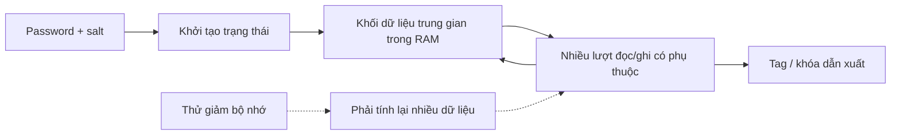
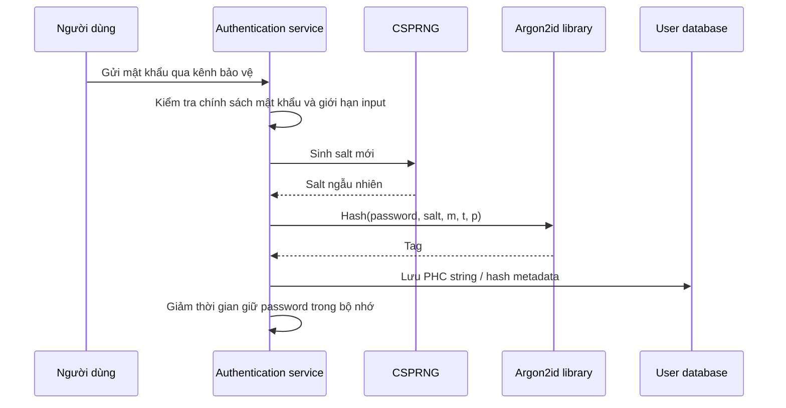
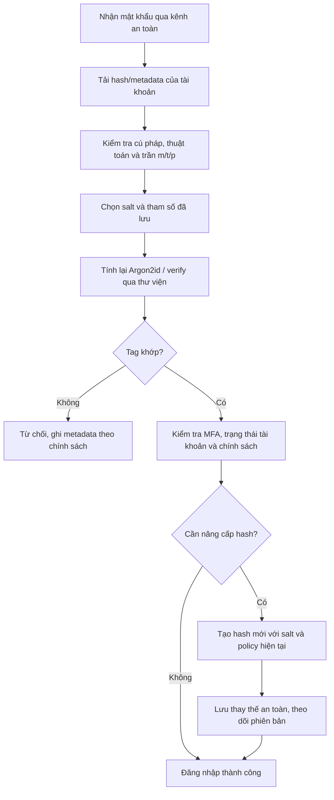
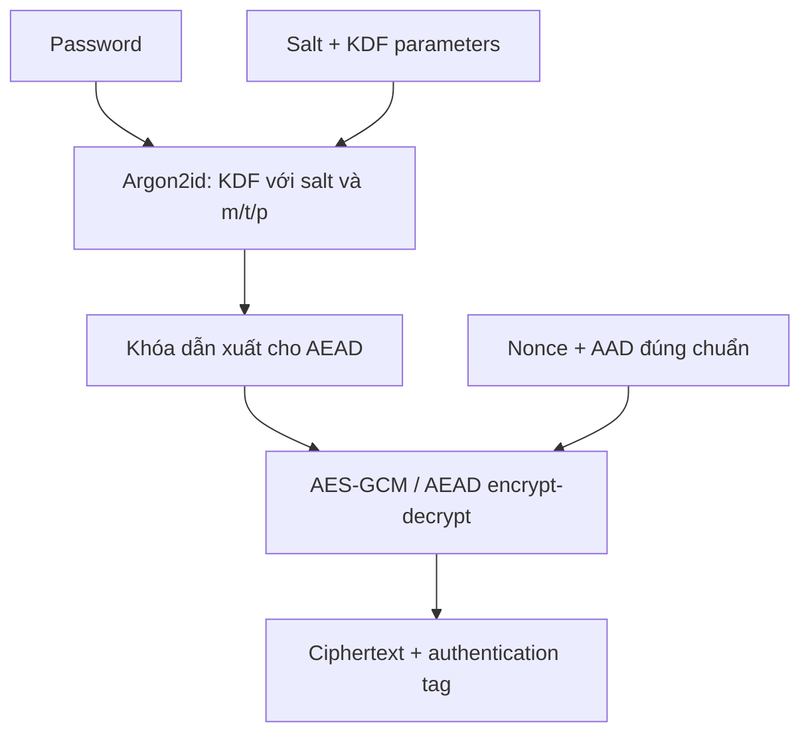

# Memory hardness

## 1. Memory hardness là gì?

**Memory hardness (tính đòi hỏi bộ nhớ)** là thuộc tính của một phép tính mật mã khiến việc thực hiện phép tính đó đòi hỏi một lượng **bộ nhớ đáng kể**, đồng thời việc giảm bớt bộ nhớ sử dụng sẽ làm tăng chi phí tính toán hoặc thời gian ở mức khó tránh khỏi theo thiết kế. Trong bảo vệ mật khẩu, đây là thuộc tính quan trọng của **password-based key derivation function (password KDF)** và **password hashing function** hiện đại.

Khi lưu mật khẩu, hệ thống thường **không lưu plaintext password**. Thay vào đó, hệ thống tạo một giá trị kiểm tra từ mật khẩu, salt và các tham số của hàm dẫn xuất; khi đăng nhập, hệ thống tính lại và so sánh. Nếu cơ sở dữ liệu bị đánh cắp, kẻ tấn công có thể thử nhiều mật khẩu đoán được trên máy của mình, **không cần gửi request đăng nhập**. Một KDF đòi hỏi nhiều bộ nhớ cho *mỗi lần đoán* khiến việc kiểm tra hàng triệu hoặc hàng tỷ ứng viên trên GPU/ASIC trở nên tốn tài nguyên hơn.

Trong chương **KDF và mật khẩu** của module `SECURITY_KEY_MANAGEMENT_FUNDAMENTALS`, memory hardness nối liền ba vấn đề:

- **Mật mã:** chọn Argon2id/scrypt hoặc phương án phù hợp để bảo vệ bí mật có entropy thấp như mật khẩu.
- **Vận hành:** hiệu chỉnh chi phí CPU, bộ nhớ, độ trễ, mức song song và giới hạn request.
- **Quản lý khóa:** phân biệt password hash với khóa đối xứng DEK/KEK, secret pepper, KMS/HSM, key rotation, quyền truy cập, kiểm toán và phương án khôi phục.

**Điểm cần nhớ:** memory-hard **không có nghĩa là “không thể bị brute force”** hay “cứ tăng RAM là an toàn”. Mật khẩu yếu vẫn có thể bị đoán, GPU vẫn có thể tấn công, và một cấu hình ngốn bộ nhớ quá mức có thể trở thành nguyên nhân gây **từ chối dịch vụ** cho chính hệ thống.

Sau bài học, bạn có thể:

1. Giải thích vì sao mật khẩu cần **hàm dẫn xuất chậm và tốn bộ nhớ** thay vì hash thông thường hoặc HKDF.
2. Phân biệt **memory cost**, **time cost**, **parallelism**, salt, pepper và độ dài output.
3. So sánh Argon2id, Argon2i, Argon2d, scrypt, PBKDF2 và HKDF theo mô hình đe dọa.
4. Tính gần đúng áp lực bộ nhớ theo **số phiên xác minh đồng thời** và thiết kế giới hạn tài nguyên.
5. Mô tả luồng lưu, xác minh, nâng cấp password hash với metadata/phiên bản an toàn.
6. Áp dụng memory-hard KDF khi cần dẫn xuất khóa mã hóa từ mật khẩu mà không nhầm với envelope encryption.
7. Hiểu ví dụ Java gọi **thư viện Argon2id bên ngoài JDK** và những kiểm soát còn thiếu trước production.

## 2. Vì sao password hashing cần memory hardness?

Mật khẩu do người dùng chọn thường có **entropy thấp** hơn rất nhiều so với khóa AES 256 bit được sinh từ CSPRNG. Dù cùng có độ dài biểu diễn 32 ký tự, một mật khẩu kiểu `MyCompany2026!MyCompany2026!` có thể thuộc từ điển đoán được, còn khóa 32 byte ngẫu nhiên có không gian tìm kiếm lớn hơn rất nhiều.

Nếu hệ thống lưu:

```text
password_hash = SHA-256(password)
```

thì kẻ tấn công đánh cắp bảng người dùng có thể tính SHA-256 cho rất nhiều ứng viên với tốc độ cao trên phần cứng chuyên dụng. SHA-256 được thiết kế để **tính nhanh** và tiêu thụ tương đối ít bộ nhớ; đó là ưu điểm đối với kiểm tra tính toàn vẹn, nhưng là bất lợi nếu dùng trực tiếp làm password hash.

Một KDF bảo vệ mật khẩu cố ý làm **mỗi lần thử tốn tài nguyên**:

\[
H = \operatorname{PasswordKDF}(P,\;S,\;\text{parameters})
\]

Trong đó `P` là mật khẩu, `S` là salt ngẫu nhiên của từng bản ghi, còn `parameters` gồm những chi phí tính toán/bộ nhớ. Máy chủ xác minh mật khẩu đúng cũng phải trả chi phí này, nhưng kẻ tấn công kiểm tra số lượng rất lớn ứng viên phải trả chi phí **lặp lại cho mỗi ứng viên**.

### 2.1. Hai mô hình tấn công khác nhau

| Mô hình | Kẻ tấn công làm gì? | Biện pháp then chốt |
| --- | --- | --- |
| **Online guessing** | Gửi nhiều yêu cầu đăng nhập đến hệ thống thật | Rate limiting, kiểm soát hành vi, MFA/passkeys, cảnh báo, xử lý khóa tài khoản có cân nhắc. |
| **Offline cracking** | Lấy được hash/salt/parameters rồi tự thử mật khẩu trên thiết bị của mình | Password KDF hiện đại, memory hardness, salt riêng, mật khẩu đủ mạnh, pepper khi phù hợp. |

Memory hardness chủ yếu tăng chi phí của **tấn công ngoại tuyến**; nó **không thay thế** rate limit và xác thực đa yếu tố cho kênh online.

Trong môi trường online, đặt memory cost rất cao mà không kiểm soát số request đồng thời có thể làm cạn RAM và khiến người dùng hợp lệ không đăng nhập được. Vì vậy, một hệ thống an toàn phải **cân bằng chi phí cho kẻ tấn công và khả năng phục vụ người dùng**.

### 2.2. Mối quan hệ giữa thời gian, dung lượng và băng thông bộ nhớ

Giả sử hai thuật toán cần cùng thời gian thực thi trên laptop của lập trình viên:

- Thuật toán A sử dụng rất ít RAM nhưng thực hiện nhiều phép băm nối tiếp.
- Thuật toán B cần liên tục đọc/ghi một vùng bộ nhớ lớn với các phụ thuộc dữ liệu.

Với A, phần cứng nhiều lõi có thể kiểm tra nhiều mật khẩu đồng thời mà không cần nhiều RAM cho mỗi phép thử. Với B, mỗi phép thử đồng thời còn cạnh tranh **dung lượng bộ nhớ** và **băng thông bộ nhớ**. GPU/ASIC vẫn có thể tăng tốc, nhưng quy mô song song và chi phí phần cứng bị ảnh hưởng bởi thiết kế memory-hard.

**Memory-hard không có nghĩa không thể dùng GPU.** Mục tiêu là tăng chi phí hoặc hạn chế lợi thế quy mô của phần cứng chuyên dụng, không bảo đảm rằng mọi GPU luôn chậm hơn CPU.

## 3. Tính chất memory-hard ở mức khái niệm

Một hàm có thể cấp phát nhiều bộ nhớ nhưng **chưa chắc có memory hardness tốt**. Ví dụ, nếu chương trình chỉ tạo một mảng rất lớn nhưng không thực sự cần đến phần lớn các phần tử để tính kết quả, kẻ tấn công có thể bỏ qua phần bộ nhớ thừa đó.

Memory-hard KDF cố gắng tạo một cấu trúc tính toán mà:

1. Các bước phụ thuộc vào dữ liệu trung gian được lưu trong bộ nhớ.
2. Bỏ bớt dữ liệu trung gian buộc người tính phải **tái tính** nhiều bước.
3. Tăng song song bằng phần cứng chuyên dụng phải trả thêm chi phí dung lượng và/hoặc băng thông.
4. Cấu trúc truy cập bộ nhớ và các giới hạn an toàn đã được phân tích trong thiết kế thuật toán.



Đây là **sơ đồ khái niệm**, không phải mô tả chi tiết của một cài đặt Argon2id. Các chứng minh và mức độ đánh đổi *time–memory trade-off* phụ thuộc thuật toán, phiên bản, cấu hình và mô hình tấn công.

### 3.1. Memory cost, time cost và parallelism

Ba tham số thường gặp trong **Argon2**:

| Ký hiệu | Tên | Ý nghĩa thực tế |
| --- | --- | --- |
| `m` | **Memory cost** | Dung lượng bộ nhớ thuật toán yêu cầu, thường biểu diễn bằng **KiB** trong giao diện Argon2/chuỗi PHC. |
| `t` | **Time cost** | Số lượt xử lý (*passes/iterations*) trên vùng nhớ theo định nghĩa Argon2; **không phải** số mili giây trực tiếp. |
| `p` | **Parallelism** | Mức song song/số *lanes* mà cấu hình cho phép, ảnh hưởng khả năng chạy nhiều luồng và sử dụng CPU. |
| `salt` | Salt | Giá trị riêng của từng lần tạo password hash; không cần bí mật. |
| `tag length` | Output length | Độ dài kết quả đầu ra, thường dùng tag đủ dài cho verifier. |

Một cấu hình `m=65536, t=3, p=1` trong cú pháp Argon2 tương ứng **64 MiB memory cost, 3 passes, 1 lane** (giả sử m tính bằng KiB). Nó không đồng nghĩa “tối đa 64 MiB RAM của cả tiến trình” vì runtime, thư viện và các request khác có chi phí bổ sung.

**Tăng `p` không có nghĩa tự động tăng độ mạnh hoặc mức bộ nhớ gấp `p` lần.** Trong Argon2, `m` mô tả bộ nhớ tổng thể theo định nghĩa tham số và được phân chia theo các lane; `p` điều chỉnh khả năng song song. Cần đo tải thực trên cùng thư viện/nền tảng.

### 3.2. Dung lượng bộ nhớ và băng thông là hai giới hạn khác nhau

Nếu một lần tính cần vùng nhớ lớn, số phép thử có thể cùng lúc nằm trong RAM/VRAM bị hạn chế bởi **dung lượng**. Nếu các phép tính liên tục đọc/ghi dữ liệu, hiệu năng còn chịu giới hạn của **băng thông** và cách truy cập bộ nhớ.

Một phép thử dùng nhiều RAM chưa chắc chậm tương ứng khi phần cứng còn băng thông; ngược lại, khi nhiều login cùng chạy, băng thông nhớ và CPU có thể trở thành điểm nghẽn trước khi hết dung lượng. Điều này cần được đo bằng benchmark theo tải thực, không suy ra chỉ từ số `m`.

## 4. So sánh các thuật toán và KDF liên quan

| Thuật toán / hàm | Có memory-hard đáng kể? | Mục đích điển hình | Chú ý |
| --- | --- | --- | --- |
| **Argon2id** | **Có** | Password hashing và dẫn xuất khóa từ password | Lựa chọn hiện đại phổ biến; cần cấu hình `m,t,p`, salt và giới hạn tài nguyên. |
| **Argon2i** | Có | Biến thể Argon2 có cách truy cập bộ nhớ ít phụ thuộc dữ liệu bí mật hơn | Cần xem mô hình side channel và bản thiết kế dùng nó. |
| **Argon2d** | Có | Biến thể có truy cập bộ nhớ phụ thuộc dữ liệu | Có cân nhắc side-channel; không chọn mặc định cho password hashing thông thường. |
| **scrypt** | **Có** | Password hashing / password-based KDF | Dùng tham số `N,r,p`; cấu hình và tài nguyên khác Argon2. |
| **PBKDF2-HMAC** | Không memory-hard theo nghĩa hiện đại | Password KDF dựa trên nhiều vòng HMAC; có thể cần vì tương thích/chính sách | Chủ yếu tăng **chi phí tính toán**; không được gọi là memory-hard tương đương Argon2id. |
| **bcrypt** | Không có đặc tính memory hardness mạnh như Argon2id/scrypt | Password hashing cho hệ thống hiện hữu | Cần chú ý giới hạn xử lý độ dài mật khẩu của nhiều triển khai và chính sách nâng cấp. |
| **HKDF** | **Không** | Dẫn xuất nhiều khóa từ vật liệu đầu vào đã có entropy thích hợp | **Không dùng trực tiếp để chống đoán password yếu**. |
| **SHA-256 trực tiếp** | Không | Hash dữ liệu, thành phần trong giao thức | **Không dùng riêng** để lưu mật khẩu. |

**Argon2id** kết hợp các đặc điểm của Argon2i và Argon2d theo thiết kế để cân bằng giữa chống tấn công phần cứng và rủi ro side-channel. Với ứng dụng password hashing mới, Argon2id thường là lựa chọn được ưu tiên khi thư viện, nền tảng và yêu cầu tuân thủ hỗ trợ. Nếu môi trường bắt buộc dùng một phương án khác, cần tham chiếu tiêu chuẩn áp dụng và bù đắp phù hợp.

### 4.1. Vì sao HKDF không thay thế password hashing?

**HKDF** được dùng để tách và mở rộng một bí mật đầu vào có entropy phù hợp thành các khóa cho những mục đích khác nhau. HKDF rất hữu ích với secret mật mã, ví dụ vật liệu từ key agreement hoặc một master key có entropy cao.

Mật khẩu người dùng thường **không** đáp ứng giả định entropy này. Nếu chỉ dùng `HKDF(password)` rồi lưu kết quả, kẻ tấn công có thể thử lượng lớn mật khẩu ứng viên tương đối rẻ. Một thiết kế đúng cần **password KDF có chi phí**, rồi nếu cần có thể dẫn xuất thêm khóa theo miền mục đích bằng cơ chế đã được đánh giá.

### 4.2. Argon2id và scrypt không dùng cùng bộ tham số

Ví dụ:

```text
Argon2id: memoryKiB=m, iterations=t, parallelism=p
scrypt:   CPU/memory parameter N, blockSize r, parallelization p
PBKDF2:   iteration count + PRF/hash, không có memory cost tương đương
```

Không thể lấy trực tiếp `m=65536` của Argon2id rồi gán vào `N` của scrypt để khẳng định tương đương về bộ nhớ hoặc mức an toàn. Mỗi thuật toán có cách định nghĩa tham số, giới hạn và phương pháp hiệu chỉnh khác nhau.

## 5. Argon2id: memory hardness trong thiết kế password hash

Argon2 được chuẩn hóa trong **RFC 9106**. Argon2id thường được dùng theo cấu trúc:

\[
\text{tag} = \operatorname{Argon2id}(password,\ salt,\ m,\ t,\ p,\ \text{tagLen})
\]

Ở mức khái niệm, Argon2id tạo các khối dữ liệu trung gian trong một vùng nhớ, rồi xử lý qua nhiều lượt theo cơ chế được quy định. Các biến thể khác nhau ở cách lựa chọn/đọc dữ liệu trung gian nhằm xử lý trade-off giữa khả năng chống tấn công và side-channel.

Không cần tự hiện thực cấu trúc khối/lane trong ứng dụng. Dùng **thư viện mật mã đã được đánh giá**, đúng phiên bản thuật toán và tuân thủ định dạng lưu trữ chính thức của thư viện.

### 5.1. Salt và memory hardness bổ sung cho nhau

**Salt** là giá trị ngẫu nhiên riêng cho từng lần tạo password hash. Salt có thể được lưu **cùng** hash.

Hai người dùng có cùng mật khẩu nhưng salt khác nhau sẽ có output khác nhau:

```text
userA:
  password = "weak-password"   salt = random-16-bytes-A
  hash = Argon2id(password, salt-A, parameters)

userB:
  password = "weak-password"   salt = random-16-bytes-B
  hash = Argon2id(password, salt-B, parameters)
```

Salt giúp ngăn việc **tái sử dụng trực tiếp** các bảng hash tính trước dùng chung và làm tấn công trên nhiều bản ghi kém thuận lợi hơn. Salt **không làm mật khẩu yếu trở thành mật khẩu mạnh**, và cũng không thay thế chi phí memory-hard của mỗi phép thử.

Nên tạo salt bằng **CSPRNG**; giá trị 16 byte ngẫu nhiên là một lựa chọn minh họa phổ biến cho Argon2id. Không dùng user ID, email, timestamp hay chuỗi có thể dự đoán làm **salt ngẫu nhiên thay thế**. Nếu thư viện đã tự sinh salt đúng chuẩn, nên dùng cơ chế của thư viện để tránh lỗi tự triển khai.

### 5.2. Pepper khác salt như thế nào?

**Pepper** là bí mật bổ sung được quản lý **ngoài** cơ sở dữ liệu password hash (ví dụ trong secret manager hoặc KMS/HSM). Mục tiêu là tăng trở ngại nếu chỉ **database** bị đánh cắp, với điều kiện pepper chưa bị lộ cùng dữ liệu.

| Thuộc tính | Salt | Pepper |
| --- | --- | --- |
| Bí mật? | **Không cần** | **Có** |
| Phạm vi | Thường riêng cho từng password hash | Có thể dùng chung cho nhóm/ứng dụng hoặc phân vùng theo chính sách |
| Lưu ở đâu? | Trong bản ghi hash/PHC string | Ngoài DB hash, có bảo vệ quyền và audit |
| Rotation | Thường đổi khi tạo hash mới | Đòi hỏi kế hoạch thay thế/phục hồi, có thể phải rehash hoặc reset |
| Chống đoán mật khẩu ngoại tuyến | Ngăn tính trước dùng chung; không làm một lần thử tự đắt hơn | Có thể gây khó khăn khi DB lộ độc lập; không thay thế Argon2id |

Không được xem pepper như một “salt bí mật” có thể bỏ thẳng vào một trường salt chuẩn rồi mong tương thích hoặc an toàn. Nếu thêm pepper, dùng **sơ đồ đã được thẩm định và hỗ trợ**, ví dụ một bước keyed MAC được thiết kế đúng theo chuẩn nội bộ, quản lý các phiên bản pepper và đánh giá khi KMS/secret manager không sẵn có.

**Mất pepper** có thể khiến không xác minh được mật khẩu cũ nếu thiết kế phụ thuộc hoàn toàn vào nó. **Pepper bị lộ** có thể buộc thay thế và hỗ trợ đăng nhập chuyển tiếp hoặc yêu cầu đặt lại mật khẩu. Cả hai trường hợp cần runbook rõ ràng.

### 5.3. Độ dài output không thay thế chi phí m/t

Kết quả Argon2id có thể có nhiều độ dài theo API. Đầu ra dài hơn **không tự làm lần thử mật khẩu đắt hơn** nếu memory cost và time cost giữ nguyên. Với password verifier, output đủ dài và phù hợp với thư viện là điều cần thiết; các tham số `m,t,p` mới là thành phần chính quyết định tài nguyên cho mỗi lần tính.

## 6. Điều chỉnh m, t, p trong hệ thống thực

Không có một bộ thông số duy nhất phù hợp cho mọi hệ thống. Hệ thống đăng nhập phục vụ vài chục nhân viên, dịch vụ xác thực hàng triệu khách hàng và ứng dụng chạy ngoại tuyến trên điện thoại có **ngân sách RAM, CPU, đồng thời và độ trễ** rất khác nhau.

### 6.1. Một bộ tham số minh họa

Giả sử một môi trường thử nghiệm dùng:

```yaml
algorithm: argon2id
argon2_version: 19
memory_kib: 65536       # 64 MiB
iterations: 3
parallelism: 1
salt_bytes: 16
tag_bytes: 32
policy_id: password-kdf-policy-v1
```

Các con số trên **chỉ là ví dụ để đọc tham số và tính tài nguyên**, không phải khuyến nghị chung hay cấu hình đủ an toàn cho mọi ứng dụng. Khi triển khai, cần tham chiếu hướng dẫn bảo mật còn hiệu lực của tổ chức và các nguồn tiêu chuẩn như RFC 9106; sau đó **benchmark trên phần cứng thực**.

Một điểm rất dễ nhầm:

- `memory_kib: 65536` là **65.536 KiB**, tương đương **64 MiB**.
- `iterations: 3` là số pass theo Argon2, **không phải 3 milliseconds**.
- `parallelism: 1` là mức lane của một phép tính, **không phải số login đồng thời**.
- `tag_bytes: 32` là độ dài kết quả, **không phải số bytes bộ nhớ trung gian**.

### 6.2. Số request đồng thời có thể làm cạn RAM

Giả sử một lần kiểm tra password có **memory cost 64 MiB**. Nếu 20 lần xác minh chạy đồng thời, **chỉ riêng vùng nhớ thuật toán theo tham số** đã xấp xỉ:

\[
20 \times 64\ \text{MiB} = 1280\ \text{MiB} \approx 1.25\ \text{GiB}
\]

Bộ nhớ thực tế của tiến trình còn gồm heap, thread stacks, network buffers, framework, các cấu trúc trong thư viện, cache, log và nhiều request không liên quan.

| Số lần xác minh đồng thời | Vùng nhớ Argon2id gần đúng với 64 MiB/lần |
| ---: | ---: |
| 1 | 64 MiB |
| 5 | 320 MiB |
| 10 | 640 MiB |
| 20 | 1,25 GiB |
| 40 | 2,5 GiB |

Con số gần đúng **không phải** giới hạn RAM cứng, và hiệu quả phụ thuộc thư viện, tham số `p` cũng như cách xếp lịch. Nó đủ để chỉ ra một rủi ro vận hành: **giới hạn số phép password KDF đang chạy song song** là cần thiết, nhất là trên container có memory limit.

### 6.3. Phương pháp benchmark và chọn tham số

Một chu trình thực tế:

1. **Xác định mục tiêu:** sức mạnh chống offline cracking, độ trễ đăng nhập chấp nhận được, mức RAM có thể dành cho mỗi request và mô hình tải.
2. **Chọn thuật toán:** Argon2id nếu phù hợp chính sách và nền tảng; nêu rõ version và thư viện.
3. **Khởi đầu bằng thông số tham chiếu được phê duyệt:** không tự dùng giá trị mặc định cũ hoặc quá thấp vì tiện.
4. **Đo với dữ liệu thử:** warm-up phù hợp, lấy latency trung vị và p95/p99; theo dõi CPU, RSS/native memory và garbage collector trong môi trường Java.
5. **Đo tại tải đồng thời:** thử burst login, autoscaling, container memory limit, tình huống mật khẩu sai và request bị timeout.
6. **Điều chỉnh `m,t,p`:** ưu tiên ngân sách RAM hợp lý và mức chống tấn công theo hướng dẫn; đánh giá chi phí vận hành khi tăng số pass hoặc parallelism.
7. **Giới hạn hàng đợi và concurrency:** không để request chưa xác thực tạo vô hạn công việc tốn bộ nhớ.
8. **Gắn phiên bản policy:** lưu thông số trong hash; đặt tiêu chí nâng cấp, theo dõi sau deploy và kế hoạch rollback an toàn.
9. **Đánh giá định kỳ:** khi phần cứng, lưu lượng, threat model hoặc tiêu chuẩn thay đổi thì benchmark lại.

Đừng chỉ chạy một phép hash trên máy lập trình rồi áp tham số cho hệ thống production. Mức p95/p99 dưới tải cùng **dung lượng bộ nhớ dự phòng** mới phản ánh rủi ro vận hành.

### 6.4. Cách giảm nguy cơ denial of service

Memory-hard KDF chủ đích tốn bộ nhớ và CPU; một endpoint đăng nhập công khai có thể bị lợi dụng tạo rất nhiều công việc tốn kém.

Các biện pháp phối hợp:

- **Rate limit** theo nhiều chiều phù hợp (IP, account, device, tenant), tránh chỉ dựa vào một key có thể bị thay đổi.
- Dùng **semaphore/worker pool/hàng đợi có giới hạn** để chặn số phiên KDF đồng thời theo RAM thực tế.
- Đặt timeout và mức tối đa của payload, đồng thời duy trì trải nghiệm đăng nhập hợp lý.
- Nếu hash string được đọc từ dữ liệu không đáng tin cậy, phải **giới hạn `m,t,p` và độ dài trường trước khi cấp phát RAM**; không cho attacker đưa `m` vô hạn qua request.
- Thiết kế cách xử lý account không tồn tại để giảm rò rỉ thông tin tài khoản, nhưng cũng giới hạn chi phí tránh lỗ hổng DoS.
- Đo **native memory/RSS**, không chỉ Java heap; nhiều thư viện mật mã dùng bộ nhớ ngoài heap.
- Tách khả năng phục vụ, cảnh báo khi hàng đợi/độ trễ tăng và thực hiện load test có kiểm soát.

Việc giảm tham số quá mạnh để hết timeout có thể tạo ra lỗ hổng bảo mật lâu dài. Khi tài nguyên thiếu, cần đánh giá cấu hình, kiến trúc và ngân sách vận hành thay vì bí mật hạ chi phí password hash cho toàn bộ tài khoản.

## 7. Lưu và xác minh password hash bằng Argon2id

Một bản ghi password hash đầy đủ thường chứa **thuật toán, phiên bản, tham số, salt và output**, nhưng **không chứa plaintext password**.

Ví dụ định dạng **PHC string**:

```text
$argon2id$v=19$m=65536,t=3,p=1$<salt-base64>$<tag-base64>
```

Chuỗi trên **chỉ là mẫu cú pháp**, các phần trong dấu `<...>` là placeholder chứ không phải giá trị đã được tạo. Dấu `$`, cách mã hóa Base64 và tham số phụ thuộc contract PHC của thư viện hỗ trợ.

Ý nghĩa:

| Trường | Giải thích |
| --- | --- |
| `argon2id` | Thuật toán và biến thể |
| `v=19` | Phiên bản thuật toán Argon2 tương ứng với phiên bản 1.3 theo cách biểu diễn PHC |
| `m=65536` | Memory cost tính bằng **KiB** |
| `t=3` | Time cost / passes |
| `p=1` | Parallelism |
| Salt | Giá trị ngẫu nhiên riêng của bản ghi |
| Tag | Kết quả tính theo mật khẩu + salt + cấu hình |

**Có thể lưu salt và tham số công khai trong DB.** An toàn không dựa vào việc giấu `m,t,p` hay salt, mà dựa vào bí mật của mật khẩu, chất lượng thuật toán, chi phí mỗi lần thử và bảo vệ những bí mật bổ sung như pepper (nếu áp dụng).

### 7.1. Luồng tạo hash khi đăng ký hoặc đặt mật khẩu



Điểm cần lưu ý: **mỗi lần đổi hoặc đặt lại mật khẩu cần salt mới**. Nếu ứng dụng áp dụng pepper hoặc sơ đồ hậu xử lý bằng KMS/HSM, phải thực hiện theo policy đã phê duyệt và giữ dấu hiệu phiên bản cần thiết, không tự trộn secret vào định dạng một cách không tương thích.

### 7.2. Luồng xác minh khi đăng nhập



**Không làm:** giải mã password hash để lấy lại mật khẩu, vì password hashing không phải phép mã hóa đảo ngược; không chuyển `PHC string` thành khóa AES; không bỏ qua bước kiểm tra policy sau khi password khớp.

Đối với account không tồn tại, cần chính sách trả lỗi và giới hạn tải để hạn chế cả **user enumeration** lẫn DoS. Phản hồi bên ngoài nên chung chung nhưng nhật ký nội bộ phải ghi đủ để điều tra với dữ liệu tối thiểu.

### 7.3. Rehash khi nâng cấp tham số

Giả sử tài khoản được tạo với `m=32768,t=2` từ nhiều năm trước, trong khi policy hiện tại dùng mức đã đánh giá cao hơn. Khi người dùng đăng nhập **thành công**, hệ thống đang có mật khẩu trong thời gian ngắn và có thể tạo một hash mới với **salt mới** cùng tham số hiện hành.

Quy trình nên:

1. Xác minh hash cũ bằng đúng thuật toán/params được ghi trong bản ghi và **nằm trong giới hạn an toàn khi xử lý**.
2. Sau khi xác minh thành công và kiểm tra chính sách, tạo hash mới với policy hiện tại.
3. Lưu cập nhật bằng thao tác chống ghi đè khi có đăng nhập đồng thời (ví dụ so khớp hash/version cũ).
4. Không giữ plaintext password ngoài vòng đời request; xử lý lỗi migration mà vẫn bảo vệ khả năng đăng nhập.
5. Theo dõi tỷ lệ tài khoản còn hash đời cũ và có kế hoạch cho tài khoản lâu không đăng nhập.

**Không thể tự rehash toàn bộ DB bằng tham số mới nếu không có mật khẩu hoặc một bí mật tương đương.** Nếu muốn nâng cấp cho người không đăng nhập lâu, có thể cần đặt lại mật khẩu thông qua quy trình khôi phục tài khoản đã được bảo vệ.

## 8. Ví dụ Java: thực hiện password hashing có memory hardness

**Java SE/JDK không cung cấp sẵn một API Argon2id thống nhất tương tự `MessageDigest.getInstance("SHA-256")`.** Với Java, ứng dụng thường sử dụng thư viện Argon2id đã được đánh giá và cập nhật bảo mật, hoặc một dịch vụ có API phù hợp.

Ví dụ dưới đây minh họa **Bouncy Castle Lightweight API** qua hai lớp `Argon2Parameters` và `Argon2BytesGenerator`. Đây là API thư viện ngoài, **không có sẵn trong JDK**. Cần chọn phiên bản Bouncy Castle có hỗ trợ Argon2id, quản lý dependency, cập nhật bản vá và kiểm thử hành vi trên môi trường thực.

Mã minh họa sử dụng password **đã được chuyển thành UTF-8 bytes** ở lớp nhập liệu, tránh khẳng định có thể xóa hoàn toàn các bản sao `String`/runtime. Trong production, cần quy định chính sách Unicode/encoding và vòng đời dữ liệu nhạy cảm nhất quán.

```java
import java.security.MessageDigest;
import java.security.SecureRandom;
import java.util.Arrays;

import org.bouncycastle.crypto.generators.Argon2BytesGenerator;
import org.bouncycastle.crypto.params.Argon2Parameters;

public final class MemoryHardPasswordDemo {
    private static final SecureRandom RNG = new SecureRandom();

    // CHỈ MINH HỌA: benchmark trước khi áp dụng vào hệ thống thật.
    private static final int MEMORY_KIB = 64 * 1024;
    private static final int ITERATIONS = 3;
    private static final int PARALLELISM = 1;
    private static final int SALT_BYTES = 16;
    private static final int TAG_BYTES = 32;

    // Bản ghi nội bộ minh họa: production dùng encoder chuẩn như PHC.
    // Các byte[] trong record vẫn có thể bị sửa; cần defensive copies.
    record StoredHash(
        int memoryKiB,
        int iterations,
        int parallelism,
        byte[] salt,
        byte[] tag
    ) {}

    static byte[] derive(
        byte[] passwordUtf8,
        byte[] salt,
        int memoryKiB,
        int iterations,
        int parallelism
    ) {
        Argon2Parameters params = new Argon2Parameters.Builder(
                Argon2Parameters.ARGON2_id)
            .withVersion(Argon2Parameters.ARGON2_VERSION_13)
            .withSalt(salt)
            .withMemoryAsKB(memoryKiB)
            .withIterations(iterations)
            .withParallelism(parallelism)
            .build();

        Argon2BytesGenerator generator = new Argon2BytesGenerator();
        generator.init(params);

        byte[] output = new byte[TAG_BYTES];
        generator.generateBytes(passwordUtf8, output);
        return output;
    }

    static StoredHash hashNewPassword(byte[] passwordUtf8) {
        byte[] salt = new byte[SALT_BYTES];
        RNG.nextBytes(salt);

        byte[] tag = derive(
            passwordUtf8, salt, MEMORY_KIB, ITERATIONS, PARALLELISM
        );
        return new StoredHash(
            MEMORY_KIB, ITERATIONS, PARALLELISM,
            salt.clone(), tag
        );
    }

    static boolean verify(
        byte[] passwordUtf8,
        StoredHash stored
    ) {
        if (stored == null || stored.salt() == null
                || stored.tag() == null
                || stored.salt().length != SALT_BYTES
                || stored.tag().length != TAG_BYTES) {
            return false;
        }

        // Trần tài nguyên cho demo. Hệ thống thật cần parser và policy.
        if (stored.memoryKiB() != MEMORY_KIB
                || stored.iterations() != ITERATIONS
                || stored.parallelism() != PARALLELISM) {
            return false;
        }

        byte[] candidate = derive(
            passwordUtf8,
            stored.salt(),
            stored.memoryKiB(),
            stored.iterations(),
            stored.parallelism()
        );
        try {
            return MessageDigest.isEqual(candidate, stored.tag());
        } finally {
            Arrays.fill(candidate, (byte) 0);
        }
    }

    public static void main(String[] args) {
        byte[] password = "demo-password-only"
                .getBytes(java.nio.charset.StandardCharsets.UTF_8);
        byte[] wrong = "not-the-password"
                .getBytes(java.nio.charset.StandardCharsets.UTF_8);

        try {
            StoredHash stored = hashNewPassword(password);
            System.out.println("Correct: " + verify(password, stored));
            System.out.println("Wrong: " + verify(wrong, stored));
        } finally {
            Arrays.fill(password, (byte) 0);
            Arrays.fill(wrong, (byte) 0);
        }
    }
}
```

**Ý nghĩa của mã:**

- `Argon2Parameters.ARGON2_id` chọn Argon2id; `ARGON2_VERSION_13` là phiên bản thuật toán tương ứng trong API minh họa.
- `withMemoryAsKB`, `withIterations`, `withParallelism` cấu hình `m,t,p` theo đúng đơn vị thư viện.
- Mỗi password hash mới có **salt ngẫu nhiên** riêng.
- Mã **không lưu plaintext password** vào bản ghi; lưu tham số, salt và tag để xác minh.
- `MessageDigest.isEqual` so sánh hai tag nhị phân phù hợp; đây **không phải cam kết toàn bộ chức năng đăng nhập chạy constant-time**.
- Mã demo chỉ verify đúng **một policy cấu hình**, chưa triển khai migration các policy cũ. Để hỗ trợ hash lịch sử, cần cho phép những tổ hợp tham số **đã được phê duyệt** nhưng vẫn có trần chống DoS.

### 8.1. Những việc phải làm thêm trước production

- **Thư viện và định dạng:** dùng bản Argon2id hiện hành, theo dõi CVE, dùng PHC encoder/parser đã kiểm tra; không tự parse string bằng split thiếu kiểm tra.
- **Kiểm tra input:** giới hạn mật khẩu quá lớn, định dạng record, salt/tag length, `m,t,p` và số lần xác minh đồng thời.
- **Bảo vệ vòng đời mật khẩu:** giảm số bản sao dữ liệu, không log password; xóa mảng do ứng dụng sở hữu khi có thể nhưng **không hứa xóa sạch RAM của JVM/thư viện**.
- **Chính sách password:** kiểm tra mật khẩu bị rò rỉ/từ điển phổ biến, hỗ trợ passphrase, MFA hoặc passkeys khi phù hợp.
- **Nâng cấp hash:** hỗ trợ metadata policy/version, rehash khi đăng nhập và cơ chế reset cho tài khoản cũ.
- **Bảo vệ endpoint:** TLS, rate limiting, theo dõi đăng nhập bất thường, chống replay/session hijack và kiểm soát account recovery.
- **Pepper nếu dùng:** quản lý trong KMS/HSM/secret manager và có kế hoạch rotation, versioning, outage/compromise.
- **Thử tải:** đo độ trễ, RAM ngoài heap và hàng đợi trên container thật; đưa số liệu vào SLO và cảnh báo.

### 8.2. Memory-hard không tương đương “constant-time”

Hai khái niệm giải quyết **hai loại vấn đề**:

- **Memory hardness:** tăng tài nguyên cần cho mỗi lần kiểm tra ứng viên, đặc biệt trước tấn công offline quy mô lớn.
- **Constant-time/side-channel resistance:** giảm khả năng rò rỉ thông tin bí mật qua thời gian thực thi hoặc mẫu truy cập tài nguyên trong mô hình đe dọa tương ứng.

Argon2id được thiết kế với các cân nhắc về side-channel; điều đó không có nghĩa **mọi đường code của ứng dụng Java** (xử lý record, lookup, error, logging, thread scheduling) có thời gian cố định. Luôn xem mô hình tấn công và sử dụng thư viện phù hợp.

## 9. Dẫn xuất khóa mã hóa từ password: phải khác password verifier

Có hai nhu cầu dễ bị nhầm:

1. **Password verification:** lưu một giá trị để hệ thống **kiểm tra mật khẩu đúng/sai**, không cần khôi phục mật khẩu.
2. **Password-based encryption (PBE):** dẫn xuất **khóa mã hóa/khóa bao bọc** từ mật khẩu để bảo vệ dữ liệu cần **giải mã lại**.

Cả hai có thể sử dụng một password KDF memory-hard, nhưng **đầu ra, metadata, quyền và vòng đời** khác nhau.

### 9.1. Dẫn xuất khóa và mã hóa bằng AEAD

Một sơ đồ PBE đơn giản ở mức khái niệm:



Nếu dùng AES-256-GCM, đầu ra KDF phù hợp có thể là **32 byte** làm key material cho cơ chế đã thiết kế. Ngoài salt và tham số KDF, hệ thống phải lưu/tra cứu **nonce, authentication tag, thuật toán, format version và metadata ràng buộc ngữ cảnh** để giải mã chính xác.

Tuy nhiên, không nên tùy tiện dùng **chính một kết quả Argon2id** làm cả password verifier và AES key. Cần **tách mục đích** bằng bí mật độc lập hoặc quy trình dẫn xuất có domain separation được đánh giá, chẳng hạn dùng các salt/ngữ cảnh riêng theo thiết kế.

### 9.2. Kết hợp với envelope encryption

Trong hệ thống quản lý khóa tổng quát:

- **DEK**: khóa dữ liệu được sinh ngẫu nhiên để AES-GCM mã hóa dữ liệu.
- **KEK**: khóa bao bọc DEK, có thể do KMS/HSM quản lý.
- **Password-derived key**: khóa dẫn xuất bằng password KDF, có thể dùng làm lớp bao bọc dữ liệu/DEK trong một thiết kế PBE chuyên dụng.

Nếu dùng mật khẩu làm một yếu tố bảo vệ DEK:

```text
Password + salt + Argon2id  ->  password-derived wrapping key
Random DEK                  ->  encrypt data with AEAD
Password-derived key        ->  wrap/protect DEK using approved scheme
Stored: ciphertext, wrapped DEK, nonce(s), salt, KDF params, versions
```

**Đổi mật khẩu** không nhất thiết phải tái mã hóa toàn bộ dữ liệu nếu có thể **unwrap DEK bằng password-derived key cũ rồi rewrap bằng key dẫn xuất từ mật khẩu mới**, với cơ chế bao bọc có xác thực được phê duyệt. Nếu **DEK đã lộ**, rewrap không khôi phục tính bí mật của DEK; khi ấy cần thay DEK và cân nhắc tái mã hóa.

**Quên mật khẩu** có thể gây mất quyền giải mã vĩnh viễn nếu thiết kế không có phương án phục hồi bí mật. Không xem “reset mật khẩu trên cơ sở dữ liệu” là tương đương khôi phục DEK: reset một verifier hash có thể thực hiện mà **không biết password cũ**, nhưng giải mã dữ liệu PBE cũ có thể **không thể** nếu không có khóa/backup được thiết kế trước.

### 9.3. Mật khẩu không thay thế KMS/HSM cho khóa máy có entropy cao

Các khóa máy như KEK, DEK, key dùng chữ ký số cần được tạo và quản trị qua nguồn mật mã phù hợp. Nếu ứng dụng đã có CSPRNG và KMS/HSM, **không cần bắt người vận hành đặt mật khẩu rồi KDF để tạo AES key** chỉ vì muốn “khóa mạnh hơn”. Với secret có entropy cao, HKDF hoặc KDF được phê duyệt có thể thích hợp để dẫn xuất khóa; password KDF memory-hard chủ yếu giải quyết **nguồn bí mật entropy thấp**.

KMS/HSM có thể bảo vệ pepper hoặc thực thi phép toán bao bọc khóa, nhưng **không phải mọi KMS/HSM đều cung cấp Argon2id**. Nhiều hệ thống chạy password KDF trong dịch vụ xác thực được giới hạn tài nguyên, sau đó sử dụng KMS/HSM cho vật liệu bí mật/khóa có vai trò khác.

## 10. Quản lý vòng đời, rotation và kiểm toán

Memory hardness là thuộc tính của thuật toán và cấu hình; để an toàn thực tế còn cần quản lý **mật khẩu, salt, pepper, policy version và khóa mã hóa liên quan**.

| Giai đoạn quản lý | Password hash / password KDF | Pepper / khóa liên quan |
| --- | --- | --- |
| **Tạo** | CSPRNG tạo salt, chọn Argon2id và m/t/p theo policy | Tạo secret pepper/KEK bằng cơ chế an toàn nếu thiết kế cần. |
| **Đăng ký** | Lưu PHC string hoặc metadata/alg/version/salt/tag | Lưu secret trong KMS/HSM/secret manager, tách quyền. |
| **Cấp quyền** | Chỉ dịch vụ xác thực có quyền kiểm tra/cập nhật hash | Chỉ danh tính được phép mới truy cập pepper hoặc gọi API. |
| **Sử dụng** | Verify qua thư viện, giới hạn concurrency, rate limit | Audit quyền sử dụng và thao tác nhạy cảm. |
| **Nâng cấp** | Rehash khi login hoặc yêu cầu reset theo migration policy | Pepper có thể cần cơ chế đa phiên bản/luồng chuyển tiếp được duyệt. |
| **Ứng cứu** | Khi DB hash lộ: đánh giá phạm vi offline cracking, tăng bảo vệ tài khoản, reset khi cần | Khi pepper/KEK lộ: xử lý thêm phạm vi bí mật và dữ liệu liên quan. |
| **Lưu giữ/hủy** | Xóa hash theo vòng đời tài khoản và quy định dữ liệu | Hủy secret khi không còn verifier/dữ liệu phụ thuộc, kiểm tra khôi phục. |

### 10.1. “Rotation” của password hash khác rotation của KEK

Với một **KEK** trong KMS, tổ chức có thể chủ động tạo vật liệu khóa mới, chuyển encrypt/wrap mới và rewrap DEK theo kế hoạch.

Với **password hash**, hệ thống **không biết plaintext password**; do đó không thể chỉ tăng `t` và “xoay” toàn bộ bản ghi sang thuật toán mới một cách tương đương mà không có input cần thiết. Cơ chế chuẩn là **rehash khi người dùng xác thực thành công** hoặc **quy trình đặt lại mật khẩu** có bảo vệ.

Một vài thiết kế có lớp pepper/HMAC hậu xử lý, cho phép thay **một lớp bọc có khóa** mà không biết password, nhưng việc đó **không đồng nghĩa** đã tăng memory cost của password KDF hay chuyển sang Argon2id. Phải phân biệt rõ trường nào đã nâng cấp.

### 10.2. Xử lý sự cố lộ database password hash

Nếu kẻ tấn công có danh sách hash/salt/tham số:

1. Đánh giá thuật toán/params hiện dùng, số lượng tài khoản và dữ liệu khác bị lộ.
2. Phân loại những tài khoản dùng hash cũ/yếu hoặc nghi đã bị đoán; xác định chính sách reset/khóa phiên.
3. Tăng biện pháp bảo vệ online: giám sát credential stuffing, MFA/passkeys, xác thực bất thường.
4. Nâng cấp policy KDF và chuyển đổi khi xác thực thành công; có kế hoạch xử lý tài khoản không hoạt động.
5. Nếu có pepper, xác minh nó có bị lộ cùng database không; xử lý và rotation theo runbook.
6. Thông báo sự cố theo nghĩa vụ và chính sách; bảo toàn log, bằng chứng điều tra.
7. Kiểm tra app, backup, CI và IAM để tìm nguyên nhân truy cập DB trái phép.

Chỉ đổi từ `Argon2id m=32768` sang `m=65536` trong cấu hình **không làm hash đã bị sao chép trước đó mạnh hơn**. Kẻ tấn công tiếp tục cracking bản hash cũ ngoại tuyến; các biện pháp quản lý tài khoản và chuyển đổi phải đánh giá rủi ro đã xảy ra.

### 10.3. Kiểm toán và quyền truy cập

Log/metrics có thể ghi:

- Thuật toán và **policy version** được dùng khi tạo/rehash hash.
- Tỷ lệ tài khoản còn dùng cấu hình cũ; trạng thái migration.
- Số thao tác verify, độ trễ p50/p95/p99, mức RAM, queue và số request bị từ chối do rate limit.
- Thay đổi quyền đọc bảng hash, thao tác export/backup, quyền truy cập pepper/KMS.
- Các sự kiện đăng nhập bất thường và kết quả điều tra theo account/issuer ở mức metadata phù hợp.

**Không log plaintext password, pepper, key material, dữ liệu KDF đầu vào hoặc trọn vẹn PHC string vào log không cần thiết.** Dù password hash không phải plaintext, việc phát tán hash qua telemetry vẫn làm tăng bề mặt tấn công ngoại tuyến.

## 11. Những sai lầm thường gặp

| Sai lầm | Vì sao nguy hiểm | Hướng xử lý |
| --- | --- | --- |
| Dùng SHA-256(password) làm password verifier | Tính toán nhanh, thuận lợi cho offline cracking | Dùng password hashing/KDF được phê duyệt như Argon2id. |
| Tăng số vòng PBKDF2 rồi gọi đó là memory-hard | PBKDF2 chủ yếu tăng CPU, không có yêu cầu RAM tương đương | Phân biệt giới hạn cơ chế, áp tiêu chuẩn tương thích khi cần. |
| Chỉ tăng RAM được cấp nhưng thuật toán không sử dụng nó | Không tăng chi phí thực của kẻ tấn công | Dùng thuật toán memory-hard được phân tích. |
| Cho mỗi request khởi chạy Argon2id không giới hạn | Cạn RAM/CPU, gây DoS | Giới hạn rate, concurrency, queue, input và trần params. |
| Hiểu `m=65536` là 65.536 bytes | Cấu hình sai bộ nhớ hơn hàng nghìn lần | Đọc đúng đơn vị **KiB** của API. |
| Nhân `p` vào m để tính lượng RAM mỗi hash một cách máy móc | Dự toán sai tài nguyên | Hiểu định nghĩa params và benchmark thư viện thực. |
| Dùng salt cố định/chung toàn hệ thống | Tăng khả năng tái sử dụng kết quả dò/tính trước | Sinh salt ngẫu nhiên riêng cho mỗi hash. |
| Coi salt là secret | Dựa vào giả định không cần thiết; giấu salt không sửa mật khẩu yếu | Lưu salt cùng hash, bảo vệ DB bằng quyền truy cập thích hợp. |
| Đặt pepper trong cùng DB với hash | Mất lợi ích phân tách khi DB bị lộ | Quản lý pepper riêng, có IAM/audit/rotation. |
| Dùng HKDF(password) thay password KDF | Không làm đoán password yếu đủ tốn kém | Dùng Argon2id/scrypt hoặc phương án phù hợp. |
| Tăng output tag từ 32 lên 64 bytes rồi coi là tăng memory hardness | Không tương đương tăng m/t | Tuning đúng tham số chi phí. |
| Tin tham số `m,t,p` tùy ý từ request/hash string | Kẻ tấn công yêu cầu cấp phát RAM quá mức | Validate bounds/allowlist policy trước khi verify. |
| Dùng một derived key cho xác minh password và AES | Trộn mục đích, tăng tác động khi bí mật bị lộ | Tách khóa/kết quả theo mục đích có domain separation. |
| Đổi mật khẩu mà không nghĩ đến DEK đã bọc bằng khóa cũ | Có thể mất khả năng giải mã dữ liệu | Thiết kế unwrap/rewrap/khôi phục trước khi thay. |
| Cho rằng nâng cấp config bảo vệ mọi hash cũ đã bị đánh cắp | Bản hash cũ vẫn có thể bị cracking ngoại tuyến | Rehash/reset và xử lý rủi ro sự cố theo phạm vi. |
| Coi memory-hard là miễn nhiễm GPU/ASIC | Chủ quan với mật khẩu yếu hoặc threat model | Kết hợp password policy, MFA, rate limit và giám sát. |

## 12. Case study: dịch vụ đăng nhập Java dưới tải cao

Giả sử dịch vụ `identity-prod` chạy trong container có 2 GiB RAM. Nhóm phát triển muốn dùng Argon2id với `m=65536 KiB`, `t=3`, `p=1`, salt riêng cho mỗi user. Mỗi yêu cầu verify cần vùng nhớ memory-hard theo tham số khoảng **64 MiB**, chưa kể phần khác.

Giờ cao điểm, hệ thống nhận nhiều request đăng nhập đồng thời. Nếu 30 phép Argon2id cùng chạy, vùng nhớ tính toán **danh nghĩa** đã gần:

\[
30 \times 64\ \text{MiB} = 1920\ \text{MiB}
\]

Con số này gần 2 GiB, chưa tính JVM heap/native overhead, nên có nguy cơ gây OOM hoặc bị container runtime kill. Hạ tham số một cách tùy tiện có thể giảm chi phí bảo vệ chống cracking; đội kỹ thuật cần giải quyết **cấu trúc tải**.

### 12.1. Phương án xử lý

1. **Giới hạn đồng thời:** chỉ cho một số phiên Argon2id chạy đồng thời dựa trên ngân sách RAM đã đo, phần còn lại xếp hàng có giới hạn hoặc từ chối có kiểm soát.
2. **Giới hạn yêu cầu:** rate limit và chống bot/credential stuffing theo nhiều tín hiệu; không để kẻ tấn công kích hoạt khối lượng xử lý đắt không giới hạn.
3. **Tách tài nguyên:** kiểm tra khả năng tách identity workers và cấu hình số instance theo tải thực.
4. **Benchmark production-like:** theo dõi RSS/native RAM, CPU, p95/p99 latency, hàng đợi và tỷ lệ timeout.
5. **Quản lý cấu hình:** gắn `password-kdf-policy-v2` với thông số được phê duyệt; không sửa lén metadata của hash đã lưu.
6. **Nâng cấp từ từ:** người đăng nhập với hash cũ được verify an toàn rồi rehash theo policy mới; lưu state đúng khi có race condition.
7. **Kiểm thử sự cố:** thử burst login, giả lập DB bị lộ, pepper/KMS outage (nếu dùng), và khả năng khôi phục từ backup.

### 12.2. Bài học từ tình huống

Hệ thống thành công khi **đạt đủ mức chống offline cracking theo tiêu chuẩn được duyệt** và **vẫn đáp ứng độ trễ/khả năng phục vụ thực tế**. Một cấu hình memory-hard có ý nghĩa trong thiết kế mật mã nhưng làm dịch vụ thường xuyên OOM chưa phải thiết kế bảo mật tốt.

## 13. Ma trận kiểm thử cần có

| Nhóm kiểm thử | Tình huống | Kết quả kỳ vọng |
| --- | --- | --- |
| **Đúng mật khẩu** | Password khớp salt/params/tag của bản ghi | Verify thành công. |
| **Sai mật khẩu** | Input khác một ký tự | Verify thất bại. |
| **Salt riêng** | Hai tài khoản có cùng password nhưng salt khác | Hash/tag khác trong thực tế với xác suất rất cao. |
| **Tham số sai** | Bản ghi khai báo version/alg không hỗ trợ | Từ chối an toàn, không fallback sang hash yếu. |
| **Param bounds** | Hash metadata chứa `m` quá lớn hoặc `t` không hợp lệ | Chặn trước khi cấp phát bộ nhớ. |
| **Format** | PHC string sai cấu trúc, salt/tag hỏng | Từ chối an toàn và ghi metadata lỗi. |
| **Concurrency** | Nhiều request đồng thời trên container giới hạn RAM | Không OOM; queue/rate limit hoạt động. |
| **P95/P99** | Load test lượng đăng nhập dự kiến | Đáp ứng SLO được phê duyệt. |
| **Version migration** | Tài khoản có hash policy cũ, password đúng | Verify theo params cũ hợp lệ rồi rehash với policy hiện tại. |
| **Concurrent rehash** | Hai login cùng nâng cấp hash | Không làm mất update; sử dụng kiểm soát ghi đè. |
| **Pepper rotation** | Hash sử dụng pepper version cũ | Quy trình chuyển tiếp/khôi phục được kiểm thử, không fail-open. |
| **No secret logs** | Verify fail, exception hoặc tracing enabled | Không lộ password, pepper hoặc đầu vào bí mật. |
| **Unicode** | Mật khẩu có dấu tiếng Việt, emoji, tổ hợp Unicode | Quy tắc encoding/normalization nhất quán và được kiểm thử. |
| **Account recovery** | Người dùng quên password, dữ liệu được bảo vệ bằng password-derived key | Không giả định reset hash tự giải mã được DEK cũ. |
| **Offline breach** | DB hash bị sao chép | Có đánh giá rủi ro, thông báo và luồng reset/rehash phù hợp. |

## 14. Checklist trước khi triển khai memory-hard KDF

Hãy xác minh các câu hỏi:

- **Threat model:** hệ thống đang bảo vệ password verifier trước tấn công offline hay dẫn xuất key để mã hóa dữ liệu? Có nguy cơ password yếu, credential stuffing và database breach không?
- **Algorithm:** Argon2id/scrypt hay một phương án bắt buộc khác đã được phê duyệt? Có dùng đúng phiên bản và thư viện không?
- **Parameters:** `m,t,p`/các tham số tương đương có được chọn từ tiêu chuẩn và benchmark thay vì copy tùy tiện không?
- **Salt:** có ngẫu nhiên bằng CSPRNG và riêng cho từng hash/record không?
- **Secret handling:** pepper (nếu có) lưu tách DB, có IAM/KMS, audit và kế hoạch khôi phục/rotation không?
- **Resource safety:** có tính RAM theo login đồng thời, giới hạn worker pool/queue, rate limit và trần tham số không?
- **Persistence:** có lưu thuật toán, version, salt, output và params theo format tương thích lâu dài không?
- **Migration:** có cách verify hash cũ rồi rehash có kiểm soát, đồng thời xử lý tài khoản không đăng nhập lâu không?
- **Separation:** password verifier, password-derived encryption key, KEK/DEK và khóa ký số có mục đích tách biệt không?
- **Recovery:** nếu password bị quên, pepper bị mất hoặc KMS không sẵn có, có kế hoạch phục hồi mà không làm mất dữ liệu bất ngờ không?
- **Monitoring:** có theo dõi latency, RSS/native memory, lỗi xác minh, queue, rate limit, tỷ lệ hash cũ và quyền DB/pepper không?
- **Testing:** đã thử sai password, salt khác, format sai, params độc hại, burst traffic, migration, Unicode và tình huống DB bị lộ chưa?

**Ghi nhớ:** **Memory hardness** buộc kẻ tấn công trả chi phí **bộ nhớ đáng kể cho từng lần đoán**, nhằm làm tấn công mật khẩu ngoại tuyến khó mở rộng hơn. Nó phải đi cùng **salt riêng, thuật toán và tham số phù hợp, quản lý tài nguyên, bảo vệ secret, xác thực nhiều lớp và khả năng nâng cấp theo vòng đời**. Trong hệ thống quản lý khóa, hãy phân biệt rõ password KDF với HKDF cho bí mật entropy cao, khóa DEK/KEK của envelope encryption và private key dùng chữ ký số; mỗi loại có yêu cầu sinh, lưu, sử dụng, xoay vòng, thu hồi và kiểm toán riêng.
