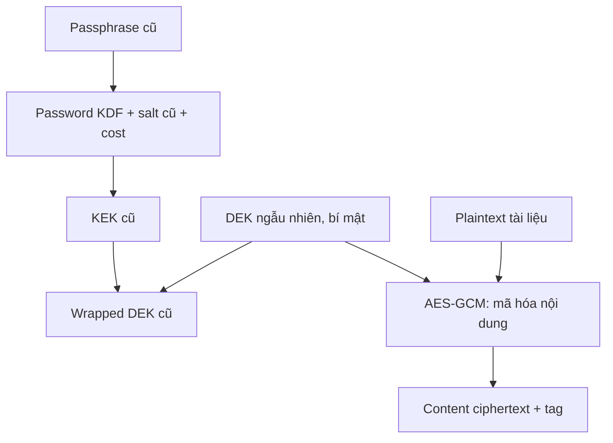
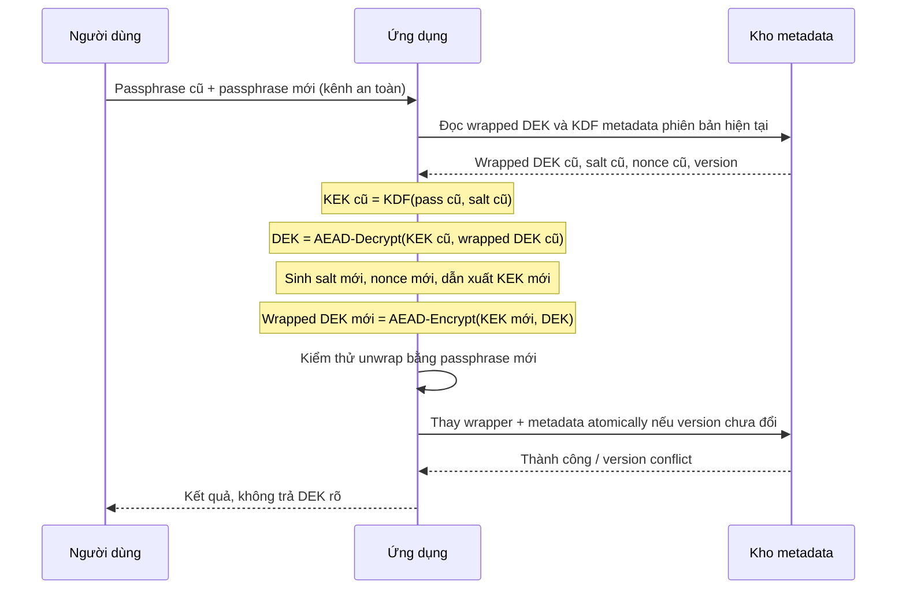
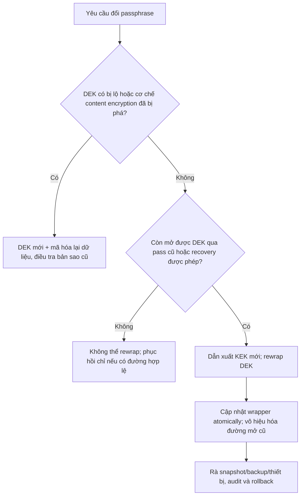
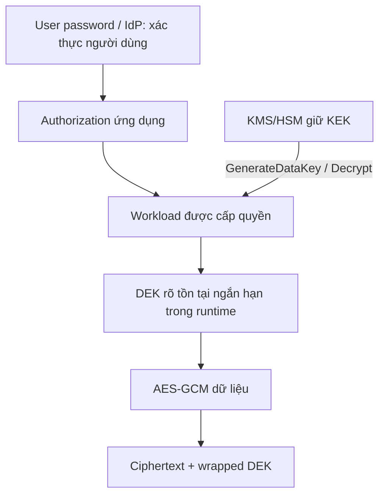
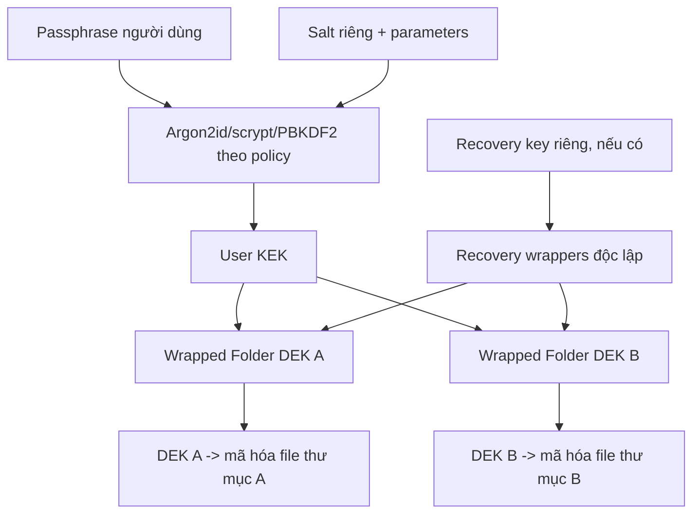

# Đổi passphrase không nhất thiết đổi DEK: Rewrap khóa thay vì mã hóa lại dữ liệu

> **Chương:** KDF và mật khẩu  
> **Bài học:** Đổi passphrase không nhất thiết đổi DEK  
> **Module:** `SECURITY_KEY_MANAGEMENT_FUNDAMENTALS` — quản lý khóa từ tạo, cấp phát, lưu trữ, sử dụng, xoay vòng, thu hồi đến hủy; liên kết mật mã đối xứng, bất đối xứng, KMS/HSM, envelope encryption, phân quyền và kiểm toán.

## 1. Bài toán: Người dùng đổi passphrase nhưng dữ liệu vẫn phải đọc được

Giả sử một ứng dụng lưu trữ tài liệu cho phép người dùng nhập **passphrase** để mở kho dữ liệu cá nhân. Trong kho có 100 GB tài liệu đã mã hóa. Người dùng muốn đổi từ passphrase cũ sang passphrase mới.

Một cách nghĩ trực giác nhưng tốn kém là:

1. Dùng passphrase cũ giải mã toàn bộ 100 GB.
2. Tạo khóa mới từ passphrase mới.
3. Mã hóa lại 100 GB bằng khóa mới.
4. Ghi đè toàn bộ file, đồng bộ bản sao và backup.

Cách này **không phải lúc nào cũng cần thiết**, vì hệ thống có thể đã thiết kế phân tách **khóa mã hóa dữ liệu (DEK)** và **khóa bảo vệ DEK (KEK)**.

Với kiến trúc đó:

- **DEK – Data Encryption Key** là khóa ngẫu nhiên mã hóa nội dung tài liệu bằng AES-GCM hoặc AEAD phù hợp.
- **KEK – Key Encryption Key** là khóa khác, ở đây được **dẫn xuất từ passphrase** bằng một password-based KDF với salt và tham số chi phí.
- DEK được mã hóa/wrap bằng KEK rồi lưu ở dạng **wrapped DEK**.
- Dữ liệu được mã hóa bằng DEK và lưu dưới dạng ciphertext riêng.

Khi người dùng đổi passphrase, ứng dụng có thể **mở DEK bằng KEK cũ và bọc lại chính DEK đó bằng KEK mới**. Ciphertext của tài liệu không cần thay đổi.

```text
Trước khi đổi:
  passphrase_cũ + salt_cũ
           |
        Password KDF
           |
         KEK_cũ ---- unwrap ----> DEK ---- AES-GCM ----> dữ liệu mã hóa
           ^
           |
      wrapped_DEK_cũ

Sau khi đổi:
  passphrase_mới + salt_mới
           |
        Password KDF
           |
         KEK_mới ---- wrap(DEK) ----> wrapped_DEK_mới

  DEK: giữ nguyên
  dữ liệu mã hóa bằng DEK: giữ nguyên
  chỉ bản wrapped DEK, salt, nonce và metadata bảo vệ thay đổi
```

**Luận điểm chính:** *Đổi passphrase không đồng nghĩa đổi DEK*. Ta có thể đổi **quyền mở khóa dữ liệu** mà không thay đổi **khóa đang trực tiếp bảo vệ nội dung**, nếu có cơ chế quản lý khóa nhiều tầng đúng cách.

Tuy nhiên, rewrap **không sửa được tình huống DEK đã bị lộ** và **không xóa được rủi ro từ các bản wrapped DEK cũ đã bị sao chép**. Điều kiện an toàn phải được đánh giá trước khi chọn giải pháp.

### Mục tiêu học tập

Sau bài này, bạn có thể:

1. Phân biệt passphrase, password-based KDF, salt, KEK, DEK, wrapped DEK và ciphertext.
2. Giải thích cơ chế **rewrap/re-encrypt key** so với **re-encrypt data**.
3. Xác định lúc nào đổi passphrase **chỉ cần rewrap** và lúc nào **phải tạo DEK mới, mã hóa lại dữ liệu**.
4. Thiết kế quy trình đổi passphrase an toàn khi người dùng còn khóa cũ hoặc sử dụng recovery mechanism.
5. Viết ví dụ Java 17 sử dụng PBKDF2-HMAC-SHA-256 và AES-GCM để minh họa thay passphrase mà ciphertext không đổi.
6. Nhận diện giới hạn chống đoán mật khẩu offline, rollback, backup/snapshot, dữ liệu nhiều thiết bị và quyền KMS/HSM.

---

## 2. Từ passphrase tới DEK: hiểu đúng các tầng

### 2.1. Những thành phần của hệ thống

| Thành phần | Định nghĩa | Có cần bí mật? | Khi đổi passphrase |
|---|---|---|---|
| **Passphrase** | Bí mật do người dùng biết/nhập để mở dữ liệu. | **Có.** | Thay giá trị cũ bằng mới. |
| **Salt** | Giá trị bổ trợ được tạo ngẫu nhiên/độc lập cho password-based KDF. | Thường không. | Nên tạo **salt mới** cho lần dẫn xuất mới. |
| **KDF parameters** | Thuật toán, số vòng lặp hoặc chi phí bộ nhớ/thời gian, độ dài đầu ra. | Không. | Có thể cập nhật theo chính sách và version. |
| **KEK** | Khóa dùng mã hóa/wrap DEK, được dẫn xuất từ passphrase trong ví dụ. | **Có.** | Được dẫn xuất lại từ passphrase mới và salt mới. |
| **DEK** | Khóa ngẫu nhiên dùng mã hóa dữ liệu ứng dụng. | **Có.** | **Có thể giữ nguyên** nếu chưa bị lộ và chính sách cho phép. |
| **Wrapped DEK** | DEK ở dạng được mã hóa/xác thực dưới KEK. | Không phải raw secret, nhưng phải bảo vệ toàn vẹn và metadata. | **Phải thay** bằng bản mới dưới KEK mới. |
| **Content ciphertext** | Tài liệu/bản ghi được mã hóa bằng DEK. | Thường không cần cất như plaintext, nhưng vẫn phải kiểm soát quyền và metadata. | Có thể **giữ nguyên từng byte**. |
| **Key ID/version** | Tham chiếu tới đúng cách diễn giải khóa và bản wrapped DEK. | Thường không. | Cần quản lý cập nhật nguyên tử và chống rollback. |

**Passphrase không nên được dùng trực tiếp làm byte AES key.** Con người chọn passphrase có entropy biến thiên và thường thấp hơn khóa ngẫu nhiên do CSPRNG sinh. Password-based KDF giúp tăng chi phí đoán passphrase, nhưng **không biến một passphrase yếu thành bí mật có entropy cao**.

### 2.2. Hai kiểu thiết kế khác nhau

**Kiểu A — dùng khóa dẫn xuất từ passphrase để mã hóa thẳng dữ liệu:**

```text
passphrase + salt -> password KDF -> K_direct
K_direct + plaintext + nonce -> AEAD ciphertext
```

Đổi passphrase làm thay đổi `K_direct`. Nếu muốn file tiếp tục được bảo vệ dưới khóa dẫn xuất mới, cần giải mã và mã hóa lại nội dung (hoặc thay đổi kiến trúc sang kiểu B).

**Kiểu B — envelope encryption, passphrase chỉ bảo vệ DEK:**

```text
passphrase + salt -> password KDF -> KEK
DEK ngẫu nhiên + KEK -> wrapped DEK

DEK + plaintext + nonce -> AEAD ciphertext
```

Đổi passphrase chỉ cần tạo `KEK_mới`, mở/bọc lại DEK và cập nhật `wrapped DEK`. **Dữ liệu vẫn được mã hóa dưới DEK cũ**, nên không cần mã hóa lại theo mặc định.

Kiểu B là nền tảng của nhiều mô hình quản lý khóa có nhiều cách mở khóa: passphrase, recovery key, thiết bị tin cậy hoặc KMS. Nhưng số lượng đường mở khóa cũng làm tăng bề mặt tấn công và cần được kiểm soát.

### 2.3. Vì sao dùng hai tầng khóa?

| Lợi ích | Giải thích | Giới hạn |
|---|---|---|
| **Đổi passphrase nhanh** | Rewrap một DEK nhỏ thay vì mã hóa lại nhiều GB dữ liệu. | Nếu có hàng triệu DEK thì vẫn phải xử lý từng bản cần rewrap. |
| **Tách vòng đời** | Passphrase/KEK thay đổi độc lập với DEK và payload. | Phải quản lý key version, metadata và backup. |
| **Nhiều cơ chế mở khóa** | Một DEK có thể có nhiều bản wrap bởi các KEK khác nhau. | Phải thu hồi/kiểm soát **mọi** đường mở khóa còn hiệu lực. |
| **Giới hạn vùng ảnh hưởng** | DEK riêng từng file/nhóm có thể giảm phạm vi rò rỉ. | Nếu một KEK mở được mọi DEK, quyền dùng KEK vẫn rất nhạy cảm. |
| **Tích hợp KMS/HSM** | KEK có thể là khóa KMS thay vì khóa sinh từ passphrase. | Mô hình tin cậy thay đổi; nhà cung cấp/workload có thể có quyền decrypt. |

## 3. Password-based KDF đóng vai trò gì?

### 3.1. Tại sao không dùng `SHA-256(passphrase)`?

```text
K = SHA256(UTF8(passphrase))    # Không nên dùng trực tiếp làm password KEK
```

SHA-256 được thiết kế để xử lý rất nhanh. Nếu kẻ tấn công có `wrapped DEK` và metadata xác thực, họ có thể thử rất nhiều passphrase offline. Dùng một hàm băm nhanh khiến việc đoán mật khẩu rẻ hơn nhiều.

**Password-based KDF** được thiết kế để tăng chi phí mỗi lần thử, dùng salt và tham số được cấu hình phù hợp. Những lựa chọn phổ biến tùy môi trường:

- **Argon2id:** KDF thiên về chi phí bộ nhớ, phù hợp nhiều thiết kế hiện đại khi có triển khai đáng tin cậy.
- **scrypt:** password-based KDF có yêu cầu bộ nhớ và CPU.
- **PBKDF2-HMAC-SHA-256:** thường được hỗ trợ rộng, kể cả Java JCA; cần tham số số vòng lặp đủ mạnh, hiệu chỉnh theo chính sách và môi trường.

Không có một con số vòng lặp/chi phí duy nhất đúng mãi: mức khuyến nghị thay đổi theo phần cứng, mô hình đe dọa và tiêu chuẩn. **Đo thời gian thực tế, đặt giới hạn DoS và có kế hoạch nâng tham số**.

### 3.2. Salt không phải secret

Ví dụ mỗi lần dẫn xuất KEK:

```text
KEK_cũ = PBKDF2(passphrase_cũ, salt_cũ, cost_cũ, 32 byte)
KEK_mới = PBKDF2(passphrase_mới, salt_mới, cost_mới, 32 byte)
```

Salt thường được lưu công khai cùng wrapped DEK. Nó giúp việc thử mật khẩu chống lại nhiều bản ghi không được tái sử dụng bảng tính sẵn và tránh các passphrase giống nhau luôn tạo cùng KEK khi tham số giống nhau.

**Không dùng lại salt cũ như một thói quen** khi đổi passphrase; sinh salt mới độc lập theo giao thức. Salt mới không phải là biện pháp đủ để đối phó passphrase yếu hoặc bản wrapped DEK cũ bị lộ.

### 3.3. Password hashing và password-derived KEK không giống nhau

Cả hai có thể sử dụng một password-based KDF nhưng mục đích lưu trữ rất khác:

| Nhu cầu | Đầu ra được lưu | Khi xác minh/đổi |
|---|---|---|
| **Xác thực đăng nhập** | Password verifier/hash một chiều, salt và tham số. | Đối chiếu mật khẩu nhập, có thể reset theo chính sách. |
| **Mở khóa dữ liệu bằng passphrase** | DEK đã wrap, salt và metadata của KEK. | Phải tạo đúng KEK để **unwrap DEK**, rồi dùng DEK giải mã dữ liệu. |

Một ứng dụng có thể cho người dùng **đổi mật khẩu đăng nhập** mà không cần thay DEK, nếu khóa dữ liệu được quản lý độc lập bằng KMS/workload identity. Nhưng trong thiết kế **zero-knowledge/end-to-end** nơi DEK chỉ được wrap bằng passphrase người dùng, việc quên passphrase cũ có thể khiến dữ liệu **không thể mở** nếu không có cơ chế recovery được tạo từ trước.

Phân biệt hai thao tác: `resetPasswordForLogin()` không nhất thiết có quyền hay vật liệu để gọi `rewrapDataKey()`.

### 3.4. HKDF không phải password KDF thay thế

**HKDF** phù hợp để dẫn xuất khóa từ vật liệu đầu vào có entropy thích hợp, ví dụ shared secret từ ECDH. HKDF được xây trên HMAC và có `salt`, `info`, nhưng **không được thiết kế để làm chi phí đoán mật khẩu chậm như Argon2id/scrypt/PBKDF2**.

Không chuyển sang `HKDF(passphrase, salt)` rồi cho rằng mức chống đoán offline giống password KDF chuyên dụng.

---

## 4. Mô hình chính xác: Đổi KEK, không đổi DEK

### 4.1. Trước khi thay passphrase



Các bản ghi phải chứa đủ metadata để ứng dụng biết dùng KDF nào, salt/nonce nào và khóa nào. **Raw DEK và raw KEK không được lưu cùng ciphertext trong cơ sở dữ liệu.**

### 4.2. Trong khi đổi passphrase



Trong suốt quy trình, **DEK dùng để mã hóa tài liệu có thể vẫn giữ nguyên**. Không cần truy xuất hoặc ghi lại hàng GB ciphertext chỉ để cập nhật passphrase.

### 4.3. Sau khi đổi

```text
KDF(passphrase_mới, salt_mới) = KEK_mới
AEAD-Decrypt(KEK_mới, wrapped_DEK_mới) = DEK_cũ

AES-GCM ciphertext(data, DEK_cũ) = vẫn như trước
```

Để tránh nhầm lẫn trong tài liệu thiết kế, nên dùng thuật ngữ:

- **Passphrase rotation:** thay bí mật người dùng dùng để mở khóa.
- **KEK rotation:** đổi khóa bọc DEK (ở đây là kết quả KDF từ passphrase).
- **DEK rewrap:** bọc lại **cùng DEK** dưới KEK khác.
- **DEK rotation + data re-encryption:** sinh DEK mới và mã hóa lại payload.

Câu “đã rotate key” không đủ rõ; phải chỉ ra **tầng khóa nào đã thay**, và dữ liệu nào còn phụ thuộc khóa cũ.

---

## 5. Khi nào chỉ cần rewrap, khi nào phải re-encrypt?

| Tình huống | Chỉ rewrap DEK có thể đủ? | Lý do và hành động |
|---|---|---|
| Người dùng đổi passphrase định kỳ; không có dấu hiệu lộ DEK/passphrase cũ. | **Thường có.** | Thay KEK/password wrapper, giữ DEK và dữ liệu mã hóa. |
| Chính sách yêu cầu tăng chi phí KDF. | **Thường có.** | Unwrap bằng thông số cũ; rewrap với salt/tham số mới, dữ liệu giữ nguyên. |
| Chuyển passphrase từ thiết bị A sang thiết bị B được ủy quyền. | **Có thể**, nếu rewrap an toàn và cùng quyền dữ liệu. | Tạo bản wrap riêng dưới KEK phù hợp cho thiết bị B. |
| Cần thay KMS KEK nhưng DEK vẫn an toàn. | **Có thể.** | Rewrap DEK dưới KEK mới, giữ dữ liệu mã hóa. |
| Passphrase cũ bị lộ **nhưng attacker chưa có old wrapped DEK và không còn bản sao cũ có thể truy cập**. | **Có thể giảm rủi ro tương lai**, với điều kiện kiểm chứng chặt. | Thu hồi đường mở cũ, rà cache, thiết bị và backup. Không vội khẳng định an toàn tuyệt đối. |
| Attacker đã có passphrase cũ **và snapshot chứa old wrapped DEK + ciphertext**. | **Không giải quyết được lộ dữ liệu quá khứ.** | Rewrap không làm snapshot cũ mất khả năng giải mã; cần phản ứng sự cố và bảo vệ dữ liệu tương lai. |
| **Raw DEK bị lộ**. | **Không.** | Phải sinh DEK mới và mã hóa lại dữ liệu thuộc phạm vi bị lộ nếu muốn bảo vệ các phiên bản tương lai. |
| AES-GCM đã bị tái sử dụng nonce với cùng DEK. | **Không đủ.** | Phải điều tra dữ liệu bị ảnh hưởng, tạo khóa/nonce mới và mã hóa lại theo kế hoạch. |
| Thuật toán mã hóa dữ liệu không còn đáp ứng chính sách. | **Không.** | Migration dữ liệu sang AEAD/khóa phù hợp; đổi wrapper đơn thuần không thay thuật toán nội dung. |
| Có hàng triệu DEK khác nhau dưới cùng một KEK. | **Cần rewrap từng DEK**, nếu không có tầng khóa trung gian. | Vẫn tránh mã hóa lại nội dung nhưng công việc không còn O(1). |
| Quên passphrase cũ, không có recovery key hoặc đường mở khóa khác. | **Không thực hiện được theo giả định mã hóa an toàn.** | Không thể lấy DEK từ wrapped DEK chỉ bằng passphrase mới. |

### 5.1. Ranh giới quan trọng khi passphrase cũ bị lộ

Giả sử attacker đã tải về:

```text
Backup ngày T0:
  encryptedData = AES-GCM(DEK-A, ...)
  wrappedDEK_T0 = AEAD-Encrypt(KEK_OLD, DEK-A, ...)
  salt_T0, nonce_T0, KDF params
```

Sau đó chủ tài khoản đổi passphrase và ứng dụng tạo `wrappedDEK_T1` dưới KEK mới. **Backup T0 mà attacker giữ không tự thay đổi.** Nếu họ biết hoặc đoán được passphrase cũ, họ có thể mở DEK-A từ snapshot T0 và giải mã dữ liệu T0.

Vì vậy:

- **Rewrap không thể thu hồi bản sao dữ liệu đã được lấy đi**, không thể làm attacker “quên” DEK đã biết.
- Sinh DEK mới và mã hóa lại dữ liệu có thể bảo vệ **bản dữ liệu mới trong hệ thống**, nhưng không thể biến snapshot T0 đã lộ thành bí mật.
- Việc thu hồi nên bao gồm các kênh truy cập, cache, backup có thể kiểm soát, thiết bị ngoại tuyến, phiên đăng nhập và hoạt động của attacker.
- Không cam kết “đổi mật khẩu là dữ liệu cũ đã an toàn” khi không xác định được phạm vi ảnh hưởng.

### 5.2. Quy tắc quyết định ngắn



---

## 6. Điều kiện bắt buộc để rewrap an toàn

### 6.1. Có khả năng mở DEK bằng một đường tin cậy

Hệ thống cần một trong các nguồn hợp lệ:

1. Người dùng cung cấp **passphrase cũ** để dẫn xuất KEK cũ.
2. Một **recovery key** độc lập đã được tạo và lưu an toàn trước đó có khả năng unwrap DEK.
3. Một **KMS/HSM KEK** hoặc khóa tổ chức được cấp quyền để mở DEK theo thiết kế.
4. Một thiết bị đang có DEK hợp lệ trong vùng bảo vệ và được policy cho phép di chuyển/wrap lại, với kiểm soát chống lạm dụng.

Nếu chỉ còn wrapped DEK và passphrase cũ đã mất, mật mã được thiết kế đúng **không có nút “reset passphrase” thần kỳ**. Việc cho quản trị viên lấy lại DEK mà không cần bí mật người dùng là **một quyết định kiến trúc recovery**, làm thay đổi giả định zero-knowledge và quyền riêng tư.

### 6.2. Xác minh passphrase cũ trước khi commit

Có thể xác minh đúng passphrase cũ bằng cách **giải mã có xác thực** wrapped DEK dưới KEK cũ, chẳng hạn AES-GCM có tag. Passphrase sai, metadata sai hoặc bản ghi bị thay đổi phải dẫn tới lỗi xác thực.

Tuy nhiên, tag hợp lệ không tự chứng minh ứng dụng đã lấy đúng tenant/DEK: cần xác định `ownerId`, `objectId`, `keyVersion` và AAD từ **ngữ cảnh đã được xác thực**.

Không sử dụng một thông báo lỗi riêng kiểu “sai byte thứ N của passphrase”; trả lỗi chung phù hợp và bảo vệ endpoint khỏi brute force. Nếu attacker có bản wrapped DEK thì họ có thể thử offline; **rate limit API không chặn được việc thử offline**.

### 6.3. KDF parameters là metadata được kiểm soát

Một bản `wrapped DEK` nên có:

```text
wrapperFormatVersion
ownerId/keyId
passwordKdf = Argon2id hoặc PBKDF2WithHmacSHA256
salt
cost/iterations/memory/parallelism
wrapAlgorithm = AES-GCM hoặc cơ chế wrap được chuẩn hóa
wrapNonce
wrappedDekAndTag
wrapperVersion
```

Phải có **allowlist thuật toán**, giới hạn tham số và chính sách migration. Không để dữ liệu không tin cậy yêu cầu `iterations=1` hoặc giá trị chi phí vô hạn gây DoS. Các trường metadata liên quan đến quyền, mục đích và phiên bản nên được **ràng buộc bằng AAD** hoặc bảo vệ tính toàn vẹn tương đương.

### 6.4. Rewrap không được làm mất bản DEK duy nhất

Nếu hệ thống ghi đè wrapped DEK cũ **trước khi** chắc chắn bản mới mở được, một lỗi ghi đĩa, mất mạng, crash hoặc KDF mismatch có thể khiến dữ liệu không thể mở.

Quy trình nên:

1. Đọc version hiện tại và xác minh passphrase cũ.
2. Tạo KEK mới và wrapped DEK mới ở vùng tạm.
3. **Tự kiểm tra** unwrap bản mới thu được DEK mong đợi.
4. Ghi **nguyên tử** `(wrapper, metadata, version)` theo điều kiện `expectedVersion`.
5. Xác nhận commit rồi mới loại đường mở cũ theo policy.
6. Dọn bản tạm và bộ nhớ bí mật hợp lý.

Không có transaction nào bao phủ mọi hệ thống trong mọi kiến trúc. Với object storage hoặc nhiều dịch vụ, cần mô hình commit/version, checksum và khả năng khôi phục được thiết kế rõ ràng.

### 6.5. Đừng nhầm nonce của wrap với nonce của data

Nếu cả hai lớp dùng AES-GCM:

- **Content nonce:** dùng với DEK để mã hóa nội dung.
- **Wrapper nonce:** dùng với KEK để mã hóa DEK.
- **KDF salt:** dùng để dẫn xuất KEK từ passphrase.

Ba giá trị này **có vai trò khác nhau**. KDF salt thường không bí mật; nonce AES-GCM phải **không được lặp với cùng khóa**. Thay salt/KEK trong rewrap không yêu cầu đổi content nonce vì không có lần content encryption mới.

Khi **mã hóa lại nội dung** dưới DEK mới, phải tạo nonce mới theo đúng chiến lược của khóa mới và định dạng AEAD.

## 7. Một ví dụ quy mô thực tế

Giả sử người dùng có:

- 1.000 file, mỗi file 10 MB.
- Mỗi file được mã hóa AES-GCM bằng một DEK riêng.
- Các DEK được wrap bởi một KEK dẫn xuất từ passphrase.

Tổng nội dung đã mã hóa xấp xỉ **10 GB**. Nếu đổi passphrase:

| Cách làm | Công việc chính | Tác động |
|---|---|---|
| **Re-encrypt data** | Đọc/giải mã/mã hóa/ghi lại khoảng 10 GB, cập nhật tag/nonce. | Nặng I/O, CPU; tốn băng thông đồng bộ. |
| **Rewrap DEKs** | Mở và bọc lại **1.000 DEK**, mỗi DEK thường 32 byte, cộng metadata. | Tránh xử lý lại nội dung; vẫn cần quản lý batch/transaction và kiểm tra đầy đủ. |
| **Thêm một tầng root key** | Một root/collection key bảo vệ DEK của các file; rewrap root/collection key. | Có thể giảm số bản wrap phải đổi, nhưng root key có phạm vi ảnh hưởng lớn hơn và đòi hỏi thiết kế tin cậy. |

**“Không cần mã hóa lại 10 GB” không đồng nghĩa “chỉ cần một thao tác”**. Số lần rewrap phụ thuộc số lượng DEK và thiết kế phân cấp khóa. Nếu tất cả DEK dùng một KEK bọc trực tiếp, việc đổi passphrase có thể phải duyệt từng wrapper.

Thiết kế key hierarchy phải cân bằng hiệu năng rotation, phân quyền từng đối tượng, khả năng recovery và tác động khi lộ khóa cấp cao.

---

## 8. Java 17: PBKDF2 + AES-GCM để đổi passphrase mà không đổi dữ liệu

Đoạn mã sau minh họa cách:

1. Sinh DEK AES-256 ngẫu nhiên.
2. Mã hóa nội dung bằng DEK và AES-GCM.
3. Dẫn xuất KEK từ passphrase cũ qua `PBKDF2WithHmacSHA256`.
4. Wrap DEK với KEK cũ bằng AES-GCM.
5. Đổi passphrase: unwrap DEK bằng KEK cũ, rewrap cùng DEK bằng KEK mới.
6. Kiểm tra **ciphertext nội dung không thay đổi** và vẫn giải mã được với DEK sau rewrap.

**Giới hạn:** Đây là minh họa Java 17 sử dụng JCA có sẵn, không thay thế việc lựa chọn Argon2id/scrypt/PBKDF2 theo chính sách và đánh giá thực tế. Số vòng lặp ví dụ là cấu hình demo cần hiệu chỉnh và version hóa; chưa có lưu trữ transaction, authentication, KMS/HSM hoặc bảo vệ chống snapshot rollback.

```java
import java.io.ByteArrayOutputStream;
import java.io.Console;
import java.io.DataOutputStream;
import java.io.IOException;
import java.nio.charset.StandardCharsets;
import java.security.GeneralSecurityException;
import java.security.MessageDigest;
import java.security.SecureRandom;
import java.util.Arrays;

import javax.crypto.Cipher;
import javax.crypto.SecretKeyFactory;
import javax.crypto.spec.GCMParameterSpec;
import javax.crypto.spec.PBEKeySpec;
import javax.crypto.spec.SecretKeySpec;

public final class ChangePassphraseWithoutChangingDek {
    private static final SecureRandom RNG = new SecureRandom();
    private static final int DEK_BYTES = 32;
    private static final int SALT_BYTES = 16;
    private static final int NONCE_BYTES = 12;
    private static final int TAG_BITS = 128;
    private static final int ITERATIONS = 600_000; // Demo; calibrate policy.
    private static final int FORMAT_VERSION = 1;

    public record DataRecord(
            String tenantId,
            String objectId,
            byte[] nonce,
            byte[] ciphertextAndTag) {
        public DataRecord {
            nonce = nonce.clone();
            ciphertextAndTag = ciphertextAndTag.clone();
        }
        @Override public byte[] nonce() { return nonce.clone(); }
        @Override public byte[] ciphertextAndTag() {
            return ciphertextAndTag.clone();
        }
    }

    public record WrappedDek(
            String ownerId,
            int version,
            int iterations,
            byte[] salt,
            byte[] nonce,
            byte[] ciphertextAndTag) {
        public WrappedDek {
            salt = salt.clone();
            nonce = nonce.clone();
            ciphertextAndTag = ciphertextAndTag.clone();
        }
        @Override public byte[] salt() { return salt.clone(); }
        @Override public byte[] nonce() { return nonce.clone(); }
        @Override public byte[] ciphertextAndTag() {
            return ciphertextAndTag.clone();
        }
    }

    private ChangePassphraseWithoutChangingDek() {}

    public static byte[] newDek() {
        byte[] dek = new byte[DEK_BYTES];
        RNG.nextBytes(dek);
        return dek;
    }

    // DEK này chỉ được dùng cho một DataRecord trong demo.
    public static DataRecord encryptData(
            byte[] dek, String tenantId, String objectId,
            byte[] plaintext) throws GeneralSecurityException, IOException {
        byte[] nonce = randomBytes(NONCE_BYTES);
        Cipher aes = Cipher.getInstance("AES/GCM/NoPadding");
        aes.init(Cipher.ENCRYPT_MODE,
                new SecretKeySpec(dek, "AES"),
                new GCMParameterSpec(TAG_BITS, nonce));
        aes.updateAAD(dataAad(tenantId, objectId));
        return new DataRecord(
                tenantId, objectId, nonce, aes.doFinal(plaintext));
    }

    public static byte[] decryptData(
            byte[] dek, DataRecord record,
            String expectedTenantId, String expectedObjectId)
            throws GeneralSecurityException, IOException {
        if (!expectedTenantId.equals(record.tenantId())
                || !expectedObjectId.equals(record.objectId())
                || record.nonce().length != NONCE_BYTES) {
            throw new GeneralSecurityException("Invalid data context");
        }
        Cipher aes = Cipher.getInstance("AES/GCM/NoPadding");
        aes.init(Cipher.DECRYPT_MODE,
                new SecretKeySpec(dek, "AES"),
                new GCMParameterSpec(TAG_BITS, record.nonce()));
        aes.updateAAD(dataAad(expectedTenantId, expectedObjectId));
        return aes.doFinal(record.ciphertextAndTag());
    }

    public static WrappedDek wrapDek(
            byte[] dek, char[] passphrase, String ownerId)
            throws GeneralSecurityException, IOException {
        if (dek.length != DEK_BYTES) {
            throw new GeneralSecurityException("Unexpected DEK length");
        }

        byte[] salt = randomBytes(SALT_BYTES);
        byte[] nonce = randomBytes(NONCE_BYTES);
        byte[] kek = deriveKek(passphrase, salt, ITERATIONS);
        try {
            Cipher aes = Cipher.getInstance("AES/GCM/NoPadding");
            aes.init(Cipher.ENCRYPT_MODE,
                    new SecretKeySpec(kek, "AES"),
                    new GCMParameterSpec(TAG_BITS, nonce));
            aes.updateAAD(wrapAad(ownerId));
            return new WrappedDek(
                    ownerId, FORMAT_VERSION, ITERATIONS, salt,
                    nonce, aes.doFinal(dek));
        } finally {
            Arrays.fill(kek, (byte) 0);
        }
    }

    public static byte[] unwrapDek(
            WrappedDek wrapper, char[] passphrase,
            String expectedOwnerId)
            throws GeneralSecurityException, IOException {
        if (!expectedOwnerId.equals(wrapper.ownerId())
                || wrapper.version() != FORMAT_VERSION
                || wrapper.iterations() != ITERATIONS
                || wrapper.salt().length != SALT_BYTES
                || wrapper.nonce().length != NONCE_BYTES
                || wrapper.ciphertextAndTag().length != DEK_BYTES + 16) {
            throw new GeneralSecurityException("Invalid wrapper metadata");
        }

        byte[] kek = deriveKek(
                passphrase, wrapper.salt(), wrapper.iterations());
        try {
            Cipher aes = Cipher.getInstance("AES/GCM/NoPadding");
            aes.init(Cipher.DECRYPT_MODE,
                    new SecretKeySpec(kek, "AES"),
                    new GCMParameterSpec(TAG_BITS, wrapper.nonce()));
            aes.updateAAD(wrapAad(expectedOwnerId));

            // Sai passphrase, tag hoặc metadata -> exception.
            return aes.doFinal(wrapper.ciphertextAndTag());
        } finally {
            Arrays.fill(kek, (byte) 0);
        }
    }

    public static WrappedDek changePassphrase(
            WrappedDek current, char[] oldPassphrase,
            char[] newPassphrase, String expectedOwnerId)
            throws GeneralSecurityException, IOException {
        byte[] dek = unwrapDek(
                current, oldPassphrase, expectedOwnerId);
        try {
            WrappedDek updated =
                    wrapDek(dek, newPassphrase, expectedOwnerId);

            // Kiểm tra bản wrap mới mở lại đúng DEK cũ.
            byte[] check = unwrapDek(
                    updated, newPassphrase, expectedOwnerId);
            try {
                if (!MessageDigest.isEqual(dek, check)) {
                    throw new GeneralSecurityException(
                            "New wrapper validation failed");
                }
            } finally {
                Arrays.fill(check, (byte) 0);
            }
            return updated;
        } finally {
            Arrays.fill(dek, (byte) 0);
        }
    }

    private static byte[] deriveKek(
            char[] passphrase, byte[] salt, int iterations)
            throws GeneralSecurityException {
        // Production: kiểm soát version/KDF parameters, cost và DoS.
        PBEKeySpec spec = new PBEKeySpec(
                passphrase, salt, iterations, DEK_BYTES * 8);
        try {
            SecretKeyFactory factory =
                    SecretKeyFactory.getInstance("PBKDF2WithHmacSHA256");
            return factory.generateSecret(spec).getEncoded();
        } finally {
            spec.clearPassword();
        }
    }

    private static byte[] randomBytes(int length) {
        byte[] result = new byte[length];
        RNG.nextBytes(result);
        return result;
    }

    private static byte[] dataAad(
            String tenantId, String objectId) throws IOException {
        ByteArrayOutputStream buffer = new ByteArrayOutputStream();
        DataOutputStream out = new DataOutputStream(buffer);
        out.writeInt(FORMAT_VERSION);
        write(out, "data/AES-256-GCM");
        write(out, tenantId);
        write(out, objectId);
        out.flush();
        return buffer.toByteArray();
    }

    private static byte[] wrapAad(String ownerId) throws IOException {
        ByteArrayOutputStream buffer = new ByteArrayOutputStream();
        DataOutputStream out = new DataOutputStream(buffer);
        out.writeInt(FORMAT_VERSION);
        write(out, "dek-wrap/AES-256-GCM/PBKDF2-SHA256");
        write(out, ownerId);
        out.writeInt(ITERATIONS);
        out.flush();
        return buffer.toByteArray();
    }

    private static void write(
            DataOutputStream out, String value) throws IOException {
        byte[] bytes = value.getBytes(StandardCharsets.UTF_8);
        out.writeInt(bytes.length);
        out.write(bytes);
    }

    public static void main(String[] args) throws Exception {
        Console console = System.console();
        if (console == null) {
            throw new IllegalStateException(
                    "Run in a terminal with System.console()");
        }

        char[] oldPass = console.readPassword("Passphrase cu: ");
        char[] newPass = console.readPassword("Passphrase moi: ");
        byte[] plaintext = "Tai lieu duoc bao ve"
                .getBytes(StandardCharsets.UTF_8);

        byte[] originalDek = newDek();
        try {
            DataRecord data = encryptData(
                    originalDek, "tenant-42", "document-1001", plaintext);
            byte[] originalCiphertext = data.ciphertextAndTag();

            WrappedDek oldWrapper =
                    wrapDek(originalDek, oldPass, "owner-42");

            // Main không cần raw DEK ban đầu nữa.
            Arrays.fill(originalDek, (byte) 0);

            WrappedDek newWrapper = changePassphrase(
                    oldWrapper, oldPass, newPass, "owner-42");

            byte[] recoveredDek =
                    unwrapDek(newWrapper, newPass, "owner-42");
            try {
                byte[] recovered = decryptData(
                        recoveredDek, data, "tenant-42", "document-1001");
                try {
                    System.out.println("Data unchanged: "
                            + MessageDigest.isEqual(
                                    originalCiphertext,
                                    data.ciphertextAndTag()));
                    System.out.println("Decryption successful: "
                            + MessageDigest.isEqual(
                                    plaintext, recovered));
                } finally {
                    Arrays.fill(recovered, (byte) 0);
                }
            } finally {
                Arrays.fill(recoveredDek, (byte) 0);
            }
        } finally {
            Arrays.fill(originalDek, (byte) 0);
            Arrays.fill(plaintext, (byte) 0);
            Arrays.fill(oldPass, '\0');
            Arrays.fill(newPass, '\0');
        }
    }
}
```

### 8.1. Code chứng minh điều gì?

Khi chạy trong terminal tương tác và nhập passphrase cũ/mới:

```text
Data unchanged: true
Decryption successful: true
```

- `DataRecord` được mã hóa một lần dưới DEK ban đầu.
- `WrappedDek` được thay bằng wrapper mới, gồm salt/nonce mới.
- `changePassphrase()` **không gọi `encryptData()`**, không thay content nonce/ciphertext.
- `unwrapDek(newWrapper, newPass, ...)` trả về cùng DEK và giải mã được record cũ.
- `MessageDigest.isEqual` ở phần kiểm tra minh họa dùng để đối chiếu byte, không có nghĩa đây là chứng cứ chống rollback.

**Đây là mô hình một DEK – một record.** Nếu một DEK mã hóa nhiều record phải có chiến lược nonce duy nhất dưới cùng DEK và giới hạn số lần sử dụng; nếu một tài khoản có nhiều DEK cần rewrap đúng toàn bộ các khóa liên quan.

### 8.2. Tại sao sử dụng PBKDF2 trong ví dụ?

`PBKDF2WithHmacSHA256` có trong API Java/JCA phổ biến nên thích hợp để minh họa ngay trên Java 17. Trong ứng dụng mới, nếu không có ràng buộc tương thích hoặc chứng nhận, nên **đánh giá Argon2id hoặc scrypt** và chọn tham số dựa trên chính sách an ninh được cập nhật.

`ITERATIONS = 600_000` chỉ là **giá trị ví dụ**, không phải mức được chứng nhận đúng cho mọi máy/ứng dụng vào mọi thời điểm. Password-based KDF tiêu tốn tài nguyên để tăng chi phí tấn công offline; ứng dụng cũng phải đặt giới hạn số lần thử, timeout và bảo vệ DoS.

### 8.3. Những gì ví dụ chưa giải quyết

- **Không có database transaction:** `newWrapper` chưa được ghi nguyên tử thay cho bản cũ. Production phải có compare-and-swap/version và recovery khi crash.
- **Không có multi-device sync:** chưa xử lý cache DEK, bản wrap cũ ở thiết bị khác hay backup.
- **Không có user authentication/authorization:** `ownerId` minh họa; trong thực tế phải suy ra từ session/workload đáng tin.
- **Không có recovery:** quên passphrase cũ sẽ không thể `changePassphrase()` trừ khi có đường mở DEK khác được thiết kế từ trước.
- **Không bảo đảm zeroization toàn bộ:** `Arrays.fill` chỉ xóa mảng đã biết; `SecretKeySpec`, `Cipher`, provider, heap/dump có thể giữ bản sao.
- **Không có Argon2id hoặc hệ quản lý KDF parameters nhiều version:** ví dụ pin một format để dễ đọc; production cần migration và giữ tương thích.
- **Không có IAM/KMS/HSM:** không xét quyền phân cấp của hệ thống quản lý khóa.
- **Không ngăn đoán passphrase offline:** attacker có wrapped DEK vẫn có thể thử candidate ngoài API, tốc độ bị hạn chế bởi KDF và sức mạnh passphrase.
- **Không cung cấp chống rollback:** attacker giữ old wrapper có thể cố khôi phục bản ghi cũ nếu hệ thống không bảo vệ version.

Trong thực tế không ghi passphrase dưới dạng `String` cố định trong source code. `Console.readPassword()` giảm nguy cơ đưa passphrase qua `String` nhập thông thường, nhưng **không bảo đảm bí mật không còn trong mọi bản sao bộ nhớ**.

---

## 9. Thay passphrase an toàn ở tầng lưu trữ

### 9.1. Không chỉ thay một cột `wrapped_dek`

Một bảng lưu trữ thường cần các nhóm dữ liệu:

| Nhóm | Trường minh họa | Nguyên tắc |
|---|---|---|
| **Data encryption** | `dataCiphertext`, `dataNonce`, `dataAlgorithm`, `dataKeyId`, `dataFormatVersion` | Dữ liệu có thể giữ nguyên khi chỉ rewrap DEK. |
| **Password-derived wrapping** | `wrappedDek`, `wrapNonce`, `kdfSalt`, `kdfAlgorithm`, `kdfParams` | Thay **cùng một transaction/phiên bản**. |
| **Ownership/context** | `tenantId`, `ownerId`, `objectId`, `purpose` | Phải ràng buộc với AAD/quyền nghiệp vụ. |
| **Revision/control** | `wrapperVersion`, `updatedAt`, `rotationEventId` | Dùng optimistic concurrency, audit và chống khôi phục bản cũ. |

Không được tự cập nhật `salt` mà không cập nhật `wrappedDek` tương ứng; làm vậy KEK được dẫn xuất khác, dẫn đến dữ liệu không thể mở.

### 9.2. Quy trình transaction đề xuất

```text
BEGIN
  SELECT wrapper, version WHERE ownerId = X
  Kiểm tra quyền người gọi và trạng thái khóa
  UNWRAP DEK bằng passphrase cũ
  WRAP cùng DEK bằng passphrase mới + salt mới
  Tự kiểm tra wrapper mới
  UPDATE wrapper, salt, nonce, params, version=version+1
         WHERE ownerId = X AND version = expectedVersion
  Nếu 0 row -> version conflict -> không commit dữ liệu cũ
COMMIT
```

**Lưu ý:** không nên giữ database transaction mở trong suốt một phép KDF tốn tài nguyên, đặc biệt dưới tải cao. Một triển khai thực tế có thể đọc bản ghi/version, tính rewrap ngoài transaction, rồi dùng **conditional update** ngắn. Khi phiên bản thay đổi trong lúc tính, phải hủy kết quả tạm, đọc lại và quyết định retry theo chính sách.

Cần đảm bảo:
- Wrapper và metadata đi kèm được cập nhật **như một đơn vị logic**.
- Không có trạng thái đã commit mà salt mới đi với wrapped DEK cũ.
- Tất cả thao tác ghi đều ràng buộc owner/context và version.
- Có cơ chế xử lý crash, transaction timeout và retry an toàn.
- Sau khi thay, **passphrase cũ không còn được chấp nhận** bởi mọi đường mở khóa còn trong phạm vi kiểm soát.

### 9.3. Nhiều thiết bị, nhiều bản wrap

Một DEK có thể có nhiều bản wrap:

```text
DEK
 ├─ wrapped_by_passphrase_phone
 ├─ wrapped_by_passphrase_laptop
 ├─ wrapped_by_recovery_key
 └─ wrapped_by_enterprise_KMS
```

Đổi passphrase của một bản wrap **không tự động thu hồi các bản còn lại**. Thiết kế cần quyết định:

- Passphrase có dùng chung mọi thiết bị không?
- Thiết bị ngoại tuyến đang giữ DEK và old wrapper phải được đồng bộ/thu hồi thế nào?
- Recovery key có quyền mở cùng DEK không?
- Khi đóng tài khoản hoặc phát hiện bị chiếm quyền, phải vô hiệu hóa những grant/thiết bị nào?
- Bản sao encrypted dữ liệu và wrapper ở cache/backup sẽ được xử lý theo thời gian lưu giữ nào?

Một hệ thống quảng bá “zero-knowledge” cần giải thích minh bạch các đường recovery/enterprise access có tồn tại hay không.

## 10. Recovery khi quên passphrase: bài toán riêng biệt

### 10.1. Có old passphrase thì rewrap tương đối thẳng

Người dùng cung cấp passphrase cũ hợp lệ. Ứng dụng có thể unwrap DEK rồi wrap bằng KEK mới.

### 10.2. Quên old passphrase nhưng có recovery key

Nếu hệ thống đã tạo một **recovery key độc lập**, DEK có thể được wrap thêm dưới khóa recovery:

```text
wrappedDEK_user = Wrap(KDF(passphrase_user), DEK)
wrappedDEK_recovery = Wrap(recoveryKEK, DEK)
```

Khi người dùng quên passphrase, recovery flow xác thực và dùng recovery key để mở DEK rồi tạo `wrappedDEK_user` mới.

Rủi ro:

- Recovery key phải được tạo, lưu, cấp phát và thu hồi an toàn.
- Người có quyền dùng recovery key có thể là một đường truy cập tới dữ liệu.
- Tổ chức giữ recovery key làm thay đổi mô hình tin cậy của người dùng.
- Recovery có thể cần MFA, phê duyệt nhiều bên, giới hạn thời gian, audit và thông báo.

### 10.3. Không có old passphrase và không có recovery

Nếu thuật toán và hệ thống đúng, không còn bí mật hợp lệ để khôi phục DEK. **Reset password đăng nhập không giải mã được dữ liệu cũ.**

Không nên triển khai một “backdoor reset” bí mật hoặc giữ bản rõ DEK trong database chỉ để hỗ trợ trường hợp quên passphrase. Nếu doanh nghiệp cần recovery, phải đưa nó vào kiến trúc và mô hình rủi ro từ đầu.

## 11. Snapshot, backup và rollback: góc khuất của rewrap

### 11.1. Old wrapper còn tồn tại ở đâu?

Sau khi đổi passphrase, bản cũ có thể còn trong:

- Backup cơ sở dữ liệu.
- Snapshot object storage.
- Cache giữa các instance.
- Thiết bị ngoại tuyến.
- Hàng đợi sự kiện, dead-letter queue hoặc event sourcing.
- Bản sao ở vùng disaster recovery.
- Log/debug không được redact.
- Bản xuất dữ liệu do người dùng tải xuống.

**Thay wrapper trong bảng dữ liệu chính không xóa các bản sao đó.** Nếu old passphrase bị lộ, người có old wrapper vẫn có thể cố mở DEK.

### 11.2. Chống rollback cần trạng thái đáng tin cậy

Kẻ tấn công có quyền ghi storage có thể khôi phục `wrappedDEK_v1` cùng metadata cũ. Nếu verifier chỉ đọc record bị thay thế mà không có version được kiểm tra ở nơi tin cậy, hệ thống có thể chấp nhận lại bản cũ.

Để chống rollback nghiêm ngặt cần:

- **Monotonic version/counter** hoặc checkpoint được bảo vệ ngoài vùng dữ liệu có thể bị rollback.
- Ghi audit/rotation event có bằng chứng toàn vẹn.
- Kiểm tra phiên bản wrapper hiện hành trước khi cấp quyền giải mã.
- Với hệ thống phân tán, đảm bảo kiểm tra version nhất quán qua vùng/instance.

Một version nằm **trong chính blob có thể bị thay toàn bộ** không đủ để chống rollback. AAD AES-GCM bảo vệ tính toàn vẹn một lần mã hóa, **không tự ngăn việc thay bằng một bản mã hợp lệ cũ hơn**.

### 11.3. Có nên xóa backup cũ?

Quyết định phải cân bằng an toàn, khả năng khôi phục, nghĩa vụ lưu giữ và khả năng vận hành. Không tùy tiện xóa mọi backup khi đổi passphrase mà chưa phân tích tác động.

Nếu nghi ngờ lộ khóa cũ:

1. Kiểm kê các backup/snapshot còn giữ wrapper cũ.
2. Giới hạn quyền truy cập và bảo vệ backup độc lập.
3. Xem xét re-encrypt/rekey backup có thể kiểm soát và quy trình expiration.
4. Bảo đảm DR không khôi phục trạng thái yếu mà không có kiểm tra version.
5. Ghi lại phạm vi không thể thu hồi (ví dụ snapshot đã bị kẻ tấn công sao chép).

**Không thể xóa từ xa một bản backup đã nằm ngoài quyền kiểm soát.**

---

## 12. Đổi passphrase khác với rotate DEK

### 12.1. Rewrap

```text
C = AEAD_Encrypt(DEK_A, plaintext, nonceA, dataAAD)

oldWrapped = AEAD_Encrypt(KEK_OLD, DEK_A, nonceOld, wrapAAD)
newWrapped = AEAD_Encrypt(KEK_NEW, DEK_A, nonceNew, wrapAAD)

Sau:
  C không đổi
  DEK_A không đổi
  oldWrapped bị thay trong hệ thống đang kiểm soát
```

Phù hợp khi cần thay phương pháp mở khóa/KEK mà **DEK vẫn được tin cậy**.

### 12.2. Re-encrypt dữ liệu

```text
plaintext = AEAD_Decrypt(DEK_A, C, nonceA, dataAAD)
DEK_B = CSPRNG()
nonceB = newNonceFor(DEK_B)
C2 = AEAD_Encrypt(DEK_B, plaintext, nonceB, dataAAD)

newWrapped = Wrap(KEK_NEW, DEK_B)
```

Phù hợp khi **DEK bị lộ**, thuật toán mã hóa cần migration hoặc chính sách bắt buộc thay khóa dữ liệu. Cần quản lý plaintext tạm thời, ghi dữ liệu có transaction, backup và yêu cầu giữ/khôi phục dữ liệu cũ.

### 12.3. Một hệ thống có thể vừa rewrap vừa re-encrypt

Ví dụ tổ chức nâng cấp KDF đồng thời thay AES mode:

1. Mở DEK theo đường cũ được phép.
2. Giải mã toàn bộ dữ liệu cũ đúng thuật toán.
3. Tạo DEK mới và mã hóa lại bằng AEAD được chọn.
4. Tạo KEK mới từ passphrase mới/KMS và wrap DEK mới.
5. Chuyển đổi các metadata/record theo version mới một cách có kiểm soát.
6. Chỉ dừng khả năng đọc dữ liệu cũ sau khi kiểm thử phục hồi và hoàn tất migration.

Điều quan trọng là **định danh rõ việc nào thay password/KEK, việc nào thay DEK và nội dung**, không dùng chung thuật ngữ “rotate” để che mất phạm vi sửa đổi.

## 13. Mô hình có KMS/HSM: Có thể không cần passphrase cho DEK

Trong hệ thống backend, DEK thường được bảo vệ bởi KEK do KMS quản lý, không phải khóa trực tiếp suy ra từ passphrase:



Trong mô hình này, **đổi mật khẩu đăng nhập người dùng không nhất thiết phải thay KEK, DEK hay ciphertext**. Mật khẩu chỉ xác thực danh tính; IAM của workload và chính sách KMS kiểm soát đường sử dụng khóa.

Đổi password ở IdP có thể cần thu hồi session/token, nhưng bản dữ liệu mã hóa vẫn sử dụng DEK/KMS như trước.

### 13.1. Phân biệt hai câu hỏi

- **Ai được đăng nhập?** → password verifier, MFA, IdP, session, access token.
- **Ai có thể mở DEK?** → KEK/KMS policy, workload identity hoặc user passphrase-derived KEK, tùy kiến trúc.

Nếu ứng dụng gộp hai cơ chế, phải ghi rõ sự phụ thuộc. Ví dụ yêu cầu “reset password” có thể chỉ cập nhật IdP, còn dữ liệu zero-knowledge vẫn không thể giải mã nếu mất passphrase dùng cho KDF.

### 13.2. Khi dùng KMS symmetric KEK

Các API dạng `GenerateDataKey`, `Encrypt`, `Decrypt`, wrap/unwrap khác nhau giữa nhà cung cấp. KMS có thể quản lý key version, chính sách, audit và ranh giới vật liệu KEK trong HSM.

Trong nhiều thiết kế, thao tác **rewrap DEK** có thể thực hiện bằng dịch vụ phù hợp mà không phải gửi nội dung dữ liệu lớn qua KMS. Nhưng phải kiểm tra:

- KMS có hỗ trợ re-encrypt/wrap trực tiếp không?
- Có trả raw DEK cho ứng dụng hay giữ trong HSM?
- Quyền nào cho phép `Decrypt`/`ReEncrypt`?
- Metadata/encryption context có được bảo vệ đúng không?
- Khi đổi KEK, dữ liệu và wrapped DEK cũ còn khôi phục được không?
- Thời gian xoay vòng và backup/DR có đáp ứng không?

Không giả định mọi KMS có cùng API hoặc mọi thao tác rotation tự động thay wrapper trong database.

### 13.3. HSM không giải quyết passphrase yếu một cách tự động

Nếu khóa bọc được dẫn xuất từ passphrase yếu và wrapped DEK bị lấy, attacker có thể tấn công offline theo tính chất định dạng/kịch bản. Việc lưu thêm một số khóa gốc trong HSM không tự cải thiện đường mở khóa từ password yếu nếu đường đó vẫn tồn tại.

Ngược lại, nếu **chỉ HSM/KMS** có quyền unwrap dưới KEK không xuất được và ứng dụng không có bản wrap phù hợp cho đoán offline, mô hình tấn công sẽ khác. Cần đánh giá dựa trên **chính xác vật liệu mà attacker có thể lấy được**.

## 14. Kiểm soát truy cập và audit

### 14.1. Quyền tối thiểu

| Vai trò | Được phép | Tránh cấp |
|---|---|---|
| Người dùng sở hữu dữ liệu | Đổi passphrase cho DEK của chính mình sau khi xác thực và có đường mở khóa hợp lệ. | Đổi wrapper của tenant khác. |
| Data service | Đọc/ghi ciphertext, dùng DEK trong phạm vi được cấp. | Đọc raw DEK của mọi tenant hoặc sửa chính sách KEK. |
| Key administrator | Quản lý key version, KDF/KEK policy theo quy trình. | Tự đọc plaintext nghiệp vụ khi không cần. |
| Recovery operator | Thực hiện recovery trong phạm vi và thời hạn được phê duyệt. | Quyền recovery không kiểm toán hoặc tự mở hàng loạt DEK. |
| Auditor | Xem metadata, log thay đổi wrapper và kết quả kiểm tra. | Đọc passphrase/raw DEK, xóa/sửa audit log. |

Khi đổi passphrase, không nên dựa vào `ownerId` do client tự khai. Người gọi phải được xác thực, rồi server kiểm tra quyền sở hữu record và trạng thái trước khi cập nhật wrapper.

### 14.2. Audit những gì?

- Chủ thể yêu cầu đổi passphrase, thời gian, phương thức xác thực (không ghi bí mật).
- `ownerId`, `dataKeyId`, `wrapperVersion` trước/sau và kết quả.
- KDF/wrap algorithm version, không ghi raw password/KEK/DEK.
- Các lần đổi thất bại, vượt số lần thử hoặc conflict do concurrent update.
- Sự kiện recovery, cấp/xóa grant, thay key policy hoặc disable key.
- Tình trạng backup/DR và dấu hiệu rollback trong quá trình đồng bộ.

**Không log** password, passphrase, byte KEK/DEK, plaintext, recovery code hoặc thông số KDF kèm dữ liệu nhạy cảm ngoài mức cần thiết. Salt và nonce thường không phải secret nhưng cũng không phải lý do log tràn lan mọi metadata.

### 14.3. Rate limiting và tấn công offline

Một endpoint cho phép thử passphrase cũ phải có rate limit, backoff và kiểm soát abuse. Nhưng nếu attacker **đã tải được wrapped DEK, salt, KDF params và authentication tag**, họ có thể thử passphrase trực tiếp trên máy của mình. Thế nên:

- Password-based KDF phải đủ chi phí theo khả năng phần cứng mục tiêu.
- Passphrase người dùng phải đủ mạnh, không bị tái sử dụng dễ đoán.
- Dữ liệu lưu trữ và wrapped DEK vẫn cần IAM, mã hóa, giám sát và hạn chế xuất.
- Có thể dùng thêm secret/pepper ở phía server hay KMS, nhưng điều này thay đổi kiến trúc recovery và khả năng triển khai offline/zero-knowledge.
- Không coi MFA tại trang đăng nhập là biện pháp **duy nhất** chống giải mã offline nếu attacker có bản wrap và biết hoặc đoán được passphrase.

---

## 15. Các lỗi thường gặp khi thay passphrase

| Sai lầm | Hậu quả | Cách xử lý |
|---|---|---|
| Dùng `SHA256(passphrase)` làm AES key. | Chi phí đoán passphrase rẻ, khó nâng cấp. | Password KDF được chuẩn hóa, salt và cost phù hợp. |
| Không có DEK riêng, mã hóa trực tiếp dữ liệu bằng KDF key rồi khẳng định chỉ cần rewrap. | Không có tầng DEK để bọc; đổi passphrase làm đổi khóa nội dung. | Thiết kế envelope encryption từ đầu hoặc migration có re-encrypt. |
| Rewrap nhưng raw DEK đã bị lộ. | Attacker vẫn giải mã dữ liệu dưới DEK cũ. | Tạo DEK mới, mã hóa lại và xử lý sự cố. |
| Đổi passphrase nhưng giữ old wrapper ở thiết bị/backup không kiểm soát. | Old passphrase vẫn có thể mở dữ liệu từ bản sao. | Kiểm kê, thu hồi/giới hạn đường cũ, kiểm soát snapshot. |
| Cập nhật salt và wrapped DEK ở hai transaction khác nhau. | Không mở được DEK nếu chỉ một phần được ghi. | Atomic update/version và kiểm tra trước commit. |
| Không có version/compare-and-swap. | Hai lần đổi đồng thời gây lost update hoặc khóa mới bị ghi đè. | Conditional write theo expected version. |
| Quên mật khẩu cũ rồi chỉ reset login password mà quảng bá dữ liệu cũng mở được. | Không còn bí mật unwrap DEK. | Phân biệt login/recovery, mô tả đúng mô hình tin cậy. |
| Dùng lại AES-GCM nonce với cùng KEK. | Phá vỡ tính bí mật và xác thực GCM. | Nonce mới duy nhất cho mỗi lần encrypt theo khóa. |
| Lấy AAD từ `tenantId` do attacker tự đưa. | Có thể vượt ranh giới tenant dù tag vẫn hợp lệ. | Dùng expected identity/context đã xác thực. |
| Tự thay `kdfIterations=1` theo metadata không tin cậy. | Hạ chi phí đoán hoặc tạo lỗi vận hành. | Allowlist và giới hạn thuật toán/params; versioning. |
| Không thử unwrap wrapper mới trước khi xóa wrapper cũ. | Khóa dữ liệu có thể mất khả năng phục hồi. | Verify round-trip trước conditional commit. |
| Không chống rollback metadata. | Attacker có thể khôi phục wrapper cũ hợp lệ. | Version đáng tin, audit/checkpoint ngoài vùng rollback. |
| Chỉ đổi KEK tại KMS và cho rằng DEK trong database đã tự được rewrap. | Data cũ vẫn phụ thuộc key version cũ. | Kiểm tra semantics KMS, rewrap theo kế hoạch. |
| Mặc định rewrap luôn chỉ một bước. | Hệ thống có nhiều DEK vẫn cần duyệt nhiều wrapper. | Kiểm kê key hierarchy và lập batch/transaction. |
| Log old/new passphrase trong debug exception. | Lộ trực tiếp bí mật người dùng. | Redaction và kiểm soát logging/telemetry. |

## 16. Case study: Kho tài liệu nhiều thiết bị

### 16.1. Bối cảnh

Một ứng dụng Java cho phép người dùng:

- Mã hóa nhiều tài liệu với DEK riêng từng thư mục.
- Mở dữ liệu bằng passphrase cá nhân.
- Đăng nhập từ laptop và điện thoại.
- Đổi passphrase mà không phải tải lại hàng chục GB dữ liệu.
- Có tùy chọn recovery được thiết kế rõ ràng.
- Có audit và cơ chế kiểm soát thiết bị bị mất.

### 16.2. Thiết kế khóa



Sơ đồ mô tả các đường mở DEK về mặt logic. Recovery wrapper **không nên phụ thuộc** vào việc biết passphrase hiện tại nếu muốn hỗ trợ reset khi passphrase bị quên.

### 16.3. Quy trình thay passphrase

1. Xác thực tài khoản và yêu cầu cung cấp old passphrase hoặc recovery factor phù hợp.
2. Kiểm tra quyền thay wrapper của các DEK liên quan.
3. Liệt kê danh sách wrapper phiên bản hiện hành, khóa đang được cấp cho các thiết bị.
4. Với mỗi DEK, unwrap bằng đường cũ được phép; tạo salt mới, KEK mới và wrapper mới.
5. Kiểm thử bản wrap mới; ghi version và metadata bằng batch/transaction có khả năng tiếp tục khi lỗi.
6. Không động đến ciphertext của file nếu DEK chưa bị lộ và không có yêu cầu migration thuật toán.
7. Thu hồi đường cũ trong phạm vi kiểm soát, cập nhật thiết bị/phiên và checkpoint chống rollback.
8. Ghi audit, thông báo đổi passphrase, đánh giá bản sao offline/backup.
9. Kiểm thử mở file cũ từ thiết bị hợp lệ sau khi đồng bộ.

**Nếu thiết bị bị đánh cắp đã giữ DEK dạng rõ**, chỉ đổi passphrase có thể không giúp giữ bí mật những file mà thiết bị đã có quyền mở. Cần xem xét khóa thiết bị, khóa phiên, phạm vi dữ liệu, revoke access và DEK rotation khi phù hợp.

### 16.4. Threat model

| Cuộc tấn công | Rewrap giúp gì? | Giới hạn/cần thêm gì? |
|---|---|---|
| Attacker thử mật khẩu đăng nhập qua API | Không phải vai trò trực tiếp của rewrap. | IdP rate limit, MFA, khóa phiên, xác thực mạnh. |
| Attacker lấy wrapped DEK nhưng chưa biết passphrase | KDF và AEAD làm tăng chi phí/khó khôi phục DEK. | Passphrase mạnh, KDF memory-hard/cost, bảo vệ storage. |
| Attacker lấy old wrapped DEK + old passphrase | **Không cứu được snapshot cũ**. | Incident response, đánh giá dữ liệu đã lộ, bảo vệ bản tương lai. |
| Attacker lấy raw DEK qua thiết bị bị chiếm | **Không giúp** cho dữ liệu do DEK đó bảo vệ. | DEK mới + re-encrypt tương ứng, kiểm soát thiết bị/cache. |
| Attacker khôi phục wrapper từ backup cũ | Không tự ngăn rollback. | Version/checkpoint đáng tin, backup policy, sync. |
| Thay passphrase gây crash giữa lúc ghi | Có thể gây mất khả năng mở khóa nếu cập nhật không nguyên tử. | Verify round-trip, CAS, transaction hoặc cơ chế recovery. |
| KMS recovery role bị chiếm quyền | Attacker có thể mở DEK nếu policy cho phép. | Least privilege, approval, audit, hạn chế recovery. |

## 17. Checklist production

### Thiết kế mật mã

- [ ] Có **DEK ngẫu nhiên độc lập** dùng mã hóa nội dung, không dùng trực tiếp password-derived KEK cho toàn bộ file nếu cần rewrap.
- [ ] Password-based KDF được chọn và hiệu chỉnh phù hợp (Argon2id/scrypt/PBKDF2 theo chính sách).
- [ ] Salt mới và tham số có version khi thay passphrase.
- [ ] Wrapped DEK được bảo vệ bằng cơ chế mã hóa/wrapping có xác thực, không dùng Base64 như mã hóa.
- [ ] AES-GCM/AEAD dùng nonce mới đúng quy tắc duy nhất với mỗi khóa.
- [ ] AAD ràng buộc owner/tenant/object/purpose từ ngữ cảnh tin cậy.
- [ ] DEK/KEK không nằm trong source, database plaintext, log hay telemetry.

### Đổi passphrase

- [ ] Người yêu cầu có identity và authorization hợp lệ cho khóa/đối tượng.
- [ ] Có đường unwrap được phép: old passphrase hoặc recovery được thiết kế trước.
- [ ] Rewrap giữ nguyên DEK khi không có dấu hiệu DEK bị lộ.
- [ ] Có kiểm thử mở lại DEK bằng passphrase mới trước khi commit.
- [ ] Wrapper, salt, nonce, params, version được cập nhật nguyên tử.
- [ ] Có compare-and-swap/version kiểm soát đổi đồng thời.
- [ ] Biết rõ có bao nhiêu DEK phải rewrap trong key hierarchy.
- [ ] Thiết bị, cache, session, đường recovery và bản wrapper cũ được xử lý theo policy.
- [ ] Không coi rewrap là phương pháp khắc phục khi raw DEK đã lộ.
- [ ] Không nhầm “đổi passphrase thành công” với “mọi snapshot cũ đã an toàn”.

### Vận hành và khôi phục

- [ ] Backup có kế hoạch phục hồi các key version/metadata còn hợp lệ.
- [ ] Có kiểm tra rollback/phiên bản ngoài vùng dữ liệu có thể bị thay.
- [ ] Có audit đổi key wrapper, KDF migration, quyền recovery và các thao tác thất bại.
- [ ] Có rate limit cho endpoint, nhưng cũng có biện pháp chống đoán offline.
- [ ] Có quy trình quên passphrase, mô tả trung thực giới hạn zero-knowledge/recovery.
- [ ] Có runbook khi lộ old passphrase, old wrapper, raw DEK hoặc thiết bị người dùng.
- [ ] KMS/HSM policy và quyền decrypt được kiểm toán, có phương án mất kết nối.
- [ ] Đã kiểm thử dữ liệu cũ giải mã được sau passphrase rotation và DR.

## 18. Câu hỏi tự kiểm tra

**Câu 1.** Khi đổi passphrase, vì sao có thể không cần mã hóa lại 100 GB tài liệu?

**Gợi ý:** tài liệu được mã hóa dưới DEK độc lập. Passphrase chỉ dẫn xuất KEK để wrap DEK; thay KEK và wrapper không làm DEK/ciphertext thay đổi.

**Câu 2.** Trong mô hình passphrase → KDF → AES key mã hóa trực tiếp file, có thể chỉ rewrap không?

**Gợi ý:** không có DEK độc lập được bọc để rewrap. Đổi khóa từ passphrase có thể buộc phải re-encrypt file hoặc migration kiến trúc.

**Câu 3.** Attacker đã có old passphrase và snapshot old wrapped DEK. Sau khi người dùng đổi passphrase, snapshot cũ còn giải mã được không?

**Gợi ý:** có thể vẫn được. Rewrap trên server không thay đổi snapshot mà attacker giữ.

**Câu 4.** Nếu raw DEK đã bị lộ, đổi passphrase mới có ngăn đọc ciphertext vẫn dùng DEK đó không?

**Gợi ý:** không. Cần tạo DEK mới và mã hóa lại dữ liệu tương ứng, đồng thời xử lý dữ liệu lịch sử có thể đã bị lấy.

**Câu 5.** Vì sao cần tạo salt mới và bọc lại DEK bằng AEAD, không chỉ đổi một trường `password`?

**Gợi ý:** passphrase mới tạo KEK mới theo KDF; phải tạo bản wrapped DEK tương ứng và đủ metadata để giải mã về sau.

**Câu 6.** Người dùng quên passphrase và không có recovery key. Có thể “reset” để giải mã dữ liệu cũ không?

**Gợi ý:** nếu không có đường mở DEK nào khác, không thể khôi phục theo giả định mật mã an toàn.

**Câu 7.** Nonce của AES-GCM dùng wrap DEK có cần trùng content nonce để giữ DEK cũ không?

**Gợi ý:** không. Nonce wrap thuộc lớp KEK, nonce content thuộc lớp DEK; khi rewrap cần nonce wrap mới theo chiến lược phù hợp.

**Câu 8.** Vì sao chỉ lưu `wrapperVersion=2` trong một blob không đủ chống rollback?

**Gợi ý:** attacker có thể thay cả blob bằng phiên bản cũ hợp lệ. Cần checkpoint/version được bảo vệ bên ngoài vùng có thể bị rollback.

**Câu 9.** Trong backend dùng KMS KEK, người dùng đổi password đăng nhập. Có nhất thiết phải rotate KEK/DEK không?

**Gợi ý:** không, nếu password chỉ dùng xác thực người dùng và quyền KMS độc lập. Cần thu hồi phiên đăng nhập/token theo chính sách.

## 19. Ghi nhớ cốt lõi

**Đổi passphrase không nhất thiết đổi DEK** khi dữ liệu được mã hóa bằng DEK độc lập và passphrase chỉ dùng để tạo KEK bảo vệ DEK. Quy trình đúng là **unwrap bằng KEK cũ → derive KEK mới bằng password KDF và salt mới → rewrap cùng DEK → kiểm thử → commit wrapper/metadata atomically**. Ciphertext của dữ liệu có thể giữ nguyên từng byte.

Nhưng **rewrap là đổi lớp bảo vệ khóa**, không phải cách khắc phục mọi sự cố. Nếu DEK đã bị lộ, cần DEK mới và re-encrypt dữ liệu. Nếu attacker đã giữ old wrapper, ciphertext và old passphrase, thay passphrase hôm nay không thể thu hồi khả năng đọc snapshot cũ. Quy trình an toàn phải quản lý cả **KDF, version, nonce, AAD, recovery, backup, cache, quyền KMS/HSM, audit và chống rollback**.

### Tài liệu nền

- **NIST SP 800-57 Part 1**, *Recommendation for Key Management* — phân loại, vòng đời, rotation, thu hồi và hủy khóa.
- **NIST SP 800-132**, *Recommendation for Password-Based Key Derivation: Part 1: Storage Applications* — password-based key derivation cho lưu trữ.
- **RFC 8018**, *PKCS #5: Password-Based Cryptography Specification Version 2.1* — PBKDF2 và password-based encryption.
- **RFC 9106**, *Argon2 Memory-Hard Function for Password Hashing and Proof-of-Work Applications* — Argon2 và các tham số chi phí.
- **RFC 5869**, *HMAC-based Extract-and-Expand Key Derivation Function (HKDF)* — phân biệt dẫn xuất từ IKM entropy cao với password KDF.
- **NIST SP 800-38D**, *Recommendation for Galois/Counter Mode (GCM) and GMAC* — quy tắc nonce/IV, AAD và authentication tag.
- **OWASP Password Storage Cheat Sheet**, **Cryptographic Storage Cheat Sheet** và **Key Management Cheat Sheet** — hướng dẫn xây dựng hệ thống lưu trữ và quản lý khóa an toàn.
