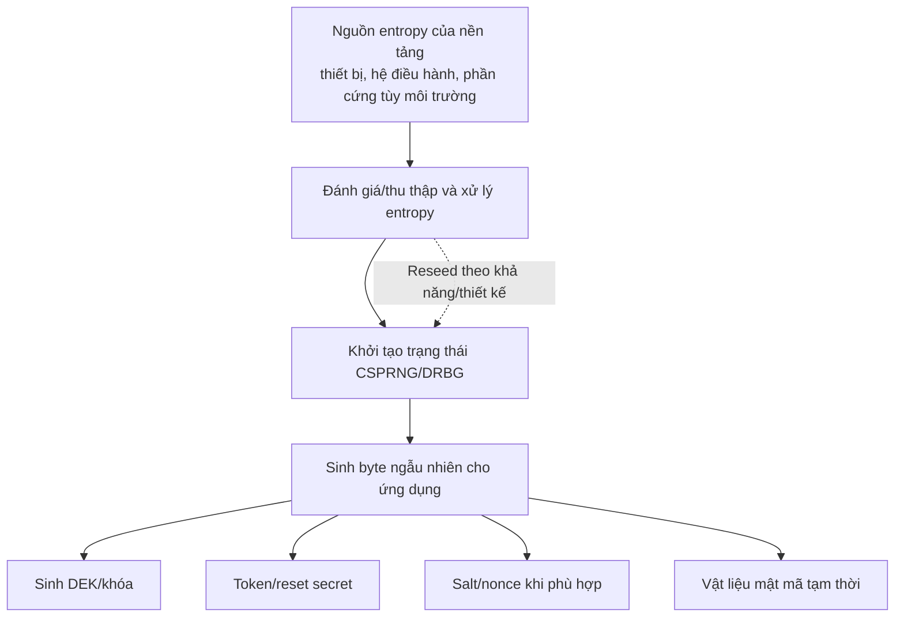
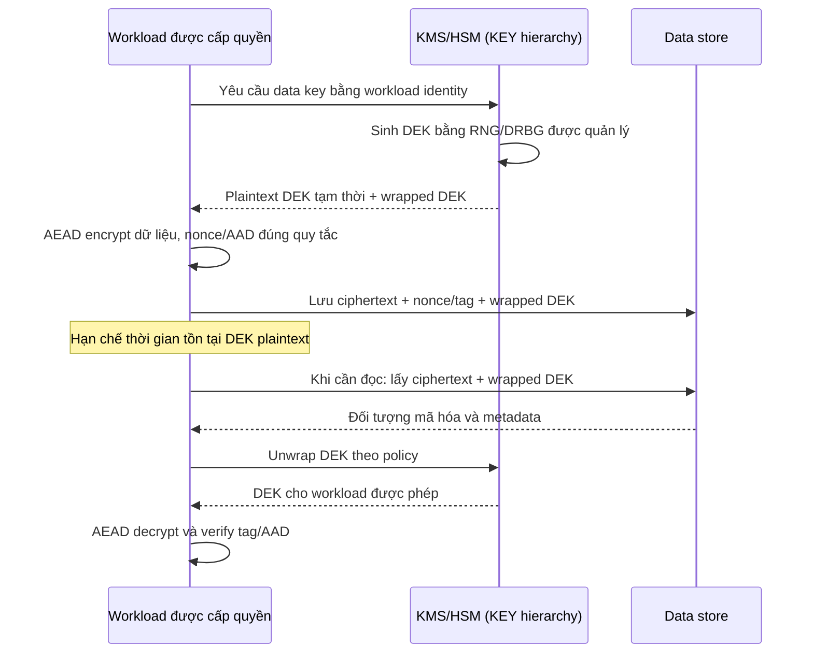
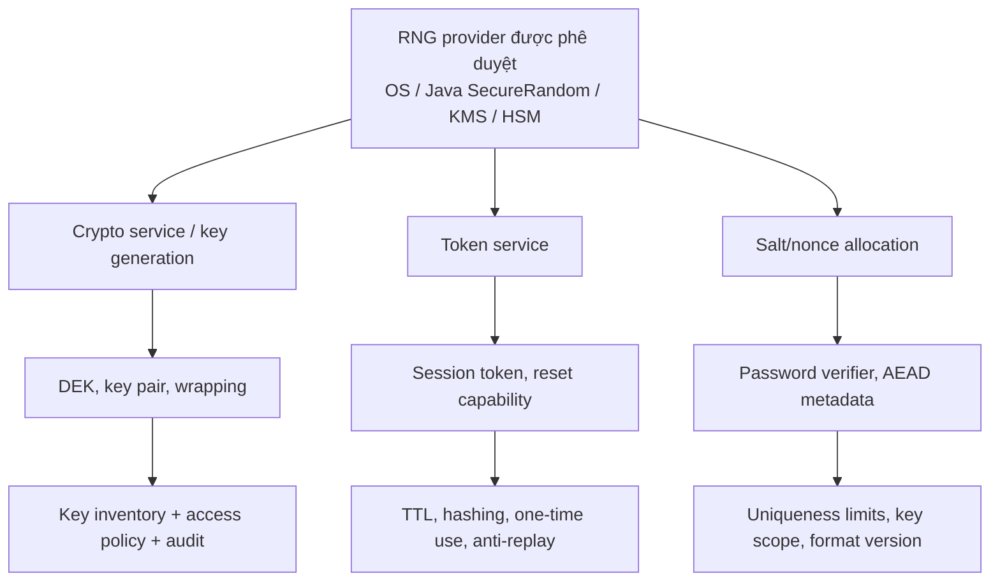
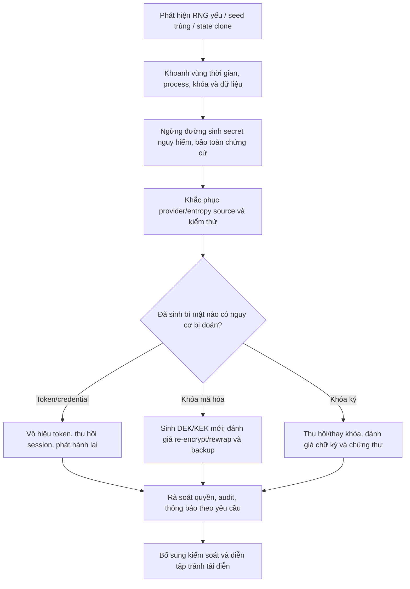
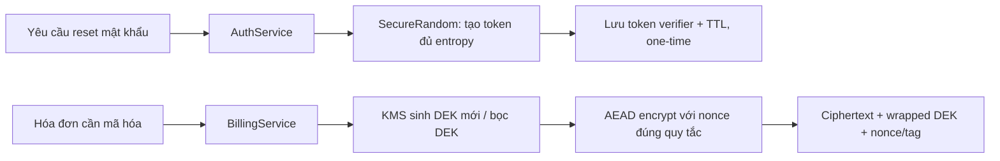

# Cryptographically secure random (CSPRNG)

> **Chương:** Secure randomness  
> **Module:** SECURITY_KEY_MANAGEMENT_FUNDAMENTALS — tìm hiểu vòng đời khóa mật mã từ tạo, cấp phát, lưu trữ, sử dụng, xoay vòng đến thu hồi và hủy; kết nối mật mã đối xứng, bất đối xứng, chữ ký số, KMS/HSM, envelope encryption, kiểm soát truy cập và kiểm toán để bảo vệ khóa an toàn.

## 1. Mục tiêu học tập

Sau bài này, bạn có thể:

1. Giải thích **cryptographically secure randomness**, **entropy** và **CSPRNG/DRBG**, phân biệt với bộ sinh số giả ngẫu nhiên thông thường.
2. Nhận diện vì sao `Math.random()`, `java.util.Random`, `ThreadLocalRandom` hoặc seed từ thời gian không phù hợp để sinh **khóa, token hay bí mật**.
3. Phân biệt **không thể dự đoán** với **không trùng lặp**; hiểu yêu cầu riêng của khóa, token phiên, password salt, IV/nonce, RSA-PSS salt và ECDSA nonce.
4. Sử dụng **`java.security.SecureRandom`** đúng mục đích; chọn byte ngẫu nhiên, số nguyên trong miền và khóa AES mà không tự xây dựng generator.
5. Hiểu mối quan hệ giữa **nguồn entropy, DRBG, seed, reseed, trạng thái tiến hóa** và giới hạn của những tuyên bố “random 256 bit”.
6. Phân tích rủi ro từ VM snapshot, container cloning, RNG bị lỗi, thư viện không được kiểm soát và quy trình vận hành khóa.
7. Liên hệ randomness với **KMS/HSM, DEK/KEK, envelope encryption, vòng đời khóa, quản lý quyền, sao lưu, audit và phản ứng sự cố**.
8. Thiết kế kiểm thử và checklist để phát hiện lỗi sử dụng RNG mà không lầm tưởng phép kiểm tra thống kê có thể chứng minh tính bảo mật.

## 2. Cryptographically secure random là gì?

**Cryptographically secure random** là đầu ra từ nguồn hoặc cơ chế sinh ngẫu nhiên đáp ứng các yêu cầu mật mã phù hợp, đặc biệt là **khó dự đoán** đối với đối thủ dù họ có thể biết nhiều đầu ra trước đó và biết thuật toán đang dùng.

Trong nhiều ứng dụng, hệ điều hành thu thập **entropy** từ các nguồn thích hợp, dùng nó để khởi tạo và bổ sung trạng thái cho một **CSPRNG** (*cryptographically secure pseudorandom number generator*). Ứng dụng gọi API được hệ điều hành/thư viện cung cấp, thay vì tự đoán entropy hay phát minh thuật toán.

Ví dụ một khóa AES-256 gồm **32 byte** chỉ có thể mang mức bất định thích hợp nếu nó được lấy từ nguồn sinh khóa an toàn. Cùng 32 byte đó, nếu tạo bằng cách lặp từ timestamp dễ đoán, **độ dài vẫn là 256 bit nhưng độ khó đoán thực tế có thể rất thấp**.

### 2.1. Ví dụ tại sao “trông ngẫu nhiên” chưa đủ

```text
token A: 5f81a3e930b04c71...
token B: 37bd004a1d4b9f82...
token C: 8ca199fb004be735...
```

Ba token trên có vẻ không theo mẫu. Tuy nhiên, **quan sát vài chuỗi đầu ra không chứng minh** chúng đến từ RNG an toàn. Chúng có thể được tạo từ:

- Một CSPRNG có seed từ hệ điều hành: phù hợp hơn cho bí mật nếu cấu hình đúng.
- Một PRNG thường với seed là số giây hiện tại: attacker có thể thử hết một không gian seed nhỏ.
- Một bộ đếm được mã hóa kiểu tự chế: có thể có cấu trúc/dự đoán được.
- Một CSPRNG mạnh về thuật toán nhưng bị **seed lặp hoặc snapshot trạng thái**: những chuỗi đầu ra có thể lặp trên các máy.

**Đừng đánh giá mức bảo mật của random bằng mắt thường.** Điều phải kiểm tra là **nguồn entropy, thiết kế generator, seed/reseed, trạng thái vận hành và cách sử dụng đầu ra**.

### 2.2. Các thuật ngữ cần phân biệt

| Thuật ngữ | Ý nghĩa | Lưu ý |
| --- | --- | --- |
| **Randomness** | Đặc tính bất định/ngẫu nhiên theo mô hình được xác định | Không đồng nghĩa mọi byte “không giống nhau” |
| **Entropy source** | Thành phần thu thập biến thiên khó dự đoán từ môi trường hoặc phần cứng | Cần đánh giá chất lượng, sức khỏe và xử lý sai lệch |
| **TRNG** | Bộ sinh ngẫu nhiên dựa trên hiện tượng vật lý | Nguồn vật lý cũng có thể hỏng, lệch hoặc bị tác động |
| **PRNG** | Bộ sinh giả ngẫu nhiên có trạng thái/seed, tạo chuỗi theo thuật toán | Có thể lặp lại và dự đoán nếu biết seed/trạng thái |
| **CSPRNG** | PRNG có đặc tính mật mã, được thiết kế chống dự đoán đầu ra | Vẫn cần seed đủ tốt và vận hành đúng |
| **DRBG** | *Deterministic Random Bit Generator*: thuật ngữ thường dùng cho CSPRNG chuẩn hóa | Ví dụ các thiết kế trong NIST SP 800-90A |
| **Seed** | Vật liệu đầu vào để khởi tạo trạng thái generator | Seed đoán được tạo rủi ro dù đầu ra dài |
| **Reseed** | Bổ sung entropy/khởi tạo lại trạng thái theo thiết kế | Có thể hỗ trợ phục hồi sau một số dạng lộ trạng thái |
| **Nonce/IV** | Giá trị “dùng một lần” hoặc tham số khởi tạo trong giao thức mã hóa | Có thể yêu cầu **duy nhất**, **khó đoán**, hoặc cả hai tùy mode |
| **Salt** | Giá trị phân biệt đầu vào trong KDF/password hashing | Thường **không bí mật**, nhưng phải đúng đặc tính của scheme |

**TRNG không tự động tốt hơn CSPRNG** trong mọi bài toán. Hệ thống thường sử dụng nguồn entropy với kiểm tra sức khỏe và cơ chế DRBG chuẩn để tạo lượng lớn byte ngẫu nhiên có chất lượng phù hợp.

## 3. Vì sao PRNG thông thường không đủ an toàn?

Trong Java, các API như `Math.random()`, `Random`, `ThreadLocalRandom` và `SplittableRandom` chủ yếu phục vụ mô phỏng, lựa chọn ngẫu nhiên nghiệp vụ, phân tán tải hoặc thuật toán thống kê. Chúng **không có hợp đồng bảo mật phù hợp** cho việc sinh khóa/secret.

### 3.1. Ví dụ không an toàn

```java
// KHÔNG dùng cho API token, mật khẩu tạm hoặc khóa mật mã.
java.util.Random rng = new java.util.Random(System.currentTimeMillis());
long resetToken = rng.nextLong();
```

Vấn đề gồm:

1. **Seed từ thời gian** có thể bị thu hẹp nếu attacker biết thời điểm hệ thống tạo token.
2. `java.util.Random` là bộ sinh giả ngẫu nhiên thông thường, không được thiết kế cho mục tiêu chống dự đoán mật mã.
3. Một giá trị `long` chỉ có tối đa **64 bit biểu diễn**; nếu dùng làm token xác thực, mức an toàn còn phụ thuộc entropy thực của generator và các đặc điểm cấp phát.
4. Nếu endpoint không có rate limit/TTL, attacker có thêm cơ hội thử token.
5. Dùng `UUID` có vẻ “random” không phải lý do được phép bỏ qua yêu cầu nguồn ngẫu nhiên, độ dài, chính sách phân phối và lưu trữ.

Ngay cả khi `Random` tạo dãy byte phân bố trông đồng đều, attacker có thể dự đoán chuỗi nếu biết đủ trạng thái hoặc suy ra seed theo điểm yếu thiết kế.

### 3.2. Không được “sửa” bằng cách hash PRNG yếu

Một cách vá sai là:

```text
weakSeed = currentTimeMillis()
weakRandomBytes = Random(weakSeed).nextBytes(32)
candidateKey = SHA256(weakRandomBytes)
```

SHA-256 có thể phân tán đầu ra về mặt hình thức, nhưng **không tạo entropy từ thông tin đã đoán được**. Nếu attacker có thể liệt kê các seed khả dĩ, họ vẫn có thể thử từng seed rồi tính SHA-256 tương ứng.

Tương tự, **base64, hex, UUID formatting, XOR với hằng số hoặc nối nhiều timestamp** không biến đầu vào đoán được thành một khóa mạnh.

### 3.3. Khi nào PRNG thông thường được phép?

PRNG thông thường có thể phù hợp với **mô phỏng, test thuật toán không nhạy cảm, randomized sorting, dữ liệu giả cho demo, game logic hoặc sampling** khi không có yêu cầu bí mật hay chống đối thủ chủ động.

Một ranh giới thiết kế tốt:

> **Nếu attacker đoán được đầu ra sẽ giúp họ xác thực, giải mã, giả mạo, chọn khóa, chiếm phiên hoặc vượt quyền, hãy dùng CSPRNG được phê duyệt và xem toàn bộ vòng đời đầu ra là một phần của bảo mật.**

## 4. Entropy: độ bất định khác độ dài chuỗi

**Entropy** mô tả lượng bất định của một biến ngẫu nhiên theo mô hình xác suất. Khi tạo bí mật, điều quan trọng không chỉ là số bit đầu ra mà còn là **khả năng attacker đoán đúng**.

Một đại lượng hữu ích là **min-entropy**:

\[
H_{\infty}(X) = -\log_2\left(\max_x P[X=x]\right)
\]

Nếu một biến được chọn đồng đều từ \(2^{128}\) giá trị, xác suất đoán đúng một lần là \(2^{-128}\), và min-entropy là 128 bit. Nếu một “seed 256 bit” thực tế chỉ có một triệu khả năng vì được lấy từ đồng hồ, mức bất định **không tự trở thành 256 bit**.

### 4.1. “256-bit key” không tự động có 256-bit entropy

Xét ba cách tạo cùng một khóa 32 byte:

| Cách tạo | Độ dài đầu ra | Nhận xét bảo mật |
| --- | --- | --- |
| CSPRNG được khởi tạo đúng từ entropy thích hợp | 32 byte | Có thể hỗ trợ mục tiêu khóa AES-256 theo chính sách và giới hạn generator |
| `SHA256(timestamp)` | 32 byte | Timestamp có thể đoán được; khóa không đạt độ khó đoán mong muốn |
| Lặp lại một byte ngẫu nhiên 32 lần | 32 byte | Tối đa 256 khả năng nếu chỉ byte đó thay đổi; rất yếu |
| Mật khẩu người dùng được mã hóa UTF-8 rồi cắt/đệm thành 32 byte | 32 byte | Chất lượng phụ thuộc entropy mật khẩu; không phải cách tạo khóa ngẫu nhiên |

Ngoài entropy nguồn, mức an toàn còn phụ thuộc thuật toán, kích thước key, giới hạn DRBG và rủi ro lộ vật liệu khóa.

### 4.2. Nguồn entropy thường được xử lý qua nhiều tầng



Sơ đồ là **mô hình khái niệm**, không mô tả chính xác cấu trúc một hệ điều hành, JDK provider hay HSM cụ thể.

- Nguồn entropy có thể có **bộ kiểm tra sức khỏe** để phát hiện lỗi hoặc phân bố bất thường.
- DRBG dùng trạng thái nội bộ để tạo chuỗi byte có tính chất mật mã mong đợi.
- Một số hệ thống có cơ chế **reseed** hoặc dựa vào dịch vụ random của hệ điều hành; cách triển khai phụ thuộc nền tảng.
- **Không tự giả định** các chi tiết seed/reseed bên trong một provider chỉ từ tên API `SecureRandom`.

### 4.3. Không thể “lấy entropy” từ biến dễ đoán

Những nguồn sau **không được xem là seed mật mã an toàn độc lập**:

- Thời gian hệ thống, microsecond/nanosecond clock.
- PID, process/thread ID, địa chỉ MAC, IP, tên container.
- Bộ đếm hoặc sequence ID.
- Chuỗi nhập tay, hash của ngày sinh hoặc tên tổ chức.
- Giá trị `Math.random()` hay `java.util.Random`.
- Một hằng số được hardcode trong source hoặc biến môi trường public.

Một hệ thống có thể dùng các giá trị công khai như **ngữ cảnh** của KDF hoặc dữ liệu không bí mật, nhưng không được gọi đó là entropy bí mật nếu attacker có thể dự đoán.

## 5. Những thuộc tính bảo mật quan trọng của CSPRNG

### 5.1. Unpredictability: khó dự đoán đầu ra chưa được tiết lộ

Với giả định generator an toàn và seed hợp lệ, dù attacker biết thuật toán cũng không nên tính được byte đầu ra tương lai chỉ từ một số đầu ra đã nhìn thấy.

Ví dụ nếu server phát token khôi phục từ CSPRNG, việc attacker biết token của một tài khoản **không được giúp suy ra token kế tiếp** của tài khoản khác theo cách khả thi.

### 5.2. Backtracking resistance: bảo vệ đầu ra trong quá khứ

Trong một số thiết kế DRBG, **backtracking resistance** (khả năng chống truy ngược) nghĩa là khi trạng thái hiện tại bị lộ, attacker không thể dùng trạng thái đó để suy ra những đầu ra **trước thời điểm lộ**, với các điều kiện bảo mật của thiết kế.

Điều này **không có nghĩa** các token quá khứ đã bị lưu ở plaintext hoặc lộ qua log bỗng được bảo vệ; cũng không bảo đảm mọi CSPRNG/provider đều triển khai cùng một thuộc tính.

### 5.3. Prediction resistance: giới hạn ảnh hưởng đến đầu ra tương lai

**Prediction resistance** thường liên quan khả năng đưa entropy mới vào generator trong cơ chế sinh random để giảm rủi ro dự đoán tương lai khi trạng thái trước đó bị lộ.

Không nên tuyên bố một RNG có prediction resistance chỉ vì thư viện có phương thức `nextBytes` hoặc vì API gọi lại nhiều lần. Cần kiểm tra **chuẩn, implementation, thiết lập reseed và môi trường vận hành**.

### 5.4. Uniqueness: khác với unpredictability

Một đầu ra có thể **khó đoán nhưng vẫn có xác suất trùng**, đặc biệt khi hệ thống cấp phát rất nhiều giá trị. Ngược lại, một counter tăng dần có thể **duy nhất nhưng hoàn toàn dự đoán được**.

| Bài toán | Khó đoán? | Duy nhất? |
| --- | --- | --- |
| Session/bearer token | **Cần** | Cần tránh xung đột, có thể kiểm tra unique bằng storage |
| Password-reset token | **Cần** | Cần ràng buộc một lần dùng và tránh collision |
| AES-GCM nonce | Không bắt buộc bí mật hoặc khó đoán theo đúng thiết kế GCM | **Bắt buộc không tái sử dụng với cùng khóa** |
| AES-CBC IV khi dùng CBC để bảo vệ bí mật | **Cần không thể dự đoán theo yêu cầu bảo mật mode** | Cần tuân quy tắc của mode; thường tạo mới mỗi lần |
| Password salt | Không cần bí mật | Nên ngẫu nhiên riêng/hiếm trùng theo scheme |
| Database auto-increment ID | Không mặc nhiên | Thường cần unique, nhưng không phải secret |
| ECDSA per-signature `k` | **Phải an toàn theo scheme** (ngẫu nhiên hoặc deterministic chuẩn) | Không được reuse nguy hiểm dưới cùng khóa ký |

**Chọn “random” không thay cho thiết kế chống trùng lặp.** Đối với AES-GCM, nếu cùng key và nonce bị dùng lại, có thể phá vỡ bảo đảm bí mật và xác thực, dù mỗi nonce lúc sinh được lấy từ một RNG tốt.

## 6. CSPRNG/DRBG trong các tiêu chuẩn

Một nhóm tài liệu nền tảng thường được dùng để thiết kế/đánh giá các thành phần ngẫu nhiên mật mã:

- **NIST SP 800-90A:** quy định các cơ chế DRBG dựa trên primitive mật mã; phân biệt cơ chế khởi tạo, sinh byte và reseed.
- **NIST SP 800-90B:** hướng dẫn về nguồn entropy và đánh giá chất lượng entropy, bao gồm kiểm tra sức khỏe thích hợp.
- **NIST SP 800-90C:** hướng dẫn tổ hợp nguồn entropy và DRBG trong các cấu trúc bộ sinh bit ngẫu nhiên.
- **RFC 4086:** các khuyến nghị về yêu cầu random trong bảo mật; không dựa vào entropy yếu/tự chế.
- **NIST SP 800-57:** nguyên tắc về sinh và quản lý khóa trong suốt vòng đời.

Khi một hệ thống yêu cầu **mô-đun mật mã đã xác nhận/đánh giá theo tiêu chuẩn cụ thể**, việc “code gọi `SecureRandom`” **không tự chứng minh tuân thủ**. Phải kiểm tra bản build, provider, chế độ vận hành và phạm vi chứng nhận/đánh giá áp dụng.

### 6.1. Ví dụ các họ DRBG

Những cơ chế được biết đến trong tài liệu DRBG gồm các thiết kế dựa trên:

- Hàm băm mật mã (**Hash_DRBG**).
- HMAC (**HMAC_DRBG**).
- Block cipher ở chế độ phù hợp (**CTR_DRBG**).

Đây là những **cấu trúc thuật toán**; triển khai đúng đòi hỏi quản lý entropy, trạng thái, độ mạnh, giới hạn yêu cầu và reseed theo đặc tả.

**Không tự viết một “AES-CTR random generator”** chỉ vì AES-CTR có thể tạo stream byte trông ngẫu nhiên. Một DRBG chuẩn không chỉ gồm phép mã hóa, mà còn có các quy tắc seed, cập nhật state, request limit, xử lý lỗi và đánh giá bảo mật.

### 6.2. Random output không tương đương entropy source

Khi một DRBG có state đã được tạo, nó có thể xuất ra nhiều byte. Nhưng những byte đó **không phải entropy mới** theo nghĩa nguồn vật lý độc lập. Lấy đầu ra của CSPRNG rồi “reseed chính nó” không tạo thêm entropy từ môi trường.

Không lấy `SHA256(SecureRandom.nextBytes(...))` rồi tuyên bố “thêm 256 bit entropy”. Hash có thể là một bước trong thiết kế hợp lệ, nhưng nó không tự tạo bất định vượt quá nguồn đã có.

## 7. Java: sử dụng `SecureRandom` để sinh bí mật

Trong Java, `java.security.SecureRandom` là API dành cho việc tạo số giả ngẫu nhiên có bảo đảm mật mã theo các provider được hỗ trợ. Đối với đa số ứng dụng, nên dùng **API này hoặc API sinh khóa của provider/KMS đã được phê duyệt**, thay vì `Random`.

Ví dụ tạo secret:

```java
import java.security.SecureRandom;
import java.util.Base64;

public final class Tokens {
    private static final SecureRandom RNG = new SecureRandom();

    private Tokens() {}

    public static String newResetToken() {
        byte[] secret = new byte[32]; // 256 bit biểu diễn.
        RNG.nextBytes(secret);
        return Base64.getUrlEncoder()
                .withoutPadding()
                .encodeToString(secret);
    }
}
```

Lưu ý:

- `new SecureRandom()` chọn implementation/provider theo môi trường Java; phải bảo đảm runtime là nền tảng đáng tin và được cấu hình theo chính sách.
- `RNG.nextBytes(...)` sử dụng generator mật mã; không tự tạo seed từ timestamp.
- Base64url **chỉ là encoding**, không thêm entropy; đầu ra có mức an toàn phụ thuộc **32 byte thực sự được sinh**.
- Token này là **bearer secret**: ai sở hữu nó có thể thực hiện hành động được cấp cho token, nên phải kiểm soát vòng đời, storage và chống replay.
- Không log token hoặc đưa token vào URL nơi có thể rò rỉ qua referrer, proxy, analytics; nếu sử dụng liên kết reset, cần thiết kế kênh truyền và logging phù hợp.

### 7.1. `getInstanceStrong()` không phải mặc định tốt hơn mọi trường hợp

Java có API `SecureRandom.getInstanceStrong()` để chọn một thuật toán được cấu hình là mạnh theo chính sách của môi trường. Tùy provider/hệ điều hành, lựa chọn đó **có thể chờ/block** hoặc có đặc tính hiệu năng không phù hợp cho đường xử lý request tốc độ cao.

**Không nhất thiết thay mọi `new SecureRandom()` bằng `getInstanceStrong()`.** Cần hiểu môi trường triển khai, đánh giá provider, latency, khả năng khởi tạo, tình trạng entropy và yêu cầu chính sách trước khi quyết định.

### 7.2. `setSeed(...)` không làm seed yếu trở nên an toàn

Ví dụ sau **không phải cách tăng cường RNG**:

```java
SecureRandom rng = new SecureRandom();
rng.setSeed(System.currentTimeMillis()); // Không tạo entropy mới đáng tin.
```

Hành vi trộn/khởi tạo seed phụ thuộc provider và thời điểm gọi; trong nhiều provider, `setSeed` có thể **bổ sung** state chứ không thay toàn bộ seed hệ thống. Tuy nhiên, **đừng đặt giả định bảo mật** rằng timestamp làm hệ thống “random hơn”, hoặc việc setSeed luôn vô hại với mọi provider. Với ứng dụng thông thường, hãy để hệ điều hành/provider cung cấp cơ chế khởi tạo an toàn.

Đặc biệt **không tự khởi tạo CSPRNG thuần túy bằng hardcoded seed** và dùng nó cho production. Dữ liệu test tái lập được có giá trị trong môi trường kiểm thử, nhưng phải cô lập hoàn toàn khỏi quy trình sinh secret thật.

### 7.3. Có nên giữ một `SecureRandom` dùng chung?

Một instance `SecureRandom` có thể được dùng lại trong ứng dụng Java theo hợp đồng thread-safety của các provider hiện đại; chính JCA làm việc với provider đáp ứng quy tắc đồng bộ theo khả năng triển khai.

Việc tạo **nhiều instance với cùng seed cố định** không an toàn. Đồng thời không tự xây dựng global lock hoặc cấu trúc đồng thời khi chưa đo khả năng provider xử lý. Kiểm thử trên JDK/provider/hạ tầng mục tiêu vẫn cần thiết.

Nếu nền tảng sử dụng nhiều JVM/container, phải tin vào cơ chế seed của từng process/nền tảng và xem xét rủi ro **clone/snapshot**; không cố giải quyết bằng cách cộng PID vào seed rồi coi là đủ.

## 8. Ví dụ Java: token, salt, khóa AES và số ngẫu nhiên có giới hạn

Đoạn Java sau tập hợp các cách dùng `SecureRandom` thường gặp. Nó là ví dụ kỹ thuật **không thay thế chính sách IAM/KMS, key storage, audit hoặc giao thức xác thực**.

```java
import java.security.GeneralSecurityException;
import java.security.SecureRandom;
import java.util.Base64;
import javax.crypto.KeyGenerator;
import javax.crypto.SecretKey;

public final class SecureRandomRecipes {
    private static final SecureRandom RNG = new SecureRandom();
    private static final int RESET_TOKEN_BYTES = 32;
    private static final int SALT_BYTES = 16;

    private SecureRandomRecipes() {}

    // Secret bearer token; lưu verifier/hash token và TTL ở server nếu cần.
    public static String resetToken() {
        byte[] token = new byte[RESET_TOKEN_BYTES];
        RNG.nextBytes(token);
        return Base64.getUrlEncoder()
                .withoutPadding()
                .encodeToString(token);
    }

    // Salt không bí mật nhưng phải tạo mới riêng cho password record.
    public static byte[] newPasswordSalt() {
        byte[] salt = new byte[SALT_BYTES];
        RNG.nextBytes(salt);
        return salt;
    }

    // Cấp khóa AES-256 bằng KeyGenerator và CSPRNG theo provider.
    public static SecretKey newAes256Key()
            throws GeneralSecurityException {
        KeyGenerator generator = KeyGenerator.getInstance("AES");
        generator.init(256, RNG);
        return generator.generateKey();
    }

    // Lựa chọn chỉ số đồng đều trong [0, bound).
    // Không áp dụng: nextInt() % bound.
    public static int uniformIndex(int bound) {
        if (bound <= 0) {
            throw new IllegalArgumentException("bound must be positive");
        }
        return RNG.nextInt(bound);
    }
}
```

### 8.1. Giải thích từng lựa chọn

**Token ngẫu nhiên 32 byte:** cung cấp tối đa 256 bit giá trị biểu diễn khi nguồn thích hợp. Thực tế bảo mật còn phụ thuộc entropy, thời hạn sử dụng, số lần thử, kênh phân phối, lưu trữ và quyền của token. **Không phải cứ dài 32 byte là an toàn** nếu ứng dụng làm lộ token qua log.

**Salt 16 byte:** thường đủ lớn cho nhiều password hashing scheme, nhưng hãy dùng API và khuyến nghị của thư viện đang triển khai. Salt **không phải pepper**, không cần bí mật và không dùng như khóa AES.

**Khóa AES-256:** `KeyGenerator` tạo một `SecretKey`; trong ví dụ này khóa có thể tồn tại trong bộ nhớ ứng dụng. **Không mặc định khóa được giữ trong HSM hoặc non-exportable** chỉ vì mã dùng `KeyGenerator`. Với hệ thống yêu cầu bảo vệ khóa nghiêm ngặt, nên sinh/quản lý DEK hoặc KEK thông qua KMS/HSM theo mô hình phù hợp.

**Lựa chọn chỉ số đồng đều:** `SecureRandom.nextInt(bound)` cung cấp API chọn chỉ số trong miền mà không phải tự làm phép modulo. Dùng `randomInt % n` có thể gây **modulo bias** và nếu `randomInt` âm còn có thể tạo chỉ số sai.

### 8.2. Ví dụ modulo bias

Giả sử nguồn trả về đồng đều số nguyên từ 0 đến 255 (256 giá trị). Nếu chọn trong ba lựa chọn bằng `x % 3`:

- Kết quả 0 xảy ra với 86 giá trị.
- Kết quả 1 xảy ra với 85 giá trị.
- Kết quả 2 xảy ra với 85 giá trị.

Tỷ lệ không hoàn toàn bằng nhau vì **256 không chia hết cho 3**. Trong ứng dụng mật mã như sinh ký tự token từ bảng ký tự tự định nghĩa, sai lệch nhỏ có thể tích lũy hoặc làm suy giảm tính đồng đều theo mục tiêu.

Hãy dùng API chọn miền không thiên lệch, hoặc thuật toán **rejection sampling** được thiết kế/kiểm thử đúng. Không tự lấy các byte ngẫu nhiên rồi `% alphabet.length` chỉ để mã ngắn hơn nếu cần bảo đảm phân bố chính xác.

### 8.3. Tạo key pair bất đối xứng

Một key pair RSA/EC/EdDSA cũng cần nguồn ngẫu nhiên thích hợp, nhưng việc tạo khóa phải theo API và provider được phê duyệt. Khóa phải có **độ mạnh, tham số và mục đích đúng scheme**, không chỉ “sinh byte random rồi tự nhét vào private key”.

Ví dụ khởi tạo RSA key pair theo profile mẫu:

```java
import java.security.KeyPair;
import java.security.KeyPairGenerator;
import java.security.SecureRandom;

SecureRandom rng = new SecureRandom();
KeyPairGenerator generator = KeyPairGenerator.getInstance("RSA");
generator.initialize(3072, rng); // 3072 là profile minh họa.
KeyPair pair = generator.generateKeyPair();

// Bảo vệ pair.getPrivate() theo quy trình key management.
// pair.getPublic() có thể công bố sau khi ràng buộc identity phù hợp.
```

Trong hệ thống có HSM, private key có thể cần được **tạo bên trong HSM** theo provider và key handle để tránh export. Không lấy `pair.getPrivate().getEncoded()` rồi lưu vào một file không mã hóa chỉ vì API cho phép.

## 9. CSPRNG trong các mục đích sử dụng cụ thể

Không có một yêu cầu “random” chung áp dụng cho mọi giá trị. Cần xác định thuộc tính mong muốn của từng loại:

| Đầu ra | Cách tạo thường phù hợp | Thuộc tính bắt buộc/chú ý |
| --- | --- | --- |
| **DEK/khóa đối xứng** | KMS/HSM hoặc CSPRNG/KeyGenerator được duyệt | Khó đoán, đúng key length, hạn chế export, quản trị vòng đời |
| **Private key RSA/ECC** | KeyPairGenerator/provider/HSM đã được duyệt | Thuật toán tạo khóa chuẩn, tham số hợp lệ, entropy tốt |
| **Session token/refresh token** | CSPRNG đủ byte, mã hóa thành chuỗi an toàn | Khó đoán, TTL, one-time/rotation theo mô hình, chống lộ và reuse |
| **Password-reset secret** | CSPRNG + lưu verifier/hash tại server | Khó đoán, ràng buộc user/action, TTL, giới hạn lần thử |
| **Password salt** | CSPRNG hoặc API password KDF phù hợp | Giá trị riêng cho mỗi hash, không cần giấu |
| **AES-GCM nonce** | Bộ đếm/định danh duy nhất đúng thiết kế hoặc RNG theo giới hạn | **Không trùng dưới cùng key**, quản lý multi-instance và số lần mã hóa |
| **AES-CBC IV** | Theo quy tắc mode, thường lấy từ CSPRNG | Phải **khó dự đoán** đối với các chế độ CBC bảo vệ dữ liệu nhạy cảm |
| **RSA-PSS salt** | Thư viện ký thực hiện theo scheme/profile | Độ dài/thuộc tính đúng; không tự dùng salt của password |
| **RSA-OAEP seed/randomness** | Thư viện mã hóa bất đối xứng | Randomness đúng scheme, không cố định |
| **ECDSA per-signature `k`** | Signer/HSM sinh theo chuẩn hoặc deterministic ECDSA phù hợp | Tái sử dụng/đoán được `k` có thể làm lộ private key |
| **Ed25519** | Sinh seed/key bằng thư viện chuẩn; quy tắc ký theo Ed25519 | Không tự thêm random `k` như ECDSA |
| **HPKE ephemeral secret** | KEM/HPKE library được kiểm thử | Ephemeral key hợp lệ, sinh đúng scheme, không reuse trái chính sách |
| **Public request ID** | Generator ID đáp ứng yêu cầu uniqueness | Không dùng làm credential trừ khi có phân tích entropy và quyền |
| **Nonce chống replay ở nghiệp vụ** | Counter, CSPRNG hoặc định danh unique phù hợp | Cần **kiểm tra trạng thái đã sử dụng**; random không tự chống replay |

### 9.1. Secret khác identifier

Một identifier có thể cần **duy nhất** nhưng không nhất thiết phải **bí mật**. Ví dụ số thứ tự đơn hàng tăng dần có thể là ID tốt nếu hệ thống không dựa vào việc khó đoán của ID để bảo vệ quyền.

Ngược lại, **password reset token** là một capability/bearer secret: attacker đoán hoặc đánh cắp nó có thể thực hiện hành động nhạy cảm. Khi sinh token, phải xem **tính khó đoán** là yêu cầu chính, ngoài tính độc nhất.

**Không dùng “đường dẫn khó đoán” làm thay authorization.** Dù resource ID được sinh bởi CSPRNG, endpoint vẫn phải kiểm tra user có quyền đọc object hay không.

### 9.2. Salt cho password hashing

Khi dùng **Argon2id, scrypt, bcrypt hoặc PBKDF2**, salt nên được sinh theo API/khuyến nghị scheme, riêng cho mỗi record. Salt có thể lưu cùng verifier vì nó **không phải secret**.

Password hashing cần **work factor/memory cost** và policy phù hợp. CSPRNG salt không biến `SHA256(password)` trực tiếp thành password KDF an toàn.

### 9.3. Entropy khi sinh khóa dẫn xuất

Một số ứng dụng dùng KDF để **dẫn xuất khóa từ master key/seed** theo ngữ cảnh. Khi đó, thuật toán KDF không tự tạo thêm entropy: độ an toàn phụ thuộc **entropy của khóa nguồn** và thiết kế domain separation.

Ví dụ `HKDF(masterKey, salt, info)` có thể tạo nhiều khóa cho mục đích riêng theo cấu trúc được duyệt; nhưng nếu `masterKey` chỉ đến từ timestamp hoặc password yếu, đầu ra không tự có độ khó đoán như khóa được sinh từ CSPRNG chuẩn.

**Đừng tự dùng output của CSPRNG làm mật khẩu người dùng hoặc ngược lại.** Mỗi loại bí mật cần KDF, encoding và policy riêng.

## 10. Trường hợp dễ nhầm: AES-GCM nonce ngẫu nhiên

**AES-GCM** là AEAD thông dụng. Một tham số quan trọng là **nonce/IV**, thường dùng giá trị 96 bit trong những thiết kế phổ biến.

Với cùng khóa AEAD, **nonce không được tái sử dụng**. Một RNG mật mã tốt giúp nonce khó đoán và phân bố phù hợp, nhưng **không bảo đảm tuyệt đối không trùng** khi gọi rất nhiều lần.

### 10.1. Xác suất trùng của nonce ngẫu nhiên

Nếu chọn đều độc lập \(q\) nonce trong không gian có \(2^{96}\) giá trị, một xấp xỉ cho xác suất có ít nhất một cặp trùng khi xác suất còn nhỏ là:

\[
P(\text{collision}) \approx \frac{q(q-1)}{2^{97}}
\]

Đây là mô hình **birthday bound** đơn giản. Nó cho thấy xác suất tăng nhanh theo **bình phương số lần sinh**, không phải tuyến tính.

Vì vậy:

- Không coi việc gọi `SecureRandom.nextBytes(new byte[12])` là **bằng chứng nonce không bao giờ trùng**.
- Đánh giá giới hạn số lần mã hóa **dưới cùng key** theo NIST SP 800-38D và cấu hình cụ thể.
- Nếu thiết kế dùng **counter nonce**, phải cấp phát duy nhất trên nhiều instance, bền qua restart/rollback và có giới hạn counter.
- Nếu dùng **nonce ngẫu nhiên**, phải tuân giới hạn và đánh giá xác suất trùng/khối lượng dữ liệu tương ứng, không dùng vô hạn.
- Không tái sử dụng cặp key+nonce khi retry job, copy VM hoặc restore snapshot.

### 10.2. Một nonce không cần giữ bí mật

Trong GCM, nonce có thể được lưu **công khai cùng ciphertext**. Điều bảo vệ dữ liệu là **khóa bí mật**, cấu hình mode và việc nonce không bị tái sử dụng trái quy tắc.

Trong CBC, IV có những yêu cầu khác: **tính không thể dự đoán** là quan trọng với kiểu sử dụng bảo vệ tính bí mật của CBC. Không áp dụng nguyên tắc “GCM nonce chỉ cần unique” cho mọi mode.

### 10.3. Ví dụ với một DEK riêng cho mỗi object

Giả sử hệ thống mã hóa mỗi file bằng một **DEK mới từ KMS** và tạo nonce GCM ngẫu nhiên:

```text
file A -> DEK-A (mới) + nonce-A -> ciphertext-A
file B -> DEK-B (mới) + nonce-B -> ciphertext-B
file C -> DEK-C (mới) + nonce-C -> ciphertext-C
```

Vì mỗi object dùng một DEK mới, phạm vi quản lý nonce trên từng key đơn giản hơn so với tái sử dụng một DEK chung cho hàng triệu object. Nhưng hệ thống vẫn phải bảo đảm **DEK thực sự mới/khó đoán**, không dùng lại cùng DEK vô tình và lưu nonce/tag/metadata để giải mã.

Đây là một quyết định kiến trúc về **key scope và envelope encryption**, không chỉ là vấn đề chọn hàm random.

## 11. Randomness trong chữ ký số và mật mã bất đối xứng

### 11.1. Sinh khóa riêng

Trong RSA, EC và nhiều scheme khác, private key phải được sinh theo thuật toán chuẩn từ **vật liệu ngẫu nhiên thích hợp**. Nếu khóa được sinh từ seed có thể đoán, attacker có thể thử tái tạo key pair và giả mạo chữ ký hoặc giải mã dữ liệu.

Độ dài khóa lớn **không bù được nguồn seed yếu**. Sinh RSA-3072 từ không gian seed rất nhỏ vẫn có thể tạo rủi ro nghiêm trọng.

### 11.2. ECDSA nonce `k`

ECDSA dùng một giá trị bí mật cho mỗi chữ ký. Nếu hai chữ ký được tạo dưới cùng private key với **cùng `k`** trong những điều kiện điển hình, hoặc `k` bị dự đoán, attacker có thể suy ra private key từ chữ ký.

Hệ quả:

- Không dùng `java.util.Random`, thời gian hoặc counter đơn giản để sinh `k`.
- Ưu tiên **thư viện signer/HSM** có triển khai chuẩn và entropy phù hợp.
- Một số thiết kế dùng **deterministic ECDSA** theo RFC 6979, nơi `k` được dẫn xuất đúng quy tắc từ key và hash thông điệp. **Deterministic** ở đây không đồng nghĩa “không an toàn”; nó được thiết kế để tránh phụ thuộc vào một lần lấy random yếu.
- Không tự hiện thực RFC 6979 hoặc ký ECDSA bằng cách ghép primitive thô nếu có thư viện chuẩn.

### 11.3. RSA-PSS và RSA-OAEP

Những sơ đồ như **RSA-PSS** (chữ ký) và **RSA-OAEP** (mã hóa) sử dụng thành phần ngẫu nhiên theo cơ chế chuẩn của chúng.

Bên ký/mã hóa nên dùng API chuẩn và provider đáng tin, không đặt random seed cố định để test rồi đưa nguyên cấu hình vào production. Bộ test có thể dùng test vector có dữ liệu cố định, nhưng **quy trình ký/mã hóa thật phải tuân đúng yêu cầu nguồn ngẫu nhiên của scheme**.

### 11.4. HPKE và ephemeral key

Trong **HPKE**, KEM có thể tạo vật liệu khóa tạm thời khi encapsulate. Nếu bộ sinh ephemeral secret có thể đoán hoặc bị tái sử dụng trái thiết kế, bảo mật của thông điệp có thể suy giảm. Phải dùng một implementation HPKE tuân chuẩn, không tự gắn ECDH với `Random`.

Ngay cả khi random tốt, HPKE Base mode **không tự xác thực danh tính người gửi**; authentication và authorization cần được xử lý bởi mode/chính sách phù hợp.

## 12. Kết nối CSPRNG với KMS, HSM và envelope encryption

### 12.1. Luồng sinh DEK trong KMS

Trong envelope encryption, ứng dụng thường dùng **DEK** để mã hóa dữ liệu và **KEK/master key** để bọc DEK. Một KMS có thể cung cấp API sinh DEK và trả về:

- Plaintext DEK **tạm thời** cho thành phần được phép mã hóa/giải mã.
- **Wrapped DEK** (DEK đã được bọc bởi KEK) để lưu cùng ciphertext.



Đây là mô hình khái niệm; không phải KMS nào cũng trả plaintext DEK hoặc cung cấp cùng API. HSM có thể thực hiện thao tác bên trong ranh giới tin cậy để hạn chế việc xuất key.

### 12.2. Vì sao RNG và quản trị khóa phải đi cùng nhau?

Ngay cả DEK sinh từ CSPRNG tốt vẫn có thể bị lộ nếu:

- DEK được log vào request/trace.
- Ứng dụng hoặc database lưu plaintext DEK thay vì wrapped DEK.
- Một service account có quyền `Decrypt/Unwrap` tất cả DEK của mọi tenant.
- Master key/KEK bị export và lưu trong cấu hình.
- VM snapshot chứa DEK plaintext và bị chia sẻ không kiểm soát.
- Backup chỉ lưu ciphertext nhưng không còn khả năng sử dụng KEK để giải bọc.

**Sinh ngẫu nhiên an toàn chỉ là điểm bắt đầu của vòng đời khóa.** Kiểm soát truy cập, key usage, rotation, audit, backup và xóa an toàn đều quan trọng.

### 12.3. KMS/HSM không bảo đảm mọi đầu ra trong ứng dụng đều an toàn

Nếu ứng dụng lấy DEK từ KMS nhưng lại tạo reset token bằng `Math.random()`, reset token vẫn có thể dự đoán. Nếu HSM bảo vệ RSA private key nhưng bên ứng dụng tạo AES-GCM nonce trùng, AEAD vẫn có thể mất bảo mật.

Mỗi nơi cần random phải được kiểm kê **theo mục đích**, không chỉ dựa vào việc tổ chức “đang sử dụng HSM”.

### 12.4. Phân quyền và audit

Quyền nên được tách:

| Vai trò | Quyền cần thiết | Rủi ro khi quá rộng |
| --- | --- | --- |
| **Key owner** | Phê duyệt loại khóa, mục đích, giới hạn và vòng đời | Không nên mặc nhiên được giải mã dữ liệu |
| **KMS/HSM admin** | Cấu hình module, policy, tạo/sửa tài nguyên theo phê duyệt | Có thể lạm dụng khi đồng thời được quyền unwrap |
| **Application workload** | Tạo DEK và dùng đúng key cho đúng nghiệp vụ | Dễ bị lạm dụng nếu có quyền xóa/export/sửa policy |
| **Auditor/SOC** | Đọc log không bí mật và cảnh báo | Không cần quyền sinh/xuất khóa |
| **Incident responder** | Điều tra và thu hồi quyền trong phạm vi sự cố | Break-glass cần giới hạn thời gian, phê duyệt và hậu kiểm |

Log cần thể hiện **ai tạo/dùng khóa, tài nguyên nào, lúc nào và kết quả ra sao** trong khả năng provider. **Không log raw entropy state, seed bí mật, DEK/KEK plaintext hay token nhạy cảm.**

## 13. Bẫy vận hành: container, VM, snapshot, fork và restart

Một RNG có thuật toán tốt vẫn có thể gặp sự cố nếu **trạng thái bị nhân bản hoặc môi trường triển khai bị cấu hình sai**.

### 13.1. Clone/snapshot trạng thái

Giả sử một VM hoặc process được snapshot sau khi generator đã khởi tạo. Nếu hai bản clone tiếp tục từ **cùng một trạng thái RNG** mà không có cơ chế đảm bảo tái tạo entropy hoặc làm mới state, chúng có thể sinh những chuỗi đầu ra giống nhau.

Hậu quả tiềm tàng:

- Hai container tạo cùng reset token/session secret.
- Cặp key/nonce bị lặp giữa các bản clone.
- Hai thiết bị sinh cùng private key khi image/seed cố định.
- ECDSA nonce trùng làm lộ private signing key trong điều kiện nguy hiểm.

**Không mặc định** mọi JVM snapshot sẽ gặp lỗi này; hệ điều hành/provider hiện đại có thể có biện pháp phòng vệ. Nhưng khi dùng process snapshot, VM template, fork semantics hoặc thiết bị IoT được flash hàng loạt, cần **xác minh thực tế** cơ chế RNG của nền tảng đó.

### 13.2. Container khởi động đồng thời

Tạo nhiều container cùng image **không tự động đồng nghĩa** chúng có cùng seed. Thông thường mỗi container dựa vào cơ chế random của hệ điều hành. Điều đáng lo là:

- Hardcode seed trong image/config.
- Dùng bộ sinh giả ngẫu nhiên tự chế và chỉ seed bằng timestamp.
- Khôi phục memory snapshot có cả RNG state.
- Một bộ sinh entropy tùy biến không nhận được đủ entropy khi khởi động.
- Thiết bị nhúng/VM snapshot có cách khởi tạo random không đảm bảo.

**Không sửa bằng cách cộng container ID vào timestamp**. Hãy dùng RNG của hệ điều hành/provider được phê duyệt, xác định phiên bản và kiểm thử quy trình clone/restore nếu sản phẩm phụ thuộc vào nó.

### 13.3. Thiết bị mới khởi động và entropy chưa sẵn sàng

Một số môi trường/thiết bị cần thời gian để nguồn entropy được khởi tạo đầy đủ. Hệ thống nên hiểu **hành vi lỗi hoặc chờ** của nền tảng và không tự fallback sang PRNG yếu chỉ để phục vụ request nhanh hơn.

Khi nguồn random không sẵn sàng:

1. **Fail closed** đối với tác vụ cần sinh secret, key hoặc token.
2. Có cơ chế retry/recovery theo hướng dẫn nền tảng.
3. Ghi nhận trạng thái/metric mà không log state hoặc secret.
4. Điều tra lỗi nền tảng trước khi mở lại thao tác nhạy cảm.

## 14. Thiết kế ứng dụng: tách nguồn RNG và cách sử dụng

Một thiết kế dễ kiểm soát thường phân thành ba lớp:



**Không phải mọi giá trị random đều phải gọi KMS.** KMS thường có chi phí/độ trễ và được thiết kế cho những thao tác quản lý khóa; session token có thể tạo từ CSPRNG địa phương nếu threat model và runtime cho phép. Quan trọng là **đúng lớp và đúng mục đích**, thay vì đưa tất cả xuống một service có quyền quá rộng.

### 14.1. Không tự chia nhỏ/mở rộng entropy bằng thuật toán riêng

Nếu ứng dụng cần nhiều khóa con từ một master secret, dùng **KDF có đặc tả phù hợp** và domain separation. Nếu ứng dụng cần một chuỗi random dài, dùng API CSPRNG với giới hạn/chế độ vận hành được provider hỗ trợ.

Không tự viết:

```text
random = SHA256(seed || counter++)
```

rồi gọi đó là “CSPRNG” cho production khi chưa có cơ sở thẩm định. Việc có hash mạnh không tự bao phủ yêu cầu seed, cập nhật state, backtracking/prediction resistance và kiểm tra entropy.

### 14.2. Khi nào dùng deterministic seed?

Trong unit test hoặc mô phỏng, output tái lập có thể hữu ích. **Tuy nhiên**:

- Chỉ dùng RNG deterministic test-only ở những luồng **không sinh bí mật production**.
- Không để cấu hình `fixedSeed` bật qua environment variable mà người vận hành có thể vô tình đưa vào production.
- Không dựa vào `new SecureRandom(fixedSeed)` để tạo dãy test byte giống nhau trên mọi provider/JDK; các provider có thể xử lý seed khác nhau.
- Nếu cần test vector cho thuật toán mật mã, kiểm thử trực tiếp các **đầu vào cố định theo vector chuẩn**, không biến RNG production thành deterministic.
- Dùng kiểm thử cấu trúc, test hành vi và bộ test vector/negative test thay vì hardcode seed cho endpoint tạo token thật.

## 15. Sự cố mất an toàn RNG và các bước xử lý

### 15.1. Các dấu hiệu cảnh báo

- Có token reset/session giống hệt nhau tại những lần tạo khác nhau mà chính sách không cho phép.
- Phát hiện code `Random` hoặc `Math.random()` trong đường sinh secret/key.
- Có seed cố định trong source, CI/CD, image hoặc cấu hình production.
- Key pair bị trùng trên nhiều thiết bị không có quy trình chia sẻ khóa hợp lệ.
- Hai VM clone tiếp tục sinh cùng chuỗi nonce/key sau restore.
- Nguồn entropy/DRBG provider báo lỗi hoặc cơ chế health test thất bại.
- Có sự cố ECDSA nonce trùng hoặc AES-GCM key+nonce reuse.
- KMS/HSM thay đổi firmware/khả năng RNG hoặc policy mà không có rà soát.
- Các dữ liệu mật mã mới đột nhiên tạo ra nhiều collision ngoài dự kiến thống kê/threat model.

**Không khẳng định mọi collision đều là bằng chứng RNG bị phá**, vì có thể trùng một cách xác suất hoặc do bug cấp phát; nhưng collision trong các dữ liệu cần duy nhất (đặc biệt key+nonce AEAD) phải được xem là sự kiện cần điều tra.

### 15.2. Quy trình ứng phó khi nghi RNG bị yếu



Các hành động phải dựa trên **phạm vi và bằng chứng**:

- **Token yếu:** vô hiệu các token có nguy cơ, kết thúc phiên phù hợp, tạo token mới từ nguồn an toàn.
- **DEK yếu/bị đoán:** chỉ thay KEK rồi rewrap **không làm DEK cũ trở nên bí mật**; có thể cần sinh DEK mới và **mã hóa lại dữ liệu**.
- **Khóa riêng bất đối xứng yếu:** phải xem xét thay cặp khóa, cập nhật public key/chứng thư hoặc trust directory.
- **ECDSA nonce lộ/trùng:** đánh giá nguy cơ private key đã bị suy ra; thu hồi/thay khóa ký và điều tra chữ ký đã tạo.
- **AES-GCM key+nonce reuse:** đánh giá tính bí mật/toàn vẹn của dữ liệu đã xử lý và thay key khi cần.

Không xóa khóa cũ trong lúc khôi phục **nếu backup/ciphertext còn phụ thuộc**, cho đến khi có kế hoạch migration và phê duyệt theo retention. Đồng thời, không tiếp tục dùng khóa có nguy cơ để bảo vệ dữ liệu mới.

### 15.3. Lưu ý forensics

Một sự cố RNG có thể khiến attacker **tái tạo bí mật** mà không cần đánh cắp key material hoặc gọi KMS. Vì thế chỉ xem log “ai gọi Decrypt” có thể **không đủ** để xác định phạm vi dữ liệu bị ảnh hưởng.

Thu thập bằng chứng phiên bản software/provider, cấu hình seed, thời điểm khởi tạo, hệ thống image/snapshot, lịch deploy, vòng đời key và metadata ciphertext/token; **không công khai raw seed hoặc secret** trong báo cáo chung.

## 16. Kiểm thử RNG và kiểm soát chất lượng

### 16.1. Không dùng kiểm tra thống kê làm bằng chứng mật mã

Các bài test như:

- Đếm số bit 0/1.
- Kiểm tra phân phối tần suất byte.
- Tìm chuỗi lặp quá thường xuyên.
- Kiểm tra tương quan đơn giản.

có thể phát hiện **một số lỗi thô**. Nhưng một PRNG yếu vẫn có thể vượt qua nhiều bài test thống kê, trong khi một chuỗi ngẫu nhiên ngắn vẫn có thể xuất hiện vài mẫu “không đẹp”.

**Một chuỗi trông ngẫu nhiên hoặc vượt bài test thống kê không chứng minh CSPRNG an toàn.** Phải đánh giá thiết kế/provider, nguồn entropy, cấu hình, cập nhật và giới hạn.

### 16.2. Các test kỹ thuật nên có

| Kiểm tra | Cách thực hiện | Kỳ vọng |
| --- | --- | --- |
| **Code review** | Tìm `Math.random`, `Random`, `ThreadLocalRandom` trong đường sinh secret | Không dùng cho key/token/nonce nhạy cảm |
| **Provider** | Kiểm tra runtime JDK, SecureRandom provider, thuật toán thực tế | Đúng môi trường và policy phê duyệt |
| **Token length** | Decode base64url token và kiểm tra số byte | Đúng độ dài đã thiết kế |
| **Token scope** | Kiểm tra TTL, one-time use, invalidation, hash tại storage | Token bị dùng lại hoặc hết hạn bị từ chối |
| **Salt** | Sinh hash cho hai user cùng password và so sánh metadata | Salt mới và verifier khác theo scheme |
| **Unbiased sampling** | Review việc dùng `nextInt(bound)` hoặc rejection sampling | Không có modulo bias do tự cắt miền |
| **AEAD nonce** | Kiểm tra cấp phát trên nhiều instance, retry và rollback | Không có đường reuse nonce dưới cùng key |
| **Key material** | Kiểm tra key length, thuật toán, phạm vi DEK/KEK | Đúng policy, không hardcode |
| **VM snapshot** | Diễn tập clone/restore trên nền tảng mục tiêu | Không tạo key/token/nonce trùng do state bị nhân bản |
| **RNG failure** | Giả lập lỗi provider nếu môi trường cho phép | Fail closed; không fallback `Random` |
| **Secret exposure** | Rà log, trace, crash dump, memory exposure theo khả năng | Không lộ key/seed/token |
| **Backup/DR** | Restore ciphertext và quyền dùng khóa | Không mất dữ liệu hoặc tạo lại khóa cũ từ seed yếu |
| **Incident runbook** | Diễn tập phát hiện seed trùng và khóa yếu | Có thể cô lập, rotate và xử lý dữ liệu liên quan |

### 16.3. Kiểm tra tính duy nhất ở lớp dữ liệu

Với token/ID cần độc nhất, có thể dùng ràng buộc uniqueness của database và cơ chế tạo lại token khi có collision. Nhưng **không coi việc retry ở DB là biện pháp bảo vệ CSPRNG yếu**: nếu nguồn random dễ đoán, attacker vẫn có thể đoán token không trùng.

Với nonce AES-GCM, xử lý collision sau khi ciphertext đã được phát hành **có thể quá muộn**. Kiến trúc phải phòng tránh reuse **trước khi mã hóa và công bố**; nếu dùng counter cần lưu/cấp phát bền vững theo key và môi trường.

### 16.4. Quan sát production mà không làm lộ secret

Metric/log nên tập trung vào:

- Provider/phiên bản runtime và cấu hình được phê duyệt.
- Lỗi RNG API/nguồn entropy và trạng thái health check nếu nền tảng cung cấp.
- Số lượng yêu cầu sinh key/token, thời gian đáp ứng và lỗi.
- Số collision/token duplicate được phát hiện.
- Tình trạng quota/rate limit KMS/HSM.
- Thay đổi policy và quyền của key service.
- Sự kiện clone, snapshot restore, container restart và version image.
- Lỗi nonce/key scope hoặc sự kiện GCM authentication failure bất thường.

**Không xuất seed/state, raw key, plaintext token, nonce bí mật giả định hay password vào log**. Nonce GCM thường công khai, nhưng log ciphertext/metadata vẫn cần phù hợp với chính sách bảo vệ thông tin và khả năng tương quan dữ liệu.

## 17. Case study: dịch vụ phát hành token và mã hóa hóa đơn

Một ứng dụng SaaS có hai luồng quan trọng:

1. **AuthService** tạo password-reset token để người dùng đặt lại mật khẩu.
2. **BillingService** mã hóa hóa đơn bằng AES-GCM, DEK được quản lý bởi KMS.

Đội phát triển phát hiện AuthService dùng `new Random(System.currentTimeMillis())` để tạo token, và BillingService dùng **counter nonce khởi tạo từ 0 ở mỗi instance** trong khi vẫn chia sẻ một DEK.

### 17.1. Phân tích rủi ro AuthService

Một attacker biết khoảng thời gian token được phát hành có thể thử các seed khả dĩ và suy ra token do PRNG thường tạo. Nếu endpoint cho phép thử token nhiều lần hoặc token tồn tại lâu, rủi ro takeover tài khoản tăng.

**Khắc phục:**

- Chuyển token sang **CSPRNG** với đủ byte cho mục tiêu an ninh.
- Token có **TTL, một lần sử dụng, ràng buộc đúng user và action**, bị vô hiệu sau reset.
- Có thể lưu **hash/verifier của token** thay vì plaintext token trong database, để hạn chế tác động nếu database bị đọc.
- Áp dụng rate limiting, kiểm soát đăng nhập/khôi phục và cảnh báo.
- Xóa/vô hiệu các token cũ có khả năng đoán, điều tra các lần sử dụng đáng ngờ.
- Không log token qua HTTP access log, tracing hoặc hệ thống email analytics ngoài phạm vi cần thiết.

### 17.2. Phân tích rủi ro BillingService

Nếu các instance **dùng chung DEK** nhưng mỗi instance đều bắt đầu nonce GCM từ 0, chúng có thể mã hóa nhiều file bằng **cùng cặp DEK+nonce**. Đây là lỗi nguy hiểm, ngay cả khi DEK được sinh từ KMS an toàn.

**Khắc phục có thể cân nhắc:**

1. **Mỗi file/object một DEK mới** từ KMS theo thiết kế envelope encryption.
2. Hoặc thiết kế **nonce allocation duy nhất theo key** trên toàn bộ instance và bền qua restart; có thể phân vùng namespace/counter nếu được phân tích đúng.
3. Lưu đầy đủ nonce/tag, wrapped DEK và key reference theo object.
4. Kiểm soát IAM KMS/tenant, không chỉ thay nonce API.
5. Đánh giá dữ liệu đã xử lý dưới key+nonce trùng; không coi việc sửa code là đã khắc phục ảnh hưởng lịch sử.

### 17.3. Thiết kế mục tiêu



Hai dịch vụ **cùng cần nguồn random an toàn** nhưng yêu cầu sử dụng đầu ra khác nhau:

- AuthService cần **khó đoán token**.
- BillingService cần **khó đoán khóa** và **không tái sử dụng nonce dưới cùng key**.
- Cả hai cần **authorization, lifecycle, audit, backup/DR và phản ứng sự cố**.

## 18. Những lỗi thường gặp và cách tránh

| Sai lầm | Hậu quả | Cách xử lý |
| --- | --- | --- |
| Dùng `Math.random()` cho API secret | Token dễ đoán hoặc không có bảo đảm mật mã | Dùng `SecureRandom`/API được duyệt |
| Seed `Random` bằng timestamp | Không gian seed nhỏ, attacker có thể thử | Không dùng PRNG thường cho secret |
| Hash đầu ra random yếu bằng SHA-256 | Không thêm entropy thực | Dùng entropy/CSPRNG phù hợp |
| Tự xây dựng DRBG bằng hash/counter | Không có cơ sở kiểm chứng state/reseed/giới hạn | Dùng provider/DRBG chuẩn |
| Hardcode seed để tái lập token production | Token/khóa có thể trùng sau restart/deploy | Cô lập test mode, cấm fixed seed production |
| Chọn `getInstanceStrong()` bất kể môi trường | Có thể gây block/latency không kiểm soát | Đánh giá provider và nhu cầu |
| Gọi `setSeed(System.currentTimeMillis())` để “tăng entropy” | Sai mô hình entropy, có thể tạo giả định an toàn | Để provider quản lý seed |
| Coi 256-bit output = 256-bit entropy | Đánh giá sai mức độ bảo mật khóa | Đánh giá entropy nguồn và generator |
| Dùng `random % n` | Modulo bias hoặc chỉ số sai | Dùng `nextInt(bound)`/rejection sampling |
| Coi nonce ngẫu nhiên chắc chắn không bao giờ trùng | Rủi ro AEAD key+nonce reuse | Thiết kế uniqueness, giới hạn per-key, monitor |
| Dùng counter nonce cục bộ nhưng chung DEK | Trùng nonce giữa instance/restart | Phối hợp allocation hoặc tách DEK |
| Dùng AES-GCM quy tắc cho CBC IV | Có thể thiếu tính không thể dự đoán | Theo đúng mode/chuẩn của IV |
| Dùng random salt nhưng hash password bằng SHA-256 một vòng | Offline cracking vẫn rẻ | Argon2id/scrypt/bcrypt/PBKDF2 phù hợp |
| Tự sinh khóa ECC/RSA từ các byte bất kỳ | Key không hợp lệ hoặc yếu | Dùng `KeyPairGenerator`/KMS/HSM chuẩn |
| Dùng RNG thường cho ECDSA `k` | Có thể lộ khóa riêng ký số | Signer/HSM chuẩn, random hoặc deterministic đúng RFC |
| Snapshot/copy RNG state | Chuỗi key/token có thể lặp | Đánh giá nền tảng clone/fork/reseed |
| Không kiểm soát lỗi entropy/provider | Fallback không an toàn hoặc treo dịch vụ | Fail closed, cảnh báo và recovery |
| Log key/seed/token để debug | Lộ secret dù random tốt | Redaction, hạn chế quyền, audit metadata |
| Dùng key non-exportable nhưng workload được unwrap mọi DEK | Lạm dụng API dù raw key không xuất | Least privilege, tenant scope, rate limit |
| Thay KEK khi DEK được sinh từ seed yếu | DEK cũ vẫn dễ đoán | Thay DEK và re-encrypt dữ liệu có nguy cơ |

## 19. Bài tập tự kiểm tra

**Câu 1.** Một ứng dụng sinh khóa AES-256 bằng `SHA256(System.currentTimeMillis())`. Khóa dài 256 bit, vậy có khó đoán tương đương khóa AES-256 ngẫu nhiên không?

**Gợi ý:** Không. Độ dài đầu ra không thể tăng entropy của timestamp. Attacker có thể thử các thời điểm khả dĩ để suy ra khóa.

**Câu 2.** Một đội dùng `java.util.Random` rồi hash các byte bằng SHA-512 trước khi đưa vào token. Có trở thành CSPRNG không?

**Gợi ý:** Không. Hash không tạo entropy mới nếu seed/chuỗi đầu vào có thể dự đoán. Dùng nguồn mật mã được phê duyệt từ đầu.

**Câu 3.** Token reset 32 byte được sinh bằng `SecureRandom`, nhưng hệ thống để token sống 30 ngày và log nguyên token vào analytics. Tại sao vẫn rủi ro?

**Gợi ý:** Entropy mạnh không ngăn token bị đánh cắp. Cần TTL hợp lý, một lần dùng, hạn chế log, giới hạn thử và phân quyền.

**Câu 4.** Một hệ thống sinh nonce AES-GCM ngẫu nhiên 96 bit cho hàng triệu object dưới cùng DEK. Có thể khẳng định chắc chắn không trùng không?

**Gợi ý:** Không. Randomness làm giảm xác suất trùng chứ không bảo đảm duy nhất. Phải đánh giá birthday bound, giới hạn per-key và chính sách quản lý nonce.

**Câu 5.** Vì sao counter tăng dần có thể phù hợp cho một số nonce GCM nhưng không phù hợp cho bearer token?

**Gợi ý:** Một nonce cần unique đúng phạm vi key; token cần khó đoán. Counter dự đoán được, không đủ cho token.

**Câu 6.** Hai user dùng cùng password và cùng chương trình Argon2id nhưng salt được sinh riêng. Hash có bắt buộc giống nhau không? Salt có cần bí mật không?

**Gợi ý:** Không. Salt khác thường tạo verifier khác nhau; salt không bí mật nhưng phải được tạo đúng scheme và riêng cho bản ghi.

**Câu 7.** Một công ty khởi tạo nhiều thiết bị IoT từ cùng image và seed cố định cho CSPRNG. Có rủi ro gì?

**Gợi ý:** Các thiết bị có thể sinh trùng khóa hoặc token vì trạng thái giống nhau. Cần entropy riêng trên thiết bị và quy trình provisioning/reseed an toàn.

**Câu 8.** Một dịch vụ tạo DEK bằng KMS nhưng sinh ECDSA nonce `k` bằng `Math.random()`. HSM có tự bảo vệ khóa ký trước lỗi này không?

**Gợi ý:** Không. Nguồn `k` yếu có thể làm lộ khóa ký; cần signer/HSM xử lý ECDSA theo chuẩn. Không thể lấy bảo vệ DEK của KMS để bảo đảm một quy trình ký khác.

**Câu 9.** Đầu ra DRBG vượt tất cả bài test tần suất bit. Có đủ để khẳng định generator an toàn không?

**Gợi ý:** Không. Cần đánh giá thuật toán, entropy nguồn, seed, reseed, implementation/provider và vòng đời trạng thái; statistical tests chỉ phát hiện một số lỗi.

**Câu 10.** Một dịch vụ nghi DEK đã được tạo từ seed đoán được. Nếu đổi master KEK và rewrap toàn bộ DEK, dữ liệu đã an toàn chưa?

**Gợi ý:** Chưa chắc, vì plaintext DEK cũ có thể vẫn bị đoán. Cần đánh giá sinh DEK mới, re-encrypt và xử lý backup/ciphertext lịch sử.

**Câu 11.** Vì sao `SecureRandom.nextInt(10)` thường phù hợp hơn `Math.abs(random.nextInt()) % 10` để chọn chỉ số cho token?

**Gợi ý:** Cơ chế giới hạn miền của `nextInt(bound)` tránh lỗi modulo bias do cắt miền tùy tiện; `Math.abs(Integer.MIN_VALUE)` còn có thể giữ giá trị âm. Đồng thời phải chắc chắn nguồn ban đầu là `SecureRandom`.

**Câu 12.** Một ứng dụng dùng `SecureRandom.getInstanceStrong()` cho mọi HTTP request và đôi khi request treo. Hướng xử lý đúng là gì?

**Gợi ý:** Kiểm tra provider và khả năng block/latency của lựa chọn “strong”; đánh giá cách cấu hình `SecureRandom` được phê duyệt cho workload thay vì tự thay bằng PRNG yếu.

**Câu 13.** Có phải HSM hoặc KMS sẽ ngăn tất cả lỗi RNG trong ứng dụng không?

**Gợi ý:** Không. HSM/KMS có thể sinh hoặc bảo vệ khóa trong phạm vi API, nhưng không sửa việc ứng dụng tạo token bằng PRNG thường, tái sử dụng GCM nonce hoặc làm lộ secret.

**Câu 14.** Hai bản VM snapshot chứa cùng trạng thái CSPRNG trước khi tạo khóa. Điều gì cần kiểm tra?

**Gợi ý:** Cơ chế RNG của OS/provider khi clone/restore, khả năng reseed và mức độ trùng output. Không mặc định an toàn hoặc không an toàn chỉ từ việc “đó là VM”; kiểm thử nền tảng và quy trình thực tế.

## 20. Ghi nhớ

1. **CSPRNG là cơ chế sinh giả ngẫu nhiên phục vụ mục đích mật mã**, cần được khởi tạo từ entropy thích hợp và vận hành đúng. Đầu ra “trông ngẫu nhiên” không phải bằng chứng an toàn.
2. **Độ dài khác entropy.** Một khóa 256 bit được tạo từ timestamp dễ đoán vẫn không có mức khó đoán của khóa ngẫu nhiên chuẩn.
3. **Không dùng PRNG thông thường cho secret:** tránh `Math.random()`, `Random`, `ThreadLocalRandom`, fixed seed và hash của thời gian; dùng `SecureRandom` hoặc API KMS/HSM được phê duyệt.
4. **Duy nhất khác khó đoán.** Token cần khó đoán; AES-GCM nonce không được trùng dưới cùng key; salt password không cần bí mật; ECDSA nonce `k` có yêu cầu riêng cực kỳ nhạy cảm.
5. **Java `SecureRandom` là API, không phải chứng nhận toàn bộ hệ thống.** Cần đánh giá JDK/provider, seed/reseed, platform snapshot, lỗi nguồn entropy và hiệu năng.
6. **Sinh khóa phải gắn với key lifecycle:** DEK/KEK, KMS/HSM, scope tenant, quyền truy cập, rotation, backup, audit và xử lý khi khóa yếu hoặc bị lộ.
7. **Không tự xây dựng DRBG hay mật mã từ primitive thô.** Dùng chuẩn, provider và thư viện đã được kiểm thử; cần kiểm soát policy và giới hạn theo use case.
8. **Kiểm thử thống kê không chứng minh CSPRNG an toàn.** Code review, threat modeling, test chính sách uniqueness, kiểm thử snapshot/restore và audit mới giúp bao phủ rủi ro hệ thống.

### Tài liệu tham khảo để đào sâu

- **NIST SP 800-90A:** cơ chế sinh bit ngẫu nhiên xác định (DRBG).
- **NIST SP 800-90B:** nguồn entropy và đánh giá/health testing.
- **NIST SP 800-90C:** cấu trúc kết hợp nguồn entropy với bộ sinh bit ngẫu nhiên.
- **RFC 4086 — Randomness Requirements for Security:** nguyên tắc về entropy và nguồn random.
- **NIST SP 800-57 Part 1:** sinh, lưu trữ, sử dụng, xoay vòng và quản lý vòng đời khóa.
- **NIST SP 800-38D:** GCM, quy tắc IV/nonce và giới hạn sử dụng.
- **RFC 6979:** deterministic usage của DSA/ECDSA trong những trường hợp áp dụng.
- **OWASP Cryptographic Storage Cheat Sheet:** lựa chọn primitive, khóa và random trong ứng dụng.
- **OWASP Key Management Cheat Sheet:** quản trị khóa, phân quyền và lưu trữ bí mật.
- **Java Platform SE — `SecureRandom` và `KeyGenerator` API documentation:** quy tắc lựa chọn provider, entropy và API tạo khóa.

Khi triển khai thực tế, cần đối chiếu **phiên bản tiêu chuẩn và provider đang dùng**, yêu cầu tuân thủ, chính sách quản lý khóa và môi trường vận hành. Bài này cung cấp cơ sở thiết kế và checklist; cấu hình RNG/DRBG cụ thể phải được xác minh theo nền tảng trước khi đưa vào production.
