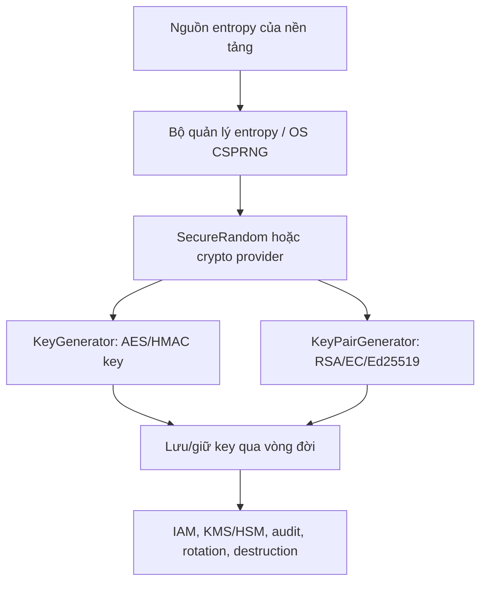
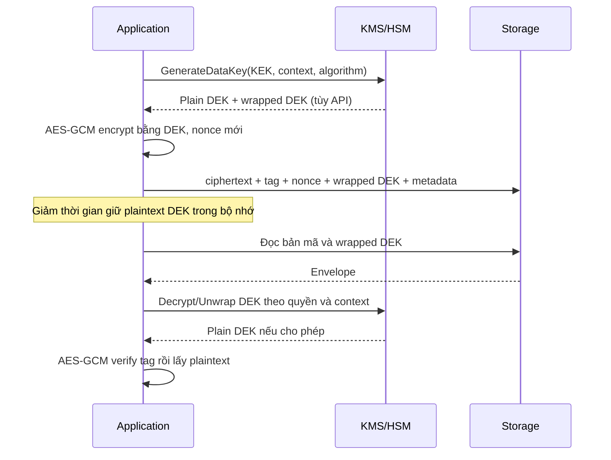
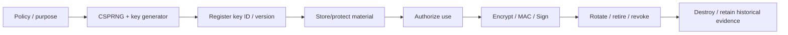

# Random key generation (Sinh khóa mật mã ngẫu nhiên an toàn)

Trong chương **Secure randomness** của module **SECURITY_KEY_MANAGEMENT_FUNDAMENTALS**, **random key generation** là quá trình tạo vật liệu khóa mật mã bằng nguồn ngẫu nhiên có chất lượng bảo mật và thuật toán sinh khóa phù hợp. Một khóa AES dài 256 bit không tự đạt mức an toàn kỳ vọng chỉ vì có 32 byte: nếu các byte được tạo từ thời gian hệ thống, số thứ tự, một seed có thể đoán hoặc bộ sinh bị lỗi thì kẻ tấn công có thể thu hẹp đáng kể không gian tìm kiếm khóa.

**Sinh khóa an toàn là điểm khởi đầu của toàn bộ vòng đời khóa**: tạo, đăng ký, cấp phát, lưu trữ, sử dụng, xoay vòng, thu hồi và hủy. Dù ứng dụng dùng AES-GCM, HMAC, RSA, ECDSA, Ed25519, KMS/HSM hay envelope encryption, nguồn ngẫu nhiên không đạt yêu cầu có thể làm mất bảo mật ngay từ lúc khóa được tạo. Nhưng tạo khóa ngẫu nhiên tốt cũng **chưa đủ**: nếu khóa bị ghi vào log, cấp quyền quá rộng hoặc không thể xoay vòng, hệ thống vẫn có thể bị xâm phạm.

## 1. Mục tiêu học tập

Sau bài học, bạn có thể:

- Giải thích **entropy**, **CSPRNG**, **DRBG**, seed, reseed, khóa đối xứng và cặp khóa bất đối xứng ở mức phù hợp để thiết kế hệ thống.
- Phân biệt độ dài khóa với độ khó đoán thực tế; nhận biết khóa ngẫu nhiên, khóa dẫn xuất từ mật khẩu và khóa do KMS/HSM tạo.
- Chọn API thích hợp để sinh khóa AES, HMAC, khóa ký số và khóa thỏa thuận bằng Java; tránh dùng `Random`, timestamp hoặc seed cố định.
- Phân biệt **random key**, **nonce/IV**, **salt**, **token** và **ECDSA signing nonce** — chúng có yêu cầu khác nhau.
- Thiết kế quy trình tạo DEK/KEK trong envelope encryption, phân quyền sử dụng khóa và kiểm toán mà không lộ vật liệu khóa.
- Nhận diện vấn đề entropy lúc khởi động, snapshot/clone máy ảo, môi trường phân tán, kiểm thử và khôi phục sau sự cố.

## 2. Ba khái niệm nền tảng: độ dài, entropy và tính khó đoán

### 2.1. Độ dài khóa không đồng nghĩa entropy

Một khóa đối xứng `K` có `n` bit, nếu được chọn **đồng đều và độc lập** từ mọi chuỗi `n` bit, có không gian khóa gồm `2^n` giá trị và xác suất đoán đúng trong một lần thử lý tưởng là `1/2^n`.

Nhưng xét hai trường hợp cùng tạo ra 32 byte:

```text
Khóa A (32 byte):
  SecureRandom/CSPRNG phù hợp -> 32 byte khó dự đoán

Khóa B (32 byte):
  SHA-256("2026-11-28")       -> 32 byte có thể tính lại

Cả A và B đều dài 256 bit.
Chỉ riêng độ dài không bảo đảm B có 256 bit entropy.
```

Hash một giá trị dễ đoán thành 256 bit **không tạo thêm entropy**. Tương tự, lặp lại chuỗi UUID, ghép `userId` với thời gian hoặc Base64-encode mật khẩu không biến nguồn đầu vào thành khóa mật mã ngẫu nhiên.

**Entropy** là đại lượng mô tả độ bất định của nguồn theo mô hình xác suất. Trong bảo mật khóa, điều quan trọng là đối thủ không thể dự đoán giá trị được chọn. Các đánh giá về **min-entropy** liên quan đến khả năng đoán giá trị có xác suất cao nhất. Không thể kết luận nguồn đủ entropy chỉ bằng việc nhìn chuỗi có vẻ “lộn xộn”, chuỗi dài hoặc vượt qua một vài phép kiểm tra thống kê.

### 2.2. CSPRNG và PRNG thông thường

| Loại bộ sinh | Mục đích | Ví dụ | Dùng để tạo khóa bí mật? |
| --- | --- | --- | --- |
| **PRNG phi mật mã** | Mô phỏng, kiểm thử thuật toán, game hoặc lấy mẫu thống kê. | `java.util.Random`, `SplittableRandom` và các bộ sinh hiệu năng cao. | **Không.** Có thể dự đoán khi biết đủ trạng thái/đầu ra, không được thiết kế cho khóa. |
| **CSPRNG** | Tạo dữ liệu khó dự đoán để dùng trong mật mã. | `java.security.SecureRandom` qua provider phù hợp. | **Có**, khi cấu hình và môi trường cung cấp entropy đúng. |
| **DRBG** | Bộ sinh bit xác định theo thuật toán mật mã, được khởi tạo từ entropy và quản lý trạng thái. | Hash/HMAC/CTR DRBG trong các triển khai được đánh giá. | **Có**, nếu khởi tạo, reseed và vận hành đúng hợp đồng bảo mật. |
| **Bộ sinh bên trong HSM/KMS** | Tạo vật liệu khóa trong ranh giới bảo vệ của nhà cung cấp. | API `GenerateKey`, `GenerateDataKey`, `GenerateKeyPair` tùy dịch vụ. | Thường phù hợp khi dùng đúng thuật toán và chính sách; cần đánh giá bảo đảm của nhà cung cấp. |

**CSPRNG là một cơ chế phần mềm/hệ thống**, không có nghĩa phải thu thập một mẫu entropy phần cứng mới cho *từng bit đầu ra*. Một DRBG được seed đầy đủ có thể tạo nhiều byte trông ngẫu nhiên bằng trạng thái mật mã và được reseed theo chính sách. Độ an toàn phụ thuộc trạng thái không bị lộ, nguồn entropy ban đầu, giới hạn output và cách cập nhật trạng thái.

Các yêu cầu thường được phân biệt:

- **Unpredictability:** đối thủ không đoán được byte tiếp theo khi không biết trạng thái bí mật.
- **Backtracking resistance:** sau khi một trạng thái bị lộ, không dễ tính lại mọi output trước đó trong thiết kế được đánh giá; không phải mọi triển khai đều có bảo đảm giống nhau.
- **Prediction resistance:** có thể cần reseed/entropy mới để ngăn dự đoán output về sau khi trạng thái từng bị lộ; đây là thuộc tính/cách vận hành cụ thể, không nên tự gán cho mọi CSPRNG.
- **Uniqueness:** một giá trị không lặp trong phạm vi yêu cầu. Tính khó đoán **không tự chứng minh tính không lặp tuyệt đối**.

### 2.3. Những nguồn entropy đáng tin trong hệ điều hành

Các hệ điều hành hiện đại có cơ chế thu thập, trộn và quản lý entropy cho **OS CSPRNG**. Ứng dụng nên dùng API bảo mật của runtime/hệ điều hành thay vì tự thu thập nhịp gõ, thời gian CPU, nhiệt độ, PID hoặc truy vấn mạng để làm seed.



Trong hệ thống nhúng, container, máy ảo hoặc thiết bị mới khởi động, cần kiểm tra môi trường có **nguồn entropy và CSPRNG được khởi tạo an toàn**. Tránh tự khẳng định “chạy trong container nên luôn thiếu entropy” hoặc “sử dụng `SecureRandom` chắc chắn an toàn bất kể provider”: hành vi thực tế phụ thuộc OS, JVM, chính sách FIPS, provider và cách triển khai.

## 3. Sinh khóa là một quy trình, không chỉ là lời gọi hàm

Một quy trình sinh khóa cần có các quyết định trước, trong và sau bước tạo byte:

| Bước | Câu hỏi thiết kế | Kiểm soát bắt buộc |
| --- | --- | --- |
| **1. Chọn mục đích** | Khóa dùng cho AES-GCM, HMAC, chữ ký số, trao đổi khóa, KEK hay DEK? | Một purpose/algorithm rõ ràng, không tái sử dụng khóa giữa các mục đích tùy tiện. |
| **2. Chọn thuật toán/tham số** | AES-128/256, RSA, P-256, Ed25519, X25519...? | Dùng bộ tham số/đường cong chuẩn; tương thích policy và thư viện. |
| **3. Chọn ranh giới sinh khóa** | Trong KMS/HSM hay ở runtime ứng dụng? | Xác định khóa có được xuất ra hay non-exportable; ai có quyền tạo. |
| **4. Cấp nguồn ngẫu nhiên** | API CSPRNG/provider được cấp entropy và vận hành ra sao? | Không dùng `Random`, seed dễ đoán, nguồn ngẫu nhiên tự chế. |
| **5. Sinh khóa** | Tạo byte bí mật hay gọi key generator có kiểm tra miền giá trị? | Với bất đối xứng, dùng thuật toán sinh key pair chuyên dụng, không tự tạo scalar/prime bằng cách tùy tiện. |
| **6. Đăng ký metadata** | `keyId`, version, purpose, owner, tenant, thời hạn và trạng thái? | Tách metadata khỏi vật liệu khóa; ghi nguồn gốc và audit phù hợp. |
| **7. Cấp phát/sử dụng** | Ai được `Encrypt`, `Decrypt`, `Sign`, `Verify` hoặc `GenerateMac`? | IAM tối thiểu, bảo vệ bộ nhớ, cấm log secret. |
| **8. Rotation và hủy** | Khi nào thay key; làm sao đọc dữ liệu/chữ ký cũ? | Định nghĩa rewrap/re-encrypt, thu hồi quyền và xóa bản sao khi hết nhu cầu. |

Một khóa sinh an toàn nhưng được đặt vào biến môi trường của container, ghi ra stdout hoặc chia sẻ cho nhiều tenant mà không kiểm soát vẫn có thể bị lộ. **Chất lượng random và quản trị khóa là hai lớp bảo vệ bổ sung, không thay thế nhau.**

## 4. Sinh khóa đối xứng: AES, HMAC và DEK

### 4.1. Sinh khóa AES

AES có các độ dài khóa chuẩn **128, 192 và 256 bit**. Với hệ thống mới, thường chọn AES-128 hoặc AES-256 theo mức an toàn yêu cầu, hỗ trợ của nền tảng và chính sách. Khóa AES phải là byte được chọn đúng bằng cơ chế bảo mật, không phải chuỗi ký tự đơn giản được băm hoặc cắt.

```text
ĐÚNG theo mục đích:
  CSPRNG -> khóa AES 256 bit (32 byte)

SAI:
  "MyCompanySecretKey2026".getBytes(...) -> làm khóa
  SHA256("tenant-42")                    -> làm khóa
  Random(seed = currentTimeMillis())     -> sinh 32 byte
```

Hash một **root secret có entropy cao** qua một KDF chuẩn có thể dùng để dẫn xuất khóa theo purpose, nhưng đó là **key derivation**, không đồng nghĩa tự sinh một khóa mới độc lập từ entropy của CSPRNG.

### 4.2. Sinh khóa HMAC

HMAC cần một khóa bí mật được chọn an toàn. Một lựa chọn phổ biến cho **HMAC-SHA256** là khóa ngẫu nhiên 256 bit (32 byte). HMAC không yêu cầu khóa phải giống một chuỗi có thể đọc; không sinh secret bằng `UUID.randomUUID().toString()` rồi mặc định đủ mạnh cho mọi purpose.

Một HMAC key có thể được dùng để tạo/kiểm tra tag; các bên nắm cùng secret đều có khả năng tạo MAC. Khi cần verifier **không thể ký thay**, dùng chữ ký số bất đối xứng thay HMAC theo giao thức.

### 4.3. DEK và KEK trong envelope encryption

**Data Encryption Key (DEK)** là khóa đối xứng thực sự mã hóa nội dung; **Key Encryption Key (KEK)** bảo vệ DEK. KMS có thể sinh DEK, cung cấp bản rõ trong một phản hồi được bảo vệ cho workload được phép và bản **wrapped/encrypted DEK** để lưu với ciphertext, tùy API.



**Sinh ngẫu nhiên DEK không đồng nghĩa đã quản lý xong DEK**. Còn cần version, phạm vi tenant, quản lý nonce/tag, quyền unwrap, audit, khôi phục và xử lý backup. **Xoay KEK** có thể dẫn đến rewrap DEK mà không phải mã hóa lại ciphertext, khi thiết kế và chính sách cho phép; **lộ DEK** có thể buộc phải tạo DEK mới và re-encrypt. Nếu một KEK hoặc DEK đã bị lộ, đổi alias mà giữ nguyên vật liệu khóa không xử lý được sự cố.

### 4.4. Sinh ngẫu nhiên khác dẫn xuất khóa

| Nhu cầu | Nguồn đầu vào | Cách giải quyết | Điểm khác biệt |
| --- | --- | --- | --- |
| Khóa AES mới độc lập | Entropy từ CSPRNG hoặc dịch vụ sinh khóa đáng tin | `KeyGenerator`, KMS `GenerateDataKey` | Tạo vật liệu khóa mới. |
| Khóa MAC riêng từ root DEK | Root secret có entropy cao | HKDF có `salt`/`info` theo giao thức | Dẫn xuất khóa với domain separation; không cần lấy entropy mới cho từng khóa con. |
| Khóa mã hóa từ passphrase | Mật khẩu dễ đoán của người dùng | Argon2id/scrypt/PBKDF2 theo chính sách | Làm tốn chi phí đoán mật khẩu; đầu ra không “tự có” 256 bit entropy. |
| Khóa phiên từ ECDH | Shared secret thỏa thuận từ private/public key | HKDF hoặc KDF được giao thức quy định | Cần xác thực peer/transcript; không dùng secret thô trực tiếp làm AES key. |

## 5. Sinh khóa bất đối xứng: private key không phải mảng byte tùy tiện

Với mật mã bất đối xứng, **private key** là vật liệu bí mật có cấu trúc toán học và **public key** được tính tương ứng. Thư viện key generation phải thực thi các ràng buộc của thuật toán, ví dụ chọn private scalar hợp lệ hoặc sinh các số nguyên tố theo tiêu chuẩn.

| Loại khóa | Công dụng | Cách sinh đúng | Sai lầm thường gặp |
| --- | --- | --- | --- |
| **RSA key pair** | Ký RSA-PSS hoặc mục đích khác theo protocol. | `KeyPairGenerator`/HSM tạo modulus và private/public parameters đúng chuẩn. | Lấy 32 byte ngẫu nhiên rồi gán là RSA private key; tự sinh prime yếu. |
| **ECDSA P-256** | Private key ký, public key xác minh. | Provider sinh scalar hợp lệ trên đường cong `secp256r1`. | Tự cắt digest/timestamp thành scalar không đúng miền, dùng nonce ký ECDSA yếu. |
| **Ed25519** | Chữ ký EdDSA. | Dùng `KeyPairGenerator.getInstance("Ed25519")` hoặc HSM hỗ trợ. | Tái sử dụng trực tiếp cùng byte private key cho X25519 hoặc AES. |
| **X25519** | Thỏa thuận khóa Diffie–Hellman. | Dùng bộ sinh và phép thỏa thuận X25519 chuẩn. | Coi khóa X25519 là Ed25519 signing key; không xác thực peer. |

Độ dài RSA modulus 2048/3072/4096 bit **không đồng nghĩa** entropy private key bằng chính con số đó. Mức bảo mật phụ thuộc vào độ khó bài toán, thuật toán, tham số và chất lượng sinh khóa. Hệ thống phải lựa chọn theo chính sách, mức an toàn, hiệu năng và hỗ trợ của KMS/HSM.

**Không dùng private key ký để giải mã tùy tiện.** RSA ký và mã hóa cần scheme/padding riêng; ECDSA/Ed25519 là thuật toán ký, không phải công cụ mã hóa nội dung. Trong thực tế, nhiều hệ thống dùng **chữ ký bất đối xứng để xác thực** và **AES-GCM để mã hóa dữ liệu**.

### 5.1. Nonce của ECDSA không giống private key được sinh một lần

ECDSA có một giá trị bí mật tạm thời thường gọi là **signing nonce `k`** cho từng chữ ký. Nếu `k` bị lặp hoặc có thể đoán trong những điều kiện tấn công phù hợp, private key có thể bị khôi phục. Vì vậy:

- Dùng thư viện ký ECDSA đã được đánh giá, với nguồn random phù hợp hoặc cách sinh nonce xác định theo chuẩn được hỗ trợ.
- Không cố định `k`, không tái sử dụng `k` giữa các thông điệp và không tự viết phép ký.
- Không đồng nhất `k` với IV/nonce AES-GCM hay với identifier của bản ghi.

Ed25519 thường dùng quy trình ký có tính xác định, nhưng điều đó không có nghĩa khóa được phép xuất ra khỏi HSM hoặc quyền `Sign` không thể bị lạm dụng.

## 6. Java 17: tạo AES key, HMAC key và cặp khóa

Trong Java, API chủ đạo là:

- `java.security.SecureRandom`: nguồn byte phục vụ mật mã qua provider của nền tảng.
- `javax.crypto.KeyGenerator`: tạo khóa bí mật theo thuật toán, ví dụ AES.
- `java.security.KeyPairGenerator`: tạo cặp khóa bất đối xứng.
- `javax.crypto.SecretKey` và `java.security.KeyPair`: đại diện khóa/cặp khóa, không phải định dạng lưu trữ lâu dài.

### 6.1. Sinh các khóa bằng Java JCA

Ví dụ Java 17 dưới đây sử dụng `SecureRandom` do provider hệ thống cung cấp, tạo AES-256 key, HMAC-SHA256 key và cặp khóa Ed25519. Code **không in giá trị bí mật**; kết quả chỉ cho biết một số thuộc tính và việc tạo khóa hoàn tất.

```java
import java.security.KeyPair;
import java.security.KeyPairGenerator;
import java.security.SecureRandom;
import java.util.Arrays;
import javax.crypto.KeyGenerator;
import javax.crypto.SecretKey;
import javax.crypto.spec.SecretKeySpec;

public final class RandomKeyGenerationDemo {
    public static void main(String[] args) throws Exception {
        // Dùng CSPRNG của provider phù hợp; không setSeed bằng hằng số.
        SecureRandom rng = new SecureRandom();

        // Sinh AES-256 key qua key generator (32 byte).
        KeyGenerator aesGen = KeyGenerator.getInstance("AES");
        aesGen.init(256, rng);
        SecretKey aesKey = aesGen.generateKey();

        // HMAC-SHA256: bí mật 32 byte chọn bằng CSPRNG.
        byte[] macBytes = new byte[32];
        rng.nextBytes(macBytes);
        SecretKey macKey = new SecretKeySpec(macBytes, "HmacSHA256");

        // Sinh cặp khóa ký Ed25519 qua API đã hiểu cấu trúc khóa.
        KeyPairGenerator edGen = KeyPairGenerator.getInstance("Ed25519");
        KeyPair signingKeyPair = edGen.generateKeyPair();

        System.out.println("AES algorithm: " + aesKey.getAlgorithm());
        System.out.println("HMAC algorithm: " + macKey.getAlgorithm());
        System.out.println("Public key algorithm: "
                + signingKeyPair.getPublic().getAlgorithm());

        // Demo: xóa bản sao byte do ứng dụng đang sở hữu.
        // SecretKeySpec giữ bản sao riêng của key nên không bị xóa tại đây.
        Arrays.fill(macBytes, (byte) 0);

        // KHÔNG ghi aesKey.getEncoded(), privateKey.getEncoded()
        // hoặc macKey.getEncoded() vào log/source.
        // Với production, sinh/lưu key bằng KMS/HSM/keystore phù hợp.
    }
}
```

Chương trình giả định provider hỗ trợ AES-256 và Ed25519. Nếu môi trường tuân thủ có bộ provider hạn chế, cần kiểm tra thuật toán và cách lưu khóa được hỗ trợ, **không tự fallback sang `Random` hoặc một khóa hard-code**.

Lưu ý: `SecretKeySpec` có thể chứa bản sao vật liệu khóa; việc gọi `Arrays.fill(macBytes, 0)` chỉ xóa mảng nguồn, **không xóa mọi bản sao trong Java heap/provider**. `SecretKey.getEncoded()` đôi khi trả về vật liệu khóa rõ, nhưng khóa non-exportable do KMS/HSM quản lý có thể **không cung cấp** byte để xuất. Đừng thiết kế production phụ thuộc việc phải đọc khóa thô từ tất cả provider.

### 6.2. Dùng khóa đã sinh với AES-GCM: khóa khác nonce

Đoạn Java sau minh họa hai yêu cầu độc lập: sinh **AES key bằng `KeyGenerator`**, còn tạo **nonce 12 byte** mới cho một lần mã hóa. Đây là **ví dụ một lần mã hóa với key mới**; trong hệ thống dùng một khóa cho nhiều thông điệp, phải có chiến lược bảo đảm nonce không lặp theo khóa và giới hạn số lần mã hóa.

```java
import java.nio.charset.StandardCharsets;
import java.security.SecureRandom;
import java.util.Arrays;
import javax.crypto.Cipher;
import javax.crypto.KeyGenerator;
import javax.crypto.SecretKey;
import javax.crypto.spec.GCMParameterSpec;

public final class GeneratedKeyGcmDemo {
    public static void main(String[] args) throws Exception {
        SecureRandom rng = new SecureRandom();

        KeyGenerator generator = KeyGenerator.getInstance("AES");
        generator.init(256, rng);
        SecretKey dek = generator.generateKey();

        byte[] nonce = new byte[12]; // 96-bit nonce GCM phổ biến
        rng.nextBytes(nonce);

        byte[] aad = "schema=v1|tenant=t7|record=r18"
                .getBytes(StandardCharsets.UTF_8);
        byte[] plaintext = "Dữ liệu cần mã hóa"
                .getBytes(StandardCharsets.UTF_8);

        Cipher enc = Cipher.getInstance("AES/GCM/NoPadding");
        enc.init(Cipher.ENCRYPT_MODE, dek, new GCMParameterSpec(128, nonce));
        enc.updateAAD(aad);
        byte[] ciphertextAndTag = enc.doFinal(plaintext);

        Cipher dec = Cipher.getInstance("AES/GCM/NoPadding");
        dec.init(Cipher.DECRYPT_MODE, dek, new GCMParameterSpec(128, nonce));
        dec.updateAAD(aad);
        byte[] recovered = dec.doFinal(ciphertextAndTag);

        System.out.println("Round-trip valid: "
                + Arrays.equals(plaintext, recovered));
        Arrays.fill(plaintext, (byte) 0);
        Arrays.fill(recovered, (byte) 0);

        // Lưu nonce + ciphertextAndTag + wrapped DEK và metadata phù hợp.
        // Không log plaintext DEK hoặc tái sử dụng nonce cho key này.
    }
}
```

Ví dụ này không quản lý backup hay distributed uniqueness. Một nonce ngẫu nhiên từ CSPRNG có **nguy cơ va chạm khác không** khi mã hóa nhiều thông điệp dưới cùng key; một số giao thức/ứng dụng thích hợp hơn với bộ cấp phát counter/nonce duy nhất hoặc **DEK riêng cho từng đối tượng**. Không sử dụng cùng cặp **key + nonce** cho hai thông điệp AES-GCM.

## 7. Khóa ngẫu nhiên, IV/nonce, salt và token khác nhau thế nào?

Mọi giá trị dưới đây có thể được lấy từ CSPRNG, nhưng **mục tiêu bảo mật và vòng đời không giống nhau**:

| Giá trị | Cần bí mật? | Thuộc tính quan trọng nhất | Ví dụ |
| --- | --- | --- | --- |
| **AES/HMAC secret key** | **Có.** | Khó đoán, đủ entropy, chỉ cấp đúng purpose và phạm vi. | DEK AES-256, HMAC key 32 byte. |
| **Asymmetric private key** | **Có.** | Sinh theo thuật toán, giữ riêng tư, giới hạn quyền ký/thỏa thuận. | Ed25519 private key, ECDSA P-256 scalar. |
| **Public key** | Không; nhưng phải **được xác thực nguồn gốc**. | Đúng thuật toán, đúng cặp khóa và đúng danh tính/issuer. | JWKS, X.509. |
| **Nonce/IV** | Thường **không**. | Không trùng trong phạm vi khóa và giao thức; đôi khi thêm yêu cầu ngẫu nhiên/không dự đoán. | AES-GCM 96-bit nonce, AES-CTR initial counter block. |
| **Salt của password KDF** | Không. | Ngẫu nhiên và đủ khác nhau giữa verifier, theo tham số thuật toán. | Salt 16 byte cho Argon2id. |
| **Bearer token / session secret** | **Có.** | Khó đoán, giới hạn quyền, TTL, thu hồi và bảo vệ khi truyền/lưu. | Token khôi phục mật khẩu ngẫu nhiên. |
| **Request ID** | Thường không. | Khả năng định danh và tránh trùng theo use case; không tự tạo quyền. | `requestId`/correlation ID. |
| **ECDSA ephemeral signing nonce `k`** | **Có.** | Bí mật và đúng quy trình sinh riêng cho mỗi chữ ký. | Nonce nội bộ ECDSA. |

### 7.1. Random không có nghĩa chắc chắn unique

Tạo nonce bằng CSPRNG không phải lời hứa rằng nonce **không bao giờ lặp**. Với các lựa chọn độc lập, xác suất va chạm tăng khi số mẫu tăng (liên quan birthday bound). Trong một hệ thống có số lượng thông điệp lớn, sử dụng nonces ngẫu nhiên dưới cùng một key phải được **giới hạn khối lượng** và đánh giá kỹ. Nếu giao thức yêu cầu uniqueness nghiêm ngặt, hãy dùng bộ cấp phát counter/nonce được thiết kế không lặp.

Đặc biệt:

- **AES-GCM** không được lặp nonce với cùng key; việc lặp có thể phá vỡ bí mật và xác thực.
- **AES-CTR** không được lặp dãy counter block với cùng key, kể cả khi IV ban đầu không trùng nhưng hai dãy chồng lấn.
- **AES-CBC** có yêu cầu IV khác theo cơ chế của CBC; không suy rằng quy tắc của GCM hoặc CTR có thể áp dụng nguyên xi.
- **Salt** có thể công khai nhưng cần được sinh theo profile phù hợp; mục đích chính của salt khác với nonce AEAD.

### 7.2. Không dùng ID để thay random key

UUID, sequence number và timestamp có thể giúp truy vết bản ghi, nhưng không phải lựa chọn mặc định cho secret key. Một identifier có thể có đủ tính duy nhất cho database mà **không có đủ unpredictability** để làm bearer token hoặc khóa mật mã.

Khi cần bearer token ngẫu nhiên, có thể tạo 32 byte bằng CSPRNG rồi encode Base64URL để vận chuyển; token phải được giới hạn quyền/thời hạn, bảo vệ khỏi log và cân nhắc lưu dạng verifier (ví dụ hash/HMAC theo thiết kế phù hợp) thay vì plaintext. **Encoding không tăng entropy**.

## 8. Hệ phân tán, máy ảo và những tình huống entropy khó thấy

Các môi trường phân tán dễ gặp lỗi không phải vì CSPRNG “không dùng được trên cloud”, mà vì **cách seed/trạng thái, clone, snapshot và quản lý phạm vi sử dụng khóa** không được hiểu đúng.

### 8.1. Snapshot và clone trạng thái bộ sinh

Nếu một VM/process được clone từ snapshot trong đó trạng thái bộ sinh xác định đã bị sao chép, hai instance có thể sinh **cùng chuỗi output** nếu không có cơ chế reseed/phân tách trạng thái thích hợp. CSPRNG của OS/provider hiện đại có thể có cơ chế phòng vệ; ứng dụng không nên tự thay bằng DRBG custom khó quản lý, đặc biệt trong môi trường snapshot/restore.

Các bước vận hành hợp lý:

- Dùng **OS CSPRNG** thông qua API được hỗ trợ; để provider/runtime phụ trách khởi tạo và reseed theo thiết kế của nó.
- Đánh giá tài liệu provider khi triển khai image/VM clone hàng loạt, môi trường embedded hoặc bộ sinh chạy trong HSM.
- Không đóng gói **seed bí mật, private key hoặc bộ sinh custom có trạng thái cố định** vào image/container template.
- Xem xét kiểm thử khôi phục từ snapshot, tạo mới instance và rolling restart dưới điều kiện tải cao.
- Giám sát lỗi provider và lỗi key generation; **không tự fallback** sang PRNG yếu khi hệ thống không thể sinh khóa an toàn.

### 8.2. Nhiều node cùng sinh khóa

Nếu hai node tạo **các khóa độc lập** bằng CSPRNG được khởi tạo đúng, chúng không cần một bộ đếm toàn cục chỉ để tránh trùng khóa ngẫu nhiên 256 bit trong vận hành thông thường. Nhưng nếu cùng dùng một **khóa AES dài hạn**, việc cấp phát **nonce/IV** dưới khóa đó phải phối hợp theo quy tắc thuật toán. Đây là hai bài toán khác nhau.

Ví dụ:

```text
Node A: GenerateDataKey(KMS) -> DEK_A
Node B: GenerateDataKey(KMS) -> DEK_B

DEK_A, DEK_B độc lập:
  Phạm vi nonce riêng theo từng DEK.

Node A và B chia sẻ cùng DEK_X:
  Phải tránh trùng nonce / counter block trên toàn bộ node.
  Cần chiến lược phối hợp, phân vùng hoặc cấp phát theo giao thức.
```

Một hệ thống có thể chọn **DEK riêng cho mỗi bản ghi** để giảm phạm vi tác động và đơn giản hóa quản lý nonce; đổi lại phải cân nhắc chi phí KMS, metadata lưu trữ, cache và throughput.

### 8.3. Deterministic testing không được tràn vào production

Kiểm thử đôi khi muốn tạo dữ liệu giả lặp lại để có kết quả ổn định. Dùng PRNG có seed cố định **cho test fixture không chứa bí mật** có thể hợp lý. Nhưng không đưa cách đó vào code sinh khóa thật.

```text
Test data:
  Random(12345) -> thứ tự mẫu có thể tái tạo (không bí mật)

Production secret:
  SecureRandom / provider được đánh giá -> khóa khó dự đoán

Nguy hiểm:
  "Để test pass, setSeed(12345) cho SecureRandom trong production"
```

Trong Java, hành vi `SecureRandom.setSeed` và các provider có thể khác nhau; một provider có thể dùng seed bổ sung thay vì thay thế entropy hiện có. Vì thế không dựa vào `setSeed` cố định để đòi deterministic behavior, và **không tự xây một lớp “SecureRandom giả”** dùng trong production. Thử nghiệm mật mã nên dùng test vectors của thuật toán và các abstraction có ranh giới rõ, không làm yếu bộ sinh khóa runtime.

## 9. Sinh khóa tại ứng dụng hay trong KMS/HSM?

Hai mô hình phổ biến:

**Mô hình A — ứng dụng sinh khóa:** workload dùng CSPRNG và key generator chuẩn để tạo DEK hoặc secret tạm thời. Nó chịu trách nhiệm bảo vệ plaintext key trong bộ nhớ, mã hóa/bọc khóa an toàn và lưu metadata.

**Mô hình B — KMS/HSM sinh khóa:** ứng dụng gọi API tạo khóa; vật liệu khóa riêng hoặc KEK có thể được giữ trong ranh giới không xuất được. Với DEK, API có thể trả cả bản rõ và bản bọc cho workload được phép, hoặc thực hiện mã hóa bên trong KMS/HSM theo cơ chế dịch vụ.

| Tiêu chí | Sinh trong ứng dụng | Sinh trong KMS/HSM |
| --- | --- | --- |
| **Nguồn CSPRNG** | Phụ thuộc JVM/OS/provider. | Phụ thuộc dịch vụ/thiết bị và bảo đảm đã được đánh giá. |
| **Khả năng xuất plaintext key** | Thường có trong bộ nhớ ứng dụng. | Có thể non-exportable với KEK/private key; DEK tùy API có thể được xuất theo quyền. |
| **Kiểm soát quyền** | Kết hợp IAM ứng dụng, secrets store, keystore và bảo vệ runtime. | Có thể dùng key policy, IAM/ACL, audit, dual control tùy nền tảng. |
| **Giới hạn tài nguyên** | RAM, CPU và khả năng bảo vệ máy chủ ứng dụng. | API quota, độ trễ, availability, cost và hạn chế thuật toán. |
| **Vòng đời** | Ứng dụng tự theo dõi key ID, backup, rotation và destruction. | KMS/HSM thường hỗ trợ metadata, audit và các thao tác quản trị theo API. |
| **Tấn công lạm dụng quyền** | App bị chiếm quyền có thể đọc key nằm trong bộ nhớ. | App bị chiếm quyền vẫn có thể gọi `Sign`/`Decrypt`/`GenerateDataKey` nếu được cấp quyền. |

**Không mặc định** mọi sản phẩm có cùng API `GenerateKey`, hỗ trợ tất cả curve, cho phép import/export hoặc cùng bảo đảm non-exportable. Với dữ liệu có yêu cầu kiểm định, cần chọn provider/thiết bị đáp ứng chuẩn và chính sách của tổ chức.

### 9.1. Nguồn gốc khóa và provenance

Metadata vận hành có thể lưu:

- `keyId` và `keyVersion` hoặc tham chiếu khóa thật;
- `algorithm`, `purpose`, key size/curve, `owner`, `tenantScope`, `environment`;
- `origin`: sinh trong KMS/HSM, ứng dụng sinh, import từ nguồn đã phê duyệt, hoặc derivation theo policy;
- thời điểm tạo, kích hoạt, hết hạn sử dụng, rotation và trạng thái;
- danh tính người/workload yêu cầu, `requestId`, kết quả, sự kiện policy và thao tác hủy.

**Không log khóa**, seed bí mật, plaintext DEK, private key, HMAC secret hay output CSPRNG được dùng làm token. Audit giúp biết **ai đã yêu cầu tạo khóa**, nhưng không chứng minh tự động rằng entropy provider đã đủ mạnh; đây còn là vấn đề cấu hình, đánh giá triển khai và health checks phù hợp.

### 9.2. Kiểm tra độ mạnh của random bằng test có đủ không?

Không thể xác nhận khóa mật mã an toàn chỉ bằng việc nhìn giá trị có phân bố tương đối đều trong vài mẫu, hoặc chạy một bài test thống kê đơn giản rồi kết luận “đã kiểm định CSPRNG”.

- **Kiểm thử chức năng** xác nhận API tạo được khóa đúng thuật toán và sử dụng được theo hợp đồng.
- **Kiểm thử tích hợp** xác nhận provider được chọn, các điều kiện startup, failover, restore, backup và IAM không tạo khóa thiếu an toàn.
- **Health tests/entropy assessment** thuộc thiết kế bộ sinh hoặc thiết bị, cần căn cứ chuẩn và đánh giá của nhà cung cấp khi áp dụng.
- **Audit** xác định thao tác và chủ thể; không thay chứng cứ chất lượng mật mã của bộ sinh.

Không ghi khóa thực vào log chỉ để “kiểm tra xem có random hay không”.

## 10. Vòng đời khóa sau khi sinh

Một yêu cầu thường gặp là “khóa đã được tạo bằng `SecureRandom`, vậy đã an toàn chưa?”. Câu trả lời: mới hoàn thành giai đoạn **generation**.



| Giai đoạn | Vấn đề nếu làm sai | Kiểm soát liên quan |
| --- | --- | --- |
| **Tạo** | Khóa đoán được do PRNG/seed yếu. | CSPRNG/HSM, thuật toán chuẩn, cấu hình đúng. |
| **Cấp phát** | Khóa của tenant này được dùng ở tenant khác. | Key ID, purpose, tenant, IAM, metadata. |
| **Lưu trữ** | Key xuất hiện trong source, log hoặc backup không mã hóa. | Non-exportable/keystore/wrapping, kiểm soát truy cập. |
| **Sử dụng** | Trùng nonce GCM, dùng chung HMAC key, lạm dụng quyền `Sign`. | Policy thuật toán, key separation, audit, kiểm soát input. |
| **Xoay vòng** | Chỉ đổi alias; khóa cũ còn hoạt động hoặc dữ liệu không đọc được. | Key version, rotation plan, DEK/KEK rewrap/re-encrypt, giữ verifier phù hợp. |
| **Thu hồi** | Key lộ vẫn dùng được trong service khác. | Vô hiệu hóa quyền, cập nhật trust, đánh giá phạm vi sự cố. |
| **Hủy** | Xóa key quá sớm làm mất dữ liệu; quá muộn tăng bề mặt rủi ro. | Kiểm kê bản sao/backup, thời hạn lưu, tiêu hủy có phê duyệt. |

### 10.1. Xoay KEK và xoay DEK: khác nhau về dữ liệu

- **Xoay KEK**: có thể bọc lại cùng DEK dưới KEK/phiên bản mới nếu hệ thống hỗ trợ; ciphertext có thể không đổi.
- **Xoay DEK**: phải tạo DEK mới và mã hóa lại dữ liệu (hoặc có quy trình chuyển đổi phù hợp). Nếu DEK đã lộ, chỉ rewrap nó dưới KEK mới **không** làm bí mật dữ liệu được khôi phục.
- **Xoay signing key**: tạo cặp khóa mới và chuyển việc ký mới; public key cũ có thể cần giữ để xác minh chữ ký lịch sử.
- **Xoay HMAC key**: hai phía cần phối hợp thời gian dùng khóa mới, cửa sổ chấp nhận khóa cũ và chống replay.

Nếu khóa nghi bị tạo từ nguồn ngẫu nhiên yếu, cần coi đây là **nguy cơ lộ vật liệu khóa**, không chỉ sửa bộ sinh cho các lần tạo sau. Phải xác định tất cả khóa đã tạo trong khoảng thời gian ảnh hưởng và đánh giá việc thay khóa, re-encrypt, phát hành lại chữ ký/chứng chỉ và hậu quả đối với dữ liệu lịch sử.

## 11. Tình huống thực tế: hệ thống đơn hàng và tài liệu ký số

Một nền tảng lưu hóa đơn PDF, phát token đăng nhập và gửi webhook cho đối tác. Các nhóm cần **ba kiểu khóa khác nhau**:

1. **Dữ liệu hóa đơn:** tạo DEK AES-256 riêng cho mỗi đối tượng hoặc phạm vi phù hợp; dùng AES-GCM với nonce/tag theo chính sách, lưu wrapped DEK dưới KEK của KMS.
2. **Token đăng nhập:** tạo cặp khóa Ed25519 hoặc thuật toán ký được giao thức hỗ trợ trong KMS/HSM; private key chỉ có quyền `Sign`, public key công bố qua JWKS tin cậy. Việc sinh private key phải đúng thuật toán, không phải 32 byte bất kỳ được gắn tên “RSA/EdDSA”.
3. **Webhook:** tạo HMAC-SHA256 secret riêng theo đối tác; không dùng chung với DEK. HMAC key cần được phân phối an toàn cho bên nhận và có lịch xoay/thu hồi.

Một hồ sơ kỹ thuật có thể nêu:

```text
Key inventory
  billing/dek/{objectId}:
    algorithm=AES-256-GCM; origin=KMS GenerateDataKey
    scope=one object; wrappedBy=kek-billing-prod

  identity/signing/{version}:
    algorithm=Ed25519; origin=KMS/HSM
    capability=Sign; publicKey=trusted JWKS

  partner/webhook/{partnerId}/{version}:
    algorithm=HMAC-SHA256; origin=approved CSPRNG/KMS
    scope=one partner; rotation window defined
```

Để kiểm toán và điều tra, không lưu key material thô trong inventory. Ghi metadata như owner, purpose, algorithm, key ID/version, trạng thái, tenant và thao tác dùng khóa. Một `keyId` biết trước **không phải secret** và tự nó không cấp quyền dùng khóa.

Nếu dịch vụ startup lỗi không lấy được entropy/provider, ứng dụng phải **không tạo fallback key dựa trên timestamp**. Nếu KMS không có sẵn, hệ thống có thể từ chối thao tác cần khóa và kích hoạt circuit breaker theo chính sách, thay vì tự sinh một KEK không thể quản lý hay log plaintext key để “phục hồi sau”.

## 12. Những lỗi thiết kế phổ biến

| Sai lầm | Nguy cơ | Cách phòng tránh |
| --- | --- | --- |
| Dùng `java.util.Random` để tạo AES/HMAC key. | Đầu ra không được thiết kế chống dự đoán mật mã. | `SecureRandom`, `KeyGenerator` hoặc KMS/HSM. |
| Dùng `currentTimeMillis`, PID, UUID/sequence làm seed duy nhất. | Đối thủ có thể thu hẹp không gian seed. | Để OS CSPRNG/provider quản lý entropy. |
| Hash một mật khẩu dễ đoán thành 32 byte rồi coi là AES-256 ngẫu nhiên. | Entropy khóa thực tế bị giới hạn bởi mật khẩu. | Với passphrase dùng password KDF như Argon2id; với random key dùng CSPRNG. |
| Hard-code hoặc copy seed/private key vào container image. | Các instance sinh lại cùng khóa hoặc kẻ đọc image khôi phục được secret. | Không lưu seed/secret trong image; dùng OS CSPRNG, KMS hoặc runtime provisioning. |
| Tự viết DRBG, phép sinh prime, scalar EC hoặc ECDSA nonce. | Lỗi toán học, seeding, bias hoặc state có thể làm lộ key. | Provider/SDK được đánh giá, đúng thuật toán. |
| Sinh một khóa AES rồi dùng lại cặp key + nonce GCM. | Có thể mất bí mật và tính toàn vẹn. | Quản lý nonce duy nhất theo key, giới hạn use hoặc tách DEK. |
| Cho rằng IV, salt, key và token có cùng yêu cầu. | Dùng cùng giá trị hoặc kiểm soát sai vòng đời. | Phân biệt bí mật, tính duy nhất, xác thực và TTL của từng loại. |
| Dùng một HMAC key cho nhiều tenant hoặc cho cả AES và HMAC. | Lộ một miền ảnh hưởng miền khác, khó điều tra. | Khóa độc lập hoặc HKDF với domain separation. |
| Log `getEncoded()`, private key, CSPRNG output để debug. | Rò secret thông qua logs/telemetry. | Chỉ log metadata và trạng thái; bảo vệ audit. |
| Cho rằng HSM giúp chặn tất cả lạm dụng. | Workload có quyền vẫn có thể gọi `Sign`/`Decrypt` trái phép. | IAM tối thiểu, policy nghiệp vụ, giới hạn tốc độ và giám sát. |
| Chỉ kiểm tra “trông ngẫu nhiên” bằng histogram. | Không phát hiện được seed đoán được hoặc lỗi mô hình an ninh. | Tin cậy provider/OS được đánh giá, cấu hình, health tests và test tích hợp. |
| Chỉ đổi alias khi phát hiện key sinh từ entropy yếu. | Key material nghi vấn vẫn tồn tại. | Tạo khóa mới thật, thay dữ liệu/chữ ký phụ thuộc và xử lý các bản sao. |
| Hủy KEK trước khi kiểm kê wrapped DEK/backup. | Dữ liệu không thể giải mã. | Kế hoạch rotation, migration, backup và destruction theo kiểm kê. |
| Cố dùng `getInstanceStrong()` cho mọi nơi vì nghĩ luôn tốt hơn. | Có thể gây độ trễ/khả năng chặn không phù hợp ở một số môi trường. | Chọn provider theo chính sách và yêu cầu thực tế, kiểm tra startup/performance. |

## 13. Checklist triển khai random key generation

1. **Purpose:** mỗi key có mục đích, algorithm, owner, môi trường và tenant rõ ràng chưa?
2. **Entropy:** ứng dụng dùng OS CSPRNG, provider hoặc KMS/HSM đáng tin thay vì PRNG/seed tự chế chưa?
3. **Key algorithm:** khóa AES/HMAC tạo bằng API thích hợp; private/public key dùng `KeyPairGenerator` hoặc dịch vụ hỗ trợ đúng cấu trúc?
4. **Key size/curve:** AES-128/256, RSA/EC/Ed25519 được chọn theo chính sách, tiêu chuẩn và hỗ trợ hạ tầng?
5. **Seeding/startup:** có đánh giá trường hợp VM/container clone, embedded, restore và lỗi provider? Không có fallback yếu?
6. **Domain separation:** DEK, KEK, signing key, HMAC key có tách purpose và phạm vi không?
7. **Nonce/IV:** có cơ chế đảm bảo uniqueness theo key và protocol, tránh nhầm khóa ngẫu nhiên với nonce ngẫu nhiên?
8. **Storage:** private key/DEK có bị ghi ra log, source, image, dump hoặc tệp cấu hình không được bảo vệ không?
9. **KMS/IAM:** key origin, exportability, quyền `GenerateDataKey`, `Encrypt`, `Decrypt`, `Sign`, rotation, backup và hủy được định nghĩa cụ thể?
10. **Audit:** có ghi thao tác tạo/đổi policy/key ID/actor mà không lộ bí mật?
11. **Rotation:** có phương án rewrap/re-encrypt, chuyển signing key/HMAC key và xác minh hoặc giải mã dữ liệu cũ?
12. **Incident response:** khi nghi ngờ entropy yếu hoặc state RNG bị lộ, có thể khoanh vùng khóa bị ảnh hưởng theo thời gian và triển khai thay khóa?
13. **Validation:** đã kiểm thử API, provider, lỗi hạ tầng, phục hồi và tài nguyên mà không cố tự chứng minh an toàn chỉ bằng thống kê output?

## 14. Câu hỏi tự kiểm tra

1. Một khóa 32 byte được tạo bằng `SHA256("tenant-42")` có 256 bit entropy không? Vì sao?
2. `java.util.Random` và `SecureRandom` khác nhau ở mục tiêu thiết kế nào? Việc một PRNG có output “rất ngẫu nhiên” khi nhìn bằng mắt có đủ không?
3. DRBG cần entropy đầu vào lúc nào? Vì sao không nhất thiết lấy entropy phần cứng mới cho từng byte output?
4. Vì sao `KeyPairGenerator` phù hợp để tạo Ed25519/RSA/EC private key hơn việc tự lấy 32 byte từ CSPRNG rồi gán loại khóa?
5. Khóa AES-GCM được sinh độc lập cho mỗi bản ghi thì yêu cầu nonce thay đổi ra sao so với khi cùng một khóa được dùng chung trên nhiều node?
6. Salt của Argon2id, nonce của AES-GCM và private signing key khác nhau về tính bí mật và tính duy nhất như thế nào?
7. Khi KMS sinh DEK, sự khác nhau giữa plaintext DEK và wrapped DEK là gì? Vì sao cần lưu cả ciphertext, nonce và metadata?
8. Tại sao việc đưa seed cố định vào container image hoặc snapshot bộ sinh có thể tạo cùng output trên nhiều instance?
9. Khi phát hiện CSPRNG từng sinh khóa từ seed đoán được, chỉ sửa code tạo khóa cho lần sau đã đủ xử lý sự cố chưa?
10. Sinh khóa trong HSM có loại bỏ nhu cầu kiểm soát ai được phép gọi `Sign` và kiểm tra nội dung cần ký không?
11. Khi xoay KEK và khi xoay DEK, thao tác đối với dữ liệu đã mã hóa khác nhau thế nào?
12. Trong Java, vì sao không nên in `SecretKey.getEncoded()` vào log và tại sao xóa một mảng byte không chứng minh mọi bản sao khóa đã biến mất?

**Ghi nhớ:** **random key generation** an toàn đòi hỏi đúng nguồn **entropy/CSPRNG**, đúng **thuật toán sinh khóa** và đúng **mục đích**. Khóa mạnh về mặt toán học vẫn có thể vô dụng nếu được sinh từ seed đoán được, tái sử dụng nonce sai, lộ vật liệu qua log hoặc cấp quyền quá rộng. Thiết kế an toàn phải tiếp tục từ bước sinh khóa sang KMS/HSM, DEK/KEK, kiểm soát truy cập, kiểm toán, xoay vòng, thu hồi và hủy khóa đúng thời điểm.
