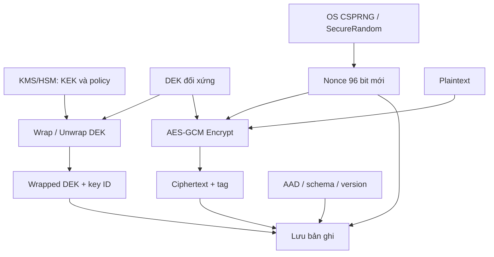

# Random nonce: sinh giá trị dùng một lần bằng nguồn ngẫu nhiên mật mã

> **Chương:** Secure randomness  
> **Module:** SECURITY_KEY_MANAGEMENT_FUNDAMENTALS

**Random nonce** là một giá trị được sinh ngẫu nhiên để sử dụng trong một ngữ cảnh mật mã cụ thể, thường chỉ **một lần trong phạm vi được quy định**. *Nonce* xuất phát từ cụm *number used once*, nhưng bản thân từ “random” không bảo đảm rằng một giá trị **không bao giờ lặp**: trong một không gian hữu hạn, các mẫu ngẫu nhiên vẫn có xác suất va chạm. Vì thế, thiết kế an toàn phải trả lời cả ba câu hỏi: **nguồn ngẫu nhiên có phù hợp không, chiều dài nonce đủ cho số lần sử dụng không, và điều kiện không lặp được duy trì như thế nào?**

Trong hệ thống sử dụng **AES-GCM**, một nonce mới thường được tạo cho mỗi phép mã hóa dưới cùng data-encryption key (**DEK**). Trong giao thức xác thực kiểu *challenge-response*, server có thể sinh nonce để yêu cầu client chứng minh phản hồi dành cho **phiên hiện tại**. Hai ví dụ cùng dùng tên “nonce” nhưng có **yêu cầu khác nhau**: với AES-GCM, tính duy nhất theo khóa là tối quan trọng; với challenge được dùng để xác thực, nonce còn có thể cần khó đoán và phải đi kèm cơ chế kiểm tra tính mới.

Bài học đặt random nonce trong phạm vi **SECURITY_KEY_MANAGEMENT_FUNDAMENTALS**: nguồn ngẫu nhiên an toàn giúp tạo nonce, khóa đối xứng, khóa bất đối xứng và secret phiên; còn **KMS/HSM, envelope encryption, IAM và audit** giúp kiểm soát việc tạo, phân phối, sử dụng, xoay vòng, thu hồi và hủy khóa. Không có cơ chế lưu khóa nào bù đắp hoàn toàn cho việc sử dụng sai nonce.

Sau bài học, bạn có thể:

- Phân biệt **random nonce**, **counter nonce**, **IV**, **salt**, **challenge**, **session ID** và **khóa bí mật**.
- Giải thích tính **duy nhất**, **khó đoán**, **entropy** và **độ mạnh của CSPRNG** trong từng bối cảnh.
- Ước lượng rủi ro va chạm theo hiệu ứng sinh nhật, hiểu vì sao nonce ngẫu nhiên 96 bit không thể dùng vô hạn dưới một khóa.
- Sử dụng `SecureRandom` trong Java 17 để cấp nonce cho AES-GCM, lưu nonce cùng ciphertext và xác minh tag.
- Thiết kế cách sinh nonce cho hệ thống nhiều worker, retry, restart, container snapshot và key rotation.
- Phân tích nonce reuse, nguồn ngẫu nhiên yếu và sự cố key compromise; chọn biện pháp khắc phục dựa trên phạm vi dữ liệu/khóa bị ảnh hưởng.

## 1. Nonce không phải là khóa

Một phép mã hóa có xác thực (*authenticated encryption with associated data* — **AEAD**) có thể được biểu diễn như sau:

\[
(C,T)=\operatorname{AEAD.Encrypt}(K,N,P,A)
\]

Trong đó:

| Ký hiệu | Vai trò | Bí mật? |
|---|---|---|
| \(K\) | **Khóa đối xứng** (ví dụ DEK AES) | Có |
| \(N\) | **Nonce** cho lần mã hóa | Thường không |
| \(P\) | Plaintext | Cần bảo vệ tùy dữ liệu |
| \(A\) | **AAD**: metadata được xác thực nhưng không mã hóa | Có thể công khai |
| \(C\) | Ciphertext | Có thể lưu/truyền |
| \(T\) | **Authentication tag** kiểm tra tính xác thực và toàn vẹn | Có thể lưu cùng ciphertext |

Ứng dụng giải mã cần đúng khóa, nonce, ciphertext, tag và AAD. Với AES-GCM, nonce có thể **lưu ngay cạnh ciphertext**; việc công khai nonce không làm lộ khóa nếu thuật toán và hệ thống được sử dụng đúng.

Hãy phân biệt:

- **Sinh khóa ngẫu nhiên:** tạo **bí mật** dùng để mã hóa/ký/MAC và phải có entropy, quyền truy cập, vòng đời bảo vệ thích hợp.
- **Sinh random nonce:** tạo **tham số thường công khai**, cần thỏa mãn ràng buộc không lặp/khó đoán theo giao thức.
- **Sinh salt cho password hashing:** tạo dữ liệu công khai giúp mỗi password verifier khác nhau và hạn chế tiền tính toán; nó không phải nonce của AES-GCM.

Đừng nhầm “nonce là ngẫu nhiên” với “nonce là secret”. **Yêu cầu bảo vệ nonce chủ yếu là bảo vệ quy tắc cấp phát, tính toàn vẹn metadata và tính đúng đắn trong sử dụng**, không phải giấu byte nonce.

## 2. “Random”, “unique” và “unpredictable” khác nhau ra sao?

Ba khái niệm thường bị dùng thay thế nhau:

1. **Random (ngẫu nhiên):** giá trị được chọn theo một phân phối từ nguồn sinh được thiết kế phù hợp. Nếu hai lần sinh độc lập, chúng **vẫn có thể ra cùng kết quả**.
2. **Unique (duy nhất):** trong miền mà giao thức quan tâm, không có hai lần sử dụng cùng giá trị. Một bộ đếm cấp phát đúng có thể tạo nonce duy nhất **mà không ngẫu nhiên**.
3. **Unpredictable (khó đoán):** attacker quan sát các giá trị trước đó cũng khó dự đoán giá trị tiếp theo trước khi nó được công bố. Một bộ đếm tuần tự dễ đoán, dù có thể hoàn toàn duy nhất.

| Bối cảnh | Thuộc tính quan trọng | Cách hiểu thực tế |
|---|---|---|
| **AES-GCM với cùng key** | **Không lặp nonce** trên các lần mã hóa | Nonce random 96 bit thường phù hợp khi số lần gọi được giới hạn; counter có thể phù hợp nếu quản lý đúng |
| **ChaCha20-Poly1305 (IETF)** | Nonce **96 bit duy nhất theo key** | Có thể dùng chiến lược random trong ngân sách phù hợp, hoặc cấu trúc do giao thức quy định |
| **AES-CTR** | Không tái sử dụng **cùng keystream/counter block dưới key** | Lặp nonce/counter có thể làm lộ quan hệ plaintext |
| **AES-CBC** | IV phải theo quy tắc mode; thông thường cần **khó đoán** | Không mặc định counter có thể thay IV CBC |
| **Challenge-response** | **Tính mới**, thường cần **khó đoán** và không được chấp nhận lại | Server phải ràng buộc challenge với phiên/chủ thể, thời hạn và trạng thái sử dụng |
| **TLS 1.3** | Nonce bản ghi do giao thức dẫn xuất **không lặp dưới traffic key** | Không tự tạo random nonce thay cho cơ chế sequence/IV của TLS |

**Kết luận quan trọng:** không có một công thức nonce chung cho mọi thuật toán. Nonce phải được tạo theo **đặc tả của scheme và API**, không theo trực giác “càng random, càng dài là luôn tốt”.

## 3. CSPRNG và nguồn entropy: vì sao phải dùng ngẫu nhiên mật mã?

**CSPRNG** (*cryptographically secure pseudorandom number generator*) là bộ sinh giả ngẫu nhiên được thiết kế để đầu ra khó phân biệt với ngẫu nhiên thật đối với kẻ tấn công tính toán có giới hạn, khi được seed và vận hành đúng. Hầu hết phần mềm không thu từng bit ngẫu nhiên thuần từ phần cứng cho mọi lần sinh; hệ điều hành thu **entropy**, khởi tạo và duy trì một cơ chế random mật mã (thường là DRBG/CSPRNG) để cung cấp byte cho ứng dụng.

### 3.1. Entropy và seed

**Entropy** mô tả mức độ không chắc chắn/khó đoán của nguồn. **Seed** là vật liệu khởi tạo trạng thái nội bộ của bộ sinh. Nếu attacker đoán hoặc biết được seed/trạng thái của một PRNG thông thường, họ có thể tái tạo chuỗi đầu ra, làm tăng nguy cơ **các nonce bị lặp** hoặc secret bị dự đoán.

Một bộ sinh mật mã cần:

- Được **khởi tạo với nguồn entropy thích hợp** của hệ điều hành hoặc module mật mã được chứng nhận theo chính sách.
- Không bị seed lại bằng giá trị dễ đoán như timestamp, process ID hoặc user ID.
- Quản lý trạng thái, reseeding/forking/clone theo đặc tính runtime; không tự triển khai bộ sinh “tốt hơn” chỉ từ hash và counter.
- Cung cấp API đủ rõ để lập trình viên phân biệt **byte random**, **key material**, **nonce** và **ID**.

### 3.2. Vì sao Random và Math.random không phù hợp?

`java.util.Random` (Java) và `Math.random()` được thiết kế chủ yếu cho mô phỏng, chọn mẫu hoặc các ứng dụng không đặt yêu cầu an ninh mật mã. Chúng **không có cam kết** khó dự đoán trước các đối thủ chủ động; việc dùng chúng để tạo secret hoặc nonce random trong giao thức bảo mật có thể tạo rủi ro nghiêm trọng.

Trong Java, ưu tiên **`java.security.SecureRandom`** cho byte random phục vụ mật mã. Nguồn/thuật toán cụ thể phụ thuộc nhà cung cấp và nền tảng; đừng tự gọi `setSeed(System.currentTimeMillis())` để “tăng độ random”. Không dựa vào giả định `SecureRandom` luôn có cùng thuật toán/hiệu năng trên mọi môi trường.

### 3.3. Nonce random không đòi hỏi giấu seed?

Nonce bản thân có thể công khai nhưng **trạng thái nội bộ của CSPRNG phải được bảo vệ**. Nếu attacker đọc/khôi phục được trạng thái RNG và đó cũng là RNG dùng sinh **private key, HMAC key hoặc session key**, hậu quả vượt xa nonce reuse. Cần cô lập tiến trình, hạn chế crash/heap dump và không log seed hoặc trạng thái RNG.

Ngược lại, việc attacker **nhìn thấy nhiều nonce công khai** không được tự cho phép họ suy ra secret key hoặc các nonce tương lai nếu CSPRNG và hệ thống được triển khai đúng.

## 4. Tại sao nonce ngẫu nhiên vẫn có thể va chạm?

Giả sử mỗi nonce là một giá trị độc lập, phân bố đều trong không gian \(b\) bit, và ứng dụng sinh \(q\) nonce dưới **cùng một khóa**. Theo xấp xỉ hiệu ứng sinh nhật, khi số lần sinh còn nhỏ so với không gian:

\[
p_{\mathrm{collision}}\approx\frac{q(q-1)}{2^{b+1}}.
\]

Với nonce **96 bit**, \(b=96\). Một số mốc *ước lượng*:

| Số nonce ngẫu nhiên \(q\) dưới một khóa | Xác suất có ít nhất một va chạm (xấp xỉ) |
|---|---|
| \(10^3\) | \(6{,}3\times 10^{-24}\) |
| \(10^6\) | \(6{,}3\times 10^{-18}\) |
| \(10^9\) | \(6{,}3\times 10^{-12}\) |
| \(2^{32}\) (khoảng 4,29 tỷ) | \(1{,}16\times 10^{-10}\) |

Các số chỉ đúng khi nonce độc lập, phân bố đều và **không có lỗi triển khai**. Chúng không thay thế những **giới hạn số lần gọi** và ràng buộc bảo mật khác của AES-GCM, thư viện hay quy chuẩn áp dụng. Với GCM sử dụng random IV, những hướng dẫn kỹ thuật thường đặt giới hạn chặt trên tổng số phép mã hóa dưới một khóa, ví dụ quy tắc liên quan ngưỡng \(2^{32}\) invocations trong các cấu hình được quy định; không được mặc định ngưỡng xác suất va chạm nhỏ là lý do dùng khóa vô hạn.

### 4.1. Một ví dụ về ngân sách khóa

Một dịch vụ mã hóa **100.000 bản ghi/giây** bằng **một DEK dùng chung**:

```text
100.000 lần mã hóa/giây
=> 8.640.000.000 lần/ngày nếu chạy liên tục.

Với nonce 96 bit random, không thể chỉ nói:
"xác suất va chạm mỗi lần cực nhỏ nên giữ DEK vô thời hạn".
```

Ngoài collision probability còn có giới hạn tổng bản ghi, số block/bytes được mã hóa, khả năng nonce bị cấp trùng do lỗi hệ thống và các điều kiện bảo mật khác. Giải pháp có thể là **phân tách DEK theo tenant/writer/object**, rotate DEK theo ngân sách, hoặc sử dụng một cách cấp nonce có kiểm soát theo chuẩn. Việc **rotate KEK** mà vẫn giữ cùng DEK không đặt lại ngân sách nonce của DEK.

### 4.2. Dài hơn có tốt hơn?

Không tùy ý thay nonce 96 bit của **AES-GCM** thành 192 bit vì thấy “an toàn hơn”. GCM có cách xử lý IV độ dài khác nhau; API, chuẩn và giới hạn sử dụng cần được tuân thủ. Một số scheme **được thiết kế** cho nonce dài, ví dụ **XChaCha20-Poly1305 dùng nonce 192 bit**, giúp sử dụng nonce random với nguy cơ va chạm thấp hơn ở quy mô lớn. Nhưng XChaCha20-Poly1305 **không phải IETF ChaCha20-Poly1305 96 bit**, và không thể thay đổi định dạng nonce tùy ý khi thư viện/giao thức không hỗ trợ.

## 5. Random nonce trong AES-GCM và ChaCha20-Poly1305

Với những AEAD yêu cầu không tái sử dụng nonce, điều kiện quan trọng là:

\[
(K,N_i)\ne(K,N_j)\quad \text{với mọi hai lần mã hóa độc lập }i\ne j.
\]

Một nonce được tạo ngẫu nhiên từ CSPRNG thường là **ứng viên hợp lệ**, nhưng phải có chính sách giữ **xác suất trùng trong giới hạn chấp nhận được** và không vượt ngân sách sử dụng.

### 5.1. AES-GCM

AES-GCM kết hợp cơ chế mã hóa dựa trên counter với một cơ chế tạo tag xác thực. **Nonce reuse dưới cùng khóa AES** có thể làm lặp keystream và phá vỡ bảo đảm về tính bí mật, đồng thời tạo điều kiện cho việc giả mạo tag trong những hoàn cảnh nhất định. Không phải chỉ có nguy cơ “hai ciphertext giống nhau”.

Ví dụ lỗi:

```text
Key: K
Nonce lần 1:  7b ... 3f
Nonce lần 2:  7b ... 3f    // Trùng dưới cùng K
Plaintext:    P1 và P2

Kết quả: hai lần mã hóa không thỏa điều kiện an toàn của GCM.
```

Đổi nonce từ lần thứ ba **không sửa** những ciphertext đã tạo ở hai lần đầu. Nếu phát hiện reuse, cần khoanh vùng record, thay DEK và cân nhắc mã hóa lại dữ liệu bị ảnh hưởng.

### 5.2. ChaCha20-Poly1305

Trong biến thể IETF, ChaCha20-Poly1305 dùng **nonce 96 bit**. Dùng lại cặp key/nonce có thể tái sử dụng keystream và khóa Poly1305 phát sinh cho lần đó, làm hỏng cả bí mật và xác thực. Quản lý nonce phải theo đúng cấu hình thư viện/giao thức; không dùng một nonce cố định chỉ vì key được tạo ngẫu nhiên.

### 5.3. AES-GCM-SIV và cơ chế chống chịu nonce misuse

Một số AEAD như **AES-GCM-SIV** được thiết kế để giảm hậu quả khi nonce vô tình lặp so với GCM thông thường. Nhưng tính “misuse-resistant” có **giới hạn riêng**, như rò rỉ về thông điệp bằng nhau trong những tình huống nhất định, giới hạn số lần dùng và điều kiện thuật toán. Nó không phải giấy phép bỏ qua quản lý key, nonce hoặc cập nhật bảo mật. Chỉ chọn khi thư viện hỗ trợ đúng đặc tả và threat model thực sự cần.

## 6. Random nonce và counter nonce: lựa chọn kiến trúc

| Tiêu chí | Nonce random | Nonce từ counter / cấu trúc |
|---|---|---|
| Nguồn | CSPRNG theo kích thước scheme | Trạng thái đếm/sequence, có thể kết hợp prefix |
| Bảo đảm duy nhất | **Xác suất** không trùng trong ngân sách thiết kế | Có thể **tuyệt đối trong miền sử dụng** nếu cấp phát và trạng thái đúng |
| Nhiều writer | Dễ triển khai khi không cần đồng bộ state, nhưng ngân sách là tổng dưới một key | Phải phân vùng không gian nonce hoặc dùng allocator chung |
| Restart | CSPRNG đủ an toàn thường không cần lưu counter ứng dụng | Cần bảo đảm counter không quay lại giá trị cũ |
| Snapshot/clone | Có rủi ro nếu **trạng thái RNG bị nhân bản** và tạo lại cùng chuỗi | Có rủi ro nếu **counter bị rollback/clone** |
| Dự đoán nonce tiếp theo | Phải khó đoán nếu CSPRNG đúng | Thường dễ đoán, có thể vẫn hợp lệ với GCM |
| Điều kiện vận hành | Số lần dùng key, chất lượng RNG, key rotation | State bền vững, phân bổ prefix, chống overflow, failover |

**Không có lựa chọn mặc định tốt nhất cho mọi hệ thống.** Với những service mã hóa số lượng vừa phải, nonce ngẫu nhiên 96 bit từ hệ điều hành có thể đơn giản và hợp lý. Với cụm nhiều writer throughput rất lớn, chiến lược **tách key theo writer/tenant** hoặc **counter có prefix duy nhất** có thể giúp kiểm soát rủi ro và hiệu năng.

### 6.1. Đừng trộn hai chiến lược tùy tiện dưới cùng khóa

Nếu một số node dùng nonce random, node khác dùng nonce counter dưới cùng khóa, các miền giá trị có thể đè lên nhau. Chỉ trộn khi **đặc tả nonce construction** cho phép và có **phân vùng không gian rõ ràng**; với GCM, cần chú ý các yêu cầu của chế độ tạo IV được quy định.

Tốt nhất chọn một chiến lược có tài liệu, test và người chịu trách nhiệm rõ ràng cho mỗi phạm vi key. Khi chuyển chiến lược cấp nonce, cân nhắc **đổi sang DEK mới** để tránh nhập nhằng lịch sử sử dụng.

## 7. Hệ phân tán: những nguồn tạo nonce trùng ngoài xác suất ngẫu nhiên

### 7.1. Snapshot, VM clone và khôi phục trạng thái RNG

Giả sử một VM được snapshot ngay sau khi CSPRNG được khởi tạo. Nếu hai bản clone có **cùng trạng thái RNG**, không reseed/phát hiện clone đúng cách, chúng có thể sinh **cùng chuỗi nonce** dù code ở mỗi máy đều gọi API “secure random”.

Để giảm rủi ro:

- Sử dụng RNG của hệ điều hành/runtime hiện đại, phù hợp mô hình virtualization và container; không tự quản lý một seed cố định chung.
- Tránh đóng gói hoặc snapshot **trạng thái CSPRNG đã khởi tạo** theo cách có thể phát lại; kiểm tra hành vi RNG sau clone/restore theo nền tảng.
- Khi không kiểm chứng được việc tách trạng thái RNG an toàn, **tạo key mới sau restore** trước khi mã hóa tiếp hoặc áp dụng cơ chế quản lý nonce được chứng minh không lặp.
- Không dựa vào “hai node ở hai máy khác nhau” làm bằng chứng không trùng nonce nếu image/state của chúng là bản sao.

Không khẳng định mọi hệ điều hành/JVM đều mắc lỗi này: hệ thống hiện đại có thể có cơ chế reseed hoặc fork safety. Đây là **nguy cơ phải đánh giá theo môi trường triển khai**, không phải kết luận rằng SecureRandom luôn không an toàn với container.

### 7.2. Retry và queue delivery

Khi một message được gửi lại do timeout:

- **Retry lưu lại cùng bộ ciphertext + nonce + tag** đã mã hóa có thể là thao tác lặp của storage, không tạo thêm một phép mã hóa.
- **Mã hóa lại message** dưới cùng key cần một nonce mới cho **lần encrypt mới**, dù plaintext không đổi.
- **Lấy message ID, timestamp hoặc số thứ tự queue làm nonce** mà không chứng minh tính duy nhất theo key có thể gây trùng khi replay, restart hoặc đổi partition.

Việc tách rõ `encrypt()` và `persist()` giúp tránh cấp phát nonce dựa trên ID giao dịch bị dùng lại khi retry.

### 7.3. Phân vùng key và ngân sách dùng key

Nếu tất cả writer cùng dùng một DEK, **tổng số lần mã hóa của mọi writer** phải nằm trong giới hạn áp dụng cho key đó. Việc mỗi node chỉ mã hóa 1 triệu record không giúp nếu hàng nghìn node cộng lại quá ngân sách.

Một kiến trúc có thể cấp **DEK riêng cho tenant, bucket, writer hoặc nhóm object**, tùy khối lượng và quy định lưu trữ. Khi cần đọc lại, ciphertext phải lưu key ID/version và dữ liệu liên quan để unwrap DEK đúng. Tách DEK cũng giới hạn **blast radius** nếu một key hoặc một cơ chế cấp nonce của writer bị lỗi.

## 8. Random challenge nonce: tính mới và khả năng chống replay

Một **challenge nonce** có thể được server cấp khi cần xác thực client hoặc chứng minh người ký đang tham gia một phiên hiện tại.

Ví dụ:

```text
Server tạo randomChallenge = CSPRNG.random(24 bytes)
Server lưu {challenge, subject, session, expiresAt, used=false}
Server gửi challenge cho client.

Client ký: Sign(privateKey, purpose || session || challenge)
Server:
  1. Kiểm tra challenge còn hạn, thuộc subject/session phù hợp.
  2. Kiểm tra chữ ký bằng public key đáng tin.
  3. Đánh dấu challenge đã sử dụng theo thao tác atomic.
  4. Chỉ sau đó cho phép hành động được ủy quyền.
```

Trong ngữ cảnh này, random nonce nên **khó đoán trước khi server phát hành**, đủ không gian để tránh đoán/trùng và có ràng buộc với chủ thể, phiên, mục đích và hạn sử dụng. Nonce có thể được gửi công khai sau khi tạo; tính bảo mật nằm ở việc kẻ tấn công không thể **chuẩn bị đáp án hợp lệ trước**, không tráo ngữ cảnh và không dùng lại đáp án cũ.

**Chỉ có random nonce không tự chống replay.** Nếu server không theo dõi trạng thái *used* hoặc không ràng buộc challenge với request/phiên, một phản hồi hợp lệ có thể được dùng lại trong cửa sổ cho phép. Với những giao thức hoàn chỉnh, dùng cơ chế chống replay được đặc tả thay vì tự chế challenge protocol.

### 8.1. Nonce AEAD khác nonce chống replay

Khi attacker gửi lại nguyên `(ciphertext, nonce, tag)` đã được tạo hợp lệ, phép giải mã AEAD có thể **xác thực lại thành công**. AES-GCM không nhớ bản ghi nào đã được xử lý. Replay protection cần **sequence number, message ID, replay window, trạng thái đã xử lý hoặc idempotency** bên ngoài primitive mã hóa.

Ngược lại, nonce của một challenge cần **kiểm tra tính mới** và thường cần độ khó đoán. Không dùng một bộ đếm công khai dễ đoán cho challenge nếu giao thức yêu cầu khó đoán, chỉ vì counter phù hợp với nonce của AES-GCM.

## 9. Salt, UUID, timestamp và random nonce

| Giá trị | Có thể dùng thay random nonce AES-GCM/challenge không? | Lý do |
|---|---|---|
| **Password salt 16 byte** | **Không tự động** | Salt thuộc verifier mật khẩu, có vòng đời/định dạng khác; có thể bị dùng lại khi xác minh |
| **UUID v4** | Không mặc định | Chứa bit cố định và kích thước/encoding riêng; có thể phù hợp làm ID nhưng không tự tương thích nonce 96 bit của GCM |
| **UUID v1 / ID dựa trên thời gian** | Không mặc định | Có cấu trúc dễ đoán, không có cam kết nonce độc nhất theo key trong mọi triển khai |
| **Timestamp** | Không | Hai request cùng timestamp, clock rollback hoặc nhiều node có thể trùng; thường đoán được |
| **Request ID / message ID** | Chỉ khi giao thức chứng minh đáp ứng điều kiện | ID có thể được dùng lại khi retry và thường không được thiết kế như nonce mã hóa |
| **CSPRNG 12 byte** | Có thể thích hợp cho AES-GCM 96 bit trong giới hạn chính sách | Vẫn có xác suất va chạm và phải quản lý tổng lần sử dụng dưới key |
| **Counter không lặp theo key** | Có thể thích hợp với AES-GCM theo cấu trúc chuẩn | Cần state bền vững, xử lý phân tán/restart/overflow |

UUID v4 có các bit random nhưng cũng có bit phiên bản/biến thể cố định; **không nên ép kiểu UUID thành nonce 12 byte** bằng cắt byte mà không phân tích phân phối, độ dài, nguy cơ va chạm và tương thích thuật toán. Khi cần nonce AES-GCM, hãy yêu cầu trực tiếp **12 byte từ CSPRNG** hoặc dùng nonce construction chính thức của giao thức.

## 10. Vòng đời random nonce và mối liên hệ với key management

Nonce không phải secret key, nhưng mỗi lần dùng nonce vẫn phụ thuộc **vòng đời khóa mã hóa**:

| Giai đoạn | Nhiệm vụ của hệ thống |
|---|---|
| **Tạo key** | Sinh key đúng thuật toán/entropy, xác định phạm vi và ngân sách sử dụng nonce theo key |
| **Cấp phát** | Cấp quyền key cho đúng workload; định nghĩa ai tạo nonce, thuật toán/mode và format |
| **Lưu trữ** | Giữ key trong KMS/HSM/secret store phù hợp; lưu nonce cùng ciphertext/tag và key ID |
| **Sử dụng** | Sinh nonce mới cho mỗi phép mã hóa độc lập; quản lý AAD, tag và kiểm soát số lần sử dụng key |
| **Xoay vòng** | Khi đạt giới hạn hoặc xảy ra lỗi nonce, chuyển sang **key mới**, không chỉ đổi KEK nếu DEK vẫn cũ |
| **Thu hồi** | Ngừng cấp quyền mã hóa mới bằng key bị ảnh hưởng; tổ chức decrypt-only/migration khi cần |
| **Hủy** | Chỉ hủy key cũ sau khi hết nhu cầu decrypt/retention; ciphertext và nonce cũ có thể vẫn cần cho chứng cứ/khôi phục |

**Nonce không cần “thu hồi” như key:** không có phép toán “revoke random nonce” khiến ciphertext đã tạo trở nên an toàn nếu nonce bị lặp. Khi xảy ra lỗi, vấn đề cần xử lý là **key/ciphertext đã sử dụng sai**, nguồn tạo nonce và phạm vi dữ liệu có nguy cơ.

## 11. Java 17: tạo random nonce và mã hóa AES-GCM

Java cung cấp `SecureRandom` để sinh byte ngẫu nhiên mật mã và `Cipher` để mã hóa/giải mã bằng AES-GCM. Ví dụ bên dưới làm ba việc quan trọng:

1. **Mỗi lần gọi mã hóa tạo nonce 12 byte mới**, không dùng lại nonce cũ.
2. **Lưu nonce chung với ciphertext và tag** trong một gói dữ liệu có format version.
3. Khi giải mã, dùng **chính nonce đã lưu** và từ chối dữ liệu nếu kiểm tra authentication tag thất bại.

Đây là **mã Java 17 minh họa**, không phải mô-đun production có đầy đủ quản lý key ID, key rotation, KMS, quota và lưu trữ.

```java
import java.nio.ByteBuffer;
import java.nio.charset.StandardCharsets;
import java.security.GeneralSecurityException;
import java.security.SecureRandom;
import java.util.Arrays;
import javax.crypto.AEADBadTagException;
import javax.crypto.Cipher;
import javax.crypto.KeyGenerator;
import javax.crypto.SecretKey;
import javax.crypto.spec.GCMParameterSpec;

public final class RandomNonceAesGcmDemo {
    private static final SecureRandom RANDOM = new SecureRandom();
    private static final int NONCE_BYTES = 12;  // AES-GCM 96-bit nonce.
    private static final int TAG_BITS = 128;
    private static final int TAG_BYTES = TAG_BITS / 8;
    private static final byte FORMAT_VERSION = 1;
    private static final byte[] AAD =
            "purpose=orders:v1|tenant=demo"
                    .getBytes(StandardCharsets.UTF_8);

    // Format: [version: 1 byte][nonce: 12 bytes][ciphertext || tag].
    public static byte[] encrypt(SecretKey key, byte[] plaintext)
            throws GeneralSecurityException {
        byte[] nonce = new byte[NONCE_BYTES];
        RANDOM.nextBytes(nonce);  // Không dùng java.util.Random!

        Cipher cipher = Cipher.getInstance("AES/GCM/NoPadding");
        cipher.init(
                Cipher.ENCRYPT_MODE, key,
                new GCMParameterSpec(TAG_BITS, nonce)
        );
        cipher.updateAAD(AAD);
        byte[] ciphertextWithTag = cipher.doFinal(plaintext);

        return ByteBuffer
                .allocate(1 + NONCE_BYTES + ciphertextWithTag.length)
                .put(FORMAT_VERSION)
                .put(nonce)
                .put(ciphertextWithTag)
                .array();
    }

    public static byte[] decrypt(SecretKey key, byte[] record)
            throws GeneralSecurityException {
        if (record == null
                || record.length < 1 + NONCE_BYTES + TAG_BYTES) {
            throw new IllegalArgumentException("Invalid record length");
        }

        ByteBuffer input = ByteBuffer.wrap(record);
        if (input.get() != FORMAT_VERSION) {
            throw new IllegalArgumentException("Unsupported format");
        }

        byte[] nonce = new byte[NONCE_BYTES];
        input.get(nonce);
        byte[] ciphertextWithTag = new byte[input.remaining()];
        input.get(ciphertextWithTag);

        Cipher cipher = Cipher.getInstance("AES/GCM/NoPadding");
        cipher.init(
                Cipher.DECRYPT_MODE, key,
                new GCMParameterSpec(TAG_BITS, nonce)
        );
        cipher.updateAAD(AAD);
        // Nếu nonce, key, ciphertext, tag hoặc AAD sai,
        // doFinal sẽ từ chối với xác suất rất cao.
        return cipher.doFinal(ciphertextWithTag);
    }

    public static void main(String[] args) throws Exception {
        // Demo: giữ key trong RAM. Production cần quản lý
        // key ID, retention, quota và KMS/envelope encryption.
        KeyGenerator generator = KeyGenerator.getInstance("AES");
        generator.init(256);
        SecretKey key = generator.generateKey();

        byte[] plaintext =
                "order=42|status=paid".getBytes(StandardCharsets.UTF_8);
        byte[] record1 = encrypt(key, plaintext);
        byte[] record2 = encrypt(key, plaintext);

        boolean sameNonce = Arrays.equals(
                Arrays.copyOfRange(record1, 1, 1 + NONCE_BYTES),
                Arrays.copyOfRange(record2, 1, 1 + NONCE_BYTES)
        );
        System.out.println("Two nonces equal: " + sameNonce);
        System.out.println("Decrypted correctly: " +
                Arrays.equals(plaintext, decrypt(key, record1)));

        byte[] tampered = Arrays.copyOf(record1, record1.length);
        tampered[tampered.length - 1] ^= 1;
        try {
            decrypt(key, tampered);
            throw new IllegalStateException("Unexpected acceptance");
        } catch (AEADBadTagException expected) {
            System.out.println("Tampered record rejected");
        }
    }
}
```

**Kết quả dự kiến:** hai nonce được sinh ngẫu nhiên thường khác nhau; cả hai bản ghi có thể giải mã nếu giữ đúng key; việc sửa ciphertext/tag phải khiến giải mã bị từ chối. Nếu dòng `Two nonces equal` hiếm khi in `true` vì va chạm, đó không phải trạng thái được phép bỏ qua trong hệ thống sản xuất: cần dừng sử dụng cặp bị lặp và đánh giá phạm vi rủi ro.

### 11.1. Những bảo đảm và giới hạn của ví dụ

- `SecureRandom` là API sinh ngẫu nhiên mật mã, không phải bằng chứng hình thức rằng **mọi nonce trên mọi instance và mọi thời điểm tuyệt đối không trùng**.
- Một `Cipher` mới được khởi tạo cho mỗi phép mã hóa. Không tái sử dụng trạng thái cipher/nonce để mã hóa một message khác.
- `GCMParameterSpec(128, nonce)` quy định tag dài 128 bit. Trong một số provider Java, đầu ra của `doFinal()` với AES-GCM là **ciphertext nối với tag**; định dạng lưu phải nhất quán giữa các hệ thống.
- **AAD được cố định để minh họa**. Trong hệ đa tenant, AAD cần bao gồm các trường phù hợp, được chuẩn hóa byte-for-byte và lấy từ ngữ cảnh đáng tin khi decrypt.
- Demo không giới hạn tổng phép mã hóa theo key. Production phải thực thi **ngân sách nonce/DEK**, key ID, quản lý sai sót khi nhiều writer cùng sử dụng key và rotation đúng lúc.
- `AEADBadTagException` biểu thị thất bại xác thực thường gặp; không được nuốt lỗi, trả plaintext chưa xác thực hoặc coi đó chỉ là lỗi format vô hại.
- Mã hóa thành công **không tự chống phát lại** toàn bộ gói dữ liệu đã hợp lệ; cần trạng thái/chính sách ở tầng protocol khi nghiệp vụ có thể bị replay.

### 11.2. Không tạo khóa mới rồi làm mất dữ liệu

`KeyGenerator` trong ví dụ tạo khóa mới khi chạy chương trình. Đối với dữ liệu lưu lâu dài, nếu lần sau ứng dụng khởi động lại và **tạo AES key khác nhưng không giữ key cũ**, nó sẽ không thể giải mã những bản ghi trước đó. Cần quản lý DEK dưới một KEK trong KMS/HSM hoặc key store phù hợp, kèm **key ID và metadata** để tìm lại key đúng.

Việc có **nonce đúng** không thay thế nhu cầu quản lý **khóa đúng**.

## 12. Java 17: sinh challenge nonce khó đoán cho phiên xác thực

Ví dụ sau chỉ minh họa **bước tạo challenge**. Nó không phải một cơ chế xác thực hoàn chỉnh:

```java
import java.security.SecureRandom;
import java.util.Base64;

public final class RandomChallengeDemo {
    private static final SecureRandom RANDOM = new SecureRandom();

    public static String issueChallenge() {
        byte[] nonce = new byte[24]; // 192 bit random.
        RANDOM.nextBytes(nonce);
        return Base64.getUrlEncoder()
                .withoutPadding()
                .encodeToString(nonce);
    }

    public static void main(String[] args) {
        String challenge = issueChallenge();
        // Production: lưu server-side với subject/session,
        // purpose, expiresAt và trạng thái chưa sử dụng.
        // Không in challenge thật ra log khi không cần.
        System.out.println("Challenge length: " + challenge.length());
    }
}
```

Một hệ thống thật cần **lưu challenge/ID hoặc trạng thái phù hợp**, giới hạn TTL, ràng buộc người dùng và phiên, kiểm tra phản hồi bằng phương pháp xác thực tin cậy (ví dụ signature với public key đã xác thực), và **đánh dấu sử dụng atomically** để không chấp nhận hai request song song cùng một challenge.

Ngay cả nonce ngẫu nhiên 192 bit cũng không giúp chống replay nếu server chấp nhận đi chấp nhận lại một phản hồi đã ký. Ngược lại, challenge phải được sinh từ CSPRNG khi giao thức đòi hỏi giá trị khó đoán, chứ không lấy timestamp hoặc số đếm dễ dự đoán rồi mặc định an toàn.

## 13. Kết hợp random nonce với envelope encryption và KMS/HSM

Trong **envelope encryption**, DEK đối xứng mã hóa dữ liệu; một **KEK** (*key-encryption key*) trong KMS/HSM bảo vệ DEK bằng thao tác wrap/unwarp hoặc cơ chế tương đương.



Nếu ứng dụng tự mã hóa bằng plaintext DEK được lấy qua API như **GenerateDataKey**, **nó phải chịu trách nhiệm về nonce** theo quy tắc của AES-GCM. KMS có thể bảo vệ KEK và cấp DEK an toàn nhưng không nhất thiết nhìn thấy mọi nonce ứng dụng dùng ở ngoài KMS.

### 13.1. Nonce và wrapped DEK có tuổi thọ khác nhau

- **Nonce** được tạo cho một lần mã hóa và thường lưu nguyên vẹn **cùng ciphertext**.
- **Plaintext DEK** có thể chỉ xuất hiện trong bộ nhớ trong thời gian cần encrypt/decrypt.
- **Wrapped DEK** có thể cần giữ nhiều năm để dữ liệu mã hóa còn đọc được.
- **KEK** do KMS/HSM bảo vệ có chính sách quyền, cryptoperiod và rotation riêng.

Không được gọi một DEK là “đã hủy” chỉ vì buffer plaintext DEK trong một request đã được giải phóng, nếu bản wrapped DEK vẫn còn và có thể unwrap.

### 13.2. Vì sao đổi KEK không sửa được lỗi random nonce?

Giả sử hai bản ghi đã được mã hóa cùng **DEK \(K\)** và nonce \(N\). Dù sau đó ứng dụng **rewrap DEK** dưới KEK khác, hai ciphertext cũ vẫn được tạo từ **cặp (K, N) trùng**. Như vậy lỗ hổng ban đầu vẫn tồn tại.

Muốn thay đổi dữ liệu mật mã, cần xem xét **sinh DEK mới và mã hóa lại** dữ liệu ảnh hưởng với nonce hợp lệ. Việc reencrypt cần kiểm tra tính toàn vẹn của dữ liệu đầu vào, xử lý backup, metadata, retry và xóa bản cũ theo chính sách.

### 13.3. Nếu dịch vụ KMS trực tiếp mã hóa thì sao?

Một số API hoặc thư viện mã hóa cấp phát nonce/IV **nội bộ** và trả gói ciphertext chứa thông tin cần thiết. Khi đó ứng dụng cần hiểu **hợp đồng dịch vụ**, giới hạn kích thước dữ liệu, thuật toán, nonce construction và định dạng kết quả; không tự bổ sung một nonce cạnh tranh khi API không yêu cầu.

Chỉ có tên **Encrypt/Decrypt** không đủ để kết luận API bảo đảm mọi điều kiện nonce trong mọi cấu hình. Cần dựa trên hành vi và tài liệu của đúng dịch vụ.

## 14. Quản lý ngân sách nonce, key và khả năng quan sát

Với AEAD dựa trên nonce ngẫu nhiên, “mỗi lần gọi đều lấy từ SecureRandom” chỉ là **điều kiện cần**, chưa phải toàn bộ chính sách vận hành. Cần quản lý:

| Đối tượng quản lý | Cần biết | Quy tắc |
|---|---|---|
| **Key ID/version** | DEK nào đang mã hóa những đối tượng nào? | Mỗi phạm vi key có ngân sách sử dụng và khả năng giải mã lịch sử |
| **Thuật toán/nonce size** | AES-GCM 96 bit hay một scheme khác? | Không tự đổi kích thước nonce/định dạng |
| **Writer/workload** | Những node nào cùng dùng key? | Tổng số encrypt là **tổng của mọi writer** dưới cùng key |
| **Số lần mã hóa** | Có sắp tới giới hạn theo scheme/chính sách không? | Rotate/split key trước khi chạm ngưỡng |
| **RNG state/lifecycle** | Clone, fork, restore có làm lặp trạng thái không? | Đánh giá nền tảng, cô lập state, thay key khi cần |
| **Replay protection** | Có xử lý message đã dùng không? | Sequence/message ID và trạng thái tiêu thụ riêng |
| **Audit KMS/IAM** | Ai đã dùng/đổi key và quyền? | Ghi principal, action, key ID, thời gian, kết quả; không ghi vật liệu key |

### 14.1. Có cần ghi log toàn bộ nonce?

Nonce AES-GCM không phải secret, nhưng log mọi nonce của từng request có thể tạo lượng dữ liệu khổng lồ và làm lộ **metadata liên kết với người dùng/đối tượng**. Nên chọn chiến lược observability theo rủi ro:

- **Counters/metrics** cho số lần encrypt theo key ID/version và writer.
- **Cảnh báo** khi gần ngưỡng key budget, xuất hiện writer lạ, có thay đổi thuật toán hoặc policy.
- **Sự kiện vận hành** liên quan snapshot/restore/restart, KMS grants và rotation.
- **Duplicate detection** khi cần và khả thi, ví dụ kiểm tra cặp key ID + nonce trên một tập record được lưu; phải tránh coi một bản ghi được đọc/lưu lại là **phép mã hóa mới**.

Việc duplicate detection sau ghi là **lớp giám sát bổ sung**, không thay thế việc sinh nonce đúng. Nếu một nonce trùng đã được dùng để mã hóa, sự cố mật mã **đã xảy ra**, ngay cả khi monitor phát hiện ngay sau đó.

### 14.2. Cần ghi gì khi xử lý sự cố?

Ghi các dữ liệu phục vụ điều tra như **key ID, thuật toán, nonce representation nếu cần, record ID, writer, thời điểm, operation ID, số lần gọi và kết quả**. Tránh ghi **DEK plaintext, KEK, seed RNG, private key, token bí mật hoặc plaintext khách hàng**. Nếu cần chứng cứ đầy đủ, lưu trong kho bằng chứng có quyền và retention phù hợp.

Không khẳng định “không có cảnh báo” chứng minh **không từng có nonce reuse**: thiếu logging, bản backup cũ, dữ liệu mã hóa ở ngoài hệ thống hoặc clone state có thể làm bức tranh chưa đầy đủ.

## 15. Sự cố random nonce: phân loại trước khi xử lý

Không phải lỗi nào liên quan nonce cũng giống nhau:

| Sự cố | Rủi ro | Cách khoanh vùng ban đầu |
|---|---|---|
| **Random nonce va chạm dưới cùng AES-GCM key** | Có thể lộ quan hệ plaintext và phá vỡ xác thực | Tìm các cặp key ID + nonce trùng giữa **các lần encrypt độc lập** |
| **CSPRNG bị seed bằng giá trị dễ đoán** | Nonce/key/secret khác có thể bị dự đoán nếu cùng RNG/thiết kế yếu | Kiểm tra nguồn seed, state, phạm vi secret đã sinh |
| **VM/container clone tạo lại RNG state** | Các node có thể phát cùng chuỗi nonce/secret | Xác định clone lineage, thời điểm, key dùng chung |
| **Counter quay về 0 sau restore** | Lặp nonce dưới cùng key | Đối chiếu counter/lease/prefix và lịch sử snapshot |
| **Challenge nonce bị gửi lại/không đánh dấu đã dùng** | Replay một phản hồi xác thực hợp lệ | Kiểm tra state consume, TTL, binding và request ID |
| **Nonce bị mất khi serialize ciphertext** | Không thể giải mã dù còn đúng key | Kiểm tra record format, backup, metadata migration |
| **Nonce bị thay đổi khi lưu/đọc** | AEAD decrypt thất bại hoặc metadata không nhất quán | Kiểm tra tính toàn vẹn record/tag/AAD và storage |

### 15.1. Quy trình ứng phó khi nghi có nonce reuse

1. **Chặn phát sinh thêm ciphertext sai:** cô lập writer lỗi, dừng encrypt bằng key/DEK nghi vấn hoặc chuyển sang **key mới và nonce construction an toàn**. Không tiếp tục dùng cùng key chỉ vì đã sửa code sinh nonce.
2. **Bảo toàn bằng chứng:** lưu key ID/version, các bản ghi bị nghi, nonce và metadata liên quan, lịch sử triển khai, snapshot/restore, KMS/IAM và log writer theo quyền được phê duyệt.
3. **Xác định phạm vi:** phân biệt cặp key/nonce trùng đã xác nhận, số record có khả năng bị ảnh hưởng, dữ liệu attacker có thể đã truy cập và những gì chưa biết. Không mặc định mọi plaintext đều đã bị đọc nhưng cũng không coi sự cố là vô hại.
4. **Đánh giá tính toàn vẹn:** nếu nghi có ciphertext/tag bị giả mạo, so sánh với nguồn/backup đáng tin và xác minh dữ liệu trước khi dùng làm đầu vào migration.
5. **Khôi phục:** sinh DEK mới; reencrypt dữ liệu thuộc phạm vi cần thay, cập nhật nonce/tag/key ID/wrapped DEK và metadata bằng thao tác nhất quán. Xem xét backup và các bản sao dữ liệu.
6. **Thu hồi theo vòng đời:** ngừng quyền encrypt key cũ, giữ decrypt-only có kiểm soát nếu còn phụ thuộc, hủy theo chính sách sau migration và retention.
7. **Ngăn tái diễn:** đưa giới hạn key budget, kiểm thử clone/restart/rollback, phân vùng writer, kiểm soát RNG và audit/alert vào vận hành.

### 15.2. Nếu nguồn ngẫu nhiên đã bị chiếm trạng thái?

Khi một CSPRNG bị lộ state hoặc khởi tạo từ seed dự đoán được, không chỉ nonce bị đe dọa. Những **DEK, HMAC key, private key, session secret, reset token** được tạo trong giai đoạn và phạm vi cùng nguồn có thể cần đánh giá hoặc thay thế. Phải dựng **inventory nguồn ngẫu nhiên, key/secret được sinh, thời gian và nơi sử dụng** trước khi kết luận phạm vi.

**KMS/HSM** có nguồn sinh khóa riêng theo thiết kế sản phẩm có thể giúp thu hẹp rủi ro cho key material được tạo bên trong ranh giới đó; tuy nhiên phải xác minh thực tế **secret nào sinh ở KMS/HSM, secret nào sinh trong ứng dụng**, thay vì giả định toàn bộ hệ thống đã được bảo vệ nhờ có KMS.

## 16. Tình huống thực tế: sao chép snapshot của dịch vụ mã hóa

Một nền tảng có bốn instance `object-encryptor`, tất cả dùng chung một DEK cho một bucket dữ liệu. Mỗi instance sinh nonce AES-GCM 96 bit bằng CSPRNG trong process. Hệ thống autoscaling phục hồi từ một snapshot chứa trạng thái ứng dụng.

### 16.1. Dấu hiệu

Sau khi scale-out, công cụ kiểm kê phát hiện hai bản ghi khác nhau có **cùng key ID và nonce**. Hai record được mã hóa ở hai instance khác nhau nhưng trong một khoảng thời gian ngắn ngay sau khi phục hồi.

### 16.2. Các giả thuyết cần kiểm tra

- Nonce vô tình trùng ngẫu nhiên, dù xác suất trong ngân sách thấp.
- Process hoặc library random generator bị **sao chép trạng thái** qua snapshot.
- Một đường mã hóa dùng nonce được tính từ timestamp hoặc request ID thay vì CSPRNG.
- Một phần dữ liệu là **retry lưu cùng ciphertext**, không phải mã hóa độc lập, nên không tạo nonce reuse mới.
- Key ID metadata không phản ánh đúng key: hai record có thể dùng hai DEK khác nhau nhưng gắn nhầm cùng ID, hoặc ngược lại.

### 16.3. Thiết kế khôi phục

1. Dừng luồng mã hóa trên DEK nghi vấn trong khi vẫn duy trì giải mã có kiểm soát nếu nghiệp vụ cần.
2. Đối chiếu **ciphertext, nonce, key ID, writer, operation ID và thời gian** để xác định có thực sự **hai lần encrypt độc lập dưới cùng key** không.
3. Đánh giá mọi DEK/secret khác do nguồn RNG cùng tiến trình tạo trong thời điểm bị ảnh hưởng.
4. Cấp DEK mới (có thể tách theo writer hoặc tập object) và khởi tạo RNG đúng cách khi mỗi instance bắt đầu; không dùng chung trạng thái random được snapshot.
5. Mã hóa lại các tập dữ liệu có nguy cơ theo chính sách, xử lý backup, kiểm thử khả năng giải mã và chỉ retire DEK cũ sau khi không còn phụ thuộc.
6. Bổ sung kiểm thử **restore/clone**, theo dõi volume encrypt theo key và cảnh báo duplicate key/nonce trong phạm vi theo dõi được.

**Bài học:** “Dùng SecureRandom” là cần thiết nhưng chưa tự đủ cho một kiến trúc nhiều instance. Phải xem **vòng đời trạng thái RNG, vòng đời DEK, hành vi triển khai và tổng số phép mã hóa**.

## 17. Những anti-pattern thường gặp với random nonce

| Cách làm sai | Rủi ro | Hướng sửa |
|---|---|---|
| Hard-code nonce 12 byte bằng 0 cho mọi request AES-GCM | Lặp key/nonce ngay từ lần thứ hai | Sinh nonce mới bằng CSPRNG hoặc cấp phát duy nhất |
| Dùng `java.util.Random` hay `Math.random()` cho giao thức bảo mật | Không có bảo đảm mật mã về khó dự đoán/trạng thái | Dùng `SecureRandom` và cơ chế thư viện chuẩn |
| Dùng timestamp hoặc request ID thay nonce | Trùng khi đồng thời, clock rollback hoặc retry | Sinh byte random đúng kích thước hoặc dùng nonce allocator chứng minh được |
| Tạo một nonce khi app startup rồi dùng cho mọi phép mã hóa | Mọi message dưới cùng key dùng cùng nonce | Sinh tại **mỗi lần encrypt độc lập** |
| Cho mỗi node counter bắt đầu từ 0 dưới một key chung | Trùng giữa các node | Prefix/writer ID được cấp phát duy nhất, counter bền vững, hoặc key riêng |
| Snapshot/clone DRBG với seed/state cố định | Các instance sinh trùng chuỗi random | Kiểm tra fork/clone safety, không sao chép state, tạo key mới khi cần |
| Đặt seed bằng timestamp “để tăng randomness” | Seed có thể dự đoán hoặc làm suy yếu thiết kế | Dùng khởi tạo theo OS/provider, không tự tạo seed yếu |
| Mã hóa lại khi retry với nonce của lần trước | Lặp phép mã hóa dưới cùng cặp key/nonce | Cấp nonce mới cho encrypt mới; chỉ retry **lưu** ciphertext cũ nếu phù hợp |
| Dùng UUID rồi cắt tùy ý thành nonce AES-GCM | Không kiểm soát phân phối bit/format/độ dài | Cấp trực tiếp 12 byte từ CSPRNG hoặc theo scheme |
| Thấy nonce công khai nên nghĩ attacker có thể giải mã | Nhầm nonce với key, dẫn đến bỏ qua vấn đề thực tế | Bảo vệ key/DEK; nonce cần đúng quy tắc và tính toàn vẹn |
| Giấu nonce nhưng dùng cùng giá trị nhiều lần | Sự bí mật không sửa được lỗi reuse | Tuân thủ uniqueness theo key |
| Đổi KEK trong KMS nhưng giữ DEK bị lỗi nonce | Ciphertext dưới DEK vẫn có nguy cơ | Đánh giá thay DEK + reencrypt dữ liệu |
| Xóa nonce khỏi record để “tăng bảo mật” | Mất khả năng giải mã chính xác | Lưu nonce cùng ciphertext/tag và key ID |
| Coi nonce AEAD là chống replay tự động | Gói ciphertext hợp lệ có thể bị phát lại | Sequence/message ID, replay window và trạng thái xử lý |
| Cho mọi workload dùng một DEK mãi mãi | Tổng encrypt lớn, blast radius cao, khó rotate | Tách phạm vi key, theo dõi ngân sách và rotation |
| Dùng nonce random 96 bit như cam kết tuyệt đối không va chạm | Xác suất cộng dồn tăng theo số lần gọi | Chấp nhận/cân đối xác suất có giới hạn hoặc dùng nonce construction không lặp |
| Thấy chữ “nonce” trong ECDSA rồi dùng lại cách cấp phát của GCM | Hai cơ chế có yêu cầu khác nhau; ECDSA nonce lỗi có thể làm lộ private key | Dùng thuật toán/thư viện ký chuẩn với nonce generation do scheme quy định |

## 18. Checklist thiết kế random nonce an toàn

Trước khi triển khai hoặc review một hệ thống:

1. **Xác định vai trò nonce.** Đây là AEAD nonce, IV của mode mã hóa, challenge xác thực, salt hay sequence number? Đừng chọn cách sinh khi chưa xác định mục đích.
2. **Đúng thuật toán/format.** AES-GCM 96 bit, IETF ChaCha20-Poly1305 96 bit hay XChaCha20-Poly1305 192 bit? API có quản lý nonce sẵn không?
3. **Đúng nguồn ngẫu nhiên.** Nếu chọn random nonce, có dùng CSPRNG/DRBG theo OS/provider được tin cậy và tránh seed tự chế dễ đoán không?
4. **Đúng mức bảo đảm.** Giao thức yêu cầu nonce **không lặp**, **khó đoán**, hay cả hai? Có trường hợp phải dùng counter/sequence thay vì random không?
5. **Đúng ngân sách.** Đã xác định tối đa bao nhiêu lần encrypt, bao nhiêu block/byte dưới **cùng DEK**, và khi nào rotate/split key chưa?
6. **Đúng phạm vi phân tán.** Có bao nhiêu node/writer cùng key? Retry, autoscaling, fork, VM snapshot, restore hoặc failover có tạo trùng state không?
7. **Đúng bản ghi.** Nonce có được lưu nguyên vẹn cùng ciphertext, tag, key ID/version và AAD cần thiết để giải mã không?
8. **Đúng IAM/KMS.** Ai tạo/unwrap DEK, ai encrypt, ai có quyền Sign/Decrypt hoặc sửa policy? KMS có thực sự cấp nonce hộ ứng dụng hay không?
9. **Đúng replay protection.** Nếu message có hiệu lực nghiệp vụ, server có kiểm tra sequence, message ID, thời hạn và trạng thái tiêu thụ để ngăn xử lý lại không?
10. **Đúng challenge semantics.** Challenge có dùng CSPRNG, ràng buộc user/session/purpose, expiry, kiểm tra response và đánh dấu đã dùng atomically không?
11. **Đúng kiểm toán.** Có theo dõi key ID, writer, tổng số phép mã hóa, lần rotate, RNG/restore events và phát hiện bất thường mà không log key không?
12. **Đúng xử lý sự cố.** Khi phát hiện cặp key/nonce trùng, có thể chặn encrypt, kiểm kê ciphertext, đổi DEK, reencrypt và giữ khả năng decrypt hợp lệ không?
13. **Đúng tiêu chí kiểm thử.** Có test các kịch bản multi-node, retry, snapshot, counter overflow, record bị sửa, tag sai và recovery không?

## 19. Câu hỏi tự kiểm tra

**1. Random nonce từ CSPRNG có chắc chắn không bao giờ trùng không?**  
Không. Nonce random lấy mẫu trong không gian hữu hạn nên vẫn có xác suất trùng. Cần giới hạn số lần dùng dưới key hoặc chọn nonce construction chứng minh được tính duy nhất trong phạm vi sử dụng.

**2. Trong AES-GCM, nonce có phải giữ bí mật như DEK không?**  
Không. Nonce thường được lưu cùng ciphertext. Điều quan trọng là **không dùng lại nonce dưới cùng key**, giữ đúng metadata và không bỏ qua authentication tag.

**3. Một counter công khai dễ đoán có luôn kém an toàn hơn random nonce không?**  
Không. Với AES-GCM, counter được cấp phát đúng có thể tạo nonce duy nhất và phù hợp. Với **challenge** cần khó đoán, một counter dễ đoán có thể không đáp ứng mô hình đe dọa. Phải xét scheme cụ thể.

**4. Vì sao không dùng timestamp làm nonce?**  
Nhiều request có thể xảy ra cùng một thời điểm, đồng hồ có thể đi lùi và các node có thể trùng timestamp. Timestamp tự nó không chứng minh uniqueness dưới cùng key và thường dễ đoán.

**5. Nếu mỗi node đều dùng SecureRandom thì có thể dùng một DEK vô hạn cho toàn cụm không?**  
Không. Tổng số lần encrypt dưới **cùng DEK** vẫn cộng dồn từ mọi node; cần key budget, rotation, giới hạn lượng dữ liệu và đánh giá trạng thái RNG sau clone/restore.

**6. Khi một record bị retry, có được tái dùng nonce cũ không?**  
Nếu chỉ **ghi lại cùng ciphertext/tag/nonce đã tạo**, không có phép mã hóa độc lập mới. Nếu gọi **Encrypt mới**, phải cấp nonce mới theo yêu cầu scheme, ngay cả khi plaintext giống nhau.

**7. Nonce AES-GCM 96 bit có thể thay bằng UUID v4 cắt còn 12 byte không?**  
Không nên mặc định. UUID có cấu trúc bit và format riêng. Hãy lấy trực tiếp 12 byte từ CSPRNG hoặc dùng nonce construction đúng chuẩn, với phân tích độ dài và ngân sách.

**8. Vì sao gửi lại ciphertext, nonce và tag đúng vẫn có thể được AEAD chấp nhận?**  
Vì AEAD xác thực dữ liệu nhưng không tự theo dõi thông điệp **đã xử lý**. Chống replay phải có sequence, message ID, replay window hoặc trạng thái idempotency ở tầng giao thức/nghiệp vụ.

**9. Khóa KEK được rotate sau sự cố nonce reuse có đủ không?**  
Không. KEK thường wrap **DEK**. Nếu ciphertext đã được mã hóa cùng cặp (DEK, nonce) trùng, rewrap DEK dưới KEK mới không sửa những bản mã đó. Có thể cần thay DEK và mã hóa lại dữ liệu.

**10. Một challenge ngẫu nhiên 192 bit có tự bảo đảm chỉ dùng được một lần không?**  
Không. Server vẫn phải ràng buộc với phiên/subject, thời hạn, trạng thái chưa sử dụng và thực hiện consume atomically. Độ ngẫu nhiên không thay thế kiểm tra replay.

**11. Nếu CSPRNG từng bị seed yếu, chỉ cần thay nonce từ bây giờ không?**  
Chưa đủ. Phải điều tra cả **secret key, token, private key, DEK/HMAC key và session secret** từng được sinh từ nguồn đó, cùng phạm vi thời gian và mức độ có thể bị dự đoán.

**12. Có nên log raw key, seed và mọi nonce để chứng minh hệ thống an toàn không?**  
Không. Log key/seed có thể tạo một vụ lộ bí mật nghiêm trọng; nonce tuy thường công khai nhưng vẫn chứa metadata liên kết. Nên ghi key ID, thuật toán, count, writer, request/correlation ID và sự kiện bất thường ở mức cần thiết.

## 20. Bảng thuật ngữ nhanh

| Thuật ngữ | Ý nghĩa chính |
|---|---|
| **Random nonce** | Giá trị ngẫu nhiên theo quy tắc của phép toán/giao thức; không mặc định duy nhất tuyệt đối |
| **CSPRNG** | Bộ sinh giả ngẫu nhiên được thiết kế an toàn về mật mã khi seed/vận hành đúng |
| **Entropy** | Mức độ không chắc chắn của nguồn dùng để khởi tạo/sinh bí mật |
| **DRBG** | Bộ sinh bit ngẫu nhiên tất định, thường là thành phần của hệ sinh ngẫu nhiên mật mã |
| **Nonce collision** | Hai lần sinh/cấp nonce cho ra cùng giá trị; nguy hiểm khi trùng trong phạm vi key mà scheme cấm |
| **Nonce reuse** | Dùng lại nonce trong các phép toán không được phép trùng, điển hình cùng key AES-GCM |
| **AEAD** | Cơ chế mã hóa có xác thực, ví dụ AES-GCM hoặc ChaCha20-Poly1305 |
| **AAD** | Dữ liệu phụ được xác thực nhưng không mã hóa |
| **Tag** | Giá trị xác thực dùng để kiểm tra ciphertext và AAD khi giải mã |
| **DEK / KEK** | Khóa mã hóa dữ liệu / khóa bảo vệ khóa dữ liệu trong envelope encryption |
| **Cryptoperiod** | Khoảng thời gian một key được phép dùng cho mục đích/mode nhất định |
| **Replay attack** | Gửi lại bản tin hợp lệ đã ghi nhận để gây hành động trùng lặp |
| **Forward secrecy** | Thuộc tính bảo vệ phiên đã kết thúc trước việc một số bí mật dài hạn bị lộ sau này, tùy giao thức |

## 21. Ghi nhớ

**Random nonce là đầu vào thường công khai được sinh bằng nguồn ngẫu nhiên mật mã cho một lần sử dụng theo ngữ cảnh; ngẫu nhiên không tự đồng nghĩa với duy nhất.** Với **AES-GCM và ChaCha20-Poly1305**, cần tránh trùng nonce dưới cùng khóa bằng thiết kế phù hợp, kiểm soát ngân sách sử dụng và quản lý state phân tán; với **challenge nonce**, còn cần tính khó đoán, ràng buộc ngữ cảnh, thời hạn và cơ chế chống phát lại.

Một hệ thống an toàn phải nối kết **CSPRNG/entropy → cấp nonce đúng thuật toán → mã hóa và xác minh tag → lưu ciphertext/nonce/key ID → theo dõi khối lượng → rotate hoặc thay DEK → ứng phó sự cố**. **KMS/HSM bảo vệ key và kiểm soát phép toán; ứng dụng thực thi mã hóa vẫn phải chịu trách nhiệm sử dụng nonce đúng khi tự dùng DEK**. Phân biệt chính xác vai trò của nonce, khóa, salt và các giá trị ngẫu nhiên khác là nền tảng để bảo vệ dữ liệu trong toàn bộ vòng đời quản lý khóa.
