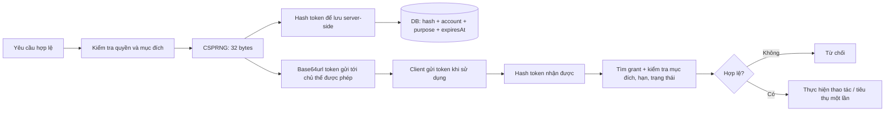
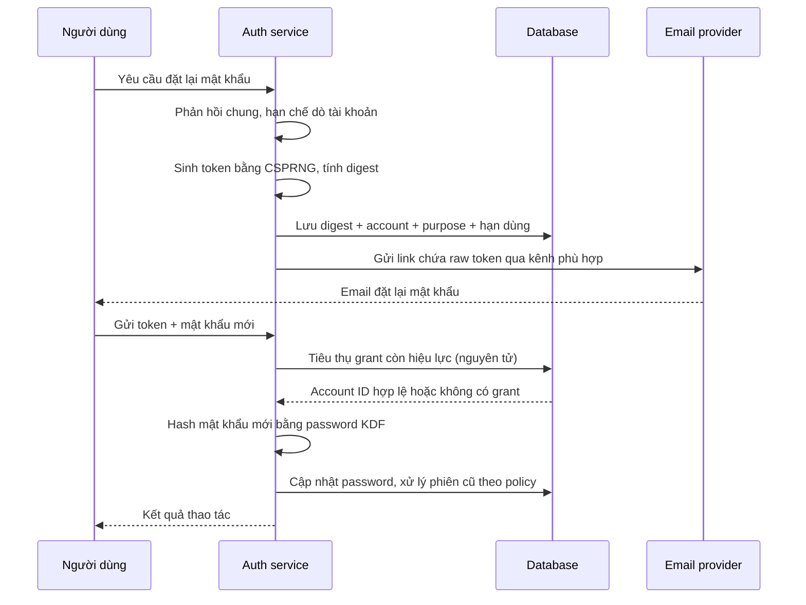
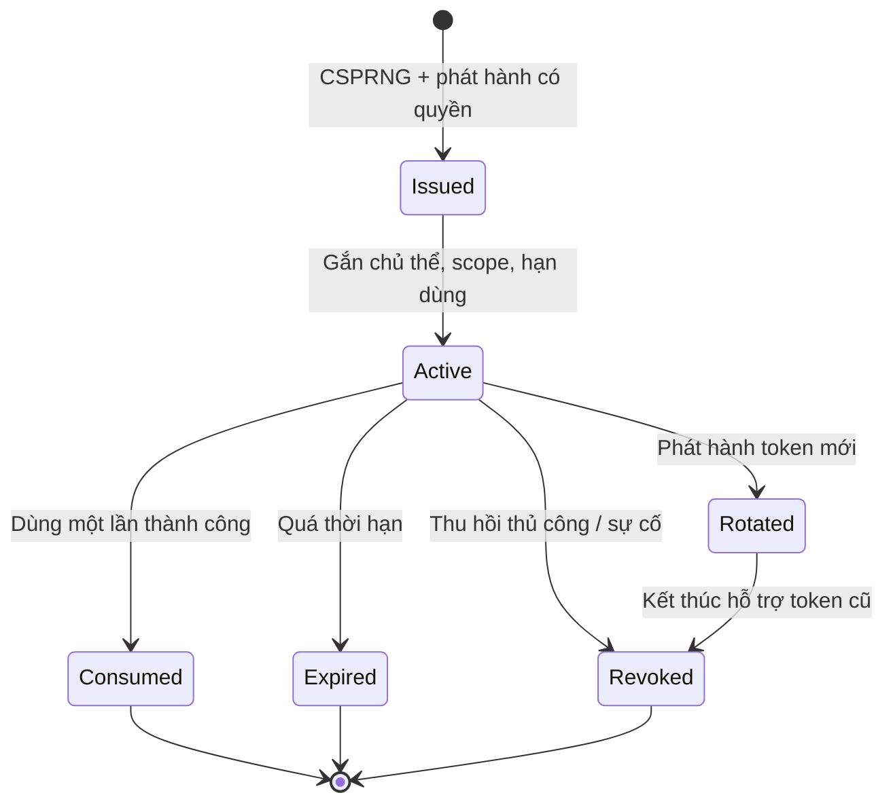

# Random token

## 1. Random token là gì?

**Random token (mã thông báo ngẫu nhiên)** là một giá trị được tạo từ nguồn ngẫu nhiên đủ mạnh để người không có quyền **không thể dự đoán hoặc đoán trúng một cách khả thi**. Trong nhiều hệ thống, token hoạt động như một **bearer credential**: ai sở hữu token hợp lệ có thể thực hiện một thao tác hoặc truy cập một tài nguyên trong phạm vi mà token được cấp.

Một số ví dụ quen thuộc:

- **Session token:** đại diện một phiên đã xác thực; trình duyệt gửi lại để chứng minh quyền truy cập phiên.
- **Password-reset token:** cho phép đặt lại mật khẩu trong thời gian ngắn, thường chỉ được sử dụng một lần.
- **Email-verification token:** chứng minh người dùng kiểm soát địa chỉ email nhận được liên kết xác minh.
- **API key dạng opaque:** cho ứng dụng hoặc tích hợp bên ngoài truy cập một tập API được cho phép.
- **Refresh token hoặc authorization code dạng opaque:** tham gia luồng cấp lại hoặc trao đổi quyền truy cập, với các ràng buộc riêng của giao thức.
- **CSRF token, OAuth state hoặc nonce:** ràng buộc một request với phiên/luồng đã bắt đầu, hạn chế một số kiểu giả mạo hoặc phát lại.

**“Ngẫu nhiên” không đủ nếu token bị lộ, không có thời hạn, không gắn với đúng mục đích hoặc có quyền quá rộng.** Việc bảo vệ token cần đi cùng tạo bằng nguồn mật mã, phân phối an toàn, lưu trữ có kiểm soát, kiểm tra phạm vi/quyền, xoay vòng, thu hồi và kiểm toán.

Bài học thuộc chương **Secure randomness** của module `SECURITY_KEY_MANAGEMENT_FUNDAMENTALS`. Nó kết nối **CSPRNG**, mật mã đối xứng/bất đối xứng, chữ ký số, KMS/HSM, envelope encryption và toàn bộ vòng đời khóa từ tạo đến hủy. Token có thể là một bí mật truy cập, nhưng **không nên đồng nhất mọi token với khóa AES, DEK, KEK hoặc private signing key**.

Sau bài học, bạn có thể:

1. Phân biệt **độ dài biểu diễn** với **entropy thực** của random token.
2. Sử dụng **`SecureRandom` trong Java** để tạo token mạnh và mã hóa bằng Base64url.
3. Nhận diện token an toàn và không an toàn: `Random`, timestamp, UUID, chuỗi có thể suy đoán.
4. Thiết kế lưu token dưới dạng hash, kiểm tra mục đích, thời hạn và **tiêu thụ một lần nguyên tử**.
5. Phân biệt token opaque ngẫu nhiên với **JWT có chữ ký** và mã OTP ngắn.
6. Lập kế hoạch **rotation, revocation, logging, incident response**, kể cả khi KMS/HSM tham gia bảo vệ secret.
7. Kiểm thử một luồng password reset hoặc API key từ phát hành đến thu hồi.

## 2. Token ngẫu nhiên giải quyết nguy cơ gì?

Xét một URL đặt lại mật khẩu:

```text
https://accounts.example/reset?token=...
```

Nếu token là chuỗi tăng dần `100001`, `100002`, hoặc được tạo từ email và thời gian hiện tại, kẻ tấn công có thể dự đoán những giá trị chưa được sử dụng. Nếu token được tạo bằng **nguồn ngẫu nhiên mật mã an toàn**, kẻ tấn công thiếu token thật phải thử trong không gian giá trị cực lớn.

Về mặt khả năng kiểm soát truy cập, token này là **một năng lực được trao tạm thời**. Sự an toàn của nó phụ thuộc vào hai nhóm điều kiện:

| Nhóm | Câu hỏi | Ví dụ |
| --- | --- | --- |
| **Không thể đoán** | Giá trị có được sinh độc lập bằng CSPRNG, đủ entropy không? | 32 byte ngẫu nhiên cho reset token. |
| **Không thể lạm dụng** | Token được phát cho ai, dùng việc gì, hết hạn khi nào, đã bị thu hồi/tiêu thụ chưa? | Chỉ đặt lại mật khẩu của đúng tài khoản, trong 15 phút, một lần. |

**Một token rất dài vẫn không an toàn** nếu bên tạo lấy `SHA-256(email + timestamp)` rồi coi digest 256 bit là 256 bit entropy. Hàm băm không thể tự tạo entropy vượt quá đầu vào dễ đoán.

### 2.1. Online guessing và lộ token là hai rủi ro khác nhau

- **Đoán token qua API:** đối thủ gửi nhiều token ứng viên tới hệ thống. Cần entropy cao, giới hạn tần suất, phát hiện hành vi bất thường và kiểm tra quyền.
- **Token bị rò rỉ trực tiếp:** token xuất hiện trong log, URL, lịch sử trình duyệt, email, cấu hình, ảnh chụp màn hình hoặc thiết bị bị xâm nhập. Entropy cao **không ngăn người đã nhìn thấy token thật sử dụng nó**; cần hạn dùng ngắn, phạm vi hẹp, biện pháp chống lộ và khả năng thu hồi.

Đây là lý do **kích thước token** và **vòng đời token** phải được thiết kế cùng nhau.

## 3. CSPRNG, entropy và độ dài token

**CSPRNG (Cryptographically Secure Pseudorandom Number Generator)** là bộ sinh giả ngẫu nhiên được thiết kế để đầu ra khó dự đoán đối với đối thủ không biết trạng thái bí mật bên trong. CSPRNG thường nhận hạt giống từ nguồn entropy của hệ điều hành, rồi tạo ra chuỗi bytes phù hợp mục đích mật mã.

Trong Java, API tiêu biểu là **`java.security.SecureRandom`**. Các lời gọi như `nextBytes(byte[])` lấy bytes từ cơ chế ngẫu nhiên của provider được chọn. Với JDK hiện đại và cấu hình nền tảng phù hợp, dùng `new SecureRandom()` là cách thông dụng để yêu cầu CSPRNG.

Ngược lại, các hàm như `Math.random()` và `java.util.Random` được thiết kế cho mô phỏng/tác vụ thông thường, **không phù hợp để tạo bearer credential cần chống dự đoán**.

### 3.1. Entropy không phải số ký tự

Nếu token là **\(n\) bit được sinh đồng đều và khó đoán**, xác suất đoán đúng bằng một lần thử lý tưởng là:

\[
P_{\text{success, one guess}} = \frac{1}{2^n}
\]

Nếu một kẻ tấn công thực hiện \(q\) lần thử độc lập trong không gian lớn, xác suất trúng gần đúng là:

\[
P_{\text{success, q guesses}} \approx \frac{q}{2^n}
\]

Ví dụ với token 128 bit và \(10^9\) lần thử, xác suất lý tưởng xấp xỉ \(2.94\times10^{-30}\). Các công thức này **giả định entropy thực đủ mạnh**, token chưa bị lộ và hệ thống không có lỗi logic cho phép bỏ qua kiểm tra.

| Nguồn token | Mức entropy lý thuyết | Biểu diễn ví dụ | Nhận xét |
| --- | ---: | --- | --- |
| **16 byte CSPRNG** | 128 bit | 22 ký tự Base64url không padding | Thường đủ lớn cho nhiều token dùng đúng phạm vi. |
| **32 byte CSPRNG** | 256 bit | 43 ký tự Base64url không padding | Lựa chọn minh họa tốt cho nhiều bearer token. |
| **32 byte CSPRNG** | 256 bit | 64 ký tự hex | Cùng entropy với dòng trên, chỉ dài ký tự hơn. |
| **Mã số 6 chữ số** | Dưới 20 bit | `004271` | Không thể dựa vào entropy để chống brute force ngoại tuyến; cần hạn dùng/rate limit. |
| **UUIDv4 sinh đúng chuẩn** | Khoảng 122 bit ngẫu nhiên | UUID có dấu gạch nối | Có thể thích hợp trong vài trường hợp; phải xác minh cách sinh và chính sách. |
| **Email + timestamp đem hash** | Không xác định, thường dễ đoán | Digest hex rất dài | Hash không biến dữ liệu dự đoán được thành secret mạnh. |

Một chuỗi Base64url 43 ký tự chỉ hàm ý 256 bit entropy khi nó **thực sự mã hóa 32 byte ngẫu nhiên độc lập**; không thể chỉ đếm độ dài để kết luận an toàn.

### 3.2. Vì sao Base64url thường hợp với token?

Bộ mã hóa Base64url sử dụng `A-Z`, `a-z`, `0-9`, `-` và `_`. Khi bỏ padding, output thuận tiện cho URL, HTTP header, JSON và cookie hơn Base64 thông thường vốn có thể chứa `+`, `/` hoặc `=`.

```text
32 byte ngẫu nhiên = 256 bit
Base64url (không padding) = 43 ký tự
Hex encoding             = 64 ký tự
Entropy                   = không đổi khi chỉ đổi encoding
```

**Encoding khác encryption và hashing:** Base64url chỉ chuyển biểu diễn bytes, không giấu thông tin. Ai nhìn thấy chuỗi Base64url có thể giải mã để lấy các bytes gốc, rồi dùng token nếu hệ thống chấp nhận.

### 3.3. Ngẫu nhiên mạnh chưa bảo đảm không trùng

Nếu các token được sinh độc lập đồng đều trong không gian \(2^n\), xác suất xảy ra ít nhất một va chạm sau \(q\) lần cấp phát, khi xác suất còn nhỏ, gần đúng là:

\[
P_{\text{collision}} \approx \frac{q(q-1)}{2^{n+1}}
\]

Với 128 hoặc 256 bit và quy mô cấp phát thông thường, xác suất va chạm rất thấp; tuy vậy, **ứng dụng vẫn nên ràng buộc unique** ở cơ sở dữ liệu theo định danh hoặc digest token, và tạo lại nếu gặp xung đột. Tính duy nhất là một thuộc tính cần thực thi; tính ngẫu nhiên mạnh chỉ giúp xung đột hiếm gặp.

Không dùng key ID tăng dần hoặc database sequence làm **phần secret của bearer token**. Có thể dùng ID công khai để tra cứu bản ghi, nhưng quyền truy cập phải dựa vào secret ngẫu nhiên riêng.

## 4. Những cách tạo token không an toàn

| Cách làm | Vấn đề | Hướng thay thế |
| --- | --- | --- |
| `new Random().nextLong()` | PRNG thông thường không được thiết kế chống dự đoán. | `SecureRandom.nextBytes`. |
| `Math.random()` rồi ghép ký tự | Không bảo đảm tính bảo mật mật mã. | Sinh bytes trực tiếp từ CSPRNG. |
| `System.currentTimeMillis()` + user ID | Đầu vào có thể đoán hoặc liệt kê. | Token độc lập từ CSPRNG. |
| Hash email + thời gian + chuỗi cố định | Digest dài nhưng entropy đầu vào thấp. | Sinh secret ngẫu nhiên thật rồi encode. |
| Sử dụng UUID bất kỳ mà không biết version/cách sinh | UUID không mặc nhiên là secret; một số biến thể chứa thời gian hoặc định danh. | CSPRNG đủ bytes; UUIDv4 chỉ dùng khi đã thẩm định phù hợp. |
| Dùng password hoặc PIN người dùng làm API token | Có thể đoán, dùng lại ở nhiều nơi và khó thu hồi độc lập. | Sinh token độc lập, gắn phạm vi và thời hạn. |
| Tự tạo `SecureRandom` với seed hằng có thể đoán | Có thể làm suy yếu trạng thái ngẫu nhiên tùy provider/triển khai. | Để API sử dụng entropy hệ điều hành, không tạo seed đoán được. |
| Sinh secret trên client không đáng tin cậy rồi server chấp nhận không kiểm soát | Không chứng minh token được cấp bởi hệ thống. | Server phát hành hoặc dùng protocol có cơ chế phát hành/kiểm chứng rõ ràng. |

### 4.1. Có nên tự “seed” SecureRandom từ thời gian không?

Không. Ứng dụng thường nên để JDK/provider và hệ điều hành xử lý nguồn entropy. Không tự lấy timestamp, PID, MAC address hoặc chuỗi do người dùng cung cấp để làm seed chính. Nếu hệ thống chạy trong môi trường đặc biệt (boot rất sớm, thiết bị nhúng, môi trường FIPS, HSM), phải đánh giá **nguồn entropy thực tế của nền tảng** theo tiêu chuẩn áp dụng.

Việc gọi `setSeed` có thể có hành vi phụ thuộc provider; không được giả định rằng tự truyền một seed yếu sẽ tạo ra entropy tốt. Cũng không cần “tái seed sau mỗi request” bằng một giá trị thời gian do ứng dụng tạo.

### 4.2. UUID có dùng làm token được không?

**UUIDv4** sinh bằng nguồn ngẫu nhiên an toàn có khoảng **122 bit ngẫu nhiên** vì một số bit dành cho version/variant; nó có thể đáp ứng một số yêu cầu về entropy. Nhưng “UUID” nói chung là **định dạng nhận dạng**, không phải chứng nhận nguồn ngẫu nhiên. Các biến thể UUID có thể gắn timestamp hoặc thuộc tính khác, và chất lượng nguồn sinh phụ thuộc thư viện.

Đối với bearer secret thông thường, việc tự sinh **16–32 byte bằng CSPRNG** rồi Base64url là cách dễ kiểm soát entropy và định dạng. Nếu ứng dụng đã dùng UUIDv4, cần đánh giá nguồn sinh, bối cảnh sử dụng, hạn dùng và các quyền đi kèm, tránh kết luận mọi UUID đều không an toàn hoặc mọi UUID đều đủ an toàn.

## 5. Token được phát hành, kiểm tra và thu hồi thế nào?

Một random token thường có **hai phần mô hình**:

1. **Secret value:** chuỗi chỉ người có quyền sở hữu phải biết.
2. **Server-side grant/session record:** bản ghi cho biết token nào được phép làm gì, cho chủ thể nào, trong thời gian nào và đã bị thu hồi/tiêu thụ chưa.

Ví dụ luồng phát hành/reset:



Tùy loại token, bản ghi có thể chứa:

| Trường | Ý nghĩa | Lưu ý |
| --- | --- | --- |
| `token_hash` hoặc `secret_digest` | Dùng tra cứu hoặc kiểm tra secret | Không lưu raw bearer token nếu không cần. |
| `token_id` | ID công khai phục vụ tra cứu/kiểm toán | Không được thay thế cho secret xác thực. |
| `subject_id` | Tài khoản, khách hàng hoặc dịch vụ mà grant thuộc về | Không tự tin `subject_id` do caller gửi khi đổi quyền. |
| `purpose` | `password_reset`, `email_verify`, `api_access`, v.v. | Không dùng token reset cho mục đích khác. |
| `scope` / `audience` | Tài nguyên và thao tác được phép | Nguyên tắc đặc quyền tối thiểu. |
| `created_at`, `expires_at` | Giới hạn thời gian sử dụng | Dùng nguồn giờ và chính sách xác minh nhất quán. |
| `consumed_at` | Dấu đã sử dụng cho token một lần | Kiểm tra và ghi nhận **nguyên tử**. |
| `revoked_at` | Dấu thu hồi thủ công hoặc tự động | Không tiếp tục chấp nhận token đã thu hồi. |
| `issuer`, `environment`, `key_version` | Phạm vi phát hành, version khi có cơ chế ký/MAC | Không tạo trường không cần thiết nếu mô hình không dùng. |

**Token ngẫu nhiên không tự mang các claim đáng tin cậy.** Các điều kiện `purpose`, `scope`, `subject` và `expires_at` cần được kiểm tra từ bản ghi do server kiểm soát hoặc cơ chế xác thực có thẩm quyền.

### 5.1. Chính sách vòng đời tùy loại token

| Loại token | Đặc điểm sử dụng | Chính sách cần thiết |
| --- | --- | --- |
| **Session ID** | Tồn tại theo phiên đăng nhập | Rotate khi đăng nhập hoặc thay đổi đặc quyền; cookie an toàn, idle/absolute timeout và logout/revocation. |
| **Password reset** | Quyền nhạy cảm, thường dùng một lần | Hết hạn ngắn, gắn tài khoản, không tiết lộ tài khoản tồn tại, tiêu thụ nguyên tử. |
| **Email verification** | Chứng minh người nhận kiểm soát email | Gắn email/chủ thể/phiên yêu cầu, hết hạn và tiêu thụ theo chính sách. |
| **API key** | Truy cập máy–máy, có thể kéo dài | Phạm vi hẹp, owner, show-once, hạn dùng, rotate overlap, revoke và audit. |
| **Opaque access/refresh token** | Tham gia protocol xác thực/ủy quyền | Tuân thủ protocol, sender constraint/rotation và chống replay khi áp dụng. |
| **CSRF token / OAuth state / nonce** | Gắn request với phiên/flow | Gắn ngữ cảnh, lưu/phát qua kênh đúng, hạn ngắn; không thay thế xác thực. |
| **Mã OTP 6 chữ số** | Dễ người dùng nhập, entropy thấp | Giới hạn thử, hết hạn rất ngắn, chống replay; không đánh đồng với token 128/256 bit. |

Các thời hạn cụ thể phải theo rủi ro và giao thức. Ví dụ **15 phút cho password-reset token** hoặc **30 ngày cho API key thử nghiệm** là lựa chọn minh họa, không phải giá trị bắt buộc cho mọi tổ chức.

## 6. Ví dụ Java 17: tạo random token bằng SecureRandom

Java có sẵn `SecureRandom` và `Base64` trong thư viện chuẩn. Ví dụ sau tạo **32 byte ngẫu nhiên**, mã hóa thành Base64url không padding, rồi tạo **SHA-256 digest** cho bản ghi server-side.

```java
import java.security.MessageDigest;
import java.security.SecureRandom;
import java.util.Arrays;
import java.util.Base64;
import java.util.HexFormat;

public final class RandomTokenDemo {
    private static final int TOKEN_BYTES = 32;
    private static final SecureRandom SECURE_RANDOM = new SecureRandom();

    record IssuedToken(String value, String digestHex) {}

    static IssuedToken issueToken() throws Exception {
        byte[] raw = new byte[TOKEN_BYTES];
        SECURE_RANDOM.nextBytes(raw);

        try {
            String token = Base64.getUrlEncoder()
                    .withoutPadding()
                    .encodeToString(raw);
            String digestHex = HexFormat.of().formatHex(
                    MessageDigest.getInstance("SHA-256").digest(raw)
            );
            return new IssuedToken(token, digestHex);
        } finally {
            Arrays.fill(raw, (byte) 0);
        }
    }

    static String digestSubmittedToken(String token) throws Exception {
        // 32 bytes random -> 43 Base64url chars (không padding).
        if (token == null || token.length() != 43
                || !token.matches("[A-Za-z0-9_-]{43}")) {
            return null;
        }

        byte[] raw;
        try {
            raw = Base64.getUrlDecoder().decode(token);
        } catch (IllegalArgumentException invalid) {
            return null;
        }

        try {
            if (raw.length != TOKEN_BYTES) {
                return null;
            }
            // Canonical encoding: tránh chấp nhận nhiều chuỗi cho cùng bytes.
            String canonical = Base64.getUrlEncoder()
                    .withoutPadding().encodeToString(raw);
            if (!canonical.equals(token)) {
                return null;
            }

            return HexFormat.of().formatHex(
                    MessageDigest.getInstance("SHA-256").digest(raw)
            );
        } finally {
            Arrays.fill(raw, (byte) 0);
        }
    }

    public static void main(String[] args) throws Exception {
        IssuedToken issued = issueToken();
        String digestReceived = digestSubmittedToken(issued.value());

        // Chỉ in thông tin không phải secret trong ví dụ.
        System.out.println("Length: " + issued.value().length()); // 43
        System.out.println("Digest matches: "
                + issued.digestHex().equals(digestReceived)); // true
        // Production: không log issued.value(), kể cả chỉ một phần dài.
    }
}
```

**Giải thích:**

1. `SecureRandom.nextBytes()` cung cấp bytes từ cơ chế ngẫu nhiên mật mã của provider, không phải `java.util.Random`.
2. **32 byte** cho tối đa 256 bit entropy nếu nguồn được triển khai an toàn.
3. **Base64url không padding** tạo chuỗi thuận tiện khi truyền. Encoding không làm tăng entropy.
4. Hàm `digestSubmittedToken` kiểm tra định dạng/độ dài và decode về bytes, phù hợp với cách tính digest lúc phát hành.
5. **SHA-256 digest** dùng để lưu/tra cứu token bí mật vốn đã có entropy cao; nó khác bài toán **password hashing** với mật khẩu có thể đoán.
6. Chỉ giữ `IssuedToken.value()` ở nơi cần trao cho chủ thể hợp lệ. Chuỗi `String` đã tạo trong JVM **không có bảo đảm xóa sạch mọi bản sao trong bộ nhớ**; `Arrays.fill` chỉ dọn mảng `raw` mà ứng dụng kiểm soát.
7. `String.equals` trên digest hex trong `main` dùng để **minh họa khớp digest**, chưa phải bộ xác minh production có kiểm soát thời gian chạy hoặc giao thức đăng nhập.

### 6.1. Vì sao không lưu token plaintext?

Giả sử database của hệ thống reset mật khẩu bị lộ. Nếu DB chứa **raw reset tokens còn hiệu lực**, kẻ tấn công có thể sử dụng trực tiếp chúng. Nếu chỉ lưu digest SHA-256 của những token được sinh ngẫu nhiên đủ mạnh, việc lấy lại token gốc từ digest thường không khả thi.

```text
Cấp phát:
  token = Base64url(CSPRNG(32 bytes))
  digest = SHA-256(decoded token bytes)
  DB lưu digest, account_id, purpose, expires_at, consumed_at

Sử dụng:
  raw token từ user -> validate format -> decode -> SHA-256
  tra cứu digest -> kiểm tra purpose/subject/expiry/revocation
  thực hiện thao tác theo giao dịch nguyên tử
```

**Tại sao SHA-256 đủ cho token mạnh nhưng không đủ cho password?**

- Token ngẫu nhiên **32 byte** không có danh sách từ điển nhỏ để thử.
- Mật khẩu do người dùng chọn thường có entropy thấp; SHA-256 tính quá nhanh, hỗ trợ offline cracking.
- Vì vậy, password nên dùng **Argon2id/scrypt hoặc password KDF được phê duyệt**, còn token entropy cao thường có thể lưu bằng **digest mật mã** theo mô hình đã đánh giá.

Không áp dụng nhận xét này cho **mã OTP 6 chữ số**, PIN hoặc token có không gian nhỏ. Digest SHA-256 đơn thuần của mã ngắn có thể bị brute force rất nhanh nếu DB bị lấy. Với mã ngắn cần hạn dùng, giới hạn thử/khóa sau số lần sai, và cân nhắc **keyed HMAC/pepper do KMS bảo vệ** theo sơ đồ phù hợp.

### 6.2. Mẫu xác minh token theo hash

Một luồng production thường dùng digest làm **khóa tra cứu có chỉ mục** trong database. Sau khi tìm đúng bản ghi, kiểm tra trạng thái, subject và scope, rồi thực hiện thao tác tương ứng. Với hệ thống chỉ kiểm tra một digest ứng viên với digest đã biết trong bộ nhớ, có thể dùng:

```java
import java.security.MessageDigest;

boolean sameDigest(byte[] storedDigest, byte[] computedDigest) {
    return storedDigest != null
            && computedDigest != null
            && storedDigest.length == 32
            && computedDigest.length == 32
            && MessageDigest.isEqual(storedDigest, computedDigest);
}
```

`MessageDigest.isEqual()` thích hợp cho so sánh digest bytes có độ dài kiểm soát, nhưng **không khiến toàn bộ endpoint constant-time**. Thời gian parse, truy vấn DB, trạng thái token, network và trả lỗi vẫn có thể khác nhau. Thực hiện rate limit, kiểm tra quyền và trả lỗi thống nhất ở mức phù hợp với threat model.

### 6.3. Mỗi lần tạo token cần mới và độc lập

Không tái sử dụng token sau logout/reset hoặc phát lại một token cũ cho cùng tài khoản. Khi cần phát hành mới, lấy bytes mới từ CSPRNG; không tạo token tiếp theo bằng cách tăng số, nối timestamp hoặc thay một vài ký tự của token cũ.

Một số hệ thống dùng **public token ID + secret ngẫu nhiên** để tìm bản ghi nhanh, ví dụ cấu trúc:

```text
ak_live_<public-id>.<random-secret-base64url>
```

Đây chỉ là định dạng minh họa. `ak_live` và public ID giúp định tuyến, **không phải phần bí mật**; xác thực vẫn dựa trên secret ngẫu nhiên và phạm vi grant. Khi lưu, chỉ hash phần secret hoặc toàn token theo định dạng được chuẩn hóa, và ràng buộc public ID với đúng bản ghi/quyền.

## 7. Password-reset token: sử dụng đúng một lần

Reset password là kịch bản có rủi ro cao: người có token hợp lệ có thể thay mật khẩu của tài khoản mục tiêu. Luồng cần xác minh **cả bí mật token lẫn trạng thái grant**.



### 7.1. Tại sao phải “atomic one-time use”?

Nếu hệ thống làm theo hai bước tách biệt:

```text
SELECT token WHERE consumed_at IS NULL
... một request khác đi qua cùng lúc ...
UPDATE token SET consumed_at = now()
```

hai request có thể cùng nhìn thấy trạng thái chưa dùng và đều tiếp tục đặt lại mật khẩu. Đây là **race condition** dẫn tới phát lại hoặc thao tác trùng.

Cần có giao dịch/cơ chế cập nhật điều kiện **nguyên tử**, ví dụ pseudocode SQL theo kiểu PostgreSQL:

```sql
BEGIN;

UPDATE password_reset_grants
SET consumed_at = CURRENT_TIMESTAMP
WHERE token_digest = :computed_digest
  AND purpose = 'password_reset'
  AND consumed_at IS NULL
  AND revoked_at IS NULL
  AND expires_at > CURRENT_TIMESTAMP
RETURNING account_id;

-- Chỉ nếu UPDATE trả đúng một account_id hợp lệ:
-- kiểm tra chính sách, ghi password hash mới, vô hiệu phiên nếu cần
-- trong một transaction/luồng nhất quán theo thiết kế.

COMMIT;
```

Ví dụ trên mô tả **ý tưởng transaction**, không phải đoạn SQL đã có đủ xử lý lỗi trong mọi database. Nếu cập nhật mật khẩu và đánh dấu token nằm trong **cùng DB**, nên quản lý cùng một transaction để tránh tiêu thụ token mà password chưa đổi. Nếu thao tác nằm ở nhiều dịch vụ, cần thiết kế giao dịch phân tán hoặc mô hình nhất quán có kiểm soát.

Không lấy `account_id` từ một tham số request chưa xác thực rồi tự quyết định tài khoản được đặt lại. Nên dùng **account ID ràng buộc trong bản ghi grant hợp lệ** làm nguồn quyết định.

### 7.2. Các yêu cầu bảo vệ luồng reset

- **Hạn dùng ngắn:** ví dụ 10–20 phút theo chính sách; server dùng đồng hồ nhất quán để kiểm tra.
- **Chỉ một lần:** lưu `consumed_at` và xử lý xung đột đồng thời đúng cách.
- **Gắn mục đích và tài khoản:** token reset không thể dùng để xác minh email hoặc đổi tài khoản khác.
- **Hạn chế phát hành:** rate limit theo địa chỉ, tài khoản và tín hiệu rủi ro; không dùng phản hồi để tiết lộ user tồn tại.
- **Thông báo sự kiện:** gửi thông báo phù hợp khi reset được yêu cầu/hoàn thành, không đính kèm token trong log.
- **Vô hiệu hóa token cũ khi cần:** khi phát hành mới, thay đổi email, logout hoặc sự cố bảo mật theo chính sách.
- **Không thay thế MFA/biện pháp khác:** quy trình reset và phục hồi tài khoản phải đánh giá nguy cơ chiếm quyền, không chỉ độ mạnh token.

### 7.3. Token trong URL có thể bị lộ ở đâu?

Token reset thường xuất hiện trong link email. Các nguồn rò rỉ đáng lưu ý gồm:

- **Log truy cập** của web server, reverse proxy, CDN hoặc hệ thống giám sát có lưu full URL/query.
- **Browser history**, bookmark, ảnh chụp màn hình, clipboard, công cụ hỗ trợ người dùng.
- **Referer header** khi trang reset tải tài nguyên bên thứ ba hoặc điều hướng không có chính sách phù hợp.
- **Analytics/tracking** và crash report thu thập URL.
- Dịch vụ kiểm tra link trong email, trình quét an toàn, hoặc hệ thống preview có thể **truy cập link trước người dùng**.

Nên làm trang reset **không thực hiện thay đổi nhạy cảm chỉ bằng GET**, mà yêu cầu một bước xác nhận/POST sau khi người dùng mở link. Cấu hình **`Referrer-Policy` phù hợp**, tránh tài nguyên bên thứ ba trên trang nhạy cảm, xóa token khỏi URL phía client sau khi xử lý an toàn nếu phù hợp và redaction log từ ingress đến ứng dụng.

Việc lưu token dạng hash trong DB **không chống được việc lộ raw token trên đường truyền hoặc ở browser**. Cần phòng vệ ở cả cấp giao thức và vận hành.

## 8. Session token và cookie an toàn

Một session token thường được cấp **sau khi xác thực thành công**. Token hoạt động như một ID không thể đoán, còn server quản lý thông tin phiên, chủ sở hữu, quyền và thời gian sống.

Các yêu cầu thường gặp:

1. Tạo **session ID mới** bằng CSPRNG khi đăng nhập.
2. Đặt cookie với các thuộc tính phù hợp: **`Secure`**, **`HttpOnly`**, **`SameSite`**, phạm vi `Path`/`Domain` tối thiểu; cân nhắc cookie tiền tố `__Host-` theo điều kiện hỗ trợ.
3. Có **idle timeout**, thời hạn tuyệt đối, logout/revoke và phương án hủy tất cả phiên khi sự cố.
4. **Rotate session ID** khi đăng nhập hoặc nâng quyền để giảm rủi ro session fixation; không duy trì ID do client đặt từ trước khi xác thực.
5. Chống session hijacking bằng TLS, kiểm soát XSS, CSRF và bảo vệ thiết bị/điểm cuối tùy môi trường.
6. Hạn chế ghi session ID vào log, URL và sự kiện analytics.

**`HttpOnly` không làm XSS vô hại**: script độc hại có thể vẫn gửi request nhân danh người dùng trong một số tình huống dù không đọc được cookie. **`SameSite` giảm một số nguy cơ CSRF nhưng không thay thế đầy đủ kiểm soát CSRF** khi threat model và luồng ứng dụng yêu cầu.

### 8.1. Token truy cập Bearer khác token ràng buộc người gửi

Một bearer token thuần được chấp nhận từ **bất cứ chủ thể nào trình ra đúng secret** theo chính sách. Trong một số giao thức, token có thể được **ràng buộc với khóa hoặc kênh của người gửi** (ví dụ một proof-of-possession mechanism) để giảm khả năng sử dụng khi chỉ lộ token.

Đây là một thiết kế khác, đòi hỏi xác minh bổ sung và hỗ trợ giao thức. Không được mặc định một token tạo bằng CSPRNG đã tự ràng buộc với thiết bị/IP/certificate. Việc ràng buộc IP có thể gây lỗi với mạng di động, NAT hoặc proxy và không phải giải pháp xác minh sở hữu mật mã phổ quát.

## 9. Opaque random token và JWT có chữ ký

Hai mô hình thường gặp:

| Thuộc tính | **Opaque random token** | **JWT/JWS có chữ ký** |
| --- | --- | --- |
| Dạng | Giá trị ngẫu nhiên không mang claim đọc được | Cấu trúc header.payload.signature theo giao thức |
| Xác minh | Thường tra cứu server-side grant/session hoặc introspection | Xác minh chữ ký/MAC và các claims theo key, issuer, audience |
| Revocation | Có thể thu hồi ngay qua trạng thái server-side | Tùy thiết kế: denylist, introspection, hạn ngắn, key revocation |
| Quyền/phạm vi | Tra từ bản ghi do server kiểm soát | Claim được bảo vệ bởi chữ ký, nhưng vẫn phải kiểm tra |
| Rủi ro trọng tâm | Lộ bearer secret, lookup sai, quên kiểm tra trạng thái | Lộ signing key, algorithm confusion, claim/issuer validation sai |
| Quan hệ với CSPRNG | Token thường cần entropy cao | JWT không cần toàn bộ chuỗi có entropy ngẫu nhiên; nhưng các nonce/`jti`/secret liên quan vẫn phải theo yêu cầu giao thức |

**JWT có chữ ký không phải “chuỗi token ngẫu nhiên dài”.** JWS bảo vệ tính toàn vẹn và nguồn phát hành của các claim qua chữ ký số hoặc MAC; payload JWT ký thường **không được mã hóa**. Nếu chứa dữ liệu nhạy cảm, cần phân tích nguy cơ lộ thông tin hoặc dùng thiết kế mã hóa/giao thức phù hợp.

Một JWT hợp lệ về chữ ký vẫn có thể sai `iss`, `aud`, `exp`, `nbf`, scope, tenant hoặc trạng thái thu hồi. Nếu private signing key bị compromise, kẻ tấn công có thể phát hành JWT giả với chữ ký toán học hợp lệ; rotation đơn thuần không đủ nếu verifier vẫn tin khóa cũ.

### 9.1. Random `jti` không tự tạo cơ chế revoke

`jti` là định danh JWT, có thể được sinh ngẫu nhiên để hỗ trợ quản lý replay hoặc thu hồi. Nhưng **chỉ có trường `jti` trong token không tự ngăn phát lại**. Hệ thống phải lưu trạng thái token đã sử dụng, token bị thu hồi hoặc xử lý các điều kiện tương ứng theo protocol.

Tương tự, OAuth `state`, OpenID Connect `nonce` và PKCE `code_verifier` cần tuân thủ **ràng buộc và độ dài/entropy được giao thức quy định**. Không mặc định một chuỗi token 32 byte có thể dùng thay mọi tham số giao thức mà không xem định dạng, phương thức kiểm tra và nơi lưu giữ ở hai đầu.

## 10. Mã OTP ngắn: vẫn dùng CSPRNG, nhưng phải kiểm soát thử

Nhiều giao diện yêu cầu mã 6 chữ số dễ nhập. Không gian `000000`–`999999` chỉ có **1.000.000 khả năng**, tương đương khoảng **19,93 bit** nếu sinh đồng đều.

Java có thể sinh mã số ngẫu nhiên đồng đều bằng:

```java
import java.security.SecureRandom;
import java.util.Locale;

SecureRandom random = new SecureRandom();
String code = String.format(
    Locale.ROOT, "%06d", random.nextInt(1_000_000)
);
```

`nextInt(bound)` của CSPRNG dùng cách sinh số nguyên nằm trong giới hạn được định nghĩa bởi API, tránh tự lấy một byte ngẫu nhiên rồi modulo 10 sai cách gây lệch phân phối. Nhưng **dù dùng SecureRandom, mã 6 số vẫn dễ brute force nếu không giới hạn số lần thử**.

Các kiểm soát quan trọng:

- Hạn rất ngắn và **giới hạn tổng số lần thử** cho từng mã/account/luồng, không chỉ theo IP.
- Ràng buộc mã với **mục đích, chủ thể, phiên yêu cầu, kênh và trạng thái tiêu thụ**.
- Không tiết lộ mã qua log, URL hay nội dung lỗi.
- Không lưu mã ngắn bằng **SHA-256 không khóa** như một phương án chống database breach; cân nhắc keyed HMAC/pepper được bảo vệ và chính sách reset phù hợp.
- Khi mã đã dùng hoặc phát lại ngoài ngữ cảnh, phải từ chối.
- Với TOTP/HOTP theo tiêu chuẩn, dùng thư viện đúng giao thức, quản lý shared secret, time step/counter và chống replay theo thiết kế riêng.

**OTP 6 số và token reset 256 bit là hai lớp credential khác nhau.** Không được lấy chính sách giới hạn thử của token 256 bit để áp cho OTP ngắn.

## 11. KMS/HSM và quản lý secret liên quan đến random token

Cần phân biệt **random token**, **khóa mật mã** và **secret phục vụ bảo vệ token**:

| Đối tượng | Vai trò | Cách quản lý gợi ý |
| --- | --- | --- |
| **Opaque random token** | Bearer secret cấp cho người dùng/dịch vụ | Sinh bằng CSPRNG; truyền qua TLS; hạn dùng/phạm vi/thu hồi; hash khi lưu nếu phù hợp. |
| **MAC/HMAC key** | Xác thực thông điệp hoặc tạo digest có khóa theo thiết kế | Sinh và lưu trong KMS/HSM/secret manager được phê duyệt; quản lý version, IAM, audit. |
| **Private signing key** | Ký JWT/JWS hoặc hiện vật số | Hạn chế export, chỉ cấp quyền `Sign`; xoay và thu hồi trust khi compromise. |
| **DEK** | Mã hóa dữ liệu bằng AES-GCM hoặc AEAD | Sinh ngẫu nhiên; bảo vệ nonce; có thể dùng envelope encryption. |
| **KEK** | Bao bọc DEK trong mô hình envelope encryption | Quản lý KMS/HSM, quyền `Encrypt/Decrypt`/wrap/unwrap và vòng đời. |
| **Password / pepper** | Bí mật đầu vào người dùng hoặc secret bổ trợ password hashing | Password KDF phù hợp, tách pepper khỏi DB, có rotation/recovery. |

KMS/HSM có thể cung cấp API sinh bytes ngẫu nhiên, HMAC hoặc khóa không thể xuất tùy sản phẩm. Tuy nhiên, **không phải token nào cũng cần KMS cho mỗi lần sinh**; Java `SecureRandom` với môi trường OS/entropy đáng tin cậy có thể phù hợp cho opaque bearer token. Quyết định phụ thuộc threat model, yêu cầu tuân thủ, độ trễ và mô hình vận hành.

### 11.1. Khi nào dùng digest không khóa, khi nào dùng HMAC?

Với **token 256 bit ngẫu nhiên đồng đều**, digest `SHA-256(token)` thường đủ để tránh lưu token plaintext. Nếu DB bị lộ, không gian brute force của token vẫn rất lớn.

Trong một số thiết kế, `HMAC(serverSecret, token)` có thể thêm một **ranh giới bí mật** do server quản lý, với điều kiện secret tách khỏi DB và có key version/khả năng khôi phục. Nhưng việc thêm HMAC cũng tạo thêm nghĩa vụ bảo vệ secret, rotation, KMS availability và xử lý bản ghi cũ. Không tự coi HMAC là bắt buộc cho mọi random token entropy cao.

Với **OTP ngắn hoặc giá trị đoán được**, digest không khóa **không đủ** để bảo vệ trước brute force ngoại tuyến nếu database bị lộ. Khi ấy keyed verification, hạn dùng ngắn và giới hạn thử là những yếu tố quan trọng hơn.

### 11.2. Không lưu bearer token bằng reversible encryption một cách tùy tiện

Nếu hệ thống chỉ cần **xác minh token được trình lên**, việc lưu `hash(token)` thường làm giảm hậu quả khi DB bị lộ so với lưu raw token hoặc ciphertext có thể giải mã. Nếu nghiệp vụ thật sự cần **lấy lại secret** (ví dụ một tích hợp phải gửi API key tới nhà cung cấp khác), phải quản lý đây là **secret có thể giải mã** qua KMS/envelope encryption, với IAM, audit và tiêu chí sử dụng rõ ràng.

Không trộn hai yêu cầu: **verifier không cần lấy lại token** thì thường nên dùng hash, còn **secret phải sử dụng để gọi hệ thống khác** có thể cần kho secret được kiểm soát. Mã hóa reversible không thay thế được việc hạn chế quyền truy cập.

## 12. Token rotation, revocation và ứng cứu khi bị lộ

Token có **vòng đời riêng**, dù nó không phải key material của một thuật toán AES hoặc chữ ký số.



Các trạng thái trên là mô hình khái niệm; hệ thống thực có thể dùng trạng thái khác. Điều quan trọng là **điều kiện chấp nhận token** phải được thực thi server-side, chứ không chỉ ghi vào tài liệu.

### 12.1. Rotation theo từng loại

- **Session token:** phát hành ID mới sau đăng nhập, nâng quyền hoặc mốc chính sách; vô hiệu hóa ID cũ, đảm bảo không có session fixation.
- **Password-reset token:** mỗi request hợp lệ sinh token mới; hết hạn và tiêu thụ một lần, có thể hủy token trước đó tùy chính sách.
- **API key:** cho phép cấp key mới trước khi thu hồi key cũ để tích hợp chuyển đổi có kiểm soát; theo dõi sử dụng của từng key ID.
- **Refresh token:** cần tuân thủ giao thức; rotation và phát hiện reuse có thể là một phần quan trọng để giảm replay.
- **CSRF/OAuth state:** token gắn với phiên hoặc luồng, kết thúc khi luồng hoàn tất hoặc hết hạn.

**Rotation không thu hồi được raw token đã bị lộ nếu server vẫn tiếp tục chấp nhận token cũ.** Khi có sự cố, cần xác định các bản sao, thời hạn chồng lấn, điều kiện thu hồi và hành động nghiệp vụ đã xảy ra.

### 12.2. Quy trình ứng cứu token compromise

1. Xác định **loại token, chủ thể, phạm vi quyền, thời hạn, thời điểm có thể bị lộ và kênh rò rỉ**.
2. Thu hồi token hoặc phiên bị ảnh hưởng; với API key có thể cần phối hợp đối tác để tránh gián đoạn ngoài ý muốn.
3. Kiểm tra log sử dụng ở mức metadata: key ID/subject, timestamp, nguồn, route, kết quả và correlation ID.
4. Rà soát những thao tác đã được thực hiện bằng token: đọc dữ liệu, thay đổi quyền, giao dịch hoặc cấp token mới.
5. Phát hành token thay thế từ CSPRNG và truyền qua kênh được bảo vệ.
6. Khắc phục nguồn rò rỉ: URL/query logging, analytics, CI secrets, browser storage, leak từ proxy hoặc quyền quản trị.
7. Ghi lại bằng chứng, quy trình thông báo và kiểm thử việc **token cũ bị từ chối** ở mọi dịch vụ nhận token.

Nếu **private signing key** của hệ thống JWT bị lộ, phạm vi ứng cứu rộng hơn một opaque token đơn lẻ: cần xử lý **key trust**, JWT giả có thể được ký, JWKS cache và token đã phát hành.

## 13. Kiểm soát truy cập và kiểm toán

Dù token là secret ngẫu nhiên, quyền mà nó mang theo vẫn cần chính sách **least privilege**.

| Chủ thể | Quyền phù hợp | Bằng chứng/kiểm soát |
| --- | --- | --- |
| **Token issuer** | Chỉ cấp các loại/scope token được phê duyệt | Audit phát hành, owner, policy, giới hạn tần suất. |
| **Token verifier** | Kiểm tra digest/trạng thái/mục đích và quyền nghiệp vụ | Không thể tự ý cấp token mới hoặc mở rộng scope. |
| **Key/secret admin** | Quản lý HMAC/signing/KEK khi hệ thống có dùng | Không mặc nhiên được xem hoặc phát hành bearer tokens cho người dùng. |
| **Incident responder** | Thu hồi hoặc vô hiệu hóa khẩn cấp theo quy trình | Quyền khẩn cấp có hạn, cảnh báo và hậu kiểm. |
| **Auditor** | Xem metadata sự kiện và lịch sử thay đổi | Không cần nhận raw token, password hoặc private key. |

Log nên gồm **event type, token ID công khai hoặc fingerprint an toàn, chủ thể, mục đích, scope, trạng thái, thời điểm, mã yêu cầu và kết quả**, không gồm raw secret. Một fingerprint dùng để correlating logs cũng phải được đánh giá về khả năng suy diễn hoặc bị sử dụng để định danh người dùng ngoài phạm vi cho phép.

Các chỉ số hữu ích:

- Tỷ lệ phát hành và xác minh token theo loại, mục đích và môi trường.
- Số token đã hết hạn nhưng còn request sử dụng; số lượt thử token không tồn tại.
- Số password reset đã yêu cầu/thành công/thất bại theo metadata an toàn.
- Số API key quá thời hạn hoặc không còn owner nhưng vẫn active.
- Số token bị thu hồi sau sự cố, độ trễ áp dụng revoke tới các verifier.
- Độ trễ của cơ chế lưu trạng thái và tỷ lệ lỗi khi hai request cùng tiêu thụ một token.

### 13.1. Audit không được trở thành nơi làm lộ token

Một hệ thống ghi log `Authorization: Bearer ...`, full query string chứa reset token, hoặc body chứa OTP có thể tự tạo ra một kho credential thứ hai mà nhiều nhân sự đọc được. Cần thực hiện **redaction tại nhiều tầng**: API gateway, reverse proxy, load balancer, application logs, tracing, analytics, hỗ trợ khách hàng và crash reports.

Với những token phải gửi qua email, cần kiểm tra chính sách giữ nội dung email, hệ thống hỗ trợ, link scanners và nơi token có thể xuất hiện trong URL. CSPRNG tốt không bù đắp được việc token được sao chép vào kho log không kiểm soát.

## 14. Case study: API key cho đối tác tích hợp

Giả sử hệ thống `billing-prod` cấp API key cho đối tác `partner-A` để đọc trạng thái hóa đơn và tạo yêu cầu thanh toán trong phạm vi một tenant.

Một thiết kế an toàn có thể gồm:

```text
Hiển thị một lần:
  ak_live_<public-key-id>.<secret-32-random-bytes-in-Base64url>

Database:
  public_key_id
  secret_digest        = SHA-256(secret bytes)
  owner                = partner-A
  tenant_id            = tenant-A
  environment          = production
  scopes               = invoices:read, payments:create
  created_at, expires_at, revoked_at, last_used_at

Request:
  Xác định public_key_id từ API key
  Kiểm tra secret digest theo đúng định dạng
  Kiểm tra trạng thái, tenant, scope, rate limit
  Ghi audit metadata và xử lý theo policy
```

**Đừng dùng prefix `ak_live` để quyết định tất cả quyền.** Đây chỉ là gợi ý định dạng/môi trường; quyền thực sự phải lấy từ grant server-side và ràng buộc với ID đã được xác minh.

### 14.1. Rotation không gián đoạn

1. Đối tác yêu cầu hoặc hệ thống lên lịch đổi key.
2. Dịch vụ cấp **key B mới** với quyền không vượt scope được duyệt, cho đối tác xem secret mới đúng một lần.
3. Bên tích hợp triển khai key B, kiểm tra hoạt động và theo dõi mức sử dụng của key A.
4. Trong giai đoạn chồng lấn được phê duyệt, cả hai key có thể hoạt động nhưng được log theo **key ID riêng**.
5. Đến hạn hoặc khi phát hiện key B ổn định, **thu hồi key A**.
6. Kiểm tra rằng request mang key A bị từ chối ở mọi gateway/instance, kể cả cache.
7. Rà soát quyền, thời hạn, owner và ứng dụng không dùng key sau rotation.

Nếu key A bị lộ, không mặc nhiên giữ giai đoạn chồng lấn như rotation định kỳ; cần cân nhắc **thu hồi ngay** theo mức độ ảnh hưởng.

### 14.2. Khi database API key bị lộ

Nếu DB chỉ chứa digest của **secret 256 bit ngẫu nhiên**, kẻ tấn công thường không thể từ digest tìm ra secret thực tế bằng cách brute force. Tuy nhiên, DB có thể còn chứa owner, tenant, scope, lịch sử sử dụng và những dữ liệu nhạy cảm khác; đội bảo mật vẫn phải đánh giá toàn bộ sự cố và **đường truy cập cấp phát key**.

Nếu log hoặc hệ thống gửi thông báo lại lưu **raw secret**, đối thủ có thể sử dụng ngay, bất kể digest DB được bảo vệ tốt. Việc ứng cứu cần xét đồng thời database, log, IAM, kênh phân phối và phạm vi token đang hoạt động.

## 15. Những sai lầm phổ biến

| Sai lầm | Rủi ro | Cách xử lý |
| --- | --- | --- |
| Dùng `Math.random()` hoặc `Random` cho bearer token | Giá trị có thể bị dự đoán trong mô hình tấn công. | Dùng `SecureRandom.nextBytes`. |
| Tạo token bằng `SHA-256(email + timestamp)` | Digest 256 bit nhưng entropy đầu vào thấp. | Sinh secret ngẫu nhiên độc lập. |
| Cho rằng Base64 hay hex là mã hóa bí mật | Token dễ dàng giải mã biểu diễn. | Bảo vệ bearer secret như mật khẩu truy cập. |
| Cho rằng mọi UUID đều là secret mạnh | Version và nguồn sinh có thể không đạt yêu cầu. | Dùng CSPRNG, kiểm tra UUIDv4 nếu lựa chọn. |
| Lưu raw reset token trong DB/log | Lộ DB hoặc log dẫn đến chiếm quyền đặt lại mật khẩu. | Hash token trong DB; redaction log. |
| Chỉ kiểm tra secret mà không kiểm tra `purpose` | Token một mục đích có thể bị lạm dụng cho mục đích khác. | Gắn purpose/subject/scope và xác minh server-side. |
| Không tiêu thụ token reset nguyên tử | Hai request cùng dùng token một lần. | Giao dịch hoặc atomic conditional update. |
| Token có entropy cao nhưng tồn tại vĩnh viễn | Một lần lộ có thể gây ảnh hưởng kéo dài. | Expiry, rotation, revoke, audit. |
| Dùng SHA-256 không khóa lưu OTP 6 số | Dễ thử toàn bộ không gian OTP nếu DB bị lộ. | Hạn dùng/rate limit; keyed verifier bảo vệ riêng khi phù hợp. |
| Đưa token qua URL và lưu query vào logs | Token bị rò rỉ dù CSPRNG mạnh. | Referrer policy, log redaction, POST xác nhận. |
| Dùng `kid` hoặc token ID như quyền xác thực | ID công khai có thể đoán/tra cứu. | Quyền dựa trên secret/cryptographic validation và grant. |
| Nghĩ JWT ký thì payload đã được giấu | JWS payload thường đọc được. | Không bỏ thông tin mật vào JWT nếu chưa có bảo vệ phù hợp. |
| Xoay key mới nhưng vẫn nhận key bị lộ | Token cũ còn sử dụng được. | Chặn/thu hồi theo sự cố và kiểm tra cache. |
| Ghi token đầy đủ để “debug” | Log trở thành kho credential dễ lộ. | Log metadata, request ID và fingerprint đã được đánh giá. |

## 16. Ma trận kiểm thử Random token

| Kiểm thử | Kỳ vọng |
| --- | --- |
| Tạo nhiều token từ CSPRNG | Độ dài/format đúng; không trùng trong mẫu kiểm thử thông thường, có unique constraint khi lưu. |
| Token mới có 32 byte dữ liệu | Base64url không padding dài **43 ký tự**. |
| Thay một ký tự của token | Bị từ chối, không map sang grant hợp lệ. |
| Dùng token sai loại/purpose | Bị từ chối dù chuỗi tồn tại ở loại khác. |
| Dùng token sai subject/tenant/scope | Bị từ chối theo quyền server-side. |
| Token quá hạn | Bị từ chối theo đồng hồ/policy của server. |
| Token bị revoke | Bị từ chối ở mọi gateway/instance/cache liên quan. |
| Password reset token dùng hai request đồng thời | Tối đa một request được tiêu thụ thành công; không có race ghi password. |
| Reset token được mở bằng link scanner | GET không tự thay mật khẩu hoặc tiêu thụ grant ngoài ý muốn. |
| Mã OTP sai quá giới hạn thử | Bị chặn theo account/flow, không mở đường brute force. |
| API key sau rotation | Key mới hoạt động; key cũ hết quyền đúng thời điểm. |
| Token trong URL/header/body bị log | Không có raw secret trong proxy/access/tracing/analytics. |
| JWT có chữ ký đúng nhưng sai `aud`/`exp` | Bị từ chối theo chính sách JWT. |
| Database chỉ chứa token digest bị đọc trái phép | Không có raw bearer secret trong bảng hoặc backup liên quan. |
| Kiểm thử định dạng Base64url sai | Từ chối gọn, giới hạn input và không có lỗi nội bộ lộ secret. |
| Khôi phục backup/session store | Trạng thái revoke, consumed và expiry không bị mất nhất quán. |

## 17. Checklist thiết kế random token cho production

Hãy trả lời các câu hỏi trước khi triển khai:

1. **Mục đích:** token là session ID, reset link, API key, CSRF/OAuth state, JWT claim hay OTP? Mỗi loại có quyền và mô hình đe dọa phù hợp chưa?
2. **Nguồn ngẫu nhiên:** giá trị có được sinh bằng CSPRNG đáng tin cậy, không dùng seed dễ đoán, `Random`, `Math.random` hay timestamp không?
3. **Entropy:** số byte ngẫu nhiên đủ lớn cho số lần đoán và thời gian sống dự kiến chưa? Có phân biệt entropy với độ dài Base64/hex?
4. **Định dạng:** truyền bằng Base64url/hex hay theo giao thức? Có giới hạn, kiểm tra và canonical encoding chưa?
5. **Lưu trữ:** chỉ cần verify thì đã lưu digest thay vì raw token chưa? Nếu phải lưu secret có thể khôi phục, đã dùng secret manager/KMS/envelope encryption đúng quyền chưa?
6. **Ràng buộc:** token có gắn `purpose`, subject, tenant, scope, audience hoặc giao dịch theo chính sách không?
7. **Thời hạn và one-time:** có expiry, consumed/revoked status và thao tác tiêu thụ nguyên tử với request đồng thời không?
8. **Phân phối:** có dùng TLS, cookie an toàn, hạn chế token ở URL và log, kiểm soát link scanners/referrer/tracking không?
9. **Đặc quyền:** token có cấp đúng quyền tối thiểu và không bị mở rộng bởi metadata do client tự chọn không?
10. **Rotation:** có tạo token mới độc lập, chuyển tiếp có kiểm soát, thu hồi token cũ và kiểm tra tất cả verifier/cache không?
11. **Sự cố:** khi DB, token, service account hoặc signing key bị lộ, có phân biệt phạm vi và runbook khắc phục tương ứng không?
12. **Kiểm toán:** có thể truy vết phát hành/sử dụng/thu hồi qua metadata mà không log raw secret không?
13. **Kiểm thử:** đã thử token sai, hết hạn, sai scope, replay, race, CSRF, cross-tenant, data breach, cache và giới hạn tốc độ chưa?

**Ghi nhớ:** Một **random token an toàn** bắt đầu từ **entropy thực của CSPRNG** nhưng chỉ hoàn chỉnh khi được **cấp đúng mục đích, bảo vệ khi truyền/lưu, xác minh đầy đủ quyền và trạng thái, có hạn dùng, có khả năng thu hồi và có thể kiểm toán**. Trong hệ thống quản lý khóa, hãy phân biệt bearer token với DEK/KEK, MAC secret và private signing key; mỗi loại có vòng đời, cơ chế bảo vệ và phương án ứng cứu riêng.
