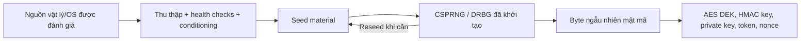
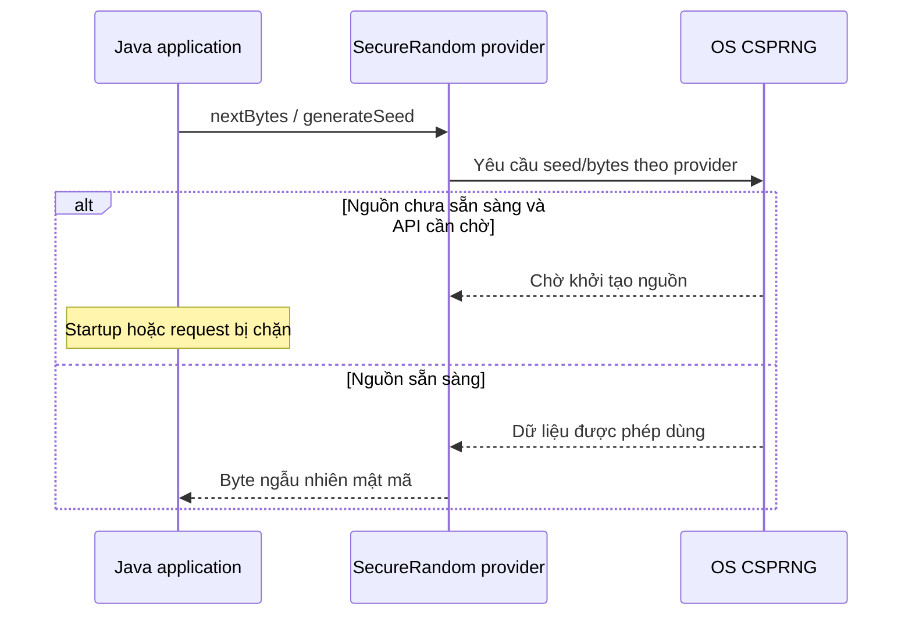
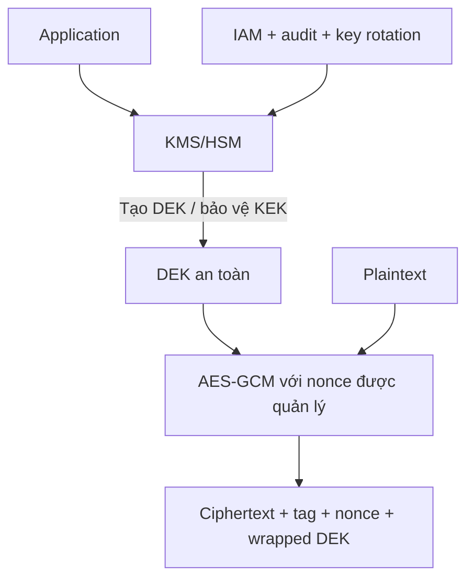
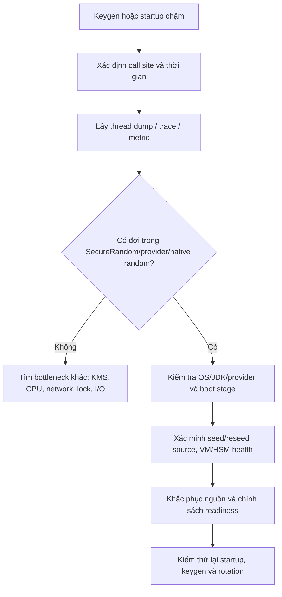
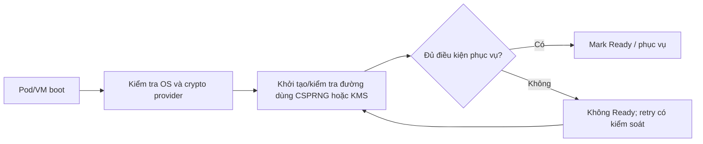
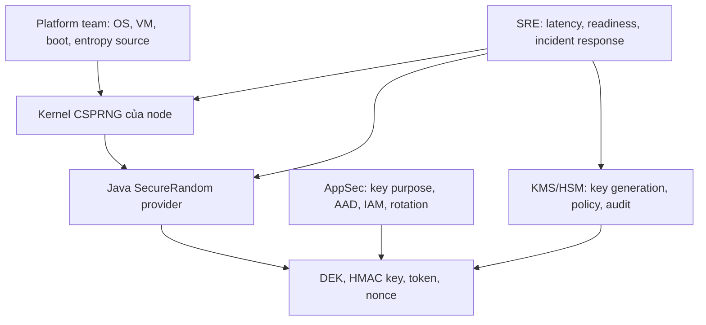

# Entropy starvation: Thiếu entropy và tác động tới sinh khóa mật mã

> **Chương:** Secure randomness  
> **Bài học:** Entropy starvation  
> **Module:** `SECURITY_KEY_MANAGEMENT_FUNDAMENTALS` — hiểu vòng đời khóa mật mã từ tạo, cấp phát, lưu trữ, sử dụng, xoay vòng đến thu hồi và hủy; kết nối mật mã đối xứng, bất đối xứng, chữ ký số, KMS/HSM, envelope encryption, kiểm soát truy cập và kiểm toán.

## 1. Bài toán thực tế: Tại sao dịch vụ treo khi sinh khóa?

Một ứng dụng Java khởi động trên máy ảo mới tạo, thực hiện:

```java
SecureRandom random = SecureRandom.getInstanceStrong();
byte[] keyBytes = new byte[32];
random.nextBytes(keyBytes);
```

Trong một số cấu hình hệ điều hành, JVM và provider, lời gọi đầu tiên có thể phải chờ **nguồn entropy hệ thống sẵn sàng** hoặc một cơ chế lấy seed cho bộ sinh ngẫu nhiên. Tại thời điểm boot sớm, máy nhúng, máy ảo có cấu hình bất thường hay dịch vụ bảo mật cần reseed, nguồn entropy chưa sẵn sàng có thể gây **chặn (blocking)**, timeout hoặc lỗi.

Hiện tượng được gọi là **entropy starvation**: một thành phần cần vật liệu ngẫu nhiên khó dự đoán cho hoạt động mật mã nhưng **không thu được đủ entropy đáng tin cậy vào thời điểm cần** hoặc không thể hoàn thành thao tác nạp seed/reseed theo chính sách.

**Không nên hiểu theo cách đơn giản rằng mỗi lần tạo token sẽ “rút cạn” một bể số ngẫu nhiên.** Với hệ điều hành hiện đại, một **CSPRNG** (*Cryptographically Secure Pseudorandom Number Generator*) đã khởi tạo đúng có thể sinh rất nhiều byte khó dự đoán từ trạng thái bí mật; thông thường không cần thu entropy vật lý mới cho từng byte đầu ra. Vấn đề nằm ở **khởi tạo, reseed, chất lượng nguồn, chính sách provider và môi trường vận hành**, không chỉ ở số lượng lời gọi `nextBytes()`.

Đây là chủ đề nền tảng của quản lý khóa: nếu vật liệu sinh khóa ban đầu **dễ dự đoán**, khóa AES, khóa riêng RSA/EC/Ed25519, secret HMAC, recovery code hoặc seed KDF có thể bị tấn công ngay cả khi thuật toán mã hóa được triển khai đúng.

### Sau bài học, bạn cần làm được

1. Phân biệt **entropy**, **min-entropy**, **seed**, **CSPRNG**, **DRBG** và **entropy pool**.
2. Hiểu khi nào thiếu entropy tạo blocking, lỗi khởi tạo hoặc rủi ro sinh khóa có thể dự đoán.
3. Giải thích hành vi phụ thuộc hệ điều hành/provider của `SecureRandom`, `getInstanceStrong()` và `KeyGenerator` trong Java 17.
4. Nhận diện các môi trường đặc biệt: **early boot**, máy ảo clone/snapshot, container, máy nhúng/IoT, HSM.
5. Phân biệt số ngẫu nhiên dùng cho **khóa**, **salt**, **nonce/IV** và **request ID**.
6. Thiết kế giám sát, readiness, xử lý sự cố và quy trình thay thế khóa nếu nghi ngờ nguồn entropy yếu.
7. Tránh những cách “chống treo” nhưng làm giảm an toàn, chẳng hạn thay CSPRNG bằng `Random` hoặc seed bằng thời gian.

---

## 2. Entropy là gì và khác số ngẫu nhiên ở điểm nào?

### 2.1. Entropy thể hiện độ khó dự đoán

Trong mật mã, entropy mô tả mức độ không chắc chắn của giá trị đối với đối thủ có thông tin và khả năng quan sát nhất định. Một chuỗi trông rất hỗn loạn **chưa chắc có entropy cao**.

Ví dụ:

```text
Giá trị A: 872609415230
Nguồn A:  đồng hồ hệ thống + vài phép toán cố định

Giá trị B: 7f0e... (32 byte)
Nguồn B:   CSPRNG hệ điều hành đã khởi tạo đúng
```

Giá trị A có thể “trông như ngẫu nhiên”, nhưng nếu đối thủ suy đoán được thời gian và thuật toán sinh, không gian tìm kiếm có thể nhỏ. Giá trị B có thể khó dự đoán hơn đáng kể khi nguồn seed và CSPRNG đáp ứng các giả định bảo mật.

**Không đánh giá chất lượng entropy chỉ bằng việc nhìn chuỗi output.** Kiểm tra số lượng bit 0/1, histogram hay bài thử thống kê trên output có thể phát hiện một số lỗi thô, nhưng **không chứng minh** rằng seed bí mật hoặc đối thủ không dự đoán được khóa.

### 2.2. Min-entropy và ý nghĩa bảo mật

Một cách biểu diễn khái niệm về **min-entropy** của biến ngẫu nhiên \(X\) là:

\[
H_{\infty}(X)=-\log_2\left(\max_x \Pr[X=x]\right)
\]

Nó phản ánh xác suất của giá trị dễ đoán nhất.

Ví dụ minh họa:

- Nếu một “khóa 256 bit” thực chất chỉ có **2 lựa chọn**, min-entropy nhiều nhất chỉ là 1 bit.
- Nếu bí mật được chọn đồng đều từ **\(2^{128}\)** giá trị, min-entropy là 128 bit.
- Việc chuyển một mật khẩu yếu thành chuỗi 32 byte bằng SHA-256 **không tạo ra 256 bit entropy**.

Độ dài byte, độ phân bố theo thống kê và entropy bảo mật là những khái niệm có liên quan nhưng **không tương đương**.

### 2.3. Seed, entropy source và CSPRNG

| Thành phần | Vai trò | Ví dụ |
|---|---|---|
| **Entropy source** | Cung cấp dữ liệu có tính không đoán trước từ môi trường/hardware theo cơ chế được đánh giá. | Nguồn được hệ điều hành tổng hợp, nguồn ngẫu nhiên phần cứng được kiểm tra. |
| **Seed material** | Vật liệu dùng khởi tạo hoặc reseed bộ sinh. | Byte seed do hệ điều hành/provider bảo đảm. |
| **CSPRNG** | Sinh chuỗi byte khó dự đoán nếu trạng thái bí mật ban đầu an toàn. | Bộ sinh ngẫu nhiên mật mã của OS, provider JCA. |
| **DRBG** | Một họ CSPRNG xác định được thiết kế theo các thuật toán/đặc tả cụ thể. | Hash_DRBG, HMAC_DRBG, CTR_DRBG theo NIST SP 800-90A. |
| **Entropy pool** | Cơ chế hệ điều hành tổng hợp và quản lý đóng góp entropy. | Hạ tầng random subsystem của Linux. |
| **Reseeding** | Cập nhật trạng thái CSPRNG từ vật liệu seed/entropy mới theo thiết kế. | Reseed khi provider hoặc policy yêu cầu. |

Dòng chảy khái niệm:



Mũi tên reseed trong sơ đồ chỉ thể hiện quan hệ khái niệm, không phải mọi lời gọi `nextBytes()` đều đi lấy entropy mới. Cơ chế phụ thuộc OS/provider/DRBG và chính sách bảo mật.

### 2.4. “Pseudorandom” có nghĩa là không an toàn?

Không. **Pseudorandom** nghĩa là các byte được tạo bằng thuật toán xác định từ trạng thái bí mật. Nếu thuật toán được thiết kế đúng, seed không dự đoán được và trạng thái được bảo vệ, đầu ra có thể phù hợp cho sinh khóa mật mã.

Điều **không phù hợp** là dùng PRNG thông thường như `java.util.Random`, `Math.random()` hoặc `ThreadLocalRandom` để sinh key/secret. Những bộ sinh này không cung cấp các bảo đảm mật mã cần thiết dù có thể rất hữu ích cho mô phỏng, phân tải hoặc dữ liệu kiểm thử không nhạy cảm.

---

## 3. Entropy starvation xảy ra ở đâu trong chuỗi khởi tạo?

### 3.1. Trước khi CSPRNG sẵn sàng

Trong giai đoạn boot sớm:

1. Hệ điều hành cần tổng hợp đủ nguồn ngẫu nhiên ban đầu.
2. Một dịch vụ yêu cầu byte ngẫu nhiên mật mã.
3. OS/provider kiểm tra nguồn đã sẵn sàng theo thiết kế hay chưa.
4. Nếu chưa, lời gọi có thể **chờ** hoặc **trả lỗi**, tùy API và chế độ được yêu cầu.



Việc **chờ nguồn an toàn** có thể là hành vi bảo mật đúng. Thay nó bằng khóa được sinh từ timestamp hoặc seed cố định chỉ để giảm thời gian startup là đánh đổi nguy hiểm.

### 3.2. Reseeding hoặc yêu cầu mức bảo đảm đặc biệt

Một số DRBG/provider yêu cầu seed mới khi:

- Được khởi tạo lần đầu.
- Đạt một ngưỡng hoặc số thao tác theo thiết kế.
- Ứng dụng yêu cầu prediction resistance hoặc reseed tường minh.
- Thiết bị HSM yêu cầu health check hoặc trạng thái entropy source mới.

Lúc này, nếu không có vật liệu seed đủ điều kiện, hoạt động có thể bị chậm, thất bại hoặc chờ theo chính sách. **Không suy rộng** rằng mọi Java `SecureRandom` đều block trong mỗi lần reseed; cần biết thuật toán và provider thực tế.

### 3.3. Lỗi nguồn entropy không nhất thiết xuất hiện thành “treo”

Có ít nhất ba nhóm kết quả:

| Hiện tượng | Ý nghĩa có thể có | Rủi ro |
|---|---|---|
| **Blocking/latency tăng** | Nguồn chưa sẵn sàng; provider đang chờ seed; thiết bị chậm. | Dịch vụ không ready, request timeout, khó đạt SLA. |
| **Exception hoặc lỗi thiết bị** | CSPRNG/HSM báo không thể khởi tạo/reseed hoặc lỗi health check. | Keygen/signing/provisioning thất bại; cần fail closed. |
| **Đầu ra dễ đoán nhưng không có cảnh báo** | Thực thi lỗi, seed yếu, clone trạng thái hoặc nguồn bị kiểm soát. | Nguy hiểm nhất: khóa/tokens sinh ra có thể bị đoán dù hệ thống vẫn chạy. |

**Không thể kết luận “không treo nghĩa là entropy tốt”**, cũng không thể kết luận “mỗi lần treo khi tạo key đều do thiếu entropy”. Cần giám sát và chẩn đoán có căn cứ.

## 4. Linux: hiểu đúng `/dev/random`, `/dev/urandom` và `getrandom()`

### 4.1. Linux hiện đại không hoạt động giống lời đồn “mỗi byte rút cạn entropy”

Trên các kernel Linux hiện đại, hệ thống random được thiết kế để **khởi tạo CSPRNG** rồi cung cấp đầu ra mật mã. Về hành vi kernel phổ biến hiện nay:

- `getrandom()` mặc định **có thể chờ đến khi CRNG được khởi tạo đủ** trong giai đoạn boot sớm.
- Khi CRNG đã sẵn sàng, `getrandom()` thông thường cung cấp byte ngẫu nhiên mà không phải chờ tích lũy một lượng entropy vật lý mới cho mỗi lần đọc.
- Trên Linux **từ 5.6**, `/dev/random` thông thường **không còn chặn chỉ vì entropy count giảm** sau khi đã khởi tạo, ngoại trừ hành vi liên quan boot sớm; các cờ/API đặc biệt có thể có hành vi riêng.
- `/dev/urandom` thường trả byte không chặn, nhưng các khuyến cáo bảo mật **trước khi CRNG được khởi tạo** cần được hiểu theo kernel/API cụ thể. Đối với ứng dụng, dùng API CSPRNG hệ điều hành/provider thích hợp thay vì tự mở thiết bị tùy tiện.

**Vì vậy, hướng dẫn cũ “đổi `/dev/random` sang `/dev/urandom` là hết thiếu entropy” có thể lỗi thời hoặc sai ngữ cảnh.** Phải đọc phiên bản kernel, phương thức của provider và tình trạng sẵn sàng của random subsystem.

### 4.2. `getrandom()` và trường hợp `EAGAIN`

Ở mức Linux API, việc gọi `getrandom()` với cờ **non-blocking** trong thời điểm chưa đủ điều kiện khởi tạo có thể trả lỗi `EAGAIN`. Ở chế độ chờ, một lời gọi có thể đợi đến khi nguồn sẵn sàng.

Lập trình viên Java thông thường **không nên** tự cài một vòng lặp bận kiểu:

```text
while (getrandom(...) == EAGAIN) {
    // spin forever; no backoff, no diagnostics
}
```

Điều này gây lãng phí CPU và che mất tình trạng startup. Thay vào đó, cần sử dụng provider/API chuẩn, quy trình boot có entropy phù hợp và trạng thái readiness biểu diễn đúng việc hệ thống **chưa thể phục vụ các chức năng cần mật mã**.

### 4.3. `entropy_avail` không phải thước đo độc lập của độ an toàn khóa

Một số hệ thống Linux có:

```text
/proc/sys/kernel/random/entropy_avail
```

Chỉ số này phản ánh một thuộc tính được kernel biểu diễn về trạng thái/ước lượng entropy. Nó có thể hỗ trợ **chẩn đoán có ngữ cảnh**, nhưng:

- Ý nghĩa thay đổi theo kernel và cơ chế quản lý random pool.
- **Không phải phép đo độc lập entropy thật của output CSPRNG.**
- Một giá trị “thấp” không tự động chứng minh các byte `SecureRandom.nextBytes()` đang yếu hoặc mọi request đang block.
- Một giá trị “cao” không chứng minh nguồn seed không bị lỗi, không bị clone hoặc không bị kiểm soát.
- Không nên đặt một ngưỡng số cố định rồi xem đó là chỉ báo duy nhất cho chất lượng mật mã.

Cần phối hợp **kernel version**, trạng thái khởi tạo, metric JVM, latency keygen, stack trace, sự kiện HSM và kiến trúc entropy source.

### 4.4. Có nên tự đọc `/dev/random` để kiểm tra?

**Không sử dụng việc đọc hàng loạt `/dev/random` làm “bài test entropy” trong production.** Tùy phiên bản hệ điều hành, thao tác có thể không phản ánh giả thuyết đang kiểm chứng, làm sai lệch quan sát hoặc gây chờ không cần thiết.

Cần quan sát **thao tác thật sự bị chậm**: Java đang gọi API nào, provider nào, thread stack ở đâu, OS boot stage ra sao. Việc đọc ngẫu nhiên một file thiết bị không xác minh được chất lượng khóa đã sinh.

### 4.5. Containers không sở hữu một “pool entropy riêng” theo nghĩa đơn giản

Các container thông thường chia sẻ **kernel của host**. Nhiều hệ Linux container runtime dựa vào nguồn CSPRNG của kernel host; không nên nói rằng mỗi container phải gom entropy vật lý riêng từ đầu.

Tuy nhiên, các yếu tố sau vẫn ảnh hưởng:

- Host khởi động chưa xong hoặc random subsystem chưa sẵn sàng.
- Runtime/VM nền có cấu hình entropy bất thường.
- Java provider khác nhau giữa image, JDK và môi trường.
- Quota/tài nguyên/HSM khiến thao tác bị chậm dù entropy không thiếu.
- App chủ động dùng một nguồn seed hoặc thiết bị không phù hợp.

Đối với Kubernetes, giám sát **node và VM host**, không chỉ số liệu bên trong container.

---

## 5. Những môi trường dễ gặp sự cố

### 5.1. Máy ảo khởi động hàng loạt

Một hệ thống auto-scaling tạo nhiều VM gần đồng thời. Các VM mới có thể có ít sự kiện môi trường trước khi dịch vụ cần sinh token, TLS key hoặc DEK.

Rủi ro/điểm cần xem xét:

- Seed state được cung cấp và tái tạo thế nào cho VM mới?
- Có thiết bị hay cơ chế entropy ảo hóa đáng tin cậy không, ví dụ `virtio-rng` trên nền tảng hỗ trợ?
- Host/hypervisor bảo vệ và phân phối entropy như thế nào?
- VM có được clone từ một snapshot chứa trạng thái PRNG đã khởi tạo hay không?
- Sau restore, có reseed hoặc cơ chế chống trùng trạng thái phù hợp không?

**Không mặc định `virtio-rng` là giải pháp đầy đủ**: cần tin cậy vào host/hypervisor, cấu hình đúng và không coi seed từ nguồn không đánh giá là entropy chắc chắn.

### 5.2. Clone và khôi phục snapshot

Một lỗi đặc biệt nguy hiểm:

```text
VM A có trạng thái CSPRNG S tại thời điểm snapshot
             |
          snapshot
          /      \
       VM A1     VM A2
          |        |
    sinh output  sinh output
```

Nếu hai VM tiếp tục chạy từ **trạng thái sinh ngẫu nhiên hoàn toàn giống nhau** mà không có bảo vệ hoặc reseed, chúng có nguy cơ tạo **cùng chuỗi byte**, dẫn đến trùng khóa, token hoặc nonce theo cách không mong muốn.

Hệ điều hành/hypervisor hiện đại có thể có cơ chế xử lý clone/snapshot và reseed, nhưng **không nên giả định** mọi môi trường/JVM/custom DRBG tự bảo đảm điều đó. Các thiết kế tự serialize seed/DRBG state hoặc dùng image có seed cố định đặc biệt dễ sai.

### 5.3. Thiết bị nhúng, IoT và máy ít tương tác

Thiết bị khởi động không có bàn phím, đĩa cơ hay mạng có thể khó cung cấp đủ nguồn thay đổi môi trường trong boot sớm. Nếu firmware sinh khóa dài hạn ngay lúc khởi động, việc thiết kế nguồn entropy rất quan trọng.

Các biện pháp gồm:

- Bộ sinh số ngẫu nhiên phần cứng được đánh giá và có health tests.
- Seed/provisioning từ nguồn đáng tin cậy trong nhà máy hoặc lúc thiết bị được ủy quyền, với cơ chế không sao chép bí mật qua nhiều thiết bị.
- Quy trình boot chờ nguồn sẵn sàng hoặc báo lỗi an toàn.
- Kiểm tra reset/power cycle/suspend/restore và firmware update.

**Không xem MAC address, serial number, PID hoặc timestamp là nguồn entropy bí mật**; chúng có thể bị đọc/đoán và thường có cấu trúc.

### 5.4. HSM và thiết bị chuyên dụng

HSM có thể sử dụng TRNG, bộ điều hòa entropy và DRBG nội bộ. Khi thành phần nguồn hoặc health test phát hiện lỗi, thiết bị có thể từ chối tạo khóa hoặc trả trạng thái lỗi.

Một sự cố “KMS `GenerateDataKey` timeout” có thể bắt nguồn từ:

- Lỗi hoặc chính sách bảo mật của HSM.
- Quota, throttling, network hoặc IAM.
- Thời gian thao tác keygen, queue nội bộ hoặc vùng sẵn sàng.
- Vấn đề nguồn ngẫu nhiên theo log/telemetry thiết bị.

Không kết luận thiếu entropy chỉ từ mã lỗi chung. Cần xem **diagnostic chính thức** của dịch vụ và nhà cung cấp.

---

## 6. Java 17: `SecureRandom` và hành vi phụ thuộc provider

### 6.1. Những API phổ biến

| API Java | Vai trò | Điểm lưu ý |
|---|---|---|
| `new SecureRandom()` | Tạo bộ sinh ngẫu nhiên mật mã từ provider được chọn. | Chi tiết seeding, thuật toán và blocking phụ thuộc nền tảng/provider. |
| `SecureRandom.getInstanceStrong()` | Chọn thuật toán/provider theo cấu hình `securerandom.strongAlgorithms`. | Có thể chọn nguồn/blocking khác; **không mặc nhiên tốt hơn** cho mọi request, có thể tăng latency. |
| `SecureRandom.getInstance("DRBG", params)` | Yêu cầu DRBG theo khả năng provider, có thể chọn strength/capability. | Cần kiểm tra provider, hỗ trợ tham số và chính sách seed/reseed. |
| `SecureRandom.nextBytes(bytes)` | Sinh byte phục vụ khóa/secret/nonce. | Yêu cầu đầu vào có trạng thái seed an toàn; độ trễ provider có thể khác nhau. |
| `SecureRandom.generateSeed(n)` | Yêu cầu seed bytes theo cơ chế của provider. | **Không cần gọi trước mỗi `nextBytes()`**; có thể khác đường lấy seed, đôi khi chậm hơn. |
| `KeyGenerator.init(size, secureRandom)` | Sinh khóa đối xứng có nguồn ngẫu nhiên truyền vào. | Đúng thuật toán/độ dài, giữ kín khóa. |
| `KeyPairGenerator.initialize(params, secureRandom)` | Sinh cặp khóa bất đối xứng với nguồn ngẫu nhiên. | Chọn params/provider được hỗ trợ, bảo vệ private key. |

Ví dụ thông thường:

```java
import java.security.SecureRandom;

SecureRandom random = new SecureRandom();
byte[] keyMaterial = new byte[32];
random.nextBytes(keyMaterial);
```

`new SecureRandom()` trong Java tiêu chuẩn **không giống** `new java.util.Random()`. Nhưng chỉ thấy tên lớp `SecureRandom` không có nghĩa có thể bỏ qua rủi ro từ provider tùy biến, seed do ứng dụng can thiệp sai hoặc môi trường boot.

### 6.2. `getInstanceStrong()` không nên được áp dụng máy móc

```java
// Có thể chọn thuật toán/provider có hành vi chờ khác:
SecureRandom strong = SecureRandom.getInstanceStrong();
```

`getInstanceStrong()` truy vấn cấu hình của nền tảng để chọn các thuật toán được ưu tiên cho sử dụng mạnh. Nó **không bảo đảm** nhanh hơn, sẵn sàng hơn hoặc phù hợp hơn `new SecureRandom()` cho hệ thống xử lý request liên tục.

Cách lựa chọn phải dựa trên:

- Mục tiêu an ninh và các yêu cầu của tổ chức.
- Thuật toán/provider có thật trên môi trường triển khai.
- Latency đo được ở startup và khi vận hành.
- Khả năng reseed, quota và chính sách lỗi.
- Tài liệu và kiểm thử của JVM/OS cụ thể.

Nếu API chặn trong giai đoạn boot sớm, ưu tiên xử lý **nguồn entropy và quy trình khởi động**, không thay bằng PRNG yếu.

### 6.3. `setSeed()` không biến dữ liệu dễ đoán thành entropy tốt

Một số mã cũ có dạng:

```java
SecureRandom rng = new SecureRandom();
rng.setSeed(System.currentTimeMillis());
```

Đây **không phải chiến lược cấp entropy mạnh**. Hành vi `setSeed()` phụ thuộc provider và có thể trộn thêm dữ liệu vào trạng thái; không nên khẳng định lời gọi này luôn làm RNG “trở nên dự đoán được” nếu provider đã seed tốt. Nhưng timestamp cũng **không bổ sung bí mật đáng kể** và không thay thế nguồn seed đáng tin.

Điều cần tránh rõ ràng hơn:

```java
// Không dùng PRNG không mật mã để tạo khóa:
java.util.Random weak = new java.util.Random(System.currentTimeMillis());
byte[] dek = new byte[32];
weak.nextBytes(dek); // Không an toàn để dùng như AES DEK

// Không dùng secret/seed cứng trong image, shared giữa instance:
byte[] fixedSeed = new byte[] {1, 2, 3, 4};
```

Đừng tự viết DRBG từ `SHA-256(counter || timestamp)` rồi xem output là mật mã an toàn. Một bộ sinh giả ngẫu nhiên có thể trông rất đều nhưng vẫn bị dự đoán hoàn toàn.

### 6.4. Có nên ép sử dụng một tên provider cụ thể?

Nếu môi trường có policy bảo mật/FIPS hoặc yêu cầu tương tác HSM, việc chọn provider cụ thể có thể là cần thiết. Nhưng không nên copy một dòng như `NativePRNGBlocking`, `NativePRNGNonBlocking` hoặc cấu hình `java.security.egd` từ bài viết cũ rồi áp dụng toàn bộ hệ thống mà không xem OS/JDK/provider.

Những tên thuật toán hoặc đường dẫn `/dev/...` **không phải hợp đồng portable** cho mọi nền tảng Java. Cơ chế seeding có thể đã thay đổi qua các bản JDK. Chọn theo runtime được hỗ trợ và kiểm thử thực tế.

---

## 7. Ví dụ Java 17: tạo vật liệu khóa bằng `SecureRandom`

Ví dụ dưới đây minh họa một dịch vụ cần sinh DEK AES-256 cho mỗi đối tượng và mã hóa nội dung bằng AES-GCM. Nó:

- Sử dụng `SecureRandom` từ JCA thay vì seed thủ công.
- Yêu cầu `KeyGenerator` dùng CSPRNG để sinh DEK.
- Tạo nonce 96 bit mới cho lần AES-GCM encrypt.
- Dùng AAD ràng buộc `tenantId`, `objectId` và mục đích.
- Đặt rõ giới hạn rằng nonce ngẫu nhiên cần được quản lý số lần dùng theo từng khóa.

Mỗi lời gọi `encryptNewObject(...)` tạo **DEK mới** trong ví dụ, giúp hạn chế nguy cơ lặp nonce **trong cùng một khóa** khi một DEK dùng cho nhiều bản ghi.

```java
import java.io.ByteArrayOutputStream;
import java.io.DataOutputStream;
import java.io.IOException;
import java.nio.charset.StandardCharsets;
import java.security.GeneralSecurityException;
import java.security.SecureRandom;
import javax.crypto.Cipher;
import javax.crypto.KeyGenerator;
import javax.crypto.SecretKey;
import javax.crypto.spec.GCMParameterSpec;

public final class SecureKeyGenerationExample {
    private static final SecureRandom RNG = new SecureRandom();
    private static final int NONCE_BYTES = 12;
    private static final int TAG_BITS = 128;

    public record Ciphertext(
            String tenantId,
            String objectId,
            byte[] nonce,
            byte[] encryptedBytes) {

        public Ciphertext {
            nonce = nonce.clone();
            encryptedBytes = encryptedBytes.clone();
        }
        @Override public byte[] nonce() { return nonce.clone(); }
        @Override public byte[] encryptedBytes() {
            return encryptedBytes.clone();
        }
    }

    public record SealedObject(SecretKey dek, Ciphertext value) {}

    private SecureKeyGenerationExample() {}

    public static SealedObject encryptNewObject(
            String tenantId,
            String objectId,
            byte[] plaintext)
            throws GeneralSecurityException, IOException {

        KeyGenerator generator = KeyGenerator.getInstance("AES");
        generator.init(256, RNG);
        SecretKey dek = generator.generateKey();

        byte[] nonce = new byte[NONCE_BYTES];
        RNG.nextBytes(nonce);

        Cipher cipher = Cipher.getInstance("AES/GCM/NoPadding");
        cipher.init(
                Cipher.ENCRYPT_MODE,
                dek,
                new GCMParameterSpec(TAG_BITS, nonce));
        cipher.updateAAD(aad(tenantId, objectId));
        byte[] encrypted = cipher.doFinal(plaintext);

        return new SealedObject(
                dek,
                new Ciphertext(tenantId, objectId, nonce, encrypted));
    }

    public static byte[] decrypt(
            SecretKey dek,
            Ciphertext stored,
            String expectedTenantId,
            String expectedObjectId)
            throws GeneralSecurityException, IOException {

        // expected... phải lấy từ ngữ cảnh đã xác thực/phân quyền.
        if (!expectedTenantId.equals(stored.tenantId())
                || !expectedObjectId.equals(stored.objectId())
                || stored.nonce().length != NONCE_BYTES) {
            throw new GeneralSecurityException("Invalid record context");
        }

        Cipher cipher = Cipher.getInstance("AES/GCM/NoPadding");
        cipher.init(
                Cipher.DECRYPT_MODE,
                dek,
                new GCMParameterSpec(TAG_BITS, stored.nonce()));
        cipher.updateAAD(aad(expectedTenantId, expectedObjectId));
        return cipher.doFinal(stored.encryptedBytes());
    }

    private static byte[] aad(String tenantId, String objectId)
            throws IOException {
        ByteArrayOutputStream bytes = new ByteArrayOutputStream();
        DataOutputStream out = new DataOutputStream(bytes);
        out.writeInt(1); // version
        write(out, "data-encryption");
        write(out, tenantId);
        write(out, objectId);
        out.flush();
        return bytes.toByteArray();
    }

    private static void write(DataOutputStream out, String value)
            throws IOException {
        byte[] data = value.getBytes(StandardCharsets.UTF_8);
        out.writeInt(data.length);
        out.write(data);
    }

    public static void main(String[] args) throws Exception {
        byte[] plaintext = "confidential order data"
                .getBytes(StandardCharsets.UTF_8);

        SealedObject sealed = encryptNewObject(
                "tenant-A", "order-1024", plaintext);
        byte[] recovered = decrypt(
                sealed.dek(), sealed.value(), "tenant-A", "order-1024");

        System.out.println("Recovered bytes: " + recovered.length);
        // Không in raw DEK, plaintext hay nonce nếu không cần.
    }
}
```

### 7.1. Giới hạn của code

Đây là **ví dụ minh họa mật mã tại ứng dụng**, không phải hệ thống lưu khóa hoàn chỉnh:

- `SealedObject` giữ `SecretKey` dạng đối tượng trong tiến trình. **Không serialize DEK như dữ liệu thường rồi lưu cạnh ciphertext**. Production dùng KMS/HSM, wrapped DEK và giới hạn thời gian tồn tại raw DEK.
- `RNG` là instance dùng chung theo ví dụ; Java/JCA quản lý đồng bộ tùy provider. Trên hệ thống tải cao nên đo throughput/lock contention và chọn cách cấp RNG hợp lý.
- Mẫu dùng **một DEK cho mỗi object**. Nếu nhiều bản ghi dùng cùng DEK, phải thiết kế nonce **duy nhất dưới cùng khóa**, kể cả nhiều instance và sau restart/restore.
- Không có xử lý lỗi provider/entropy source tại thời điểm boot, hạn mức keygen, timeout hay circuit breaker.
- Không triển khai authentication/authorization người dùng, audit KMS, backup/rotation hoặc chống replay/rollback.
- Không đưa `SecureRandom` hoặc đối tượng khóa được giữ trong bộ nhớ vào snapshot/serialization tùy tiện.

**Tại sao không tự gọi `generateSeed()` rồi `setSeed()` cho mỗi object?** `SecureRandom` đã có cơ chế khởi tạo/trạng thái của provider; tự thêm bước seed thủ công mỗi request không làm hệ thống an toàn hơn và có thể tạo chi phí, chờ đợi hoặc lỗi không cần thiết.

### 7.2. Khi cần khóa ký bất đối xứng

Có thể dùng `KeyPairGenerator` và provider được hỗ trợ:

```java
import java.security.KeyPair;
import java.security.KeyPairGenerator;
import java.security.SecureRandom;

SecureRandom rng = new SecureRandom();

KeyPairGenerator generator = KeyPairGenerator.getInstance("RSA");
generator.initialize(3072, rng);
KeyPair pair = generator.generateKeyPair();

// Demo: private key có thể tồn tại trong JVM.
// Production: cân nhắc KeyGen trong HSM/KMS nếu có yêu cầu non-exportable.
```

Việc dùng RSA 3072 trong ví dụ không có nghĩa mọi hệ thống phải chọn RSA; thuật toán và mức bảo mật được chọn theo mục đích, chính sách, provider và khả năng tương tác. Với chữ ký số có thể dùng thuật toán khác phù hợp, và private key cần chính sách riêng.

---

## 8. Mô hình DRBG và hành vi “prediction resistance”

### 8.1. DRBG sinh nhiều output từ seed ban đầu

Một DRBG an toàn được thiết kế để tạo các byte khó dự đoán từ trạng thái bí mật. Có thể xem ở mức khái niệm:

```text
Entropy source -> Instantiate(DRBG) -> internal state S0
                     |
            Generate(...) -> output 1 + state S1
                     |
            Generate(...) -> output 2 + state S2
                     |
            Reseed(...)   -> cập nhật từ entropy mới
```

**DRBG không phải phép nhân entropy vô hạn.** Nó kéo giãn vật liệu bí mật theo giả định tính toán. Nếu seed ban đầu bị đoán hoặc trạng thái nội bộ bị lộ, bảo đảm bảo mật có thể bị suy giảm nghiêm trọng cho một khoảng output.

### 8.2. Backtracking resistance và prediction resistance

Hai mục tiêu thường được nhắc đến:

- **Backtracking resistance:** nếu trạng thái hiện tại bị lộ, đối thủ không dễ suy ra những output **trước đó**, theo cơ chế cập nhật trạng thái được thiết kế phù hợp.
- **Prediction resistance:** bảo đảm mạnh hơn trong một mô hình nhất định, thường đòi hỏi cập nhật nguồn entropy mới trước khi đáp ứng yêu cầu để ngăn suy đoán output tiếp theo sau sự cố lộ trạng thái.

Không nên coi các thuật ngữ này là tính năng mặc định của mọi `SecureRandom` hoặc mọi cấu hình provider. Một yêu cầu prediction resistance có thể tăng phụ thuộc vào nguồn entropy lúc reseed.

### 8.3. DRBG trong Java 17

Java 17 có API `DrbgParameters` cho provider hỗ trợ thuật toán `"DRBG"`:

```java
import java.security.DrbgParameters;
import java.security.SecureRandom;

SecureRandom drbg = SecureRandom.getInstance(
        "DRBG",
        DrbgParameters.instantiation(
                256,
                DrbgParameters.Capability.RESEED_ONLY,
                "orders-prod".getBytes(java.nio.charset.StandardCharsets.UTF_8)));

byte[] tokenSecret = new byte[32];
drbg.nextBytes(tokenSecret);
```

Trong đó:

- `256` là yêu cầu strength cho việc instantiate trong API, **không tự tạo 256 bit entropy** nếu môi trường nguồn không cung cấp được.
- `RESEED_ONLY` là capability được yêu cầu, không phải yêu cầu prediction resistance.
- Personalization string **không phải secret/seed entropy**; nó giúp phân biệt ngữ cảnh theo thiết kế.
- Provider có thể **không hỗ trợ** lựa chọn hoặc thuật toán/strength yêu cầu; ứng dụng phải xử lý lỗi và kiểm tra cấu hình thực tế.

Không nên dùng DRBG tùy biến chỉ vì tên “DRBG” nghe an toàn hơn. Với phần lớn ứng dụng Java, sử dụng `SecureRandom` chuẩn từ runtime tin cậy và KMS/HSM cho khóa quan trọng có thể phù hợp hơn.

## 9. Entropy starvation tác động trực tiếp đến key management

### 9.1. Sinh AES DEK và HMAC key

Nếu CSPRNG/entropy source yếu, khóa AES-256 hoặc HMAC-SHA-256 có độ dài 256 bit trên giấy nhưng **không đủ độ khó dự đoán**. Người tấn công có thể thử một không gian seed nhỏ thay vì không gian khóa đầy đủ.

```text
Sai:  DEK = SHA256(timestamp || pid || counter)
Đúng: DEK <- CSPRNG/KMS đủ bảo đảm, được kiểm soát
```

Đây không phải một khác biệt nhỏ về hiệu năng; nó có thể làm sụp đổ toàn bộ cơ sở bảo vệ ciphertext và MAC.

### 9.2. Sinh private key và chữ ký số

Cặp khóa RSA/EC/Ed25519 được tạo từ vật liệu ngẫu nhiên hoặc seed theo thuật toán. Nếu quá trình sinh có đầu vào dễ dự đoán hoặc bị lặp giữa máy, private key có thể bị khôi phục hoặc nhiều thiết bị có thể có khóa trùng.

Với ECDSA và các thuật toán có nonce/ephemeral randomness trong quá trình ký, lựa chọn và bảo vệ nonce cũng quan trọng; dùng nonce bị lặp/sai có thể gây lộ private signing key tùy thuật toán. Nhiều cơ chế ký hiện đại sử dụng nonce xác định theo chuẩn hoặc cơ chế nội bộ thích hợp; **không tự áp dụng một chiến lược nonce cho mọi thuật toán chữ ký**.

### 9.3. KMS/HSM và envelope encryption

Một kiến trúc envelope encryption thường có:



Nếu DEK được sinh bởi KMS/HSM, tính tin cậy của nguồn ngẫu nhiên trong dịch vụ đó trở thành một phần mô hình đe dọa. Nếu ứng dụng tự sinh DEK và chỉ dùng KMS để wrap, nguồn `SecureRandom` của **ứng dụng** vẫn rất quan trọng.

**KMS không thể sửa một DEK vốn đã được sinh yếu chỉ bằng thao tác wrap.** KMS có thể bảo vệ việc lưu khóa, nhưng tính bí mật ban đầu của DEK phụ thuộc vào nơi tạo ra nó.

### 9.4. Salt, nonce và token: yêu cầu khác nhau

| Giá trị | Yêu cầu chính | Có cần giữ bí mật? | Nguồn/cơ chế |
|---|---|---|---|
| **DEK/KEK/HMAC key** | Độ khó dự đoán cao; bí mật. | **Có.** | CSPRNG/KMS/HSM. |
| **Private signing key** | Sinh đúng thuật toán với đầu vào an toàn; giữ kín. | **Có.** | KeyPairGenerator/KMS/HSM. |
| **Password KDF salt** | Duy nhất/ít trùng và có độ dài phù hợp, ngẫu nhiên theo chuẩn. | Thường **không**. | CSPRNG là lựa chọn phổ biến. |
| **AES-GCM nonce** | **Không lặp dưới cùng khóa** theo yêu cầu thuật toán. | Thường không. | Bộ đếm được quản lý hoặc CSPRNG có giới hạn sử dụng. |
| **IV của các chế độ khác** | Thuộc tính theo mode, có thể cần không dự đoán được. | Tùy mode. | Theo đặc tả thuật toán, không áp một quy tắc cho mọi mode. |
| **Session/bearer token** | Khó đoán; không rò rỉ và có thời hạn. | **Có**, nếu là bearer secret. | CSPRNG/thiết kế token an toàn. |
| **Request ID phục vụ truy vết** | Hạn chế trùng và phân biệt sự kiện. | Không mặc định. | Có thể dùng cách sinh ID phù hợp; không nhất thiết cần token-grade entropy. |

**Điểm quan trọng:** với AES-GCM, một nonce có thể hoàn toàn **công khai**, nhưng **trùng nonce dưới cùng DEK** là lỗi nghiêm trọng ngay cả khi nonce đó được tạo từ nguồn ngẫu nhiên mạnh. Chất lượng entropy và tính duy nhất của nonce là hai yêu cầu khác nhau.

Nếu cần bảo đảm tuyệt đối không trùng theo thiết kế, có thể dùng cấp phát nonce cấu trúc/bộ đếm có phối hợp giữa instance và xử lý restart/rollback; CSPRNG 96 bit chỉ giúp xác suất va chạm nhỏ trong giới hạn sử dụng được đánh giá.

## 10. Tại sao “đã đủ entropy” không có nghĩa mọi nonce sẽ duy nhất?

Một bộ sinh cho output khó dự đoán không tự tạo bảo đảm **không bao giờ trùng** ở mọi quy mô.

Ví dụ với nonce ngẫu nhiên 96 bit, xác suất trùng xấp xỉ theo hiệu ứng ngày sinh khi sinh nhiều nonce độc lập. Với số lần sinh \(q\) đủ nhỏ so với không gian \(2^{96}\), một xấp xỉ thô là:

\[
P_{\text{collision}} \approx \frac{q(q-1)}{2^{97}}
\]

Công thức chỉ là mô hình lý tưởng cho các mẫu độc lập, không thay thế giới hạn cụ thể của thuật toán GCM và kiến trúc thực thi.

**Không nên rút ra rằng có thể dùng một DEK mã hóa vô hạn số bản ghi chỉ vì mỗi nonce do `SecureRandom` tạo.** Cần đặt giới hạn số lần mã hóa mỗi key, bảo đảm không trùng qua restart/multi-instance hoặc dùng DEK mới cho mỗi object/nhóm nhỏ.

Nếu hai VM clone trùng trạng thái PRNG và cùng DEK, rủi ro còn cao hơn nhiều so với mô hình nonce được sinh độc lập.

---

## 11. Phát hiện và chẩn đoán entropy starvation trong Java service

### 11.1. Những tín hiệu có thể quan sát

- Startup rất chậm ngay trước khi tạo key, TLS identity hoặc session secret.
- Thread đang chờ ở các lời gọi liên quan `SecureRandom`, `generateSeed`, provider hoặc native random source.
- Lời gọi tạo key trong KMS/HSM trả timeout, lỗi sức khỏe thiết bị hoặc tăng latency.
- Dịch vụ chỉ lỗi sau boot/restart/restore, nhưng ổn định khi máy đã chạy lâu.
- Không tạo được credential/key mới, dù các request chỉ dùng key hiện có vẫn hoạt động.
- Một cụm node mới bị ảnh hưởng, còn node cũ bình thường.

**Chưa đủ để chẩn đoán:** “CPU thấp nên chắc thiếu entropy”, “`entropy_avail` dưới một ngưỡng”, “TLS chậm nên `/dev/random` đã hết”. Còn nhiều nguyên nhân khác như DNS, mạng, disk I/O, Java classloading, provider lock, KMS rate limit hoặc CPU throttling.

### 11.2. Quy trình triage có hệ thống



Các bước:

1. **Gắn thời điểm:** lỗi xảy ra lúc cold boot, restore VM hay cả khi hệ thống chạy ổn định?
2. **Xác định API:** `new SecureRandom`, `getInstanceStrong`, `nextBytes`, `generateSeed`, `KeyGenerator`, `KeyPairGenerator` hay API KMS?
3. **Xem provider/algorithm:** ghi tên thuật toán, provider và phiên bản runtime; không ghi seed hay secret.
4. **Đo độ trễ:** đo riêng tạo RNG, lấy byte đầu tiên và keygen theo môi trường, không nhầm với thời gian mở kết nối KMS.
5. **Đọc thread dump:** xác định native blocking, lock contention, GC hoặc KMS network wait.
6. **Xem OS/hypervisor:** kernel version, trạng thái boot, nguồn entropy được cấu hình; đặc biệt các node mới/clone.
7. **Xem log HSM/KMS:** quota, health check, permissions, availability.
8. **Xem yếu tố đối chiếu:** cùng JVM nhưng host khác, cùng host nhưng provider khác, trước và sau reboot có khác biệt không?

Kết luận chỉ nên đưa ra sau khi dữ liệu cho thấy nguyên nhân liên quan **entropy/seeding**, không phải một nguyên nhân gần giống.

### 11.3. Một công cụ chẩn đoán Java 17 tối giản

Đoạn mã sau dành cho **môi trường kiểm thử có kiểm soát**. Nó không in seed, key hay byte ngẫu nhiên. Nó đo thời gian tạo đối tượng và lấy byte đầu tiên; cần hiểu rằng phép đo chỉ phản ánh cấu hình hiện tại, **không chứng minh chất lượng entropy**.

```java
import java.security.SecureRandom;
import java.time.Duration;

public final class SecureRandomStartupProbe {
    public static void main(String[] args) {
        long t0 = System.nanoTime();

        // Đường khởi tạo mặc định của JCA trong môi trường đang chạy.
        SecureRandom random = new SecureRandom();
        long t1 = System.nanoTime();

        byte[] buffer = new byte[32];
        random.nextBytes(buffer);
        long t2 = System.nanoTime();

        System.out.println("algorithm=" + random.getAlgorithm());
        System.out.println("provider=" + random.getProvider().getName());
        System.out.println("constructionMs="
                + Duration.ofNanos(t1 - t0).toMillis());
        System.out.println("firstNextBytesMs="
                + Duration.ofNanos(t2 - t1).toMillis());

        // Không in buffer, không chuyển nó thành seed cố định.
        java.util.Arrays.fill(buffer, (byte) 0);
    }
}
```

**Diễn giải:**

- Đây không phải health check xác nhận entropy tốt.
- Timing ngắn không chứng minh khóa mạnh; timing dài có thể do lý do khác.
- Không gọi thăm dò hàng loạt trong loop để “ép hệ thống thu entropy”.
- Trong ứng dụng có SLA, nên dùng instrumentation tại đúng code path thay vì chạy vô hạn một công cụ probe.

### 11.4. Phân biệt blocking với lỗi đồng bộ

Một provider có thể dùng khóa đồng bộ nội bộ hoặc nguồn HSM có queue. Thread dump cho thấy đang ở `SecureRandom.nextBytes()` không đủ để kết luận đang **đợi entropy**; có thể đang đợi một thread khác hoàn thành cùng generator.

Cần kết hợp stack trace, sample nhiều lần, provider docs và metric về contention/CPU. Một giải pháp thay `SecureRandom` chung bằng nhiều instance chỉ hợp lý khi có bằng chứng contention và provider hỗ trợ; không tự ý seed từng instance bằng các số đếm ngắn.

---

## 12. Cách phòng ngừa trong thiết kế hạ tầng

### 12.1. Chuẩn bị nguồn entropy trước khi keygen

Ở lớp OS/hypervisor:

- Dùng kernel/JDK và các bản vá được tổ chức hỗ trợ.
- Cấu hình nguồn entropy đáng tin cậy theo nền tảng, bao gồm phần cứng/hypervisor khi phù hợp.
- Kiểm tra quy trình boot image và clone/snapshot, không đưa **trạng thái RNG cố định** vào bản image được nhân bản.
- Đối với thiết bị nhúng, đánh giá nguồn TRNG và health tests theo yêu cầu bảo mật.
- Đảm bảo tiến trình phục hồi snapshot/clone có cơ chế reseed/unique state phù hợp.
- Theo dõi lỗi health check, không tự đánh dấu entropy giả để qua kiểm tra.

Khi cần hỗ trợ từ nhà cung cấp hypervisor/HSM, dùng tài liệu chính thức và tiêu chí đánh giá có thể kiểm chứng thay vì cấu hình “mẹo” truyền miệng.

### 12.2. Readiness: không nhận request mật mã khi chưa sẵn sàng

Một dịch vụ yêu cầu sinh khóa khi khởi động có thể:



**Không biến readiness thành thao tác sinh nhiều key liên tục**, vì việc đó có thể tạo thêm tải hoặc khó chẩn đoán. Tùy kiến trúc, readiness chỉ cần xác nhận các thành phần thực sự cần thiết đã khởi tạo và API KMS bắt buộc có sẵn.

Nếu không có cách kiểm tra trạng thái entropy tin cậy, hãy dựa vào trạng thái provider/OS và thử nghiệm đúng nghiệp vụ trong giới hạn; không phát minh một ngưỡng `entropy_avail` chung cho mọi node.

### 12.3. Không hạ cấp bảo mật để tránh blocking

Các cách khắc phục không nên dùng:

```text
Thay SecureRandom bằng java.util.Random
Seed bằng System.currentTimeMillis()
Dùng cùng secret cứng trong mọi container
Tạo key từ PID + hostname + timestamp
Tắt health check của nguồn phần cứng không rõ nguyên nhân
Chấp nhận plaintext hoặc token cố định khi KMS không sẵn sàng
Bỏ qua lỗi khi tạo khóa và dùng byte zero
```

Nếu nguồn an toàn tạm thời không sẵn sàng, **từ chối hoặc trì hoãn thao tác phụ thuộc nguồn** là lựa chọn an toàn hơn việc tạo khóa có thể dự đoán.

### 12.4. Retry, timeout và circuit breaker

Với HSM/KMS remote:

- Chọn timeout phù hợp theo loại thao tác và SLA.
- Retry có giới hạn, backoff/jitter và chính sách idempotency nếu API hỗ trợ.
- Phân biệt lỗi tạm thời, lỗi quyền, quota và lỗi health.
- Không tự fallback sang key generator yếu hoặc một khóa mặc định.
- Ghi nhận audit/correlation ID và cảnh báo khi ngưỡng lỗi tăng.
- Đảm bảo worker không sinh trùng giao dịch/DEK metadata khi retry.

Với local CSPRNG, xử lý readiness và trạng thái provider thay vì cho rằng mọi chờ đều phải được retry ở tầng ứng dụng.

---

## 13. Kiểm soát vòng đời khóa khi có rủi ro entropy

### 13.1. Key provenance: khóa được sinh ở đâu?

Đối với khóa có giá trị cao, nên ghi metadata không nhạy cảm:

| Trường | Ý nghĩa |
|---|---|
| `keyId`/`version` | Biết khóa nào được dùng và lúc nào. |
| `keyPurpose` | DEK, KEK, HMAC, signing, transport hoặc session. |
| `creationTime` | Tách phạm vi thời gian có thể bị ảnh hưởng bởi sự cố. |
| `source` | KMS key generation, HSM hoặc provider được phê duyệt. |
| `algorithm`/`keyLength` | Mức bảo mật và khả năng tương tác. |
| `creatorWorkload` | Workload được cấp quyền tạo hoặc nhập khóa. |
| `lifecycleState` | Active, suspended, rotated, disabled, pending destruction. |
| `auditRef` | Đường tới sự kiện tạo/rotate mà không lộ key bytes. |

**Không ghi seed hoặc raw key để “chứng minh đủ entropy”.** Thay vào đó lưu phiên bản provider/HSM, policy và sự kiện sức khỏe nguồn theo mức bảo mật được phép.

### 13.2. Khi phát hiện seed yếu trong một khoảng thời gian

Một sự cố entropy có thể ảnh hưởng nhiều loại vật liệu:

- DEK mã hóa dữ liệu.
- HMAC keys cho request/webhook.
- Private key ký số/PKI.
- API tokens, session secrets, password reset tokens.
- Seed của DRBG, recovery keys và một số nonce/IV.
- Secret phục vụ thiết lập khóa giữa dịch vụ.

Cần lập danh sách **khóa được tạo trong cửa sổ thời gian rủi ro**, chứ không chỉ “khóa đang được dùng hiện tại”. Khóa yếu có thể đã được wrap dưới KMS KEK và lưu trong database nhiều năm.

### 13.3. Rotation nào thực sự giải quyết sự cố?

| Vật liệu có nguy cơ | Hành động thường cần đánh giá |
|---|---|
| **DEK bị dự đoán hoặc lộ** | Sinh DEK mới bằng nguồn đã được khắc phục, **mã hóa lại dữ liệu**; rewrap cùng DEK không sửa được điểm yếu. |
| **HMAC key yếu/lộ** | Cấp khóa mới, dừng chấp nhận tag khóa cũ, kiểm tra event/request bất thường. |
| **Private signing key yếu/lộ** | Thu hồi/quản lý chứng thư và quyền ký, cấp khóa mới, đánh giá chữ ký lịch sử và chứng cứ thời gian. |
| **Key transport private key yếu** | Đổi cặp khóa, đánh giá encrypted DEK đã ghi trong quá khứ; có thể cần re-encrypt/rewrap. |
| **Session/bearer tokens dễ đoán** | Thu hồi phiên/token, cấp mới, điều tra hành vi truy cập trái phép. |
| **Nonce AES-GCM trùng với cùng key** | Điều tra payload/tag có nguy cơ, tạo key/nonce mới, đánh giá mã hóa lại. |

Một thay đổi cấu hình RNG **không tự làm các khóa đã sinh yếu trở nên mạnh hơn**. Cần xác định **vật liệu nào đã bị tạo dưới nguồn yếu** và thay thế theo tác động thực tế.

### 13.4. Bản sao và backup vẫn quan trọng

Nếu một DEK yếu đã bảo vệ bản snapshot cũ mà attacker đã sao chép, mã hóa lại dữ liệu mới **không thu hồi được bản snapshot**. Tương tự, khóa ký yếu có thể đã được sử dụng tạo chữ ký không phân biệt được khỏi chữ ký hợp lệ bằng thao tác verify đơn thuần.

Kế hoạch ứng cứu cần kết hợp:

- Rotation/re-encryption.
- Thu hồi credential và quyền IAM.
- Khả năng khôi phục/DR cho dữ liệu hợp lệ.
- Kiểm toán truy cập và xác định phạm vi bản sao bị lộ.
- Bảo toàn bằng chứng phục vụ điều tra.

---

## 14. Quan hệ giữa entropy, KDF, passphrase và các khóa tầng khác

### 14.1. Password KDF không tạo entropy từ mật khẩu yếu

Nếu người dùng nhập `123456`, sử dụng PBKDF2/Argon2id/scrypt đúng thuật toán sẽ làm mỗi lần đoán tốn chi phí hơn; nhưng **không biến bí mật có ít khả năng thành bí mật 256 bit thực sự**.

```text
Mật khẩu yếu -> password KDF (salt + cost) -> KEK khó thử nhanh hơn
Không có nghĩa: entropy(KEK) = 256 bit chỉ vì KEK dài 32 byte
```

Để giảm rủi ro cần passphrase mạnh, chính sách hợp lý, KDF phù hợp và bảo vệ wrapped DEK. Khi đổi passphrase, không nhất thiết đổi DEK nếu DEK vẫn an toàn; nhưng nếu **raw DEK được sinh từ nguồn yếu**, rewrap bằng passphrase mạnh **không khắc phục**.

### 14.2. HKDF không thay thế nguồn entropy

HKDF có thể dẫn xuất nhiều khóa tách mục đích từ **Input Keying Material** phù hợp. Nhưng nếu IKM đã dễ đoán, HKDF không thể biến nó thành một bí mật có entropy cao hơn theo cách thần kỳ.

Ví dụ:

```text
IKM an toàn  -> HKDF(info="orders/mac") -> HMAC key
             -> HKDF(info="orders/enc") -> encryption key
```

Dùng context/info riêng giúp **tách mục đích sử dụng**, không phải tạo entropy từ số 0.

### 14.3. Envelope encryption bảo vệ lưu trữ, không chứng minh entropy

```text
DEK yếu  -> Wrap(KMS KEK mạnh, DEK yếu) -> wrapped DEK
```

KEK mạnh bảo vệ việc lưu và truy cập DEK, nhưng **không làm giá trị DEK yếu đã chọn trở nên khó đoán hơn**. Nếu attacker có thể đoán trực tiếp DEK từ tập nhỏ, họ có thể thử giải mã ciphertext bất kể có biết KMS KEK hay không.

Vì vậy, quy trình quản lý khóa phải kiểm tra cả **nguồn tạo khóa**, **mục đích**, **quyền**, **lưu trữ**, **rotation** và **audit**.

---

## 15. Tình huống nghiên cứu: Các pod Java khởi động hàng loạt

### 15.1. Bối cảnh

Một hệ thống đặt hàng dùng Java 17, auto-scaling từ 4 lên 100 pod trên nhiều node VM. Ứng dụng có hai nhu cầu:

- Tạo session token ở startup cho một số tác vụ.
- Tạo AES DEK để mã hóa record trước khi lưu vào database.

Trong một đợt scale-out, 20 pod mới khởi động chậm hơn bình thường. Một nhóm kỹ sư nghi ngờ “bể entropy bị hút cạn vì 100 pod cùng sinh khóa”.

### 15.2. Cách phân tích đúng

**Bước 1 — xác nhận triệu chứng.** Chỉ pod trên VM mới bị ảnh hưởng hay mọi pod? Độ trễ nằm trong `SecureRandom`, `KeyGenerator`, `KMS GenerateDataKey`, kết nối mạng hay classloading?

**Bước 2 — xác định random provider.** JVM dùng thuật toán/provider nào, `new SecureRandom()` hay `getInstanceStrong()`? Các pod có cùng phiên bản JDK và cấu hình không?

**Bước 3 — kiểm tra node/VM.** Kernel version, thời gian boot, random subsystem readiness, cách hypervisor cung cấp entropy, log restore/snapshot.

**Bước 4 — phân biệt cơ chế.** Nếu CSPRNG host đã khởi tạo, việc 100 pod cùng gọi `nextBytes()` **không mặc nhiên làm cạn entropy pool**. Có thể có lock contention, CPU throttling hoặc KMS quota.

**Bước 5 — khắc phục đúng nguyên nhân.** Nếu thật sự chờ seed tại early boot, cải thiện entropy provisioning và readiness của node. Nếu KMS throttling, kiểm soát concurrency/rate và retry. Nếu provider contention, đo benchmark và điều chỉnh thiết kế sử dụng API.

**Bước 6 — kiểm tra an toàn khóa đã sinh.** Nếu có bằng chứng seed yếu hoặc trạng thái PRNG bị clone, lập danh sách DEK/token/private key bị ảnh hưởng để ứng cứu; không chỉ khắc phục độ trễ.

### 15.3. Sơ đồ trách nhiệm



Không thể đẩy toàn bộ trách nhiệm cho Java developer hoặc KMS vendor. **Nguồn entropy, runtime, ứng dụng và key management đều có vai trò riêng.**

### 15.4. Kết luận của case study

Lời giải không phải “đọc `/dev/urandom` thủ công nhiều lần” hay “dùng `Random` để hết block”. Lời giải là đo đúng API, hiểu provider/OS, bảo vệ quá trình boot/clone, đảm bảo keygen chỉ sử dụng nguồn tin cậy và giữ khả năng **fail closed** khi không sẵn sàng.

---

## 16. Những lỗi thiết kế thường gặp

| Sai lầm | Hậu quả | Cách tiếp cận đúng |
|---|---|---|
| Dùng `java.util.Random` tạo AES/HMAC key. | Trạng thái có thể dự đoán, khóa không đạt bảo đảm mật mã. | `SecureRandom`, KMS/HSM phù hợp. |
| Tự seed bằng timestamp/PID/hostname. | Không gian giá trị có thể đoán. | Dựa vào nguồn seed an toàn của OS/provider. |
| Gắn cùng seed cố định vào image container. | Các instance có thể tạo cùng chuỗi output trong thiết kế sai. | Không đóng gói seed/PRNG state nhạy cảm vào image. |
| Hiểu entropy pool như “mỗi token rút hết 256 bit”. | Chẩn đoán sai, tối ưu sai hướng. | Hiểu CSPRNG/DRBG sau khởi tạo. |
| Coi `entropy_avail` là chứng cứ tuyệt đối. | Cảnh báo giả hoặc bỏ sót lỗi seed thật. | Kết hợp version OS, provider, boot stage, trace. |
| Dùng `getInstanceStrong()` cho mọi request không benchmark. | Có thể tăng độ trễ/blocking tùy provider. | Chọn provider theo chính sách và đo thực tế. |
| Gọi `generateSeed()` mỗi lần `nextBytes()`. | Chi phí/chờ không cần thiết, không tự tăng an toàn. | Dùng API theo hợp đồng provider và policy reseed. |
| Hạ cấp random khi KMS lỗi. | Phát hành khóa/tokens có thể đoán. | Fail closed, retry có giới hạn, readiness. |
| Cho rằng container nào cũng có entropy pool độc lập. | Bỏ qua host/kernel và hypervisor. | Đánh giá hạ tầng host và provider. |
| Không xem xét clone/VM snapshot. | Trùng trạng thái RNG, nguy cơ trùng key/nonce. | Cơ chế snapshot/reseed phù hợp và kiểm thử. |
| Dùng output trông ngẫu nhiên để chứng minh an toàn. | Bài test thống kê bỏ sót seed có thể đoán. | Đánh giá nguồn, thiết kế DRBG và quy trình. |
| Dùng nonce AES-GCM ngẫu nhiên không giới hạn dưới cùng DEK. | Có nguy cơ collision tăng theo số lần dùng. | Nonce unique strategy và giới hạn mỗi key. |
| Rewrap DEK yếu bằng KEK mạnh rồi tuyên bố DEK an toàn. | DEK vẫn có thể bị đoán trực tiếp. | Sinh DEK mới và re-encrypt nếu nguồn cũ không đáng tin. |
| Giữ nguyên key sau sự cố seed yếu vì dịch vụ đã hết treo. | Rủi ro mật mã tồn tại qua nhiều năm. | Kiểm kê khóa trong cửa sổ ảnh hưởng, rotation/incident response. |
| Không log phiên bản provider/key provenance. | Khó xác định khóa nào bị ảnh hưởng. | Audit metadata không nhạy cảm khi tạo và đổi khóa. |
| Tắt TRNG health check để tăng uptime. | Có thể phát hành secret từ nguồn lỗi. | Xử lý nguồn, dịch vụ lỗi an toàn và escalation. |

---

## 17. Checklist trước khi đưa hệ thống vào production

### Nguồn entropy và runtime

- [ ] Hệ điều hành/JDK/provider được phê duyệt và cập nhật theo chính sách.
- [ ] Random subsystem được khởi tạo an toàn trước khi dịch vụ cần keygen.
- [ ] Không đưa seed/trạng thái RNG cố định vào golden image hoặc snapshot clone.
- [ ] Có kiểm tra cơ chế reseed sau restore/clone hoặc khi thiết bị ngủ–thức.
- [ ] Nguồn entropy hardware/hypervisor/HSM được đánh giá và có health monitoring.
- [ ] Không phụ thuộc một ngưỡng `entropy_avail` duy nhất để quyết định an toàn.
- [ ] Có kiểm thử cold boot, scale-out và startup trên VM mới.
- [ ] Java `SecureRandom`/provider được đo latency và xác định thuật toán thực tế.

### Ứng dụng và mật mã

- [ ] Không dùng `Random`, `Math.random` hoặc timestamp cho key/secret.
- [ ] Sinh DEK/HMAC key/private key từ CSPRNG hoặc KMS/HSM tin cậy.
- [ ] Phân biệt key entropy, salt uniqueness và nonce uniqueness.
- [ ] AES-GCM có cơ chế tránh lặp nonce dưới cùng key và giới hạn sử dụng key.
- [ ] Không tự gọi `generateSeed()`/`setSeed()` tùy tiện mỗi request.
- [ ] Có chính sách chọn DRBG, strength, reseed và prediction resistance khi cần.
- [ ] `SecureRandom` không bị serialize/copy trạng thái nhạy cảm để tái sử dụng giữa máy.
- [ ] KDF/HKDF, wrapping và envelope encryption không được dùng để “che” nguồn DEK yếu.
- [ ] Có readiness/fail closed nếu thành phần mật mã thiết yếu không sẵn sàng.

### Vận hành và sự cố

- [ ] Có metric keygen latency, startup delay, KMS error/throttle và provider failures.
- [ ] Có thể truy vết call site bị chặn qua thread dump/trace mà không log seed/secret.
- [ ] Có metadata `keyId`, creation time, source, provider/policy version để khoanh vùng.
- [ ] Có runbook cho early boot entropy, VM snapshot, HSM health failure và KMS outage.
- [ ] Có kế hoạch rotate/re-encrypt khi phát hiện DEK sinh từ nguồn yếu.
- [ ] Có quy trình revoke/reissue private key/cert/tokens nếu bị ảnh hưởng.
- [ ] IAM và audit được bảo vệ; không lộ seed, raw key hoặc private key trong log.
- [ ] Backup/DR đảm bảo giữ khả năng khôi phục dữ liệu sau khi thay khóa.
- [ ] Việc kiểm thử nguồn entropy tuân thủ hướng dẫn nhà cung cấp, không tự vô hiệu hóa health tests.

## 18. Câu hỏi tự kiểm tra

**Câu 1.** Entropy starvation có nghĩa cứ sinh thêm 32 byte thì hệ thống mất 256 bit entropy vật lý không?

**Gợi ý:** không. CSPRNG đã seed đúng có thể sinh nhiều output từ trạng thái bí mật. Starvation thường liên quan khởi tạo, reseed hoặc điều kiện nguồn.

**Câu 2.** Nếu `new SecureRandom().nextBytes(...)` trả về ngay lập tức, có thể kết luận entropy đủ mạnh không?

**Gợi ý:** không. Timing không chứng minh chất lượng entropy hoặc không có vấn đề clone seed. Cần tin cậy OS/provider và quy trình vận hành.

**Câu 3.** `SecureRandom.getInstanceStrong()` có luôn tốt hơn `new SecureRandom()` cho mọi request không?

**Gợi ý:** không. Nó phụ thuộc cấu hình/provider, có thể block hoặc có chi phí cao hơn; chọn theo mục tiêu bảo mật và kiểm thử.

**Câu 4.** Tại sao `SHA256(System.currentTimeMillis())` không tạo khóa AES-256 tốt?

**Gợi ý:** số byte đầu ra dài 256 bit nhưng entropy đầu vào rất thấp và dễ đoán. Hash không tự tạo entropy.

**Câu 5.** Container có random pool vật lý độc lập với host Linux không?

**Gợi ý:** thường không; container chia sẻ kernel host. Cần kiểm tra node/VM/provider.

**Câu 6.** Tại sao hai VM khôi phục từ một snapshot có thể gây rủi ro số ngẫu nhiên?

**Gợi ý:** nếu trạng thái PRNG bị sao chép và không reseed đúng, hai VM có thể phát ra cùng chuỗi byte.

**Câu 7.** Một DEK được sinh yếu rồi wrap dưới KEK mạnh trong KMS. DEK có tự trở nên an toàn hơn không?

**Gợi ý:** không. Wrapping bảo vệ lưu trữ, không tăng entropy của DEK cũ. Nếu DEK dễ đoán cần thay DEK và dữ liệu liên quan.

**Câu 8.** Nonce AES-GCM cần bí mật hay cần duy nhất?

**Gợi ý:** thường không cần bí mật, nhưng bắt buộc tuân thủ quy tắc không trùng nonce dưới cùng key. Ngẫu nhiên mạnh không tự bảo đảm không bao giờ trùng ở quy mô bất kỳ.

**Câu 9.** Khi thấy startup chậm ở Java, vì sao không nên kết luận ngay entropy starvation?

**Gợi ý:** có thể do lock contention, CPU, classloading, KMS quota/network, provider hoặc GC. Cần trace/stack/metric phù hợp.

**Câu 10.** Nếu phát hiện toàn bộ DEK sinh trong một giờ dùng seed dễ đoán, bước đổi cấu hình RNG có đủ không?

**Gợi ý:** không. Cần kiểm kê khóa bị ảnh hưởng, thay DEK và mã hóa lại dữ liệu nếu cần, xử lý snapshot/backups và audit.

## 19. Tổng kết

**Entropy starvation** xảy ra khi thành phần cần vật liệu ngẫu nhiên khó dự đoán nhưng nguồn entropy/seed **không đủ điều kiện hoặc không sẵn sàng** ở thời điểm khởi tạo hoặc reseed theo thiết kế. Hậu quả có thể là chờ, lỗi hoặc nghiêm trọng hơn: khóa được sinh từ nguồn dễ dự đoán mà không có cảnh báo.

Một hệ thống Java an toàn cần hiểu đúng **`SecureRandom` và provider**, trạng thái random subsystem của OS, sự khác biệt giữa early boot và vận hành bình thường, cùng các rủi ro **VM clone/snapshot, embedded device và KMS/HSM**. Không nên xem CSPRNG như một “bể entropy cạn dần theo byte”, không tự seed bằng timestamp và không dùng PRNG thường để tránh blocking.

Trong quản lý khóa, entropy mạnh là điều kiện đầu vào cho **DEK, HMAC key, private signing key, recovery secret và token**. Những lớp bảo vệ phía sau như KDF, AES-GCM, envelope encryption, KMS/HSM, IAM hay audit **không thể tự khắc phục một khóa vốn đã dễ đoán**. Khi phát hiện nguồn yếu, phải khoanh vùng vật liệu đã sinh và **rotate/re-encrypt/reissue** theo phạm vi ảnh hưởng, không chỉ sửa cấu hình cho các lần tạo khóa tiếp theo.

### Tài liệu nền

- **NIST SP 800-90A Rev. 1**, *Recommendation for Random Number Generation Using Deterministic Random Bit Generators* — các cơ chế DRBG.
- **NIST SP 800-90B**, *Recommendation for the Entropy Sources Used for Random Bit Generation* — đặc tính nguồn entropy và health tests.
- **NIST SP 800-90C**, *Recommendation for Random Bit Generator (RBG) Constructions* — kết hợp nguồn entropy và cơ chế sinh bit ngẫu nhiên.
- **NIST SP 800-57 Part 1**, *Recommendation for Key Management* — vòng đời, mục đích và độ mạnh khóa.
- **RFC 4086**, *Randomness Requirements for Security* — yêu cầu nguồn ngẫu nhiên trong hệ thống bảo mật.
- **Linux manual pages `getrandom(2)`, `random(4)`** — hành vi API ngẫu nhiên và lưu ý trong boot sớm theo phiên bản Linux.
- **Java SE 17 API: `java.security.SecureRandom`, `java.security.DrbgParameters`, `javax.crypto.KeyGenerator`** — giao diện và khả năng provider trong JCA.
- **OWASP Cryptographic Storage Cheat Sheet** và **Key Management Cheat Sheet** — thiết kế sử dụng và quản lý vật liệu khóa an toàn.
