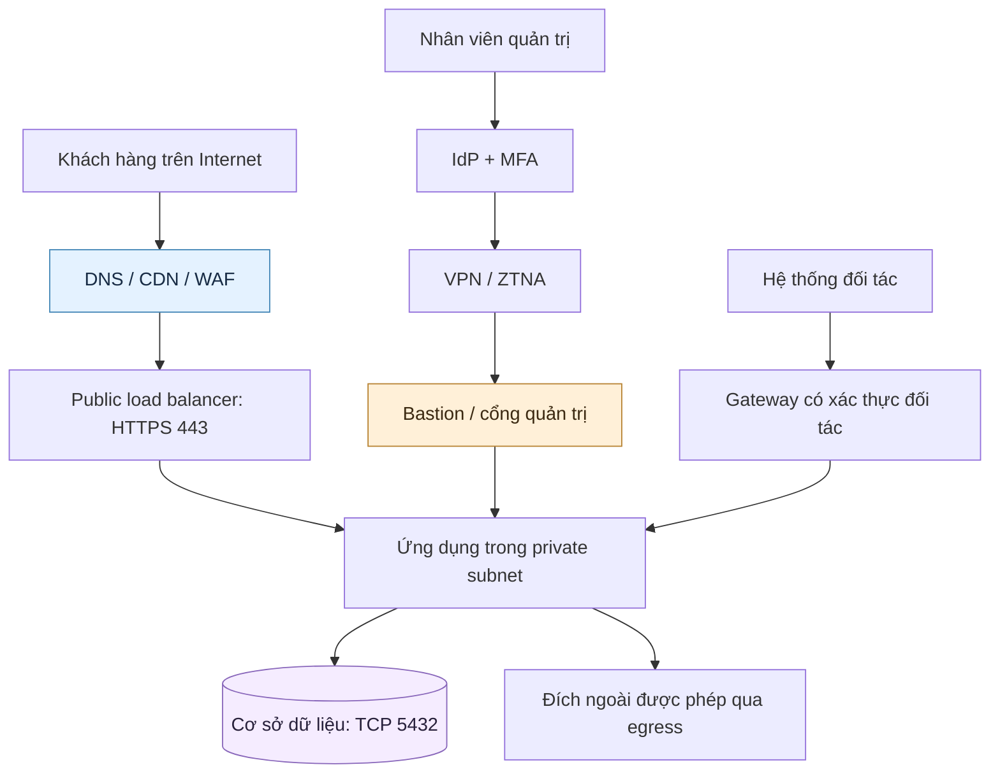

# Attack surface của một hệ thống kết nối mạng

Một hệ thống có kết nối mạng luôn có những điểm mà người dùng, thiết bị, dịch vụ hoặc hệ thống bên ngoài có thể tương tác với nó. **Attack surface (bề mặt tấn công)** là tập hợp các điểm tiếp xúc, giao diện và đường đi mà tác nhân đe dọa có thể tận dụng để tiếp cận tài sản, đưa dữ liệu vào, nhận dữ liệu ra hoặc tác động đến hoạt động của hệ thống. Trong an ninh mạng, hiểu bề mặt tấn công là tiền đề để thiết kế phân đoạn mạng, firewall, VPN, IDS/IPS, xác thực kết nối, bảo vệ DNS, mạng không dây và hạ tầng đám mây.

Một cổng TCP mở không tự động đồng nghĩa với một lỗ hổng. Ngược lại, một cổng đóng với Internet cũng chưa bảo đảm an toàn nếu tài khoản quản trị, kênh VPN, tên miền, dịch vụ nội bộ hoặc quan hệ tin cậy giữa các mạng bị cấu hình sai. Cần xét **ai có thể đi tới đâu, qua giao thức nào, với quyền gì, qua lớp bảo vệ nào và sau đó có thể làm gì**.

## Mục tiêu học tập

Sau bài này, bạn có thể:

1. Phân biệt attack surface với tài sản, điểm vào (entry point), attack vector, lỗ hổng và rủi ro.
2. Phân loại bề mặt tấn công theo mạng, ứng dụng, định danh, DNS, không dây, cloud, đối tác và luồng đi ra.
3. Vẽ sơ đồ luồng dữ liệu, vùng tin cậy và các đường có thể tiếp cận tài sản quan trọng.
4. Lập bảng kiểm kê điểm phơi lộ, đánh giá mức độ ưu tiên và đề xuất kiểm soát phù hợp.
5. Xây dựng quy trình theo dõi sự thay đổi bề mặt tấn công khi hệ thống phát triển.

## 1. Attack surface thực chất bao gồm những gì?

Giả sử một ứng dụng chỉ cho khách hàng truy cập qua `https://shop.example.com`. Đường truy cập công khai đó là một phần bề mặt tấn công, nhưng toàn bộ hệ thống còn có thể có API cho đối tác, cổng VPN cho nhân viên, dashboard giám sát, SSH trên máy chủ, bảng điều khiển cloud, API Kubernetes, DNS, máy trạm quản trị và kết nối từ ứng dụng tới cơ sở dữ liệu. Một thay đổi nhỏ như thêm quy tắc firewall, cấp tài khoản dịch vụ hoặc xuất bản hostname mới cũng có thể tạo thêm đường tiếp cận tài sản.

| Khái niệm | Câu hỏi cần trả lời | Ví dụ |
| --- | --- | --- |
| **Tài sản (asset)** | Cái gì cần bảo vệ? | Dữ liệu khách hàng, máy chủ, khóa API, cấu hình router, tính sẵn sàng của dịch vụ. |
| **Điểm vào (entry point)** | Tương tác bắt đầu ở đâu? | HTTPS endpoint, VPN gateway, Wi-Fi access point, cổng SSH. |
| **Attack surface** | Có những điểm và đường tương tác nào có thể bị tác động? | Tập hợp điểm vào, API, định danh, dịch vụ quản trị, quan hệ tin cậy và luồng dữ liệu. |
| **Attack vector** | Tác nhân có thể dùng phương thức gì? | Đánh cắp thông tin xác thực, gửi yêu cầu độc hại, lạm dụng API, chiếm phiên truy cập. |
| **Vulnerability** | Điểm yếu cụ thể nằm ở đâu? | Firmware chưa vá, kiểm soát truy cập sai, dịch vụ không yêu cầu MFA. |
| **Risk** | Khả năng xảy ra và hậu quả là gì? | Dữ liệu nhạy cảm bị truy cập trái phép hoặc hệ thống ngừng hoạt động. |

**Attack surface tồn tại ngay cả khi chưa tìm thấy lỗ hổng.** Việc kiểm kê chỉ trả lời hệ thống đang mở những tương tác nào; đánh giá lỗ hổng kiểm tra chất lượng phòng vệ tại các điểm đó; mô hình hóa mối đe dọa phân tích cách chúng có thể kết hợp thành một chuỗi tấn công.

Có thể xem bề mặt tấn công qua ba góc nhìn bổ sung cho nhau:

- **Bên ngoài (external):** tài sản và giao diện có thể tiếp cận từ Internet, mạng khách, nhà cung cấp hoặc đối tác ngoài tổ chức.
- **Bên trong (internal):** dịch vụ, máy trạm, giao thức chia sẻ tài nguyên và kết nối ngang giữa các phân đoạn mà một người dùng nội bộ hay thiết bị đã bị xâm nhập có thể tiếp cận.
- **Mặt phẳng điều khiển (control/management plane):** tài khoản và API có thể thay đổi cấu hình, định tuyến, quyền truy cập, image triển khai, firewall hoặc bí mật hệ thống. Một giao diện không công khai vẫn có rủi ro lớn nếu tài khoản điều khiển của nó bị chiếm.

Các góc nhìn này chồng lấn: API quản trị cloud nằm trên Internet nhưng thuộc control plane; dashboard chỉ truy cập qua VPN vẫn là bề mặt tấn công nội bộ và định danh.

## 2. Những lớp tạo thành bề mặt tấn công mạng

### 2.1. Địa chỉ, cổng, giao thức và đường định tuyến

Tầng mạng quyết định thiết bị nào có thể gửi lưu lượng đến thiết bị nào. Khi kiểm kê phải tính cả IPv4, IPv6, địa chỉ công khai, địa chỉ riêng, NAT, định tuyến, firewall trên host, firewall ở ranh giới mạng, security group của cloud và chính sách lọc giữa các subnet.

Một dịch vụ lắng nghe trên `0.0.0.0:8080` chấp nhận kết nối trên các giao diện IPv4 của host, nhưng **không thể kết luận ngay** dịch vụ đã công khai Internet: còn phụ thuộc địa chỉ host, định tuyến và các lớp lọc. Tương tự, bind vào `127.0.0.1` làm giảm khả năng truy cập trực tiếp từ xa, nhưng reverse proxy, tunnel hoặc dịch vụ khác trên host vẫn có thể tạo đường tiếp cận gián tiếp.

| Điểm cần xem xét | Dấu hiệu làm tăng phơi lộ | Câu hỏi xác minh |
| --- | --- | --- |
| IP và giao diện mạng | Địa chỉ public hoặc IPv6 global ngoài dự kiến | Host nào thực sự được định tuyến và nhận kết nối từ Internet? |
| Cổng, giao thức | SSH/RDP, database, dashboard mở rộng phạm vi | Ai kết nối được? Có thực sự cần giao thức này không? |
| Firewall, ACL, security group | Quy tắc `0.0.0.0/0`, `::/0` hoặc cho phép quá nhiều subnet | Quy tắc nào thực sự có hiệu lực trên từng chặng? |
| NAT, load balancer, proxy | Cổng được chuyển tiếp hoặc có đường vào bỏ qua proxy | Có thể tới origin trực tiếp mà không qua WAF không? |
| Định tuyến giữa vùng | Các subnet nhạy cảm có thể truy cập ngang | Máy trạm thường có kết nối trực tiếp tới database không? |

**Quy tắc thực hành:** đánh giá *khả năng kết nối thực tế từ một nguồn cụ thể tới một đích cụ thể*, không suy diễn chỉ từ một cấu hình đơn lẻ.

### 2.2. Dịch vụ ứng dụng và API

Bề mặt ứng dụng gồm website, API công khai và nội bộ, webhook, upload endpoint, hệ thống message broker, cổng quản trị, endpoint sức khỏe (`/health`) và metrics. Mỗi endpoint có yêu cầu về xác thực, ủy quyền, giới hạn tốc độ, kiểm tra dữ liệu đầu vào và phân quyền khác nhau.

Ví dụ API đối tác `/partner/orders` có thể dùng TLS đúng cách nhưng vẫn nguy hiểm nếu khóa API dùng chung cho nhiều đối tác hoặc nếu mỗi đối tác đọc được đơn hàng của đối tác khác. Khi rà soát, phải ghi nhận **danh tính nào được gọi, dữ liệu nào được đọc/ghi, và quyền được kiểm tra ở đâu**. TLS bảo vệ truyền dữ liệu; TLS không tự thay thế xác thực và ủy quyền cấp ứng dụng.

### 2.3. Định danh và truy cập quản trị

Tài khoản người dùng, tài khoản dịch vụ, khóa SSH, token CI/CD, tài khoản đặc quyền, phiên đăng nhập, VPN và cổng truy cập từ xa đều là thành phần của bề mặt tấn công. Cần xét cả đường cấp quyền: một token không truy cập được database trực tiếp nhưng có quyền sửa pipeline triển khai thì vẫn có thể tác động đến database thông qua ứng dụng.

Một số câu hỏi quan trọng: tài khoản nào có đặc quyền cao? MFA có áp dụng cho quản trị và VPN không? Token có thời hạn và phạm vi tối thiểu không? Quyền được thu hồi khi nhân viên hoặc nhà cung cấp ngừng hợp tác chưa? Có giám sát đăng nhập bất thường và thay đổi đặc quyền không?

### 2.4. DNS, chứng chỉ và hạ tầng định danh dịch vụ

DNS quyết định người dùng và hệ thống tìm tới đâu. Các bản ghi `A`, `AAAA`, `CNAME`, `MX`, `NS`, các vùng DNS nội bộ, dịch vụ DNS resolver và tài khoản quản lý tên miền cần được kiểm kê. Một CNAME trỏ đến dịch vụ cloud đã bị xóa có thể tạo nguy cơ **subdomain takeover** nếu nhà cung cấp cho phép bên khác nhận lại tên tài nguyên. Cấu hình DNS sai cũng có thể chuyển lưu lượng tới đích ngoài mong muốn hoặc làm gián đoạn dịch vụ.

TLS và quản lý chứng chỉ liên quan mật thiết tới lớp này: tên miền, chứng chỉ, khóa riêng và chính sách TLS phải được quản lý đồng bộ. DNSSEC có thể cung cấp xác thực nguồn gốc và tính toàn vẹn cho câu trả lời DNS khi chuỗi tin cậy được xác minh; nó **không mã hóa** truy vấn DNS và không thay thế TLS.

### 2.5. Mạng không dây, thiết bị đầu cuối và hệ thống vật lý

Wi-Fi doanh nghiệp, Wi-Fi khách, access point, mạng IoT, máy in, camera, thiết bị mạng và thiết bị làm việc từ xa cũng có thể mở đường vào hệ thống. Các rủi ro thường gặp gồm mật khẩu Wi-Fi dùng chung quá lâu, thiết bị không quản lý, AP giả mạo, cấu hình WPA yếu, thiếu cách ly giữa mạng khách với mạng doanh nghiệp và firmware chậm cập nhật.

Giải pháp thường gồm WPA2/WPA3-Enterprise với 802.1X khi phù hợp, quản lý vòng đời thiết bị, tách VLAN hoặc vùng bảo mật, giới hạn giao tiếp ngang và giám sát sự kiện kết nối. VLAN là một công cụ phân đoạn, nhưng vẫn cần ACL/firewall giữa các vùng và kiểm thử khả năng truy cập thực tế.

### 2.6. Cloud, container và tích hợp bên thứ ba

Trong cloud, tài sản có thể xuất hiện nhanh và tồn tại ngắn: public load balancer, security group, storage endpoint, serverless function URL, public IP gắn tạm, Kubernetes Ingress/Service, API điều khiển và dịch vụ managed. Cấu hình `Service` kiểu `LoadBalancer` không có nghĩa chắc chắn sẽ public trong mọi môi trường, nhưng phải kiểm tra IP, loại load balancer và chính sách mạng thực tế.

Đối tác, SaaS, hệ thống thanh toán, webhook và đường VPN site-to-site mở rộng ranh giới tin cậy ra ngoài tổ chức. Không nên mặc định rằng mạng đối tác đáng tin cậy ngang mạng nội bộ; cấp quyền theo từng dịch vụ, từng tài khoản và từng đường kết nối cần thiết.

### 2.7. Lưu lượng đi ra (egress) và kết nối chủ động

Attack surface không chỉ là các cổng nhận kết nối. Máy chủ nội bộ có thể chủ động gọi DNS, HTTP(S), registry, hệ thống cập nhật hoặc webhook bên ngoài. Nếu dịch vụ bị xâm nhập, đường egress quá rộng có thể giúp nó liên lạc tới hạ tầng điều khiển hoặc chuyển dữ liệu nhạy cảm ra ngoài.

Vì vậy cần quan sát **cả ingress và egress**: ứng dụng được gọi những domain/IP nào, dùng giao thức gì, có cần Internet trực tiếp không, có proxy/DNS policy không, lưu lượng bất thường có được ghi nhận không. Danh sách cho phép theo đích và dịch vụ cần được duy trì theo thay đổi hợp lệ của hệ thống.

## 3. Đặt attack surface vào kiến trúc: vùng tin cậy và đường đi

Xét hệ thống thương mại điện tử giả định dưới đây. Sơ đồ chỉ mô tả các thành phần chính để thực hành phân tích, không ngụ ý các vùng đã được cách ly nếu chưa xác minh chính sách mạng.



Trong sơ đồ, hãy đánh dấu ít nhất bốn **ranh giới tin cậy**:

1. Internet sang hạ tầng công khai: mọi yêu cầu đều phải được coi là không tin cậy, kể cả khi đi qua CDN/WAF.
2. Load balancer sang vùng ứng dụng: kiểm tra nguồn đến, giao thức, chính sách TLS và khả năng truy cập origin trực tiếp.
3. Ứng dụng sang vùng dữ liệu: chỉ các workload có nhu cầu mới được kết nối database với đúng quyền cần thiết.
4. Nhân viên/đối tác sang hệ thống nội bộ: danh tính, thiết bị, phiên truy cập, quyền theo vai trò và thời hạn truy cập phải được kiểm chứng.

Đường **Internet → WAF → ứng dụng** có thể được kiểm soát tốt, nhưng nếu origin vẫn có IP public và nhận request trực tiếp, các chính sách tại WAF có thể bị bỏ qua. Ngược lại, nếu VPN có quyền tới toàn bộ subnet database, một tài khoản VPN bị chiếm có thể tạo đường tấn công mà sơ đồ truy cập website không thể hiện. Đây là lý do cần phân tích *đường đi đầy đủ* thay vì chỉ liệt kê thiết bị bảo mật.

Khi vẽ kiến trúc thực tế, nên phân biệt ba loại luồng:

- **Data plane:** lưu lượng phục vụ nghiệp vụ, như HTTP từ người dùng, truy vấn ứng dụng đến database.
- **Control plane:** lệnh thay đổi cấu hình hoặc triển khai, như cloud API, CI/CD, Kubernetes API, quản trị firewall.
- **Observability plane:** luồng log, metrics, tracing, DNS query và network flow tới hệ thống giám sát; bản thân nơi thu thập và tài khoản truy cập log cũng cần bảo vệ.

## 4. Kết nối attack surface với mô hình hóa mối đe dọa

Để đánh giá một bề mặt, trước hết xác định **tác nhân**, **điểm bắt đầu**, **mục tiêu**, **đường đi** và **kiểm soát hiện hữu**. Không cần giả định kẻ tấn công đã có mọi quyền: mỗi tình huống phải nêu rõ khả năng ban đầu của họ.

| Tình huống | Điểm bắt đầu và mục tiêu | Đường tấn công cần kiểm tra | Kiểm soát giảm thiểu |
| --- | --- | --- | --- |
| Người lạ trên Internet tìm thấy cổng quản trị | Public IP → dashboard | Dashboard có bị lộ, có yêu cầu MFA và giới hạn nguồn không? | Chuyển quản trị vào kênh truy cập riêng, MFA, least privilege, log. |
| Tài khoản đối tác bị lộ | API/gateway đối tác → dữ liệu nghiệp vụ | Quyền của đối tác có bị cấp quá rộng hoặc thiếu cô lập tenant không? | Xác thực mạnh, phân quyền theo tài nguyên, quota, phát hiện truy cập bất thường. |
| Máy trạm nội bộ bị xâm nhập | LAN nhân viên → server/database | Có thể kết nối ngang tới vùng dữ liệu hoặc cổng quản trị không? | Phân đoạn, firewall giữa vùng, bảo vệ endpoint, giám sát east-west traffic. |
| Quyền CI/CD bị lạm dụng | Pipeline → workload production | Token triển khai có quyền thay đổi image, cấu hình mạng hoặc bí mật quá rộng không? | Tách quyền, secret ngắn hạn, phê duyệt thay đổi nhạy cảm, audit log. |
| Dịch vụ ứng dụng bị chiếm | App → Internet và database | App có egress không hạn chế và truy cập dữ liệu quá mức cần thiết không? | Egress policy, tài khoản DB tối thiểu, cảnh báo truy vấn và lưu lượng lạ. |

Có thể dùng STRIDE để đặt câu hỏi có hệ thống tại mỗi ranh giới:

| Nhóm STRIDE | Câu hỏi gợi ý về kết nối mạng |
| --- | --- |
| **Spoofing** (giả mạo) | Ai xác minh danh tính client, service, thiết bị, DNS và phiên VPN? |
| **Tampering** (sửa đổi) | Lưu lượng hoặc cấu hình firewall/route có thể bị thay đổi trái phép không? |
| **Repudiation** (chối bỏ) | Có log đủ để biết ai đăng nhập, đổi rule, tạo endpoint hay truy cập API không? |
| **Information disclosure** (lộ dữ liệu) | Có đường đọc dữ liệu hoặc egress nào không cần thiết? TLS có được dùng đúng nơi không? |
| **Denial of service** (từ chối dịch vụ) | Các endpoint công khai, VPN và DNS có giới hạn, dự phòng và giám sát phù hợp không? |
| **Elevation of privilege** (leo thang đặc quyền) | Tài khoản, token hoặc quan hệ tin cậy nào có thể đưa một tác nhân lên quyền quản trị? |

Một chuỗi tấn công có thể nối nhiều bề mặt: **khóa API đối tác bị lộ → truy cập API vượt phạm vi → đọc dữ liệu ngoài quyền được cấp**. Một chuỗi khác bắt đầu từ **máy trạm có quyền VPN → kết nối tới dịch vụ quản trị nội bộ → lợi dụng quyền quản trị quá rộng → thay đổi cấu hình hệ thống**. Các ví dụ này là kịch bản phân tích rủi ro, không khẳng định hệ thống nào cũng có những điểm yếu đó.

## 5. Đánh giá mức độ phơi lộ và ưu tiên xử lý

Không nên đánh đồng số lượng cổng mở với mức độ rủi ro. Một cổng HTTPS public có nhiều request có thể là chức năng bắt buộc, trong khi một cổng quản trị ít người dùng nhưng có quyền cao có thể đòi hỏi xử lý trước. Đánh giá nên kết hợp:

- **Khả năng tiếp cận (reachability):** Internet, đối tác, nhân viên, máy chủ cùng subnet hay chỉ host cục bộ? Có đường khác dẫn tới đích không?
- **Yêu cầu quyền ban đầu:** không cần xác thực, cần tài khoản thường, cần VPN, hay cần tài khoản đặc quyền?
- **Độ nhạy và quyền của tài sản:** thành phần đó có truy cập dữ liệu nhạy cảm, secret, hệ thống sản xuất hay quyền thay đổi cấu hình không?
- **Tình trạng kiểm soát:** mức độ cập nhật bản vá, xác thực, phân quyền, giới hạn tốc độ, phân đoạn và phát hiện bất thường.
- **Khả năng ảnh hưởng và khôi phục:** bị lạm dụng có dẫn tới mất dữ liệu, gián đoạn kinh doanh, lan truyền sang vùng khác hoặc mất kiểm soát hạ tầng không?

Ví dụ bảng ưu tiên **minh họa**, không phải thang đo chuẩn ngành:

| Bề mặt | Phơi lộ | Hậu quả giả định | Ưu tiên điều tra | Hành động đầu tiên |
| --- | --- | --- | --- | --- |
| SSH quản trị public, chưa giới hạn nguồn | Từ Internet | Có thể truy cập quyền cao nếu xác thực bị vượt qua | Cao | Xác minh nhu cầu, hạn chế đường vào, tăng xác thực và giám sát. |
| Database chỉ nhận kết nối từ ứng dụng | Private subnet | Rò rỉ dữ liệu nếu ứng dụng hoặc tài khoản DB bị chiếm | Cao nếu dữ liệu nhạy cảm | Kiểm tra rule thực tế, quyền DB, backup và logging. |
| HTTPS phục vụ khách hàng qua WAF | Từ Internet | Lạm dụng chức năng và gây gián đoạn | Phụ thuộc lỗ hổng và kiểm soát | Kiểm thử xác thực, phân quyền, rate limit, đường bypass. |
| Dashboard thử nghiệm còn DNS public | Từ Internet nếu DNS/route dẫn tới đích | Có thể lộ thông tin hoặc quản trị | Cần xác minh sớm | Kiểm tra endpoint còn hoạt động và chủ sở hữu. |

Nếu cần điểm số để sắp hàng công việc, tổ chức có thể tự xây tiêu chí định tính **thấp / trung bình / cao** cho từng yếu tố và ghi rõ bằng chứng. Điểm số không thay thế kiểm chứng kỹ thuật. Một dịch vụ không thấy trong kết quả quét vẫn có thể truy cập bằng IPv6, đường VPN, proxy, hostname khác hoặc chỉ tồn tại trong thời gian triển khai.

## 6. Quy trình nhận diện và giảm attack surface

### Bước 1 — Xác định phạm vi và tài sản có giá trị

Ghi rõ mạng, môi trường dev/staging/prod, cloud account, DNS zone, thiết bị, đối tác và hệ thống không dây nằm trong phạm vi. Xác định dữ liệu quan trọng, chức năng sống còn, người chịu trách nhiệm và thời gian phục vụ. Phạm vi phải bao gồm cả tài sản ít được chú ý như môi trường thử nghiệm, IP tạm thời và hạ tầng quản lý.

### Bước 2 — Lập kiểm kê từ nhiều nguồn

Đối chiếu CMDB/asset inventory, DNS, IPAM, cấu hình firewall, security group, load balancer, Kubernetes, danh sách tài khoản đặc quyền, VPN và dữ liệu lưu lượng thực tế. Một nguồn duy nhất thường bỏ sót tài sản không còn được quản lý hoặc thành phần mới được tạo tự động.

Một bản ghi kiểm kê tối thiểu nên có:

| Trường | Ví dụ | Vì sao cần? |
| --- | --- | --- |
| Asset / owner / môi trường | `orders-api`, nhóm nền tảng, `prod` | Biết ai xác nhận nhu cầu và chịu trách nhiệm. |
| Điểm tiếp xúc | `api.example.com:443/TCP` | Xác định hostname, IP, port, giao thức. |
| Nguồn có thể tới | Internet qua WAF, subnet của đối tác A | Mô tả phạm vi kết nối thực tế. |
| Định danh và quyền | OAuth client riêng cho đối tác A, chỉ đọc đơn hàng thuộc A | Phân biệt truy cập mạng với truy cập dữ liệu. |
| Ranh giới / phụ thuộc | Internet → gateway → API → database | Thấy đường truyền và quan hệ tin cậy. |
| Kiểm soát và bằng chứng | WAF rule, firewall rule ID, audit log, ngày kiểm tra | Có thể xác minh, theo dõi thay đổi. |
| Mức ưu tiên / trạng thái | Cao, cần giới hạn rule, hạn ngày xử lý | Biến phát hiện thành hành động cụ thể. |

### Bước 3 — Kiểm chứng khả năng tiếp cận từ các vùng

Chọn góc quan sát hợp lệ cho Internet, mạng nhân viên, mạng đối tác, subnet ứng dụng và subnet quản trị. Kết hợp cấu hình với kiểm tra kết nối có phạm vi được cấp phép. Nếu một firewall cho phép IP nhưng host không có route hoặc dịch vụ không listen, tình trạng thực tế khác với việc chỉ nhìn vào rule.

Ví dụ các lệnh **đọc trạng thái** trên Linux (chạy trên máy được quyền quản trị):

```bash
# Địa chỉ trên các giao diện và đường định tuyến hiện có
ip -brief address
ip route

# Các socket TCP/UDP đang lắng nghe trên máy
ss -lntu

# Quy tắc firewall local (nếu hệ thống dùng nftables)
sudo nft list ruleset
```

Khi có quyền kiểm tra từ một máy trong vùng nguồn tương ứng, có thể xác minh một tập cổng được phê duyệt trên IP tài liệu minh họa:

```bash
# Chỉ thực hiện trong phạm vi được chủ hệ thống cho phép
nmap -sT -p 22,80,443,5432 192.0.2.10
```

`192.0.2.0/24` là dải địa chỉ dành cho tài liệu; thay bằng tài sản thật trong phạm vi được ủy quyền. Kết quả kết nối phải được đối chiếu với source IP, thời điểm, firewall, route, IPv6 và chính sách dịch vụ. Một kết quả `filtered` không chứng minh mọi đường khác đều đã bị chặn.

Đối với Kubernetes, những lệnh đọc như `kubectl get svc,ingress -A -o wide` và `kubectl get networkpolicy -A` giúp phát hiện service/ingress và chính sách mạng được khai báo. Cần kiểm tra cả việc CNI có thực thi NetworkPolicy, cấu hình cloud load balancer và kết quả kết nối thực tế; **không suy ra mạng được cách ly chỉ vì tồn tại tài nguyên NetworkPolicy**.

### Bước 4 — Kiểm tra ranh giới và quyền thực tế

Theo từng luồng, xác minh firewall, ACL, security group, host firewall và chính sách định danh; chú ý cả kết nối trở về, kết nối ngang và egress. Với các tài khoản quản trị, rà soát MFA, thời hạn phiên, nhóm đặc quyền, nguồn truy cập và audit. Với đối tác, kiểm tra từng tenant, từng endpoint và quyền tài khoản dịch vụ.

### Bước 5 — Mô hình hóa đường tấn công

Chọn vài mục tiêu có tác động cao như database khách hàng, secret store, cloud control plane, domain registrar và hệ thống triển khai. Bắt đầu từ các điểm mà một tác nhân có khả năng thực tế tiếp cận, lần theo những bước tiếp theo được phép bởi route, token và quyền. Ghi lại điểm kiểm soát ngăn đường đi và chỗ còn thiếu bằng chứng.

### Bước 6 — Thu hẹp bề mặt và tăng khả năng phát hiện

Ưu tiên loại bỏ endpoint không dùng, đóng listener thừa, giới hạn nguồn đích, tách vùng dữ liệu và quản trị, bỏ đường đi trực tiếp đến origin, thu hẹp quyền dịch vụ, chuẩn hóa xác thực và vá thành phần còn cần hoạt động. Với kết nối vẫn phải công khai, tăng phân quyền, bảo vệ ứng dụng, giới hạn lưu lượng, giám sát và phương án ứng phó.

### Bước 7 — Theo dõi liên tục và kiểm tra lại sau thay đổi

Attack surface thay đổi khi thêm domain, triển khai service, đổi firewall, tạo VM, gắn public IP, kết nối nhà cung cấp hoặc cấp token. Đưa kiểm tra vào quy trình thay đổi và CI/CD/IaC, so sánh inventory trước/sau, cảnh báo phát sinh endpoint công khai bất thường và xác minh lại sau mỗi biện pháp khắc phục.

## 7. Chọn biện pháp phòng vệ đúng với từng lớp

| Lớp | Phòng ngừa / giảm phơi lộ | Quan sát / phát hiện |
| --- | --- | --- |
| Ranh giới Internet | Đóng dịch vụ thừa, WAF khi phù hợp, lọc nguồn, bảo vệ DDoS, TLS | Flow log, request log, cảnh báo tăng lưu lượng hoặc lỗi bất thường. |
| Giữa các phân đoạn | ACL/firewall least privilege, microsegmentation nếu phù hợp | NetFlow/VPC Flow Logs, IDS/NDR, kiểm tra kết nối không mong đợi. |
| Kênh quản trị | VPN/ZTNA, MFA, bastion, quyền tối thiểu, session timeout | Audit login, thay đổi role, truy cập ngoài khung giờ hoặc từ nguồn mới. |
| Dịch vụ ứng dụng/API | Xác thực và ủy quyền từng yêu cầu, quota, validation, secret rotation | API logs, lỗi auth, truy cập chéo tenant, tần suất request bất thường. |
| DNS/tên miền | Quản lý zone và registrar, loại bỏ CNAME mồ côi, hạn chế quyền thay đổi | DNS query log, giám sát thay đổi bản ghi và chứng chỉ. |
| Wi-Fi/thiết bị | WPA2/WPA3-Enterprise khi thích hợp, NAC, mạng khách riêng, vá firmware | Sự kiện AP, xác thực 802.1X, thiết bị và SSID lạ. |
| Cloud/Kubernetes | Private endpoint khi có thể, policy as code, giới hạn IAM, network policy | Cloud audit log, cấu hình public mới, sự kiện thay đổi IAM/security group. |
| Egress | Proxy/egress firewall, giới hạn domain/IP và dịch vụ cần thiết | DNS/HTTP proxy logs, kết nối đích mới, lưu lượng outbound bất thường. |

**Firewall, VPN và IDS/IPS giải quyết những câu hỏi khác nhau.** Firewall chủ yếu kiểm soát lưu lượng nào được phép qua ranh giới; VPN tạo kênh kết nối được bảo vệ nhưng cần xác thực và phân quyền phù hợp; IDS phát hiện dấu hiệu đáng ngờ, còn IPS có thể chặn theo chính sách và vị trí triển khai. Không giải pháp nào đơn lẻ thay thế kiểm kê tài sản, xác thực ứng dụng, cập nhật bản vá hoặc kiểm tra quyền truy cập.

Áp dụng **defense in depth**: ngay cả khi một lớp bảo vệ bị vượt qua, tác nhân vẫn gặp giới hạn mới ở phân đoạn mạng, định danh dịch vụ, ủy quyền dữ liệu và egress. Tuy nhiên, nhiều lớp cấu hình sai theo cùng một cách không tạo ra phòng vệ hiệu quả; phải kiểm chứng từng ranh giới bằng dữ liệu thực tế.

## 8. Những điểm dễ bị bỏ sót

1. **IPv6 ngoài tầm kiểm kê:** IPv4 bị chặn nhưng host nhận địa chỉ IPv6 global hoặc firewall IPv6 chưa có chính sách tương đương.
2. **Đường đi vòng qua WAF:** DNS trỏ về CDN nhưng origin public vẫn chấp nhận request từ bất kỳ nguồn nào.
3. **Hệ thống thử nghiệm còn truy cập được:** staging, dashboard tạm, endpoint debug hoặc tài khoản test tồn tại sau khi dự án kết thúc.
4. **Quyền VPN quá rộng:** xác thực vào VPN thành công đồng nghĩa kết nối được đến nhiều subnet hoặc cổng quản trị không liên quan đến công việc.
5. **DNS mồ côi và tài nguyên cloud động:** hostname trỏ đến dịch vụ đã xóa; public IP hoặc load balancer mới xuất hiện mà inventory chưa cập nhật.
6. **Tin cậy quá mức vào mạng nội bộ:** một máy trạm hoặc workload bị chiếm có thể truy cập ngang đến nơi không cần thiết.
7. **Chỉ xem chiều ingress:** ứng dụng được phép kết nối ra Internet vô hạn, trong khi đường egress không được giám sát.
8. **Thiếu góc nhìn control plane:** API quản trị cloud, tài khoản DNS hoặc token CI/CD có thể thay đổi chính những lớp firewall và ứng dụng đang bảo vệ hệ thống.
9. **Hiểu nhầm trạng thái cấu hình:** có NetworkPolicy, security group, WAF rule hoặc IDS không có nghĩa chính sách đang áp dụng đúng vào lưu lượng dự kiến.
10. **Bỏ sót thiết bị không dây và nhà cung cấp:** Wi-Fi khách, thiết bị IoT hoặc tunnel đối tác có thể là một phần của đường đến vùng nhạy cảm.

## 9. Đo lường việc quản lý attack surface

Một số chỉ số hữu ích cho đội vận hành và an ninh:

- **Độ phủ kiểm kê:** tỷ lệ tài sản được phát hiện có owner, mục đích và môi trường xác định; kết hợp kiểm kê với nguồn quan sát độc lập để giảm bỏ sót.
- **Endpoint public mới:** số endpoint hoặc public IP xuất hiện trong kỳ và thời gian từ lúc xuất hiện đến khi được rà soát.
- **Kết nối quản trị không đúng chính sách:** số đường quản trị mở từ nguồn không được phê duyệt và thời gian khắc phục.
- **Quy tắc quá rộng:** số rule cho phép tất cả nguồn/đích trên dịch vụ nhạy cảm, kèm lý do ngoại lệ nếu có.
- **Thời gian giảm thiểu rủi ro:** khoảng thời gian từ khi xác nhận bề mặt không cần thiết hoặc sai cấu hình đến lúc kiểm chứng đã xử lý.
- **Độ phủ log và cảnh báo:** tỷ lệ điểm truy cập quan trọng có log hữu dụng, đồng bộ thời gian, lưu trữ và người nhận cảnh báo.

Cần đọc các chỉ số cùng bối cảnh. Số cổng public giảm là tín hiệu tốt nếu dịch vụ không cần thiết đã đóng, nhưng có thể là tín hiệu sai nếu chuyển chức năng sang một API public mới có đặc quyền lớn hơn.

## 10. Bài tập tình huống

Một công ty có ứng dụng web qua HTTPS, database trong private subnet, hệ thống giám sát chỉ dành cho đội vận hành và một VPN đối tác. Trong một lần rà soát, phát hiện:

- Một security group cho phép `TCP/22` từ `0.0.0.0/0` vào máy ứng dụng.
- VPN đối tác được route tới toàn bộ subnet ứng dụng và database dù chỉ cần API trao đổi đơn hàng.
- Một bản ghi `CNAME` của môi trường staging trỏ đến dịch vụ cloud đã ngừng sử dụng.
- Máy ứng dụng được phép gửi kết nối outbound đến mọi IP và port.

Hãy lập bảng cho từng phát hiện gồm **tài sản**, **nguồn có thể tiếp cận**, **ranh giới tin cậy**, **hậu quả giả định**, **bằng chứng cần kiểm tra**, **cách giảm bề mặt** và **cách phát hiện tái diễn**.

Gợi ý phân tích:

| Phát hiện | Điều cần xác minh | Hướng xử lý chính |
| --- | --- | --- |
| SSH nhận từ mọi IPv4 | Host có IP public và đường route tới port 22 không? Có đường quản trị thay thế an toàn không? | Giới hạn nguồn, sử dụng kênh quản trị riêng, MFA/khóa phù hợp và audit. |
| VPN đối tác tới subnet rộng | Chính sách firewall và ACL thực tế cho phép tới IP/port nào? Tài khoản đối tác có quyền gì? | Chỉ cho phép API và luồng nghiệp vụ cần thiết, chặn database và quản trị. |
| CNAME staging mồ côi | Tài nguyên đích còn tồn tại? Nhà cung cấp có cơ chế nhận lại tên tài nguyên không? | Xóa bản ghi không dùng hoặc khôi phục tài nguyên dưới quyền sở hữu hợp lệ. |
| Egress toàn bộ | Ứng dụng thực sự cần truy cập những đích nào? Có log DNS/flow không? | Xây allowlist phù hợp, định tuyến qua egress kiểm soát, giám sát thay đổi. |

**Câu hỏi tự kiểm tra:** (1) Vì sao một database trong private subnet vẫn thuộc attack surface? (2) Một cổng mở khác gì một lỗ hổng? (3) WAF có loại bỏ rủi ro từ đường truy cập origin trực tiếp không? (4) Tại sao kiểm kê IP/port phải đi cùng kiểm kê danh tính và quyền? (5) Điều gì khiến bề mặt tấn công thay đổi dù không sửa code ứng dụng?

**Kết luận:** Quản lý attack surface là hoạt động liên tục để hiểu và giới hạn các đường tương tác với tài sản. Bắt đầu từ kiểm kê, xác minh khả năng tiếp cận, vẽ ranh giới tin cậy và quyền, sau đó giảm những đường không cần thiết, tăng phát hiện và kiểm chứng lại sau thay đổi. Đây là nền tảng để xây dựng kiến trúc mạng an toàn và phân tích lưu lượng, xâm nhập một cách có hệ thống.
