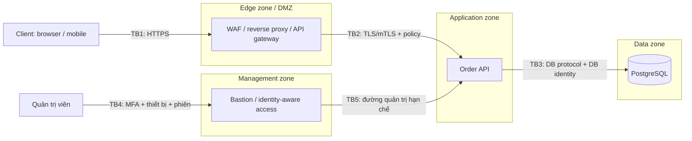

# Trust boundary giữa client, service và network zone

Một hệ thống có thể đặt cơ sở dữ liệu trong mạng riêng, sử dụng HTTPS và bật firewall nhưng vẫn bị truy cập trái phép nếu API tin rằng mọi yêu cầu đi từ mạng nội bộ đều an toàn. Điểm sai nằm ở **ranh giới tin cậy (trust boundary)**: nơi dữ liệu, danh tính hoặc quyền điều khiển đi từ một phạm vi có mức bảo đảm này sang phạm vi khác. Mỗi lần vượt qua ranh giới, hệ thống phải xác minh những giả định bảo mật phù hợp.

Bài học thuộc chương **Nhập môn** của **SECURITY_NETWORK_SECURITY**. Đây là nền tảng để hiểu phân đoạn mạng, firewall, VPN, IDS/IPS, xác thực kết nối, bảo vệ DNS, mạng không dây và hạ tầng đám mây; đồng thời giúp phân tích luồng lưu lượng, mô hình hóa mối đe dọa và thiết kế kiến trúc mạng an toàn.

## 1. Mục tiêu học tập

Sau bài này, bạn có thể:

1. Phân biệt **client**, **service**, **network zone** và **trust boundary**; xác định ranh giới trong sơ đồ luồng dữ liệu.
2. Giải thích vì sao IP nội bộ, kết nối VPN hoặc việc đi qua API gateway không tự động khiến một yêu cầu được tin cậy.
3. Gắn từng luồng vượt ranh giới với kiểm soát tương ứng: định tuyến và firewall, TLS/mTLS, xác thực, phân quyền, kiểm tra đầu vào, kiểm soát egress và giám sát.
4. Đọc một chính sách phân đoạn mạng cơ bản và kiểm tra cả đường đi được phép lẫn đường đi cần bị chặn.
5. Phát hiện các lỗi thiết kế như tin vào header do client gửi, mở đường trực tiếp tới backend hoặc cho workload kết nối tùy ý sang zone dữ liệu.

## 2. Những khái niệm nền tảng

**Client** là bên khởi tạo yêu cầu: trình duyệt, ứng dụng di động, thiết bị IoT, CLI hoặc một service khác. Client có thể là người dùng hợp lệ nhưng vẫn gửi dữ liệu sai, chạy phần mềm nhiễm mã độc hoặc cố ý tấn công. Vì vậy, thông tin do client kiểm soát phải được xem là *đầu vào chưa được tin cậy* cho đến khi được kiểm chứng.

**Service** là thành phần cung cấp chức năng qua một giao diện: REST API, gRPC, worker, dịch vụ đăng nhập, cơ sở dữ liệu hoặc DNS resolver. Một service vừa là *server* đối với bên gọi, vừa có thể là *client* khi gọi service khác. Vai trò của nó thay đổi theo từng luồng.

**Network zone** là nhóm tài nguyên được tổ chức theo yêu cầu kết nối và mức bảo vệ, ví dụ: Internet, vùng biên (edge/DMZ), vùng ứng dụng, vùng dữ liệu, vùng quản trị. Zone có thể được triển khai bằng VLAN, subnet, VPC/VNet, security group, firewall, Kubernetes NetworkPolicy hoặc cơ chế phân đoạn tương đương. Tên zone chỉ mô tả ý định kiến trúc; khả năng cô lập thực tế phụ thuộc cấu hình và enforcement.

**Trust boundary** là ranh giới giữa hai phạm vi có **giả định tin cậy, quyền hạn hoặc chủ thể kiểm soát khác nhau**. Nó có thể trùng với firewall hoặc subnet, nhưng cũng tồn tại giữa hai tiến trình trong cùng máy, hai microservice cùng subnet, một trình duyệt và API công khai, hoặc hai tenant dùng chung một ứng dụng.

| Khái niệm | Câu hỏi cần trả lời | Ví dụ |
|---|---|---|
| Zone | Thành phần nằm ở đâu, có thể kết nối tới đâu? | API trong subnet riêng chỉ nhận kết nối từ gateway |
| Boundary | Khi luồng vượt qua đây, điều gì không thể tiếp tục được giả định? | Header danh tính từ Internet đi vào hệ thống |
| Authentication (xác thực) | Ai/đối tượng nào đang kết nối? | Xác minh chữ ký và thuộc tính của access token; mTLS xác minh service peer |
| Authorization (phân quyền) | Chủ thể đó được làm thao tác nào trên tài nguyên nào? | Người dùng A không được xem đơn hàng của người dùng B |
| Enforcement point | Thành phần nào thực sự chặn yêu cầu sai? | Firewall, API, ingress gateway hoặc policy engine |

Một boundary **không nhất thiết** là một bước nhảy mạng. Ví dụ, khi service nhận giá trị `tenantId` từ request, việc dùng giá trị này để truy vấn dữ liệu tenant là một ranh giới về **quyền dữ liệu**, ngay cả khi toàn bộ xử lý diễn ra trong cùng một process.

### Ba nguyên tắc quan trọng

- **Không kế thừa sự tin cậy chỉ từ vị trí mạng.** “Đến từ IP private”, “đã kết nối VPN” hoặc “đang ở cùng cluster” là thông tin về đường kết nối, không phải bằng chứng đầy đủ về danh tính và quyền truy cập.
- **Xác minh đúng cấp độ.** TLS bảo vệ kênh truyền; xác thực nhận diện chủ thể; phân quyền quyết định thao tác; kiểm tra dữ liệu giảm rủi ro đầu vào. Một kiểm soát không thay thế các kiểm soát còn lại.
- **Đặc quyền tối thiểu, mặc định từ chối.** Mỗi zone và service chỉ cho phép các luồng thực sự cần thiết, đồng thời ghi nhận và giám sát những lần đi qua boundary quan trọng.

## 3. Nhận diện boundary trên sơ đồ kiến trúc

Giả sử một ứng dụng quản lý đơn hàng gồm trình duyệt khách hàng, gateway, API, PostgreSQL và đường quản trị. Mọi mũi tên là một **data flow**; dấu TB chỉ vị trí cần xem xét thay đổi miền tin cậy.



**Diễn giải các ranh giới:**

| Ranh giới | Giả định dễ bị sai | Kiểm soát cần kiểm tra |
|---|---|---|
| TB1 – Client → edge | Header, tham số, cookie và IP mà client trình bày đều đáng tin | HTTPS; chống lạm dụng; kiểm tra đầu vào; xác thực người dùng; xử lý header proxy đúng cách |
| TB2 – Edge → service | Mọi request tới được API đã được gateway phân quyền đầy đủ | Chỉ cho gateway kết nối; xác thực service khi phù hợp; xác minh token/quyền tại API; bảo vệ header nội bộ |
| TB3 – Service → data | Workload trong application zone có thể đọc mọi bảng hoặc mọi DB | ACL/security group/NetworkPolicy; danh tính DB riêng; quyền trên schema và dữ liệu; mã hóa đường truyền |
| TB4 – Admin → quản trị | Có VPN là có quyền quản trị | MFA; xác minh người dùng và thiết bị; cấp quyền theo vai trò; ghi audit; phiên ngắn hạn |
| TB5 – Kênh quản trị → service | Ai tới được bastion cũng có quyền shell hay thay cấu hình | Hạn chế lệnh/tài nguyên; đặc quyền tối thiểu; phê duyệt phù hợp; nhật ký hoạt động |

Trong thực tế còn có đường đi từ API ra Internet, tới DNS, message broker, object storage, service thứ ba và các service ngang hàng (*east–west traffic*). Mỗi đường như vậy cũng cần được vẽ, vì **luồng outbound** có thể làm lộ dữ liệu hoặc bị khai thác qua SSRF.

### Cách khoanh boundary khi đọc một sơ đồ

Với từng mũi tên, hỏi theo thứ tự:

1. **Nguồn là ai?** Người dùng, workload, thiết bị hay một bên thứ ba? Chủ thể nào có thể kiểm soát thông điệp?
2. **Đích là đâu?** Một process, API, subnet, tenant, kho dữ liệu hoặc giao diện quản trị?
3. **Dữ liệu có gì nhạy cảm?** Token, thông tin cá nhân, lệnh quản trị, bí mật, bản ghi tenant, kết quả truy vấn?
4. **Giả định nào thay đổi?** Từ công khai sang nội bộ, từ người dùng sang service, từ tenant A sang dữ liệu tenant B, từ quyền đọc sang quyền ghi?
5. **Ai thực thi kiểm soát?** Chỉ ghi “secure” trên sơ đồ là chưa đủ: phải chỉ ra gateway, service, firewall, identity provider hay database policy nào quyết định chấp nhận/từ chối.

Một subnet riêng tạo ra **ranh giới kết nối**. Việc API xác minh “người này có được đọc đơn hàng `orderId` hay không” tạo ra **ranh giới ủy quyền**. Hai ranh giới bổ sung cho nhau.

## 4. Đi theo một request từ client đến dữ liệu

Xét yêu cầu `GET /api/orders/827` từ người dùng đã đăng nhập.

**Bước 1 – Client đến gateway:** Trình duyệt mở HTTPS tới domain công khai. TLS giúp bảo vệ dữ liệu khi truyền và xác thực máy chủ theo chứng chỉ, nhưng một request được mã hóa vẫn có thể chứa payload độc hại. Gateway giới hạn kích thước request, tốc độ truy cập và áp dụng bộ lọc phù hợp.

**Bước 2 – Ghi nhận danh tính:** Nếu dùng access token, thành phần chịu trách nhiệm xác thực phải kiểm tra chữ ký bằng khóa phù hợp và các thuộc tính như issuer (`iss`), audience (`aud`), thời hạn (`exp`), thời điểm hiệu lực (`nbf` nếu có), thuật toán được chấp nhận và phạm vi quyền (`scope` hoặc claim tương đương). Token hợp lệ về chữ ký vẫn chưa chứng minh được quyền đọc **đơn hàng 827**. Hệ thống phải có chính sách thu hồi/đổi khóa và xử lý token bị lộ phù hợp.

**Bước 3 – Gateway đến API:** Firewall/security group chỉ cho gateway được mở kết nối đến API qua cổng cần thiết. Nếu sử dụng mTLS, API có thể xác thực workload phía gateway thông qua chứng chỉ và danh tính service. API không nên tin một header kiểu `X-User-Id: 42` chỉ vì header đó xuất hiện trong request.

**Bước 4 – Phân quyền tại API:** API xác định chủ thể từ nguồn thông tin đã được kiểm chứng, lấy chủ sở hữu đơn hàng từ dữ liệu tin cậy rồi áp dụng quy tắc: người dùng chỉ đọc đơn của mình hoặc đơn thuộc phạm vi được ủy quyền. Cần trả về kết quả từ chối thích hợp khi thiếu xác thực (thường là HTTP 401) hoặc thiếu quyền (thường là HTTP 403), đồng thời tránh để thông điệp lỗi tiết lộ thông tin không cần thiết.

**Bước 5 – API đến DB:** API kết nối bằng danh tính DB riêng cho chức năng đặt hàng. Policy mạng chỉ cho phép luồng cần thiết, còn quyền DB giới hạn bảng, thao tác và schema. Truy vấn tham số hóa bảo vệ khỏi SQL injection. Kết quả chỉ được trả cho client sau khi logic phân quyền đã hoàn tất.

**Bước 6 – Theo dõi:** Log nên ghi nhận thời gian, request ID, service nguồn/đích, kết quả xác thực và quyết định phân quyền; không ghi nguyên token, mật khẩu hoặc toàn bộ dữ liệu cá nhân. Kết hợp log ứng dụng với log gateway, firewall, network flow và cảnh báo xâm nhập để điều tra một chuỗi sự kiện.

Đáng chú ý: nếu gateway và API cùng nằm trong vùng application, **TB2 vẫn tồn tại** vì chúng có trách nhiệm và quyền hạn khác nhau.

## 5. Những lỗi phổ biến khi vượt ranh giới

### 5.1. Tin header do client tự khai

Giả sử backend dùng header sau làm danh tính:

```http
GET /api/orders/827 HTTP/1.1
Host: orders.example.test
X-User-Id: admin
X-Forwarded-For: 10.0.0.15
```

Nếu client có thể gửi những header này và backend chấp nhận chúng làm nguồn sự thật, kẻ tấn công có thể giả mạo người dùng hoặc địa chỉ nguồn. `X-Forwarded-For` chỉ đáng sử dụng cho thông tin IP khi **reverse proxy đáng tin** quản lý chuỗi header và ứng dụng giới hạn tập proxy được tin. Bản thân IP nguồn cũng không phải cơ chế phân quyền.

Thiết kế an toàn hơn là: gateway loại bỏ/ghi đè các header định danh nội bộ do client gửi; chuyển thông tin định danh qua cơ chế được bảo vệ (ví dụ token đã xác minh với audience phù hợp, hoặc danh tính qua kết nối mTLS); backend kiểm tra nguồn và thực hiện phân quyền theo tài nguyên. Nếu hệ thống lựa chọn tin vào chứng thực do gateway cấp, phải bảo vệ toàn bộ đường đi đến backend và ngăn client gọi thẳng tới nó.

### 5.2. Coi một địa chỉ private là bằng chứng tin cậy

“Chỉ mở API cho `10.0.0.0/8`” vẫn có thể cho phép những máy không liên quan trong mạng công ty hoặc workload bị xâm nhập truy cập. Dải IP private rất rộng; dùng policy theo service, subnet/identity cụ thể và cổng cần thiết. Với giao dịch nhạy cảm, kiểm tra danh tính và quyền ở lớp ứng dụng.

### 5.3. Mở đường tắt tới backend

Nếu API gateway bắt buộc xác thực nhưng backend vẫn có public IP, NodePort, cổng debug hoặc load balancer riêng có thể truy cập trực tiếp, người dùng có thể bỏ qua gateway. Cần rà soát **mọi đường vào** API, bao gồm IPv4, IPv6, ingress phụ, môi trường staging, endpoint quản trị, đường VPN và đường nội bộ.

### 5.4. Đánh đồng TLS với phân quyền

HTTPS bảo vệ một kênh truyền, không quyết định client được sửa tài khoản nào. mTLS giúp xác thực hai đầu kết nối, nhưng “service A được gọi service B” không đồng nghĩa “A được đọc mọi dữ liệu qua B”. Phân quyền theo chức năng, tài nguyên và tenant vẫn cần thiết.

### 5.5. Không kiểm soát lưu lượng đi ra

Một chức năng tải ảnh từ URL do người dùng cung cấp có thể khiến server gửi request tới địa chỉ nội bộ, endpoint metadata trên cloud hoặc dịch vụ quản trị: đây là một dạng **server-side request forgery (SSRF)**. Không chỉ kiểm tra chuỗi URL; nên có allowlist đích phù hợp nhu cầu, kiểm soát cả phân giải DNS và redirect, chặn dải địa chỉ nội bộ/link-local/metadata không cần thiết, đồng thời hạn chế egress tại lớp mạng. Quy tắc cụ thể phải xét cả IPv4 và IPv6, và nơi chạy workload.

### 5.6. Mở rộng lòng tin xuyên tenant

`tenant_id` nhận từ payload hoặc URL không thể tự nó quyết định phạm vi dữ liệu. Danh tính tenant cần được xác lập từ thông tin đã xác thực và ràng buộc với quyền của chủ thể; mọi truy vấn phải thực thi cách ly dữ liệu tương ứng. Đây là boundary logic có thể tồn tại dù tất cả tenant ở cùng một database.

## 6. Ghép các lớp phòng vệ với từng boundary

An toàn mạng có tính **phòng vệ nhiều lớp** (*defense in depth*). Mỗi lớp xử lý một câu hỏi khác nhau:

| Lớp kiểm soát | Chức năng chính | Giới hạn cần nhớ |
|---|---|---|
| Phân đoạn mạng (VLAN, subnet, VPC, security group, NetworkPolicy) | Giới hạn nơi workload có thể kết nối | Không tự phân quyền từng đơn hàng hay tenant |
| Firewall / ACL | Chặn giao thức, nguồn, đích, cổng không cần thiết | Policy quá rộng hoặc đường đi khác có thể vô hiệu hóa ý định bảo vệ |
| TLS / mTLS | Bảo vệ kênh, xác thực endpoint hoặc service peer | Không thay thế kiểm tra quyền nghiệp vụ |
| VPN / ZTNA | Cung cấp đường truy cập từ xa và điều kiện truy cập | Vào được mạng vẫn phải xác thực và phân quyền ở hệ thống đích |
| Gateway / WAF | Tập trung ingress, áp policy và chống một số mẫu lạm dụng | Không thay logic ủy quyền ở backend; cần ngăn gọi trực tiếp |
| IAM / JWT / OAuth 2.0 / OIDC | Cung cấp cơ chế chứng thực danh tính, token và quyền được ủy thác | Phải kiểm tra claim, phạm vi và quyền trên tài nguyên thực tế |
| IDS / IPS, log, flow monitoring | Phát hiện hoặc ngăn hành vi bất thường trên luồng quan sát được | Lưu lượng mã hóa có thể làm giảm khả năng nhìn nội dung; cần telemetry bổ trợ |
| DNS control | Giới hạn/quan sát truy vấn tên miền, giảm một số rủi ro phân giải | DNS cho biết ánh xạ tên; bản thân tên miền không chứng minh service đáng tin |
| Kiểm soát Wi-Fi và thiết bị | Phân đoạn guest/corporate, xác thực thiết bị, giảm truy cập ngang | Đã vào SSID công ty không đồng nghĩa được cấp mọi quyền |

**Điểm thiết kế:** firewall thường thực thi ranh giới mạng, còn ứng dụng thực thi ranh giới đối tượng và dữ liệu. Cần cả hai. Trong kiến trúc đám mây hoặc Kubernetes, kiểm soát phía hạ tầng cần phối hợp với IAM, admission, cấu hình workload và quyền ứng dụng.

### Traffic north–south và east–west

- **North–south:** client bên ngoài đi vào hoặc traffic từ hạ tầng đi ra ngoài. Kiểm soát thường thấy: edge firewall, reverse proxy, gateway, egress gateway, DNS policy.
- **East–west:** traffic giữa các workload nội bộ. Rủi ro gồm di chuyển ngang sau xâm nhập (*lateral movement*), service giả mạo service và sử dụng quyền quá rộng. Cần policy giữa service, danh tính workload, phân quyền giữa API và quan sát luồng nội bộ.

Sự hiện diện của một mesh hoặc ingress controller không bảo đảm mọi kết nối đều qua policy của chúng; hãy kiểm tra tính bao phủ và các đường bypass.

## 7. Ví dụ phân đoạn trong Kubernetes

Giả sử namespace `edge` chứa pod `app=gateway`, namespace `app` chứa `app=order-api` và namespace `data` chứa `app=postgres`. API lắng nghe TCP 8080, DB lắng nghe TCP 5432; DNS cluster ở namespace `kube-system`.

Chính sách sau **chọn các pod order-api** và chỉ mô tả các luồng ingress/egress cần thiết cho chúng:

```yaml
apiVersion: networking.k8s.io/v1
kind: NetworkPolicy
metadata:
  name: order-api-boundary
  namespace: app
spec:
  podSelector:
    matchLabels:
      app: order-api
  policyTypes:
    - Ingress
    - Egress
  ingress:
    - from:
        - namespaceSelector:
            matchLabels:
              kubernetes.io/metadata.name: edge
          podSelector:
            matchLabels:
              app: gateway
      ports:
        - protocol: TCP
          port: 8080
  egress:
    - to:
        - namespaceSelector:
            matchLabels:
              kubernetes.io/metadata.name: data
          podSelector:
            matchLabels:
              app: postgres
      ports:
        - protocol: TCP
          port: 5432
    - to:
        - namespaceSelector:
            matchLabels:
              kubernetes.io/metadata.name: kube-system
          podSelector:
            matchLabels:
              k8s-app: kube-dns
      ports:
        - protocol: UDP
          port: 53
        - protocol: TCP
          port: 53
```

**Cách đọc và giới hạn:**

1. Chỉ pod gateway có nhãn và namespace phù hợp được phép tạo kết nối TCP tới `order-api:8080` theo policy này. Một pod khác ở cùng namespace `edge` không tự có quyền chỉ vì ở cùng zone.
2. `order-api` được phép kết nối tới pod PostgreSQL tương ứng trên TCP 5432 và DNS cluster trên TCP/UDP 53. Mọi luồng mới khác **không được policy này cho phép**; nếu workload cần gọi identity provider, message broker hoặc dịch vụ ngoài, phải thiết kế thêm đúng luồng cần thiết.
3. NetworkPolicy chỉ có tác dụng khi CNI/network plugin thực thi loại policy đó. NetworkPolicy chuẩn là **cộng dồn quyền cho phép**: các policy khác cùng chọn pod có thể mở thêm luồng. Không thể suy ra “đã deny toàn bộ” nếu chưa rà soát policy khác.
4. Hai phía của kết nối có thể cùng áp dụng chính sách: để API tới PostgreSQL thành công, phía PostgreSQL cũng cần cho phép ingress tương ứng nếu đã bị cách ly. Các nhãn của DNS pod thay đổi theo môi trường và phải được xác minh trước khi áp dụng.
5. NetworkPolicy giới hạn kết nối, **không** xác thực người dùng ứng dụng và không thay mật khẩu DB, TLS, RBAC, backup hoặc phân quyền SQL. Ngoài ra cần kiểm tra các đường truy cập đặc biệt như host networking và các giới hạn của plugin đang sử dụng.

Trước khi đưa vào vận hành, đối chiếu chính sách trên với ma trận luồng thực tế, thử kết nối từ pod hợp lệ và pod bị chặn, đồng thời kiểm tra IPv6 nếu cluster dùng dual stack. Đừng dùng một chính sách minh họa như cấu hình sản xuất nếu topology chưa được xác minh.

## 8. Threat modeling: biến boundary thành câu hỏi bảo mật

Một cách làm thực dụng là vẽ **Data Flow Diagram (DFD)** gồm tác nhân, process, kho dữ liệu và mũi tên trao đổi; sau đó đánh dấu boundary. Với mỗi luồng, phân tích nhóm mối đe dọa **STRIDE**:

| STRIDE | Câu hỏi đặt tại boundary | Ví dụ với hệ thống đơn hàng |
|---|---|---|
| Spoofing – giả mạo | Ai có thể tự nhận danh tính khác? | Client tự thêm `X-User-Id` hoặc service giả mạo peer |
| Tampering – sửa đổi | Dữ liệu/lệnh có thể bị sửa ở đâu? | Thay `orderId` hoặc thay payload trên đường không bảo vệ |
| Repudiation – chối bỏ | Có bằng chứng để truy vết hoạt động không? | Không có audit log cho thao tác hoàn tiền |
| Information disclosure – lộ thông tin | Luồng nào có thể làm lộ bí mật/dữ liệu? | API trả đơn hàng của tenant khác; log chứa access token |
| Denial of service – từ chối dịch vụ | Boundary có thể bị làm cạn tài nguyên? | Request không giới hạn kích thước/tốc độ làm quá tải gateway |
| Elevation of privilege – leo thang quyền | Quyền mới được cấp dựa trên giả định nào? | Chỉ cần đi qua VPN đã truy cập API quản trị |

### Ví dụ: từ một threat đến kiểm soát có thể kiểm chứng

**Tài sản:** bản ghi đơn hàng và thông tin khách hàng. **Luồng:** trình duyệt → gateway → Order API → DB. **Threat:** người dùng A sửa `orderId` thành ID của B. **Điểm vượt boundary:** từ dữ liệu request do client kiểm soát sang quyết định đọc bản ghi tại API. **Kiểm soát:** xác thực danh tính, kiểm tra chủ sở hữu/role theo bản ghi, truy vấn giới hạn theo tenant, kiểm thử truy cập chéo tài khoản. **Bằng chứng:** test với hai tài khoản khác tenant phải cho thấy A không đọc được bản ghi của B, kể cả khi request đi qua gateway và có token hợp lệ.

Điểm cốt lõi là xác định **ai có thể tạo dữ liệu**, **ai tiêu thụ dữ liệu** và **ai kiểm chứng giả định**. Gắn chữ “nội bộ” lên một service không loại bỏ được threat.

## 9. Kiểm thử ranh giới theo cả hai chiều

Một policy chỉ có giá trị khi luồng hợp lệ hoạt động và luồng không hợp lệ bị từ chối. Có thể xây ma trận kiểm thử sau cho môi trường thử nghiệm:

| Thử nghiệm | Kết quả kỳ vọng | Kiểm tra ở lớp nào? |
|---|---|---|
| Client kết nối thẳng vào IP/cổng backend | Không có đường truy cập hoặc bị chặn | Topology, firewall, security group, ingress |
| Gateway được phép gọi Order API qua cổng 8080 | Kết nối mạng thành công | NetworkPolicy/firewall |
| Pod ngoài danh sách được phép gọi Order API | Kết nối bị chặn | NetworkPolicy/firewall và kiểm tra các policy cộng dồn |
| Request không có chứng thực gọi endpoint cần đăng nhập | Bị từ chối, thường HTTP 401 | API/gateway tùy kiến trúc |
| Token hợp lệ của A đọc đơn hàng B | Bị từ chối, thường HTTP 403 hoặc phản hồi che giấu tài nguyên theo thiết kế | Phân quyền nghiệp vụ |
| Client tự đặt header `X-User-Id` và `X-Forwarded-For` | Không thể thay đổi danh tính/quyền đã xác thực | Trusted proxy và API |
| API gửi traffic tới DB đúng cổng | Được phép với danh tính DB có quyền tối thiểu | Mạng + cơ sở dữ liệu |
| API cố kết nối điểm đến Internet/metadata không nằm trong allowlist | Bị egress policy chặn | Egress firewall/proxy, DNS và xử lý SSRF |
| Người dùng vào VPN rồi gọi thao tác admin thiếu quyền | Bị hệ thống đích từ chối | IAM/RBAC, kiểm tra thiết bị/phiên |

Nên kiểm tra cả **đường IPv4 và IPv6**, giao thức TCP/UDP được dùng, đường public và private, các endpoint phụ, ingress tạm thời, môi trường dự phòng và thay đổi sau deploy. Kết nối bị từ chối bởi firewall khác với phản hồi HTTP 403: hai kết quả đến từ những lớp kiểm soát khác nhau.

### Telemetry và điều tra

Tại mỗi boundary đáng chú ý, xác định log/metric cần thu thập: kết nối bị chặn, request bị từ chối xác thực, quyết định phân quyền, lưu lượng bất thường giữa các zone, thay đổi policy, kết nối outbound hiếm gặp. Dùng correlation/request ID để nối dấu vết qua gateway và service. IDS/IPS hay NetFlow có thể giúp phát hiện quét cổng, lưu lượng ngang hoặc dữ liệu ra ngoài bất thường; cần kết hợp log ứng dụng vì sensor mạng có thể không thấy nội dung HTTPS/mTLS đã mã hóa.

Đặt cảnh báo có điều kiện và kiểm soát truy cập log: log chính nó có thể trở thành tài sản nhạy cảm. Kiểm thử việc ghi nhận cả trường hợp bị từ chối; một policy im lặng có thể khó đánh giá khi sự cố xảy ra.

## 10. Bài tập áp dụng

**Bối cảnh:** một công ty có ứng dụng web đặt hàng. Web gọi HTTPS vào gateway; gateway gọi Order API; API dùng PostgreSQL và cần gọi dịch vụ thanh toán bên thứ ba; nhân viên hỗ trợ dùng VPN để truy cập công cụ quản trị. Hiện tại tất cả VM và database ở chung một subnet, firewall cho phép mọi máy trong subnet truy cập mọi cổng.

**Yêu cầu:**

1. Vẽ ít nhất năm boundary có ý nghĩa: client–edge, edge–API, API–DB, API–payment, nhân viên–giao diện quản trị. Nêu chủ thể nguồn/đích và dữ liệu đi qua từng luồng.
2. Đề xuất ma trận kết nối với nguồn, đích, giao thức/cổng, mục đích và danh tính bắt buộc. Xác định các kết nối mặc định cần chặn.
3. Trả lời: Nếu nhân viên đã đăng nhập VPN, họ có tự động được xem mọi đơn hàng không? Nếu gateway đã xác minh JWT, tại sao API vẫn cần phân quyền?
4. Viết ba ca kiểm thử âm tính nhằm chứng minh các ranh giới thật sự được thực thi.

**Gợi ý lời giải:**

- Gateway được phép gọi API đúng cổng, API được phép gọi DB đúng cổng và gọi payment qua một lối egress được kiểm soát. Không công khai DB, không mở ngang mọi service.
- VPN chỉ cung cấp một điều kiện/đường truy cập; công cụ quản trị vẫn phải xác thực, áp quyền theo vai trò và ghi audit. Gateway xác thực request không bảo đảm người gọi có quyền trên từng đơn hàng.
- Thử truy cập DB từ client hoặc workload không được phép; giả mạo header danh tính ở phía client; thử tài khoản A truy cập đơn của B. Tất cả phải bị chặn bởi đúng lớp được thiết kế.

## 11. Những hiểu lầm cần tránh

**“Ở cùng VPC nên hai service có thể tin nhau.”** VPC là phạm vi mạng; xác thực workload và quyền truy cập vẫn cần được xác định riêng. Một workload bị xâm nhập có thể trở thành điểm xuất phát cho di chuyển ngang.

**“Đã bật WAF là hết rủi ro về authorization.”** WAF có thể chặn một số hành vi hoặc mẫu payload, nhưng không tự biết mọi quan hệ sở hữu dữ liệu và quy tắc nghiệp vụ.

**“Bật HTTPS là đủ.”** HTTPS bảo vệ đường truyền và máy chủ được xác thực bằng chứng chỉ; không tự chứng minh người dùng được quyền làm việc đang yêu cầu.

**“Deny ingress là hệ thống không rò rỉ dữ liệu.”** Workload đã bị xâm nhập có thể đưa dữ liệu ra qua kết nối outbound nếu egress quá rộng.

**“Có NetworkPolicy tức là chắc chắn chặn được.”** Phải xác nhận CNI thực thi, các policy khác không cho phép bổ sung, các luồng đặc biệt được xem xét và thử nghiệm thực tế đạt kỳ vọng.

## 12. Ghi nhớ và tự kiểm tra

Một trust boundary xuất hiện mỗi khi một dữ liệu, chủ thể hoặc quyền hạn đi vào phạm vi có giả định khác. Với mọi luồng, hãy ghi rõ **nguồn → đích → tài sản → mối đe dọa → điểm thực thi → phép thử**. Kết hợp phân đoạn mạng, kiểm tra danh tính, phân quyền tài nguyên, bảo vệ kênh truyền và giám sát sẽ giảm khả năng một điểm lỗi dẫn tới xâm nhập lan rộng.

Tự trả lời ba câu hỏi:

1. **Vì sao mTLS giữa gateway và API chưa đủ để ngăn đọc đơn hàng của người khác?** Vì danh tính service và quyền truy cập của người dùng trên từng tài nguyên là hai quyết định khác nhau.
2. **Nếu Order API chỉ nhận traffic từ gateway, còn ranh giới nào phía API cần thực thi?** Phân quyền cho từng chức năng/bản ghi/tenant, kiểm tra dữ liệu đầu vào, quyền tới DB và kiểm soát các kết nối outbound.
3. **Cần bằng chứng gì để khẳng định data zone đã được cô lập?** Cấu hình policy có thể kiểm tra, ma trận kết nối mong muốn, thử nghiệm kết nối được phép và bị chặn từ nhiều nguồn, cùng log/telemetry xác nhận enforcement.

Các thuật ngữ nên nhớ: **trust boundary** (ranh giới tin cậy), **network segmentation** (phân đoạn mạng), **least privilege** (đặc quyền tối thiểu), **default deny** (mặc định từ chối), **north–south/east–west traffic** (lưu lượng vào-ra và ngang nội bộ), **lateral movement** (di chuyển ngang), **ingress/egress** (lưu lượng vào/ra), **authentication/authorization** (xác thực/phân quyền).
