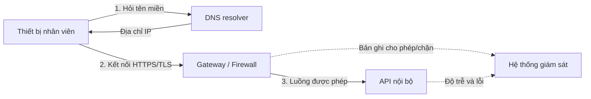

# Network security khác network performance như thế nào?

Trong cùng một hệ thống mạng, **network security (an ninh mạng)** trả lời câu hỏi *“Ai có thể truy cập, dữ liệu có được bảo vệ và hệ thống có chống chịu được hành vi tấn công không?”*. **Network performance (hiệu năng mạng)** trả lời câu hỏi *“Dữ liệu được truyền nhanh, ổn định và hiệu quả đến mức nào?”*. Hai lĩnh vực liên quan chặt chẽ nhưng có mục tiêu, cách đo và phương pháp xử lý khác nhau.

Ví dụ: một API trả lời trong 20 ms nhưng cho phép người lạ đọc dữ liệu khách hàng có **hiệu năng tốt nhưng bảo mật kém**. Ngược lại, một kết nối VPN mã hóa và xác thực đúng có thể **an toàn nhưng chậm** vì đường truyền vòng xa hoặc máy chủ VPN quá tải. Hệ thống vận hành tốt cần đạt cả hai mục tiêu.

## Mục tiêu học tập

Sau bài này, bạn có thể:

- Phân biệt mục tiêu của network security và network performance qua các tình huống cụ thể.
- Đọc đúng những chỉ số như độ trễ, thông lượng, mất gói, sự kiện chặn và mức độ phơi nhiễm.
- Giải thích cách phân đoạn mạng, firewall, VPN, IDS/IPS, DNS, Wi-Fi và dịch vụ đám mây ảnh hưởng đến cả bảo mật lẫn hiệu năng.
- Xác định dữ liệu cần thu thập khi một hệ thống vừa có dấu hiệu chậm vừa có cảnh báo an ninh.
- Đề xuất cách cân bằng hiệu năng với yêu cầu bảo mật mà không làm mất các biện pháp phòng vệ thiết yếu.

## 1. Hai câu hỏi tối ưu hóa khác nhau

### 1.1. Network security: bảo vệ tài sản trước các mối đe dọa

Trong mạng máy tính, “tài sản” có thể là dữ liệu, tài khoản, API, thiết bị đầu cuối, máy chủ, dịch vụ DNS hoặc khả năng phục vụ khách hàng. Network security sử dụng các cơ chế phòng vệ theo nhiều lớp để giảm nguy cơ bị truy cập trái phép, nghe lén, sửa đổi dữ liệu và làm gián đoạn dịch vụ.

Ba thuộc tính nền tảng thường được gọi là **CIA triad**:

| Thuộc tính | Ý nghĩa | Ví dụ trong mạng |
| --- | --- | --- |
| **Confidentiality — Tính bí mật** | Chỉ chủ thể được phép mới đọc được thông tin. | Mã hóa HTTPS/TLS, VPN, bảo vệ Wi-Fi bằng WPA2/WPA3, hạn chế truy cập giữa các phân đoạn mạng. |
| **Integrity — Tính toàn vẹn** | Phát hiện hoặc ngăn sửa đổi trái phép thông tin. | Xác thực bản ghi TLS; DNSSEC giúp xác thực tính toàn vẹn và nguồn gốc dữ liệu DNS đã được ký. |
| **Availability — Tính sẵn sàng** | Dịch vụ tiếp tục phục vụ người dùng hợp lệ khi có sự cố hoặc tấn công. | Giảm thiểu DDoS, giới hạn lưu lượng bất thường, dự phòng đường truyền và hạ tầng. |

Ngoài CIA, mạng an toàn còn cần **xác thực** danh tính thiết bị/người dùng, **phân quyền** truy cập theo nguyên tắc đặc quyền tối thiểu, quản lý cấu hình và **ghi nhận sự kiện** phục vụ phát hiện, điều tra.

Các câu hỏi trọng tâm:

- Người dùng hay thiết bị nào được phép kết nối đến dịch vụ này?
- Kẻ tấn công có thể nghe lén, giả mạo, vượt quyền hoặc làm gián đoạn ở đâu?
- Nếu một máy bị xâm nhập, có thể hạn chế việc lan sang các vùng mạng khác không?
- Cảnh báo xâm nhập có được phát hiện, phân tích và xử lý kịp thời không?

**Lưu ý:** Không có một chỉ số đơn lẻ chứng minh mạng “an toàn 100%”. Số lượng cảnh báo ít có thể do ít tấn công, hoặc do hệ thống giám sát chưa quan sát đúng.

### 1.2. Network performance: chất lượng vận chuyển dữ liệu

Network performance đo tốc độ và độ ổn định của việc trao đổi dữ liệu giữa các điểm trên mạng, trong điều kiện lưu lượng, thiết bị và tuyến truyền cụ thể.

| Chỉ số | Đo điều gì? | Cần hiểu đúng |
| --- | --- | --- |
| **Latency (độ trễ)** | Thời gian truyền hoặc phản hồi; thường đo bằng ms. | RTT của `ping` khác thời gian phản hồi HTTP toàn phần. |
| **Throughput (thông lượng)** | Lượng dữ liệu thực sự truyền thành công trên mỗi giây. | Không đồng nhất với **bandwidth**, là khả năng hoặc dung lượng danh nghĩa của đường truyền. |
| **Packet loss (mất gói)** | Tỷ lệ gói không đến được đích trong phép đo. | Có thể do nghẽn, lỗi đường truyền, chính sách chặn hoặc giới hạn đo đạc. |
| **Jitter (dao động trễ)** | Mức thay đổi độ trễ giữa các gói. | Đặc biệt ảnh hưởng đến thoại, họp trực tuyến và trò chơi thời gian thực. |
| **Connection/setup time** | Thời gian tra DNS, thiết lập TCP và bắt tay TLS. | Hữu ích khi chậm ở bước kết nối nhưng xử lý ứng dụng vẫn nhanh. |
| **Tail latency (p95/p99)** | 95%/99% phép đo có độ trễ không vượt quá ngưỡng được báo cáo. | Cho thấy trải nghiệm ở phần đuôi phân phối; cần đủ mẫu và cùng điều kiện đo. |

Các câu hỏi trọng tâm:

- Vì sao truy cập một trang lại mất nhiều thời gian?
- Đường truyền có nghẽn hoặc mất gói không?
- Nút mạng, DNS, firewall, proxy hay ứng dụng nào tạo thêm độ trễ?
- Tốc độ và độ ổn định có đáp ứng mục tiêu trải nghiệm (SLO) hay không?

### 1.3. So sánh trực diện

| Góc nhìn | Network security | Network performance |
| --- | --- | --- |
| Mục tiêu chính | Ngăn chặn, phát hiện và ứng phó truy cập hoặc hành vi gây hại. | Cung cấp kết nối nhanh, ổn định, sử dụng tài nguyên hiệu quả. |
| Đối tượng quan tâm | Danh tính, quyền truy cập, dữ liệu, bề mặt tấn công, luồng truy cập. | Gói tin, đường truyền, hàng đợi, độ trễ, băng thông và năng lực xử lý. |
| Rủi ro thường gặp | Nghe lén, giả mạo, di chuyển ngang, khai thác dịch vụ, DDoS. | Nghẽn, mất gói, định tuyến kém, thiết bị quá tải, DNS hoặc TLS thiết lập chậm. |
| Công cụ/biện pháp | Phân đoạn, ACL/firewall, TLS/VPN, IDS/IPS, xác thực, giám sát sự kiện. | Tối ưu tuyến, cân bằng tải, QoS, cache, tăng năng lực, tối ưu giao thức. |
| Minh chứng đánh giá | Kiểm thử quyền truy cập, phân tích cảnh báo, kiểm tra cấu hình và mức độ phơi nhiễm. | RTT, throughput, loss, jitter, thời gian DNS/TCP/TLS, p95/p99. |
| Kết quả không mong muốn | Truy cập trái phép hoặc dịch vụ bị đánh sập bởi tấn công. | Người dùng hợp lệ thấy chậm, giật, lỗi hoặc không đáp ứng SLO. |

**Điểm giao nhau quan trọng là availability (tính sẵn sàng).** Hiệu năng kém có thể khiến dịch vụ khó sử dụng ngay cả khi không bị tấn công; còn một cuộc DDoS có thể vừa phá tính sẵn sàng về bảo mật vừa làm độ trễ tăng và thông lượng hợp lệ giảm. Nguyên nhân phải được điều tra bằng bằng chứng, không suy ra từ triệu chứng “mạng chậm”.

## 2. Cùng một luồng truy cập, hai cách quan sát

Giả sử nhân viên dùng trình duyệt gọi một API nội bộ qua HTTPS:



Khi nhìn qua **lăng kính bảo mật**, ta hỏi DNS có đáng tin cậy không, chứng chỉ TLS có được xác thực không, người dùng có quyền gọi API không, firewall có chỉ cho phép luồng cần thiết không và IDS/IPS có phát hiện hành vi đáng ngờ không.

Khi nhìn qua **lăng kính hiệu năng**, ta đo thời gian phân giải DNS, thời gian thiết lập kết nối và TLS, độ trễ tại gateway, thời gian xử lý API, độ trễ đường truyền và mức mất gói. Một kết nối có thể được firewall **cho phép đúng chính sách** nhưng vẫn chậm vì tải CPU cao. Nó cũng có thể rất nhanh nhưng chính sách cho phép quá rộng.

Chú ý: **TLS bảo vệ dữ liệu trên đường truyền** và xác thực máy chủ khi chứng chỉ được kiểm tra đúng; TLS tự nó **không xác định** người dùng nào có quyền xem một bản ghi nghiệp vụ. Phân quyền vẫn cần được thực hiện ở tầng phù hợp.

## 3. Các biện pháp bảo mật tác động đến hiệu năng như thế nào?

Một cơ chế phòng vệ có thể thêm bước xử lý, lưu lượng hoặc điểm trung chuyển. Tác động thực tế tùy cấu hình, phần cứng, vị trí triển khai và loại lưu lượng.

| Lớp phòng vệ | Đóng góp bảo mật | Tác động hiệu năng có thể gặp | Cách đánh giá đúng |
| --- | --- | --- | --- |
| **Phân đoạn mạng, VLAN, ACL, security group** | Giới hạn đường đi và quyền truy cập; giảm khả năng di chuyển ngang. | Có thể thêm tuyến hoặc điểm kiểm tra; cấu hình sai có thể gây timeout. | Kiểm tra ma trận luồng được phép, đường đi, độ trễ và sự kiện deny. |
| **Firewall** | Cho phép/chặn theo chính sách; stateful firewall theo dõi trạng thái kết nối. | Bảng kết nối đầy, CPU quá tải hoặc rule/thiết bị cấu hình kém gây nghẽn. | Đo session count, drop, tài nguyên thiết bị, độ trễ trước/sau thay đổi. |
| **TLS/HTTPS** | Mã hóa và bảo vệ toàn vẹn luồng dữ liệu; xác thực máy chủ bằng chứng chỉ. | Bắt tay TLS và mã hóa có chi phí, rõ hơn ở kết nối mới hoặc thiết bị yếu. | Đo riêng thời gian TLS, tỷ lệ tái sử dụng kết nối, CPU, chứng chỉ và lỗi bắt tay. |
| **VPN** | Bảo vệ lưu lượng trên đoạn mạng được thiết lập, kiểm soát kết nối từ xa. | Đóng gói/mã hóa, MTU, tuyến vòng xa hoặc gateway VPN quá tải. | So sánh RTT, throughput, MTU và tải gateway trong các phép đo hợp lệ. |
| **IDS/IPS** | IDS phát hiện/cảnh báo; IPS triển khai inline có thể chặn lưu lượng. | IPS cần kiểm tra nội dung/metadata, có thể tăng trễ hoặc chặn nhầm; IDS thụ động thường không trực tiếp nằm trên đường truyền. | Đối chiếu alert, false positive, drop, p95/p99 và tài nguyên. |
| **DNSSEC; DoT/DoH** | DNSSEC xác thực dữ liệu DNS được ký; DoT/DoH mã hóa truy vấn DNS trên đoạn tới resolver tương ứng. | Xác thực, mã hóa hoặc chọn resolver có thể thay đổi thời gian phân giải. | Đo DNS lookup và kiểm tra đúng thuộc tính cần bảo vệ. |
| **Wi-Fi WPA2/WPA3** | Xác thực và mã hóa kết nối không dây theo chế độ cấu hình. | Hiệu năng còn chịu ảnh hưởng lớn từ nhiễu, sóng yếu, mật độ thiết bị và airtime. | Tách vấn đề xác thực khỏi RSSI, retry, kênh và chất lượng sóng. |
| **Bảo vệ mạng đám mây** | Security group, network ACL, private subnet, private endpoint và quan sát luồng giảm bề mặt tấn công. | NAT, gateway, load balancer, vị trí vùng và tuyến mạng có thể thêm chi phí hoặc độ trễ. | Xem đường đi thực tế, lưu lượng giữa vùng, flow log, lỗi và p95/p99. |

Không nên kết luận “thêm bảo mật thì mạng luôn chậm”:

- TLS hiện đại có thể có chi phí nhỏ so với thời gian xử lý ứng dụng, nhất là khi kết nối được tái sử dụng.
- Chặn một đợt DDoS hoặc giới hạn lưu lượng lạm dụng có thể **cải thiện hiệu năng cho người dùng hợp lệ**.
- Firewall hoặc IPS bị cấu hình quá tải có thể làm giảm hiệu năng ngay cả khi không có cuộc tấn công.
- Cache, QoS và cân bằng tải giúp hiệu năng nhưng **không tự thay thế** xác thực, phân quyền hay mã hóa.

Quyết định kỹ thuật nên dựa trên cả **mức giảm rủi ro** và **chi phí đo được** đối với người dùng hợp lệ.

## 4. Nhìn vào triệu chứng: chậm không đồng nghĩa bị tấn công

### Tình huống A — Nhanh nhưng không an toàn

API nội bộ có p95 chỉ 35 ms, song một người không được cấp quyền vẫn gọi được endpoint xuất dữ liệu do thiếu bước kiểm tra quyền. Các chỉ số hiệu năng đều đẹp, nhưng **confidentiality** bị phá vỡ. Cách xử lý chính là sửa cơ chế phân quyền và kiểm thử trường hợp truy cập trái phép; tăng băng thông không giải quyết vấn đề.

### Tình huống B — An toàn nhưng trải nghiệm kém

Nhân viên kết nối thành công qua VPN với xác thực đúng, TLS đúng và firewall đúng chính sách. Tuy nhiên truy vấn từ xa phải đi vòng qua gateway quá tải, khiến RTT và p95 tăng. Đội vận hành cần đo đường đi, năng lực gateway, MTU và tài nguyên, sau đó điều chỉnh tuyến hoặc mở rộng hạ tầng trong phạm vi được phép. Không nên tắt mã hóa hay bỏ xác thực để “sửa tốc độ”.

### Tình huống C — DDoS tác động lên cả hai

Một dịch vụ công khai nhận lượng yêu cầu bất thường làm đầy tài nguyên kết nối; người dùng hợp lệ gặp timeout. Về bảo mật, đây có thể là cuộc tấn công vào **availability**; về hiệu năng, số kết nối hợp lệ hoàn thành giảm và tail latency tăng. Cần xác minh nguồn, mẫu lưu lượng, tính hợp lệ của yêu cầu và tài nguyên bị cạn trước khi áp dụng rate limit, lọc hoặc giải pháp chống DDoS. Việc chặn quá rộng có thể tạo **false positive**, làm người dùng thật cũng không truy cập được.

### Tình huống D — Lỗi cấu hình bị nhầm là sự cố mạng

Sau khi cập nhật rule firewall, một nhóm người dùng không truy cập được ứng dụng. Ứng dụng vẫn trả lời nhanh cho những người được phép, nhưng nhóm còn lại bị timeout. Đây trước hết là vấn đề **chính sách truy cập hoặc đường đi**, không thể kết luận máy chủ ứng dụng chậm chỉ từ thời gian chờ ở client. Hãy xem log deny, tuyến đi và thay đổi cấu hình theo đúng thời điểm sự cố.

| Quan sát ban đầu | Khả năng cần kiểm tra | Bằng chứng hữu ích |
| --- | --- | --- |
| RTT hoặc packet loss tăng đồng thời trên nhiều đích | Nghẽn, lỗi tuyến, thiết bị hoặc Wi-Fi; cũng có thể là lưu lượng tấn công. | Utilization, retransmission, lỗi cổng, retry Wi-Fi, lưu lượng theo thời điểm. |
| HTTP nhanh nhưng người không có quyền đọc được dữ liệu | Lỗi xác thực/phân quyền hay phân đoạn. | Kiểm thử quyền, log truy cập, rule mạng và luồng dữ liệu. |
| Chậm ngay sau bật kiểm tra IPS inline | Năng lực xử lý, rule IPS, chặn nhầm hoặc lưu lượng thay đổi. | p95 trước/sau, CPU, session, alert, drop và kết quả kiểm thử hợp lệ. |
| Chậm trước khi có kết nối TCP | Phân giải DNS, đường đi, thiết lập mạng. | DNS lookup time, TCP connect time, lỗi phân giải hoặc định tuyến. |
| Chậm ở bước TLS hoặc lỗi chứng chỉ | TLS handshake, chứng chỉ, phiên bản/cấu hình hoặc tải thiết bị. | TLS timing, lỗi xác thực chứng chỉ, cấu hình endpoint và CPU. |
| Tăng mạnh request bất thường cùng tỷ lệ lỗi | Có thể là bot, DDoS hoặc chiến dịch hợp lệ gây tải đột biến. | Phân bố nguồn, mẫu request, log bảo mật, 429/5xx, kết nối và năng lực phục vụ. |

## 5. Quy trình chẩn đoán kết hợp bảo mật và hiệu năng

**Bước 1 — Xác định đối tượng và tiêu chí thành công.** Ghi rõ luồng cần phân tích (ví dụ: laptop nhân viên → API nội bộ), người dùng nào bị ảnh hưởng, khi nào bắt đầu, loại lỗi, và mục tiêu như p95 độ trễ hoặc tỷ lệ thành công. Đồng thời xác định quyền truy cập dự kiến và mức nhạy cảm của dữ liệu.

**Bước 2 — Đo đường đi của yêu cầu.** Tách tối thiểu DNS lookup, TCP connect, TLS handshake, thời gian đến byte đầu tiên (TTFB) và tổng thời gian. Kiểm tra RTT, mất gói, retransmission, băng thông sử dụng và tải tài nguyên ở các điểm trung gian. Đo nhiều lần trong cùng điều kiện; một phép đo đơn lẻ không đủ kết luận.

**Bước 3 — Đối chiếu tín hiệu an ninh.** Xem firewall allow/deny, log xác thực, số kết nối, cảnh báo IDS/IPS, sự kiện rate limit, thay đổi rule, endpoint hoặc tuyến mạng. Một gói bị chính sách chặn có thể là hành vi bảo vệ đúng, cũng có thể là cấu hình sai; cần kiểm tra người gửi và quyền mong đợi.

**Bước 4 — Phân biệt nguyên nhân.** Đặt các giả thuyết cạnh nhau: mất gói do nghẽn, IPS bị quá tải, DNS bị lỗi, chính sách deny, request độc hại gây cạn tài nguyên. Sử dụng bằng chứng theo cùng mốc thời gian để loại trừ từng giả thuyết.

**Bước 5 — Điều chỉnh có kiểm soát và đo lại.** Ưu tiên khắc phục cấu hình sai, tối ưu rule, tăng năng lực hoặc thay đổi đường đi hợp lý. Với biện pháp phòng vệ có khả năng chặn nhầm, kiểm thử bằng lưu lượng hợp lệ trong môi trường được phép và theo dõi cả hiệu năng lẫn an ninh sau thay đổi.

### Ví dụ phép đo với `curl`

Trên máy có `curl`, có thể ghi nhận thời gian các giai đoạn của một yêu cầu HTTPS đến **endpoint mà bạn được phép kiểm tra**:

```bash
curl -sS -o /dev/null \
  -w 'DNS=%{time_namelookup}s TCP=%{time_connect}s TLS=%{time_appconnect}s TTFB=%{time_starttransfer}s TOTAL=%{time_total}s HTTP=%{http_code}\n' \
  https://example.com/
```

Trong đầu ra:

- `time_namelookup`: thời gian tích lũy đến khi phân giải tên hoàn tất.
- `time_connect`: thời gian tích lũy đến khi thiết lập kết nối TCP hoàn tất.
- `time_appconnect`: thời gian tích lũy đến khi hoàn tất bắt tay TLS (đối với kết nối HTTPS trực tiếp).
- `time_starttransfer`: thời gian tích lũy đến khi nhận byte đầu tiên.
- `time_total`: tổng thời gian thực hiện yêu cầu.

Các giá trị này **được tính từ đầu yêu cầu**, không phải các khoảng thời gian độc lập để cộng lại. Ví dụ, để ước lượng phần bắt tay TLS từ các mốc phù hợp, lấy `time_appconnect - time_connect`; để ước lượng thời gian sau khi TLS hoàn tất đến byte đầu tiên, lấy `time_starttransfer - time_appconnect`. Kết quả còn phụ thuộc proxy, tái sử dụng kết nối, cache DNS và cách máy khách thiết lập kết nối.

**Một phép đo thời gian không chứng minh kết nối an toàn.** Cần kiểm tra riêng HTTPS, xác thực chứng chỉ, cấu hình và chính sách truy cập; đồng thời không dùng tùy chọn bỏ xác minh chứng chỉ như `curl -k` để làm “nhanh” hoặc né lỗi TLS.

### Gắn phép đo với một tình huống

Giả sử API có p95 tăng từ **120 ms lên 260 ms** sau một thay đổi cấu hình IPS (số liệu giả định). Nhóm vận hành có thể:

1. So sánh p95, tỷ lệ lỗi, lưu lượng và tỷ lệ chặn trước/sau thay đổi trong cùng khung giờ và tải tương đương.
2. Xem cảnh báo nào tương ứng với luồng hợp lệ, số lượng false positive và mức tải thiết bị IPS.
3. Xác định nguyên nhân là xử lý inline quá tải, rule chặn nhầm hay tăng tải độc lập.
4. Tối ưu rule hoặc năng lực thiết bị trong môi trường kiểm thử có kiểm soát; kiểm tra lại cả tỷ lệ phát hiện và p95 trước khi triển khai.

Chỉ vì hai sự kiện xảy ra gần nhau chưa đủ để kết luận IPS gây chậm. Cần đối chiếu điều kiện đo và các thay đổi khác.

## 6. Threat modeling và SLO: đặt hai mục tiêu vào cùng một thiết kế

**Threat modeling (mô hình hóa mối đe dọa)** giúp xác định tài sản cần bảo vệ, tác nhân có thể tấn công, điểm vào, ranh giới tin cậy, hậu quả và biện pháp giảm thiểu. **SLO (service level objective)** mô tả mục tiêu đo được về khả năng phục vụ, chẳng hạn tỷ lệ yêu cầu thành công và p95. Hai phương pháp này bổ sung cho nhau.

Ví dụ: thiết kế API thanh toán trên hạ tầng đám mây.

| Câu hỏi thiết kế | Yêu cầu bảo mật | Yêu cầu hiệu năng/vận hành |
| --- | --- | --- |
| Ai được truy cập? | Chỉ client đã xác thực và có quyền; database không mở truy cập công khai. | Lưu lượng hợp lệ không bị chặn nhầm; tỷ lệ yêu cầu thành công đạt mục tiêu. |
| Dữ liệu truyền thế nào? | HTTPS/TLS, kiểm tra chứng chỉ, giới hạn luồng vào các phân đoạn phù hợp. | Thời gian bắt tay và tổng độ trễ trong ngưỡng SLO. |
| Làm gì khi lưu lượng tăng? | Rate limit theo rủi ro, phát hiện lạm dụng, bảo vệ DDoS. | Duy trì khả năng phục vụ cho người hợp lệ dưới tải dự kiến. |
| Làm sao nhận biết bất thường? | Thu log truy cập, luồng mạng, alert, kiểm soát quyền đọc log và thời hạn lưu. | Theo dõi p50/p95/p99, throughput, error rate, CPU, memory. |
| Điều gì xảy ra khi một vùng mạng bị xâm nhập? | Phân đoạn, hạn chế quyền và đường đi giữa các vùng. | Đảm bảo luồng hợp lệ còn hoạt động qua tuyến và thành phần dự phòng. |

Một ví dụ **tiêu chí chấp nhận giả định**, cần điều chỉnh theo sản phẩm thực tế:

- Ứng dụng chỉ chấp nhận các luồng mạng đã được phê duyệt; các luồng trái phép bị từ chối và được ghi nhận phù hợp.
- p95 độ trễ của yêu cầu hợp lệ nhỏ hơn 200 ms trong bài kiểm thử tải đã xác định.
- Tỷ lệ từ chối nhầm đối với người dùng hợp lệ được đo, phân tích và giữ dưới ngưỡng nhóm vận hành đặt ra.
- Khi thử tình huống lưu lượng bất thường có kiểm soát, hệ thống vừa bảo vệ được tài nguyên vừa theo dõi được ảnh hưởng đến yêu cầu hợp lệ.

Không nên đánh đổi yêu cầu cốt lõi như xác thực đúng hoặc bảo vệ dữ liệu lấy vài mili giây. Nếu một lớp bảo vệ đẩy hệ thống vượt SLO, hãy điều tra cách triển khai, dung lượng và vị trí đặt lớp bảo vệ, đồng thời giữ nguyên mục tiêu giảm rủi ro.

## 7. Những nhầm lẫn thường gặp

**“Dùng HTTPS thì API đã an toàn.”** HTTPS bảo vệ đường truyền và xác thực máy chủ theo cấu hình chuẩn, nhưng không thay thế kiểm tra quyền, an toàn đầu vào, bảo vệ khóa và cấu hình mạng.

**“Firewall chặn được gói xấu thì mọi kết nối chậm đều do firewall.”** Cần đo tải thiết bị, drop, số phiên và tuyến đi. DNS, Wi-Fi, backend hoặc đường truyền đều có thể là nguyên nhân.

**“IDS và IPS giống nhau.”** IDS chủ yếu quan sát và cảnh báo; IPS ở chế độ inline có khả năng chặn. Vì vậy ảnh hưởng trực tiếp đến lưu lượng của chúng khác nhau.

**“Mạng có băng thông lớn sẽ có latency thấp.”** Băng thông mô tả dung lượng truyền; độ trễ còn phụ thuộc khoảng cách, hàng đợi, định tuyến, bắt tay và xử lý ở từng nút.

**“DNSSEC mã hóa truy vấn DNS.”** DNSSEC nhằm xác minh tính xác thực/toàn vẹn của dữ liệu DNS đã ký; DoT và DoH mới là các cơ chế mã hóa truy vấn trên đoạn truyền tới resolver tương ứng. Chúng giải quyết những thuộc tính khác nhau.

**“Chặn càng nhiều càng an toàn.”** Chặn nhầm có thể phá availability cho người dùng hợp lệ. Chính sách hiệu quả phải dựa trên rủi ro, quyền truy cập và bằng chứng, có theo dõi false positive.

## 8. Tự kiểm tra

1. API phản hồi 15 ms nhưng cho phép tài khoản không có quyền xem dữ liệu người khác. Đây là vấn đề security hay performance? Thuộc tính nào bị ảnh hưởng?
2. Sau khi chuyển người dùng sang VPN, throughput giảm đáng kể. Hãy nêu ba điểm cần đo trước khi xác định nguyên nhân.
3. Một ứng dụng chậm và có nhiều alert IPS. Vì sao chỉ dựa vào hai hiện tượng này chưa thể kết luận đang bị tấn công?
4. Trong một cuộc DDoS, availability là mục tiêu của security hay performance? Giải thích tại sao cả hai nhóm đều cần phối hợp.
5. Vì sao thời gian `time_appconnect` trong `curl` không đủ để kết luận một kết nối có quyền truy cập đúng?

**Gợi ý đáp án:** (1) Security: thiếu kiểm soát truy cập, ảnh hưởng tính bí mật; (2) RTT/tuyến, tải VPN gateway, MTU/mất gói hoặc mức dùng CPU mã hóa; (3) Cần đối chiếu mẫu lưu lượng, nguồn, rule, false positive và hiệu năng thiết bị; (4) Cả hai: bảo vệ trước tác nhân xấu và duy trì chất lượng phục vụ người dùng hợp lệ; (5) Thời gian bắt tay TLS không kiểm tra logic phân quyền của API.

## Kết luận

**Network security bảo vệ điều gì được phép xảy ra trên mạng và khả năng chống chịu trước mối đe dọa. Network performance đo mạng thực hiện các trao đổi đó nhanh và ổn định đến đâu.** Một kiến trúc mạng an toàn cần đồng thời quản lý phân đoạn, firewall, VPN, IDS/IPS, xác thực kết nối, DNS, Wi-Fi và hạ tầng đám mây; đồng thời quan sát độ trễ, thông lượng, mất gói và khả năng phục vụ. Khi gặp sự cố, hãy đo đúng từng lớp và đối chiếu log bảo mật với chỉ số hiệu năng để tìm nguyên nhân thực tế.
