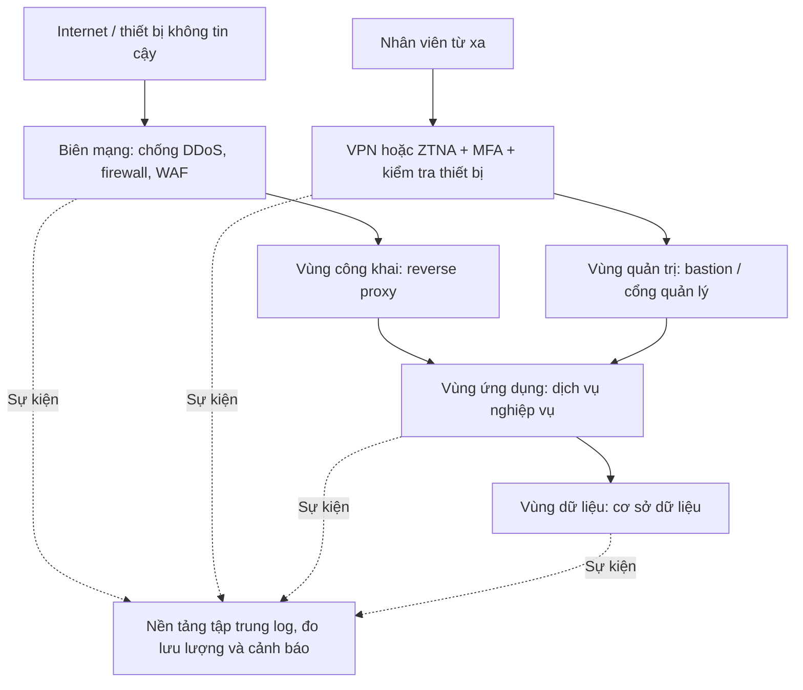

# Phòng thủ theo lớp trong bảo vệ mạng

> **Chương:** Nhập môn  
> **Chủ đề:** Phòng thủ theo lớp trong bảo vệ mạng (*defense in depth*)  
> **Phạm vi:** Bảo mật mạng từ phân đoạn, firewall, VPN, IDS/IPS và xác thực kết nối đến DNS, Wi-Fi, đám mây, giám sát lưu lượng và ứng phó sự cố.

## 1. Vì sao mạng cần nhiều lớp phòng vệ?

Hãy hình dung một doanh nghiệp có ứng dụng web công khai, máy chủ ứng dụng, cơ sở dữ liệu chứa thông tin khách hàng và nhân viên truy cập từ xa. Doanh nghiệp đã lắp firewall ở cổng Internet. Đây là một biện pháp quan trọng, nhưng một firewall đơn lẻ không giải quyết hết các tình huống sau:

- Kẻ tấn công dùng tài khoản VPN bị đánh cắp để đi vào mạng dưới danh nghĩa nhân viên.
- Một máy trạm nhiễm mã độc cố truy cập trực tiếp cơ sở dữ liệu hoặc các máy trạm khác.
- Ứng dụng web có lỗ hổng cho phép kẻ tấn công điều khiển tiến trình phía sau firewall.
- Máy chủ nội bộ kết nối ra tên miền điều khiển độc hại qua DNS hoặc HTTPS.
- Một quy tắc firewall bị cấu hình quá rộng, thiết bị bảo vệ quá tải hoặc hệ thống ghi log bị gián đoạn.

**Phòng thủ theo lớp** là cách thiết kế nhiều biện pháp bảo vệ tại các ranh giới tin cậy và các giai đoạn của cuộc tấn công. Khi một lớp bị vượt qua hoặc hoạt động sai, lớp khác vẫn có cơ hội **ngăn chặn, phát hiện, giới hạn thiệt hại và hỗ trợ phục hồi**.

Đây không phải bài toán mua càng nhiều sản phẩm bảo mật càng tốt. Giá trị nằm ở việc mỗi lớp bảo vệ **một rủi ro cụ thể**, có ranh giới thực thi rõ ràng, có người vận hành và có phương pháp xác minh hiệu quả. Ví dụ, firewall ở cổng Internet và một firewall nội bộ chỉ thực sự bổ sung cho nhau khi chúng giới hạn những luồng truy cập khác nhau; hai thiết bị cùng cho phép mọi lưu lượng sẽ không tạo ra hai lớp bảo vệ hữu ích.

### Mục tiêu học tập

Sau bài này, bạn có thể:

1. Giải thích khái niệm phòng thủ theo lớp và phân biệt các chức năng phòng ngừa, phát hiện, ứng phó.
2. Xác định tài sản, luồng dữ liệu và ranh giới tin cậy để đặt các biện pháp mạng đúng vị trí.
3. Kết hợp phân đoạn, firewall, VPN, xác thực, IDS/IPS, DNS, Wi-Fi, TLS và kiểm soát mạng đám mây thành một kiến trúc nhất quán.
4. Phân tích một đường đi tấn công và đánh giá các lớp còn lại khi một lớp bị vượt qua.
5. Xây dựng quy tắc truy cập tối thiểu, cách giám sát và kế hoạch kiểm thử cho mạng mẫu.

## 2. Nguyên tắc nền tảng

### 2.1. Bảo vệ tài sản, không chỉ bảo vệ chu vi

Biên mạng Internet thường là điểm cần phòng vệ đầu tiên, nhưng tài sản quan trọng có thể nằm trong trung tâm dữ liệu, đám mây, máy trạm, thiết bị mạng hoặc dịch vụ của bên thứ ba. Vì vậy, câu hỏi thiết kế nên bắt đầu từ **cái gì cần bảo vệ** và **ai cần trao đổi dữ liệu với ai**.

Ba mục tiêu quen thuộc là:

| Mục tiêu | Ví dụ rủi ro mạng | Biện pháp hỗ trợ |
|---|---|---|
| **Bí mật** (*confidentiality*) | Người không có quyền đọc dữ liệu trên đường truyền hoặc truy cập cơ sở dữ liệu | Phân quyền, phân đoạn, TLS/mTLS, xác thực mạnh |
| **Toàn vẹn** (*integrity*) | Lưu lượng bị sửa, yêu cầu giả mạo hoặc cấu hình mạng bị thay đổi trái phép | TLS, xác thực thiết bị, quản lý thay đổi, ghi nhận sự kiện |
| **Sẵn sàng** (*availability*) | DDoS, lỗi cấu hình firewall hoặc sự cố kết nối khiến dịch vụ ngừng hoạt động | Chống DDoS, giới hạn lưu lượng, dự phòng, giám sát, phương án khôi phục |

Không có biện pháp nào đồng thời giải quyết hoàn toàn cả ba mục tiêu. Chẳng hạn, mã hóa TLS bảo vệ dữ liệu khi truyền và hỗ trợ xác thực đầu cuối, nhưng không tự ngăn một người dùng hợp lệ truy cập sai dữ liệu hoặc một máy chủ đã bị chiếm quyền gửi dữ liệu ra ngoài.

### 2.2. Các lớp nên bổ trợ nhau

Một kiến trúc phòng thủ tốt áp dụng đồng thời những nguyên tắc sau:

- **Ít quyền nhất:** Chỉ cho phép đúng người, đúng thiết bị, đúng dịch vụ, đúng giao thức và đúng hướng kết nối cần thiết.
- **Mặc định từ chối:** Những luồng không được phép một cách rõ ràng sẽ bị chặn. Phải kiểm tra cả IPv4, IPv6 và đường truyền thay thế.
- **Giới hạn phạm vi ảnh hưởng:** Nếu một thành phần bị chiếm quyền, kẻ tấn công khó di chuyển sang vùng khác hoặc lấy dữ liệu quan trọng.
- **Không tin cậy ngầm theo vị trí:** Kết nối từ VPN hoặc cùng mạng nội bộ vẫn cần kiểm tra danh tính, thiết bị, quyền và ngữ cảnh. Đây là điểm giao nhau với tư duy *Zero Trust*.
- **Độc lập ở mức hợp lý:** Tránh để toàn bộ cơ chế bảo vệ cùng phụ thuộc vào một cấu hình sai, một tài khoản quản trị hoặc một điểm lỗi duy nhất.
- **Có khả năng quan sát và phục hồi:** Sự kiện quan trọng phải được ghi nhận, tương quan, cảnh báo và có quy trình xử lý.

Hãy phân biệt ba vai trò của kiểm soát bảo mật:

| Vai trò | Mục đích | Ví dụ |
|---|---|---|
| **Phòng ngừa** (*preventive*) | Ngăn hành động trái phép trước khi gây hại | Quy tắc firewall, MFA, phân đoạn mạng, chính sách egress |
| **Phát hiện** (*detective*) | Nhận biết dấu hiệu bất thường hoặc hành vi vượt quyền | IDS, log DNS, NetFlow, cảnh báo từ hệ thống xác thực |
| **Ứng phó/khắc phục** (*responsive/corrective*) | Cô lập, hạn chế tổn thất, khôi phục dịch vụ | Cách ly máy nghi nhiễm, thu hồi phiên VPN, chặn IOC, khôi phục cấu hình |

Các kiểm soát không nhất thiết nằm ở ba thiết bị khác nhau. Một hệ thống có thể vừa chặn truy cập vừa ghi log; tuy nhiên, việc hệ thống ấy có thể bị vô hiệu hóa phải được xét trong mô hình mối đe dọa.

## 3. Thiết kế bắt đầu từ ranh giới tin cậy

**Ranh giới tin cậy** (*trust boundary*) là nơi một yêu cầu hoặc dữ liệu chuyển giữa các vùng có mức tin cậy, quyền hoặc chính sách bảo mật khác nhau. Ví dụ: từ Internet vào vùng công khai; từ máy chủ web vào dịch vụ ứng dụng; từ ứng dụng vào cơ sở dữ liệu; từ thiết bị cá nhân vào mạng quản trị.

Trước khi chọn thiết bị, hãy trả lời bốn câu hỏi:

1. Tài sản nào là trọng yếu: dữ liệu khách hàng, hệ thống danh tính, máy chủ ứng dụng, máy chủ quản trị, dịch vụ DNS?
2. Luồng hợp lệ là gì: nguồn, đích, cổng, giao thức, chiều kết nối, danh tính và lý do nghiệp vụ?
3. Ai hoặc cái gì không được tin cậy: Internet, thiết bị chưa quản lý, máy khách đã bị nhiễm, tài khoản có thể bị chiếm quyền?
4. Nếu một lớp thất bại, lớp kế tiếp nằm ở đâu và làm cách nào xác minh lớp đó hoạt động?

### 3.1. Ví dụ kiến trúc ứng dụng ba tầng

Sơ đồ dưới đây minh họa một cách bố trí các điểm kiểm soát. Tên vùng và địa chỉ chỉ mang tính ví dụ; kiến trúc thực tế phải tuân theo luồng nghiệp vụ và mô hình triển khai.



Đường nối trong sơ đồ thể hiện **một nhóm luồng được xem xét cấp quyền**, không có nghĩa là tất cả kết nối giữa hai vùng đều được chấp nhận. Chẳng hạn, reverse proxy được quyền gọi cổng dịch vụ cụ thể của vùng ứng dụng, còn máy trong vùng công khai không có quyền truy cập trực tiếp cơ sở dữ liệu.

Khi triển khai, cần bảo đảm mọi luồng quan trọng thực sự đi qua điểm kiểm soát. Hai subnet đặt tên khác nhau nhưng có tuyến định tuyến cho phép kết nối tự do không tạo thành phân đoạn an toàn. Tương tự, VLAN hỗ trợ tách mạng ở lớp 2 nhưng chính sách hạn chế truy cập giữa các VLAN phải được thực thi ở lớp 3/4 hoặc cao hơn.

### 3.2. Bản đồ các lớp bảo vệ

| Lớp | Nguy cơ chính | Kiểm soát tiêu biểu | Bằng chứng cần có |
|---|---|---|---|
| **Kết nối Internet và biên mạng** | Quét cổng, truy cập không được phép, DDoS | Firewall biên, chống DDoS, giới hạn lưu lượng, WAF cho HTTP(S) | Chỉ dịch vụ công khai cần thiết được mở; có log và số liệu tải |
| **Phân đoạn nội bộ** | Di chuyển ngang từ máy đã bị chiếm quyền | Subnet/vùng tin cậy, firewall nội bộ, ACL, microsegmentation | Luồng không thuộc danh sách cho phép bị chặn |
| **Danh tính và truy cập từ xa** | Lộ thông tin đăng nhập, truy cập bằng thiết bị không an toàn | VPN/ZTNA, MFA, chứng chỉ thiết bị, chính sách theo vai trò | Phiên và quyền được kiểm tra; thu hồi có hiệu lực |
| **Giao thức và phiên kết nối** | Nghe lén, giả mạo đầu cuối, sửa đổi dữ liệu | TLS, mTLS khi phù hợp, quản lý chứng chỉ và khóa | Chứng chỉ được xác minh; giao thức lỗi thời bị loại bỏ |
| **Dịch vụ ứng dụng và máy chủ** | Lỗ hổng, tiến trình bị chiếm quyền | WAF, xác thực ứng dụng, hardening, vá lỗi, quyền tối thiểu | Máy chủ không thể tự vượt qua quyền mạng hoặc quyền dữ liệu |
| **DNS, kết nối ra ngoài** | Liên lạc với hạ tầng độc hại, rò rỉ dữ liệu | Resolver được quản lý, lọc DNS, egress firewall/proxy | Truy vấn và luồng ra ngoài có chính sách và dấu vết |
| **Mạng không dây và đám mây** | Thiết bị lạ, cấu hình cho phép quá rộng | WPA3-Enterprise/802.1X, guest isolation, cloud firewall, private endpoint | Thiết bị/vùng chỉ kết nối tới tài nguyên được cấp quyền |
| **Quan sát và ứng phó** | Tấn công diễn ra nhưng không bị phát hiện hoặc xử lý | IDS/IPS, lưu lượng mạng, log, cảnh báo, quy trình IR | Có thể truy vết, cảnh báo và cô lập đúng nguồn gây sự cố |

## 4. Cách các lớp phối hợp trong thực tế

### 4.1. Phân đoạn mạng và microsegmentation

**Phân đoạn mạng** chia tài sản thành những vùng có chính sách riêng, ví dụ: người dùng, ứng dụng, dữ liệu, khách, quản trị và môi trường thử nghiệm. Firewall hoặc ACL kiểm soát các luồng *north-south* (vào/ra hệ thống) và *east-west* (giữa các hệ thống nội bộ).

**Microsegmentation** áp dụng nguyên tắc tương tự ở mức chi tiết hơn, có thể theo workload, nhãn dịch vụ hoặc danh tính tiến trình thay vì chỉ theo subnet. Nó đặc biệt hữu ích khi nhiều dịch vụ chạy trong cùng môi trường ảo hóa, container hoặc đám mây.

Một quy tắc thiết kế tốt là: máy trạm của nhân viên được gọi API của ứng dụng theo nhu cầu, nhưng không thể kết nối thẳng cổng cơ sở dữ liệu; máy chủ ứng dụng chỉ được gọi cơ sở dữ liệu của chính ứng dụng ấy. Nếu máy trạm bị nhiễm mã độc, kiểm soát nội bộ vẫn tạo ra trở ngại đối với việc di chuyển ngang.

Lưu ý rằng phân đoạn không thay thế quyền ở tầng ứng dụng hoặc cơ sở dữ liệu. Máy chủ ứng dụng có kết nối hợp lệ vẫn cần dùng tài khoản dữ liệu với quyền hạn chế.

### 4.2. Firewall, WAF và kiểm soát lưu lượng ra ngoài

**Firewall mạng** thường áp dụng chính sách theo địa chỉ, giao thức, cổng, trạng thái phiên, đôi khi thêm ứng dụng và danh tính. Firewall *stateful* theo dõi trạng thái kết nối để nhận diện lưu lượng phản hồi hợp lệ. **WAF** làm việc chủ yếu với HTTP(S), giúp kiểm soát các mẫu yêu cầu web độc hại; WAF không thay thế firewall mạng hay cơ chế kiểm tra quyền của ứng dụng.

Một chính sách cơ bản nên bao gồm:

- **Ingress:** Chỉ cho phép dịch vụ thật sự cần công khai, thường qua reverse proxy hoặc điểm bảo vệ thích hợp.
- **East-west:** Chỉ mở những kết nối giữa các vùng đã được phê duyệt theo ma trận luồng.
- **Egress:** Giới hạn đích và dịch vụ mà từng nhóm máy được phép truy cập ra ngoài, thay vì mặc định cho phép mọi kết nối đi ra.
- **Management plane:** Chỉ quản trị từ khu vực hoặc cổng truy cập được kiểm soát; không công khai SSH, RDP hoặc giao diện quản lý khi không có yêu cầu bắt buộc.
- **Logging:** Ghi nhận thay đổi quy tắc, kết nối bị từ chối quan trọng và những sự kiện cần điều tra; điều chỉnh mức log để tránh quá tải.

Ví dụ, một máy chủ ứng dụng không nhất thiết cần kết nối tùy ý đến Internet. Máy có thể chỉ cần gọi dịch vụ cập nhật, API đối tác và resolver được quản lý. Quy tắc egress thu hẹp cơ hội liên lạc ra ngoài nếu máy chủ bị chiếm quyền.

### 4.3. VPN, Zero Trust Network Access và xác thực kết nối

VPN tạo đường truyền bảo vệ từ xa hoặc nối giữa các mạng. Nó **không chứng minh rằng mọi hành động qua đường hầm đều đáng tin cậy**. Một tài khoản VPN bị đánh cắp vẫn có thể tạo phiên kết nối hợp lệ.

Do đó, đường truy cập từ xa nên kết hợp MFA, xác thực danh tính, kiểm tra tình trạng thiết bị khi khả thi, cấp quyền theo nhóm công việc, giới hạn tài nguyên truy cập và ghi lại vòng đời phiên. **ZTNA** thường ưu tiên cấp quyền tới ứng dụng hoặc dịch vụ cụ thể thay vì mở rộng quyền truy cập vào toàn mạng; lựa chọn VPN hay ZTNA phụ thuộc nhu cầu vận hành và khả năng kiểm soát.

Ở kết nối máy với máy, TLS xác minh máy chủ và bảo vệ dữ liệu đang truyền. **mTLS** cho phép cả hai phía xuất trình chứng chỉ, hữu ích cho một số dịch vụ nội bộ và kết nối giữa workload. Chứng chỉ phải được kiểm tra đúng tên, chuỗi tin cậy và thời hạn; mTLS không tự thay thế phân quyền nghiệp vụ.

### 4.4. IDS/IPS, đo lưu lượng và giám sát

**IDS** phân tích dấu hiệu tấn công hoặc hành vi bất thường và gửi cảnh báo. **IPS** có thể chặn lưu lượng khi được đặt trên đường truyền hoặc tích hợp ở điểm thực thi phù hợp. Cả hai cần bộ luật/đặc trưng cập nhật, điều chỉnh ngưỡng và quy trình xử lý cảnh báo giả.

Để có góc nhìn đáng tin cậy, nên kết hợp nhiều loại bằng chứng:

| Nguồn tín hiệu | Có thể trả lời | Giới hạn |
|---|---|---|
| Firewall / ACL log | Kết nối nào được cho phép hoặc bị chặn? | Không luôn thấy nội dung ứng dụng hoặc nguyên nhân đăng nhập |
| NetFlow / IPFIX / lưu lượng tổng hợp | Ai liên lạc với ai, bao nhiêu byte, trong bao lâu? | Không chứa đầy đủ payload hoặc ý nghĩa nghiệp vụ |
| IDS/IPS | Lưu lượng nào khớp dấu hiệu hay hành vi đáng ngờ? | Có thể có cảnh báo sai, bỏ sót và hạn chế khi lưu lượng được mã hóa |
| DNS log | Máy nào hỏi tên miền nào, khi nào? | DNS không thể hiện mọi luồng; DoH/DoT ngoài chính sách có thể làm giảm quan sát |
| Log VPN / IdP / thiết bị | Ai đăng nhập, từ thiết bị nào, quyền gì? | Danh tính đúng không có nghĩa hành động sau đăng nhập luôn an toàn |
| Packet capture (PCAP) | Gói tin và trình tự giao thức cụ thể như thế nào? | Tốn tài nguyên; có thể chứa dữ liệu nhạy cảm; TLS hạn chế khả năng xem nội dung |

Điều tra tốt thường phải **liên kết nhiều nguồn theo thời gian**. Đồng bộ thời gian, đặt thời hạn lưu trữ phù hợp, phân quyền truy cập log và bảo vệ tính toàn vẹn log là phần thiết yếu của lớp phát hiện.

### 4.5. DNS, Wi-Fi và đám mây cũng là các ranh giới cần bảo vệ

**DNS:** Cho máy trạm và máy chủ sử dụng resolver đã được quản lý; theo dõi các miền bất thường và lọc những đích có rủi ro theo chính sách. DNSSEC hỗ trợ xác thực tính toàn vẹn/xuất xứ của dữ liệu DNS khi được kiểm tra hợp lệ; DNSSEC **không mã hóa** truy vấn. DoT/DoH mã hóa kết nối tới resolver, nhưng không thay thế kiểm soát truy cập hay đánh giá độ tin cậy của resolver. Chính sách doanh nghiệp cần tính đến resolver bên ngoài và luồng DNS mã hóa.

**Wi-Fi:** Tách mạng khách và thiết bị chưa quản lý khỏi mạng nội bộ; ưu tiên xác thực theo danh tính bằng 802.1X và WPA3-Enterprise khi hạ tầng hỗ trợ, chẳng hạn EAP-TLS với chứng chỉ thiết bị. Hạn chế dùng chung mật khẩu cho toàn bộ nhân viên; giám sát điểm truy cập giả và cấu hình yếu. Thiết bị kết nối thành công vào Wi-Fi vẫn chịu chính sách phân đoạn.

**Đám mây:** VPC/VNet, subnet, route table, cloud firewall/security group, load balancer và private endpoint đều góp phần hình thành ranh giới. Cần phân biệt quy tắc **stateful** với **stateless** theo đúng dịch vụ của nhà cung cấp; ví dụ security group và network ACL trong AWS có cơ chế khác nhau. Đặc biệt kiểm tra tài nguyên có địa chỉ công khai, đường từ Internet vào workload, quyền kết nối giữa các workload, kết nối hybrid, định tuyến egress và log mạng. Kiểm soát mạng không thay thế IAM, cấu hình dịch vụ hoặc bảo mật ứng dụng.

Trong Kubernetes hoặc môi trường container, nhãn dịch vụ và NetworkPolicy có thể giúp giới hạn luồng giữa các pod nếu plugin mạng thực thi chính sách ấy. Cần kiểm chứng lưu lượng thực tế vì định nghĩa policy mà không có thành phần thực thi thích hợp sẽ không tạo ra lớp ngăn chặn.

## 5. Ví dụ hoàn chỉnh: quy tắc tối thiểu cho ứng dụng doanh nghiệp

Giả sử hệ thống có bốn vùng: Internet, vùng công khai chứa reverse proxy, vùng ứng dụng và vùng dữ liệu. Quản trị viên đi qua VPN/ZTNA và bastion. Mọi luồng không nêu trong danh sách hợp lệ đều bị từ chối tại điểm kiểm soát tương ứng.

| Nguồn | Đích | Giao thức/cổng minh họa | Điều kiện cấp quyền |
|---|---|---|---|
| Người dùng Internet | Reverse proxy công khai | TCP 443 | HTTPS tới dịch vụ được công bố; áp dụng WAF/chống DDoS nếu cần |
| Reverse proxy | Dịch vụ ứng dụng | TCP 8443 | Chỉ địa chỉ/nhãn workload được chỉ định, xác thực đầu cuối |
| Dịch vụ ứng dụng | Cơ sở dữ liệu riêng | TCP 5432 | Chỉ dịch vụ được phép; tài khoản DB quyền tối thiểu |
| Các máy thuộc phạm vi quản lý | Resolver nội bộ | UDP/TCP 53, hoặc cổng mã hóa được chọn | Resolver được phê duyệt, log và chính sách DNS |
| Quản trị viên đủ quyền | Bastion qua VPN/ZTNA | Theo cổng quản trị được công bố | MFA, thiết bị đạt yêu cầu và quyền theo vai trò |
| Bastion | Máy đích cần quản trị | TCP 22/3389 khi cần | Chỉ nhóm máy đã phê duyệt; ghi nhận phiên/quyền |
| Máy chủ ứng dụng | API đối tác | TCP 443 | Chỉ đích cần thiết, qua điểm kiểm soát egress |

Các cổng trên là **ví dụ**, không phải yêu cầu bắt buộc cho mọi hệ thống. Cổng 8443 hay 5432 chỉ phù hợp nếu ứng dụng và cơ sở dữ liệu thực sự dùng chúng. Quy tắc phải giới hạn chiều kết nối, nguồn, đích và môi trường; có quy trình cấp quyền, hết hạn ngoại lệ và kiểm thử sau thay đổi.

Một biểu diễn chính sách ở mức khái niệm:

```yaml
# PSEUDOCONFIG: minh họa ma trận quyền, không phải cú pháp của sản phẩm firewall.
default_action: deny
rules:
  - from: internet
    to: public_reverse_proxy
    protocol: tcp
    destination_port: 443
    action: allow
  - from: public_reverse_proxy
    to: application_service
    protocol: tcp
    destination_port: 8443
    action: allow
  - from: application_service
    to: dedicated_database
    protocol: tcp
    destination_port: 5432
    action: allow
  - from: employee_workstation
    to: dedicated_database
    action: deny
    log: true
```

Trong triển khai thật, còn phải xác định hành vi đối với lưu lượng phản hồi, DNS/NTP/giám sát, cân bằng tải, sao lưu, cập nhật, kiểm tra sức khỏe, IPv6 và đường dự phòng. Một quy tắc `deny` mặc định chỉ có giá trị khi tất cả tuyến kết nối liên quan đều đi qua nơi thực thi quy tắc.

### 5.1. Thử đi theo một đường tấn công

Giả sử kẻ tấn công đã khai thác được lỗi của một ứng dụng web. Lúc này, WAF có thể đã không nhận biết được yêu cầu gây hại. Các lớp còn lại cần làm gì?

1. **Giới hạn quyền tiến trình:** Ứng dụng chạy bằng tài khoản dịch vụ hạn chế, không có quyền quản trị máy hoặc đọc bí mật không cần thiết.
2. **Phân đoạn:** Vùng ứng dụng chỉ có thể gọi cơ sở dữ liệu được chỉ định. Các máy quản trị, máy trạm và hệ thống khác không nằm trong danh sách đích hợp lệ.
3. **Quyền dữ liệu:** Tài khoản ứng dụng không có quyền sửa cấu trúc, xuất toàn bộ hoặc quản lý người dùng cơ sở dữ liệu nếu không cần.
4. **Kiểm soát egress:** Workload bị chiếm quyền không thể tùy ý mở kết nối tới máy chủ bên ngoài để tải công cụ hay gửi dữ liệu đi.
5. **Phát hiện:** Log ứng dụng, truy vấn bất thường, kết nối bị firewall chặn, DNS và lưu lượng ra ngoài được tương quan thành cảnh báo.
6. **Ứng phó:** Đội vận hành cách ly workload, thu hồi thông tin xác thực liên quan, lưu bằng chứng, vá nguyên nhân gốc và khôi phục qua quy trình kiểm chứng.

Lớp bảo vệ thành công không nhất thiết có nghĩa “không có xâm nhập”. Thành công còn có thể là **kẻ tấn công không đi xa hơn được**, sự cố được phát hiện đủ sớm và mức độ tác động bị giới hạn.

### 5.2. So sánh một số kịch bản

| Kịch bản | Lớp đầu có thể thất bại | Lớp tiếp theo và tín hiệu quan sát | Phản ứng phù hợp |
|---|---|---|---|
| Mật khẩu VPN bị lộ | Xác thực chỉ bằng mật khẩu | MFA, kiểm tra thiết bị, cấp quyền theo ứng dụng; log IdP/VPN báo đăng nhập lạ | Thu hồi phiên/token, đổi thông tin xác thực, rà soát các truy cập sau đăng nhập |
| Máy trạm bị mã độc điều khiển | Biện pháp bảo vệ thiết bị | Phân đoạn chặn truy cập DB/máy quản trị; IDS và firewall log phát hiện quét ngang | Cách ly thiết bị, thu thập dấu vết, tìm máy bị ảnh hưởng khác |
| Ứng dụng web bị khai thác | WAF hoặc kiểm soát đầu vào | Quyền hệ thống tối thiểu, firewall nội bộ, giới hạn egress, log ứng dụng | Cô lập workload, xoay khóa, vá lỗi, xác minh dữ liệu |
| Máy chủ hỏi tên miền độc hại | Phát hiện trên máy chủ | Resolver quản lý và DNS log, giám sát egress, cảnh báo lưu lượng bất thường | Chặn đích theo quy trình, xác định tiến trình nguồn, điều tra phạm vi |
| Dịch vụ công khai bị DDoS | Lọc đơn lẻ ở mạng biên | Nhà cung cấp chống DDoS, điều tiết tốc độ, kiến trúc dự phòng và giám sát tải | Kích hoạt playbook, giảm tác động, phối hợp nhà cung cấp |

Đừng đánh đồng **phát hiện** và **ngăn chặn**: IDS có thể gửi cảnh báo sau khi lưu lượng đã đi qua; IPS có thể chặn nhưng cần kiểm soát tác động tới người dùng hợp lệ. Chọn cách thực thi dựa trên hậu quả của chặn nhầm, độ chính xác tín hiệu và yêu cầu sẵn sàng của hệ thống.

## 6. Từ mô hình mối đe dọa đến vị trí đặt kiểm soát

Thay vì bắt đầu bằng danh sách thiết bị cần mua, hãy đi qua một chu trình ngắn:

**Bước 1 — Liệt kê tài sản và luồng dữ liệu.** Vẽ sơ đồ các vùng, định danh nguồn/đích, người quản lý, dữ liệu nhạy cảm, kết nối với đối tác và các luồng đi ra Internet. Ghi rõ đường quản trị và đường sao lưu.

**Bước 2 — Xác định mối đe dọa ở từng ranh giới.** Có thể dùng câu hỏi từ STRIDE: giả mạo danh tính, sửa dữ liệu, chối bỏ hành động, lộ thông tin, từ chối dịch vụ và leo thang đặc quyền. Ví dụ, tại ranh giới ứng dụng → cơ sở dữ liệu, xem xét cả giả mạo dịch vụ, truy cập sai cơ sở dữ liệu, lạm dụng tài khoản và lưu lượng bất thường.

**Bước 3 — Chọn kiểm soát cho từng đường tấn công.** Với mỗi kịch bản, chỉ ra ít nhất một kiểm soát phòng ngừa, một cách phát hiện và một thao tác giới hạn thiệt hại/khôi phục. Kiểm tra xem chúng có chung điểm lỗi hay không.

**Bước 4 — Xác minh bằng chứng.** Kiểm tra kết nối hợp lệ hoạt động đúng và kết nối không hợp lệ bị chặn. Xác nhận sự kiện chặn đến được nơi giám sát và người trực có thể hiểu, xử lý cảnh báo.

**Bước 5 — Duy trì theo thay đổi.** Khi có dịch vụ mới, subnet mới, thay đổi tài khoản hoặc chuyển hệ thống lên đám mây, cập nhật sơ đồ, ma trận luồng, chính sách và thử nghiệm. Hạn chế quy tắc “tạm thời cho phép tất cả” không có thời điểm hết hạn.

Một mẫu ghi nhận rủi ro ngắn gọn:

| Thành phần | Ví dụ |
|---|---|
| Tài sản | Cơ sở dữ liệu khách hàng |
| Ranh giới | Máy chủ ứng dụng → subnet dữ liệu |
| Đường tấn công | Workload ứng dụng bị chiếm quyền và dùng quyền kết nối để dò tìm DB khác |
| Phòng ngừa | Chỉ cho phép app A tới DB A trên cổng được duyệt; quyền DB tối thiểu |
| Phát hiện | Log kết nối bị chặn, truy vấn bất thường và thay đổi quyền DB |
| Ứng phó | Cô lập workload, thu hồi tài khoản, khôi phục từ bản sao tin cậy khi cần |
| Kiểm thử | App A → DB A thành công; app A → DB B và máy trạm → DB A bị từ chối |

## 7. Kiểm thử và vận hành các lớp phòng vệ

Một kiến trúc chỉ thực sự có giá trị khi có thể **chứng minh** những kết nối quan trọng được cho phép, những kết nối không mong muốn bị chặn và những bất thường được phát hiện. Cần có môi trường hoặc khung giờ kiểm thử thích hợp, quyền thử nghiệm và phương án hoàn tác để tránh ảnh hưởng dịch vụ thật.

### 7.1. Kiểm tra lưu lượng hai chiều

Với từng luồng trong ma trận truy cập, xác nhận:

- **Luồng hợp lệ:** Giao tiếp ứng dụng thành công, chứng chỉ hợp lệ, độ trễ chấp nhận được và lưu lượng phản hồi không bị chặn sai.
- **Luồng bị cấm:** Thử từ vùng người dùng tới DB, từ máy khách tới cổng quản trị và từ workload tới đích Internet không được duyệt; xác nhận có chặn thực sự.
- **Đường tránh kiểm soát:** Kiểm tra IPv6, mạng dự phòng, kết nối hybrid, dịch vụ có IP công khai và tuyến nội bộ có thể đi vòng firewall.
- **Tín hiệu giám sát:** Sự kiện được ghi với thời gian, nguồn, đích, hành động, chính sách hoặc danh tính đủ để điều tra.
- **Tác động vận hành:** Đảm bảo thay đổi không làm hỏng DNS, NTP, sao lưu, giám sát hoặc luồng health check của dịch vụ.

Ví dụ kết quả mong đợi với địa chỉ RFC 1918 dùng trong mạng lab:

```text
10.10.10.20 (reverse proxy) -> 10.10.20.15:8443  ALLOW
10.10.20.15 (application)   -> 10.10.30.12:5432  ALLOW
10.10.40.25 (workstation)   -> 10.10.30.12:5432  DENY + LOG
10.10.20.15 (application)   -> unknown internet IP DENY + LOG
```

Đây là kết quả **mô phỏng** để đọc và đối chiếu chính sách, không phải log đã đo từ hệ thống thật.

### 7.2. Đo chất lượng bảo vệ

Các chỉ số giúp đánh giá chất lượng theo thời gian gồm:

- Tỷ lệ luồng quan trọng đã có chủ sở hữu, tài liệu và quy tắc truy cập rõ ràng.
- Số dịch vụ nhạy cảm có thể bị tiếp cận trực tiếp từ vùng người dùng hoặc Internet.
- Tỷ lệ yêu cầu truy cập bị từ chối có log và đủ thông tin điều tra.
- Thời gian từ khi xuất hiện tín hiệu nghi vấn đến khi người trực nhận biết, phân loại và cô lập.
- Số ngoại lệ firewall quá hạn, tài khoản truy cập từ xa không dùng MFA hoặc chính sách egress quá rộng.
- Khả năng phục hồi dịch vụ sau lỗi quy tắc, mất kết nối, DDoS hoặc thay đổi hạ tầng.

Đừng coi “số cảnh báo càng nhiều càng tốt” là mục tiêu. Cảnh báo hữu ích phải giúp người trực ra quyết định; độ chính xác và khả năng phản ứng quan trọng hơn lượng sự kiện thô.

### 7.3. Ví dụ chuỗi ứng phó khi phát hiện quét ngang

1. IDS hoặc hệ thống phân tích luồng phát hiện một máy trạm liên tục thử kết nối tới nhiều máy trong vùng dữ liệu.
2. Người trực đối chiếu firewall log và nhật ký thiết bị để xác định nguồn, thời điểm, các đích đã tiếp cận và tài khoản liên quan.
3. Nếu đủ dấu hiệu xâm nhập, cô lập máy trạm tại NAC/EDR hoặc chặn luồng tại điểm kiểm soát thích hợp; lưu lại thông tin phục vụ điều tra.
4. Rà soát tài khoản, token, máy cùng vùng và lưu lượng trước/sau thời điểm bất thường để xác định phạm vi.
5. Khắc phục nguyên nhân, phục hồi truy cập theo quy trình, giám sát tái phát và bổ sung kiểm soát nếu phát hiện lỗ hổng phòng vệ.

Quyết định tự động chặn cần được thử nghiệm cẩn thận, đặc biệt với máy chủ trọng yếu, hệ thống quản trị và luồng nghiệp vụ thời gian thực.

## 8. Những ngộ nhận và lỗi thiết kế thường gặp

| Ngộ nhận hoặc lỗi | Vì sao nguy hiểm | Cách cải thiện |
|---|---|---|
| “Có firewall Internet là đủ” | Tài khoản bị chiếm quyền và tấn công nội bộ có thể vượt qua biên mạng | Kiểm soát cả phân đoạn, danh tính, ứng dụng, egress và phát hiện |
| “Đã vào VPN là tin cậy” | VPN bảo vệ đường truyền nhưng tài khoản/thiết bị vẫn có thể bị xâm nhập | MFA, quyền theo vai trò, kiểm tra thiết bị và giới hạn đích |
| “Tách VLAN là đã cách ly” | Định tuyến hoặc quy tắc rộng vẫn cho phép liên lạc giữa các VLAN | Thực thi ACL/firewall và kiểm tra các đường truy cập thực tế |
| “Cho phép mọi egress để dễ vận hành” | Máy bị xâm nhập có nhiều lựa chọn kết nối ra ngoài | Chỉ cho phép đích/ứng dụng cần thiết, có quy trình ngoại lệ |
| “IDS cảnh báo tức là đã chặn” | Phát hiện có thể xảy ra sau kết nối; cảnh báo có thể bị bỏ qua | Xác định rõ hành động, người trực và quy trình phản ứng |
| “TLS khiến mạng an toàn hoàn toàn” | TLS không giải quyết quyền ứng dụng và không chặn endpoint bị chiếm quyền | Kết hợp xác thực, phân quyền, hardening và giám sát metadata/log |
| “Quy tắc cloud giống hệt thiết bị on-premises” | Cơ chế stateful/stateless, routing và kiểm soát nhà cung cấp có thể khác | Đọc đúng ngữ nghĩa từng dịch vụ và kiểm thử lưu lượng thực tế |
| “Chặn càng nhiều càng an toàn” | Chặn sai có thể gây mất dịch vụ, làm nhân viên tìm đường vượt kiểm soát | Dựa vào rủi ro và luồng nghiệp vụ, triển khai theo giai đoạn, có rollback |

## 9. Bài tập áp dụng

**Bối cảnh:** Một công ty có ứng dụng bán hàng công khai, cơ sở dữ liệu đơn hàng, nhân viên làm việc từ xa, Wi-Fi khách và dịch vụ sao lưu trên đám mây. Một nhân viên bị lộ mật khẩu; một máy chủ ứng dụng có thể bị khai thác lỗi.

**Yêu cầu:**

1. Vẽ tối thiểu năm vùng tin cậy. Chỉ ra các ranh giới từ Internet, thiết bị từ xa và Wi-Fi khách tới ứng dụng/dữ liệu.
2. Lập ma trận ít nhất sáu luồng hợp lệ, ghi nguồn, đích, giao thức/cổng và lý do nghiệp vụ. Xác định ba luồng phải bị từ chối.
3. Với từng kịch bản “mất mật khẩu VPN” và “máy chủ ứng dụng bị chiếm quyền”, mô tả một lớp phòng ngừa, một lớp phát hiện và một bước ứng phó.
4. Nêu cách ngăn máy chủ ứng dụng gửi dữ liệu tới một đích Internet chưa được phê duyệt; giải thích log nào giúp điều tra.
5. Chọn hai phép thử cho luồng hợp lệ và hai phép thử cho luồng bị cấm; nói rõ bằng chứng nào chứng minh chính sách đang có hiệu lực.

**Gợi ý tự đánh giá:** Một thiết kế đạt yêu cầu khi các đường truy cập đều có lý do nghiệp vụ, không có quyền ngầm chỉ vì cùng mạng/VPN, có kiểm soát lưu lượng ra ngoài, có tín hiệu phát hiện và có phương án cô lập khi một thành phần bị xâm nhập. Nếu bỏ một lớp bất kỳ, hãy chỉ ra lớp nào còn lại và thiệt hại có thể xảy ra.

## 10. Ghi nhớ

Phòng thủ theo lớp là tư duy **thiết kế đường đi an toàn của dữ liệu và truy cập**, dựa trên tài sản, mối đe dọa và ranh giới tin cậy. Firewall, phân đoạn, VPN, IDS/IPS, xác thực, TLS, DNS, Wi-Fi và kiểm soát đám mây chỉ phát huy tác dụng khi chúng có chính sách cụ thể, bổ sung cho nhau và được đo lường thường xuyên.

Khi xem xét một kiến trúc, hãy tự hỏi: **Nếu lớp bảo vệ gần nhất bị vượt qua, kẻ tấn công đi tiếp được tới đâu, tín hiệu nào giúp phát hiện và ai có thể ngăn chặn?** Câu trả lời rõ ràng cho ba vế ấy chính là nền tảng của một mạng được bảo vệ theo lớp.
