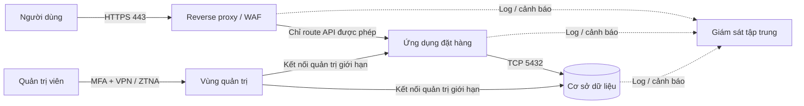

# Security control tại host, network và application

## Mục tiêu học tập

Sau bài này, người học có thể:

- Phân biệt **security control** ở ba lớp **host**, **network** và **application** theo tài sản cần bảo vệ, vị trí thực thi và loại rủi ro được giảm thiểu.
- Thiết kế các lớp phòng vệ bổ trợ nhau thay vì phụ thuộc vào một firewall, VPN hoặc WAF duy nhất.
- Chọn biện pháp **ngăn chặn (preventive)**, **phát hiện (detective)** và **ứng phó/khôi phục (responsive/recovery)** cho một luồng truy cập cụ thể.
- Hiểu cách kết hợp phân đoạn mạng, xác thực kết nối, kiểm soát quyền, ghi log và giám sát xâm nhập trong hệ thống on-premises, container hoặc cloud.
- Xây dựng phương án kiểm chứng để xác nhận chính sách bảo vệ thực sự có hiệu lực.

## 1. Security control là gì và vì sao cần nhiều lớp?

**Security control** là cơ chế kỹ thuật hoặc quy trình được áp dụng nhằm giảm xác suất, phạm vi ảnh hưởng hoặc thời gian tồn tại của một rủi ro bảo mật. Ví dụ: cập nhật bản vá hệ điều hành, chỉ cho phép kết nối đến cổng cần thiết, kiểm tra quyền xem đơn hàng và cảnh báo khi tài khoản đăng nhập bất thường đều là security control.

Ba mục tiêu thường được bảo vệ là **tính bí mật (confidentiality)**, **tính toàn vẹn (integrity)** và **tính sẵn sàng (availability)**. Một control có thể hỗ trợ nhiều mục tiêu nhưng hiếm khi giải quyết mọi vấn đề. Mã hóa TLS bảo vệ dữ liệu trên đường truyền nhưng không chứng minh người dùng được phép đọc tài nguyên. Firewall có thể chặn cổng cơ sở dữ liệu từ Internet nhưng không chặn được lỗi phân quyền trong API đã được cho phép truy cập.

**Defense in depth (phòng vệ nhiều lớp)** đặt các control ở nhiều điểm khác nhau trên đường đi của yêu cầu. Nếu một lớp bị vượt qua, lớp còn lại vẫn có khả năng hạn chế thiệt hại, phát hiện hành vi bất thường hoặc tạo thời gian cho đội vận hành ứng phó. Tư duy **zero trust** bổ sung nguyên tắc không mặc định tin cậy chỉ vì một thiết bị hay tài khoản nằm trong mạng nội bộ: mỗi truy cập cần được xác thực, cấp quyền phù hợp và có thể được đánh giá lại theo ngữ cảnh.

| Lớp | Đối tượng chủ yếu | Control điển hình | Giới hạn cần nhớ |
| --- | --- | --- | --- |
| **Host** | Máy chủ, VM, máy trạm, node container, hệ điều hành và tiến trình | Hardening, cập nhật bản vá, quyền tài khoản dịch vụ, EDR/HIDS, firewall host, kiểm soát file và log | Host an toàn vẫn có thể chạy ứng dụng mắc lỗi nghiệp vụ hoặc mở kết nối mạng không cần thiết. |
| **Network** | Luồng giao tiếp giữa máy, subnet, dịch vụ và vùng tin cậy | ACL/firewall, security group, phân đoạn, VPN/TLS, DNS filtering, IDS/IPS, bảo vệ DDoS | Thiết bị mạng thường không hiểu đầy đủ danh tính người dùng và quy tắc nghiệp vụ trong dữ liệu ứng dụng. |
| **Application** | API, web, dịch vụ nghiệp vụ, dữ liệu và phiên làm việc | Authentication, authorization, kiểm tra input, chống injection, bảo vệ session, rate limit, logging | Code an toàn không thay thế được việc vá OS, quản trị khóa bí mật hay hạn chế đường kết nối. |

Một control cũng có thể được phân theo chức năng: **ngăn chặn** (chặn truy cập trái phép), **phát hiện** (nhận biết hành vi đáng ngờ) và **ứng phó/khôi phục** (cách ly máy, thu hồi token, khôi phục dịch vụ). Một hệ thống khỏe mạnh cần đủ cả ba, cùng người hoặc hệ thống chịu trách nhiệm xử lý cảnh báo.

## 2. Mô hình ví dụ: hệ thống đặt hàng trực tuyến

Xét một hệ thống gồm reverse proxy công khai, API đặt hàng và cơ sở dữ liệu. Quản trị viên truy cập qua cổng quản trị riêng; người dùng cuối chỉ truy cập HTTPS. Đây là mô hình minh họa, không phải sơ đồ cấu hình sẵn cho mọi môi trường.



Để quản lý rủi ro, trước hết xác định **tài sản** (tài khoản, đơn hàng, dữ liệu khách hàng, khóa bí mật), **điểm vào** (HTTPS, API quản trị, kết nối nội bộ), **ranh giới tin cậy** (Internet → vùng public → vùng ứng dụng → vùng dữ liệu) và **luồng dữ liệu hợp lệ**. Chẳng hạn, chỉ API mới cần kết nối đến DB ở cổng 5432; trình duyệt và reverse proxy không cần truy cập trực tiếp cổng này.

Một yêu cầu `GET /api/orders/42` đi qua nhiều kiểm soát độc lập:

1. Tại **network**, reverse proxy nhận HTTPS qua cổng đã công bố; firewall và phân đoạn không cho máy trên Internet kết nối thẳng đến database.
2. Tại **host**, máy chạy reverse proxy/API giới hạn dịch vụ, quyền tiến trình, bản vá và kết nối không cần thiết; agent giám sát có thể phát hiện hành vi lạ.
3. Tại **application**, API xác minh người gọi, kiểm tra người đó có quyền xem đơn hàng `42` và chỉ trả về trường dữ liệu được phép.
4. Tại **giám sát**, sự kiện đăng nhập thất bại, truy cập bị từ chối và kết nối bất thường được đưa về nơi có thể đối chiếu và cảnh báo.

Ba lớp có mối liên hệ chặt chẽ nhưng không đồng nhất: một request có thể đến đúng cổng và có TLS hợp lệ, song vẫn phải bị từ chối khi người dùng không sở hữu đơn hàng.

## 3. Security control tại host

**Host security** bảo vệ nền tảng nơi ứng dụng chạy: máy vật lý, VM, máy trạm, máy chủ cơ sở dữ liệu và node vận hành container. Một máy bị chiếm quyền có thể trở thành bàn đạp di chuyển ngang ngay cả khi lưu lượng ban đầu vào hệ thống hoàn toàn hợp lệ.

### 3.1. Giảm bề mặt tấn công và vá lỗi

- Chỉ cài gói, service và cổng lắng nghe cần cho chức năng; loại bỏ tài khoản mặc định, dịch vụ thử nghiệm và giao diện quản trị không sử dụng.
- Dùng bản OS và runtime đang được hỗ trợ; theo dõi CVE, ưu tiên vá theo khả năng khai thác, mức độ lộ diện và tầm quan trọng tài sản. Có quy trình thử nghiệm, triển khai và khôi phục khi bản vá gây lỗi.
- Cấu hình baseline bảo mật cho SSH/RDP, chính sách tài khoản, đồng bộ thời gian và nhật ký. Với SSH, ưu tiên khóa mạnh và giới hạn điểm nguồn; tài khoản quản trị nên đi qua MFA hoặc giải pháp truy cập quản trị hỗ trợ MFA.
- Dùng **host firewall** để kiểm soát chiều vào và, khi cần, chiều ra ngay tại máy; chính sách của mạng không thay thế được firewall trên host, nhất là khi máy đổi môi trường mạng.

Ví dụ, server API chỉ cần nhận kết nối từ reverse proxy và gửi truy vấn đến DB. Việc API cũng mở một dịch vụ debug trên mọi địa chỉ (`0.0.0.0`) là bề mặt tấn công dư thừa; cần tắt dịch vụ hoặc giới hạn truy cập bằng cả cấu hình host và policy mạng.

### 3.2. Giới hạn đặc quyền và bảo vệ bí mật

- Chạy dịch vụ bằng **tài khoản không có quyền administrator/root**; cấp quyền đọc/ghi thư mục và tài nguyên đúng nhu cầu. Tách tài khoản ứng dụng, triển khai và quản trị.
- Lưu mật khẩu, khóa API và chứng thư trong cơ chế quản lý secret; tránh nhúng trong source code, image container hoặc log. Luân chuyển và thu hồi khi có sự cố.
- Giới hạn quyền container, capability, mount và quyền truy cập socket/container runtime; cô lập workload và bảo vệ host chạy các workload ấy.
- Mã hóa dữ liệu lưu trữ khi phù hợp với mô hình rủi ro, nhưng phải bảo vệ cả khóa và quyền truy cập vào dữ liệu sau khi giải mã.

**Nguyên tắc least privilege** giúp giới hạn phạm vi thiệt hại: nếu API bị thực thi mã trái phép, tiến trình ứng dụng không nên có quyền sửa cấu hình hệ thống hoặc đọc khóa của dịch vụ khác.

### 3.3. Phát hiện và ứng phó ở host

**HIDS** theo dõi dấu hiệu xâm nhập trên máy như log đăng nhập, thay đổi file hoặc tiến trình bất thường; **EDR** thường bổ sung thu thập hoạt động endpoint, điều tra và khả năng cô lập/quản lý phản ứng. Các thành phần này cần cấu hình, cập nhật và quy trình xử lý cảnh báo; cài agent đơn thuần chưa bảo đảm được phát hiện.

Tín hiệu hữu ích gồm: service mới không có trong baseline, lệnh đặc quyền ngoài lịch bảo trì, file nhị phân bị thay đổi, tiến trình web server tạo shell bất thường hoặc host bắt đầu kết nối đến địa chỉ chưa từng xuất hiện. Nên đẩy log về nơi lưu tập trung với phân quyền và thời gian lưu phù hợp để giảm nguy cơ bị xóa dấu vết khi máy bị xâm nhập.

## 4. Security control tại network

Lớp network quyết định **ai/thiết bị/dịch vụ nào có thể nói chuyện với ai, qua giao thức và cổng nào**. Đây là trọng tâm của kiến trúc mạng an toàn: phân vùng, kiểm soát luồng vào/ra, xác thực kết nối, giảm cơ hội di chuyển ngang và quan sát lưu lượng.

### 4.1. Phân đoạn mạng và firewall

Phân biệt hai chiều lưu lượng:

- **North–south:** giữa Internet/người dùng bên ngoài và các vùng mạng nội bộ, ví dụ người dùng → reverse proxy.
- **East–west:** giữa các dịch vụ/vùng bên trong, ví dụ reverse proxy → API hoặc API → DB. Di chuyển ngang của kẻ tấn công thường diễn ra ở chiều này.

**Segmentation** chia mạng thành vùng tin cậy hoặc vùng chức năng; **microsegmentation** thu hẹp thêm chính sách theo workload, nhãn hoặc danh tính dịch vụ. VLAN, subnet hay VPC là phương tiện phân chia nhưng **không tự động tạo được ranh giới bảo mật** nếu route và ACL vẫn cho phép giao tiếp tự do giữa các vùng.

Firewall/ACL ở L3–L4 thường quyết định theo nguồn, đích, giao thức, cổng và trạng thái kết nối. Firewall **stateful** ghi nhận phiên hợp lệ để xử lý lưu lượng phản hồi; ACL **stateless** cần quy tắc chiều về tương ứng. L7 proxy/WAF có thể đọc ngữ cảnh HTTP ở điểm kết thúc TLS, nhưng không biết toàn bộ quan hệ sở hữu tài nguyên và quy tắc phân quyền trong ứng dụng.

Ví dụ ma trận **allowlist** cho kiến trúc đặt hàng:

| Nguồn | Đích | Cho phép | Lý do |
| --- | --- | --- | --- |
| Internet | Reverse proxy | TCP 443 | Phục vụ HTTPS công khai. |
| Reverse proxy | API | Cổng API nội bộ đã khai báo | Chuyển yêu cầu hợp lệ qua vùng ứng dụng. |
| API | Database | TCP 5432 | Truy vấn PostgreSQL; chỉ từ đúng workload. |
| Quản trị đã xác thực | Cổng quản trị qua VPN/ZTNA | Cổng quản trị cần thiết | Truy cập vận hành có kiểm soát. |
| Internet | Database | **Deny** | Không công bố dịch vụ dữ liệu ra ngoài. |
| Workload khác | Database | **Deny** theo mặc định | Hạn chế truy cập trái phép và di chuyển ngang. |

Ở chiều **egress**, không nên mặc định cho mọi server kết nối mọi địa chỉ Internet. Hạn chế destination và giao thức cho những nhu cầu có thật như cập nhật phần mềm, API đối tác hoặc DNS resolver được quản lý; kế hoạch egress cũng phải tính tới thay đổi địa chỉ của dịch vụ cloud và nhu cầu vận hành.

### 4.2. Ví dụ microsegmentation bằng Kubernetes NetworkPolicy

Trong namespace `shop-prod`, giả sử API có label `app: order-api` và PostgreSQL có label `app: postgres`. Policy sau chỉ cho các Pod API cùng namespace **khởi tạo kết nối ingress** tới Pod database trên TCP 5432:

```yaml
apiVersion: networking.k8s.io/v1
kind: NetworkPolicy
metadata:
  name: db-from-order-api
  namespace: shop-prod
spec:
  podSelector:
    matchLabels:
      app: postgres
  policyTypes:
    - Ingress
  ingress:
    - from:
        - podSelector:
            matchLabels:
              app: order-api
      ports:
        - protocol: TCP
          port: 5432
```

Các điểm cần kiểm tra khi áp dụng:

1. Policy chỉ áp dụng cho Pod mang label `app: postgres` trong namespace được chỉ định. Khi một Pod đã được chọn bởi NetworkPolicy ingress, các kết nối ingress chỉ được phép nếu được ít nhất một policy phù hợp cho phép.
2. Cơ chế mạng/CNI của cluster **phải hỗ trợ thực thi NetworkPolicy**; việc Kubernetes nhận manifest không tự chứng minh luồng đã bị chặn.
3. Policy này không đặt quy tắc **egress** cho Pod API; nếu hệ thống có chính sách egress mặc định deny, cần thêm quy tắc phù hợp ở phía API, kể cả luồng DNS nếu ứng dụng cần phân giải tên.
4. NetworkPolicy kiểm soát kết nối mạng, không xác thực tài khoản PostgreSQL. DB vẫn cần cấp quyền cho user ứng dụng, kết nối mã hóa khi phù hợp và log truy cập.

Ví dụ cũng áp dụng về mặt tư duy cho cloud security group và firewall giữa subnet: cho phép theo **nguồn cần thiết và đúng cổng**, kiểm tra ở cả hai đầu, rồi thử kết nối từ nguồn hợp lệ lẫn nguồn bị cấm.

### 4.3. Xác thực kết nối và bảo vệ lưu lượng

- **TLS/HTTPS** bảo vệ tính bí mật và toàn vẹn của dữ liệu trong quá trình truyền, đồng thời cho client xác minh danh tính server thông qua chứng thư được tin cậy và tên miền phù hợp. TLS không tự quyết định user được thao tác nghiệp vụ nào.
- **Mutual TLS (mTLS)** cho cả hai phía xuất trình chứng thư, hữu ích cho service-to-service; cần chính sách cấp phát, luân chuyển, thu hồi chứng thư và ánh xạ danh tính dịch vụ sang quyền truy cập.
- **VPN** tạo đường hầm được bảo vệ cho truy cập từ xa hoặc site-to-site. Người đã vào VPN vẫn cần được giới hạn tài nguyên và xác thực/ủy quyền tại ứng dụng; VPN không biến mọi endpoint thành an toàn.
- **ZTNA** có thể cấp truy cập theo danh tính, thiết bị và ứng dụng cụ thể thay vì mở rộng toàn bộ mạng cho client. Thiết kế cụ thể tùy nhà cung cấp và mô hình tin cậy.
- Trong Wi-Fi, dùng cơ chế xác thực và mã hóa phù hợp như WPA3-Enterprise/802.1X khi được hỗ trợ, cách ly guest khỏi mạng nội bộ và kiểm soát rogue access point.

**DNS** là một điểm bảo vệ riêng: quản lý resolver, log truy vấn cần thiết, xác minh cấu hình domain và lọc các miền độc hại bằng chính sách có kiểm soát. DNS filtering có thể giảm truy cập tới đích nguy hiểm nhưng không thay thế việc kiểm tra IP, HTTPS hoặc danh tính dịch vụ. **DNSSEC** giúp xác thực dữ liệu DNS khi chuỗi kiểm chứng được triển khai đúng; nó không mã hóa truy vấn DNS và không bảo đảm website được truy cập là an toàn.

### 4.4. IDS, IPS và DDoS

**NIDS** quan sát gói tin/luồng mạng để cảnh báo dấu hiệu tấn công; **NIPS** nằm trên đường xử lý phù hợp để có thể chặn lưu lượng theo luật. Phát hiện có thể dựa vào chữ ký, hành vi hoặc tương quan sự kiện. Lưu lượng TLS không được giải mã hạn chế mức quan sát nội dung; sử dụng metadata, log từ điểm kết thúc TLS và telemetry ứng dụng sẽ giúp bổ sung bức tranh.

Khi triển khai IPS inline, cần cân bằng khả năng chặn với nguy cơ false positive và ảnh hưởng hiệu năng. Với tấn công DDoS, rate limiting ở edge, CDN/scrubbing, kiểm soát tài nguyên và kế hoạch ứng phó của nhà cung cấp có thể kết hợp; không thể kỳ vọng một host firewall đơn lẻ hấp thụ mọi mức lưu lượng.

## 5. Security control tại application

Application xử lý danh tính người dùng, ý nghĩa dữ liệu và quy tắc nghiệp vụ. Đây là nơi quyết định yêu cầu **có hợp lệ trong bối cảnh nghiệp vụ hay không**, ngay cả khi packet đã vượt qua network firewall.

### 5.1. Authentication, authorization và session

- **Authentication (xác thực)** trả lời *người gọi là ai?* Ví dụ phiên đăng nhập, OAuth 2.0/OIDC hoặc danh tính máy trong giao tiếp nội bộ. Cần kiểm tra chữ ký, thời hạn, issuer/audience của token theo giao thức sử dụng; không tin cậy thông tin do client tự khai báo.
- **Authorization (phân quyền)** trả lời *người gọi được làm gì với tài nguyên cụ thể?* Phải kiểm tra ở server cho từng thao tác và đối tượng. RBAC, ABAC hoặc kiểm tra quan hệ sở hữu đều có chỗ dùng tùy bài toán.
- **Session/token security** bao gồm thời hạn phù hợp, thu hồi khi cần, cookie `Secure`/`HttpOnly`/`SameSite` theo mô hình xác thực, bảo vệ CSRF cho luồng dựa trên cookie và bảo vệ chống đánh cắp token.

Với endpoint `GET /api/orders/{id}`, chỉ xác minh token đã đăng nhập là **chưa đủ**. Sau khi tra cứu đơn hàng, server cần xác minh nó thuộc người gọi hoặc người gọi có vai trò được phép truy cập. Nếu bỏ qua bước này, người dùng có thể thay ID để đọc đơn của người khác (**Broken Object Level Authorization / IDOR**); firewall và TLS vẫn có thể xem lưu lượng là hợp lệ.

Mã giả nhấn mạnh vị trí kiểm tra quyền:

```text
GET /api/orders/42
  identity = verifySessionOrToken(request)
  if identity is invalid: return 401

  order = loadOrder(42)
  if order does not exist: return 404
  if not canRead(identity, order): return 403

  audit("order.read", identity.id, order.id, "allowed")
  return onlyPermittedFields(order)
```

Quy tắc trả về `403` hay che giấu tài nguyên bằng `404` tùy chính sách chống lộ thông tin của ứng dụng. Dù lựa chọn nào, việc kiểm tra quyền vẫn phải diễn ra **tại backend**, không phụ thuộc vào nút bị ẩn trên giao diện.

### 5.2. Bảo vệ đầu vào, phụ thuộc và API

Ứng dụng nên kiểm tra kiểu/độ dài/ràng buộc dữ liệu, sử dụng truy vấn có tham số để giảm SQL injection, encode output theo ngữ cảnh để hạn chế XSS, và kiểm soát truy cập file/URL để hạn chế SSRF hoặc path traversal. Không dùng regex hay escaping đơn giản làm cơ chế bảo vệ duy nhất cho mọi kiểu injection.

Áp dụng thêm các control theo nguy cơ thực tế: giới hạn tần suất theo người dùng/IP/client, hạn chế kích thước request, chống brute force, cấu hình CORS theo nguồn được phép, security headers phù hợp, cập nhật thư viện, quản lý SBOM và quét lỗ hổng trong quá trình build/deploy. **WAF** có thể chặn một số mẫu tấn công web phổ biến, nhưng luật WAF không hiểu toàn bộ nghiệp vụ và không thay thế sửa lỗi tại code.

Các sự kiện cần ghi log gồm login thất bại, từ chối phân quyền, thay đổi quyền, truy cập dữ liệu nhạy cảm và lỗi bất thường. Log cần có thời gian, request ID/correlation ID, kết quả và danh tính đã chuẩn hóa; tránh ghi mật khẩu, token đầy đủ, thông tin thanh toán hoặc dữ liệu nhạy cảm không cần thiết.

## 6. Ghép các control vào tình huống tấn công

Giả sử kẻ tấn công chiếm được tài khoản người dùng thông thường và thử lấy đơn hàng của người khác, sau đó tìm cách mở kết nối đến DB. Mô hình ba lớp giúp đặt câu hỏi **mỗi chặng có control gì và nếu control đó thất bại thì điều gì xảy ra tiếp theo?**

| Tình huống / nguy cơ | Host | Network | Application | Tín hiệu cần theo dõi |
| --- | --- | --- | --- | --- |
| Truy cập trái phép đơn hàng qua ID | Giới hạn quyền tiến trình API, bảo vệ log | Chỉ mở route HTTPS đến API | Kiểm tra quyền ở cấp đối tượng; trả dữ liệu tối thiểu | Nhiều lỗi 403/404, truy cập ID tuần tự, spike theo tài khoản |
| Từ một workload bị chiếm quyền, thử truy cập DB | Tài khoản service không có đặc quyền hệ thống, EDR | Chỉ workload API hợp lệ được đến DB:5432; giới hạn east–west | DB user chỉ có quyền cần thiết; xác thực kết nối | Kết nối bị deny, truy vấn và login DB bất thường |
| Tài khoản quản trị bị dò mật khẩu | Hardening SSH/RDP, theo dõi đăng nhập | Chỉ đường quản trị có xác thực mạnh, chặn nguồn không hợp lệ | MFA, rate limit và phân quyền quản trị | Login thất bại liên tiếp, thiết bị/vị trí lạ |
| Ứng dụng có lỗ hổng thực thi lệnh | Giới hạn quyền runtime, patch/EDR, bảo vệ secret | Egress allowlist và phân đoạn giảm khả năng lan truyền | Vá lỗi đầu vào/thư viện; kiểm thử và WAF bổ trợ | Tiến trình con lạ, kết nối ra ngoài bất thường |
| Dịch vụ public bị quá tải | Giới hạn tài nguyên và khả năng phục hồi host | CDN/DDoS protection, rate limit ở edge | Giới hạn request theo định danh, hàng đợi/backpressure | Request/giây, error rate, độ trễ, saturation |

Ví dụ cho thấy kiểm soát một tầng có thể làm **giảm xác suất** xâm nhập, còn các tầng khác giúp **giới hạn phạm vi** khi một control bị vượt qua. Cần phân biệt **control dự kiến** với **control đã được xác minh hoạt động**.

## 7. Từ threat modeling đến thiết kế control

Một quy trình khả thi cho nhóm vận hành và phát triển:

1. **Lập bản đồ tài sản và luồng dữ liệu:** xác định dữ liệu quan trọng, điểm vào, hệ thống nhận/gửi, tài khoản dịch vụ, đường quản trị và các bên thứ ba.
2. **Xác định ranh giới tin cậy:** nơi request chuyển từ Internet vào vùng ứng dụng, từ API sang DB, từ tài khoản bình thường sang tác vụ đặc quyền, hoặc từ mạng on-premises sang cloud.
3. **Mô hình hóa mối đe dọa:** có thể dùng STRIDE làm gợi ý — giả mạo danh tính, sửa đổi, chối bỏ, lộ dữ liệu, từ chối dịch vụ, leo thang đặc quyền. Gắn mỗi mối đe dọa với tài sản và điều kiện khai thác cụ thể.
4. **Chọn control và người chịu trách nhiệm:** tại mỗi ranh giới, xác định lớp host/network/application ngăn chặn gì, lớp nào phát hiện và ai nhận cảnh báo. Ưu tiên theo rủi ro thực tế, không theo số lượng sản phẩm bảo mật.
5. **Viết điều kiện kiểm chứng:** nguồn hợp lệ phải kết nối được, nguồn không hợp lệ phải bị chặn, người dùng không có quyền phải nhận phản hồi từ chối và sự kiện cần thiết phải xuất hiện trong hệ thống log.
6. **Đánh giá định kỳ:** khi thêm API, subnet, tài khoản service hay nhà cung cấp cloud, cập nhật sơ đồ luồng và kiểm tra rule cũ còn cần thiết hay không.

Trong cloud, đặc biệt chú ý **mô hình chia sẻ trách nhiệm**: nhà cung cấp bảo vệ một phần hạ tầng, nhưng cấu hình IAM, security group, secret, workload và dữ liệu của khách hàng thường vẫn cần đội sử dụng quản lý. Các lớp này có thể hiện diện ở cloud firewall, host VM, Kubernetes NetworkPolicy, service mesh, API gateway và code ứng dụng.

## 8. Kiểm chứng và giám sát hiệu lực

Một chính sách viết đúng cú pháp chưa chắc đã có tác dụng. Ví dụ: rule được tạo ở nhầm security group, Pod có label khác dự kiến, agent log không gửi về hệ thống tập trung hoặc ingress đi vòng qua reverse proxy. Vì vậy cần kiểm tra cả **cấu hình**, **đường đi thực tế** và **kết quả truy cập**.

| Bài kiểm tra | Kỳ vọng | Lớp kiểm tra |
| --- | --- | --- |
| Từ máy ngoài Internet truy cập cổng DB | Không thiết lập được kết nối | Network |
| Từ API hợp lệ truy vấn DB bằng tài khoản ứng dụng | Thành công, với quyền dữ liệu tối thiểu | Network + Application |
| Từ workload khác cố kết nối DB | Bị từ chối kết nối; có telemetry phù hợp | Network + Detective control |
| Người dùng A gọi API lấy đơn hàng của B | Bị từ chối ở backend, không lộ dữ liệu | Application |
| Tiến trình API cố đọc secret quản trị host | Bị hệ điều hành từ chối | Host |
| Đăng nhập thất bại nhiều lần trong môi trường thử nghiệm | Có log/cảnh báo đúng ngưỡng | Application + Monitoring |
| Giả lập sự cố bằng bài diễn tập được phê duyệt | Đội vận hành nhận biết, cách ly và khôi phục theo playbook | Response + Recovery |

Quan sát vận hành nên theo dõi **số lần policy deny**, tỉ lệ lỗi 401/403, sự kiện EDR/IDS theo mức độ ưu tiên, số rule dư thừa, tuổi bản vá, độ trễ xử lý cảnh báo và khả năng nối các sự kiện qua request ID. Thống kê phải có baseline và ngữ cảnh để tránh nhầm một đợt deploy hợp lệ với xâm nhập. Việc thu thập và lưu log phải tuân thủ chính sách bảo mật, giới hạn truy cập và thời hạn lưu dữ liệu.

Khi phát hiện xâm nhập, quy trình điển hình là: **xác minh cảnh báo → đánh giá phạm vi → cô lập endpoint hoặc workload/thu hồi thông tin xác thực → bảo toàn chứng cứ → khắc phục lỗ hổng → phục hồi và theo dõi tái diễn**. Cần kiểm tra tác động của hành động cô lập đối với dịch vụ quan trọng và có phương án rollback phù hợp.

## 9. Những nhầm lẫn thường gặp

- **“Đã có firewall thì ứng dụng an toàn.”** Firewall mạng có thể cho phép đúng port HTTPS trong khi API vẫn có SQL injection, XSS hoặc lỗi phân quyền.
- **“Dùng VPN là đã xác thực đủ.”** VPN có thể xác thực đường vào, song vẫn phải cấp quyền cho từng tài nguyên và kiểm soát máy/phiên đã kết nối.
- **“Dùng TLS nghĩa là nội dung request đáng tin.”** TLS bảo vệ kênh truyền và xác thực endpoint theo cấu hình; nó không đảm bảo giá trị input hợp lệ hoặc người dùng có quyền truy cập dữ liệu.
- **“Tách VLAN là đã chặn di chuyển ngang.”** Phải kiểm tra route, ACL/firewall và các kênh quản trị nối các vùng.
- **“Có IDS/EDR là không cần hardening và patch.”** Agent chỉ có thể giảm thời gian phát hiện/ứng phó khi được vận hành tốt; nhiều lỗ hổng có thể bị khai thác trước khi sinh cảnh báo.
- **“Default deny càng nhiều càng tốt mà không cần thử.”** Chính sách chặn cần đi kèm inventory luồng hợp lệ và kiểm thử; nếu bỏ sót DNS, health check hoặc dịch vụ phụ trợ, hệ thống có thể mất khả dụng.

## 10. Bài tập áp dụng

Một dịch vụ báo cáo nội bộ sử dụng kiến trúc `Employee browser → API gateway → Report service → Database`. Nhân viên cần xem báo cáo của phòng mình; quản trị viên có quyền xuất báo cáo tổng hợp. Đội vận hành phát hiện Report service có thể kết nối tới mọi subnet và đang chạy bằng tài khoản hệ điều hành đặc quyền.

Hãy thực hiện ba yêu cầu:

1. **Host:** đề xuất tối thiểu ba thay đổi để giảm khả năng chiếm quyền hoặc giảm thiệt hại nếu Report service bị khai thác.
2. **Network:** vẽ các luồng được phép, chọn hai luồng cần chặn và giải thích vì sao phải kiểm tra cả inbound lẫn egress.
3. **Application + monitoring:** mô tả cách kiểm tra nhân viên chỉ xem báo cáo thuộc phòng của mình và ba sự kiện nên ghi log/cảnh báo.

**Gợi ý đánh giá:** thiết kế hợp lý thường có tài khoản service ít quyền, patch/host firewall và theo dõi tiến trình; gateway chỉ nói chuyện với Report service, service chỉ nói chuyện với DB/đích thực sự cần; API kiểm tra người dùng, vai trò và phạm vi phòng ban trên từng yêu cầu; cảnh báo về truy cập bị từ chối, truy vấn bất thường và kết nối mạng sai baseline. Luôn nêu cách kiểm chứng cả trường hợp **được phép** và **bị cấm**.

## Tổng kết kiến thức

**Host** bảo vệ môi trường thực thi và giới hạn đặc quyền của tiến trình. **Network** bảo vệ đường kết nối, ranh giới tin cậy và khả năng di chuyển giữa các vùng. **Application** quyết định người dùng hoặc dịch vụ được làm gì với từng dữ liệu và chức năng. Kết hợp ba lớp với phân đoạn, firewall, VPN/mTLS, IDS/IPS, giám sát và diễn tập ứng phó tạo nên kiến trúc phòng vệ có thể kiểm chứng và cải tiến liên tục.
