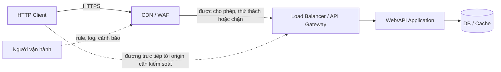
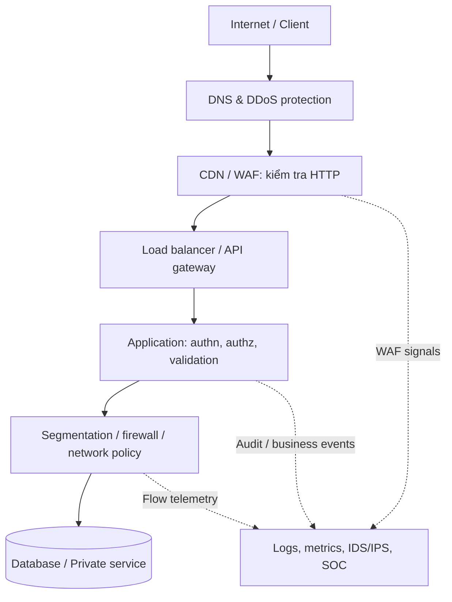
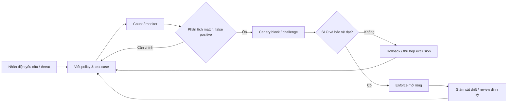

# WAF bảo vệ HTTP application như thế nào?

## 1. Web Application Firewall là gì?

**Web Application Firewall (WAF)** là lớp kiểm soát lưu lượng hướng vào ứng dụng web, có khả năng phân tích những đặc điểm của giao thức **HTTP/HTTPS** để nhận diện và xử lý các yêu cầu có dấu hiệu trái chính sách hoặc gây hại. Khác với firewall mạng chủ yếu quyết định theo địa chỉ IP, cổng, giao thức và trạng thái kết nối, WAF có thể áp dụng chính sách lên **phương thức HTTP, hostname, đường dẫn URL, query parameter, header, cookie, request body và ngữ cảnh phiên** trong phạm vi sản phẩm hỗ trợ.

Ví dụ: một cửa hàng trực tuyến mở HTTPS qua TCP/443 cho khách hàng. Firewall mạng phải cho phép cổng 443 để website hoạt động; nó không thể chỉ nhờ thông tin IP/cổng mà biết request `POST /login` có mẫu dữ liệu bất thường hay một client đang thử gọi API trái với hành vi bình thường. WAF được đặt tại một điểm có thể **hiểu HTTP** để quan sát request, áp dụng rule và đưa ra hành động trước khi ứng dụng xử lý.

WAF đặc biệt hữu ích cho mục tiêu:

- Giảm bề mặt tấn công từ những input HTTP có mẫu nguy hiểm đã biết.
- Áp dụng kiểm soát chung ở edge đối với nhiều website/API.
- Giới hạn tốc độ, phân biệt bot và ngăn lạm dụng ở mức HTTP khi sản phẩm có khả năng phù hợp.
- Thu thập tín hiệu an ninh để phát hiện, điều tra và tinh chỉnh các chính sách.
- Bảo vệ tạm thời một số điểm yếu trong giai đoạn chờ vá ứng dụng (**virtual patching**), sau khi đã đánh giá phạm vi và hiệu lực rule.

**WAF không thay thế phát triển ứng dụng an toàn.** Những vấn đề như kiểm tra quyền truy cập từng đối tượng (BOLA/IDOR), thiết kế quy trình thanh toán, bảo vệ secret, truy vấn tham số hóa hay quản trị phiên vẫn phải được xử lý ở ứng dụng và hệ thống danh tính.

## 2. WAF nằm ở đâu trong ngăn xếp mạng và đường đi của HTTP?

Một hệ thống điển hình có thể triển khai:

```text
Client / Browser / Mobile app
        │ HTTPS
        ▼
DNS ──> CDN / Edge WAF (TLS termination tại edge nếu cấu hình như vậy)
        │ HTTPS hoặc HTTP nội bộ tùy kiến trúc
        ▼
Load balancer / API gateway
        │
        ▼
Application service
        │
        ▼
Database / Cache / Queue
```

DNS giúp client tìm địa chỉ hoặc endpoint của dịch vụ; DNS không chuyển HTTP request đến WAF theo nghĩa xử lý nội dung. Trong một số kiến trúc, DNS trỏ tới **edge CDN/WAF**, nơi proxy nhận request rồi kết nối tới **origin**. Ở kiến trúc khác, WAF chạy tại reverse proxy, load balancer, ingress controller hoặc thành phần tích hợp trong ứng dụng. **Điểm kiểm soát hiệu lực** phải nằm trên đường đi mà request thực sự đi qua.



WAF có thể phân tích HTTP khi thành phần đó **nhìn thấy nội dung HTTP đã giải mã**. Nếu HTTPS kết thúc tại CDN/WAF, lớp này có thể đọc request và áp dụng chính sách; sau đó có thể thiết lập một phiên TLS khác tới origin. Nếu lưu lượng vẫn được chuyển qua theo kiểu TLS pass-through hoàn toàn và không được giải mã ở WAF, các chức năng kiểm tra nội dung HTTP sẽ không khả dụng tại điểm đó.

**Một kết nối TLS từ client đến WAF không tự đảm bảo chặng WAF → origin cũng được mã hóa**. Khi xây dựng kiến trúc an toàn, cần xác định rõ TLS termination, chứng chỉ/tên host, xác thực upstream, chính sách kết nối nội bộ và nơi dữ liệu rõ có thể tồn tại.

### 2.1. Liên hệ với mô hình OSI

| Thành phần | Góc nhìn chức năng | Đặc điểm |
|---|---|---|
| Router / network ACL | L3/L4 | chủ yếu xử lý địa chỉ, tuyến, giao thức và port |
| Stateful firewall | L3/L4, đôi khi có kiểm tra ứng dụng | kiểm soát kết nối và trạng thái, tùy tính năng |
| **WAF** | **Layer 7: HTTP application** | phân tích cấu trúc HTTP và đặc điểm request/response |
| IDS/IPS mạng | phát hiện/ngăn lưu lượng bất thường theo phạm vi giải mã và signature | có thể quan sát nhiều giao thức, không mặc nhiên đọc nội dung TLS |
| API gateway | điều phối API, xác thực/ủy quyền, quota, routing tùy sản phẩm | có thể tích hợp WAF nhưng vai trò không giống nhau |
| Reverse proxy / CDN | kết thúc kết nối, phân phối/cache và routing | có thể là điểm **triển khai WAF**, không mặc nhiên có đầy đủ chính sách WAF |

Tên “firewall” không có nghĩa WAF thay thế firewall của VPC, phân đoạn mạng, VPN hay hệ thống 802.1X/NAC. WAF bảo vệ chủ yếu **đường ứng dụng HTTP**; các giao thức như SSH, cơ sở dữ liệu và nhiều luồng TCP/UDP khác cần lớp kiểm soát tương ứng.

## 3. WAF có thể quan sát những gì trong một HTTP request?

Một request đơn giản có cấu trúc:

```http
POST /api/orders HTTP/1.1
Host: shop.example.com
Content-Type: application/json
Authorization: Bearer <redacted>
Cookie: session=<redacted>

{"items":[{"sku":"SKU-001","quantity":2}]}
```

Đây là **dữ liệu ví dụ**, không phải thông tin xác thực thật. Tùy sản phẩm, giao thức, cấu hình và giới hạn kích thước, WAF có thể đánh giá:

| Vùng HTTP | Ví dụ chính sách | Chú ý |
|---|---|---|
| Host / hostname | chỉ nhận hostname đã được phê duyệt | cần xử lý Host và tên máy trong TLS phù hợp |
| Method | `GET`/`POST`/`PUT`... theo từng đường dẫn | chặn sai có thể phá API hợp lệ |
| URL path | giới hạn endpoint quản trị hoặc route đặc biệt | cần thống nhất cách chuẩn hóa đường dẫn với backend |
| Query string | độ dài, định dạng, mẫu input đáng ngờ | encoding và tham số trùng lặp gây khác biệt parser |
| Header | Content-Type, Origin, User-Agent, header an ninh hoặc bất thường | một số header do client tự khai báo, không đáng tin tuyệt đối |
| Cookie / token metadata | sự hiện diện, định dạng hoặc đặc tính phù hợp của phiên | WAF không tự xác thực mọi token nếu thiếu tích hợp cần thiết |
| Request body | JSON/form/XML, giới hạn kích thước hoặc mẫu giá trị | phụ thuộc parser, giới hạn body và xử lý multipart/streaming |
| Response | mã trạng thái, header, một phần nội dung nếu bật kiểm tra | inspection response không phải khả năng phổ quát; có chi phí và rủi ro riêng |
| Hành vi phiên / nguồn | request rate, endpoint sequence, tín hiệu bot | dễ có false positive khi NAT/proxy dùng chung |

Trong HTTP/2 và HTTP/3, biểu diễn trên dây **khác HTTP/1.1** nhưng WAF có thể áp dụng chính sách trên dạng HTTP đã được điểm kết thúc giao thức giải mã và chuẩn hóa, nếu sản phẩm hỗ trợ. Không nên mặc định chỉ vì hệ thống có WAF cho HTTPS/TCP thì cùng cấu hình đó áp dụng đầy đủ cho **HTTP/3 trên QUIC/UDP**. Cần xác minh chính sách và telemetry theo từng giao thức thực dùng.

### 3.1. Request đi qua WAF như thế nào?

Quy trình điển hình:

1. Nhận kết nối và xử lý TLS/HTTP theo năng lực của điểm triển khai.
2. Chuẩn hóa metadata và parse các thành phần request có thể kiểm tra.
3. Áp dụng chính sách: hostname, địa chỉ nguồn đáng tin cậy, rate limit, bot signals, rule HTTP, virtual patch.
4. Kết luận: **allow**, **log/count**, **block**, **challenge** hoặc một hành động khác mà sản phẩm hỗ trợ.
5. Nếu cho qua, chuyển request đến origin; đồng thời ghi log/metric theo chính sách.
6. Nếu bật response inspection, có thể phân tích thêm response trước khi trả client.

Chính sách cần có **thứ tự ưu tiên, điều kiện ngoại lệ và hành vi mặc định** rõ ràng. Không thể suy ra cơ chế “first match”, “anomaly scoring” hay “block ngay” chỉ từ tên WAF: mỗi sản phẩm, phiên bản và loại rule set có thể khác nhau.

## 4. Những loại rủi ro HTTP mà WAF hỗ trợ giảm thiểu

WAF thường phát huy tốt nhất khi hành vi nguy hiểm có **dấu hiệu ở request** và chính sách có thể phân biệt lưu lượng đáng ngờ với nhu cầu hợp lệ.

| Nhóm rủi ro | WAF có thể làm gì? | Giới hạn cần hiểu |
|---|---|---|
| **SQL injection** | nhận diện mẫu input có dấu hiệu chèn cú pháp truy vấn | không thay thế prepared statements, quyền DB tối thiểu và validation |
| **Cross-site scripting (XSS)** | phát hiện một số mẫu input chứa mã/HTML đáng ngờ | không thay thế output encoding, CSP và xử lý dữ liệu đúng ngữ cảnh |
| **Path traversal / file inclusion** | kiểm tra đường dẫn và biểu diễn bất thường | phụ thuộc cách ứng dụng chuẩn hóa path và quyền filesystem |
| **Command injection** | đánh dấu một số chuỗi/lệnh đáng ngờ ở input | không thay thế loại bỏ thực thi shell nguy hiểm ở backend |
| **Lạm dụng login / credential stuffing** | dùng rate limit, bot/challenge, tín hiệu rủi ro | cần MFA, chống dò mật khẩu và monitoring ở hệ thống xác thực |
| **HTTP request flood ở L7** | giới hạn/challenge/chặn yêu cầu theo endpoint và hành vi | bão hòa uplink trước WAF cần chống DDoS tại upstream |
| **API input sai schema/khối lượng lớn** | kiểm tra method, content type, kích thước và một số schema | lỗi logic và quyền theo đối tượng phải xử lý ở ứng dụng |
| **Một số bất thường giao thức HTTP** | kiểm tra header/request có cấu trúc khác thường | parser của proxy và backend có thể hiểu khác nhau; cần đồng bộ và cấu hình chặt |
| **Endpoint không được phép công khai** | chặn request vào một số đường dẫn/host | không thay thế kiểm soát truy cập origin và phân đoạn mạng |

WAF có thể **giảm rủi ro** nhưng không thể bảo đảm loại bỏ toàn bộ nhóm lỗ hổng nêu trên. Kẻ tấn công có thể tạo request khác với mẫu được rule nhận diện, còn người dùng hợp lệ đôi khi gửi chuỗi giống input đáng ngờ. Đó là nguyên nhân phải quản lý cả **false negative** và **false positive**.

### 4.1. Các vấn đề WAF không thể tự giải quyết

Một số tình huống ứng dụng có thể trả HTTP 200 cho request đúng cú pháp nhưng **vi phạm quyền hoặc quy trình nghiệp vụ**:

- Người dùng A gọi `GET /api/invoices/123` và nhận hóa đơn của B vì backend không kiểm tra quyền theo object (**BOLA/IDOR**).
- Người dùng được đăng nhập sửa giá sản phẩm, hạn mức hoặc thông tin giao hàng vì backend tin tham số từ client.
- Quy trình chuyển tiền chấp nhận lặp lại một yêu cầu hợp lệ mà không có idempotency và kiểm soát giao dịch.
- API chỉ xác thực danh tính mà không kiểm tra quyền thực hiện thao tác quản trị.
- Backend lộ secret do cấu hình, log, storage policy hoặc pipeline bị sai.
- Ứng dụng bị khai thác qua kết nối không đi qua WAF, ví dụ kênh quản trị riêng hoặc dịch vụ non-HTTP.

Ở những trường hợp này, WAF chỉ có thể đưa ra lớp kiểm soát hỗ trợ nếu có rule/ngữ cảnh phù hợp; **authorization ở điểm đích, validation ở backend, IAM, quản trị secret và threat modeling** vẫn là yêu cầu chính.

## 5. Rule của WAF hoạt động ra sao?

Một rule có thể gồm:

```text
IF    <điều kiện trên HTTP request hoặc hành vi>
THEN  <allow | log/count | block | challenge | rate-limit>
SCOPE <hostname, path, method, tenant, môi trường...>
OWNER <nhóm chịu trách nhiệm>
```

Ví dụ **mô hình chính sách**, không phải file cấu hình của nhà cung cấp:

```yaml
rule_id: WAF-API-001
host: api.example.com
path: /api/orders
methods: [POST]
conditions:
  content_type: application/json
  request_body_max_bytes: 65536
action_when_invalid: block
deployment_mode: monitor_then_enforce
owner: api-security
review_at: "2026-12-15T00:00:00Z"
```

Ở chính sách ví dụ, `65536` byte chỉ là **mốc giả định**. Hạn mức thực phải dựa vào kích thước yêu cầu hợp lệ, yêu cầu business và giới hạn body inspection của WAF. Một số WAF có giới hạn số byte được **kiểm tra**, khác hoàn toàn với giới hạn kích thước request mà hệ thống **chấp nhận**. Khi vượt giới hạn, hành vi có thể là kiểm tra một phần, bỏ qua, chặn hoặc xử lý theo cấu hình; phải kiểm tra tài liệu sản phẩm và policy thực tế.

### 5.1. Negative security và positive security model

Hai mô hình phổ biến:

- **Negative security model / blocklist:** nhận diện request có dấu hiệu bị cấm; ví dụ phát hiện mẫu input thuộc những nhóm tấn công đã biết.
- **Positive security model / allowlist:** xác định tập hành vi hợp lệ; ví dụ chỉ cho `POST /api/orders` với JSON đúng schema, body ở mức cho phép và danh tính đáp ứng yêu cầu.

Negative model thường dễ bổ sung vào ứng dụng cũ nhưng có thể bỏ sót cách biểu diễn mới. Positive model phù hợp với API có hợp đồng rõ ràng, nhưng cần cập nhật khi API thay đổi và có thể chặn ứng dụng hợp lệ nếu schema không phản ánh hành vi thật. Nhiều tổ chức dùng **kết hợp**: managed signatures cho rủi ro phổ biến và allowlist/schema/rate limit cho endpoint quan trọng.

### 5.2. Signature, heuristic, anomaly scoring

**Signature rule** phát hiện mẫu cụ thể của dấu hiệu nguy hiểm. **Heuristic** đánh giá tính bất thường theo những dấu hiệu kết hợp; một số giải pháp còn dùng tín hiệu phân loại bot hoặc mô hình thống kê. **Anomaly scoring** cho điểm nhiều sự kiện rồi so với ngưỡng ra quyết định, thay vì mọi dấu hiệu đều dẫn tới block tức thì.

Ví dụ cơ chế chấm điểm giả định:

```text
Request A:
  Dấu hiệu 1: +3 điểm
  Dấu hiệu 2: +2 điểm
  Tổng = 5

Ngưỡng từ chối = 5 → đánh dấu/chặn theo chính sách đang áp dụng
```

Điểm số trên chỉ là minh họa, **không phải điểm số mặc định của mọi WAF**. Cần nắm rõ quy tắc cộng điểm, mức độ nghiêm trọng, giai đoạn xử lý, rule exclusion và ngưỡng thực tế của bộ rule đang sử dụng.

## 6. OWASP Core Rule Set (CRS) và managed rule sets

**OWASP Core Rule Set (CRS)** là bộ quy tắc phát hiện tấn công HTTP mã nguồn mở, được sử dụng với các WAF engine tương thích, thường được nhắc tới trong hệ sinh thái ModSecurity/Coraza và các giải pháp tích hợp phù hợp. CRS cung cấp những rule tổng quát cho nhiều nhóm hành vi đáng ngờ, để tổ chức không phải tự viết mọi signature từ đầu.

Một số WAF thương mại/cloud có **managed rule groups** hoặc bộ quy tắc riêng, với cơ chế cập nhật và hành động khác nhau. **Không được coi mọi managed WAF đều chạy CRS** hoặc mọi rule có tên giống OWASP đều là cùng phiên bản CRS.

### 6.1. CRS không phải “bật một lần là xong”

Triển khai CRS cần quan tâm:

1. **Phiên bản bộ rule và engine:** tương thích cú pháp và cơ chế parse request.
2. **Paranoia Level (PL):** độ nghiêm ngặt của rule set theo cấu hình CRS; PL cao thường tăng phạm vi phát hiện và cả nguy cơ false positive.
3. **Anomaly threshold:** điểm từ chối cần được cân nhắc cùng mục tiêu bảo vệ và dữ liệu request hợp lệ.
4. **Rule exclusions:** loại trừ rule hoặc trường cụ thể cho API có hành vi hợp lệ nhưng trùng mẫu nhận diện.
5. **Body processors và giới hạn:** JSON, XML, form/multipart có được parse đúng không, kích thước nào thực sự được inspection?
6. **Logging và giám sát:** ghi nhận rule ID, vị trí match, action và tác động tới người dùng.
7. **Quy trình cập nhật:** rule update có thể thay hành vi, cần kiểm thử ứng dụng trước khi triển khai rộng.

**Paranoia Level không nên bị hiểu là mức bảo đảm bảo mật.** Tăng PL hoặc giảm anomaly threshold có thể làm nhiều request hợp lệ bị chặn nếu không đánh giá và chỉnh ngoại lệ. Đội vận hành phải đo ảnh hưởng trên từng endpoint và loại khách hàng.

### 6.2. Ví dụ về điều chỉnh chính sách có trách nhiệm

Một API tìm kiếm hợp lệ có tham số chứa các ký tự mà một signature tổng quát đánh dấu. Cách tiếp cận không nên là **tắt toàn bộ WAF** hoặc allow mọi request từ `0.0.0.0/0`; cần:

- Xác nhận request đó đến từ luồng ứng dụng hợp lệ, có bằng chứng và owner.
- Xác định **rule ID**, trường dữ liệu và endpoint gây match.
- Chọn loại trừ **nhỏ nhất** theo path, method, tham số hoặc rule ID mà sản phẩm hỗ trợ.
- Chạy lại bộ test request đáng ngờ cho cùng endpoint sau khi thêm exclusion.
- Ghi ticket, người duyệt, hạn review và giám sát các bất thường mới.

Một exclusion quá rộng có thể biến “tinh chỉnh false positive” thành **vùng mù** của hệ thống giám sát và phòng vệ.

## 7. Chuẩn hóa HTTP, encoding và những khác biệt giữa proxy với backend

WAF và application có thể được phát triển trên các HTTP parser khác nhau. Nếu hai thành phần diễn giải request **không nhất quán**, chính sách WAF có nguy cơ kiểm tra một biểu diễn khác với dữ liệu backend thực sự xử lý.

Các yếu tố cần kiểm tra:

| Yếu tố | Câu hỏi về tính nhất quán |
|---|---|
| URL encoding / Unicode | WAF và router ứng dụng chuẩn hóa path, parameter và ký tự giống nhau không? |
| Duplicate parameters | Khi cùng một tên parameter xuất hiện nhiều lần, WAF và app dùng giá trị nào? |
| Header trùng lặp / bất thường | Frontend và backend có quy tắc xử lý đồng nhất không? |
| Content-Type / body parser | Body thực tế được đọc như JSON, form, multipart hay raw bytes? |
| Request size | WAF kiểm tra được bao nhiêu byte, backend chấp nhận bao nhiêu? |
| HTTP/2/HTTP/3 translation | Chuyển đổi phiên bản HTTP giữa edge và origin có gây khác biệt ngữ nghĩa không? |
| Chunking / transfer semantics | Các proxy trong chuỗi có thống nhất ranh giới request và kết nối không? |

Đối với các nguy cơ như **HTTP request smuggling/desynchronization**, bản chất vấn đề có thể là **frontend và backend không đồng ý về ranh giới request**. WAF đơn độc không tự sửa được một chuỗi proxy/server có cách parse không nhất quán. Cần cập nhật phần mềm, chuẩn hóa xử lý request, loại bỏ biểu diễn mơ hồ theo khả năng sản phẩm và kiểm tra cấu hình đồng bộ ở toàn bộ đường đi.

Với HTTP body, phải ghi rõ chính sách khi WAF chỉ inspection một phần hoặc gặp nội dung không parse được. Nếu phần nguy hiểm nằm ngoài khoảng inspection hoặc backend diễn giải body khác với WAF, có thể xuất hiện **false negative**. Ngược lại, một body hợp lệ nhưng có định dạng không được WAF hỗ trợ có thể bị chặn sai. Vì thế **body limit và parser compatibility** là yêu cầu thiết kế, không chỉ tối ưu hiệu năng.

## 8. WAF cho API: REST, GraphQL, gRPC và WebSocket

Ngày nay, “HTTP application” không chỉ là trang web HTML. Nhiều API và giao thức ứng dụng dùng HTTP làm transport hoặc làm cơ sở kết nối:

| Loại traffic | Điểm nên kiểm soát | Giới hạn WAF cần kiểm tra |
|---|---|---|
| **REST/JSON** | method, route, Content-Type, body/schema, request rate, auth context | chính sách đối tượng và nghiệp vụ phải nằm ở backend |
| **GraphQL** | endpoint cố định, độ phức tạp query, depth, số operation, rate/cost | rule WAF dựa trên URL đơn thuần khó biết query nào tốn tài nguyên |
| **gRPC qua HTTP/2** | endpoint/method được công bố, policy identity và limit | payload protobuf và streaming không phải WAF nào cũng inspection đầy đủ |
| **WebSocket** | HTTP handshake, Origin/chứng thực, số kết nối, thời hạn | sau khi upgrade, nhiều WAF chỉ giám sát handshake hoặc có giới hạn trên frame data |
| **File upload** | kích thước, MIME/type, endpoint và tần suất | cần AV/scanning, validation và lưu trữ an toàn ở ứng dụng |
| **HTTP/3 qua QUIC** | hostname, route, bot/rate limit ở edge có hỗ trợ | phải kiểm tra tính tương đương của rule và log cho UDP/QUIC |

Với API, **hợp đồng OpenAPI** hoặc schema có thể giúp xây chính sách positive model khi được tích hợp đúng. Tuy vậy, schema không tự chứng minh quyền truy cập: `GET /api/users/{id}` có thể đúng định dạng nhưng vẫn vi phạm quyền nếu caller không được xem ID được yêu cầu.

### 8.1. GraphQL và giới hạn chi phí

Một GraphQL endpoint thường có URL cố định như `POST /graphql`; những truy vấn khác nhau có thể có chi phí rất khác nhau. Giới hạn theo request/giây một cách đơn giản chưa đủ để bảo vệ backend. Có thể cần phối hợp:

- Giới hạn **query depth, complexity và kích thước input** trong GraphQL server.
- Timeout, concurrency cap và quota theo danh tính/tenant.
- Cơ chế allowlist/persisted query khi phù hợp với sản phẩm.
- Tín hiệu từ WAF/API gateway: bot score, rate limit, nhận diện nguồn hoặc hành vi bất thường.

WAF hỗ trợ giảm tải ở biên; **ứng dụng mới có ngữ cảnh chính xác để tính chi phí một truy vấn và thực thi quyền theo field/object**.

## 9. Rate limiting, bot management và phòng vệ application DoS

Một ứng dụng có thể bị giảm khả năng phục vụ bởi lượng lớn HTTP request hoặc các tác vụ có chi phí xử lý cao. WAF tích hợp rate limit và bot management có thể giảm lưu lượng trước khi chạm tới backend.

### 9.1. Đơn vị giới hạn phải phù hợp

Giới hạn 100 request/phút **mỗi IP** là ví dụ đơn giản, nhưng không luôn công bằng:

- Nhiều khách hàng thật có thể dùng chung public IP phía sau NAT, proxy doanh nghiệp hoặc mạng di động.
- Một người có thể gửi request từ nhiều IP khác nhau.
- Một request xuất báo cáo có thể tiêu tốn tài nguyên hơn hàng trăm request xem trang được cache.
- Các route như login, tìm kiếm và checkout có đặc tính sử dụng khác nhau.

Vì thế chính sách có thể kết hợp **IP đã xác định đáng tin cậy, API key, danh tính người dùng, tenant, route, kết quả challenge và chi phí ước tính**. Đối với anonymous traffic, phải thừa nhận rằng độ tin cậy của dấu hiệu định danh thấp hơn so với client đã xác thực.

### 9.2. Token bucket: mô hình dễ hình dung

Một cơ chế rate limit phổ biến dùng “thùng token”: token được bổ sung theo tốc độ định sẵn; mỗi request tiêu thụ token; khi hết token, request bị từ chối hoặc điều tiết theo chính sách.

```text
Ví dụ giả định:
    refill_rate   = 10 token/giây
    bucket_size   = 30 token
    request_cost  = 1 token cho request thường

Khi không còn token, WAF/API gateway có thể trả 429,
thử thách client hoặc áp dụng xử lý khác tùy cấu hình.
```

Các con số chỉ là ví dụ học thuật. Đặt giới hạn thật cần dựa trên **baseline traffic, peak hợp lệ, SLA/SLO, lưu lượng theo nhóm người dùng và tải của backend**. HTTP 429 thường phù hợp khi client vượt quota; HTTP 503 thường chỉ trạng thái dịch vụ tạm quá tải. Retry-After và backoff nên được thiết kế tránh tình trạng nhiều client retry cùng lúc làm quá tải nặng hơn.

### 9.3. DDoS ở nhiều tầng

WAF thường có ích nhất khi request HTTP đã đến được điểm kiểm soát. Với **volumetric DDoS** làm bão hòa đường Internet trước WAF tại chỗ, cần năng lực giảm thiểu **upstream/ISP/CDN/Anycast** thích hợp. Với **SYN/state exhaustion**, cần các lớp kiểm soát mạng/transport. Với **Layer 7 DoS**, WAF kết hợp CDN cache, rate limit, giới hạn đồng thời, backpressure và kiểm soát tại ứng dụng.

**Autoscaling không phải phương án chống DoS hoàn chỉnh**: backend còn bị giới hạn bởi DB, connection pool, quota và chi phí cloud. WAF chỉ là một phần của kiến trúc bảo vệ tính sẵn sàng.

## 10. Những mô hình triển khai WAF

| Mô hình | Ưu điểm | Rủi ro/điểm cần đánh giá |
|---|---|---|
| **Cloud/CDN edge WAF** | hấp thụ lưu lượng ở biên, dễ bảo vệ nhiều hostname, tích hợp CDN/DDoS | phải bảo vệ origin khỏi đường truy cập trực tiếp; phụ thuộc provider và khả năng inspection |
| **Reverse proxy WAF tự quản lý** | kiểm soát sâu cấu hình/engine/rule và vị trí đặt | vận hành HA, cập nhật, hiệu năng, giám sát và quản lý TLS phức tạp hơn |
| **WAF tại load balancer / application gateway** | gắn với luồng ingress trên nền tảng cloud | kiểm tra phạm vi policy, protocol support, giới hạn body, log và backend |
| **WAF tại ingress của Kubernetes** | quản lý policy theo ứng dụng/namespace với gateway chung | rủi ro ingress dùng chung, cấu hình drift, CNI/network policy và quá tải gateway |
| **WAF tích hợp trực tiếp trong ứng dụng/agent** | có thể hiểu một phần ngữ cảnh ứng dụng tùy sản phẩm | phụ thuộc framework/runtime, khác cách triển khai với edge WAF |
| **Phối hợp nhiều lớp** | edge chống tải/phơi lộ, gateway kiểm soát API, app xác thực/ủy quyền | tránh rule mâu thuẫn, nhiều lần parse và thiếu correlation giữa các tầng |

### 10.1. Chống truy cập bypass origin

Nếu DNS công khai trỏ tới CDN/WAF, nhưng **origin vẫn cho phép kết nối trực tiếp không bị kiểm soát**, một client có thể đi ngoài đường kiểm tra WAF của CDN. Bảo vệ origin cần kết hợp:

1. Hạn chế ingress ở origin chỉ từ những nguồn/đường mạng được phê duyệt, khi kiến trúc cho phép.
2. Dùng **mTLS, xác thực nguồn hoặc token/chứng thực origin** phù hợp để origin nhận biết upstream đáng tin cậy.
3. Quản lý allowlist dải IP của nhà cung cấp CDN theo cơ chế cập nhật chính thức; IP của provider có thể thay đổi.
4. Không tin client IP từ `X-Forwarded-For` do người gửi tùy ý tự đặt; chỉ tin header do **proxy đã xác thực/được tin cậy** kiểm soát.
5. Đánh giá các đường phụ như địa chỉ IP public của load balancer, hostname mặc định của cloud, IPv6, region dự phòng và môi trường staging.
6. Có kiểm thử định kỳ xác nhận **đường bypass không được phê duyệt thực sự bị từ chối**, đồng thời đường thông qua WAF vẫn hoạt động.

Điểm quan trọng là không mặc định "đã có WAF trước website" đồng nghĩa **mọi request** đều đi qua WAF. Phạm vi coverage phải được đo bằng đường truy cập thực tế và dữ liệu cấu hình.

### 10.2. Tính sẵn sàng của chính WAF

WAF là thành phần nằm trên đường phục vụ request nên có thể thành **điểm lỗi tập trung**. Cần thiết kế:

- Dự phòng/HA theo mô hình provider hỗ trợ; giám sát latency và error ở WAF.
- Chính sách xử lý khi WAF service, rule engine hoặc endpoint quản trị lỗi: **fail-open/fail-closed** phải được lựa chọn theo tính nhạy cảm và nhu cầu vận hành, không suy đoán sản phẩm mặc định.
- Giới hạn độ phức tạp rule và khả năng inspection để tránh biến WAF thành điểm nghẽn.
- Quy trình kiểm soát thay đổi, canary rollout, rollback và contact nhà cung cấp khi gặp sự cố.
- Phương án giữ tối thiểu các biện pháp bảo vệ mạng/ứng dụng nếu WAF không sẵn sàng.

Ví dụ một website tin tức có thể chấp nhận một chiến lược bảo đảm tính sẵn sàng khác với cổng quản trị tài chính. Quyết định **fail behavior** nên do yêu cầu kinh doanh, threat model và policy an ninh xác định.

## 11. WAF và các lớp bảo vệ mạng khác

WAF phát huy hiệu quả khi gắn với **defense in depth**: một request được cho phép ở edge vẫn cần qua các lớp kiểm soát tương ứng bên trong.



| Lớp | Điều bảo vệ chủ yếu | Điều WAF không thể thay thế |
|---|---|---|
| **DNS security** | phân giải, chặn domain nguy hiểm, xác minh DNS tùy cơ chế | WAF không bảo vệ DNS resolver khỏi mọi tấn công |
| **ISP/CDN DDoS** | băng thông và sức chịu tải mạng quy mô lớn | WAF tại origin có thể không nhận được request khi uplink nghẽn |
| **Firewall/segmentation** | đường L3/L4 giữa vùng, dịch vụ non-HTTP, east–west | rule HTTP không làm database port trở nên private |
| **TLS/mTLS** | bí mật, toàn vẹn và xác thực kết nối | WAF inspection không tự mã hóa chặng origin; TLS không thay authorization |
| **VPN/ZTNA/802.1X** | danh tính và quyền truy cập mạng/người dùng/thiết bị | WAF không tự cấp quyền thiết bị vào mạng nội bộ |
| **IDS/IPS/SIEM** | quan sát nhiều lớp, correlation, cảnh báo và ứng phó | WAF log không đủ điều tra mọi luồng lateral movement |
| **Secure SDLC** | sửa lỗ hổng trong code, kiểm soát dependency, test | signature rule chỉ giảm một phần rủi ro, không xóa lỗi gốc |
| **IAM & backend authz** | quyền người dùng và dịch vụ trên từng thao tác/tài nguyên | WAF không biết đầy đủ quyền của user trên từng object |

Từ góc nhìn **network threat modeling**, cần ghi rõ WAF bảo vệ **luồng HTTP cụ thể** nào, endpoint nào không đi qua nó, và một lỗ hổng ứng dụng nếu bị khai thác sẽ ảnh hưởng tới tài nguyên nào ở mạng riêng. Câu hỏi này liên kết WAF với sơ đồ phân đoạn, firewall, xác thực kết nối và giám sát xâm nhập.

## 12. Vòng đời triển khai rule: từ giám sát đến chặn

Một rule hữu ích phải **ngăn hành vi xấu có thể đo được** mà không làm gián đoạn người dùng hợp lệ quá mức.

### 12.1. Những trạng thái vận hành



Các bước:

1. **Xác định mục tiêu:** rule nhằm giảm rủi ro nào, ở host/route nào, owner và mức ưu tiên ra sao?
2. **Thu baseline:** request rate, phân bố method/path, tỷ lệ lỗi, latency, số giao dịch hoàn thành và hành vi client hợp lệ.
3. **Count/monitor mode:** đánh giá request nhưng chưa chặn, ghi match và hiểu nhóm client chịu ảnh hưởng.
4. **Xác minh sự kiện:** review mẫu request đã che thông tin nhạy cảm, rule ID, endpoint và thời điểm; phân biệt bot thực sự với client được cấp quyền.
5. **Tuning nhỏ nhất:** chỉnh ngưỡng, ngoại lệ theo trường/đường dẫn/danh tính, tránh bỏ hoàn toàn rule quan trọng.
6. **Triển khai có kiểm soát:** canary theo hostname, route, môi trường hoặc phần trăm lưu lượng nếu sản phẩm hỗ trợ.
7. **Theo dõi tác động:** tỷ lệ block/challenge, successful login/checkout, p95/p99 latency và phản hồi hỗ trợ khách hàng.
8. **Rollback nếu cần:** phục hồi policy được biết là ổn và đánh giá nguyên nhân, không để sự cố false positive kéo dài.
9. **Review sau cập nhật:** managed rule sets và version engine thay đổi theo thời gian; phải đánh giá lại rule exclusion và coverage.

### 12.2. Rule review và expiration

Quyền ngoại lệ nên có **mục đích, owner, lý do, phạm vi và hạn review**. Một exclusion được tạo để xử lý lỗi trong tuần phát hành có thể biến thành lỗ hổng lâu dài nếu không có ngày xem lại. Tùy chính sách, ngoại lệ tạm thời có thể có `expires_at` và cơ chế thu hồi được phê duyệt.

**Không nên vô điều kiện bật block rule vừa thêm trên toàn production** khi chưa có dữ liệu ứng dụng thật. Mặt khác, đối với nguy cơ đang bị khai thác và có tác động nghiêm trọng, quy trình incident response có thể cho phép thực thi khẩn cấp theo thẩm quyền, sau đó hậu kiểm.

## 13. False positive và false negative: hai lỗi cần đo riêng

**False positive (FP)** là request hợp lệ bị WAF đánh dấu hoặc chặn sai. **False negative (FN)** là request có hành vi cần ngăn nhưng không được WAF phát hiện/ngăn.

| Thực tế | WAF cho phép | WAF chặn |
|---|---|---|
| Request hợp lệ | True negative (đúng) | **False positive** (chặn nhầm) |
| Request nguy hiểm theo chính sách kiểm thử | **False negative** (lọt) | True positive (đúng) |

Một rule có số lượng “block” rất cao **không tự chứng minh** nó hiệu quả. Block có thể là bot vô hại, người dùng thật từ một NAT hoặc request hợp lệ trùng signature; ngược lại số block thấp có thể vì chưa có traffic độc hại hoặc vì rule không bao phủ endpoint cần bảo vệ.

Đo FP/FN bằng:

- Bộ test có **nhãn đúng/sai** được xác nhận, trong đó có request nghiệp vụ hợp lệ.
- Mẫu sự kiện thực tế được triage từ log và hành vi backend.
- So sánh request **would-block** trong monitor mode với kết quả nghiệp vụ.
- Kiểm thử regression khi cập nhật CRS/managed rules, API route, parser hoặc cấu hình TLS/HTTP.
- Phản hồi từ người dùng và đội sản phẩm: login, checkout, webhook, mobile app, đối tác.

**Trường hợp dễ FP:** request chứa JSON/code snippet do ứng dụng cung cấp (ví dụ nền tảng học lập trình), URL có ký tự đặc biệt, OAuth callback, GraphQL query phức tạp, tải file lớn hoặc webhook dùng payload không quen thuộc. Cần chính sách theo **ngữ cảnh endpoint**.

## 14. Logging, giám sát và điều tra sự kiện WAF

Một WAF dùng để bảo vệ thật cần quan sát được **quyết định của rule** và tác động của quyết định đó tới ứng dụng.

### 14.1. Những trường log quan trọng

| Trường | Mục đích |
|---|---|
| Timestamp theo UTC | ghép WAF event với log origin và hệ thống khác |
| Request/correlation ID | lần theo request qua CDN, proxy, API gateway và backend |
| Host, path, method, status | xác định endpoint chịu ảnh hưởng; lọc dữ liệu nhạy cảm |
| Rule ID, rule group/version | biết chính sách nào match |
| Action / mode | allow, count, block, challenge và kết quả challenge |
| Client identity/source | IP đã được proxy xác minh, API key/tenant ID đã pseudonymize khi phù hợp |
| HTTP protocol / TLS context | phân tích khác biệt traffic HTTP/1.1, HTTP/2, HTTP/3 tùy log hỗ trợ |
| Rate/bot signals | điều tra chiến dịch tự động và xu hướng bất thường |
| Origin response / latency | đo liệu request cho qua gây tải hay lỗi ứng dụng không |
| Policy revision | truy ngược thay đổi rule trước/sau khi sự cố xảy ra |

Đối với log, **không ghi nguyên vẹn password, Authorization header, session cookie, access token, PII hoặc request body nhạy cảm** trừ khi có căn cứ, quy trình và kiểm soát bảo mật phù hợp. Nên mask/hash những trường cần thiết, giới hạn retention và kiểm soát quyền đọc log.

### 14.2. Tín hiệu nên cảnh báo

- Tỷ lệ **block/challenge/429** tăng đột ngột tại một host hoặc endpoint.
- Nhiều rule match xuất hiện ngay sau một lần update bộ signature.
- Tỷ lệ **login/checkout thành công** giảm đồng thời block tăng.
- Backend bị quá tải, p99 latency tăng nhưng WAF chưa nhận diện được traffic bất thường.
- Lưu lượng tới origin tăng mà **không tương ứng** với request quan sát tại WAF: giả thuyết origin bypass, traffic nội bộ hoặc đường ingress khác.
- Cùng một API token/tenant xuất hiện hành vi tăng đột biến trên nhiều IP.
- Rule/exclusion mới được thêm ngoài quy trình thay đổi, hoặc policy drift với IaC.
- Chênh lệch log giữa HTTP/2/TCP và HTTP/3/QUIC gây khoảng trống giám sát.

Những tín hiệu này là **đầu vào điều tra**, không phải kết luận tự động. Marketing campaign, thay đổi ứng dụng hoặc một bộ API client mới có thể tạo mẫu traffic khác trước. Nên ghép WAF metrics với **CDN/network flow, application metrics, identity logs và chỉ số kinh doanh**.

### 14.3. WAF và IDS/IPS

IDS/IPS mạng có thể phát hiện các mẫu lưu lượng ngoài HTTP hoặc các dấu hiệu ở lớp network/transport; WAF tập trung vào **ngữ nghĩa HTTP tại vị trí có thể đọc request**. Khi lưu lượng mã hóa, IDS/IPS không tự nhìn thấy toàn bộ nội dung ứng dụng nếu không có giải mã phù hợp. Vì thế cả hai cần được đặt đúng tuyến, có log tương thích và được liên kết trong SIEM/SOC.

## 15. Threat modeling một ứng dụng được bảo vệ bởi WAF

Xét dịch vụ thương mại điện tử có:

```text
User → DNS → CDN/WAF → API gateway → Web/API → Database
                               └──────→ Identity service
```

**Tài sản quan trọng:** tài khoản khách hàng, đơn hàng, phiên đăng nhập, quyền quản trị, dữ liệu thanh toán và tính sẵn sàng của checkout.

**Đường có khả năng bị tấn công:** endpoint công khai, tài nguyên chưa qua xác thực, callback/webhook, file upload, API từ ứng dụng di động, các đường đi không qua WAF và dịch vụ backend.

### 15.1. Bảng mối đe dọa và kiểm soát

| Kịch bản | Ranh giới bị ảnh hưởng | WAF giúp gì? | Kiểm soát vẫn cần ở ứng dụng/mạng |
|---|---|---|---|
| Input có dấu hiệu SQLi trên tìm kiếm | Internet → API | rule/signature, quan sát và chặn request đáng ngờ | truy vấn tham số hóa, giới hạn DB privilege |
| Tự động thử đăng nhập | Internet → identity service | rate limit/bot/challenge theo endpoint | MFA, phát hiện credential stuffing, bảo vệ tài khoản |
| Gọi API đối tượng của user khác | User → resource authorization | thường không biết chính xác quyền object | bắt buộc kiểm tra ownership/authz ở backend |
| HTTP flood làm cạn worker | Internet → API / DB | rate limit, edge filtering, challenge | cache, concurrency cap, autoscaling có giới hạn, backpressure |
| Request hợp lệ chứa payload bị signature match | Internet → WAF | log giúp phát hiện và tune | test case, exclusion hẹp, giám sát false positive |
| Truy cập origin qua endpoint khác | Internet → ingress chưa qua WAF | không thấy request bypass | segmentation/firewall, origin auth, loại bỏ direct path |
| Đổi cấu hình WAF trái phép | Management plane | rule HTTP không tự bảo vệ admin plane | IAM/RBAC, MFA, change approval, audit, IaC |

Một threat model tốt phải kiểm tra **nếu WAF bị bypass hoặc lỗi thì có lớp nào khác ngăn hậu quả**. Ví dụ WAF có thể chặn mẫu SQLi, nhưng ứng dụng vẫn cần prepared statements để bảo vệ ngay cả khi signature không nhận diện hoặc lưu lượng đi qua tuyến khác.

### 15.2. Định nghĩa coverage WAF

Hãy liệt kê từng **hostname, API version, ingress endpoint, protocol (HTTP/1.1, HTTP/2, HTTP/3), môi trường, vùng và đường truy cập**. Với mỗi mục, ghi:

1. Request có đi qua enforcement point không?
2. WAF có parse được giao thức/body phù hợp không?
3. Bộ rule nào đang chạy? Ở chế độ monitor hay block?
4. Có ngoại lệ nào và ai sở hữu?
5. Origin có chấp nhận đường trực tiếp không?
6. Request/response và hành động có log đủ để điều tra không?

Một danh sách “domain đã bật WAF” mà không kiểm tra những điều trên có thể bỏ sót chính những endpoint cần bảo vệ.

## 16. Thực hành: quy trình bảo vệ API đăng nhập

**Bối cảnh giả định:** API `POST /api/auth/login` nhận thông tin đăng nhập; WAF đang ở chế độ monitor. SOC phát hiện một đợt tăng request, trong khi một số khách hàng hợp lệ dùng chung IP của nhà mạng.

### 16.1. Thiết kế rule theo nhiều chiều

Mục tiêu là hạn chế lạm dụng mà vẫn cho phép người dùng thật đăng nhập:

1. Giới hạn method và loại body phù hợp với hợp đồng API, kết hợp kích thước hợp lý.
2. Đặt rate limit theo nhiều tín hiệu: IP ở điểm proxy tin cậy, tài khoản/tenant khi xác định được, tín hiệu bot và phân bố kết quả login.
3. Nếu sản phẩm hỗ trợ challenge phù hợp với client, áp dụng theo risk score; không mặc định CAPTCHA có thể sử dụng tốt cho mọi mobile/API client.
4. Kết hợp backend để **giới hạn số lần xác thực**, bảo vệ tài khoản, theo dõi login failure và yêu cầu MFA khi thích hợp.
5. Tránh hiển thị cho client thông tin xác thực nhạy cảm trong log hoặc thông điệp lỗi.
6. Giám sát số lần login **thành công** và tỷ lệ block của người dùng hợp lệ, không chỉ tổng request bị chặn.

Ví dụ chính sách bằng pseudocode:

```text
on_http_request(request):
    if request.host != "api.example.com":
        apply_host_policy()

    if request.path == "/api/auth/login":
        enforce_supported_methods_and_size(request)
        risk = inspect_http_signatures(request)
        risk += evaluate_rate_and_bot_signals(request)

        if risk >= configured_block_threshold:
            log_decision_with_redaction(request, "block")
            return HTTP_403_OR_POLICY_RESPONSE

        if risk >= configured_challenge_threshold:
            return challenge_if_client_supported(request)

    return forward_to_backend(request)
```

Đây là **mô hình xử lý**, không phải code có thể copy chạy. Thứ tự quyết định, logic rủi ro và hành động có thể khác theo WAF; policy thực cần được kiểm thử trên phiên bản cụ thể.

### 16.2. Các test case quan trọng

| Trường hợp | Hành vi mong đợi | Mục tiêu kiểm tra |
|---|---|---|
| Người dùng thật đăng nhập vài lần | cho qua WAF; backend xác thực bình thường | tránh false positive |
| Nhiều người dùng sau cùng NAT | không chặn hàng loạt chỉ vì chung IP | chính sách đa tín hiệu |
| Request thiếu Content-Type được API cho phép hay không | theo đúng hợp đồng API | tránh dựa vào giả định không đúng |
| Request vượt giới hạn kích thước đã phê duyệt | bị xử lý theo policy, log có thông tin cần thiết | kiểm soát body/size |
| Một client tạo tần suất bất thường | rate limit/challenge/block theo cấu hình | giảm lạm dụng |
| Endpoint có ký tự lạ trong username hợp lệ | không bị chặn bởi exclusion quá rộng | tuning signature |
| Request tới origin qua đường không được phê duyệt | bị từ chối | chống bypass |
| WAF rule update làm tăng block | phát hiện nhanh và có rollback | an toàn thay đổi |

Toàn bộ kiểm thử cần thực hiện trên tài nguyên do tổ chức quản lý, trong phạm vi được cấp phép và theo tải đã thống nhất. Không cần chạy tải lớn lên dịch vụ của bên khác để kiểm chứng một chính sách WAF.

## 17. Vận hành, cập nhật và ứng phó sự cố

WAF là một **hệ thống đang vận hành**, nên phải có trách nhiệm rõ ràng giữa ứng dụng, mạng, bảo mật và đội hạ tầng:

| Vai trò | Trách nhiệm |
|---|---|
| **Application owner** | xác nhận request hợp lệ, đường API, business impact, schema và thay đổi chức năng |
| **Network/Platform** | cấu hình DNS, TLS, origin connectivity, HA, logging, IaC, deploy/rollback |
| **AppSec / Security engineering** | quản lý rule policy, kiểm thử false positive/negative, virtual patch |
| **SOC / Incident response** | phân tích event bất thường, phối hợp giảm thiểu và điều tra |
| **SRE** | SLO, latency, error budget, giám sát tài nguyên và phục hồi |

### 17.1. Khi nghi ngờ bị tấn công HTTP

1. **Xác nhận ảnh hưởng:** website/API nào, user nào, latency, error, checkout/login và vùng nào bị tác động?
2. **Khoanh vùng:** nhìn bps/pps ở CDN/ISP, HTTP RPS, host/path/method, bot signals, log WAF, WAF policy revisions và backend saturation.
3. **Phân loại:** volumetric/network, state exhaustion, L7 flood, signature-based attack hay lỗi ứng dụng/marketing flash crowd.
4. **Giảm thiểu phù hợp:** nâng năng lực upstream khi nghẽn băng thông; tuning rate/bot rule ở WAF; load shedding/cache/quota tại application; hạn chế ingress origin.
5. **Đo hiệu quả:** mức phục vụ request hợp lệ, false positive, ứng dụng còn lỗi không và tài nguyên đã hồi phục chưa.
6. **Lưu bằng chứng:** thời điểm, rule ID, quyết định, thay đổi cấu hình, log đã được xử lý riêng tư và thông tin từ nhà cung cấp.
7. **Hậu kiểm:** bổ sung test, fix lỗi code, điều chỉnh rule và hoàn thiện kiến trúc để giảm rủi ro lặp lại.

### 17.2. Khi WAF chặn nhầm traffic hợp lệ

Ví dụ sau khi cập nhật managed rule set, callback từ đối tác nhận HTTP 403 nhiều hơn bình thường:

- Kiểm tra rule ID/version và các request bị block tại endpoint đó.
- Dùng log API, transaction success và bằng chứng của đối tác để xác minh request hợp lệ.
- Áp dụng rollback hoặc ngoại lệ **nhỏ nhất** cho route/method/parameter cần thiết theo quy trình thay đổi.
- Duy trì giám sát các request bất thường ở endpoint; lập test regression để tránh tái phát.
- Review lại ngoại lệ khi rule engine hoặc API thay đổi.

Chỉ đổi action từ “block” sang “allow” trên toàn website vì một callback hỏng có thể vô hiệu hóa những kiểm soát quan trọng không liên quan.

## 18. Các chỉ số đánh giá hiệu quả WAF

| Chỉ số | Dùng để đánh giá |
|---|---|
| **Protected endpoint coverage** | tỷ lệ host/API/ingress đi qua WAF và được inspection đúng |
| **Mode coverage** | phân biệt route chỉ monitor với route thực thi block/challenge |
| **Rule match/action distribution** | bộ rule nào tạo cảnh báo và bị chặn nhiều nhất |
| **Confirmed false-positive rate** | mức độ làm hỏng yêu cầu hợp lệ qua dữ liệu đã triage |
| **Detection gap / false negatives** | nhóm test rủi ro hoặc sự kiện đã xác minh mà WAF không nhận ra |
| **Business success rate** | tỷ lệ login, checkout, giao dịch thành công theo tác động |
| **Latency overhead** | độ trễ do điểm kiểm tra WAF đóng góp vào p95/p99 |
| **Origin bypass findings** | số đường ingress hoặc endpoint chưa buộc đi qua WAF |
| **Policy change failure rate** | tỷ lệ rollout rule gây lỗi/rollback |
| **Time to tune / mitigate** | thời gian từ phát hiện tới điều chỉnh và xác minh |
| **Expired exceptions** | số ngoại lệ hết hạn hoặc chưa được review |
| **Log correlation coverage** | tỷ lệ request có thể truy vết từ WAF tới origin và hoạt động nghiệp vụ |

Không có một “tỷ lệ chặn càng cao càng tốt”. Hiệu quả phải được đánh giá bằng **mức giảm rủi ro có chứng cứ**, khả năng cung cấp dịch vụ cho người dùng thật và chi phí vận hành.

## 19. Những hiểu lầm phổ biến

1. **“Có WAF thì không cần sửa SQL injection/XSS.”** WAF giảm một phần rủi ro; lỗi trong code phải được sửa tại nguồn.
2. **“Mở HTTPS nghĩa là WAF tự đọc được HTTP.”** WAF cần nằm ở điểm có thể giải mã/parse HTTP; TLS pass-through không cung cấp payload để kiểm tra.
3. **“Một rule hoạt động với HTTP/1.1 sẽ tự bảo vệ gRPC/WebSocket/HTTP/3.”** Phải kiểm tra hỗ trợ protocol, body/stream và logging cụ thể.
4. **“Càng nhiều rule block càng an toàn.”** False positive và policy conflict có thể gây outage; hiệu quả cần đo bằng kết quả thực.
5. **“IP nhiều request luôn là bot.”** NAT, mạng di động và đối tác hợp lệ có thể tạo lượng request lớn từ một địa chỉ.
6. **“WAF chặn mọi DDoS.”** Bão hòa đường truyền cần bảo vệ upstream; L7 DoS còn cần resource limits ở backend.
7. **“Rule match có nghĩa là đã chặn.”** Count/monitor mode chỉ ghi nhận; action thực tế phụ thuộc policy.
8. **“Có WAF ở CDN thì origin đã an toàn.”** Phải xác minh đường truy cập trực tiếp và ingress khác tới origin.
9. **“WAF có thể biết quyền trên từng invoice hoặc account.”** Chỉ backend/authz được trang bị đủ ngữ cảnh mới kiểm tra được quyền object chính xác.
10. **“Tắt một signature sẽ hết false positive mà không ảnh hưởng khác.”** Exclusion quá rộng có thể tạo khoảng trống phát hiện lớn.
11. **“Log càng nhiều body càng tốt.”** Ghi dữ liệu nhạy cảm vào log có thể làm tăng rủi ro lộ token và thông tin cá nhân.
12. **“WAF chính là network firewall.”** Hai lớp có chức năng bổ sung, đặc biệt với dịch vụ non-HTTP và kết nối east–west.

## 20. Câu hỏi tự kiểm tra và bài tập

**Câu 1.** Trong đường `Client → CDN/WAF → API gateway → Application`, WAF cần điều kiện gì để đọc nội dung HTTPS? Phân biệt phiên TLS ở hai chặng.

**Câu 2.** Tại sao WAF có thể phát hiện một số mẫu SQL injection nhưng không thể thay prepared statements hoặc kiểm tra quyền truy cập invoice?

**Câu 3.** Một doanh nghiệp có WAF trên CDN, nhưng origin load balancer vẫn nhận kết nối public. Hãy mô tả rủi ro và biện pháp xác minh/bảo vệ origin.

**Câu 4.** Một rule mới chặn 15% request vào `POST /api/search` và đội sản phẩm báo khách hàng không còn tìm được sản phẩm hợp lệ. Bạn cần những bằng chứng gì trước khi quyết định rollback hay thêm exclusion?

**Câu 5.** Vì sao rate limit `100 request/phút/IP` có thể gây chặn nhầm trên mạng di động? Có thể dùng thêm những tín hiệu nào?

**Câu 6.** WAF chỉ đọc được 8 KiB đầu của body nhưng backend chấp nhận JSON 256 KiB. Khoảng trống kiểm soát nào có thể xuất hiện? Bạn nên xác minh những giới hạn và hành vi nào của WAF?

**Câu 7.** So sánh WAF, network firewall, IDS/IPS, API gateway và authentication/authorization của backend khi bảo vệ cùng một website.

**Bài tập 1 — lập threat model:** Một dịch vụ thương mại điện tử có WAF, API đăng nhập, API đơn hàng, GraphQL tìm kiếm và ứng dụng thanh toán. Vẽ các luồng/ràng buộc tin cậy, lập ít nhất năm kịch bản rủi ro; với mỗi kịch bản xác định WAF có thể phát hiện/ngăn được gì, kiểm soát nào phải đặt tại ứng dụng hoặc mạng, bằng chứng xác minh và rủi ro còn lại.

**Bài tập 2 — thiết kế rollout an toàn:** Chọn một managed rule group hoặc tập rule do nhóm tự viết. Xây kế hoạch `monitor → triage → tuning → canary block → enforce`; định nghĩa test case hợp lệ/bất thường, chỉ số false positive, chính sách rollback, người phê duyệt và lịch review exclusion.

**Bài tập 3 — đo hiệu quả:** Thiết kế dashboard gồm bps/pps ở edge, HTTP RPS, phân bố rule action, HTTP 403/429/5xx, p95/p99 latency, tỷ lệ login/checkout thành công và backend saturation. Nêu cách diễn giải khi block rate tăng nhưng giao dịch thành công giảm mạnh.

## 21. Tổng kết

**WAF bảo vệ HTTP application** bằng cách quan sát request/response ở vị trí có thể hiểu HTTP, áp dụng các rule về cú pháp, input, đường dẫn, method, tốc độ, hành vi và chính sách theo endpoint. Những cơ chế như **signature, OWASP CRS, managed rules, positive security model, bot/rate limiting và virtual patching** giúp giảm một số rủi ro từ Internet trước khi request vào ứng dụng.

Hiệu lực WAF phụ thuộc vào **độ bao phủ đường đi, TLS termination, khả năng parse body/giao thức, ngữ nghĩa rule, quy trình tuning, giám sát và quản trị ngoại lệ**. WAF phải phối hợp với **DNS/CDN/anti-DDoS, firewall và network segmentation, TLS/mTLS, IDS/IPS, API gateway, IAM, secure coding và backend authorization**. Một kiến trúc mạnh vừa chặn được yêu cầu nguy hiểm, vừa duy trì lưu lượng hợp lệ và có bằng chứng kiểm chứng được.

**Tài liệu đọc sâu:** OWASP Web Application Firewall (WAF) guidance; OWASP ModSecurity Core Rule Set/OWASP CRS documentation; OWASP Top 10 (Web Application Security Risks); OWASP API Security Top 10; NIST SP 800-41 Rev.1 (*Guidelines on Firewalls and Firewall Policy*); tài liệu chính thức về WAF của nhà cung cấp đang triển khai và tài liệu HTTP/TLS tương ứng.
