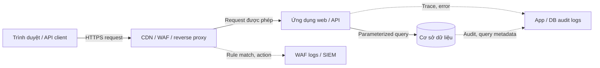
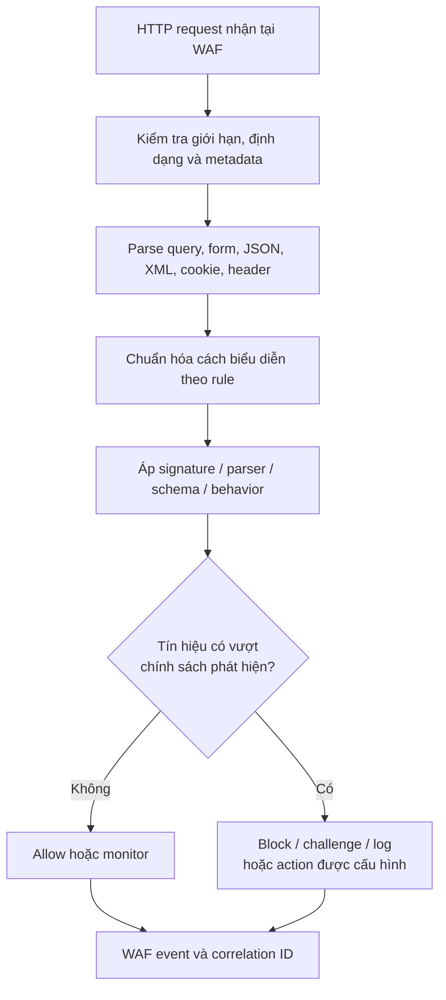
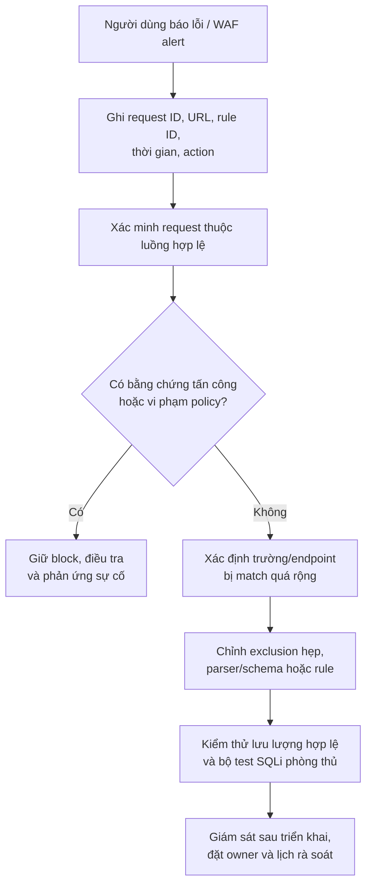

# SQL injection detection trong Web Application Firewall (WAF)

**SQL injection (SQLi)** là rủi ro xảy ra khi dữ liệu do bên ngoài kiểm soát được đưa vào câu lệnh SQL theo cách khiến hệ quản trị cơ sở dữ liệu diễn giải một phần dữ liệu đó như **cú pháp truy vấn**. Hậu quả có thể là truy cập dữ liệu không đúng quyền, sửa hoặc xóa dữ liệu, bỏ qua kiểm tra nghiệp vụ hoặc ảnh hưởng tính sẵn sàng của hệ thống. **SQL injection detection** trong **Web Application Firewall (WAF)** tập trung nhận biết dấu hiệu có thể là SQLi ở lưu lượng HTTP/HTTPS trước khi chúng đến ứng dụng và thực thi hành động phù hợp với chính sách.

Trong mô-đun **SECURITY_NETWORK_SECURITY**, WAF là một lớp bảo vệ ứng dụng nằm trong kiến trúc phòng vệ mạng gồm phân đoạn, firewall, VPN, IDS/IPS, DNS, giám sát lưu lượng và quản lý truy cập. WAF có thể góp phần phát hiện và chặn các request có dấu hiệu SQLi, nhưng **không thay thế mã nguồn an toàn, truy vấn tham số hóa và phân quyền tối thiểu ở cơ sở dữ liệu**.

Bài học hướng dẫn cách phân tích nguồn gốc rủi ro, hiểu pipeline phát hiện của WAF, giải thích log và điểm số cảnh báo, kiểm soát sai lệch phát hiện, kiểm thử trong phạm vi được phép và xử lý sự cố thực tế.

## 1. Hiểu đúng SQL injection trước khi phát hiện

Một ứng dụng web thường nhận dữ liệu qua query string, form, JSON, cookie, HTTP header hoặc một luồng API khác. Server sử dụng các giá trị này để tìm kiếm, lọc, đăng nhập hoặc cập nhật bản ghi trong cơ sở dữ liệu.

Ví dụ nghiệp vụ: người dùng truy cập danh sách đơn hàng theo **customer_id**. Nếu chương trình ghép trực tiếp chuỗi đầu vào vào câu SQL, ranh giới giữa **dữ liệu** và **mã lệnh** có thể bị phá vỡ.

### 1.1. Mẫu code không an toàn

```java
// Ví dụ minh họa LỖI THIẾT KẾ, không sử dụng trong ứng dụng.
String sql = "SELECT id, total FROM orders WHERE customer_id = "
        + request.getParameter("customer_id");
Statement statement = connection.createStatement();
ResultSet rows = statement.executeQuery(sql);
```

Nếu giá trị nhận từ client được ghép thành SQL mà không buộc nó giữ vai trò dữ liệu, chương trình có thể tạo câu lệnh mang ý nghĩa khác với ý định của người viết. Vấn đề gốc ở **cách dựng truy vấn**, không phải ở việc ký tự nào xuất hiện trong request.

### 1.2. Mẫu xử lý đúng: prepared statement

```java
// Ví dụ phòng vệ cho một truy vấn đơn giản.
String sql = "SELECT id, total FROM orders WHERE customer_id = ?";
try (PreparedStatement ps = connection.prepareStatement(sql)) {
    ps.setLong(1, customerId);
    try (ResultSet rs = ps.executeQuery()) {
        while (rs.next()) {
            // Xử lý kết quả theo quyền của người dùng đã xác thực.
        }
    }
}
```

Dấu **?** là tham số dữ liệu, giúp phân tách giá trị khỏi cấu trúc SQL. **customerId** nên được chuyển đổi/kiểm tra kiểu trước đó, và truy vấn vẫn phải giới hạn dữ liệu theo danh tính được phép. Nếu ứng dụng cần xây dựng tên bảng, cột hoặc hướng sắp xếp động, các phần **định danh/cú pháp SQL** không thể luôn truyền như bind parameter; nên chọn từ **allowlist cố định** theo nghiệp vụ.

**Prepared statements + kiểm soát quyền ở ứng dụng + tài khoản DB có quyền tối thiểu** mới trực tiếp xử lý nhiều nguyên nhân chính của SQLi. WAF là lớp bổ sung nhằm giảm khả năng request đáng ngờ đến được ứng dụng và tăng khả năng quan sát.

## 2. WAF nhìn thấy những gì?

Một WAF bảo vệ ứng dụng HTTP/HTTPS có thể đặt ở CDN/edge, reverse proxy, API gateway hoặc tại lớp ứng dụng, tùy triển khai. WAF cần nhìn thấy request dưới dạng có thể phân tích; với HTTPS, điểm thực thi phù hợp thường phải kết thúc TLS hoặc được tích hợp vào vị trí có dữ liệu HTTP đã giải mã hợp lệ.



Một WAF phía trước ứng dụng thường có thể quan sát:

| Thành phần request | Ví dụ dữ liệu | Ý nghĩa với phát hiện |
| --- | --- | --- |
| HTTP method và path | GET /orders, POST /search | Xác định endpoint, chức năng, loại request |
| Query parameter | customer_id=123 | Tìm dấu hiệu cú pháp đáng ngờ, kiểm tra kiểu mong đợi |
| Form field | Form đăng nhập, bộ lọc tìm kiếm | Phân tích giá trị có thể chạm vào truy vấn |
| JSON/XML body | Thuộc tính truy vấn API | Cần parser hiểu đúng cấu trúc, encoding và giới hạn nội dung |
| Cookie/header | Session, giá trị điều hướng, header tùy biến | Có thể là nguồn dữ liệu được ứng dụng đưa vào SQL; dễ chứa dữ liệu nhạy cảm |
| HTTP response | Status, kích thước, một số nội dung nếu WAF có quan sát response | Hỗ trợ tương quan lỗi hoặc kết quả, không luôn được bật |
| Nguồn và ngữ cảnh | IP đã xác minh, route, user/role nếu tích hợp | Phân biệt hành vi dự kiến và yêu cầu đáng ngờ |

**WAF không mặc nhiên thấy câu SQL thực tế** mà ứng dụng gửi đến DB. Request có thể được ứng dụng biến đổi qua nhiều lớp, có truy vấn phát sinh từ job nền hoặc dữ liệu lưu trước đó. Ngược lại, không phải mọi chuỗi giống cú pháp SQL trong HTTP request đều được sử dụng để tạo SQL.

### 2.1. Điều kiện để quan sát đúng

- WAF phải nằm trên **đường đi thực tế** của endpoint; nếu origin nhận truy cập trực tiếp ngoài WAF, một phần request có thể vượt ngoài phạm vi phân tích.
- Chính sách TLS termination và kết nối đến origin phải được cấu hình đúng; tránh giả định có thể đọc nội dung HTTPS mã hóa khi không được giải mã.
- WAF phải hỗ trợ loại **Content-Type** và định dạng mà ứng dụng sử dụng; JSON, multipart, GraphQL, XML và biểu mẫu có cách phân tích khác nhau.
- Giới hạn kích thước body, timeout và streaming/upload phải được biết rõ. “Không thấy cảnh báo” khi body không được xử lý đầy đủ **không chứng minh request an toàn**.
- Nhiều lớp proxy có thể thay đổi IP nguồn, header, path hoặc encoding; cần thiết lập danh sách proxy tin cậy và lưu correlation ID nhất quán.

## 3. Dấu hiệu SQLi mà WAF có thể nhận diện

Một số cách mô tả nhóm hành vi SQLi có ích cho thiết kế detection:

| Nhóm tín hiệu | Ý tưởng cơ bản | Hướng quan sát phòng thủ |
| --- | --- | --- |
| **Mẫu cú pháp SQL đáng ngờ** | Input chứa các từ khóa, toán tử hoặc chuỗi cấu trúc thường liên quan đến truy vấn | Signature/rule dựa trên token và ngữ cảnh trường |
| **Boolean-based behavior** | Cách ứng dụng phản hồi thay đổi theo điều kiện logic bất thường | Chuỗi request liên quan và khác biệt phản hồi trong một phiên kiểm thử/điều tra |
| **Error-based indicators** | Ứng dụng trả thông báo lỗi DB hoặc parser | Response log, app error và DB error code; tránh lộ stack trace cho client |
| **Time-based indicators** | Một số request tạo chênh lệch thời gian phản hồi đáng kể | Telemetry latency, correlation, loại trừ tải hệ thống bình thường |
| **Union/query-shape manipulation** | Dữ liệu nhập có dấu hiệu cố ảnh hưởng cấu trúc lấy dữ liệu | Chữ ký parser và log đường đi đến endpoint |
| **Second-order SQLi** | Dữ liệu được lưu trước, chỉ gây hại khi được dùng ở một truy vấn về sau | Code review, database audit, kiểm soát toàn bộ nơi dựng SQL; WAF ở request ban đầu có thể không thấy |
| **Blind SQLi** | Ứng dụng không trả dữ liệu lỗi trực tiếp nhưng có phản hồi khác biệt | Nhận diện chuỗi tương tác, rate/behavior và telemetry ứng dụng |
| **Đầu vào vượt schema** | Trường phải là số nhưng chứa cấu trúc không phù hợp hoặc kích thước bất thường | Schema validation ở API gateway/ứng dụng, rule theo endpoint |

Các nhóm này là **khái niệm phân tích**, không phải bảo đảm rằng WAF có thể nhận biết mọi cuộc tấn công. Ví dụ thời gian phản hồi tăng còn có thể do database lock, mất cache hoặc tắc nghẽn mạng. Một thông báo lỗi SQL có thể do lỗi lập trình hợp lệ chứ chưa chắc là hoạt động đối kháng.

### 3.1. Phát hiện mẫu từ khóa không đủ

Một ứng dụng đào tạo có thể cho phép người dùng nhập nội dung như “Học câu lệnh SELECT và JOIN” trong ô mô tả. Chuỗi chứa tên lệnh SQL nhưng **không chứng minh SQLi**, và chặn mọi request có từ khóa **SELECT** sẽ gây false positive nghiêm trọng.

Dấu hiệu có giá trị hơn khi kết hợp:

- Trường nào xuất hiện chuỗi? **order_id** mong đợi số khác với **lesson_text** có thể chứa ví dụ SQL.
- Request tới endpoint nào? Search API, form bình luận, endpoint báo cáo hay truy vấn sản phẩm?
- Có cấu trúc bất thường phù hợp với cách dữ liệu thường đi vào DB không?
- Một request hay một chuỗi request có liên hệ cùng session/nguồn?
- Server trả HTTP lỗi, chậm bất thường hay vẫn trả nội dung bình thường?
- WAF có parser đúng định dạng body và bộ quy tắc đang áp dụng không?

Mục tiêu detection là **phân biệt ý đồ có thể gây hại với dữ liệu hợp lệ theo ngữ cảnh**, không chỉ đếm từ khóa.

## 4. Pipeline phát hiện của WAF

Một WAF thường thực hiện các bước tương tự:



Pipeline này chỉ là sơ đồ logic; thứ tự parser, rate limit, bot detection, managed rules, custom rules và action có thể khác nhau theo nền tảng.

### 4.1. Parsing và canonicalization

Cùng một giá trị ứng dụng nhận được có thể được truyền qua các biểu diễn khác nhau: URL encoding, JSON escaping, nhiều lớp proxy hoặc nhiều lần chuyển đổi. Nếu WAF và ứng dụng diễn giải dữ liệu **không giống nhau**, detector có thể đánh giá sai. Vì thế WAF cần canonicalization/normalization phù hợp với parser mà ứng dụng thật sử dụng.

Tuy nhiên **chuẩn hóa càng nhiều không phải lúc nào cũng tốt**. Giải mã hoặc biến đổi dữ liệu quá mức có thể làm thay đổi ý nghĩa của input hợp lệ và gây false positive. Quy tắc cần được kiểm thử trên traffic thực, nhất là với Unicode, các giá trị rỗng, ký tự quốc tế và các trường hỗ trợ văn bản phong phú.

Các khía cạnh cần xác minh:

| Tình huống | Câu hỏi phòng thủ |
| --- | --- |
| Nhiều query parameter cùng tên | WAF và framework chọn giá trị đầu tiên, cuối cùng hay danh sách? |
| Nội dung JSON lồng nhau | WAF có phân tích đủ các trường nằm sâu mà ứng dụng sử dụng? |
| Multipart form upload | Quy tắc chỉ kiểm tra tên file, text field hay phần nội dung được phép phân tích? |
| Content-Type khác body thực | Parser xử lý request như thế nào; có từ chối input không hợp lệ? |
| Dữ liệu rất lớn hoặc được gửi theo luồng | Có ngưỡng body inspection và hành vi khi vượt ngưỡng? |
| Các dạng escape/Unicode | Kết quả chuẩn hóa có thống nhất với ứng dụng và bộ lọc? |

Không cần tạo quy tắc nhằm đoán mọi dạng biểu diễn có thể xảy ra. Giải pháp bền vững là **dùng parser đúng chuẩn, validation theo schema và truy vấn tham số hóa ở ứng dụng**, rồi kiểm tra WAF nhận diện phù hợp trên tập dữ liệu thử đại diện.

### 4.2. Detection theo chữ ký

**Signature-based detection** so khớp request với mẫu đáng ngờ, có thể kết hợp từ khóa, toán tử, cấu trúc, vị trí dữ liệu và các phép biến đổi đã định nghĩa. Ưu điểm là dễ kiểm tra dấu hiệu cụ thể và có thể phản ứng nhanh với mẫu đã biết; nhược điểm là dễ báo sai ở ứng dụng xử lý nội dung kỹ thuật và có thể bỏ sót biểu diễn chưa được rule bao phủ.

Để vận hành, phải quan tâm:

1. **Rule ID** và phiên bản/signature set.
2. **Biến HTTP** được kiểm tra: query argument, body field, header hay cookie.
3. **Transformation** được áp dụng và dữ liệu đã chuẩn hóa.
4. **Action** thực thi: alert, log, block, challenge hay score only.
5. **Tần suất và mức tin cậy** của match trong bối cảnh endpoint.
6. **Tác động hợp lệ**: người dùng/ứng dụng có bị chặn nhầm hay không.

### 4.3. Detection theo hành vi và anomaly

Phương pháp **behavioral/anomaly detection** nhìn thêm các dấu hiệu theo thời gian hoặc tập request, ví dụ lưu lượng bất thường đến một endpoint, sự gia tăng lỗi server, mẫu thử lặp lại hoặc thay đổi kích thước phản hồi. Một số nền tảng dùng mô hình thống kê hoặc học máy; khác biệt ngữ cảnh ứng dụng và thiếu dữ liệu huấn luyện phù hợp có thể làm sai lệch kết quả.

Khuyến nghị không mặc định **anomaly = attack**. Một đợt triển khai client lỗi có thể tạo số lượng request sai schema hoặc retry cao. Cần kết hợp log ứng dụng, release, thời gian cao điểm, trạng thái DB và dấu hiệu độc lập.

## 5. Rule-based detection và anomaly scoring

Nhiều WAF hỗ trợ quy tắc chặn trực tiếp khi có một match đáng tin cậy, hoặc **cộng điểm bất thường** từ nhiều rule trước khi đưa ra quyết định.

Ví dụ một request có các dấu hiệu:

| Rule giả định | Mô tả tín hiệu | Điểm minh họa |
| --- | --- | ---: |
| WAF-SQL-101 | Input không đúng kiểu tại trường ID và xuất hiện cấu trúc bất thường | 3 |
| WAF-SQL-202 | Một mẫu cú pháp truy vấn không phù hợp ngữ cảnh HTTP field | 4 |
| WAF-SQL-303 | Endpoint phát sinh dạng lỗi DB liên quan, được telemetry xác nhận | 3 |
| **Tổng** | Nếu các rule cùng khớp cùng request | **10** |

Giả sử chính sách minh họa định nghĩa **điểm từ 5 trở lên → block**. Một request match WAF-SQL-101 đơn lẻ có thể chỉ được ghi log, trong khi cùng request match thêm WAF-SQL-202 có thể vượt ngưỡng. Đây là **ví dụ mô phỏng**, không đại diện bảng điểm hay ngưỡng mặc định của một sản phẩm.

**OWASP Core Rule Set (CRS)** là một bộ quy tắc phát hiện thường dùng với WAF engine tương thích như ModSecurity và các triển khai liên quan. CRS sử dụng nhiều nhóm rule, bao gồm nhóm phát hiện SQLi và cơ chế anomaly scoring. Tên biến, pha xử lý, các ngưỡng và hành vi thực tế phải đối chiếu **phiên bản CRS/WAF đang triển khai**. Không nên chép các ID hoặc ngưỡng từ tài liệu phiên bản khác rồi coi chúng luôn đúng.

### 5.1. Điều chỉnh threshold và paranoia level

Với những triển khai CRS, **paranoia level** (PL) điều khiển độ nhạy và nhóm rule được bật; mức cao hơn thường tăng mức bao phủ kiểm tra nhưng có thể tăng false positive và chi phí vận hành. **Anomaly threshold** quyết định mức điểm dẫn đến chặn khi cơ chế anomaly scoring được dùng.

Hai tham số phục vụ mục đích khác nhau:

- **PL**: chọn phạm vi/độ nhạy kiểm tra.
- **Threshold**: quyết định số điểm phát hiện nào được coi là đủ để thực thi một hành động.

Thay đổi một tham số có thể đổi cả hiệu quả phát hiện lẫn tỷ lệ chặn nhầm. Nên đo bằng tập request hợp lệ của ứng dụng, kiểm thử trong staging và triển khai tăng dần. Không nâng PL hoặc hạ threshold trên toàn hệ thống chỉ vì một yêu cầu “bảo mật càng cao càng tốt” chưa có đánh giá.

### 5.2. Rule tùy chỉnh dựa trên schema

Trên một endpoint **GET /orders/{id}**, tham số id chỉ chấp nhận một mã định danh có định dạng xác định. Thay vì tìm mọi cú pháp SQL có thể có, rule hoặc API schema validator có thể yêu cầu:

- id đúng kiểu số hoặc mẫu định danh đã công bố.
- Độ dài tối đa phù hợp tài liệu API.
- Chỉ những HTTP method được ứng dụng hỗ trợ.
- Content-Type và cấu trúc request đúng giao kèo.

**Validation theo schema** thường tạo tín hiệu rõ hơn chữ ký tổng quát đối với trường có định dạng chặt. Tuy nhiên nó không thay thế prepared statement; cũng không nên áp validate quá chặt lên các trường thực sự cho phép biểu thức tìm kiếm hoặc văn bản tự do.

## 6. Các bề mặt HTTP cần xét khi phát hiện SQLi

Không phải mọi dữ liệu đầu vào đều nằm ở query string. Bảng dưới đây giúp lên kế hoạch coverage:

| Bề mặt | Đường đi trong ứng dụng | Điểm cần xác minh |
| --- | --- | --- |
| **Query string** | Bộ lọc, phân trang, tìm kiếm | Field name, type, length, chuẩn hóa URL |
| **application/x-www-form-urlencoded** | Form login, đăng ký, search | Parser form, repeated keys, ký tự quốc tế |
| **application/json** | REST API và backend service | Nested objects, arrays, field paths, parser limits |
| **multipart/form-data** | Upload có metadata text | Những text fields và metadata nào được WAF đọc? |
| **XML/SOAP** | Dịch vụ tích hợp truyền thống | XML parsing, namespace, giới hạn phân tích |
| **GraphQL** | Query và mutation theo schema | Trường argument/variables, persisted query, auth ở resolver |
| **HTTP header/cookie** | Tracking, routing, trạng thái ứng dụng | Có trường nào được backend dùng như dữ liệu truy vấn? |
| **WebSocket và luồng nâng cấp** | Ứng dụng thời gian thực | WAF có nhìn thấy message sau protocol upgrade không? |
| **HTTP/2 và HTTP/3** | Nhiều request/stream với đặc tính transport khác nhau | Nền tảng có hỗ trợ parser và log tương ứng không? |

Ở một số nền tảng, WAF chỉ kiểm tra đầy đủ **HTTP request ban đầu** chứ không giải mã mọi message trong WebSocket đã nâng cấp. Nếu ứng dụng dùng giao thức đó để nhận dữ liệu truy vấn, cần kiểm soát bằng validation ở backend và bảo vệ lớp khác.

### 6.1. API không phải lúc nào cũng giống trang web

API sử dụng JSON, dữ liệu có cấu trúc, token người dùng hoặc GraphQL variables. Detector tổng quát có thể gặp false positive nếu body chứa SQL như **đoạn code dùng trong bài học**, hoặc false negative nếu endpoint dùng schema hiếm và WAF không xử lý đúng kiểu nội dung.

Một thiết kế phòng vệ API tốt kết hợp:

1. WAF ở đường vào đúng kiến trúc.
2. OpenAPI/JSON Schema/GraphQL schema validation khi có thể.
3. Kiểm tra xác thực và phân quyền tại từng resource/action.
4. Giới hạn kích thước, độ sâu và kiểu dữ liệu.
5. Truy vấn tham số hóa và mapping allowlist cho tên trường/sort.
6. Log request ID, quyết định WAF và DB/application error một cách phù hợp.

## 7. Phân biệt SQLi với các rủi ro khác

SQLi xảy ra ở **ranh giới dữ liệu ứng dụng → câu lệnh SQL**. Có những nhóm rủi ro tương tự bề ngoài nhưng cần cơ chế phòng vệ riêng:

| Rủi ro | Ngữ cảnh | Điểm phân biệt |
| --- | --- | --- |
| **SQL injection** | Dữ liệu làm thay đổi cấu trúc hoặc ý nghĩa SQL | Truy vấn SQL được dựng không an toàn |
| **NoSQL injection** | Truy vấn vào cơ sở dữ liệu không dùng SQL truyền thống | Cú pháp/kiểu truy vấn khác; cần validation và API an toàn tương ứng |
| **OS command injection** | Đầu vào làm thay đổi lệnh hệ điều hành | Hướng tới shell/process, khác SQL parser |
| **XSS** | Nội dung do attacker kiểm soát được thực thi trong trình duyệt | Ngữ cảnh HTML/DOM/JavaScript |
| **SSRF** | Server bị dẫn đến request URL/resource không mong muốn | Ranh giới truy cập mạng từ backend |
| **Path traversal** | Đường dẫn tệp được diễn giải ngoài phạm vi mong muốn | Quy tắc canonicalization filesystem |
| **Broken Access Control** | Người dùng đọc/sửa resource vượt quyền | Có thể xảy ra kể cả SQL query an toàn |

WAF có thể cung cấp rule cho nhiều nhóm trên. Tuy nhiên một sự kiện gắn nhãn “SQLi” **không tự chứng minh dữ liệu DB đã bị truy cập trái phép**. Kết luận sự cố phải dựa thêm vào log ứng dụng/DB, quyền tài khoản, kết quả truy vấn và dấu hiệu thay đổi dữ liệu.

## 8. False positive: chặn nhầm lưu lượng hợp lệ

**False positive** xảy ra khi WAF đánh dấu hoặc chặn request hợp lệ là SQLi. Đây là vấn đề nổi bật ở các ứng dụng có trường nhập tài liệu, tìm kiếm mã nguồn, hỗ trợ kỹ thuật, báo cáo hoặc nội dung học SQL.

Ví dụ các giá trị hợp lệ có thể bao gồm:

- Bài viết hướng dẫn **SELECT**, **JOIN**, **WHERE**.
- Câu mô tả có ký tự nháy đơn và dấu câu.
- Tên sản phẩm hoặc tác giả chứa ký tự đặc biệt.
- Dữ liệu JSON có chuỗi ký hiệu toán học hoặc cú pháp lập trình.
- Tìm kiếm tài liệu chứa các thuật ngữ truy vấn.

### 8.1. Quy trình xử lý cảnh báo nghi false positive



**Exclusion phải càng hẹp càng tốt**: chỉ một tham số, một route, một phương thức hoặc một nhóm rule khi có căn cứ. Không nên tắt toàn bộ nhóm bảo vệ SQLi hoặc đưa IP khách hàng vào allowlist tuyệt đối để xử lý một trường text hợp lệ.

Khi áp exclusion cần trả lời:

- Trường bị loại trừ **có thực sự không đi vào SQL nguy hiểm** không? Code review hoặc data-flow review có xác nhận chưa?
- Một số rule có thể cùng phát hiện trên route khác; thay đổi ảnh hưởng phạm vi nào?
- Có thể sửa schema/input ở ứng dụng tốt hơn việc bỏ kiểm tra?
- Có testcase regression cho request hợp lệ và request đáng ngờ sau sửa không?
- Ai sở hữu exception và thời điểm phải xem lại?

### 8.2. False negative: bỏ sót dấu hiệu

**False negative** xảy ra khi lưu lượng nguy hiểm không được phát hiện hoặc rule không quan sát được đúng dữ liệu. Nguyên nhân có thể liên quan:

- Endpoint không đi qua WAF do đường origin hoặc đường nội bộ khác.
- Body vượt giới hạn inspection hoặc định dạng không được parser hỗ trợ.
- Dữ liệu ứng dụng được xây dựng/truyền qua nhiều bước mà WAF không thấy cùng ngữ cảnh.
- Bộ signature cũ, cấu hình thiếu hoặc rule bị loại trừ quá rộng.
- SQLi phát sinh từ dữ liệu được lưu trước đó hoặc từ luồng không phải HTTP.
- Phương thức phân loại thiếu độ bao phủ trong một kiểu nghiệp vụ đặc thù.

**Không thấy alert không chứng minh không có SQLi.** Cần kết hợp kiểm tra mã nguồn, DAST/SAST được phép thực hiện, logging ứng dụng/DB, kiểm thử integration và mô hình hóa dữ liệu.

## 9. Logging: từ WAF alert đến bằng chứng có thể giải thích

Một log SQLi detection hữu ích phải cho biết điều gì đã được quan sát và rule đã xử lý ra sao.

| Trường | Mục đích |
| --- | --- |
| **Event time, timezone** | Ghép với client, app, DB và SIEM |
| **Request/transaction ID** | Theo dấu một yêu cầu qua proxy, WAF và backend |
| **Source context** | IP nguồn tin cậy, ASN/geo nếu cần, identity/session sau xác minh |
| **Host, method, path** | Xác định route và API |
| **Matched variable** | Query argument, JSON field, cookie hoặc header |
| **Rule ID / rule set version** | Giải thích vì sao được đánh dấu |
| **Score / severity / confidence** | Mức độ rule hoặc engine nhận định |
| **Action / status** | Log-only, allow, block, challenge, HTTP response |
| **Body parsing status** | Có phân tích đủ dữ liệu cần thiết hay không |
| **Origin response / app trace** | Tương quan kết quả phía backend khi có |
| **Exception identifier** | Xác định ngoại lệ nào đã được áp dụng |

Ví dụ log JSON **giả định và đã giảm chi tiết nhạy cảm**:

```json
{
  "event_time": "2026-11-28T02:15:32Z",
  "request_id": "req-demo-013",
  "asset": "api.example.net",
  "method": "GET",
  "path": "/orders",
  "client_ip": "198.51.100.24",
  "matched_variable": "ARGS:order_id",
  "matched_data": "[redacted]",
  "rule_id": "WAF-SQL-202",
  "rule_set_version": "example-2026-11",
  "category": "sqli",
  "anomaly_score": 7,
  "configured_threshold": 5,
  "action": "block",
  "response_status": 403,
  "body_inspection": "complete",
  "notes": "Số liệu, rule và điểm chỉ để minh họa"
}
```

**198.51.100.24** thuộc dải địa chỉ dành cho tài liệu. Tên rule, threshold và trường JSON chỉ nhằm giải thích cách lập bản ghi; không phải schema hoặc giá trị mặc định của WAF cụ thể.

### 9.1. Log chứng minh và không chứng minh điều gì?

Log trên chứng minh **WAF đã đánh dấu request và thực thi block theo policy đang ghi** nếu nguồn log đáng tin và không có mâu thuẫn. Nó **không đủ** chứng minh client là kẻ tấn công, ứng dụng có lỗ hổng SQLi, hoặc DB đã bị truy xuất.

Ngược lại, HTTP **403** mà người dùng thấy **không mặc định** đến từ WAF: reverse proxy, ứng dụng, authorization middleware hoặc CDN cũng có thể tạo 403. Ghép **request ID**, thời gian, rule/action và log phía sau để xác định.

Nếu WAF ở chế độ *detect-only*, request có thể được chuyển tới origin dù match SQLi. Cần phân biệt **detected**, **blocked**, **allowed**, **challenged** và **bypassed** trong báo cáo.

### 9.2. Bảo vệ dữ liệu khi ghi log

Query string, JSON body, cookie, Authorization header và URL có thể chứa tên người dùng, token, mật khẩu hoặc dữ liệu cá nhân. Việc bật full request logging để điều tra WAF có thể vô tình tạo kho dữ liệu nhạy cảm thứ hai.

Nguyên tắc:

- Ghi **rule ID, field name, request ID, hành động và metadata đủ điều tra** trước khi lưu toàn bộ payload.
- Khi cần raw request, dùng kho lưu được phân quyền, giới hạn thời gian và quy trình điều tra.
- Che/redact cookie, token, password, số định danh và dữ liệu nhạy cảm theo chính sách.
- Đồng bộ thời gian, kiểm soát tính toàn vẹn và bảo đảm log từ WAF/ứng dụng/DB có thể tương quan.
- Không gửi raw secret vào ticket/chat chỉ để chứng minh rule match.

## 10. Phân tích cảnh báo SQLi theo từng lớp

Một sự kiện WAF detection cần được điều tra như một **giả thuyết**, không tự động coi là đã khai thác thành công.

### 10.1. Câu hỏi tại lớp WAF

1. Tài sản và endpoint nào đã nhận request?
2. Request có đi qua tất cả rule dự kiến hay chỉ một phần?
3. Field nào match, body đã parse đầy đủ chưa?
4. Rule ID, phiên bản CRS/managed rule và transformation là gì?
5. Action thực tế: block, log-only hay challenge?
6. Có exception, allowlist hoặc rule ưu tiên cao nào tác động kết quả?
7. Nguồn có đáng tin theo sơ đồ proxy không? Header IP có thể bị client tự gửi nếu proxy chain cấu hình sai.

### 10.2. Câu hỏi tại ứng dụng

- Route đó có thực sự dùng input cho database query?
- Có sử dụng **prepared statement/bind parameter** ở mọi nhánh, gồm báo cáo, thống kê và cập nhật không?
- Có mapping tên trường/sort/filter theo allowlist?
- Có log lỗi SQL, exception hoặc thay đổi khác thường trong output?
- Resource authorization có kiểm tra quyền người dùng trước truy vấn?
- Ứng dụng có cho phép nhập văn bản SQL hợp lệ phục vụ nghiệp vụ?

### 10.3. Câu hỏi tại database

- Tài khoản DB của ứng dụng có quyền gì và có đang sử dụng quyền tối thiểu?
- Có truy vấn bất thường, lỗi cú pháp, lượng đọc dữ liệu tăng đột biến hoặc tác vụ ghi ngoài baseline?
- Có thay đổi schema/table/quyền hoặc truy cập dữ liệu vượt dự kiến?
- Có thể liên hệ request ID đến query trace/transaction không? Nếu không, cần cải thiện telemetry.

Chỉ khi có bằng chứng từ các lớp liên quan mới nên kết luận một nỗ lực đã ảnh hưởng tới DB. Một request WAF chặn sớm có thể **chưa đến ứng dụng**; việc server không có log cùng request là phù hợp nhưng cần xem độ phủ log và thiết kế đường đi.

## 11. Thử nghiệm phát hiện SQLi có kiểm soát

**Mục đích kiểm thử** là đánh giá detection và khả năng bảo vệ ứng dụng của mình, đồng thời giảm false positive với dữ liệu hợp lệ. Phạm vi cần xác định trước: môi trường staging/lab, domain, endpoint, tài khoản test, khung giờ, rate limit và cách phục hồi.

Nên xây dựng **tập dữ liệu thử có nhãn** gồm các nhóm:

1. **Request hợp lệ thông thường:** ID số, bộ lọc chuẩn, tìm kiếm sản phẩm.
2. **Request hợp lệ dễ gây false positive:** đoạn tài liệu học SQL, câu có dấu nháy đơn, chuỗi code trong form.
3. **Request sai schema:** ID quá dài, sai kiểu hoặc body không đúng định dạng.
4. **Mẫu kiểm thử SQLi được phê duyệt trong lab:** dùng bộ kiểm thử ứng dụng an toàn, payload tối thiểu và dữ liệu giả; không dùng cơ sở dữ liệu thật.
5. **Trường hợp parser:** JSON lồng nhau, field rỗng, content type đúng/sai, body gần giới hạn inspection.
6. **Kiểm tra đường đi:** request tới endpoint public phải qua WAF; origin không tiếp nhận đường truy cập không được cho phép.
7. **Kiểm tra lỗi vận hành:** log forwarding chậm, rule update, exception sai, mode detect-only và failover.

### 11.1. Ma trận nghiệm thu

| Test ID | Bối cảnh | Kết quả mong đợi | Bằng chứng |
| --- | --- | --- | --- |
| **T01** | GET /orders?order_id=123 | Allow, ứng dụng xử lý bình thường | WAF pass log, app request ID |
| **T02** | POST /notes với nội dung dạy SQL hợp lệ | Allow, không chặn chỉ vì xuất hiện tên lệnh SQL | HTTP thành công, không có block WAF |
| **T03** | ID không đúng schema | Từ chối ở schema validator/app hoặc rule phù hợp | 4xx có reason rõ, không làm lộ lỗi DB |
| **T04** | Bộ mẫu SQLi phòng thủ tại staging | Ghi đúng rule và action theo policy đã định | WAF rule/score/action và client result |
| **T05** | Request chạm giới hạn body inspection | Xử lý theo policy đã công bố, không âm thầm bỏ qua | Body inspection status và hành động |
| **T06** | Request public thử đường origin trực tiếp | Bị giới hạn đúng kiến trúc | Network/edge logs, kết quả truy cập |
| **T07** | Bật exception hẹp cho text field | Request hợp lệ qua; các test SQLi bảo vệ còn hiệu lực | Regression suite, diff rule |
| **T08** | Chuyển chế độ detect-only ↔ block ở lab | Action hiển thị đúng, không nhầm detected với blocked | Policy version, log, client response |

### 11.2. Chỉ số đánh giá detection

Dùng các định nghĩa cơ bản:

- **True positive (TP):** request thuộc tập có hành vi SQLi và được phát hiện.
- **False positive (FP):** request hợp lệ bị gắn nhãn SQLi.
- **False negative (FN):** request SQLi không được phát hiện.
- **True negative (TN):** request hợp lệ không bị gắn nhãn.

Từ đó:

\[
\text{Precision} = \frac{TP}{TP+FP}
\]

\[
\text{Recall} = \frac{TP}{TP+FN}
\]

\[
\text{False Positive Rate} = \frac{FP}{FP+TN}
\]

**Precision** phản ánh mức đáng tin của các cảnh báo đã phát. **Recall** phản ánh mức bao phủ trên tập tình huống có nhãn. **False Positive Rate** cho biết tỷ lệ yêu cầu hợp lệ bị đánh dấu trong tập thử. Những số đo này **phụ thuộc mạnh vào tính đại diện của tập thử**, và không phải “tỷ lệ bảo mật tuyệt đối” của hệ thống.

Đối với WAF chạy anomaly scoring, có thể thay threshold và so sánh precision/recall, nhưng phải đồng thời đo:

- **False block rate** của request hợp lệ trong traffic thực.
- **Tác động hiệu năng**: độ trễ, CPU, throughput và body parsing.
- **Mức độ giải thích được**: rule ID và context có đủ cho analyst xử lý?
- **Khoảng trống coverage**: endpoint nào không qua WAF hoặc không được parse?
- **Chi phí vận hành**: số alert cần xem, thời gian xử lý false positive.

Một mô hình đạt recall cao trong lab nhưng chặn nhầm form đăng ký của khách hàng có thể không phù hợp sản xuất.

## 12. Ví dụ một đợt triển khai detection trong doanh nghiệp

Giả sử hệ thống bán hàng có:

- **shop.example.net**: giao diện khách hàng.
- **api.example.net**: REST API cho mobile.
- **admin.example.net**: quản trị nội bộ qua VPN.
- Ứng dụng backend kết nối PostgreSQL bằng tài khoản giới hạn quyền.

Mục tiêu: phát hiện SQLi trên API nhận **product_id**, **search_text** và **sort_by**.

### 12.1. Thiết kế bảo vệ ngay tại nguồn

- **product_id** phải đúng kiểu và giới hạn giá trị.
- **search_text** là văn bản tự do; cho phép từ khóa SQL khi chúng có ý nghĩa nội dung.
- **sort_by** phải chọn từ danh sách cố định do ứng dụng định nghĩa (ví dụ price, newest, rating), không đưa nguyên biểu thức từ người dùng vào ORDER BY.
- Mọi truy vấn có giá trị người dùng phải được tham số hóa.
- Tài khoản PostgreSQL chỉ có quyền phù hợp với chức năng, không dùng quyền quản trị DB cho dịch vụ web.

### 12.2. Cấu hình WAF và quan sát

- Đặt WAF tại edge của **shop** và **api**, đồng thời giới hạn origin theo đường đã phê duyệt.
- Bật managed rule SQLi thích hợp, nhưng trước tiên triển khai **log/monitor** cho rule mới cần đánh giá.
- Tạo validation theo schema cho **product_id** và **sort_by**.
- Không thêm exception tổng quát cho **search_text** chỉ vì có một false positive; xác minh field được sử dụng an toàn, sau đó chỉ chỉnh rule/field thật sự cần.
- Gửi WAF event với request ID về SIEM; ứng dụng cũng ghi trace ID và DB error ở mức không tiết lộ secret.
- Đặt cảnh báo khi có nhiều sự kiện SQLi tương quan với 5xx bất thường, thời gian truy vấn tăng hoặc thay đổi policy không được phê duyệt.

### 12.3. Những điều phải chứng minh khi nghiệm thu

1. Request hợp lệ lấy sản phẩm và tìm kiếm vẫn hoạt động.
2. Dữ liệu văn bản chứa ví dụ SQL không bị chặn vô lý.
3. Test SQLi trong staging được ghi đúng rule ID, action và request ID theo policy.
4. Khi policy thực thi block, request bị chặn trước backend theo sơ đồ triển khai.
5. Backend không có truy vấn ghép chuỗi từ input chưa tin cậy ở những code path liên quan.
6. Giám sát thấy log WAF và app đúng thời gian, cả khi có rule update/failover.
7. Sau mỗi ngoại lệ, regression tests xác nhận rule còn bảo vệ các endpoint nhạy cảm.

## 13. Tình huống xử lý sự cố thực tế

### 13.1. Trường hợp A: WAF chặn nhầm tài liệu SQL hợp lệ

**Triệu chứng:** người dùng gửi bài viết có ví dụ lệnh SQL và nhận HTTP 403.

**Bằng chứng:** request ID trùng WAF event; rule SQLi khớp giá trị trong **article_body**; người dùng có quyền viết bài, server không ghi nhận request do WAF block.

**Đánh giá:** đây có thể là false positive vì nội dung SQL là nghiệp vụ hợp lệ. Tuy nhiên cần xác minh backend đưa dữ liệu bài viết vào prepared statement và không dùng lại như SQL code ở bước sau.

**Xử lý:** thu hẹp rule hoặc exclusion cho đúng field/endpoint, kiểm thử lại bộ SQLi phòng thủ và lưu ticket/owner/ngày xem xét. Không tắt toàn bộ SQLi protection trên site.

### 13.2. Trường hợp B: Rule ghi detect nhưng backend vẫn nhận request

**Triệu chứng:** SIEM có nhiều SQLi alerts, nhưng web server vẫn có request tương ứng và trả 200.

**Bằng chứng:** log WAF action=log-only; policy đang chạy ở **detection mode**, không phải blocking. Request đến backend theo cấu hình.

**Kết luận:** đã phát hiện chứ chưa chặn. Không nên báo cáo “tấn công đã bị WAF ngăn” chỉ dựa trên alert; cần đánh giá liệu request có được ứng dụng xử lý an toàn không và có cần chuyển sang block sau kiểm thử.

### 13.3. Trường hợp C: WAF block tăng mạnh sau nâng rule set

**Triệu chứng:** các truy vấn sản phẩm hợp lệ bắt đầu trả 403 sau khi nâng managed rule set.

**Bằng chứng:** có thay đổi rule version; alert tập trung vào endpoint tìm kiếm và một rule ID mới; số complaint tăng trong cùng khung giờ; DB/app vẫn khỏe.

**Xử lý:** so sánh match detail, tỷ lệ false positive và request mẫu đã che dữ liệu; tạm điều chỉnh ở phạm vi hẹp theo quy trình rollback, kiểm thử các case SQLi bảo vệ, rồi triển khai lại có kiểm soát. Đừng bỏ qua khả năng lưu lượng xấu thực sự cũng tăng cùng lúc.

### 13.4. Trường hợp D: WAF không có alert nhưng app báo lỗi DB

**Triệu chứng:** app log có SQL syntax errors, WAF không ghi nhận SQLi trên cùng thời điểm.

**Khả năng:** lỗi truy vấn trong mã nguồn, dữ liệu stored bị xử lý sai, body không được phân tích, request đi đường khác hoặc rule chưa bao phủ.

**Điều tra:** xác định request/trace ID, luồng dữ liệu đến DB, cấu hình body parser, rule mode, đường origin và truy vấn thực tế. **Không vội kết luận WAF bị vượt qua** khi chưa xác minh nguyên nhân. Mã nguồn phải được sửa nếu có SQL ghép chuỗi không an toàn.

## 14. Triển khai WAF SQLi detection theo nhiều giai đoạn

### Giai đoạn 1 — Kiểm kê và xác định ranh giới

Liệt kê domain, application/API, đường đi tới origin, phương thức, Content-Type, dữ liệu nhạy cảm, người sở hữu và luồng hợp lệ. Xác định route nào có truy vấn DB, trường đầu vào nào, và bảo vệ app đã có (prepared statements, schema validation, authz).

### Giai đoạn 2 — Bật logging và baseline

Bật rule SQLi ở chế độ quan sát với logging phù hợp; thống kê route, rule ID, loại request và false positive ban đầu. Đảm bảo request ID đi qua WAF, reverse proxy và application. Giới hạn raw payload log theo chính sách.

### Giai đoạn 3 — Kiểm thử và điều chỉnh

Tạo tập test có nhãn, bao gồm traffic hợp lệ dễ gây false positive, định dạng API khác nhau và bộ test SQLi trong lab. Chọn độ nhạy/threshold phù hợp rồi chỉnh rule/exclusion hẹp có lý do và owner.

### Giai đoạn 4 — Chặn có kiểm soát

Đưa policy đã nghiệm thu sang block cho asset/route phù hợp; triển khai theo từng nhóm hoặc canary khi nền tảng hỗ trợ. Theo dõi HTTP error, business conversion, support tickets, latency và các WAF events liên quan.

### Giai đoạn 5 — Giám sát, cập nhật và phục hồi

Xác định ai được thay rule, cách review exception, quy trình rollback và việc cập nhật managed rules/signatures. Giám sát thay đổi API/schema, app release và thay đổi kiến trúc mạng có thể khiến traffic bỏ qua WAF.

**Một phát hiện SQLi chưa đóng khi WAF đã chặn một request.** Nếu mã ứng dụng còn SQL ghép chuỗi nguy hiểm, nhóm phát triển phải sửa nguồn gốc, bổ sung regression test và rà soát quyền DB.

## 15. Giới hạn của WAF SQLi detection và các lớp bảo vệ bổ sung

| Giới hạn | Nguyên nhân | Lớp hỗ trợ |
| --- | --- | --- |
| Không thể bảo đảm nhận biết mọi SQLi | Signature/heuristic hữu hạn, logic ứng dụng đa dạng | Prepared statements, code review, SAST/DAST, DB audit |
| Không nhìn thấy truy vấn nội bộ | WAF ở HTTP edge, không theo dõi mọi job/queue | Kiểm soát truy vấn ở backend, database permissions |
| Không quan sát đủ HTTPS hoặc body | TLS placement, parser/size limit, upgrade protocol | Đặt đúng WAF, kiểm tra cấu hình, validation server-side |
| Có false positive với văn bản hợp lệ | Pattern trùng dữ liệu nghiệp vụ | Context-aware tuning, schema validation, regression tests |
| Có false negative với dữ liệu lưu trước | SQLi phát sinh ở giai đoạn sử dụng lại dữ liệu | Data-flow review, chuẩn hóa quyền truy vấn ở mọi điểm |
| Không thay thế authorization | SQL an toàn vẫn có thể đọc dữ liệu vượt quyền | RBAC/ABAC, kiểm tra resource ownership |
| Không bảo vệ DB khỏi mọi đường truy cập | Service khác có quyền DB, tài khoản bị lộ | Network segmentation, IAM, rotation, DB least privilege |
| Có thể bị mất bảo vệ khi origin public | Request đi vòng ngoài WAF | Origin access restriction, private connectivity |
| Rule có thể thay đổi hiệu lực sau update | Managed rule/engine release | Version control, canary, alerting, rollback |

Cần kết hợp phòng vệ theo lớp:

- **Tại code:** parameterized SQL, ORM dùng đúng cách, không ghép chuỗi SQL động từ input, kiểm soát schema.
- **Tại ứng dụng:** AuthN/AuthZ, validation, rate limits, lỗi trả về tổng quát và log riêng tư.
- **Tại DB:** tài khoản quyền tối thiểu, chia quyền đọc/ghi, kiểm tra audit và backup phù hợp.
- **Tại mạng:** segmentation, firewall/ACL, quản trị riêng, giới hạn DB port, VPN/ZTNA nếu cần.
- **Tại edge:** WAF SQLi detection, bot/rate controls, origin protection, telemetry.
- **Tại vận hành:** cập nhật signature, kiểm thử định kỳ, quản lý exception, tương quan WAF/app/DB events trong SIEM.

## 16. Sai lầm thường gặp

| Sai lầm | Vấn đề | Cách sửa |
| --- | --- | --- |
| “Bật WAF là ứng dụng hết SQLi” | Lỗ hổng trong mã vẫn tồn tại | Sửa truy vấn không an toàn và dùng bind parameter |
| “Có từ SELECT trong input là tấn công” | Văn bản nghiệp vụ có thể chứa SQL hợp lệ | Phân tích field và endpoint |
| “Không có alert tức là không có SQLi” | WAF có khoảng trống parse/coverage | Code review và DB/app telemetry |
| “HTTP 403 chắc chắn do WAF” | Nhiều thành phần trả 403 | Ghép request ID và action |
| “Detect-only nghĩa là đã block” | Request vẫn có thể tới backend | Phân biệt action rõ ràng |
| “Tăng PL tối đa cho mọi site” | Có thể làm chặn nhầm nghiêm trọng | Thử nghiệm theo từng ứng dụng |
| “Hạ threshold càng thấp càng an toàn” | False block tăng và che khuất tín hiệu | Đo precision/recall, tác động nghiệp vụ |
| “Bỏ toàn bộ SQLi rules để sửa false positive” | Tạo lỗ hổng quan sát rộng | Exclusion hẹp theo route/field/rule |
| “WAF đọc được mọi JSON/WebSocket body” | Phụ thuộc engine, parser và giới hạn | Xác minh coverage và validation backend |
| “Cloud WAF ở trước domain nên origin tự an toàn” | Origin có thể nhận request trực tiếp | Giới hạn origin theo đường được phê duyệt |
| “Chỉ WAF log đủ cho kết luận đã bị hack” | Match chỉ là tín hiệu, không chứng minh DB bị ảnh hưởng | Tương quan request, application và DB audit |
| “Lưu full request log là tốt nhất” | Rủi ro lộ token và dữ liệu nhạy cảm | Thu thập tối thiểu, redact, phân quyền |

## 17. Checklist thiết kế và vận hành

- [ ] Mỗi web/API có owner, scope WAF, đường tới origin và chính sách truy cập rõ ràng.
- [ ] SQLi được xử lý gốc bằng prepared statements và quyền DB tối thiểu.
- [ ] Các trường tên bảng/cột/sắp xếp động được kiểm soát bằng allowlist.
- [ ] WAF thực sự quan sát các request cần bảo vệ, gồm JSON/multipart/GraphQL nếu áp dụng.
- [ ] Có ghi nhận hành vi khi body lớn hoặc parser không thể đọc đủ.
- [ ] Managed rule/CRS được cấu hình đúng phiên bản, rule ID, action, scoring/threshold.
- [ ] Phân biệt detected, blocked, allowed và challenged trong log/báo cáo.
- [ ] Có baseline traffic hợp lệ, bao gồm các trường văn bản có chứa từ khóa SQL.
- [ ] Exception được thu hẹp theo field/route/rule, có owner và thời điểm xem lại.
- [ ] Có bộ test SQLi phòng thủ và regression test trên staging được phép.
- [ ] Log WAF mang timestamp, request ID, matched field, rule ID, action và policy version.
- [ ] Log ứng dụng/DB có thể đối chiếu mà không lộ secret hoặc thông tin cá nhân không cần.
- [ ] Đã bảo vệ đường origin trực tiếp và các đường API không qua WAF.
- [ ] Có giám sát false block rate, detection coverage, latency và rule updates.
- [ ] Có quy trình xử lý sự cố và rollback/canary khi cập nhật rule.
- [ ] Đã thử cả request hợp lệ và request đáng ngờ trong phạm vi cho phép.
- [ ] Kết quả điều tra phân biệt dấu hiệu SQLi với việc khai thác thành công.

## 18. Ghi nhớ

**SQL injection detection trong WAF** là quá trình quan sát request HTTP, phân tích trường đầu vào và định dạng dữ liệu, áp rule/signature hoặc tín hiệu hành vi, rồi ghi log hoặc chặn theo policy. Điểm mạnh nằm ở **giảm rủi ro tại lớp HTTP và cung cấp bằng chứng quan sát**, còn giới hạn nằm ở khả năng nhận diện, độ chính xác parser, traffic không đi qua WAF và false positive/false negative.

Thiết kế an toàn đòi hỏi phối hợp **WAF + kiểm soát dữ liệu đầu vào + prepared statements + phân quyền ứng dụng/DB + phân đoạn mạng + logging và kiểm thử định kỳ**. Một WAF được vận hành tốt là WAF có thể giải thích vì sao một request bị chặn, hạn chế gây gián đoạn cho người dùng hợp lệ và hỗ trợ đội an ninh xác minh sự cố trên toàn bộ luồng từ client đến cơ sở dữ liệu.
