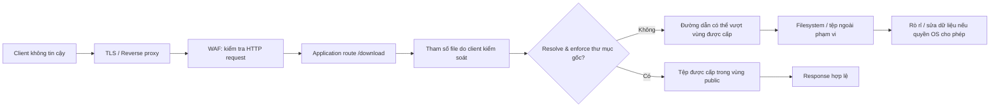
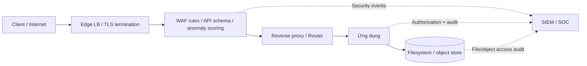

# Path traversal

> **Học phần:** `SECURITY_NETWORK_SECURITY`  
> **Chương:** Web application firewall  
> **Chủ đề:** Nhận diện và phòng vệ lỗi *path traversal* (directory traversal) trong ứng dụng web, API và luồng phân phối tệp; hiểu rõ vai trò của WAF, xác thực kết nối, phân đoạn, ghi log và cơ chế kiểm tra đường dẫn an toàn ở ứng dụng.

## Mục tiêu học tập

Sau bài này, người học có thể:

1. Giải thích path traversal, tài sản bị ảnh hưởng và ranh giới thư mục mà request không được phép vượt qua.
2. Nhận diện đường dẫn nguy hiểm trong URL path, query parameter, form, header, JSON, archive entry và metadata lưu trữ tệp.
3. Phân biệt path traversal với local file inclusion (LFI), remote file inclusion (RFI), SSRF, truy cập sai quyền và lỗ hổng cấu hình web server.
4. Mô tả cách URL decoding, path normalization, hệ điều hành, reverse proxy, framework và WAF có thể hiểu **khác nhau** cùng một request.
5. Thiết kế WAF rule, policy kiểm thử và log để phát hiện/chặn bất thường nhưng hạn chế chặn nhầm.
6. Áp dụng phòng vệ tại ứng dụng: dùng định danh tài nguyên, allowlist, kiểm soát real path, quyền hệ điều hành và xử lý symlink/race condition.
7. Liên hệ với các lớp phòng vệ mạng khác: DMZ, firewall, TLS, IDS/IPS, VPN, DNS, giám sát xâm nhập và cloud storage.

## 1. Path traversal là gì?

**Path traversal** (còn gọi là *directory traversal*) là lỗi khi ứng dụng dùng một giá trị do bên ngoài kiểm soát để tạo đường dẫn đến tệp/thư mục, nhưng không giới hạn kết quả trong **thư mục hoặc nhóm tài nguyên được cấp phép**.

Đoạn `..` trong đường dẫn hệ thống tệp thường có nghĩa **đi lên thư mục cha**. Nếu ứng dụng ghép trực tiếp chuỗi đầu vào với đường dẫn gốc, một giá trị như `../` có thể khiến việc truy cập thoát khỏi thư mục dự kiến.

Ví dụ giả định:

```text
Thư mục ứng dụng được phép đọc:
  /srv/app/public/reports/

Tệp hợp lệ:
  /srv/app/public/reports/summary.pdf

Tham số tên tệp do client gửi:
  ../internal/test.txt

Nếu ghép trực tiếp rồi hệ điều hành xử lý đường dẫn:
  /srv/app/public/reports/../internal/test.txt
           └─ thư mục reports bị vượt qua
```

Trong tình huống thực, tác động phụ thuộc tệp có tồn tại, quyền đọc/ghi của tiến trình, chính sách filesystem, kiểm tra ứng dụng và đường đến handler. **Chuỗi chứa `..` chưa tự chứng minh đã khai thác thành công**.

### Các tài sản có thể bị ảnh hưởng

- **Bí mật cấu hình:** thông tin kết nối dịch vụ, khóa hoặc tham số triển khai nếu có thể đọc từ vùng không dành cho request.
- **Dữ liệu người dùng:** tài liệu lưu ngoài thư mục public, báo cáo nội bộ, hồ sơ riêng nếu ứng dụng thiếu phân quyền.
- **Tệp vận hành:** log, cấu hình app, template, artifact build, dữ liệu hỗ trợ sao lưu.
- **Tính toàn vẹn:** một chức năng ghi tệp có đường dẫn không an toàn có thể ghi đè hoặc tạo tệp ở vị trí không mong muốn.
- **Tính sẵn sàng:** thao tác xóa/di chuyển tệp không an toàn có thể gây mất dữ liệu hoặc làm ứng dụng gián đoạn.

Path traversal có thể xuất hiện ở thao tác **đọc, ghi, liệt kê, tạo, giải nén, đổi tên hoặc xóa**. Bởi vậy chỉ bảo vệ endpoint “download file” là chưa đủ khi ứng dụng còn các điểm xử lý tệp khác.

## 2. Ví dụ luồng request và ranh giới tin cậy

Xét API hợp pháp sau:

```http
GET /download?file=summary.pdf HTTP/1.1
Host: files.example.test
```

Backend dự định chỉ đọc tài liệu trong `/srv/app/public/reports/`. Nếu xử lý `file` không an toàn, một request thử nghiệm có thể chứa `../internal/test.txt`. Giả định đây là **môi trường lab được phép**, với các tệp giả lập không nhạy cảm.



Ở đây có ít nhất ba **trust boundary**:

1. **Internet/client → WAF/reverse proxy:** Request có thể chứa dữ liệu bất kỳ. WAF kiểm tra được các thành phần HTTP mà nó nhìn thấy sau xử lý TLS nếu được bố trí phù hợp.
2. **WAF/proxy → ứng dụng:** Chuẩn hóa URL, percent decoding, định tuyến và việc xử lý header có thể khác nhau giữa hai thành phần.
3. **Ứng dụng → filesystem:** Giá trị từ client chuyển thành quyền truy cập tệp của **tiến trình server**. Đây là ranh giới phải được kiểm soát chặt nhất.

WAF ở lớp ngoài có thể **giảm số request đáng ngờ tới backend**, nhưng quyết định tài nguyên nào được đọc và trả cho người dùng vẫn phải do ứng dụng và hệ thống quyền thực thi.

## 3. Nguyên nhân gốc: dùng đầu vào làm đường dẫn có quyền

Một mẫu thiết kế lỗi thường gặp là:

```java
// Ví dụ minh họa lỗi thiết kế; không dùng làm code production.
Path base = Path.of("/srv/app/public/reports");
String fileName = requestParameter;
Path file = base.resolve(fileName);
byte[] bytes = Files.readAllBytes(file);
```

Giá trị `requestParameter` đến từ client. Nếu client kiểm soát cả thành phần đường dẫn, ứng dụng không đảm bảo `file` nằm trong `base`. Việc `Path.resolve()` tạo đối tượng đường dẫn **không tự** thực thi giới hạn quyền truy cập thư mục.

Ngoài việc ghép chuỗi/tạo `Path`, các lỗi tương tự xảy ra khi:

- Ứng dụng xây path từ URL path, form input, tên file trong header, JSON hoặc metadata.
- Handler tĩnh/web server ánh xạ URL vào filesystem với cấu hình alias/root không nhất quán.
- Bộ upload dùng trực tiếp tên file do người dùng gửi để đặt vị trí lưu.
- Tiến trình giải nén sử dụng tên entry trong ZIP/TAR mà không kiểm tra vị trí kết quả (**Zip Slip** là một biến thể liên quan).
- Worker lưu hoặc phục hồi backup từ path do job configuration, message queue hay user chọn.
- Ứng dụng tin rằng client chỉ gửi tên file vì frontend đã hạn chế ô nhập; API backend lại không kiểm tra.

### Đường dẫn “trông có vẻ hợp lệ” vẫn có thể nguy hiểm

Chỉ dò chuỗi `../` chưa đủ do có nhiều biểu diễn cùng ngữ nghĩa hoặc các đặc điểm xử lý ở các tầng:

| Nhóm đầu vào | Ví dụ lab hoặc bối cảnh | Điều phải xác minh |
|---|---|---|
| Relative path có thư mục cha | `../internal/test.txt` | Có vượt khỏi base directory sau normalize không? |
| Percent encoding | `%2e%2e%2finternal%2ftest.txt` | Tầng nào decode, decode mấy lần, WAF/backend có nhất quán không? |
| Separator khác nhau | `..\internal\test.txt` | Windows hoặc thành phần trung gian có coi `\` là separator không? |
| Absolute path | `/tmp/example.txt` hoặc đường dẫn kiểu drive trên Windows | Khi dùng `resolve`, đường dẫn tuyệt đối có thay thế base không? |
| Symlink | Một file/link trong base trỏ ra ngoài | Normalize từ vựng có phát hiện việc symlink trỏ ra ngoài không? |
| Tên lưu trữ/archive | `../outside.txt` trong tên entry giải nén | Entry được resolve tương đối với thư mục giải nén thế nào? |
| Path nhiều thành phần | `subdir/../../other.txt` | Kết quả chuẩn hóa và real path sau xử lý |
| Cloud object key | Key chứa `../` như chuỗi ký tự | Object storage có thực sự diễn giải như thư mục không, hay chỉ ứng dụng trung gian diễn giải? |

**Chú ý:** Một object key trong nhiều dịch vụ object storage chỉ là chuỗi khóa, không nhất thiết được hệ thống lưu trữ diễn giải thành đường dẫn thư mục. Rủi ro xuất hiện khi ứng dụng, gateway, bộ đồng bộ hoặc công cụ giải nén **chuyển** key đó thành đường dẫn trên filesystem hoặc dùng key sai phạm vi. Không nên khẳng định mọi tên khóa chứa `..` đều là traversal thực tế.

## 4. Normalization, canonicalization và decoding

Hai tầng có thể nhìn thấy những biểu diễn khác nhau của cùng một request:

```text
HTTP request gốc
    ↓
TLS termination / WAF
    ↓ (một chính sách decode/normalize)
Reverse proxy / load balancer
    ↓ (có thể rewrite URL)
Framework router / request parser
    ↓ (decode và parse thành tham số)
Application file/path logic
    ↓ (OS xử lý dấu phân cách, symlink, mount)
Filesystem
```

### 4.1 Percent encoding

Trong URL, ký tự có thể được biểu diễn bằng mã phần trăm. Chẳng hạn:

- `.` → `%2e`
- `/` → `%2f`
- `\` → `%5c`

Một số lớp tự decode, số khác không hoặc có chế độ khác nhau giữa URL path và query. **WAF và backend phải thống nhất cách diễn giải request**, hoặc phải thiết kế sao cho backend vẫn an toàn ngay cả khi WAF không nhận diện một biểu diễn đầu vào.

Tránh chiến lược “cứ decode nhiều lần đến khi không đổi” một cách tùy tiện. Các quy tắc decode ở các tầng và cách xử lý URL phải được định nghĩa rõ; ứng dụng nên nhận dữ liệu đã được framework parse theo hợp đồng nhất quán và kiểm tra loại dữ liệu mà nghiệp vụ thực sự cho phép.

### 4.2 Normalize từ vựng khác real path

- **Normalization** theo kiểu từ vựng thường xử lý dấu `.` và `..`, dấu phân cách hoặc các thành phần dư thừa mà **không kiểm tra filesystem**.
- **Canonical/real path** giải quyết thông tin thực của filesystem, thường bao gồm symlink, để biết tệp cuối cùng được tham chiếu ở đâu.
- **Authorization** kiểm tra principal có được phép đọc/ghi **tài nguyên cụ thể** hay không; đây là bước khác với kiểm tra path nằm trong directory.

Ví dụ, `/srv/app/public/reports/link.pdf` có thể là một symlink trỏ ra ngoài thư mục `reports`. So sánh chuỗi sau `normalize()` vẫn có thể thấy path nằm dưới base, trong khi real target không nằm đó. Do đó, với filesystem có symlink, phải kiểm tra **đích thực** và tính ổn định của hệ thống tệp.

### 4.3 Tại sao `startsWith` theo chuỗi có thể sai?

Kiểm tra như:

```java
// Không nên dùng để kiểm soát ranh giới thư mục.
if (candidate.toString().startsWith("/srv/app/public")) {
    // ...
}
```

có thể chấp nhận cả đường dẫn bắt đầu bằng chuỗi `/srv/app/public-backup` dù đó là **thư mục khác**. Nên dùng API `Path.startsWith(Path)` kiểm tra theo **thành phần path**, sau khi giải quyết path thực phù hợp và vẫn kiểm soát race/symlink.

Đối với Windows, phân biệt drive, đường dẫn UNC, ký tự phân cách và quy tắc case-sensitivity thực tế của filesystem. Một quy tắc chỉ được thử trên Linux không chắc đúng trên Windows.

## 5. Path traversal khác gì với các lỗi liên quan?

| Lỗi | Cơ chế chính | Quan hệ với path traversal |
|---|---|---|
| **Path/directory traversal** | Đầu vào làm truy cập vượt thư mục hoặc phạm vi đường dẫn được phép | Trọng tâm bài học |
| **Local File Inclusion (LFI)** | Ứng dụng include/thực thi/nạp nội dung từ tệp cục bộ ngoài dự kiến | Có thể được dẫn tới bởi traversal, nhưng ý nghĩa “include” khác thao tác đọc file |
| **Remote File Inclusion (RFI)** | Ứng dụng include hoặc nạp tài nguyên từ vị trí từ xa ngoài dự kiến | Phụ thuộc ngôn ngữ/cấu hình; không phải chỉ là đi lên thư mục |
| **Arbitrary file read/write** | Đọc/ghi tệp ngoài quyền; có thể do nhiều loại lỗi | Traversal là một trong các nguyên nhân |
| **Zip Slip / archive traversal** | Tên entry sau giải nén thoát khỏi thư mục đích | Biến thể của vấn đề giới hạn đường dẫn |
| **SSRF** | Server bị lợi dụng gửi yêu cầu mạng tới đích không được phép | Có thể liên quan API tải tài nguyên nhưng không giống truy cập filesystem |
| **IDOR/BOLA** | User truy cập object không được cấp quyền qua ID/key hợp lệ | Dù path nằm trong base, vẫn có thể bị lộ do thiếu authorization |
| **Static file misconfiguration** | Alias/root/route khiến server công bố tệp không đúng phạm vi | Có thể tạo biểu hiện tương tự nhưng gốc nằm ở cấu hình |

Ví dụ: endpoint `/download?id=invoice-42` có thể chỉ truy xuất trong thư mục hợp lệ nhưng vẫn trả hóa đơn của người khác. Đây là lỗi **authorization** dù không có `..`. Ngược lại, một đường traversal có thể bị chặn bởi quyền filesystem ngay cả khi WAF không phát hiện.

Cần mô tả **kết quả và điều kiện thực tế**, tránh gắn mọi request chứa ký tự lạ thành một lỗ hổng đã bị khai thác.

## 6. Path traversal trong thực tế ứng dụng web và API

### 6.1 Tải xuống tài liệu

Một API nhận `file` hoặc `path` để tải tệp. Nếu backend ghép trực tiếp giá trị này vào thư mục lưu, user có thể yêu cầu vị trí ngoài thư mục được cấp. Thiết kế tốt là client chỉ gửi **mã tài liệu**; server ánh xạ mã đó tới tệp/đối tượng đã được quản lý, kiểm tra quyền user và không cho client điều khiển đường dẫn thực.

### 6.2 Upload file hoặc tên file trong Content-Disposition

Tên file gửi từ trình duyệt hoặc client HTTP **không đáng tin**, kể cả khi được cung cấp qua multipart form. Việc ghi trực tiếp theo tên client có thể tạo đường dẫn không mong muốn; có thể phát sinh xung đột tên, ghi đè hoặc lỗi filesystem.

Nên tạo tên lưu bằng ID ngẫu nhiên/định danh nội bộ, đặt dưới thư mục riêng, kiểm tra content type theo nhu cầu, quota và quyền truy cập. Giữ tên gốc (đã được xử lý an toàn) như metadata hiển thị chứ không dùng làm quyền chọn vị trí lưu.

### 6.3 Ghi log, xuất báo cáo và hệ thống template

Hàm `export?destination=...`, công cụ tạo báo cáo, server-rendered templates, hệ thống nạp cấu hình hoặc scheduler có thể sử dụng path từ request/message. Đặc biệt thận trọng nếu tác vụ chạy với quyền cao hơn user, ví dụ service ghi lên thư mục cấu hình.

Đặt logic kiểm tra path **ở lớp service xử lý tệp**, không chỉ ở frontend, vì cùng một service có thể được gọi từ web API, queue, cron hoặc component nội bộ.

### 6.4 Giải nén và khôi phục bản sao

Một archive có thể chứa entry với tên đường dẫn tương đối; khi giải nén, cần kiểm tra path đích của **từng entry** có nằm trong thư mục giải nén được cấp không. Kiểm tra tên archive ban đầu hoặc đuôi `.zip` chưa đủ. Cân nhắc symlink, hard link, quyền file, số lượng file, dung lượng nén/giải nén và giới hạn tài nguyên để tránh cả lỗi bảo mật lẫn quá tải.

### 6.5 Tệp tĩnh qua CDN, gateway hoặc cloud

Khi một web server/proxy ánh xạ URL tới thư mục gốc, cấu hình rewrite/alias và normalization có thể ảnh hưởng mapping thực. Với cloud storage, phải phân biệt **object key** với đường dẫn OS; serverless function hoặc worker có thể đưa key thành file path khi tải về disk. Dùng quyền bucket/object tối thiểu và đảm bảo việc ánh xạ tài nguyên tuân theo phạm vi tenant/owner.

## 7. Vai trò của Web Application Firewall (WAF)

**WAF** phân tích request/response HTTP(S) tại điểm được triển khai để áp chính sách bảo vệ ứng dụng web. Tùy sản phẩm và chế độ, WAF có thể xem URL path, query, header, body, cookie, method, client metadata và các tín hiệu bất thường.

Đối với path traversal, WAF có thể:

- Phát hiện mẫu thư mục cha, dấu phân cách hoặc biểu diễn mã hóa đáng ngờ sau khi chuẩn hóa theo khả năng engine.
- Giới hạn cấu trúc URL/parameter được phép với endpoint cụ thể.
- Ghi log event, rule ID, anomaly score và bối cảnh request để phục vụ điều tra.
- Chặn, challenge hoặc chỉ ghi nhận request khi chính sách/mức tin cậy phù hợp.
- Kết hợp bot protection, rate limiting, API schema validation hoặc hành vi để giảm lạm dụng.

**Giới hạn cốt lõi:** WAF không biết đầy đủ permission của tiến trình, nội dung filesystem, symlink, ánh xạ ID tài nguyên và quyền của user. Một WAF có rule path traversal tốt **không thay thế** kiểm soát đường dẫn trong backend.

### WAF đặt ở đâu?



Sơ đồ minh họa; WAF có thể chạy trên CDN, reverse proxy, API gateway hoặc trong server. Nếu traffic giữ mã hóa end-to-end mà WAF không có khả năng đọc HTTP plaintext tại điểm đặt, WAF không thể kiểm tra payload như kỳ vọng. Trong hệ thống sử dụng nhiều ingress (ví dụ public CDN và private API gateway), cần biết **mọi đường tới backend** có đi qua policy được thiết kế hay không.

## 8. Detection logic: từ pattern đến quy tắc theo endpoint

Một số WAF dùng tập rule chung (generic ruleset) để tìm dấu hiệu path traversal; cũng có thể dùng **positive security model** để giới hạn input theo schema/allowlist. Hai cách nên phối hợp.

### 8.1 Dấu hiệu có ích

| Thành phần request | Tín hiệu cần xem | Ví dụ công việc bảo vệ |
|---|---|---|
| URL path | Thành phần `..` hoặc đường dẫn sau normalize vượt route | Kiểm tra mapping file/static route |
| Query parameter `file`/`path` | Cấu trúc path khác schema của endpoint | Với tài liệu chỉ cho phép ID hoặc tên trong danh sách |
| Body JSON/form | Giá trị là đường dẫn khi nghiệp vụ chỉ chờ ID | Giới hạn type/format và độ dài |
| Multipart filename | Đường dẫn thay vì tên file đơn | Dùng ID do server tạo, không tin filename |
| Archive entry | Tên entry thoát khỏi output root khi giải nén | Kiểm tra tại ứng dụng/worker; WAF thường không thấy nội dung archive đã giải nén |
| Chuỗi mã hóa/biểu diễn khác | Decode/normalize mismatch giữa các tầng | Đồng bộ parse và kiểm thử các representation |
| File access audit | Request đến file ngoài vùng cấp quyền | Xác nhận tác động và sửa ứng dụng |

Trong các log WAF, tín hiệu chỉ là **một phần bằng chứng**. Một request bị WAF chặn không chứng minh backend có lỗ hổng; một request WAF cho qua cũng không chứng minh endpoint an toàn.

### 8.2 Rule mẫu ở dạng chính sách (không phụ thuộc sản phẩm)

```yaml
policyId: WAF-FILE-DOWNLOAD-ALLOW-SCHEMA
route:
  method: GET
  path: /download
requestContract:
  acceptedQueryParameters:
    - documentId
  documentId:
    type: string
    pattern: "^[A-Za-z0-9_-]{1,64}$"
decision:
  malformedRequest: deny
  authorizedRequest: pass_to_backend
logging:
  includeRuleId: true
  includeRequestId: true
  redactSensitiveParameters: true
owner: document-platform
```

Mẫu là **mô tả mục tiêu**, không phải cấu hình cú pháp của ModSecurity, NGINX, AWS WAF hay một nhà cung cấp cụ thể. Sự phù hợp của regex, engine, JSON parser, transformation và cách đánh giá rule phải được xác minh trước khi triển khai.

**Tại sao dùng `documentId` có schema chặt?** Endpoint không cần chấp nhận đường dẫn do client cung cấp. Khi biểu diễn tài nguyên bằng ID, ứng dụng có thể ánh xạ ID tới tệp hợp lệ, giảm bề mặt traversal ngay từ giao diện API.

### 8.3 Pattern blocking không đủ

Đơn giản tìm `../` có thể bỏ sót cách biểu diễn khác hoặc chặn nhầm đường dẫn hợp lệ trong những ứng dụng thật sự xử lý đường dẫn tương đối. Cần xem:

- Engine đã xử lý URL decode, case, unicode hay path normalization chưa.
- Tầng nào xác định path vs query vs body, và có decode lặp ngoài dự kiến không.
- Reverse proxy có rewrite/normalize path trước khi đưa tới framework không.
- Rule có áp cho mọi route hay chỉ route/file parameter có nguy cơ.
- Request gốc và giá trị chuẩn hóa nào được ghi vào audit; có lộ bí mật trong log không.

Các tập quy tắc như **OWASP Core Rule Set (CRS)** cung cấp lớp phát hiện chung cho nhiều loại tấn công HTTP, trong đó có path traversal; vẫn cần cấu hình theo ứng dụng, test false positive và cập nhật theo phiên bản. Không giả định mọi WAF sử dụng cùng mã rule, cùng scoring hoặc transformations.

## 9. Khác biệt chuẩn hóa giữa WAF, proxy và backend

Khi hai thành phần **diễn giải URL khác nhau**, một request có thể bị WAF đánh giá theo một chuỗi nhưng backend lại xử lý theo một đường dẫn khác. Điều này thường gọi chung là *parser/normalization discrepancy*.

```mermaid
sequenceDiagram
    autonumber
    participant C as Client
    participant W as WAF
    participant P as Reverse proxy
    participant A as Application
    participant F as Filesystem
    C->>W: HTTP request chứa giá trị đường dẫn
    W->>W: Parse và chuẩn hóa theo WAF policy
    alt WAF nhận diện input không hợp lệ
        W-->>C: Từ chối và ghi event
    else WAF không chặn
        W->>P: Forward request
        P->>A: Rewrite/parse theo proxy và framework
        A->>A: Kiểm tra input + ánh xạ resource + authorization
        alt Resource hợp lệ, nằm trong phạm vi và user có quyền
            A->>F: Mở tệp được cấp
            F-->>A: Dữ liệu tệp
            A-->>C: Trả nội dung đúng quyền
        else Invalid path hoặc thiếu quyền
            A-->>C: Từ chối; không truy cập ngoài phạm vi
        end
    end
```

**Tình huống quan trọng:** WAF đã xử lý phần trăm một lần, backend lại nhận chuỗi và giải mã thêm. Để tránh sai khác, nên:

1. Thiết kế **hợp đồng input** đơn giản (ví dụ ID thay cho raw path).
2. Xác định rõ một tầng tin cậy chịu trách nhiệm parse và decode request.
3. Không thực hiện decode bổ sung tùy tiện sau khi framework đã parse.
4. Thực thi kiểm tra **resource/real path** và quyền ngay tại application/handler.
5. Test request qua **toàn bộ chuỗi ingress** thực tế, bao gồm CDN, WAF, proxy và framework.

WAF policy có thể giúp phát hiện các cách biểu diễn đáng ngờ, nhưng khả năng bảo vệ cuối cùng không nên phụ thuộc vào việc dự đoán được mọi biến thể payload.

## 10. Phòng vệ tại ứng dụng: ưu tiên tài nguyên theo ID

Cách đơn giản và an toàn hơn là **không nhận path từ client** nếu nghiệp vụ chỉ cần “tải tài liệu X”. Thay vì:

```text
GET /download?file=team-2026/report.pdf
```

có thể dùng:

```text
GET /documents/doc_7QF2/download
```

Ứng dụng kiểm tra:

1. Người dùng đã xác thực và có quyền đọc tài liệu `doc_7QF2` không?
2. ID có tồn tại trong cơ sở dữ liệu quản lý tài liệu không?
3. Bản ghi tài liệu tham chiếu đến object hoặc đường dẫn nội bộ nào?
4. Dịch vụ chỉ mở file/object **được server quản lý**, theo quyền tối thiểu không?

Điều này giải quyết đồng thời **kiểm soát tài nguyên theo nghiệp vụ** và loại bỏ nhu cầu cho client quyết định thư mục. Nó cũng giúp phân biệt yêu cầu không tồn tại, không có quyền và lỗi server.

### Java: ánh xạ ID sang tệp đã đăng ký

Ví dụ tối giản, giả định thư mục tài liệu thuộc quyền quản lý của ứng dụng, không cho client ghi vào và không bị tác nhân khác tự ý thay đổi symlink khi request đang chạy:

```java
import java.io.IOException;
import java.nio.file.Files;
import java.nio.file.Path;
import java.util.Map;

public final class DocumentReader {
    private final Path trustedRoot;
    private final Map<String, String> registeredNames = Map.of(
        "manual", "manual.pdf",
        "policy", "policy.pdf"
    );

    public DocumentReader(Path storageRoot) throws IOException {
        this.trustedRoot = storageRoot.toRealPath();
    }

    public byte[] readForAuthorizedUser(String documentId) throws IOException {
        // Bước trước đó: xác minh user có quyền đối với documentId.
        String serverManagedName = registeredNames.get(documentId);
        if (serverManagedName == null) {
            throw new IllegalArgumentException("Document not found");
        }

        // Lấy path thực và kiểm tra theo thành phần Path, không so sánh chuỗi.
        Path realFile = trustedRoot.resolve(serverManagedName).toRealPath();
        if (!realFile.startsWith(trustedRoot) || !Files.isRegularFile(realFile)) {
            throw new SecurityException("File is outside the allowed store");
        }
        return Files.readAllBytes(realFile);
    }
}
```

**Giới hạn của ví dụ:** Phần authorization được nêu rõ là điều kiện trước, chưa được hiện thực trong đoạn code. `toRealPath()` kiểm tra filesystem tại thời điểm gọi, nhưng nếu đường dẫn/symlink bị sửa **giữa kiểm tra và mở tệp** thì có nguy cơ *time-of-check to time-of-use (TOCTOU)*. Bởi vậy cần giữ kho tài liệu **không thể bị sửa bởi principal không tin cậy**, hoặc dùng API mở tệp theo directory handle và kiểm soát symlink/race (chẳng hạn `SecureDirectoryStream` ở nền tảng hỗ trợ), cùng quyền OS phù hợp.

Trong hệ thống thật, thường nên dùng ID → object key đã quản lý, download qua storage API theo IAM/resource permission hoặc streaming thay vì đọc toàn bộ file bằng `readAllBytes()` (có thể tốn bộ nhớ với file lớn).

### Khi nghiệp vụ bắt buộc cho phép đường dẫn tương đối

Nếu cần nhận đường dẫn con như `subdir/report.pdf`, hãy:

- Định nghĩa rõ loại path hợp lệ, ký tự và quy tắc decode.
- Từ chối đường dẫn **tuyệt đối**, NUL hoặc các giá trị trái schema, không cho chọn ổ/UNC ngoài root.
- Resolve dưới **trusted root**, chuẩn hóa và kiểm tra ranh giới bằng `Path` API.
- Giải quyết symlink/real path, kiểm tra file cuối cùng vẫn thuộc root tin cậy.
- Giữ quyền truy cập OS tối thiểu; không để user tùy ý thay link/path trong khoảng kiểm tra và sử dụng.
- Luôn xác minh **quyền đọc/ghi đối tượng** của user, không chỉ vị trí trong thư mục.

**Không coi blacklisting `../` là biện pháp duy nhất.** Điều kiện chuẩn là đường dẫn kết quả và thao tác thực sự thuộc phạm vi được cấp.

## 11. Phòng vệ cho upload, giải nén và ghi tệp

### Upload

Một chiến lược phù hợp khi nhận multipart upload:

1. Tách **display name** khỏi **storage name**.
2. Tạo storage key/filename do server quản lý, tránh dùng tên từ header làm đường dẫn OS.
3. Xác minh user có quyền upload vào collection/tenant tương ứng.
4. Lưu vào vùng chỉ được cấp quyền tối thiểu, không dùng thư mục thực thi mã hoặc cấu hình.
5. Giới hạn dung lượng, số lượng file, loại nội dung theo nghiệp vụ và quét nội dung khi cần.
6. Ghi audit đối tượng tạo ra, owner, thời điểm và vị trí lưu nội bộ.

### Giải nén archive

Với mỗi entry, phải kiểm tra vị trí đích **trước khi ghi**. Mẫu mã giả:

```text
destinationRoot = trustedExtractionDirectory

for each archiveEntry:
    check entry name/type/limits
    candidate = resolve(destinationRoot, entry.name)
    reject if absolute or escapes destinationRoot

    if entry is symbolic-link/hard-link or special file:
        reject unless strictly required and safely supported

    open destination safely under root
    write with size/count/time limits
```

Trong một implementation thực, chỉ dùng `normalize + startsWith` ở thời điểm kiểm tra **chưa đủ** nếu thư mục/entry có thể bị thay đổi trong lúc giải nén; cần thiết kế chống symlink và race theo filesystem, cũng như giới hạn *zip bomb* và quyền tạo file.

### Ghi/xóa/di chuyển tệp

Các thao tác thay đổi dữ liệu thường có tác động nghiêm trọng hơn đọc. Thiết kế API theo ID và policy đối tượng, dùng đường dẫn/kho lưu do server quản lý, yêu cầu quyền riêng cho các thao tác quản trị, có backup/rollback khi phù hợp và audit thay đổi.

## 12. Phân đoạn mạng và quyền tiến trình giảm tác động ra sao?

Path traversal là lỗi ở ranh giới **ứng dụng ↔ filesystem**, nhưng các lớp phòng vệ mạng vẫn giúp hạn chế chuỗi tấn công và xử lý sau xâm phạm.

| Lớp | Vai trò | Giới hạn |
|---|---|---|
| **WAF / reverse proxy** | Chặn dấu hiệu HTTP bất thường, kiểm tra API schema, rate limiting | Không thay thế đường dẫn thực/quyền tệp bên trong |
| **Ingress firewall / DMZ** | Chỉ cho Internet vào endpoint công khai cần thiết | Endpoint public vẫn có thể có lỗi ứng dụng |
| **Egress firewall** | Giảm kết nối ngoài dự kiến từ backend nếu bị lạm dụng | Không ngăn file read tại chính backend |
| **Network segmentation** | Chặn backend kết nối trực tiếp tới data/management không cần thiết | Không sửa lỗi filesystem ở host |
| **OS permissions / sandbox** | Giới hạn tệp mà tiến trình có thể đọc/ghi | Cần cấu hình least privilege thực và tránh mount bí mật không cần |
| **Container / cloud IAM** | Hạn chế volume mount, object bucket, secret và quyền control plane | IAM không tự kiểm tra raw path trong app |
| **Authentication / authorization** | Xác định user có quyền với tài liệu/hành động cụ thể | Vẫn cần giới hạn path để ngăn nhầm tài nguyên |
| **IDS/IPS / EDR / SIEM** | Phát hiện request, file access, network bất thường | Chỉ có alert không phải bằng chứng đầy đủ của khai thác |

Ví dụ, nếu service web chạy dưới user chỉ có quyền đọc trong `/srv/app/public/reports/` và không thể đọc tệp cấu hình bí mật, tác động của một lỗi traversal có thể giảm đáng kể. Cần đồng thời **không mount secret quá rộng**, tránh cấp service account quyền quản trị, giới hạn kết nối ra ngoài và tách khu vực quản trị.

Trong Kubernetes/cloud, việc dùng read-only root filesystem, mount riêng volume, non-root user, seccomp/AppArmor/SELinux khi hỗ trợ, IAM scope hẹp và NetworkPolicy có thể bổ trợ. Không có một cài đặt nào đơn lẻ bảo đảm path traversal không xảy ra.

## 13. Logging và phát hiện path traversal

Một WAF hoặc IDS có thể ghi nhận request đáng ngờ; application audit mới giúp kiểm chứng **hành động với tài nguyên thực**. Cần liên kết qua request ID/trace ID.

| Nguồn | Trường có ích | Câu hỏi cần trả lời |
|---|---|---|
| **WAF** | Timestamp, rule ID, action, URI/parameter đã được redaction, anomaly score, client metadata | Request bị chặn, challenge hay được chuyển tiếp? |
| **Reverse proxy** | Route, normalized URI, upstream, HTTP status, request ID | Proxy đã forward đến backend nào? |
| **Application** | Principal, document ID, validation decision, path policy result, authorization result | User được phép với tài liệu nào; ứng dụng đã từ chối gì? |
| **Filesystem/EDR** | Process identity, file path hoặc asset ID được bảo vệ, hoạt động đọc/ghi | Có thực sự đọc/ghi tệp ngoài phạm vi không? |
| **Cloud storage audit** | Principal, bucket/object, action, resource policy decision | Có object ngoài quyền đã được truy xuất không? |
| **Firewall/IDS/IPS** | Session metadata, IP/port, rule ID, dấu hiệu lưu lượng | Có đường kết nối bất thường sau sự kiện web không? |

### Các dấu hiệu cần điều tra

- Một client liên tục gửi tên path có thành phần thư mục cha vào endpoint tải/ghi file.
- Request chứa dạng mã hóa lạ hoặc normalization mismatch làm WAF và backend ghi nhận khác nhau.
- Nhiều lỗi `400`/`403`/`404` kèm WAF traversal detection trên cùng endpoint; cần phân biệt người dùng thao tác sai với quét tự động.
- File service ghi nhận yêu cầu tới tài nguyên ngoài collection/tenant của user.
- Một tiến trình web bỗng đọc các vị trí cấu hình, secret, log không thuộc nghiệp vụ.
- Sau request đáng ngờ xuất hiện hoạt động outbound hoặc admin API không thường gặp (liên hệ điều tra, chưa tự chứng minh quan hệ nhân quả).

**Đừng ghi nguyên văn token, cookie, nội dung file nhạy cảm hay toàn bộ upload body vào log chung.** Với những input có thể chứa bí mật, chỉ lưu lượng thông tin đủ phục vụ điều tra và áp chính sách retention/quyền truy cập. Request ID, rule ID, normalized path classification và kết quả auth thường hữu ích hơn dump toàn bộ payload.

### Mẫu event giả định

```json
{
  "timestamp": "2026-11-28T08:15:00Z",
  "requestId": "req-demo-42",
  "method": "GET",
  "route": "/download",
  "wafRule": "TRAVERSAL-SCHEMA-001",
  "wafDecision": "BLOCK",
  "reason": "file parameter violates expected document ID format",
  "backendReached": false,
  "principal": "anonymous"
}
```

Đây là dữ liệu mô phỏng. Tên trường và khả năng ghi quyết định `backendReached` phụ thuộc logging thật; không suy ra “backend không bị truy cập” chỉ dựa vào việc một log riêng lẻ có giá trị BLOCK mà chưa đối chiếu đường ingress.

## 14. Triển khai WAF policy giảm false positive

Nếu bật rule traversal chung ở chế độ **block toàn bộ** mà không kiểm thử, một số ứng dụng hợp lệ xử lý path tương đối hoặc tên file có ký tự đặc biệt có thể bị chặn nhầm.

Quy trình khuyến nghị:

1. **Inventory endpoint có chức năng file:** download, upload, export, import, archive, template, static file, preview.
2. **Định nghĩa hợp đồng request:** endpoint nào chỉ chấp nhận ID, endpoint nào cho phép tên file đơn, endpoint nào thực sự cho phép đường dẫn con.
3. **Chọn rule và transformations:** hiểu engine WAF đang decode/normalize như thế nào, có hoạt động trên JSON/multipart/URL path hay không.
4. **Bật detection/monitor mode** nếu nền tảng hỗ trợ; thu thập event và phân loại false positive theo route.
5. **Kiểm thử có đối chứng:** request hợp lệ phải chạy, input trái schema bị từ chối; WAF và backend có audit khớp nhau.
6. **Chặn có phạm vi:** ưu tiên rule chính xác theo route/parameter, loại trừ hẹp có owner thay vì tắt toàn bộ nhóm rule chung.
7. **Triển khai theo giai đoạn:** canary, giám sát HTTP error rate, WAF hit, throughput và trải nghiệm người dùng.
8. **Rà soát:** cập nhật rule set, giải quyết phát hiện mới, giới hạn ngoại lệ, xác nhận path vẫn được backend kiểm soát.

### Detection mode so với prevention mode

| Chế độ | Hành vi | Khi nào hữu ích | Rủi ro |
|---|---|---|---|
| **Detect / monitor** | Ghi log, không nhất thiết chặn | Baseline, thử rule mới, theo dõi false positive | Request độc hại có thể vẫn tới backend |
| **Block / prevent** | Từ chối request khớp điều kiện | Policy đã được kiểm chứng và có cơ chế xử lý sự cố | Chặn nhầm có thể làm gián đoạn ứng dụng |
| **Challenge / rate limit** | Áp bước kiểm tra hoặc giới hạn request | Bổ sung cho bot/automation khi phù hợp | Không thay thế authorization hoặc file path validation |

Không phải WAF nào cũng hỗ trợ mọi chế độ. Khi đánh giá hiệu quả, đo **tỷ lệ request thật được phân loại đúng** và **hành vi backend**, không chỉ số lượng alert.

## 15. Kịch bản lab: kiểm chứng endpoint download

**Môi trường giả định:** Trang `https://files.example.test` có API tải tài liệu. Root filesystem `/srv/app/public/reports` chứa `summary.pdf`. Một file giả lập `/srv/app/public/internal/test.txt` nằm ngoài thư mục được phép và không chứa bí mật thực. Mục tiêu là bảo đảm mọi request từ người dùng thường chỉ truy xuất tài liệu đã đăng ký.

### Bộ kiểm thử ở mức hành vi

| Ca thử | Đầu vào mẫu trong lab | Kỳ vọng tại WAF/ứng dụng |
|---|---|---|
| Hợp lệ | `documentId=manual` | Cho đi khi đúng quyền; trả tài liệu tương ứng |
| ID không tồn tại | `documentId=unknown` | Không lộ filesystem path; trả lỗi phù hợp |
| Input cố đi thư mục cha | `file=../internal/test.txt` | Không đọc file ngoài root; WAF có thể chặn, app phải chặn |
| Input mã hóa của thành phần cha | `file=%2e%2e%2finternal%2ftest.txt` | Không thay đổi kết quả bảo vệ dù parser/decoder khác nhau |
| Path tuyệt đối | `file=/tmp/example.txt` | Không đọc ngoài kho tài liệu |
| Path chứa separator kiểu Windows | `file=..\internal\test.txt` | Không vượt phạm vi trên nền tảng đích |
| Symlink ra ngoài root | Link được tạo chủ động trong lab | Ứng dụng không mở file ngoài thư mục cho phép |
| User khác truy cập ID tài liệu hợp lệ nhưng không được cấp | `documentId=private-42` | Từ chối do authorization dù path an toàn |
| Request HTTP hợp lệ nhưng chứa query lạ | Tham số không thuộc hợp đồng API | Đưa ra quyết định schema rõ ràng; không âm thầm dùng làm path |

Những giá trị mang ý nghĩa traversal được trình bày để **xác minh logic phòng vệ trên hệ thống được phép**, không nhằm gửi hàng loạt vào hệ thống bên ngoài.

### Gherkin: xác nhận cả WAF và backend

```gherkin
Feature: File download is isolated to authorized resources

  Scenario: Authorized user downloads a registered document
    Given a user allowed to read document "manual"
    When the user requests its download by document ID
    Then the service returns the registered document
    And an authorization audit event is recorded

  Scenario: Traversal-like input cannot read an internal test file
    Given a test file exists outside the allowed document root
    When a client submits a document parameter containing parent path components
    Then the WAF may block the malformed request
    And the backend must not return contents of the outside file
    And the denial is observable in authorized audit logs

  Scenario: A different encoding does not change the security invariant
    Given the API expects an opaque document ID
    When a client submits an encoded path instead of a valid document ID
    Then request validation rejects the unsupported format
    And no external file is accessed

  Scenario: Valid document ID never bypasses object authorization
    Given a document exists but belongs to another user
    When the current user requests that document ID
    Then the service denies access
    And no document bytes are disclosed
```

### Tiêu chí đạt

- Không thể đọc tệp nằm ngoài vùng được cấp, kể cả khi gửi biểu diễn path khác nhau.
- WAF đưa ra quyết định theo policy; backend vẫn an toàn khi request được forward.
- Không có đường khác như private API endpoint hay direct origin bypass kiểm tra cần thiết.
- Quyền đối tượng được kiểm tra độc lập với kiểm tra đường dẫn.
- Log có thể liên kết request với WAF/proxy/app; không ghi lộ dữ liệu nhạy cảm.
- Các request hợp lệ vẫn hoạt động, không tăng lỗi do rule quá rộng.

## 16. Chẩn đoán khi WAF chặn request tải tệp

| Triệu chứng | Giả thuyết | Hướng kiểm tra |
|---|---|---|
| `403` từ WAF khi tên file có ký tự đặc biệt | Generic traversal rule có false positive | Tìm rule ID, input field, transformation, route, định nghĩa schema |
| WAF không báo gì nhưng backend trả `403` | App đã chặn authorization hoặc path validation | Kiểm tra audit ở backend, user, document ID, chính sách |
| Một URL hoạt động qua proxy A nhưng lỗi qua proxy B | URL parsing/rewrite/decoding khác nhau | So sánh URI gốc và đã chuẩn hóa, backend route, cấu hình |
| WAF chặn nhưng vẫn thấy truy cập origin | Có đường ingress khác hoặc log không cùng request | Xác minh request ID, CDN/origin policy, network allowlist |
| Sau cấu hình WAF, nhiều download hợp lệ lỗi | Rule áp quá rộng, transform khác hợp đồng | Dùng detection mode/rollback có kiểm soát, thu hẹp rule |
| Endpoint upload lỗi với tên path lạ | Multipart filename không tuân contract | Tạo storage name phía server; lưu display name riêng |
| WAF cho qua nhưng tệp ngoài root bị đọc | Backend thiếu kiểm tra path hoặc quyền OS rộng | Ưu tiên sửa ứng dụng và giới hạn filesystem; rà soát hậu quả |
| Chỉ lỗi trên Windows hoặc khi chạy trong container | Separator, symlink, mount, working directory khác | Kiểm tra theo filesystem thực, Path API và container volume |
| Log phát hiện nhiều request nhưng không thấy dữ liệu bị lộ | Có thể chỉ là probing hoặc WAF đã chặn | Đối chiếu response, backend và filesystem audit |
| App trả `500` với path lạ | Exception chưa xử lý, lộ thông tin lỗi | Trả lỗi an toàn, không đưa đường dẫn thật/stack trace ra response |

Nếu một rule WAF vừa được cập nhật, cần phân biệt **WAF chặn đúng**, **backend chặn đúng** và **ứng dụng thật sự có lỗ hổng**. Một lỗi `403` không đủ để suy ra tầng nào đã ra quyết định. Luôn lưu request ID, route, policy version, thời điểm và đường ingress cụ thể.

## 17. Threat modeling path traversal theo STRIDE

Sử dụng STRIDE để đặt path traversal trong bức tranh phòng vệ tổng thể.

| Nhóm | Ví dụ liên quan | Kiểm soát phù hợp |
|---|---|---|
| **Spoofing** | Một client/tài khoản giả mạo dùng đường truy cập tài liệu | TLS, xác thực user/service, quản lý phiên |
| **Tampering** | Ghi đè file hoặc archive entry đi ra ngoài thư mục cấp | Server-managed path, filesystem permissions, archive validation |
| **Repudiation** | Không có log ai tải/xóa tài liệu hoặc ai đổi rule | Audit có request/principal/resource ID, log policy changes |
| **Information Disclosure** | Truy cập file nội bộ ngoài thư mục public | Root containment, object authz, OS least privilege, WAF |
| **Denial of Service** | Thao tác file gây quá tải hoặc phá dữ liệu | Quota, giới hạn tài nguyên, rate limit, quyền ghi/xóa |
| **Elevation of Privilege** | Truy cập/ghi file được thành phần có quyền cao xử lý dẫn tới khả năng ngoài quyền | Least privilege, tách dịch vụ, kiểm soát file và quyền ứng dụng |

Trong threat model, mô tả rõ:

- **Tác nhân:** user không xác thực, user hợp lệ quyền thấp, đối tác API hoặc workload bị chiếm.
- **Điểm vào:** `/download`, `/upload`, `/export`, job import/archive hoặc worker.
- **Ranh giới:** client input → app path; service identity → filesystem/object storage.
- **Tài sản:** tài liệu, cấu hình, secret, file log, nội dung tenant khác.
- **Điều kiện thành công:** thực sự đọc/ghi tệp ngoài phạm vi hoặc làm lộ tài nguyên không được cấp.
- **Giảm thiểu:** chuyển sang resource ID, path containment, authz, quyền OS, WAF, logging và segmentation.
- **Bằng chứng:** request/response, WAF decision, application audit, file access audit.

### Threat statement minh họa

> Một API cho phép user gửi tên file để download. Nếu backend ghép tên vào thư mục root mà không xác minh đường dẫn cuối cùng và quyền với tài liệu, người dùng ít quyền có thể yêu cầu tệp ngoài kho được cấp, dẫn đến lộ dữ liệu nếu tiến trình có quyền đọc. Khắc phục bằng API nhận document ID, ánh xạ server-side, object authorization, kiểm soát filesystem và WAF schema rule; xác nhận bằng test request hợp lệ, path trái phép và file ngoài root.

## 18. Quy trình xử lý sự cố nghi ngờ path traversal

1. **Xác nhận dấu hiệu:** Ghi request ID, WAF rule/action, route và thời điểm; phân biệt request bị chặn với request backend đã xử lý.
2. **Bảo toàn bằng chứng:** Proxy/WAF log, app audit, file access audit, policy version và các artifact liên quan theo quy trình; tránh đưa file nhạy cảm vào log chia sẻ.
3. **Đánh giá phạm vi:** Endpoint nào nhận raw path; tiến trình có quyền với loại file nào; có đường bypass WAF hoặc đường nội bộ không.
4. **Xác nhận tác động:** Dựa vào bằng chứng file access và dữ liệu trả về/thay đổi, không dựa vào request chứa `..` đơn lẻ.
5. **Giảm nguy cơ đang tiếp diễn:** Áp rule chặn hẹp ở WAF khi có bằng chứng, thu hồi đường truy cập không cần, hạn chế quyền filesystem và credential nếu có dấu hiệu lộ.
6. **Sửa nguyên nhân:** Loại bỏ raw path từ API khi có thể; áp kiểm tra path/authorization tại backend và review tất cả thao tác file liên quan.
7. **Kiểm thử hồi quy:** Test input hợp lệ, path vượt root, symlink, dạng mã hóa, multi-tenant auth và upload/archive; giám sát false positive.
8. **Rà soát phòng vệ:** Kiểm tra firewall/DMZ, quyền runtime/container, cloud IAM, log retention, rule update và việc phối hợp SOC–developer.

Trong sự cố thực tế, chính sách của tổ chức quy định trách nhiệm bảo mật, phản ứng và thông báo; nội dung bài này chỉ là khung kỹ thuật để phân tích.

## 19. Những hiểu nhầm thường gặp

**“WAF chặn `../` là đã sửa xong path traversal.”** Không. WAF có thể giảm một số request đáng ngờ, còn backend vẫn phải giới hạn quyền truy cập file. Đường ingress khác, encoding hoặc một handler nội bộ có thể không đi qua cùng WAF.

**“Chỉ cần `normalize()` là đủ.”** Không luôn đúng. Symlink, mount, quyền filesystem và race condition có thể khiến path cuối cùng khác kiểm tra từ vựng. Nên giảm quyền OS và không để client điều khiển path.

**“Đường dẫn không đi ra ngoài root là user nào cũng được tải.”** Sai. File nằm trong root có thể thuộc tenant hoặc user khác; authorization cần xét đúng resource và principal.

**“WAF nhìn được toàn bộ tệp trong upload/archive.”** Không mặc nhiên. Khả năng parse multipart, giải nén archive, giới hạn body size và inspection phụ thuộc sản phẩm, cấu hình và quyền quan sát.

**“WAF log bị chặn là bằng chứng đã tấn công thành công.”** Không. Rule match là tín hiệu; cần xác nhận backend, tài nguyên và tác động thực.

**“Dùng container hoặc private subnet thì lỗi path traversal không nghiêm trọng.”** Không. Tiến trình trong container vẫn có thể đọc volume, token, secret được mount và truy cập storage theo IAM. Phân đoạn mạng không thay thế filesystem permission.

**“Thay tên file bằng mã định danh chắc chắn giải quyết mọi vấn đề.”** Giảm bề mặt traversal nhưng vẫn cần kiểm tra quyền đối tượng, ánh xạ an toàn, cấp quyền OS/IAM, xử lý lỗi và logging.

## 20. Bài tập ứng dụng có lời giải

**Bối cảnh:** Một doanh nghiệp có dịch vụ `document-api` nằm sau CDN/WAF và reverse proxy. Ứng dụng cung cấp endpoint `/download?file=...`, lưu tài liệu trong một volume và chạy bằng service account có quyền đọc thêm file cấu hình của ứng dụng. WAF dùng rule traversal chung, nhưng bộ phận phát triển chưa kiểm tra path cuối cùng tại backend. Người dùng đăng nhập chỉ được quyền tải tài liệu thuộc dự án của mình.

### Câu hỏi

1. Xác định ba trust boundary chính và tài sản cần bảo vệ.
2. Vì sao WAF rule theo `..` không thể là kiểm soát duy nhất?
3. Đề xuất thiết kế API mới giảm việc user điều khiển path.
4. Tệp có path hợp lệ trong volume nhưng thuộc project khác có được trả về không?
5. Nêu ba kiểm soát giảm tác động nếu backend có lỗ hổng.
6. Đề xuất hai test phủ định và hai loại log cần tương quan.

### Gợi ý đáp án

**(1)** Client → WAF/proxy; proxy → backend; backend → filesystem/volume hoặc object storage. Tài sản gồm tài liệu theo project, tệp cấu hình, secret và dữ liệu audit.

**(2)** Có thể có sai khác parse/decoding, input từ JSON/upload hoặc một đường ingress không qua WAF. WAF cũng không hiểu symlink và object authorization.

**(3)** Dùng `GET /documents/{documentId}/download`, server tìm tài liệu từ metadata đáng tin, kiểm tra user/project authorization rồi truy xuất path/object key server quản lý.

**(4)** Không. Path nằm trong base mới chỉ là kiểm tra **giới hạn thư mục**, cần authorization theo user/project.

**(5)** Giảm quyền tiến trình đọc tệp, không mount secret ngoài nhu cầu, cô lập volume, IAM tối thiểu; bổ sung egress restrictions để giảm hậu quả nếu service bị lạm dụng và logging để phát hiện.

**(6)** Test traversal-like input không đọc được tệp giả ngoài root; test user A không tải được document ID của project B. Liên kết WAF decision với app/file access audit bằng request ID.

## 21. Checklist triển khai bảo vệ path traversal

- [ ] Đã kiểm kê mọi endpoint/worker có thao tác tải, ghi, xóa, liệt kê, giải nén hoặc tạo tệp.
- [ ] API ưu tiên **opaque resource ID** thay vì path do client truyền khi nghiệp vụ cho phép.
- [ ] Backend kiểm tra quyền principal đối với từng resource; không chỉ giới hạn folder.
- [ ] Nếu bắt buộc dùng path, có schema rõ, xử lý absolute path, normalization, real path, symlink và TOCTOU.
- [ ] Tên file upload/đường dẫn archive không được dùng trực tiếp làm vị trí lưu mà thiếu kiểm soát.
- [ ] Tiến trình chạy theo least privilege; tệp cấu hình, secret và thư mục quản trị không được mount/cấp quyền không cần thiết.
- [ ] WAF có rule theo route/parameter, hiểu khả năng transformations và được kiểm thử qua toàn bộ đường ingress.
- [ ] Đã xem các khác biệt URL decoding/rewrite giữa CDN, WAF, reverse proxy và backend.
- [ ] WAF policy có chế độ quan sát hoặc kế hoạch canary/rollback để hạn chế false positive.
- [ ] Có kiểm thử request hợp lệ, path vượt thư mục, URL encoding, symlink, multi-tenant và archive extraction.
- [ ] WAF/proxy/app/file audit có request ID và quyết định cho phép/chặn; log không làm lộ secret.
- [ ] DMZ, segmentation, egress firewall, DNS, IDS/IPS, VPN và cloud IAM được dùng như các lớp phòng vệ bổ sung.
- [ ] Có owner của rule WAF, version, ticket thay đổi, lịch cập nhật rule set và quy trình xử lý sự cố.

## Kết luận

**Path traversal** xảy ra khi dữ liệu đầu vào không tin cậy được biến thành đường dẫn hoặc vị trí tệp vượt phạm vi được cấp. WAF giúp quan sát và chặn nhiều biểu hiện HTTP bất thường, nhưng **chốt bảo vệ quan trọng nhất** là ứng dụng ánh xạ tài nguyên an toàn, kiểm tra path cuối cùng và quyền của người dùng, kết hợp quyền tiến trình tối thiểu. Trong kiến trúc mạng an toàn, WAF phối hợp với firewall, phân đoạn, DNS/VPN, IDS/IPS, giám sát và cloud IAM để giới hạn đường tấn công và tác động khi một thành phần bị khai thác.

**Tài liệu tham khảo để học sâu:** OWASP *Path Traversal* và *File Upload Cheat Sheet*; OWASP *Core Rule Set (CRS)*; CWE-22 (*Improper Limitation of a Pathname to a Restricted Directory*), CWE-23 (*Relative Path Traversal*), CWE-36 (*Absolute Path Traversal*), CWE-59 (*Improper Link Resolution Before File Access*); NIST SP 800-41 Rev. 1 (*Guidelines on Firewalls and Firewall Policy*). Cần kiểm tra hành vi normalization, TLS termination, rule language, filesystem và runtime theo các nền tảng thực tế.
