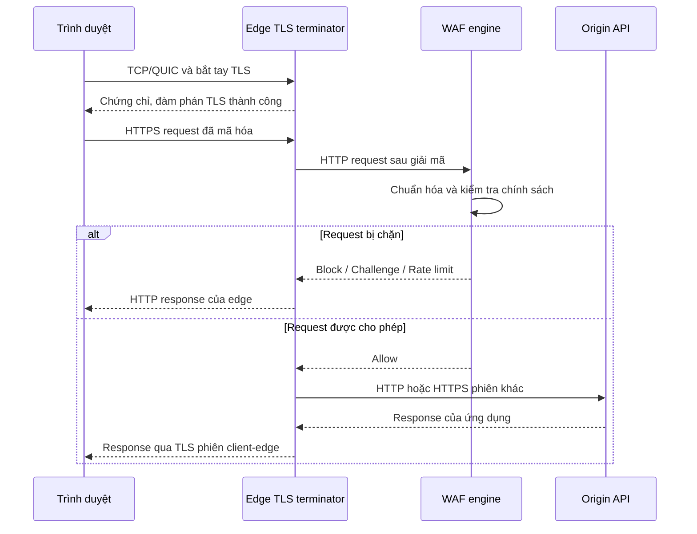
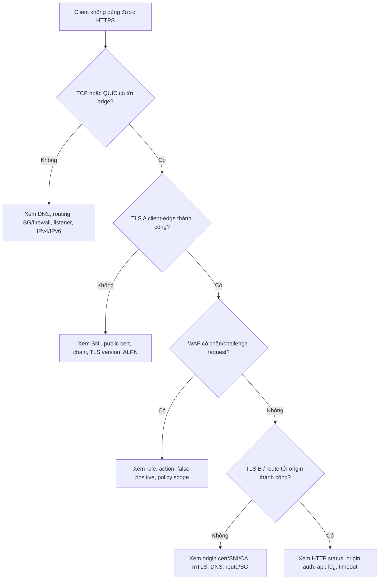

# TLS termination tại WAF: giải mã HTTPS để kiểm tra và bảo vệ ứng dụng

Một ứng dụng web công khai sử dụng HTTPS để bảo vệ dữ liệu giữa trình duyệt và máy chủ. Tuy nhiên, nếu toàn bộ request đều được mã hóa, **Web Application Firewall (WAF)** đặt trên đường đi sẽ kiểm tra nội dung HTTP như đường dẫn URL, query, header, cookie hay body bằng cách nào? Một giải pháp phổ biến là **kết thúc kết nối TLS (TLS termination) tại một điểm trung gian đáng tin cậy**, sau đó cho WAF phân tích HTTP đã được giải mã trước khi quyết định chuyển request tới ứng dụng.

Trong module **SECURITY_NETWORK_SECURITY**, TLS termination tại WAF liên kết nhiều lớp phòng vệ: firewall mạng kiểm soát IP/port, WAF kiểm soát request HTTP, TLS bảo vệ đường truyền, phân đoạn mạng giới hạn đường tới origin, VPN và xác thực bảo vệ kênh quản trị, còn IDS/IPS, log và giám sát cung cấp bằng chứng khi có tấn công. Thiết kế hiệu quả phải xem xét cả **bảo mật ở biên** lẫn **bảo mật trên đoạn từ WAF tới backend**.

Sau bài học, người học có thể:

- Giải thích TLS termination là gì, tại sao WAF thường cần thấy HTTP plaintext để kiểm tra nội dung.
- Phân biệt **TLS offloading**, **TLS bridging/re-encryption** và **TLS passthrough** cùng giới hạn kiểm tra L7 của từng phương án.
- Mô tả TLS handshake, vai trò của chứng chỉ, SNI, ALPN, TLS 1.2/1.3 và HTTP/2/HTTP/3 trong kiến trúc có WAF.
- Thiết kế trust boundary, xác thực mTLS và đường truyền WAF–origin an toàn, ngăn truy cập trực tiếp bỏ qua WAF.
- Vận hành chứng chỉ/khóa, phân tích lỗi TLS, đọc log WAF và kiểm thử false positive, origin reachability và hiệu năng.

## 1. TLS termination và WAF là hai chức năng liên quan nhưng khác nhau

**TLS termination** là thời điểm một đầu của phiên TLS giải mã dữ liệu nhận được, kiểm tra tính toàn vẹn/xác thực theo cơ chế TLS rồi chuyển dữ liệu đã giải mã cho tầng ứng dụng xử lý. Một proxy kết thúc TLS có thể đóng vai trò **TLS server đối với client** và đồng thời đóng vai trò **HTTP client/TLS client đối với origin**.

**WAF** kiểm tra thông điệp HTTP/HTTPS ở tầng ứng dụng, ví dụ phương thức, path, query, header, cookie và request body trong phạm vi mà sản phẩm hỗ trợ. WAF có thể áp dụng tập luật cho tấn công ứng dụng, bot, tốc độ truy cập và những hành vi bất thường.

Không phải mọi sản phẩm gọi là WAF đều tự giữ private key hay thực hiện handshake TLS:

- Trong mô hình **reverse proxy/CDN tích hợp WAF**, một thành phần ở biên nhận và kết thúc TLS, rồi module WAF kiểm tra request đã giải mã.
- Trong mô hình **WAF gắn với load balancer/API gateway**, load balancer hoặc gateway có thể thực hiện TLS termination; dịch vụ WAF nhận ngữ cảnh HTTP thông qua tích hợp của nền tảng.
- Trong mô hình **WAF chạy trong ứng dụng hoặc web server**, web server có thể kết thúc TLS rồi gọi engine WAF ở pipeline xử lý HTTP.
- Một thiết bị **chỉ nhìn thấy ciphertext** của phiên TLS mà không có quyền giải mã hoặc ngữ cảnh HTTP tương ứng sẽ không thể kiểm tra đầy đủ nội dung request bằng luật HTTP truyền thống. Nó vẫn có thể dùng một số metadata/giao thức để giám sát hay lọc L3/L4.

Vì thế, “TLS termination **tại WAF**” trong bài này có nghĩa thực tế là **tại điểm biên nơi WAF được tích hợp và có quyền quan sát nội dung HTTP đã giải mã**. Thành phần sở hữu chứng chỉ/khóa và thành phần đánh giá luật HTTP có thể là hai module khác nhau.

### 1.1. Vì sao mã hóa TLS làm thay đổi khả năng quan sát?

Với kết nối HTTPS thông thường:

```text
Client  ─── TLS-encrypted HTTP ───> Origin
```

Một thiết bị mạng đứng giữa chỉ quan sát được các trường mà giao thức và vị trí capture để lộ, chẳng hạn IP, port, thời điểm, kích thước packet và một phần metadata TLS. Nội dung HTTP sau khi handshake hoàn tất được bảo vệ bằng mã hóa và kiểm tra toàn vẹn.

Nếu đưa một proxy có WAF vào đường đi:

```text
Client ── TLS phiên A ──> Edge reverse proxy / TLS terminator
                                  |
                                  v
                           HTTP đã giải mã
                                  |
                           WAF kiểm tra L7
                                  |
                      Allow / Block / Challenge
                                  |
                                  v
                        Proxy tới origin
```

Chỉ khi WAF được cấp HTTP ở dạng có thể phân tích, nó mới có thể đối chiếu các trường ứng dụng với rule. Việc giải mã tạo một **trust boundary mới**: thiết bị/tiến trình kết thúc TLS có thể tiếp cận nội dung nhạy cảm, nên phải được bảo vệ nghiêm ngặt.

## 2. Một request HTTPS đi qua WAF theo từng bước

Ví dụ người dùng truy cập `https://shop.example.test/orders`. Hệ thống dùng proxy ở biên tích hợp WAF và gửi lưu lượng tới API backend.



Sơ đồ rút gọn: proxy và WAF có thể chạy chung tiến trình, WAF có thể kiểm tra nhiều giai đoạn của request/response, kết nối upstream có thể được tái sử dụng, và việc bị chặn có thể dẫn tới các response khác nhau theo sản phẩm. Không có nghĩa mỗi HTTP request bắt buộc mở một TCP/TLS connection mới.

### 2.1. Những ranh giới quan trọng

| Ranh giới | Dữ liệu có thể quan sát | Biện pháp cần chú ý |
|---|---|---|
| Client → Edge | Dữ liệu HTTPS được mã hóa trên đường truyền | Chứng chỉ hợp lệ, phiên bản TLS, cấu hình giao thức, chống DoS. |
| Bên trong edge sau TLS termination | HTTP plaintext trong bộ nhớ/pipeline xử lý | Bảo vệ tiến trình, khóa, quyền đọc log, hạn chế dữ liệu nhạy cảm. |
| WAF → Origin qua HTTP | HTTP plaintext trên đường nội bộ | Phân đoạn chặt, rủi ro nghe lén/sửa đổi trên đoạn này. |
| WAF → Origin qua HTTPS | Một **phiên TLS thứ hai**, độc lập với client → edge | Xác minh chứng chỉ origin, tên host, trust store, mTLS nếu cần. |
| Origin/API | Request đã đi qua WAF nếu đường đi được cưỡng chế | AuthN/AuthZ, input validation, log, quyền truy cập dữ liệu. |

Một request **đã được WAF cho phép** vẫn có thể bị từ chối tại API vì người dùng không có quyền. Ngược lại, WAF có thể bỏ sót tấn công mới hay request nằm ngoài phạm vi kiểm tra, nên ứng dụng vẫn cần cơ chế bảo mật riêng.

## 3. Ba mô hình TLS phổ biến khi triển khai WAF

### 3.1. TLS offloading: giải mã ở edge, HTTP tới origin

```text
Client ─── HTTPS/TLS ───> Edge + WAF ─── HTTP ───> Origin
            mã hóa                          plaintext
```

Edge giữ chứng chỉ/khóa cần thiết để kết thúc TLS. Request HTTP được WAF xử lý rồi proxy chuyển HTTP tới origin. Mô hình này có thể giảm trách nhiệm TLS của backend hoặc tương thích với một số ứng dụng cũ, nhưng **đoạn edge–origin không được TLS bảo vệ**.

Nó chỉ phù hợp khi tổ chức đã đánh giá rủi ro của đường đi và có các cơ chế bảo vệ tương ứng. Một “mạng private” không tự chứng minh traffic ở đó không thể bị đọc hoặc sửa. Trong môi trường đa tenant, mạng chia sẻ, xuyên vùng mạng/cloud hoặc cần tuân thủ cao, nên cân nhắc mã hóa lại đến origin.

### 3.2. TLS bridging / re-encryption: hai phiên TLS độc lập

```text
Client ── HTTPS/TLS A ──> Edge + WAF ── HTTPS/TLS B ──> Origin
         chứng chỉ edge                 chứng chỉ origin
              │                               │
              └─ giải mã → WAF → mã hóa lại ──┘
```

Mô hình này còn được gọi là **TLS bridging**, **TLS re-encryption** hoặc một dạng **TLS offload + TLS tới backend**.

- Phiên **A** do client và edge đàm phán. Trình duyệt kiểm tra chứng chỉ được edge cung cấp cho hostname public.
- Edge giải mã request để WAF kiểm tra, rồi khởi tạo hoặc tái sử dụng phiên **B** tới origin.
- Edge là **TLS client** của origin, phải kiểm tra chứng chỉ origin đúng tên, chain và chính sách tin cậy; có thể sử dụng **mTLS** nếu origin yêu cầu edge xuất trình client certificate.
- Origin nhìn thấy kết nối tới từ edge/proxy hoặc nguồn phù hợp với cấu trúc mạng. **Chứng chỉ trình duyệt của phiên A không tự chuyển thành danh tính TLS trên phiên B.**

Đây thường là lựa chọn phù hợp khi cần kiểm tra L7 nhưng vẫn bảo vệ đường truyền giữa các thành phần. Tuy nhiên, **không còn một phiên TLS end-to-end duy nhất từ browser tới origin**: edge là điểm có thể đọc HTTP đã giải mã. Với yêu cầu mật mã buộc chỉ origin được đọc dữ liệu, phải thiết kế lại vị trí kiểm tra hoặc chấp nhận phạm vi kiểm tra WAF bị giới hạn.

### 3.3. TLS passthrough: giữ TLS từ client đến origin

```text
Client ───────── HTTPS/TLS ────────> Origin
                    │
              Thiết bị trung gian
              chỉ chuyển tiếp TCP/UDP
```

Thiết bị giữa đường không kết thúc TLS và không có quyền giải mã thì **không thể kiểm tra trực tiếp HTTP path, cookie, JSON body** bằng rule WAF truyền thống. Nó có thể lọc theo IP/port, tốc độ, một số metadata chưa mã hóa hoặc áp dụng chính sách transport/connection.

Một số hệ thống cung cấp công nghệ nhận diện hoặc kiểm tra riêng ngoài luồng; cần xác minh khả năng thực tế trước khi coi chúng tương đương WAF L7.

### 3.4. Bảng so sánh

| Tiêu chí | Offload HTTP tới origin | Bridge/Re-encrypt | Passthrough |
|---|---|---|---|
| TLS client kết thúc ở đâu? | Edge | Edge | Origin |
| WAF tại edge nhìn thấy HTTP sau giải mã? | Có, nếu tích hợp đúng | Có, nếu tích hợp đúng | Không, trừ khi có cơ chế giải mã/quan sát khác |
| Đường edge → origin được TLS bảo vệ? | Không | Có | Phiên TLS client–origin duy trì xuyên qua |
| Ai quản lý chứng chỉ public? | Edge | Edge | Origin |
| Cần xác minh chứng chỉ origin ở edge? | Không có phiên TLS tới origin | Có | Client xác minh chứng chỉ origin |
| Khả năng thực thi rule HTTP ở edge | Cao theo tính năng WAF | Cao theo tính năng WAF | Giới hạn |
| Rủi ro nổi bật | Plaintext ở đoạn nội bộ | Edge có quyền đọc dữ liệu; quản lý hai phiên/chứng chỉ | Không kiểm tra sâu nội dung HTTP ở edge |

**Chọn mô hình theo mục tiêu:** muốn kiểm tra WAF L7 cần thấy HTTP đã giải mã; muốn bảo vệ cả hai chặng mạng nên mã hóa lại; muốn chỉ origin được giải mã dữ liệu thì edge WAF mất khả năng kiểm tra đầy đủ nội dung.

## 4. TLS handshake, chứng chỉ và tên miền ở WAF

Để kết thúc TLS, edge phải có khả năng tham gia bắt tay TLS như server cho hostname được công bố. Với kết nối HTTPS công khai, edge thường sở hữu hoặc truy cập an toàn **private key và chứng chỉ server** cho hostname tương ứng.

### 4.1. Đường đi của handshake

Một phiên TLS 1.3 thông thường có các thành phần khái niệm:

1. Client gửi `ClientHello`, đề xuất phiên bản/giao thức, các thuật toán và thông tin cần cho bắt tay khóa; có thể bao gồm **SNI** và **ALPN**.
2. Edge trả `ServerHello` với các lựa chọn được đàm phán; hai phía thiết lập khóa phiên theo TLS.
3. Edge chứng minh danh tính máy chủ bằng chứng chỉ và các thông điệp handshake được bảo vệ theo giao thức.
4. Client xác minh chứng chỉ với tên miền, chain CA tin cậy, thời hạn và các chính sách TLS liên quan.
5. Sau khi handshake thành công, HTTP được gửi trong dữ liệu được mã hóa; edge giải mã để WAF có thể kiểm tra.

Sơ đồ trên rút gọn cơ chế TLS 1.3. Các bước TLS 1.2 khác ở một số chi tiết. Với TLS 1.3, nhiều thông điệp handshake sau `ServerHello`, gồm certificate, được mã hóa; một bản pcap ngoài đường truyền **không tự nhìn được đầy đủ chứng chỉ hoặc request HTTP**.

### 4.2. SNI và ALPN quyết định điều gì?

**SNI (Server Name Indication)** trong TLS giúp client báo tên máy chủ mong muốn để edge chọn cấu hình/chứng chỉ phù hợp, ví dụ `shop.example.test`. **ALPN (Application-Layer Protocol Negotiation)** giúp hai bên đàm phán giao thức ứng dụng trên TLS, chẳng hạn HTTP/1.1 hay HTTP/2; QUIC cũng sử dụng TLS 1.3 theo cách của giao thức QUIC.

Điểm cần nhớ:

- **SNI khác HTTP `Host` hoặc HTTP/2/3 `:authority`.** Chúng xuất hiện ở các giai đoạn khác nhau; thiết bị phải có chính sách định tuyến/vhost nhất quán để tránh truy cập nhầm site hay bypass policy.
- SNI có thể không tồn tại trong mọi trường hợp; với **Encrypted ClientHello (ECH)** ở những môi trường có hỗ trợ, một phần thông tin tên máy chủ được che khỏi người quan sát bên ngoài.
- Edge kết thúc TLS vẫn có khả năng xử lý yêu cầu cho hostname phù hợp với cấu hình và quyền giải mã; không thể suy diễn khả năng quan sát SNI của bên thứ ba bằng khả năng của endpoint TLS.
- **ALPN phía client–edge và phía edge–origin là độc lập.** Ví dụ browser dùng HTTP/2 tới edge trong khi edge gửi HTTP/1.1 tới origin.

Không nên dùng một mình SNI, Host hay path để **xác thực người dùng**; chúng là thành phần định tuyến/ngữ cảnh, không thay thế xác thực và phân quyền.

### 4.3. Chứng chỉ public và chứng chỉ origin có thể khác nhau

Trong mô hình bridge:

```text
Client -- TLS A --> edge.shop.example.test / shop.example.test
                        |
                        |  TLS B, SNI: origin.internal.example
                        v
                   origin.internal.example
```

Public certificate cần hợp lệ cho hostname mà **client** truy cập. Origin certificate cần hợp lệ cho tên mà **edge dùng để xác minh origin**, có thể là hostname nội bộ khác. Origin có thể sử dụng CA nội bộ được tin cậy theo chính sách rõ ràng; **không nên tắt kiểm tra chứng chỉ** chỉ vì backend ở mạng private.

Một origin chỉ trình diện chứng chỉ self-signed không được tin cậy sẽ gây lỗi xác minh ở edge nếu không cấu hình trust đúng. Giải pháp là cấp chứng chỉ phù hợp hoặc tin cậy CA/certificate theo quy trình được phép, thay vì bỏ qua certificate validation.

## 5. Trust boundary khi TLS bị giải mã ở WAF

Ngay cả khi hai chặng mạng đều dùng TLS, có một khoảng xử lý **HTTP plaintext bên trong edge**. Những thành phần có thể tiếp cận dữ liệu gồm tiến trình kết thúc TLS, module WAF, plugin, bộ nhớ, hệ thống logging hoặc công cụ debug tùy kiến trúc.

### 5.1. Bảo vệ private key, session secrets và cấu hình TLS

- Giữ private key trong kho an toàn, KMS/HSM hoặc cơ chế quản lý khóa được sản phẩm hỗ trợ; giới hạn tài khoản và tiến trình có quyền sử dụng.
- Không sao chép khóa/chứng chỉ vào repository, image container public, ticket hoặc log.
- Có quy trình cấp, gia hạn, thu hồi/đổi khóa, theo dõi expiry và kiểm tra deployment thực tế.
- Kiểm soát người có quyền thay chứng chỉ, thay TLS policy và gắn WAF vào ứng dụng; ghi audit log.
- Duy trì phiên bản TLS/cipher phù hợp chính sách hiện hành, tránh giao thức lỗi thời; thử tương thích client trước khi siết cấu hình.
- Bảo vệ hệ điều hành, container, proxy module và giao diện quản trị của edge; thiết bị edge có quyền nhìn thấy nội dung nên là tài sản nhạy cảm.

**Chứng chỉ hợp lệ không đồng nghĩa WAF hoạt động.** TLS có thể thành công dù module WAF bị tắt, rule chỉ ở chế độ quan sát (*count/log*) hoặc request đi vào listener khác không gắn WAF.

### 5.2. Xác thực origin và ngăn bypass WAF

Một lỗ hổng kiến trúc thường gặp là `origin` vẫn truy cập công khai trực tiếp. Kẻ tấn công có thể gửi request trực tiếp đến origin IP/hostname, qua đó **bỏ qua toàn bộ WAF** dù trình duyệt thông thường đi qua CDN/WAF.

```text
Đường được thiết kế:
Internet → WAF/Edge → Origin

Đường bypass ngoài ý muốn:
Internet ────────────→ Origin
```

Cần kết hợp các kiểm soát phù hợp:

1. Đặt origin trong mạng riêng khi có thể; hạn chế route và public exposure.
2. Ở ingress firewall/SG origin, chỉ cho phép **nguồn thực tế của edge** hoặc cơ chế private connectivity được hỗ trợ.
3. Xác thực edge tại origin bằng **mTLS** hoặc một cơ chế danh tính độc lập khi mức rủi ro yêu cầu; không coi danh sách IP thay cho xác thực.
4. Nếu dùng CDN/proxy có IP thay đổi, quản lý nguồn tin cậy bằng danh sách/đối tượng do nhà cung cấp hỗ trợ và quy trình cập nhật an toàn.
5. Kiểm thử request trực tiếp đến origin từ nguồn không được phép, không chỉ dựa vào DNS công khai không trỏ tới origin.

Một header bí mật hoặc `X-Forwarded-For` **đơn độc** không phải biện pháp chống bypass đủ mạnh nếu nguồn bên ngoài có thể giả mạo hoặc đọc được giá trị. Không có một kiểm soát đơn lẻ bảo đảm origin không thể bị truy cập ngoài ý muốn.

### 5.3. Đường mạng giữa edge và origin

Khi edge và origin nằm ở những vùng mạng khác nhau, cần kiểm soát:

- **Egress từ edge:** chỉ tới đúng backend/port và các dịch vụ hạ tầng cần thiết.
- **Ingress vào origin:** chỉ từ edge hợp lệ; tránh allow toàn bộ VPC/subnet nếu không cần.
- **DNS nội bộ và định tuyến:** đảm bảo tên origin phân giải về IP mong đợi, tránh public DNS vô tình chuyển qua Internet.
- **TLS B:** kiểm tra hostname/certificate/CA, không sử dụng chế độ bỏ xác minh để “chữa” lỗi.
- **Log/metrics:** có thể truy vết cả hai chặng bằng request ID và timestamp; không kỳ vọng cùng một TCP 5-tuple xuyên qua reverse proxy.

Một **security group cho phép TCP/8443** không chứng minh origin được xác thực; nó chỉ cung cấp điều kiện reachability ở tầng mạng.

## 6. mTLS trước và sau WAF: danh tính của ai được xác minh?

**Mutual TLS (mTLS)** cho phép cả hai phía xuất trình và xác minh chứng chỉ theo cấu hình. Khi edge kết thúc TLS, các phiên độc lập có danh tính khác nhau:

```text
Client ── mTLS A ──> Edge/WAF ── mTLS B ──> Origin
  danh tính client   chứng chỉ edge         danh tính proxy/edge
```

Trong phiên A, edge có thể xác minh **client certificate**. Trong phiên B, origin thường chỉ thấy edge như một TLS client nếu edge sử dụng chứng chỉ riêng; origin **không tự nhìn thấy chứng chỉ client ở phiên A**.

Nếu ứng dụng cần danh tính client được xác minh tại edge, phải có cơ chế chuyển tiếp ngữ cảnh danh tính được bảo vệ:

- Edge chỉ thêm các header định danh sau khi đã **xác minh chứng chỉ**, và xóa/ghi đè các header cùng tên do client gửi.
- Origin chỉ tin header này qua **kênh đã xác thực từ edge** (ví dụ mTLS và giới hạn mạng); không tin header tùy ý từ Internet.
- Với yêu cầu cao, dùng token/chữ ký hoặc cơ chế ủy quyền danh tính có thời hạn, ràng buộc audience và kiểm tra tại origin.
- Phân biệt rõ chứng chỉ **client người dùng** với chứng chỉ **edge làm client tới origin**.

**WAF không thay hệ thống xác thực danh tính.** Rule nhận diện request đáng ngờ không chứng minh ai đang gửi request, cũng không quyết định người dùng có được xem dữ liệu hay không.

### 6.1. `X-Forwarded-For`, `Forwarded` và `X-Forwarded-Proto`

Proxy thường chuyển thông tin về client ban đầu qua các header như:

```http
X-Forwarded-For: 192.0.2.10
X-Forwarded-Proto: https
X-Forwarded-Host: shop.example.test
```

Đây chỉ là **ví dụ**, không phải bằng chứng có thể tin ngay. Client có thể tự gửi header trùng tên nếu edge không xử lý đúng. Trong chuỗi nhiều proxy, phải có **danh sách proxy tin cậy**, quy tắc loại bỏ/ghi đè header không đáng tin, và xác định đúng IP client dựa trên vị trí proxy.

Nếu origin cho phép truy cập trực tiếp, một đối tượng bên ngoài có thể gửi `X-Forwarded-Proto: https` dù kết nối không được TLS bảo vệ; ứng dụng không được suy ra transport an toàn chỉ từ header đến từ nguồn bất kỳ.

## 7. WAF đọc gì sau TLS termination?

Một WAF được tích hợp đúng vào pipeline HTTP có thể kiểm tra một số thuộc tính sau (tùy sản phẩm, cấu hình và giới hạn kích thước):

| Thành phần HTTP | Ví dụ | Mục đích phòng vệ |
|---|---|---|
| Method | `GET`, `POST`, `PUT` | Phát hiện method ngoài danh sách nghiệp vụ, áp chính sách endpoint. |
| Path và query | `/api/orders?id=123` | Phát hiện mẫu tấn công, kiểm soát URL nhạy cảm. |
| Headers | `Host`, `Content-Type`, `User-Agent` | Kiểm tra định dạng, protocol anomalies, hành vi client. |
| Cookies | Session cookie và thuộc tính liên quan | Áp luật/điều kiện hoặc ghi nhận tín hiệu rủi ro theo khả năng WAF. |
| Request body | JSON, form fields, multipart | Tìm dấu hiệu injection hoặc payload bất thường trong phạm vi được parse. |
| Source context | IP sau chuỗi proxy tin cậy, ASN, vị trí, danh tính edge có thể xác minh | Rate limit, allow/deny, bot/risk policies. |
| Response (nếu hỗ trợ) | HTTP status, một số header/body | Chính sách/log/kiểm tra dữ liệu ở chiều trả lời; không phải WAF nào cũng kiểm tra toàn bộ. |

Ví dụ một request bình thường:

```http
POST /api/orders HTTP/1.1
Host: shop.example.test
Content-Type: application/json
Authorization: Bearer <redacted>

{"itemId":"SKU-123","quantity":2}
```

Nếu WAF nhận HTTP sau giải mã, nó có thể đánh giá method, path, header và JSON trong giới hạn cấu hình. Tuy nhiên, ví dụ có `Authorization` nhắc rằng **log WAF không nên lưu token nguyên văn**. Quy tắc bảo mật nhật ký và masking phải được thiết kế ngay từ đầu.

### 7.1. Bốn loại hành động thường gặp

1. **Allow:** request qua lớp WAF để tiếp tục đến origin; không đồng nghĩa người dùng được ứng dụng cấp quyền.
2. **Block:** WAF/edge từ chối và trả response phù hợp, thường có HTTP status do sản phẩm cấu hình.
3. **Count/Log/Monitor:** chỉ ghi nhận khi rule khớp, request vẫn có thể đi tiếp; thích hợp đo false positive trước khi bật chặn.
4. **Rate limit / Challenge / CAPTCHA:** điều tiết hoặc yêu cầu bước xác nhận theo tính năng sản phẩm. Các biện pháp này có thể ảnh hưởng API, ứng dụng di động hoặc client tự động.

Kết quả thực tế phụ thuộc **thứ tự rule, phạm vi rule, action của group, ngoại lệ, host/path, giao thức và mode triển khai**. Không nên kết luận “đã có rule” nghĩa là request chắc chắn bị chặn.

### 7.2. Chuẩn hóa dữ liệu và parser consistency

WAF và origin cần hiểu **cùng một request**. Các biểu diễn khác nhau như percent-encoding, Unicode normalization, duplicate headers, HTTP/2 → HTTP/1.1 conversion, chunked transfer và cách xử lý request body có thể tạo khác biệt giữa proxy/WAF và backend.

Ví dụ hai thành phần diễn giải URL hoặc `Content-Length`/`Transfer-Encoding` không nhất quán có thể làm phát sinh **HTTP request smuggling/desynchronization** ở một số kiến trúc. Cần:

- Cập nhật proxy, WAF và web server; thống nhất cách chuẩn hóa/parse HTTP.
- Từ chối request mơ hồ, header bất hợp lệ và các dạng framing đáng ngờ theo chính sách của nền tảng.
- Kiểm chứng những đường HTTP/1.1, HTTP/2, HTTP/3 và các bước downgrade/proxy chuyển giao thức được hỗ trợ.
- Tránh dùng rule đơn giản chỉ dựa vào một chuỗi văn bản như biện pháp duy nhất chống khai thác.

### 7.3. Giới hạn kích thước request và định dạng payload

WAF có thể giới hạn số byte của body được inspect hoặc chỉ hỗ trợ một số loại nội dung. Các luồng `multipart/form-data`, file upload lớn, JSON lồng sâu, GraphQL, streaming body, WebSocket upgrade hoặc gRPC có thể cần cấu hình/đường kiểm tra riêng.

Nếu chỉ kiểm tra một phần body, phần còn lại có thể nằm ngoài tầm nhìn của rule. Cần biết **WAF sẽ xử lý thế nào khi vượt giới hạn**: bỏ qua phần còn lại, cho qua, chặn, hoặc áp cách xử lý theo cấu hình. Không được mặc định một request đã “đi qua WAF” thì mọi byte đều được quét.

Đặc biệt, nếu ứng dụng tự mã hóa dữ liệu **bên trong** JSON payload, TLS termination chỉ giải mã lớp TLS; WAF vẫn không đọc được nội dung được mã hóa ở tầng ứng dụng trừ khi có cơ chế giải mã riêng được cho phép.

## 8. HTTP/2, HTTP/3 và những giao thức có ảnh hưởng đến WAF

### 8.1. Client–edge và edge–origin có thể dùng giao thức khác nhau

```text
Trình duyệt → Edge: HTTP/2 qua TLS 1.3 (TCP/443)
Edge → Origin: HTTP/1.1 qua TLS 1.2 hoặc TLS 1.3 (TCP/8443)
```

Hoặc:

```text
Trình duyệt → Edge: HTTP/3 qua QUIC (UDP/443)
Edge → Origin: HTTP/2 qua TLS (TCP/443)
```

WAF vẫn có thể phân tích HTTP sau khi thành phần biên xử lý HTTP/2/HTTP/3 nếu nền tảng hỗ trợ. Cần chắc chắn traffic qua **mọi listener/giao thức được công bố** đều được gắn chính sách WAF. Nếu chỉ cấu hình WAF cho TCP/443 nhưng site cũng phục vụ HTTP/3 ở UDP/443 qua một stack khác, có thể tạo lỗ hổng giám sát hoặc khác biệt policy.

### 8.2. HTTP/3 dùng QUIC chứ không dùng TLS record trên TCP

QUIC sử dụng UDP và tích hợp TLS 1.3 handshake vào giao thức QUIC. Nói “TLS termination cho HTTP/3” là hợp lý về **vai trò đầu mối mật mã**, nhưng triển khai không giống hệt kết thúc một phiên TLS-over-TCP. Proxy ở edge phải hỗ trợ QUIC/HTTP/3 nếu muốn nhận kết nối này, và WAF cần tích hợp với HTTP stack tương ứng.

Không thấy TCP SYN tới `443` không chứng minh site không hoạt động; client có thể đang dùng QUIC/UDP. Khi phân tích packet cần xem cả TCP `443`, UDP `443` và khả năng giao thức fallback.

### 8.3. Session resumption và TLS 1.3 0-RTT

Session resumption có thể giảm chi phí handshake. Với **TLS 1.3 early data (0-RTT)** trong trường hợp triển khai hỗ trợ, một số dữ liệu ứng dụng có thể được gửi sớm và có **rủi ro replay**; cần kiểm soát theo chính sách của edge và ứng dụng, nhất là các thao tác thay đổi trạng thái.

Không phải WAF hoặc CDN nào cũng bật/nhận 0-RTT, và cách xử lý early data khác nhau. Phải xác minh hành vi thực tế, ngăn chấp nhận request không phù hợp và đảm bảo các kiểm soát ứng dụng quan trọng không dựa vào giả định rằng mọi request luôn theo handshake đầy đủ.

### 8.4. WebSocket, gRPC và kết nối tồn tại lâu

WebSocket có thể bắt đầu bằng HTTP upgrade (với HTTP/1.1) rồi chuyển sang luồng thông điệp khác. gRPC thường dùng HTTP/2 và có thể truyền streaming request/response. Nhiều WAF kiểm tra tốt **pha HTTP ban đầu** nhưng khả năng inspect từng thông điệp/stream về sau phụ thuộc sản phẩm. Cần test rõ tính năng được hỗ trợ, kích thước body, timeout và đường routing; không giả định mọi nội dung ứng dụng trên kênh lâu dài đều được WAF xem.

## 9. Triển khai theo môi trường: CDN, cloud WAF và reverse proxy

### 9.1. CDN/reverse proxy có WAF tích hợp

```text
Internet → CDN/Reverse proxy (TLS A + WAF + cache) → TLS B → Origin private
```

Những nội dung cần thiết kế bao gồm: tên miền và chứng chỉ public tại edge, DNS trỏ tới edge, chế độ kết nối origin, origin certificate verification, cache policy, rule WAF, bot/rate limiting, log và bảo vệ origin trước truy cập trực tiếp.

**Cache cũng ảnh hưởng quan sát:** request được edge đáp ứng từ cache có thể không tới origin. Một response `200` tại client không chứng minh origin nhận request đó. WAF có thể áp chính sách ở các giai đoạn khác nhau so với cache tùy nhà cung cấp; cần biết thứ tự pipeline của sản phẩm đang dùng.

### 9.2. AWS WAF gắn với dịch vụ nhận HTTP

Trong kiến trúc AWS, **AWS WAF** có thể gắn với một số loại tài nguyên như CloudFront, Application Load Balancer hoặc API Gateway theo khả năng hỗ trợ. Các thành phần nhận HTTPS như CloudFront/ALB/API Gateway thường xử lý TLS; WAF đánh giá request HTTP thông qua **tích hợp với tài nguyên đó**. Vì vậy, phát biểu “AWS WAF tự nắm private key và terminate TLS” là không chính xác nếu không xét thành phần thực tế.

Ví dụ:

```text
Client ── HTTPS ──> CloudFront/ALB ── HTTP request metadata ──> AWS WAF evaluation
                             |
                             +── HTTP hoặc HTTPS ──> Origin/Target
```

Các yêu cầu cần xác minh riêng: WAF Web ACL đã liên kết với đúng distribution/ALB/stage chưa, listener TLS/certificate thuộc dịch vụ nào, origin protocol policy là HTTP hay HTTPS, backend có chấp nhận traffic chỉ từ lớp được phép hay không, và có endpoint khác đi vòng WAF không.

### 9.3. Reverse proxy tự quản lý và WAF module

Trong mô hình tự quản lý, NGINX, Apache hoặc reverse proxy khác có thể thực hiện TLS termination và HTTP proxying, đồng thời tích hợp WAF engine như ModSecurity theo module/cấu hình được triển khai. **Khả năng inspection và cú pháp kích hoạt WAF không tự xuất hiện chỉ vì reverse proxy đã bật HTTPS.**

Ví dụ NGINX bên dưới tập trung vào **hai phiên TLS** và xác minh chứng chỉ origin. Nó **chưa chứa cấu hình bật WAF engine/rule set**; phần đó phải được tích hợp riêng, đúng module và phiên bản thực tế:

```nginx
server {
    listen 443 ssl;
    server_name app.example.test;

    # Chứng chỉ của hostname public mà browser truy cập.
    ssl_certificate     /etc/nginx/tls/public-fullchain.pem;
    ssl_certificate_key /etc/nginx/tls/public-private.key;
    ssl_protocols TLSv1.2 TLSv1.3;

    location / {
        # Bảo vệ cả chặng tới origin bằng TLS B.
        proxy_pass https://origin.internal.example:8443;

        # Chỉ thiết lập header theo proxy tin cậy.
        proxy_set_header Host app.example.test;
        proxy_set_header X-Forwarded-Proto https;
        proxy_set_header X-Forwarded-For $remote_addr;

        # SNI và xác minh chứng chỉ origin.
        proxy_ssl_server_name on;
        proxy_ssl_name origin.internal.example;
        proxy_ssl_verify on;
        proxy_ssl_trusted_certificate /etc/nginx/tls/origin-ca.pem;
        proxy_ssl_verify_depth 3;
    }
}
```

Giải thích:

1. Browser xác minh certificate public của `app.example.test`. NGINX giải mã phiên A.
2. NGINX tạo TLS B tới `origin.internal.example:8443`; bật `proxy_ssl_verify on` để xác minh origin.
3. `proxy_ssl_name` đặt tên dùng cho SNI/xác minh hostname origin trong ngữ cảnh cấu hình được hỗ trợ.
4. `X-Forwarded-For $remote_addr` phản ánh IP của **peer trực tiếp nhìn từ NGINX**, không chắc là IP người dùng ban đầu nếu trước NGINX còn CDN/proxy. Muốn khôi phục client IP qua nhiều proxy, cần cấu hình danh sách proxy tin cậy và xử lý `real_ip`/headers thích hợp; không được tin header do client tự gửi.
5. `Host app.example.test` là giá trị cố định trong ví dụ. Nếu một proxy phục vụ nhiều hostname, cần thiết kế định tuyến Host/SNI và giới hạn tên hợp lệ một cách rõ ràng.
6. NGINX trên chỉ minh họa reverse proxy + TLS, **chưa có WAF inspection**. Phải bật module/tích hợp WAF đúng cách, áp rule phù hợp và kiểm tra log trước khi khẳng định được bảo vệ.

Các đường dẫn certificate là placeholder; ví dụ cần được điều chỉnh theo hệ điều hành, phiên bản NGINX, cách tải module, hạ tầng mạng, cấu hình origin và chính sách TLS. Không đưa private key thực vào giáo trình hoặc repository.

### 9.4. Ví dụ pipeline logic cho một chính sách WAF

```text
TLS termination tại edge
      ↓
Xác định site / Host / client context đáng tin
      ↓
Parse và chuẩn hóa HTTP request
      ↓
Kiểm tra kích thước / định dạng / rule ứng dụng / rate limit
      ├── Block hoặc Challenge → phản hồi từ edge + log
      └── Allow → proxy qua HTTPS tới origin
                        ↓
                 Origin auth + validation
                        ↓
                 Response trở lại client
```

Khi bật rule mới, nên bắt đầu bằng chế độ monitor/count trong phạm vi hợp lý để ước lượng false positive, sau đó bật block có kiểm soát, theo dõi tỷ lệ lỗi và chuẩn bị rollback.

## 10. Quản lý chứng chỉ và xoay vòng khóa

Việc TLS termination tại WAF tăng số điểm cần quản lý chứng chỉ:

| Chứng chỉ/khóa | Được sử dụng ở đâu? | Cần kiểm tra |
|---|---|---|
| Public server certificate | Edge chứng minh hostname public trước browser | SAN đúng tên, chain, hạn dùng, private key, chế độ gia hạn. |
| Origin server certificate | Origin chứng minh danh tính trước edge | SAN đúng tên mà edge xác minh, CA/trust chain, hạn dùng, SNI. |
| Edge client certificate (nếu mTLS B) | Edge xác thực chính mình với origin | Danh tính proxy, phạm vi CA, hạn dùng và quyền thay cert. |
| Client certificate (nếu mTLS A) | Client xác thực với edge | CA tin cậy, chính sách danh tính, thu hồi/expiry, ánh xạ danh tính ứng dụng. |

### 10.1. Quy trình đổi chứng chỉ không gây gián đoạn ngoài ý muốn

1. Kiểm kê **hostname, SAN, endpoint, listener, trust store, key owner, ngày hết hạn** của cả hai phiên TLS.
2. Cấp/gia hạn chứng chỉ mới với chain phù hợp; kiểm tra quyền truy cập private key và cấu hình của proxy.
3. Nếu thay CA cho origin hoặc mTLS, chuẩn bị giai đoạn **cùng tin cậy CA cũ và mới** khi phù hợp để tránh gián đoạn.
4. Thử trên môi trường staging/canary, xác minh handshake A và B bằng client và log TLS.
5. Triển khai theo cơ chế reload/rotate được sản phẩm hỗ trợ, kiểm tra các edge node/region có cấu hình nhất quán.
6. Theo dõi lỗi handshake, cảnh báo expiry và độ trễ; xác nhận WAF rule vẫn được áp dụng sau deploy.
7. Thu hồi/tắt khóa, CA hoặc cấu hình cũ theo quy trình, không để bản sao private key ở hệ thống không cần thiết.

Một sự cố hay gặp là chứng chỉ public mới đã triển khai nhưng **edge–origin TLS B vẫn lỗi** vì trust store hoặc hostname không khớp. Đừng gộp mọi lỗi “SSL handshake failed” thành một lỗi duy nhất; phải xác định **phiên A hay phiên B** đang thất bại.

## 11. Quan sát và kiểm tra hai phiên TLS

### 11.1. Dùng OpenSSL kiểm tra certificate public

Trên máy được phép kiểm tra endpoint:

```bash
# Kiểm tra bắt tay, tên host và chuỗi chứng chỉ của phiên client-edge.
openssl s_client \
  -connect app.example.test:443 \
  -servername app.example.test \
  -verify_hostname app.example.test \
  -verify_return_error \
  -showcerts
```

Các mục cần quan sát gồm phiên bản TLS, chứng chỉ được trình diện, SAN/hostname, chuỗi tin cậy, thời hạn, mã lỗi xác minh và ALPN nếu công cụ/phiên được cấu hình hỗ trợ. Khi dùng CA doanh nghiệp, máy kiểm thử cần trust store thích hợp; bỏ xác minh chứng chỉ để “cho qua” chỉ che mất lỗi.

### 11.2. Kiểm tra origin từ mạng của edge

Thực hiện ở môi trường **có đường mạng tới origin** và có quyền truy cập:

```bash
# CA file là chứng chỉ CA tin cậy để xác minh chứng chỉ origin.
openssl s_client \
  -connect origin.internal.example:8443 \
  -servername origin.internal.example \
  -verify_hostname origin.internal.example \
  -CAfile /etc/nginx/tls/origin-ca.pem \
  -verify_return_error
```

Nếu origin yêu cầu **mTLS**, cần thêm đúng client certificate/key của edge theo quy trình an toàn để kiểm chứng, và phân biệt lỗi do server certificate với lỗi xác thực client certificate.

### 11.3. Dùng curl kiểm tra hostname, DNS và HTTP status

```bash
# Xem TLS handshake/HTTP response từ endpoint public.
curl -Iv https://app.example.test/health

# Giữ nguyên hostname để dùng SNI/Host/verify cert nhưng thử một edge IP cụ thể.
# 203.0.113.20 chỉ là địa chỉ ví dụ dành cho tài liệu.
curl --resolve app.example.test:443:203.0.113.20 \
  -I https://app.example.test/health
```

`-I` gửi HTTP HEAD; một số ứng dụng không hỗ trợ HEAD giống GET, vì vậy hãy chọn method phù hợp. `--resolve` buộc mapping hostname → IP cho phép thử điểm edge nhưng **vẫn dùng hostname trong URL** khi xác minh TLS và định tuyến Host. Không thêm `-k` để bỏ kiểm tra chứng chỉ trong phép thử đánh giá bảo mật.

### 11.4. Packet capture cho biết gì?

```bash
# Tại client hoặc điểm quan sát phù hợp, xem TLS-over-TCP và QUIC/UDP.
sudo tcpdump -ni eth0 'host 203.0.113.20 and (tcp port 443 or udp port 443)'

# Trên edge, ghi lưu lượng tới origin nếu được phép và đúng interface.
sudo tcpdump -ni eth0 'host 10.0.2.15 and tcp port 8443'
```

Trong mô hình re-encryption, capture ở **cả hai chặng mạng đều là ciphertext**, dù WAF ở edge có thể quan sát HTTP trong tiến trình của nó. Muốn biết WAF đã áp rule gì, dùng WAF log, request ID và metrics thay vì suy đoán từ ciphertext. Các địa chỉ, interface và port trong ví dụ phải thay theo môi trường được phép kiểm tra.

### 11.5. Ghép log client–edge và edge–origin

| Nguồn log | Trường nên giữ | Giới hạn |
|---|---|---|
| Edge TLS access/error | Timestamp, vhost, TLS version, handshake error, ALPN, connection ID | Không tự chỉ ra HTTP request đã bị rule WAF nào chặn. |
| WAF event | Rule/group, action, URI/path đã xử lý, request ID, độ tin cậy của client IP, kích thước body được inspect | Log có thể bị masking/truncation và không chứa toàn bộ payload. |
| Proxy upstream | Backend IP/name, status, connect/TLS time, response time, upstream error | Mỗi request có thể retry sang backend khác hoặc được trả từ cache. |
| Origin application | Request ID, endpoint, auth decision, status, thời gian xử lý | Chỉ thấy request đã tới ứng dụng; request bị WAF block sẽ không có log origin tương ứng. |
| Firewall/flow logs | Source/destination IP/port/protocol, allow/reject, time window | Không chứng minh TLS hay ứng dụng thành công. |

**Request ID/correlation ID** nên được tạo hoặc làm mới ở trusted edge rồi chuyển sang origin qua kênh tin cậy. Không cho client tùy ý đặt một ID có thể gây trùng/giả mạo mà không kiểm soát. Timestamp cần đồng bộ để đối chiếu. Che/redact token, cookie, dữ liệu thanh toán và thông tin cá nhân trước khi lưu hoặc chia sẻ log.

## 12. Chẩn đoán sự cố TLS termination tại WAF

Chẩn đoán theo **ranh giới nào đã hoạt động**:



### 12.1. Bảng triệu chứng và phép kiểm chứng

| Triệu chứng | Giả thuyết thường gặp | Bằng chứng cần kiểm tra |
|---|---|---|
Browser báo certificate/hostname mismatch | Edge trình diện cert sai tên, SNI/vhost sai, chain thiếu | `openssl s_client`, SAN/chain, listener/cert binding, SNI. |
TLS A handshake thất bại | Phiên bản/cipher không tương thích, public cert/identity, mTLS client không đạt | Client và edge TLS error logs, phiên bản, certificate policy. |
TLS A tốt, edge trả `403` hoặc challenge | Rule WAF chặn, bot/geo/rate limit, hoặc auth ở edge | WAF event/action, request ID, matched rule và scope. |
HTTP `502` từ edge | Không liên hệ được upstream, TLS B/transport failure hoặc upstream response không hợp lệ | Proxy upstream log, kết nối TCP, TLS B certificate/trust/hostname. |
HTTP `504` từ edge | Upstream không phản hồi trong timeout | Upstream timing, app latency, route, health, timeout/retry policy. |
Client gặp timeout trước TLS | DNS, firewall, route, edge overload hoặc QUIC/TCP khác dự kiến | Packet hai đầu, flow log, listener, health, IP/port/protocol. |
Một số client dùng được, một số không | Phiên bản TLS/HTTP/3 khác nhau, IPv6, SNI, edge node/certificate không đồng bộ | Phân nhóm theo UA, ALPN, IP version, edge PoP/node và handshake log. |
Origin thấy request nhưng app trả `401/403` | AuthN/AuthZ, header nhận diện client sai, policy ứng dụng | Log origin, token/identity validation, trusted proxy config. |
Chỉ request body lớn thất bại | Giới hạn WAF/body buffering, proxy size/timeouts hoặc backend limit | Kích thước request, WAF inspection limit, `413/4xx`, upstream metrics. |
Origin có request lạ nhưng WAF không ghi nhận | Truy cập origin trực tiếp, WAF chưa gắn đúng listener/policy, rule ở monitor mode | Path tới origin, SG/route, WAF association, edge logs. |

HTTP status **không phải bằng chứng duy nhất** về thành phần gây lỗi. `403` có thể do WAF, proxy hoặc origin; `502` có thể do nhiều lý do ở upstream; phải dùng response headers đáng tin, log và request ID để xác nhận nguồn phản hồi.

### 12.2. Kiểm tra false positive khi bật rule

**False positive** là request hợp lệ bị nhận diện sai là nguy hiểm, dẫn tới chặn hoặc gây trải nghiệm không mong muốn. Ví dụ người dùng nhập nội dung có ký tự đặc biệt trong trường tìm kiếm, upload file lớn hoặc gọi API sử dụng định dạng đặc thù.

Quy trình xử lý:

1. Xác định request hợp lệ bị ảnh hưởng bằng request ID, path, method, thời gian và tác động nghiệp vụ.
2. Tìm rule cụ thể đang khớp, trường HTTP nào bị kiểm tra, hành động là gì và dữ liệu đã được normalize ra sao.
3. So với log ứng dụng/contract API và khả năng attacker lợi dụng đường tương tự.
4. Thử thay đổi **hẹp**: giới hạn ngoại lệ theo endpoint, tham số, method hoặc rule; tránh tắt toàn bộ rule group cho cả website.
5. Đưa rule/ngoại lệ qua staging/canary, theo dõi false positive và negative test; có phương án rollback.
6. Ghi chủ sở hữu, lý do, thời hạn và theo dõi ngoại lệ để tránh “allow forever”.

Không nên dùng một rule allow đứng trước mọi kiểm tra cho toàn bộ path nhạy cảm chỉ vì có một request hợp lệ bị chặn.

## 13. Phân tích mối đe dọa quanh điểm TLS termination

Điểm TLS termination là nơi tập trung quyền giải mã và định tuyến nên cũng là tài sản có giá trị với kẻ tấn công. Mô hình hóa các rủi ro:

| Mối đe dọa | Tác động có thể xảy ra | Biện pháp |
|---|---|---|
| Private key edge bị lộ | Giả mạo endpoint trong các điều kiện nhất định, xâm hại danh tính hoặc dịch vụ | KMS/HSM/kho khóa, least privilege, audit, rotation và quy trình ứng phó khóa lộ. |
| HTTP plaintext trên edge–origin | Bị đọc/sửa nếu đoạn mạng không được bảo vệ | TLS re-encryption với xác minh certificate origin, mạng riêng và policy. |
| Origin public cho truy cập trực tiếp | Bypass WAF, cache, rate limit và log ở edge | Giới hạn ingress origin, private connectivity, mTLS hoặc danh tính proxy. |
| Giả mạo `X-Forwarded-For`/client cert header | Sai client identity, bypass rate limit/authorization | Trusted proxy config, xóa/ghi đè header không tin cậy, auth edge–origin. |
| WAF/body parser khác backend | Request nguy hiểm đi qua do khác biệt parse hoặc inspect không hết | Đồng bộ parser, patch, body limits, negative testing, input validation ở app. |
| Policy WAF không gắn mọi ingress path | Một hostname/port/protocol không được bảo vệ | Inventory listeners/ALPN/QUIC, kiểm tra WAF association và direct origin. |
| TLS B không verify origin | Edge có thể kết nối tới endpoint giả hoặc sai tên | Bật verify, trust store/CA, SAN/SNI đúng, mTLS nếu cần. |
| Rule WAF chặn nhầm | Ngừng dịch vụ hợp lệ, ảnh hưởng giao dịch | Monitor/count, tuning hẹp, canary và rollback. |
| WAF/edge quá tải hoặc không sẵn sàng | Đứt luồng truy cập hoặc rơi vào chế độ bypass | Dự phòng, capacity planning, fail-open/fail-closed phù hợp rủi ro, monitoring. |
| Log chứa dữ liệu nhạy cảm | Rò token, cookie, PII, thông tin thanh toán | Masking, hạn chế log body, RBAC, encryption at rest, retention. |
| HTTP/3, WebSocket, gRPC bị kiểm tra không đầy đủ | Mất tầm nhìn với đường traffic mới | Xác minh sản phẩm, thử tất cả protocol/endpoint, bổ sung kiểm soát trong ứng dụng. |

**Fail-open** có thể duy trì khả năng phục vụ khi module WAF lỗi nhưng cho request đi qua mà không được kiểm tra như mong muốn; **fail-closed** tăng khả năng chặn khi kiểm soát không sẵn sàng nhưng có thể gây downtime. Hành vi hỗ trợ và cách cấu hình tùy nền tảng. Quyết định này phải dựa vào độ nhạy cảm dịch vụ và yêu cầu sẵn sàng, không áp chung cho mọi ứng dụng.

### 13.1. WAF là lớp phòng vệ bổ sung, không sửa lỗi ứng dụng

Một WAF có rule tốt vẫn có thể bỏ sót lỗi authorization (ví dụ người dùng A đọc được đơn hàng của B), truy vấn logic bất thường, lỗ hổng mới, dữ liệu mã hóa bên trong payload hoặc API không thuộc phạm vi bảo vệ. Cần duy trì:

- Kiểm tra quyền ở từng endpoint/đối tượng (authN, authZ).
- Validation, output encoding, truy vấn tham số hóa và thiết kế API an toàn.
- Quản lý session/token, secret, rate limit theo danh tính, chống lạm dụng nghiệp vụ.
- Vá lỗi, kiểm thử ứng dụng, quản lý dependency và log kiểm toán.
- Network segmentation, security group, VPN/mTLS và giám sát xâm nhập.

WAF kiểm tra HTTP là cơ chế **giảm rủi ro** và tăng khả năng phát hiện, không phải một chứng nhận rằng mọi request được phép đều an toàn.

## 14. Bài thực hành: thiết kế và xác minh mô hình bridge

**Bối cảnh:** Shop có tên miền public `shop.example.test`, API origin `origin.internal.example:8443`, WAF ở edge và database nằm trong vùng private. Yêu cầu: browser nhận HTTPS hợp lệ, WAF kiểm tra HTTP, edge–origin tiếp tục mã hóa, origin không thể truy cập từ Internet.

### 14.1. Các quyết định phải ghi rõ

| Hạng mục | Thiết kế minh họa | Kiểm chứng |
|---|---|---|
| DNS public | `shop.example.test` trỏ tới edge được quản lý | `dig`/DNS query và kết quả routing từ client. |
| TLS A | Edge nhận HTTPS public với chứng chỉ hợp lệ | `openssl s_client`, `curl` không bỏ verify. |
| WAF HTTP inspection | Policy gắn với đúng site/listener và protocol hỗ trợ | WAF log có request ID và action mong đợi. |
| TLS B | HTTPS từ edge tới `origin.internal.example:8443` | Origin certificate validation với CA và SAN phù hợp. |
| Origin reachability | Chỉ edge/trust network được kết nối tới origin | SG/firewall rules, thử từ nguồn hợp lệ và không hợp lệ. |
| Forwarded identity | Header/tokens chỉ từ proxy tin cậy | Kiểm tra request giả header từ Internet không vượt policy. |
| API security | Kiểm tra xác thực/phân quyền ở origin | Positive/negative tests cho user/role. |
| Logging | Correlation ID xuyên edge–origin, dữ liệu nhạy cảm được mask | So log WAF, proxy và app mà không lộ token. |
| Resilience | Nhiều edge/origin nếu yêu cầu, policy failure được phê duyệt | Kiểm tra failover, overload và rollback. |

### 14.2. Luồng kiểm thử tối thiểu

1. **Kết nối hợp lệ:** client truy cập HTTPS qua edge; TLS A và B thành công; API trả response đúng; WAF action là allow.
2. **Rule WAF có hiệu lực:** trong môi trường staging, gửi một request thử nghiệm an toàn được thiết kế để khớp **rule kiểm thử riêng**; WAF ghi nhận/block đúng dự kiến, và origin không nhận request bị chặn.
3. **Không có bypass:** một máy không thuộc danh sách nguồn tin cậy thử truy cập origin trực tiếp; kết nối bị từ chối theo policy ở điểm mạng phù hợp.
4. **Xác minh chứng chỉ origin:** dùng một môi trường kiểm thử với CA/tên không hợp lệ để chắc chắn edge không âm thầm bỏ qua validation; khôi phục cấu hình đúng.
5. **Kiểm thử false positive:** request nghiệp vụ hợp lệ có dấu đặc biệt, JSON body và upload phù hợp vẫn hoạt động.
6. **Kiểm thử giao thức:** TCP/HTTPS, HTTP/2, HTTP/3/QUIC nếu bật, WebSocket/gRPC nếu sử dụng đều đi qua path được WAF quản lý.
7. **Thất bại có kiểm soát:** đo lỗi/timeout khi origin không sẵn sàng, khi WAF policy thay đổi và khi rotate chứng chỉ; xác minh khả năng rollback.

Không dùng payload tấn công thực tế vào hệ thống ngoài phạm vi được phép. Đối với negative test của WAF, ưu tiên rule kiểm thử được kiểm soát để có kết quả tái hiện mà không ảnh hưởng dữ liệu thật.

### 14.3. Biên bản kết quả mẫu

| Kiểm tra | Kỳ vọng | Quan sát cần lưu |
|---|---|---|
| Browser → Edge TLS | Pass | Hostname, TLS version, cert chain, timestamp. |
| WAF nhận request | Pass | Request ID, matched policy scope, action. |
| Edge → Origin TLS | Pass | Origin SNI, cert chain, hostname verification, upstream status. |
| Direct client → Origin | Deny | Firewall deny/route, IP nguồn thực tế. |
| Staging WAF test rule | Block | Log rule ID, response từ edge, không có origin request tương ứng. |
| Normal checkout/API request | Allow và hoàn thành | Log app, HTTP status và thời gian. |
| Không lộ bí mật trong logs | Pass | Token/cookie redaction, quyền đọc, retention. |

## 15. Tình huống chẩn đoán để luyện suy luận

### Tình huống A: Trình duyệt báo sai chứng chỉ, origin hoạt động bình thường

**Quan sát:** `openssl s_client` kết nối hostname public trả certificate không khớp `shop.example.test`; truy cập origin nội bộ bằng đúng tên của nó có TLS hợp lệ.

**Suy luận:** Vấn đề ở **TLS A**, có thể do edge vhost/SNI/cert binding sai, không phải chứng chỉ origin. Kiểm tra listener và certificate public của từng edge node. Không sửa trust store origin khi chưa có bằng chứng TLS B lỗi.

### Tình huống B: TLS A thành công nhưng edge trả `502`

**Quan sát:** Trình duyệt bắt tay TLS tới edge tốt; WAF log không có block, proxy error log ghi lỗi xác minh hostname origin trên kết nối upstream.

**Suy luận:** TLS B bị lỗi khi edge xác minh origin, làm request không tới ứng dụng. Kiểm tra SNI, SAN, CA, hostname và endpoint origin; **không tắt `proxy_ssl_verify`** chỉ để che lỗi. Sau khi sửa, thử lại request, xem proxy log và xác nhận WAF vẫn áp đúng rule.

### Tình huống C: Request trực tiếp đến origin không xuất hiện trong WAF log

**Quan sát:** Từ một nguồn mạng bên ngoài, origin vẫn nhận request trên một public IP/port mà edge không xử lý; WAF log không có correlation ID tương ứng.

**Suy luận:** Có đường truy cập **bypass WAF**. Cần đóng đường public không cần thiết, giới hạn ingress origin tới nguồn edge, áp TLS/mTLS backend theo yêu cầu và kiểm chứng từ nhiều điểm mạng.

### Tình huống D: Bật WAF thì giao dịch hợp lệ bị chặn

**Quan sát:** Các request gửi JSON hợp lệ tới một endpoint có `403` của edge; log WAF chỉ rõ rule id đang match trên một tham số chứa ký tự đặc biệt.

**Suy luận:** Nghi false positive. Cần xác minh logic ứng dụng, rule/action và phạm vi input; thử exclusion hẹp trong staging trước khi triển khai. Không vô hiệu hóa toàn bộ WAF cho ứng dụng.

### Tình huống E: Người dùng thấy 2xx nhưng origin không có log

**Quan sát:** Client nhận `200`, không có request trùng thời điểm ở origin, nhưng edge cache log ghi cache hit.

**Suy luận:** Response có thể được edge/CDN trả từ cache, không cần tới origin. Phân tích WAF policy gắn với request/cache path và kiểm chứng bypass/authorization của nội dung cache, nhất là trang cá nhân hóa; không quy ngay là mất log origin.

### Tình huống F: mTLS client đã thành công tại edge nhưng API báo thiếu danh tính

**Quan sát:** Edge log xác nhận client certificate hợp lệ; API chỉ thấy chứng chỉ mTLS của edge, hoặc header danh tính bị loại.

**Suy luận:** TLS A và TLS B là hai phiên độc lập; client identity không tự truyền vào origin. Cần thiết kế chuyển tiếp danh tính đã được edge xác minh qua kênh tin cậy và kiểm tra chính sách của API.

### Tình huống G: HTTP/3 bị lọt khỏi thống kê WAF

**Quan sát:** Traffic TCP/443 có request log đầy đủ, nhưng request HTTP/3/QUIC dùng UDP/443 đi vào listener/cụm khác chưa được gắn cùng policy.

**Suy luận:** Lỗ hổng phạm vi WAF theo giao thức/entrypoint. Rà soát hỗ trợ QUIC, endpoint, policy association, rule parity và cách client fallback; chỉ công bố HTTP/3 khi đảm bảo đường đi được quản lý.

## 16. Những hiểu lầm cần tránh

| Nhận định | Điều cần hiểu đúng |
|---|---|
| “WAF tự thực hiện TLS handshake trong mọi sản phẩm.” | TLS termination có thể do CDN, ALB, reverse proxy hoặc web server thực hiện; WAF xử lý HTTP qua tích hợp. |
| “Đã bật HTTPS nghĩa là WAF đọc được request.” | WAF chỉ đọc được HTTP khi có giải mã hoặc ngữ cảnh HTTP phù hợp và được gắn vào đúng pipeline. |
| “TLS A và TLS B là một phiên TLS end-to-end.” | Đây là **hai phiên độc lập**; edge có thể đọc plaintext ở giữa. |
| “Dùng TLS tới origin là đã an toàn dù bỏ verify certificate.” | Không xác minh certificate origin làm giảm khả năng chống kết nối tới endpoint giả/sai. |
| “Chỉ cần che origin bằng DNS là không bypass WAF.” | Đường public tới origin có thể vẫn truy cập được qua IP; cần ingress policy và xác thực. |
| “`X-Forwarded-For` luôn là IP thật.” | Header có thể bị giả mạo; phải có trusted proxy chain và cơ chế ghi đè/kiểm tra. |
| “TLS termination cho phép WAF đọc cả payload mã hóa của ứng dụng.” | Giải mã TLS không giải mã thêm dữ liệu được app mã hóa bên trong body. |
| “WAF kiểm tra toàn bộ body và mọi WebSocket/gRPC message.” | Khả năng body inspection, streaming và giao thức khác nhau theo nền tảng và giới hạn. |
| “WAF block nghĩa là origin đã nhận request và từ chối.” | Request có thể bị chặn ngay tại edge, không hề tới origin. |
| “Có `403` nghĩa là WAF chặn.” | WAF, proxy, auth layer hoặc origin đều có thể phát `403`. |
| “WAF thay thế input validation và authorization.” | WAF là lớp phòng vệ bổ sung; ứng dụng vẫn chịu trách nhiệm bảo mật nghiệp vụ. |
| “Bật HTTP/3 không ảnh hưởng WAF.” | HTTP/3 dùng QUIC/UDP và cần được hỗ trợ, đưa vào cùng phạm vi chính sách. |

## 17. Checklist triển khai TLS termination tại WAF

- [ ] Đã xác định **ai kết thúc TLS A**: CDN, reverse proxy, load balancer, gateway hay web server.
- [ ] WAF thực sự được tích hợp vào pipeline HTTP của **mọi hostname, listener và giao thức** đang phục vụ.
- [ ] Chứng chỉ public đúng tên, chain CA hợp lệ; private key được bảo vệ và có quy trình rotation.
- [ ] TLS version/ALPN/HTTP/2/HTTP/3 được thiết kế có chủ đích; chỉ bật giao thức mà WAF và edge hỗ trợ đầy đủ.
- [ ] Đã chọn rõ HTTP offload, HTTPS bridging hay passthrough; hiểu giới hạn kiểm tra và bảo mật từng mô hình.
- [ ] Nếu dùng bridge, TLS B **xác minh certificate và hostname origin**, quản lý CA/SNI, cân nhắc mTLS backend.
- [ ] Origin không được truy cập trực tiếp từ nguồn không có quyền; ingress policy, routing và DNS nội bộ đã được kiểm tra.
- [ ] Client identity/IP và forwarded headers chỉ được tin sau khi qua proxy chain, transport và quy tắc xác thực phù hợp.
- [ ] WAF rule có phạm vi/ưu tiên/action rõ ràng; biết mode block hay count và giới hạn body inspection.
- [ ] Đã thử request hợp lệ và request kiểm thử bị chặn; kiểm tra false positive, cache, streaming, upload, WebSocket/gRPC nếu dùng.
- [ ] Có correlation ID cho edge–origin, log TLS/WAF/proxy/app và masking dữ liệu nhạy cảm.
- [ ] Có giám sát lỗi TLS A/B, `4xx/5xx`, backend latency, request block/challenge, cert expiry và capacity.
- [ ] Có phương án khi WAF/edge lỗi (fail-open/fail-closed theo rủi ro), load balancing, canary và rollback.
- [ ] Xác thực, phân quyền, input validation, giới hạn quyền mạng, bảo vệ dữ liệu và IDS/IPS vẫn hoạt động độc lập.

**Điểm cốt lõi:** TLS termination cho WAF quyền quan sát HTTP để áp dụng kiểm soát ở tầng ứng dụng, nhưng đồng thời tạo ra một điểm tin cậy nơi dữ liệu được giải mã. Kiến trúc an toàn phải bảo vệ khóa và edge, **mã hóa/xác thực lại chặng tới origin khi cần**, chống bypass, kiểm soát nguồn được phép và giữ đầy đủ biện pháp bảo mật bên trong ứng dụng.
