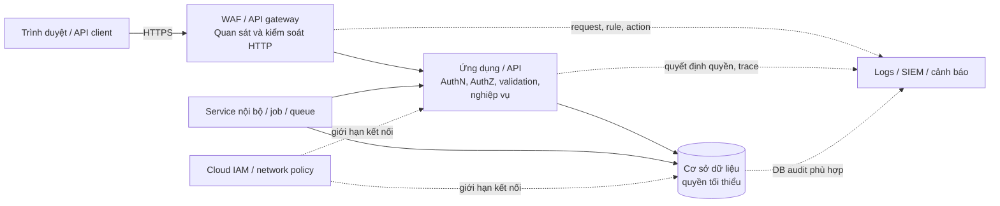
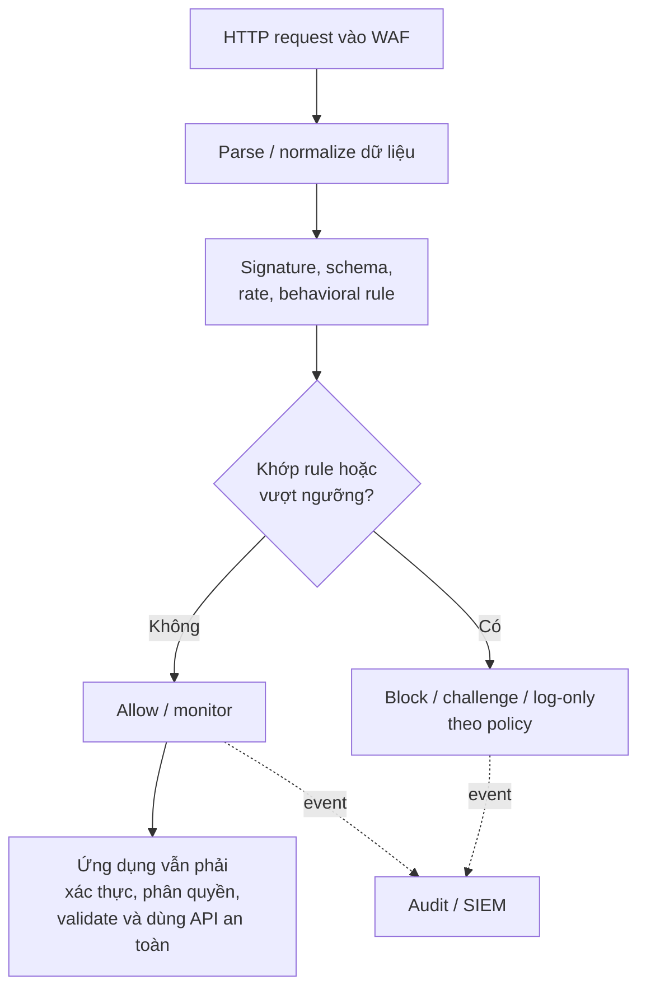
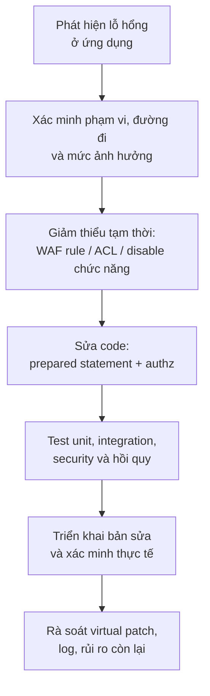

# WAF không thay thế secure coding

**Web Application Firewall (WAF)** giúp giám sát và thực thi chính sách đối với lưu lượng HTTP/HTTPS nhằm giảm rủi ro từ một số kiểu yêu cầu nguy hiểm. Nhưng **WAF không thể thay thế secure coding** — quá trình thiết kế, lập trình, kiểm thử và vận hành ứng dụng theo nguyên tắc bảo mật ngay từ nguồn. Một ứng dụng vẫn có thể bị truy cập trái phép vào dữ liệu dù mọi yêu cầu đều đi qua WAF và không xuất hiện một cảnh báo tấn công nào.

Ví dụ: người dùng đã đăng nhập gửi yêu cầu xem đơn hàng với một mã đơn hợp lệ nhưng đơn hàng thuộc khách hàng khác. Cú pháp HTTP và tham số hoàn toàn bình thường. Nếu ứng dụng **không kiểm tra quyền sở hữu đơn hàng**, nó có thể trả dữ liệu trái phép. WAF thường không biết mô hình sở hữu đơn hàng bên trong cơ sở dữ liệu để ngăn chặn chính xác hành vi này. Đây là lỗi **broken access control**, phải được sửa trong ứng dụng.

Trong mô-đun **SECURITY_NETWORK_SECURITY**, WAF là một phần của phòng vệ nhiều lớp, phối hợp với firewall, VPN, phân đoạn mạng, kiểm soát danh tính, IDS/IPS, bảo vệ DNS, giám sát và hạ tầng cloud. Giá trị của WAF là **giảm xác suất một số yêu cầu độc hại đến được ứng dụng, cung cấp dấu hiệu điều tra và hỗ trợ giảm thiểu tạm thời**. Trách nhiệm bảo đảm tính đúng đắn của truy vấn, quyền truy cập và luồng nghiệp vụ vẫn thuộc về thiết kế và mã ứng dụng.

## 1. Tư duy đúng: WAF bảo vệ cửa vào, secure coding bảo vệ hành vi

Hãy hình dung ứng dụng quản lý đơn hàng:



Tại WAF, câu hỏi thường là: “Request này có khớp chính sách HTTP, mẫu tấn công hoặc tín hiệu bất thường không?” Tại ứng dụng, câu hỏi sâu hơn: “**Chủ thể này** có quyền thực hiện **hành động này** trên **đối tượng cụ thể này** trong **trạng thái nghiệp vụ hiện tại** hay không?” Hai câu hỏi phục vụ những cấp độ khác nhau.

Một request có thể trông bình thường đối với WAF nhưng gây sai lệch nghiệp vụ. Ngược lại, dữ liệu hợp lệ chứa những từ như **SELECT** hoặc ký tự đặc biệt có thể bị một rule WAF quá rộng coi là nguy hiểm. Vì vậy, hệ thống bảo vệ tốt cần cả **phòng ngừa từ gốc ở code** và **kiểm soát ở điểm vào**, kèm khả năng giải thích quyết định.

### 1.1. Vai trò và giới hạn

| Phạm vi | WAF hỗ trợ gì? | Secure coding phải đảm bảo gì? |
| --- | --- | --- |
| Dấu hiệu SQL injection | Phát hiện/chặn một số request có cú pháp nghi vấn | Prepared statement, query an toàn, dữ liệu tách khỏi cú pháp SQL |
| Cross-site scripting (XSS) | Phát hiện một số chuỗi/kiểu request nghi ngờ | Output encoding đúng ngữ cảnh, xử lý DOM an toàn, template an toàn |
| Broken access control | Có thể lọc theo path, phiên, IP, token/role khi tích hợp | Kiểm tra quyền ở từng resource và operation, tenant isolation |
| Xác thực phiên | Rate limiting, bot detection, IP reputation, rules | MFA khi cần, xác thực đúng chuẩn, bảo vệ phiên/token, thu hồi quyền |
| SSRF | Có thể nhận diện một số URL hoặc đầu vào đáng ngờ | Kiểm soát điểm đến từ server, phân giải/redirect an toàn, egress policy |
| Business logic | Có thể hỗ trợ rate limit và phát hiện hành vi khác thường | Ràng buộc bất biến nghiệp vụ, hạn mức, trạng thái, chống race condition |
| Upload tệp | Kiểm tra loại request/kích thước/chữ ký theo khả năng | Kiểm tra nội dung, cô lập lưu trữ, quyền truy cập, xử lý file an toàn |
| Thư viện lỗi thời | Không trực tiếp sửa mã thư viện | Quản lý dependency, cập nhật bản vá và kiểm thử tương thích |
| Bí mật bị lộ | Có thể giám sát một phần nội dung HTTP | Quản lý secret, không hardcode, rotation, kiểm soát logs |
| Kết nối trực tiếp đến DB/job | Thường ngoài phạm vi WAF HTTP | Phân quyền service, xác thực giữa thành phần, DB least privilege |

**WAF không phải “vá lỗ hổng trong code”.** Ngay cả khi một rule WAF chặn được một cách khai thác, luồng lỗi bên trong ứng dụng vẫn tồn tại và có thể bị chạm đến qua giao diện khác hoặc sau khi policy thay đổi.

## 2. Tại sao WAF không nhìn thấy toàn bộ bề mặt tấn công?

Một WAF hoạt động hiệu quả khi các request cần bảo vệ đi qua nó và dữ liệu có thể được phân tích đúng. Nhưng không phải mọi đường truy cập ứng dụng đều nằm trong điều kiện này.

### 2.1. Những đường không nhất thiết đi qua WAF

- **Origin trực tiếp:** máy chủ backend vẫn có IP public hoặc hostname riêng cho phép truy cập ngoài CDN/WAF.
- **Dịch vụ nội bộ:** service-to-service, message queue, batch job hoặc API nội bộ có thể đọc/ghi cùng DB mà không qua WAF.
- **Giao thức khác HTTP:** SSH, kết nối cơ sở dữ liệu, giao thức TCP tùy chỉnh không phải phạm vi xử lý của WAF HTTP thông thường.
- **Luồng nâng cấp/streaming:** một số sản phẩm không phân tích mọi message WebSocket hoặc toàn bộ request lớn.
- **Ứng dụng di động và API:** endpoint có JSON, multipart, GraphQL hay định dạng mà parser của rule set chưa bao phủ đầy đủ.
- **Môi trường staging/admin:** có thể đi qua VPN hoặc reverse proxy khác với site public.
- **Dữ liệu đã lưu:** dữ liệu nguy hiểm có thể được lưu ở thời điểm trước rồi gây lỗi khi job nội bộ sử dụng lại; WAF trên request ban đầu không thể bảo đảm phát hiện.

**Chính sách mạng phải bảo đảm đường đi dự kiến.** Nếu kiến trúc yêu cầu WAF trước origin, hãy xác minh origin chỉ nhận kết nối từ đường đã được phê duyệt. Tuy nhiên, ngay cả khi origin được khóa đúng, các luồng xử lý nội bộ vẫn cần secure coding riêng.

### 2.2. HTTPS và giới hạn độ quan sát

WAF ở vị trí kết thúc TLS hợp lệ có thể đọc HTTP request; nếu lưu lượng chưa được giải mã tại điểm đó, khả năng kiểm tra payload sẽ hạn chế. Hơn nữa, WAF có thể có ngưỡng kích thước body, giới hạn parser hoặc phương thức xử lý từng Content-Type khác nhau.

Một số vấn đề cần xác minh:

| Điều kiện | Rủi ro nhận định sai |
| --- | --- |
| Body vượt giới hạn kiểm tra | Không có alert dù WAF chưa xem toàn bộ dữ liệu |
| Mismatch giữa parser WAF và framework | WAF và app hiểu cùng request theo hai cách khác nhau |
| JSON lồng sâu, multipart hoặc GraphQL | Một số trường dữ liệu không được kiểm tra như dự kiến |
| HTTP/2, HTTP/3 hoặc proxy chain | Khác biệt trong diễn giải/ngữ cảnh request và log |
| Proxy thêm hoặc thay header | Nguồn IP, scheme, hostname có thể bị gán nhầm |
| TLS termination ở sai điểm | WAF không nhìn thấy nội dung cần phát hiện |

Vì vậy, **không xuất hiện sự kiện WAF** không phải là bằng chứng ứng dụng không có lỗ hổng.

## 3. Signature, anomaly scoring và giới hạn của phát hiện

WAF thường kết hợp chữ ký, quy tắc theo HTTP field, phân loại URL/đích, rate limiting và đôi khi sử dụng anomaly scoring hoặc mô hình hành vi.



Mô hình trên chỉ minh họa luồng quyết định, không phải pipeline cố định của mọi nhà cung cấp. **Block**, **detect-only**, **challenge** và **allow** là những kết quả khác nhau, phải phân biệt trong log.

### 3.1. False positive và false negative

**False positive:** WAF chặn một yêu cầu hợp lệ. Ví dụ trang bài học bảo mật có nội dung **SELECT, JOIN, script**; một rule chỉ nhìn từ khóa có thể nhận định sai. **False negative:** WAF bỏ sót một hoạt động gây hại, có thể do parser không hỗ trợ, logic nghiệp vụ không có dấu hiệu đặc trưng, rule quá hẹp hoặc request không qua WAF.

| Tình huống | Nguyên nhân có thể | Cách xử lý |
| --- | --- | --- |
| Văn bản học SQL bị chặn | Chữ ký khớp từ khóa hợp lệ | Kiểm tra matched field, chỉnh exception hẹp và regression test |
| Dữ liệu khác tenant bị đọc nhưng WAF không báo | Request có cú pháp hợp lệ; thiếu authorization trong code | Thêm resource-level authorization, kiểm thử cross-tenant |
| Payload trong JSON không có alert | Parser/giới hạn body hoặc rule không áp | Kiểm tra coverage WAF và bổ sung validation server-side |
| Sau nâng rule set xuất hiện nhiều 403 | Rule mới nhạy hơn với traffic hợp lệ | Xác minh log, triển khai rollback/tuning có phạm vi |
| WAF báo “SQLi” nhưng DB an toàn | Signature match không nhất thiết chứng minh SQL thực thi | Đối chiếu app trace, DB audit, prepared statement |

**Không điều chỉnh WAF bằng cách tắt toàn bộ bảo vệ cho một endpoint** khi chưa xác minh root cause. Điều chỉnh tối thiểu nên gắn với rule/field/path cụ thể, có chủ sở hữu, giới hạn thời gian và phép kiểm thử sau thay đổi.

## 4. Secure coding bắt đầu từ dữ liệu không tin cậy

Nguyên tắc nền tảng là **mọi dữ liệu đi qua ranh giới tin cậy phải được xử lý theo ngữ cảnh sử dụng**. Không chỉ dữ liệu nhập trực tiếp từ client mới không đáng tin: nội dung lưu ở DB, message từ queue, metadata từ cloud hoặc phản hồi service khác cũng có thể xuất phát từ nguồn chưa được kiểm soát.

Có thể chia trách nhiệm thành bốn nhóm:

1. **Validation:** ràng buộc kiểu, phạm vi, độ dài, định dạng và cấu trúc theo hợp đồng nghiệp vụ.
2. **Context-safe APIs:** dùng các API tách dữ liệu khỏi cú pháp, ví dụ prepared statement thay vì ghép chuỗi SQL.
3. **Authorization:** kiểm tra ai được phép làm gì trên đối tượng cụ thể, kể cả khi dữ liệu đầu vào có vẻ hợp lệ.
4. **Output handling:** mã hóa/escape theo ngữ cảnh đích như HTML, JavaScript, URL, header hay shell; không dùng một hàm escape chung cho mọi môi trường.

**Input validation không tương đương output encoding**, và cả hai cũng không thay thế phân quyền. Một giá trị số hợp lệ vẫn có thể tham chiếu đơn hàng của khách khác; một chuỗi văn bản hợp lệ vẫn có thể gây XSS nếu được đưa không an toàn vào HTML.

## 5. Ví dụ 1: SQL injection cần sửa ở nơi tạo câu SQL

Giả sử API nhận **customerId** để trả đơn hàng. Một cách viết có rủi ro là đưa trực tiếp input vào câu SQL:

```java
// Cách viết KHÔNG AN TOÀN, chỉ dùng để giải thích lỗi.
String customerId = request.getParameter("customerId");
String query = "SELECT id, amount FROM orders WHERE customer_id = " + customerId;
Statement stmt = connection.createStatement();
ResultSet rs = stmt.executeQuery(query);
```

WAF có thể phát hiện một số mẫu đầu vào đáng ngờ, nhưng nguyên nhân gốc là giá trị client được ghép trực tiếp vào **cú pháp SQL**. Cách sửa là dùng **prepared statement**, kiểm soát kiểu đầu vào và **ràng buộc dữ liệu theo danh tính thực**:

```java
// Minh họa truy vấn an toàn hơn bằng JDBC.
long customerId = principal.customerId(); // lấy từ danh tính tin cậy sau xác thực
String sql = "SELECT id, amount FROM orders WHERE customer_id = ?";

try (PreparedStatement ps = connection.prepareStatement(sql)) {
    ps.setLong(1, customerId);
    try (ResultSet rs = ps.executeQuery()) {
        while (rs.next()) {
            // Chuyển đổi dữ liệu phù hợp quyền truy cập.
        }
    }
}
```

Ở đây, **?** là tham số dữ liệu; **customerId** được lấy từ danh tính đã xác thực thay vì tin tưởng giá trị bất kỳ do client gửi. Nếu API cho phép chọn khách hàng theo vai trò quản trị, logic authorization phải xác minh role và phạm vi được quản lý trước khi truy vấn.

### 5.1. Các câu hỏi secure coding khi dùng SQL

- Mọi truy vấn có dữ liệu không tin cậy đã dùng **bind parameter** chưa?
- Tên bảng, tên cột, hướng **ORDER BY** động đã được chọn qua allowlist chưa? Không phải mọi identifier SQL đều bind như value.
- Tài khoản DB của dịch vụ có **chỉ các quyền cần thiết** không?
- Dữ liệu có được giới hạn theo tenant/chủ sở hữu không?
- Lỗi SQL có bị hiển thị trực tiếp với client không?
- Có phép thử hồi quy cho các nhánh tìm kiếm, cập nhật, báo cáo, job xử lý và import dữ liệu không?

**WAF có thể là lớp giảm thiểu trong thời gian sửa code, nhưng không được xem là lý do trì hoãn việc tham số hóa truy vấn.**

## 6. Ví dụ 2: XSS cần output encoding đúng ngữ cảnh

**Cross-site scripting (XSS)** xảy ra khi dữ liệu không tin cậy được đưa vào môi trường thực thi của trình duyệt theo cách tạo ra mã hoặc hành vi ngoài ý muốn. WAF có thể phát hiện một số input nghi vấn nhưng không thể hiểu đầy đủ mọi vị trí đầu ra hoặc luồng DOM.

Ví dụ client hiển thị nội dung mô tả sản phẩm dưới dạng HTML. Đầu vào chứa ký tự đặc biệt không phải bản thân là lỗ hổng; lỗ hổng phát sinh khi code **diễn giải nó như markup/script**.

### 6.1. Minh họa trên frontend

```javascript
// KHÔNG NÊN làm với dữ liệu không tin cậy:
container.innerHTML = product.description;

// An toàn hơn khi mục đích là hiển thị văn bản thuần:
container.textContent = product.description;
```

Nếu ứng dụng thực sự cho phép **rich text HTML**, phải dùng cơ chế **sanitize HTML có chính sách** và cấu hình tin cậy phù hợp, không chỉ thay mọi chuỗi bằng textContent. Nếu xuất dữ liệu vào template server, sử dụng cơ chế auto-escaping của template engine và tránh tắt nó tùy tiện.

### 6.2. Ngữ cảnh đầu ra khác nhau

| Ngữ cảnh | Hướng xử lý |
| --- | --- |
| HTML text node | HTML escaping/auto-escaping hoặc textContent |
| HTML attribute | Attribute encoding phù hợp, kiểm soát tên thuộc tính |
| URL/href | Kiểm tra scheme, nguồn cho phép và encode theo URL context |
| JavaScript literal | Tránh nhúng trực tiếp dữ liệu; dùng JSON serialization an toàn và API DOM phù hợp |
| CSS | Không ghép tùy ý input vào stylesheet; dùng allowlist giá trị có thể dùng |
| DOM HTML động | Không dùng sink nguy hiểm với dữ liệu chưa được xử lý phù hợp |

**Content Security Policy (CSP)** có thể hạn chế một số tác động của XSS nhưng không thay thế output encoding và DOM API an toàn. Nếu dữ liệu đã lưu trong DB được hiển thị ở trang khác, lỗi có thể là **stored XSS**; WAF kiểm tra request ghi dữ liệu không nhất thiết nhận biết ngữ cảnh hiển thị sau này.

## 7. Ví dụ 3: Broken Access Control không thể giải quyết chỉ bằng WAF

Đây là nhóm lỗ hổng minh họa rõ nhất giới hạn của WAF. Xét API:

- **GET /api/orders/101** trả đơn hàng của người dùng A.
- **GET /api/orders/102** trả đơn hàng của người dùng B.

Một client hợp lệ có thể gửi cả hai request với cấu trúc bình thường, không từ khóa SQLi/XSS. Nếu server chỉ kiểm tra “đã đăng nhập” mà **không kiểm tra chủ sở hữu order**, nó có thể tiết lộ dữ liệu.

### 7.1. Quyền phải được kiểm tra trên từng đối tượng

```java
// Pseudocode minh họa ý tưởng: không phải một controller đầy đủ.
Order order = orderRepository.findById(orderId)
    .orElseThrow(() -> new NotFoundException());

if (!authorizationService.canReadOrder(principal, order)) {
    throw new AccessDeniedException("Không có quyền đọc đơn hàng");
}

return orderMapper.toAuthorizedView(order);
```

Một cách khác là truy vấn trực tiếp **theo cả orderId và customerId thuộc principal** để giảm khả năng truy xuất đối tượng ngoài quyền, nhưng vẫn cần kiểm tra các điều kiện nghiệp vụ khác. Trong hệ thống multi-tenant, tenant ID phải đến từ ngữ cảnh đã xác thực và được kiểm tra ở mọi thao tác đọc, sửa, xóa, export và batch.

### 7.2. Những thao tác WAF không đủ ngữ cảnh

| Request có vẻ bình thường | Điều code phải xác minh |
| --- | --- |
| Xem đơn hàng với ID hợp lệ | Người dùng có quyền xem đúng đơn hàng |
| Thay đổi email tài khoản | Chủ thể có quyền, có xác minh phù hợp với thao tác nhạy cảm |
| Tải hóa đơn theo UUID | UUID không phải cơ chế phân quyền; phải kiểm tra quyền |
| Thay giá hoặc mã giảm giá | Server áp quy tắc giá/khuyến mại, không tin dữ liệu client |
| Xuất báo cáo toàn tenant | Giới hạn tenant và vai trò, tránh data leak qua export |
| Gọi API admin bằng token user | Authorization theo quyền của action, không chỉ dựa trên route |

WAF có thể chặn đường dẫn admin từ Internet hoặc yêu cầu các tín hiệu danh tính, nhưng **nó không thể tự bảo đảm ràng buộc sở hữu dữ liệu trong mọi nghiệp vụ**. Cần kiểm tra **AuthZ ở server** trong cả luồng web, API, job và event handler.

## 8. Ví dụ 4: Business logic và race condition cần bất biến nghiệp vụ

Ứng dụng thương mại điện tử có thể có quy tắc: “Mỗi khách hàng chỉ được đổi một voucher một lần”. Một người dùng gửi nhiều yêu cầu **POST /redeem** có body hoàn toàn hợp lệ. WAF có thể thấy nhiều request, thậm chí bật rate limit, nhưng không thể bảo đảm cơ sở dữ liệu không xử lý trùng nếu ứng dụng thiếu cơ chế giao dịch.

**Root fix** có thể bao gồm:

- Constraint **UNIQUE(customer_id, voucher_id)** trong DB khi phù hợp.
- Giao dịch bảo đảm kiểm tra điều kiện và ghi nhận việc đổi voucher là một thao tác nguyên tử.
- **Idempotency key** cho API thanh toán/ghi nhận trạng thái, có vòng đời rõ ràng.
- Kiểm tra trạng thái nghiệp vụ và chống lặp trong hệ thống worker/queue.
- Kiểm thử cạnh tranh đồng thời và hành vi retry hợp lệ.

**Rate limiting ở WAF chỉ giảm lượng request**, không tạo được tính nguyên tử cho giao dịch. Một lượng nhỏ request đồng thời vẫn có thể gây race condition nếu code thiếu ràng buộc.

Các yêu cầu tương tự xuất hiện ở chuyển tiền, đặt vé, cấp quyền, reset mật khẩu, đăng ký dịch vụ và quy trình phê duyệt nhiều bước. Mỗi workflow cần **invariant** được kiểm soát tại hệ thống sở hữu dữ liệu.

## 9. Ví dụ 5: SSRF cần kiểm soát đích truy cập từ server

**Server-Side Request Forgery (SSRF)** xảy ra khi ứng dụng có chức năng gửi request đến một tài nguyên bên ngoài và dữ liệu từ người dùng làm server truy cập đích ngoài phạm vi cho phép. WAF có thể nhận diện một số URL hoặc chuỗi đáng ngờ trong request vào, nhưng không nhất thiết biết server sẽ **resolve DNS, theo redirect hoặc kết nối tới IP nào** sau đó.

Tình huống hợp lệ: hệ thống tạo thumbnail từ ảnh được người dùng gửi qua URL. Cách bảo vệ không thể chỉ là chặn vài từ khóa ở WAF.

### 9.1. Biện pháp ngay trong ứng dụng và mạng

1. **Giảm khả năng dùng URL tùy ý**: nếu nghiệp vụ cho phép, chỉ nhận định danh đối tượng trong kho đã được kiểm soát, thay vì một URL bất kỳ.
2. **Allowlist đích theo nhu cầu**: xác định scheme, hostname và cổng được hỗ trợ.
3. **Kiểm tra phân giải và đích thực**: xem xét IPv4/IPv6, dải nội bộ, loopback, link-local và đích không được phép; phòng thay đổi kết quả DNS giữa kiểm tra và kết nối.
4. **Kiểm soát redirect**: không tự động đi sang đích mới ngoài chính sách.
5. **Egress filtering**: hạn chế nơi workload được phép kết nối ở firewall, VPC và network policy.
6. **Bảo vệ cloud metadata service** bằng cấu hình và quyền workload phù hợp.
7. **Không trả nguyên dữ liệu nhạy cảm của remote response** cho người dùng; áp giới hạn kích thước, timeout và content type.
8. **Ghi log quyết định** và thiết lập cảnh báo cho đích kết nối bất thường.

Chính sách chỉ so khớp một chuỗi URL ở request đầu vào có thể sai lệch với kết nối cuối cùng. WAF và **egress firewall** hỗ trợ nhau, nhưng kiểm soát nguồn gốc phải nằm trong API chịu trách nhiệm gửi request.

## 10. Các lỗ hổng khác cần được giải quyết trong mã nguồn

| Nhóm rủi ro | Giới hạn WAF | Thực hành secure coding |
| --- | --- | --- |
| Command injection | Chữ ký HTTP không biết mọi ngữ cảnh shell | Tránh shell nếu có API hệ thống; dùng argument tách biệt và allowlist |
| Path traversal | Có thể phát hiện mẫu đường dẫn, nhưng parser/app có thể diễn giải khác | Canonicalize an toàn, giới hạn root, kiểm soát quyền tệp |
| Insecure deserialization | Payload có thể mã hóa/phức tạp hoặc lưu trước đó | Không deserialize dữ liệu không tin cậy thành object nguy hiểm; dùng kiểu/schema an toàn |
| File upload | WAF không thay thế toàn bộ kiểm tra file/nội dung | Allowlist định dạng, kích thước, kiểm tra file, lưu tách biệt, tránh execute |
| CSRF | WAF không tự biết ý định người dùng đã đăng nhập | Anti-CSRF token đúng cách, SameSite khi phù hợp, kiểm tra Origin và thiết kế API |
| Sensitive data exposure | WAF không luôn thấy dữ liệu phát sinh từ nội bộ | Data minimization, encryption, secret management, kiểm soát response |
| Insecure dependency | Rule có thể chặn vài mẫu khai thác đã biết | SCA/SBOM, update bản vá, review package và khả năng rollback |
| Insecure configuration | WAF có thể chặn một số route nhưng không sửa dịch vụ mặc định | Hardening, least privilege, secure defaults, IaC review |
| Broken authentication | Bot/rate policy không bảo đảm quản lý phiên an toàn | MFA, credential handling, session lifecycle, token validation |
| Logging/security monitoring failures | WAF chỉ có góc nhìn HTTP mà nó xử lý | Audit nghiệp vụ, log ứng dụng/DB, SIEM và bảo vệ dữ liệu log |

Cách tiếp cận tốt nhất là ghép **đường dữ liệu**, **điểm ra quyết định** và **lớp phòng vệ** của từng nhóm lỗi. Không phải WAF không hữu ích, mà chức năng của nó có **phạm vi cụ thể**.

## 11. WAF có thể hỗ trợ virtual patching nhưng không phải bản vá cuối cùng

**Virtual patching** là sử dụng kiểm soát bên ngoài ứng dụng — chẳng hạn rule WAF — để giảm khả năng một lỗ hổng đã xác định bị khai thác trong thời gian đội phát triển sửa nguồn gốc. Đây là một biện pháp giảm thiểu rủi ro có giá trị, nhất là khi việc sửa code cần thời gian kiểm thử và phát hành.

Tuy nhiên:

- Rule chỉ bảo vệ những **đường đi và mẫu** mà nó có thể quan sát.
- Một số luồng nội bộ hoặc client khác vẫn có thể chạm vào lỗi.
- Thay đổi ứng dụng hoặc rule set có thể làm giảm hiệu quả.
- False positive có thể làm gián đoạn nghiệp vụ.
- Việc chặn request không làm dữ liệu đã lộ được phục hồi.
- Sau khi sửa code, vẫn cần kiểm tra lại và quyết định giữ/điều chỉnh rule theo chính sách.

### 11.1. Ví dụ quy trình xử lý khi phát hiện SQLi



Trong sự cố nghiêm trọng, cô lập dịch vụ hoặc thu hồi credential có thể diễn ra song song. Thứ tự xử lý do quy trình ứng phó quyết định, không cứng nhắc theo sơ đồ.

**Tiêu chí đóng rủi ro không nên chỉ là “đã bật rule WAF”.** Cần chứng minh nguồn gốc đã được sửa, test đủ đường đi liên quan và có quyết định chấp nhận rủi ro còn lại.

## 12. Secure SDLC: đưa bảo mật vào từng bước phát triển

Vì WAF không thay thế secure coding, tổ chức cần triển khai **Secure Software Development Life Cycle (Secure SDLC)**. Một lộ trình phù hợp cho web/API:

### 12.1. Thiết kế và threat modeling

Trước khi viết code, trả lời:

- Tài sản nhạy cảm là gì: tài khoản, dữ liệu cá nhân, thanh toán, log, quyền quản trị?
- User/role/tenant nào được phép xem hoặc sửa từng đối tượng?
- Dữ liệu nào đi qua **ranh giới tin cậy**: Internet → WAF → app → DB, user → service, service → cloud?
- Có thao tác nào có thể bị lạm dụng với **request hoàn toàn hợp lệ**?
- Nếu một service hoặc credential bị xâm nhập, nó có quyền truy cập ngang ra sao?
- Những kiểm soát nào phải nằm trong mã, những kiểm soát nào thuộc WAF/NGFW/cloud?

Có thể dùng **abuse case/misuse case** kết hợp STRIDE để phát hiện các tình huống không mong muốn. Ví dụ abuse case “Khách hàng truy cập hóa đơn của khách khác” được chuyển thành yêu cầu kiểm tra **object-level authorization**, không phải chỉ tạo một rule HTTP.

### 12.2. Viết code theo nguyên tắc mặc định an toàn

- Không tin đầu vào từ client hoặc service khác.
- Dùng API an toàn theo ngữ cảnh (bind SQL, DOM text API, serializer, đường dẫn chuẩn).
- **Deny by default** với quyền truy cập resource/action.
- Áp **least privilege** với DB role, service account và cloud IAM.
- Không hardcode bí mật trong mã nguồn hoặc frontend.
- Trả lỗi rõ về trạng thái nhưng không lộ stack trace, query hay credential.
- Bảo đảm thao tác quan trọng có transaction, invariant và idempotency khi cần.

### 12.3. Code review theo đường dữ liệu

Một review có giá trị không chỉ kiểm tra style. Người review cần truy vết:

**Source → transformation → validation → authorization → sink**

Ví dụ:

- Source: orderId trong URL.
- Transformation: parse thành số nguyên.
- Validation: orderId có đúng định dạng.
- Authorization: user có quyền đọc orderId thuộc tenant đó.
- Sink: truy vấn DB và response trả về.

Nếu chỉ có validation số nguyên mà không có authorization theo tài nguyên, **lỗ hổng vẫn còn** dù WAF không cảnh báo.

### 12.4. CI/CD và các loại kiểm thử bảo mật

| Phương pháp | Giá trị | Giới hạn |
| --- | --- | --- |
| **Unit test** | Kiểm tra hàm phân quyền, validator, query builder, quy tắc nghiệp vụ | Không tự đại diện đầy đủ pipeline HTTP/cloud |
| **Integration test** | Xác minh app, DB, IdP, message bus và policy cùng hoạt động | Cần môi trường dữ liệu và cấu hình đúng |
| **SAST** | Tìm mẫu code có nguy cơ và luồng dữ liệu đáng ngờ | Có thể báo sai và bỏ sót logic nghiệp vụ |
| **DAST** | Kiểm thử hành vi web/API đang chạy trong môi trường được phép | Không nhìn thấy toàn bộ mã hay nhánh nội bộ |
| **SCA** | Phát hiện thư viện/phụ thuộc có vấn đề đã biết | Không chứng minh package được khai thác hoặc tất cả lỗi đã được nhận diện |
| **Secret scanning** | Phát hiện credential/secret bị commit hoặc phát hành | Secret vẫn cần được thu hồi nếu đã lộ |
| **Threat modeling / manual review** | Tìm lỗi thiết kế, phân quyền, business logic | Phụ thuộc phạm vi và chuyên môn |
| **WAF policy test** | Kiểm tra rule, logging, false block và đường origin | Không thay thế kiểm thử mã ứng dụng |

**Không có một công cụ riêng lẻ nào bảo đảm ứng dụng an toàn**. Nên kết hợp các phép kiểm thử và gắn kết quả vào ticket theo chủ sở hữu, mức độ rủi ro, bản sửa và bằng chứng.

## 13. Kiểm thử đúng: phải kiểm tra cả WAF lẫn code

Một hệ thống có thể vượt qua bài kiểm tra “WAF đã chặn request nghi vấn” trong khi vẫn thất bại bài kiểm tra “Người dùng không được đọc dữ liệu của người khác”.

Hãy tạo ma trận nghiệm thu song song:

| ID | Tình huống | Kết quả ở WAF | Kết quả bắt buộc ở ứng dụng |
| --- | --- | --- | --- |
| T01 | Khách hợp lệ xem đơn của mình | Allow | 200 với dữ liệu thuộc quyền |
| T02 | Khách hợp lệ xem đơn của tenant khác | Có thể allow vì request bình thường | 403/404 theo thiết kế, **không trả dữ liệu ngoài quyền** |
| T03 | Trường tìm kiếm chứa ví dụ câu SQL hợp lệ | Không nên chặn nhầm | Dữ liệu giữ vai trò văn bản; truy vấn tham số hóa |
| T04 | Bộ test SQLi đã phê duyệt tại staging | Phát hiện/chặn theo policy | Code không tạo truy vấn SQL nguy hiểm |
| T05 | Mô tả sản phẩm chứa ký tự HTML đặc biệt | Không chặn dữ liệu hợp lệ vô cớ | Render thành nội dung an toàn, không thực thi script ngoài ý muốn |
| T06 | Người dùng thử đổi voucher lần thứ hai | Không có dấu hiệu WAF bắt buộc | Server/DB từ chối theo invariant nghiệp vụ |
| T07 | Request lên API từ đường không qua WAF | Đường công khai trái thiết kế phải bị chặn bằng network policy | AuthN/AuthZ và validation vẫn phải đúng dù WAF không có mặt |
| T08 | Bộ kiểm thử ứng dụng sau cập nhật WAF rule | Không phát sinh chặn nhầm lớn | Chức năng hợp lệ và kiểm tra quyền vẫn hoạt động |
| T09 | Upload file không phù hợp chính sách | Hỗ trợ giới hạn phù hợp | Server kiểm tra loại/kích thước/lưu trữ; không execute file |
| T10 | Service nội bộ gọi backend API | WAF có thể không quan sát | Backend vẫn xác thực service và kiểm tra quyền |

### 13.1. Thứ tự ưu tiên phép thử

1. **Rủi ro cao nhất:** thao tác liên quan dữ liệu nhạy cảm, thanh toán, quản trị, cross-tenant và quản lý phiên.
2. **Code path nhiều nguồn đầu vào:** URL, JSON, cookie, upload, queue và dữ liệu đã lưu.
3. **Đường không qua WAF:** worker, admin interface, internal API, private network hoặc origin.
4. **Regression sau bản sửa:** kiểm tra tình huống khai thác được phép mô phỏng, đồng thời bảo đảm use case hợp lệ.
5. **WAF tuning:** xác nhận rule dự kiến khớp, action đúng, không có false positive nghiêm trọng.

Chỉ thử với hệ thống/tài khoản/dữ liệu **được phép kiểm tra**, ưu tiên staging hoặc lab. Tránh quét hay gửi tải phá hoại lên production. Mục tiêu là kiểm chứng kiểm soát, không tạo gián đoạn.

## 14. Vận hành WAF và secure coding cùng một hệ thống bằng chứng

Đội an ninh và đội phát triển cần nói cùng một ngôn ngữ khi xử lý cảnh báo. Một request WAF bị chặn chỉ là một **bằng chứng về điểm thực thi**, không phải chẩn đoán toàn bộ mã nguồn.

Một bản ghi điều tra nên chứa:

| Trường | Câu hỏi |
| --- | --- |
| **Thời gian UTC / timezone** | Các log có cùng khung thời gian không? |
| **Request ID / trace ID** | WAF, API gateway và ứng dụng có liên kết được? |
| **Endpoint, method, field** | Dữ liệu gây cảnh báo nằm ở đâu? |
| **Rule ID / rule set version** | WAF khớp quy tắc gì và ở chế độ nào? |
| **Action** | Block, allow, challenge hay detect-only? |
| **Identity / tenant context** | Client đang làm việc với quyền nào (đã che dữ liệu nhạy cảm)? |
| **App decision** | AuthN/AuthZ, validator và business rule trả kết quả gì? |
| **DB/service telemetry** | Có thao tác bất thường, lỗi, thay đổi dữ liệu không? |
| **Code fix / test** | Lỗi đã sửa ở commit/bản phát hành và kiểm thử nào? |
| **Residual risk** | Còn đường đi hay trường hợp chưa xác minh? |

Ví dụ một bản ghi minh họa:

```yaml
case_id: WAF-CODE-013
observed_at: "2026-11-28T03:05:00Z"
asset: "api.example.net"
route: "GET /api/orders/{orderId}"
waf:
  action: "allow"
  matched_sql_injection_rule: false
  request_id: "req-demo-013"
application:
  authn: "valid-session"
  resource_authz: "missing-in-affected-version"
  outcome: "cross-tenant data could be returned"
root_cause: "Missing object-level authorization"
containment:
  - "Temporarily restrict affected endpoint where justified"
  - "Increase monitoring of access to orders"
permanent_fix:
  - "Enforce tenant and owner checks server-side"
  - "Add negative integration tests for cross-tenant access"
confidence: "Example scenario for training; not an actual incident"
owner: "Application team + Security"
```

Bản ghi cho thấy **WAF allow** vẫn có thể đi kèm lỗ hổng trong code. Các giá trị trên chỉ là ví dụ; không nên dùng làm chứng cứ một sự cố có thật.

**Bảo vệ dữ liệu log:** query string, cookie, body và Authorization header có thể chứa secret hoặc dữ liệu cá nhân. Hạn chế log payload, redact token/cookie, chỉ thu thập dữ liệu cần điều tra, kiểm soát quyền truy cập và áp chính sách lưu trữ/xóa.

## 15. Quy trình phối hợp xử lý một cảnh báo WAF

Khi WAF cảnh báo SQLi/XSS/SSRF, nên kết hợp công việc của **network security**, **application security** và **owner dịch vụ**:

### Bước 1 — Xác minh sự kiện

- Log có đúng action **block** hay chỉ **detect-only**?
- Request có đi tới backend không?
- Rule nào khớp, trường nào bị đánh dấu?
- Có dấu hiệu false positive hay request hợp lệ đáng ngờ?
- Có WAF bypass path hoặc route khác không?

### Bước 2 — Xác định tác động

- Người dùng/role/tenant nào liên quan?
- Có log app/DB hoặc dữ liệu chỉ ra quyền bị vượt qua?
- Có thay đổi dữ liệu, lỗi truy vấn hoặc đột biến request?
- Bằng chứng có đủ để khẳng định khai thác thành công chưa?

### Bước 3 — Giảm rủi ro tức thời

Nếu cần, áp rule WAF tạm thời, giới hạn endpoint, yêu cầu xác thực bổ sung, chặn đường origin hoặc giảm phạm vi dịch vụ. Ghi **thời hạn và người sở hữu** của ngoại lệ/biện pháp giảm thiểu.

### Bước 4 — Sửa gốc trong code

Dựa trên đường dữ liệu đã tìm thấy, sửa kiểm tra quyền, prepared statement, output encoding, validation, transaction hoặc cấu hình dịch vụ. Review tác động các code path khác có cùng mẫu lỗi.

### Bước 5 — Kiểm thử và phát hành

Kiểm thử âm tính (truy cập sai quyền phải bị từ chối) và dương tính (người có quyền vẫn sử dụng được). Chạy bộ regression ở ứng dụng và WAF. Triển khai qua quy trình kiểm soát thay đổi, có rollback.

### Bước 6 — Đóng và theo dõi

Xác nhận không còn hành vi lỗi tại phiên bản mới, theo dõi log và quyết định có cần giữ rule WAF hay không. Chỉ đóng ticket theo **tiêu chí khắc phục**, không chỉ vì số WAF alert giảm.

## 16. Tình huống triển khai: ứng dụng bán hàng trên cloud

Giả sử tổ chức triển khai:

- Website khách hàng qua **CDN + WAF**.
- API sau **load balancer**.
- Cơ sở dữ liệu trong private subnet.
- Worker xử lý đơn từ message queue.
- Nhân viên quản trị truy cập qua VPN/ZTNA và bastion.

### 16.1. Các sự cố giả định

**Tình huống A — WAF chặn SQLi nhưng code vẫn ghép SQL.** Rule đã ngăn một số request ở edge, nhưng một service nội bộ gọi chung hàm query không an toàn. Cách sửa đúng là **tham số hóa SQL trong service**, hạn chế quyền DB, thêm test cho cả HTTP và xử lý nội bộ. Giữ WAF rule trong khi xử lý chỉ là lớp giảm thiểu.

**Tình huống B — Khách xem đơn hàng người khác.** WAF không báo vì endpoint nhận một ID hợp lệ. Cần sửa **object-level authorization**, ràng buộc order với tenant/user, kiểm thử mọi phương thức đọc/sửa/xuất dữ liệu và xem lại log truy cập có liên quan.

**Tình huống C — WAF gây false positive với trang học SQL.** Người dùng nhập bài viết kỹ thuật, rule khớp từ khóa. Không tắt toàn bộ SQLi protection; xác minh output được encode, dữ liệu được lưu qua truy vấn tham số hóa và tạo exception hẹp cho trường nội dung nếu cần.

**Tình huống D — Origin cloud bị truy cập trực tiếp.** Rule WAF hoạt động trên hostname công khai nhưng VM/load balancer gốc vẫn mở từ Internet. Phải hạn chế **network path đến origin**, bật authz ở backend và kiểm thử đường truy cập trực tiếp. Không dựa vào việc origin khó đoán.

### 16.2. Chia trách nhiệm trong doanh nghiệp

| Nhóm | Trách nhiệm chủ yếu |
| --- | --- |
| **Developer / application owner** | Thiết kế API, authz, query an toàn, validation, output handling, test và sửa root cause |
| **AppSec** | Threat modeling, secure coding standard, code review, SAST/DAST, xác minh lỗ hổng |
| **Network/Security operations** | WAF/NGFW policy, rule, logging, origin access, phân đoạn, giám sát và xử lý cảnh báo |
| **Platform/Cloud** | Cloud IAM, security group, secrets, network paths, deployment security, logging infrastructure |
| **DBA/Data owner** | Quyền DB, backup, audit, data classification, kiểm soát truy cập dữ liệu |
| **Product/business owner** | Quy tắc nghiệp vụ, phạm vi dữ liệu, quyết định quyền và rủi ro chấp nhận |

Bảo mật bền vững cần trách nhiệm rõ ràng và cơ chế phối hợp, không phải giao toàn bộ vấn đề cho nhóm quản trị WAF.

## 17. Đo hiệu quả theo khả năng chống lỗi gốc, không chỉ theo số request bị chặn

Một dashboard WAF có hàng nghìn request bị block có thể chứng minh lưu lượng đã bị rule chặn, nhưng **không chứng minh ứng dụng không còn lỗ hổng**. Nên kết hợp hai nhóm chỉ số:

| Chỉ số WAF / mạng | Chỉ số ứng dụng / secure coding |
| --- | --- |
| Tỷ lệ endpoint public đi qua WAF đúng thiết kế | Tỷ lệ endpoint có resource-level authorization test |
| Số cảnh báo đã xác minh/đã xử lý | Số lỗi root cause đang mở theo mức ảnh hưởng |
| False positive rate và số request hợp lệ bị block | Tỷ lệ regression test bảo mật pass |
| Độ trễ và khả năng quan sát WAF | Mức bao phủ SAST/SCA/DAST cùng review thủ công |
| Thời gian triển khai mitigation rule | Thời gian sửa mã nguồn và triển khai bản vá |
| Số origin ngoài WAF bị phát hiện | Số credential/dependency/config issue chưa xử lý |
| Độ đầy đủ log WAF → SIEM | Khả năng tương quan request → authz → DB operation |
| Số rule tạm thời quá hạn | Số test nghiệp vụ nhạy cảm/race condition còn thiếu |

Các chỉ số cần có nguồn dữ liệu và định nghĩa rõ. Ví dụ một endpoint có nhiều test nhưng bỏ sót trường hợp cross-tenant vẫn có thể thiếu kiểm soát; “100% test pass” chỉ áp dụng cho **tập trường hợp đã viết**.

## 18. Những hiểu lầm cần tránh

| Hiểu lầm | Vì sao sai | Cách tiếp cận đúng |
| --- | --- | --- |
| “WAF chặn SQLi nên không cần prepared statement” | Root cause vẫn ở query builder | Dùng bind parameter, kiểm tra quyền DB |
| “HTTP request hợp lệ thì không thể gây tấn công” | Broken access control và business logic thường dùng cú pháp bình thường | Kiểm tra role, ownership, tenant, invariant |
| “Không có WAF alert nghĩa là ứng dụng an toàn” | WAF có vùng mù và false negative | Code review, SAST/DAST, kiểm thử logic |
| “Bật WAF là đã vá lỗ hổng” | Rule có thể chỉ chặn một đường khai thác | Xem mitigation tạm thời, sửa code cuối cùng |
| “Tắt WAF trên route có false positive là nhanh nhất” | Có thể tạo vùng bỏ kiểm tra rộng | Điều chỉnh field/rule hẹp có test |
| “Chặn IP làm được phân quyền người dùng” | IP có thể thay đổi/chia sẻ hoặc đi qua proxy | Identity-aware policy và authz ở server |
| “CSP thay được output encoding” | CSP giảm tác động nhưng không sửa injection root | Output encoding, DOM API an toàn |
| “Rate limit đủ chống race condition” | Một vài request hợp lệ có thể gây race | Transaction, constraint, idempotency |
| “WAF nhìn được mọi JSON, WebSocket và HTTPS” | Tùy đường đi, parser và TLS termination | Kiểm chứng coverage, bảo vệ ở backend |
| “Hệ thống có WAF nên không cần kiểm tra origin” | Request có thể đi đường trực tiếp | Hạn chế origin, kiểm thử network paths |
| “Chỉ cần sửa web API, worker nội bộ an toàn” | Cùng logic/DB có thể bị tác động ngoài HTTP | Bảo vệ mọi entry point và service boundary |
| “WAF block là bằng chứng ứng dụng đã bị xâm nhập” | Log thể hiện quyết định rule, không chứng minh tác động DB | Tương quan WAF, app, DB, auth logs |

## 19. Checklist nghiệm thu kiến trúc WAF + secure coding

- [ ] Mỗi endpoint có owner, tài sản, nguồn dữ liệu và vai trò truy cập rõ ràng.
- [ ] Xác định WAF đứng ở đâu, loại traffic nào được nhìn thấy và đường nào không qua WAF.
- [ ] Origin/private API được bảo vệ theo thiết kế, không có đường truy cập public ngoài dự kiến.
- [ ] Mã ứng dụng không ghép input chưa tin cậy thành SQL hoặc lệnh hệ điều hành.
- [ ] Có prepared statement/ORM dùng đúng cách; tên trường và sort động dùng allowlist.
- [ ] Mọi thao tác trên resource có server-side authorization theo user/tenant/role.
- [ ] Các quy tắc nghiệp vụ nhạy cảm được bảo vệ bằng transaction, constraint và idempotency khi cần.
- [ ] Đã kiểm tra output encoding, DOM sink và CSP ở ngữ cảnh phù hợp.
- [ ] URL-fetch/upload/deserialization và secret handling được kiểm soát ở backend.
- [ ] Các service nội bộ, background worker và message handler cũng thực thi kiểm tra phù hợp.
- [ ] DB role, service account và cloud IAM tuân thủ least privilege.
- [ ] WAF có rule, action, body parser, TLS placement và logging phù hợp traffic thực tế.
- [ ] Exception WAF có phạm vi hẹp, owner và thời hạn rà soát.
- [ ] Có test cho request hợp lệ và request sai quyền; không chỉ test payload bị WAF block.
- [ ] Có kiểm thử SAST/SCA/DAST, integration, code review và kiểm thử thủ công phần logic nhạy cảm.
- [ ] Có khả năng liên kết log WAF, API, authz và DB qua timestamp/trace ID.
- [ ] Dữ liệu log/capture được giảm thiểu, che secret và lưu giữ đúng chính sách.
- [ ] Mọi virtual patch đều liên kết với ticket sửa root cause trong code.
- [ ] Sau phát hành có regression test, giám sát false positive và phương án rollback.
- [ ] Kết quả đánh giá rủi ro có ghi hạn chế quan sát và phần chưa được xác minh.

## 20. Tổng kết

**WAF và secure coding không phải hai lựa chọn thay thế nhau**. WAF kiểm soát một phần traffic HTTP đi vào hệ thống và cung cấp khả năng phát hiện, giảm thiểu, giám sát. Secure coding bảo vệ **cách dữ liệu được diễn giải, cách quyền được quyết định, cách trạng thái nghiệp vụ thay đổi và cách ứng dụng tương tác với DB, hệ điều hành và dịch vụ khác**.

Một kiến trúc mạng an toàn cần cả **WAF được đặt đúng đường, policy được vận hành có bằng chứng, mã nguồn được thiết kế an toàn, kiểm thử quyền và nghiệp vụ, quyền DB tối thiểu, phân đoạn mạng và giám sát toàn chuỗi**. Khi phát hiện một lỗ hổng, hãy dùng WAF để giảm rủi ro nếu phù hợp, nhưng **kết thúc bằng việc sửa nguyên nhân gốc trong code và chứng minh bằng kiểm thử hồi quy**.
