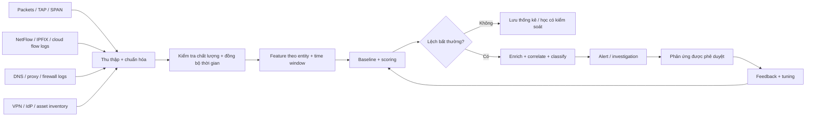

# Anomaly-based detection trong IDS/IPS

## Mục tiêu học tập

Sau bài học, bạn có thể:

1. Giải thích **anomaly-based detection** (phát hiện bất thường) trong hệ thống **IDS/IPS**, phân biệt với phát hiện dựa trên chữ ký và hiểu vì sao **bất thường không đồng nghĩa với tấn công**.
2. Xác định các nguồn dữ liệu quan sát mạng như **packet capture, NetFlow/IPFIX, DNS logs, firewall logs, proxy, TLS metadata và cloud flow logs**; nêu giới hạn của từng nguồn.
3. Thiết kế baseline lưu lượng theo **thiết bị, dịch vụ, vai trò, thời điểm và vùng mạng**, tránh so sánh không đúng giữa các nhóm hành vi khác nhau.
4. Tính và diễn giải các chỉ số cơ bản như **tốc độ, số đích duy nhất, tỷ lệ lỗi, z-score, median absolute deviation (MAD), percentile** và cảnh báo theo chuỗi thời gian.
5. Đánh giá chất lượng detection qua **precision, recall, false-positive rate, độ trễ phát hiện**, chất lượng nhãn và sự thay đổi hành vi mạng.
6. Xây dựng quy trình **phát hiện → kiểm chứng ngữ cảnh → điều tra → phản ứng → cải tiến**, chỉ tự động chặn khi đủ tin cậy và có cơ chế rollback phù hợp.
7. Thực hiện bài lab an toàn bằng **dữ liệu tổng hợp** để kiểm tra ngưỡng, false positive và nội dung một alert có thể hành động.

## 1. Anomaly-based detection là gì?

Trong an ninh mạng, **anomaly-based detection** là cách nhận diện một quan sát hoặc chuỗi hành vi **khác biệt đáng kể so với trạng thái bình thường hoặc mô hình hành vi dự kiến**. Tùy thiết kế, hệ thống có thể dựa vào quy tắc thống kê, mô hình chuỗi thời gian, tập hợp đặc trưng, mô hình học máy hoặc sự kết hợp của nhiều tín hiệu.

Ví dụ trong một hệ thống nội bộ:

- Một máy trạm thường kết nối tới 20–60 địa chỉ đích trong mỗi 15 phút. Đột nhiên nó kết nối đến 480 đích.
- Một dịch vụ DNS thường có tỷ lệ phản hồi `NXDOMAIN` thấp, nhưng trong một khoảng ngắn tỷ lệ tăng bất thường.
- Một ứng dụng chỉ thực hiện truy vấn nội bộ, nhưng bất ngờ phát sinh lượng lớn dữ liệu đi ra Internet.
- Một tài khoản quản trị thường dùng bastion trong giờ bảo trì, song xuất hiện nhiều phiên không đúng cửa sổ hoặc tới tài sản ngoài phạm vi.

Những hiện tượng trên đều có thể là **dấu hiệu cần điều tra**. Chúng cũng có thể do thay đổi hợp lệ: rollout phần mềm, backup, kiểm thử định kỳ, sự cố DNS, failover, thay đổi mạng hoặc hoạt động của hệ thống giám sát. **Detector chỉ nêu bất thường theo dữ liệu nó quan sát được; analyst phải kiểm tra ngữ cảnh trước khi kết luận đây là hành vi độc hại.**

Trong module `SECURITY_NETWORK_SECURITY`, anomaly-based detection là một lớp giám sát bổ trợ cho phân đoạn mạng, firewall, VPN, DNS security, quản lý truy cập, bảo mật Wi-Fi, cloud network và ứng phó sự cố. Nó giúp phát hiện hoạt động **không phù hợp với hành vi mong đợi** ngay cả khi chưa có chữ ký tấn công cụ thể.

### 1.1. Ba câu hỏi bắt buộc

Trước khi dùng một detector, phải trả lời:

1. **Bình thường theo ai và khi nào?** Theo một máy, nhóm máy, ứng dụng, zone hay toàn hệ thống; so trong cùng ca làm việc và cùng lịch vận hành?
2. **Sai lệch ở đặc trưng nào?** Số đích, tỷ lệ lỗi, byte ra ngoài, tần suất kết nối, phân bố protocol, DNS response, hay chuỗi hành vi?
3. **Bằng chứng nào giúp xác minh ý nghĩa an ninh?** Asset owner, change ticket, xác thực VPN, EDR, firewall policy, DNS logs, dữ liệu ở máy đích và lịch công việc?

Không thể xây dựng mô hình hữu ích chỉ bằng tuyên bố “phát hiện mọi hành vi lạ”.

## 2. Vị trí của anomaly detection trong IDS và IPS

**IDS** (*Intrusion Detection System*) chủ yếu **quan sát và phát cảnh báo**. **IPS** (*Intrusion Prevention System*) có khả năng **can thiệp hoặc chặn** lưu lượng theo chính sách. Anomaly detection là **phương pháp ra quyết định/phát hiện**, có thể được sử dụng trong cả hai.

| Đặc điểm | Signature-based detection | Anomaly-based detection |
|---|---|---|
| Cách phát hiện | Khớp đặc điểm/mẫu đã biết của traffic hoặc hành vi | So hành vi quan sát với baseline/mô hình |
| Điểm mạnh | Dễ liên hệ một mẫu với quy tắc cụ thể; chính xác với mẫu đã mô tả tốt | Có thể nêu ra hành vi khác thường chưa có chữ ký |
| Điểm yếu | Bỏ sót hành vi mới hoặc thay đổi hình thức, traffic mã hóa làm giảm khả năng quan sát | Nhạy với thay đổi hợp lệ; dễ sinh false positive nếu baseline sai |
| Bằng chứng đầu ra | Rule ID, mẫu khớp, gói/phiên tương ứng | Đặc trưng lệch, điểm số, kỳ vọng, lịch sử và ngữ cảnh |
| Dữ liệu thường dùng | Packet/protocol fields, signature, application metadata | Flow statistics, DNS behavior, time series, host/identity context |
| Tác vụ thường phù hợp | Phát hiện mối đe dọa có dấu hiệu rõ | Tìm khác thường, ưu tiên điều tra và gợi ý threat hunting |
| Rủi ro tự động chặn | Rule quá rộng hoặc chữ ký sai | Baseline trôi, legitimate burst bị xem là tấn công |

**Không loại trừ nhau:** một hệ thống có thể kết hợp signature, anomaly, threat intelligence, phân tích giao thức và hành vi endpoint để tăng độ tin cậy. Sự đồng thuận của nhiều nguồn độc lập thường hữu ích hơn một điểm anomaly đơn lẻ.

### 2.1. Passive IDS và inline IPS

```text
Passive NIDS (quan sát):
Client ---- Switch/Router ---- Server
                  |
               SPAN/TAP
                  |
               NIDS sensor ----> Alert/SIEM

Inline IPS (có thể can thiệp):
Client ---- [ IPS policy / detection / enforcement ] ---- Server
                         |
                    Alert + action
```

- Với **SPAN/TAP**, sensor có thể quan sát bản sao traffic nhưng thông thường **không trực tiếp ngăn lưu lượng trên đường chính**. SPAN có thể mất gói khi quá tải; TAP cũng phải được thiết kế phù hợp băng thông và link.
- Với **inline IPS**, việc tính toán anomaly và đưa quyết định có thể làm tăng latency hoặc tạo nguy cơ chặn nhầm. Cần tính công suất, giới hạn xử lý, timeout, hành vi khi sensor lỗi và phương án HA.
- Cơ chế **fail-open/fail-closed** là quyết định kiến trúc của điểm thực thi: lỗi detection engine có khiến traffic được bypass, giữ policy cũ hay bị chặn? Không thể suy từ chữ “IPS” rằng sản phẩm luôn chọn một chế độ.
- Một NIDS có thể gửi tín hiệu sang firewall/SOAR để cô lập tài sản, nhưng đó là **hành động của hệ thống phản ứng khác**, phải có phê duyệt, giới hạn và audit.

## 3. Quan sát ở đâu và lấy dữ liệu từ đâu?

Thiết kế detector bắt đầu từ **độ bao phủ mạng**. Một model chính xác trên dữ liệu thiếu có thể vẫn bỏ sót các tuyến quan trọng.



### 3.1. Các nguồn telemetry

| Nguồn | Thường chứa | Có thể phát hiện | Giới hạn |
|---|---|---|---|
| **PCAP/full packet** | Header và payload quan sát được | Giao thức, chuỗi kết nối, nội dung không mã hóa, retransmission | Tốn dung lượng; TLS/QUIC bảo vệ payload; lưu payload có rủi ro riêng tư |
| **NetFlow/IPFIX** | IP nguồn/đích, port, protocol, byte/packet count, thời điểm flow và trường mở rộng tùy exporter | Flow burst, fan-out, egress volume, thay đổi dịch vụ | Sampling, active/inactive timeout, NAT và độ trễ export |
| **Firewall/session logs** | Rule allow/deny, NAT, session, byte count, action, thời gian | Policy violations, deny spikes, thay đổi lưu lượng qua zone | Có thể chỉ log theo policy; session có thể tồn tại lâu |
| **DNS resolver logs** | Query name/type, response code, client, timestamp | NXDOMAIN spike, tên miền mới, thay đổi truy vấn | DoH/DoT, cache và resolver ngoài làm giảm visibility |
| **Proxy/HTTP gateway** | Host, method, path theo chính sách, response, user/session | Request anomalies, egress destinations, HTTP errors | Chỉ thấy lưu lượng đi qua proxy; path/query có thể nhạy cảm |
| **TLS metadata** | Handshake/phiên, chứng thư, version, một số fingerprint tùy nguồn | Thay đổi đích, đặc điểm handshake, lưu lượng lạ | SNI có thể không có/được mã hóa; fingerprint dễ thay đổi, không chứng minh độc hại |
| **VPN/ZTNA/IdP** | User, device, authentication, session, risk/posture | Truy cập trái thông lệ, liên hệ IP với principal | Định danh có thể bị chiếm quyền; không thấy mọi hành động |
| **Cloud/VPC flow logs** | Flow records tại điểm quan sát do cloud hỗ trợ | East-west, north-south, workload egress | Có sampling/aggregation, không phải full packets |
| **Endpoint/EDR logs** | Process, socket, binary, user, host event | Quy kết lưu lượng cho tiến trình, giải thích bất thường | Phụ thuộc agent, quyền và độ phủ thiết bị |

**Bằng chứng cấp mạng thường gắn với IP/flow, không tự gắn với con người.** NAT/PAT, shared proxy, DHCP và VPN tunnel khiến nhiều thiết bị hoặc người dùng chia sẻ địa chỉ. Khi cần truy vết, phải nối với lease, NAT mapping, session và IdP theo **cùng thời điểm**.

### 3.2. Định nghĩa đơn vị quan sát

Một detector thường làm việc trên một **cửa sổ thời gian** (*time window*) và một **thực thể** (*entity*):

```text
entity   = (asset_id, zone, role) hoặc (workload_id, service_id)
window   = [10:00:00, 10:15:00) UTC
features = {
    flow_count,
    unique_destination_ip_count,
    outbound_bytes,
    blocked_connection_ratio,
    dns_nxdomain_ratio,
    failed_connection_ratio,
    ...
}
```

Chọn cửa sổ quá ngắn khiến tín hiệu nhiễu và thiếu dữ liệu; quá dài làm che đỉnh bất thường và tăng thời gian phát hiện. Có thể dùng **nhiều độ dài** (1 phút, 5 phút, 15 phút, 1 giờ) theo mục tiêu detection.

Một flow có thể được exporter báo cáo **sau khi kết thúc** hoặc theo active timeout. Vì vậy timestamp của flow không nhất thiết là thời điểm collector nhận log; khi tổng hợp phải rõ dùng **event time** hay **ingestion time** và có xử lý dữ liệu đến muộn.

## 4. Chọn đặc trưng (features) có ý nghĩa an ninh

Một đặc trưng tốt có **đơn vị rõ ràng**, được đo nhất quán và liên hệ với giả thuyết về hành vi mạng.

| Đặc trưng | Cách đo cơ bản | Ví dụ gợi ý |
|---|---|---|
| **Flow rate** | Số flow được quan sát / phút hoặc cửa sổ | Tăng bất thường ở một host hoặc service |
| **Unique destination count** | Số IP/port/hostname đích duy nhất theo cửa sổ | Một host kết nối tới nhiều đích hơn nền |
| **Destination port diversity** | Số port đích hoặc phân bố port | Thay đổi hành vi sử dụng dịch vụ |
| **Outbound/inbound byte ratio** | Byte egress chia ingress có xử lý mẫu số bằng 0 | Bất thường với ứng dụng vốn chủ yếu nhận dữ liệu |
| **New external destinations** | Số đích chưa thấy trong khoảng baseline | Egress sang các hệ thống ít gặp |
| **Connection failure ratio** | Kết nối thất bại hoặc bị từ chối / tổng quan sát | Tăng kết nối bị lỗi; cần chuẩn hóa cách đo |
| **DNS NXDOMAIN ratio** | Số phản hồi NXDOMAIN / tổng phản hồi DNS theo loại nguồn | Lỗi DNS, cấu hình sai hoặc hành vi cần điều tra |
| **DNS name novelty** | Tên/nhóm domain mới so với lịch sử | Ứng dụng mới, telemetry lạ hoặc hoạt động đáng ngờ |
| **Protocol distribution** | Tỷ trọng TCP, UDP, ICMP, QUIC... | Bùng phát một loại traffic |
| **East-west fan-out** | Số workload đích nội bộ / entity / cửa sổ | Di chuyển ngang hoặc tác vụ vận hành mới |
| **Auth/session anomalies** | Tỷ lệ thất bại, phiên ngoài khung giờ, thay đổi device | Nghi vấn truy cập sai thông lệ |

Đặc trưng cần gắn với **vai trò tài sản**. Ví dụ, DNS resolver, vulnerability scanner được cấp phép và web crawler nội bộ vốn có fan-out lớn; so chúng với laptop nhân viên sẽ sinh cảnh báo sai. Một máy chủ backup có egress/inbound ratio khác ứng dụng web hoặc máy in.

### 4.1. Feature enrichment và nhãn tài sản

Để tăng tính giải thích, gắn thêm:

- `asset_id`, zone, environment, owner, service role, độ quan trọng.
- Cửa sổ vận hành, deployment/change ticket, lịch backup hoặc maintenance.
- `internal/external` dựa trên phạm vi IP được quản lý; xử lý IPv4/IPv6 và NAT.
- Tên ứng dụng, service account/workload identity, cloud tags hoặc Kubernetes metadata.
- Policy firewall, ZTNA session, DNS view và resolver thực tế.
- Chỉ số chất lượng telemetry: sample rate, packet loss, collector lag, missing fields.

**Đừng để feature chứa “tên được cho là tấn công” do analyst gán sau sự cố** rồi dùng để huấn luyện trên cùng dữ liệu cần đánh giá. Đó là một dạng *data leakage* dẫn đến kết quả kiểm thử quá lạc quan.

## 5. Xây dựng baseline: “bình thường” không cố định

**Baseline** là mô tả hành vi kỳ vọng trong điều kiện vận hành đã xác định. Baseline có thể là khoảng giá trị, phân phối thống kê, mô hình chuỗi thời gian hoặc tập hành vi của các nhóm tài sản tương đồng.

### 5.1. Các chiều cần phân nhóm

| Chiều | Vì sao quan trọng? |
|---|---|
| **Asset role** | DNS server, proxy, backup server và laptop có hành vi khác nhau |
| **Day/night; weekday/weekend** | Nhiều dịch vụ thay đổi theo lịch làm việc |
| **Seasonality/campaign** | Cuối tháng, cuối quý, cao điểm mua sắm hoặc kiểm thử định kỳ |
| **Environment** | Production, staging, lab có tần suất thay đổi khác nhau |
| **Network zone** | Internet edge, management, east-west và user egress có risk profile khác |
| **Deployment/version** | Bản phát hành mới có thể thay endpoint và volume |
| **Telemetry location** | Flow ở core switch khác flow ở cloud ingress hoặc NAT |
| **Identity/posture** | Một service account và một nhân viên có chu kỳ sử dụng khác |

Ví dụ, detector số đích duy nhất theo **host 15 phút** có thể cần baseline riêng cho DNS resolver, còn máy trạm có baseline theo cùng nhóm vai trò và giờ trong ngày.

### 5.2. Baseline học từ dữ liệu nào?

Quy trình hợp lý:

1. Thu thập dữ liệu đủ thời gian để bao phủ chu kỳ chính (ngày, tuần, đợt triển khai).
2. Kiểm tra **mất log, sampling, thay đổi exporter, timezone**, trùng record và burst hợp lệ.
3. Loại hoặc đánh dấu giai đoạn **sự cố đã biết, kiểm thử stress, DDoS** trước khi xây baseline.
4. Dùng baseline ban đầu có điều kiện và đánh giá trên một khoảng thời gian **khác**; không học và đánh giá bằng cùng dữ liệu rồi báo độ chính xác cao.
5. Ghi `baseline_version`, nguồn dữ liệu, phạm vi áp dụng, cửa sổ đào tạo và người duyệt.
6. Theo dõi **drift** và làm mới baseline bằng quy trình có giám sát, tránh “học luôn” hành vi tấn công kéo dài thành bình thường.

Nếu hệ thống mới chưa có lịch sử, có thể dùng baseline từ nhóm tương tự hoặc ngưỡng bảo thủ trong giai đoạn **learning mode**. Cần ghi rõ độ tin cậy thấp hơn cho đến khi có đủ dữ liệu của chính hệ thống đó.

### 5.3. “Bình thường” có thể thay đổi hợp pháp

Một dịch vụ triển khai region mới, dùng CDN mới, chuyển sang QUIC hoặc mở rộng node sẽ thay đổi lưu lượng. Cần ghép tín hiệu với **CMDB/IaC, change management, cloud inventory và lịch vận hành** để điều chỉnh baseline đúng lúc.

Hành động như whitelist vĩnh viễn một IP hoặc tắt detector sau vài false positive có thể tạo điểm mù. Tốt hơn là **suppress có điều kiện, theo thời gian và có người chịu trách nhiệm**.

## 6. Các phương pháp phát hiện thống kê

Không có mô hình duy nhất phù hợp mọi tín hiệu. Bắt đầu từ phương pháp **đơn giản, giải thích được** thường giúp vận hành tốt hơn trước khi dùng mô hình phức tạp.

### 6.1. Ngưỡng tĩnh và tỷ lệ tăng

Ngưỡng dễ hiểu:

```text
alert nếu unique_destinations_15m > 200
```

Ưu điểm: rõ ràng, dễ kiểm thử, hiệu năng cao. Nhược điểm: không thích nghi với mỗi tài sản. Con số 200 có thể quá thấp cho DNS resolver nhưng quá cao cho một thiết bị IoT.

Tỷ lệ tương đối:

```text
alert nếu current_count > 5 * baseline_median
```

Nên kết hợp **ngưỡng tuyệt đối nhỏ nhất** để tránh trường hợp baseline gần 0 dẫn đến alarm bởi thay đổi không đáng kể, đồng thời giới hạn trường hợp baseline=0.

### 6.2. Z-score

Với một đặc trưng có trung bình `μ` và độ lệch chuẩn `σ > 0` trong nhóm baseline phù hợp:

```text
z = (x - μ) / σ
```

Giá trị `z=3` nghĩa là quan sát cao hơn trung bình ba độ lệch chuẩn. Tuy nhiên, **z-score không tự tạo ra xác suất bị tấn công** và quy tắc “3 sigma” dựa trên giả định phân phối phù hợp. Lưu lượng mạng thường lệch, có đuôi dài, phụ thuộc theo thời gian và nhiều outlier.

Không dùng z-score khi `σ=0` mà không có xử lý đặc biệt; một chuỗi hầu như bằng 0 có thể cần logic “không có trong baseline” hoặc ngưỡng tối thiểu riêng.

### 6.3. Median và MAD: ít nhạy với một số đỉnh lớn

Với dữ liệu nền `x₁, x₂, ... xₙ`:

```text
median = trung vị(x)
MAD    = trung vị(|xᵢ - median|)
robust_z = 0.6745 * (x_current - median) / MAD
```

Hệ số `0.6745` giúp chuẩn hóa gần đúng MAD cho phân phối chuẩn khi dùng đúng giả định; `MAD=0` cần xử lý riêng. Đây là **điểm số lệch chuẩn bền vững**, không phải xác suất sự cố.

Ví dụ một host có số đích duy nhất/15 phút trong chín khoảng quan sát bình thường:

```text
32, 34, 40, 44, 46, 38, 42, 44, 48

median = 42
độ lệch tuyệt đối so với 42:
10, 8, 2, 2, 4, 4, 0, 2, 6
MAD = 4

Quan sát hiện tại: x = 180
robust_z = 0.6745 * (180 - 42) / 4 ≈ 23.27
```

Kết quả cao cho thấy **khác mạnh so với chín cửa sổ nền này**. Chín mẫu quá ít để tự tin xem là baseline đầy đủ, và vẫn phải kiểm tra host có chạy backup/crawler hoặc kế hoạch thay đổi hợp lệ không. Chỉ số này giúp **ưu tiên kiểm tra**, không thể tự chứng minh port scan hoặc lateral movement.

### 6.4. Percentile, EWMA và mô hình mùa vụ

- **Percentile/quantile:** so `x` với ngưỡng P95/P99 từ các cửa sổ tương đồng. Dễ giải thích, nhưng ngưỡng P99 vẫn có thể sinh nhiều alert khi số entity/window rất lớn.
- **EWMA (Exponentially Weighted Moving Average):** `m_t = α x_t + (1 - α) m_(t-1)` với `0 < α ≤ 1`; dùng để theo dõi xu hướng có trọng số cao hơn cho dữ liệu mới. Cần cơ chế phát hiện trước khi cập nhật nếu muốn tránh ô nhiễm baseline.
- **Mô hình theo mùa:** có ngưỡng khác cho giờ/ngày/tuần, hoặc so với cùng khung thời gian của các chu kỳ trước.
- **Change-point detection:** tìm thời điểm phân phối hành vi đổi rõ rệt, hữu ích khi một thay đổi kéo dài hơn một spike.
- **Các tỷ lệ và đặc trưng kết hợp:** ví dụ byte egress tăng cùng số đích ngoài tổ chức và số lần deny; giảm cảnh báo từ chỉ một đặc trưng.

### 6.5. Multivariate và machine learning

Một detector **đa biến** đánh giá nhiều đặc trưng đồng thời, có thể thấy một tổ hợp lạ dù từng đặc trưng riêng chưa vượt ngưỡng. Các hướng thường gặp:

| Phương pháp | Ý tưởng | Điểm cần chú ý |
|---|---|---|
| Isolation Forest | Tìm điểm dễ bị tách trong không gian đặc trưng | Phải chọn dữ liệu huấn luyện và mức contamination; giải thích cần hỗ trợ |
| Clustering/distance | So quan sát với nhóm hành vi thường gặp | Nhóm tài sản sai làm khoảng cách mất ý nghĩa |
| Autoencoder | Học tái tạo dữ liệu thông thường; lỗi tái tạo cao được xem là bất thường | Cần giám sát overfitting và thay đổi baseline |
| Sequence/time-series | Học thứ tự/tần suất sự kiện theo thời gian | Yêu cầu đồng bộ timestamp và dữ liệu đủ chu kỳ |
| Supervised classifier | Dùng nhãn benign/malicious để dự đoán | Đây là **phân loại có giám sát**, không tự động là mô hình anomaly unsupervised |

**Complexity ≠ security value.** Một mô hình có AUC cao trên bộ dữ liệu benchmark vẫn có thể tạo quá nhiều cảnh báo hoặc bỏ sót trong mạng thực vì sampling, drift, thay đổi tài sản và mất cân bằng lớp. Luôn đánh giá dựa trên môi trường triển khai.

## 7. Ví dụ các loại bất thường trong mạng

| Tín hiệu | Giả thuyết an ninh | Giải thích hợp lệ có thể xảy ra | Dữ liệu đối chiếu |
|---|---|---|---|
| Một host tăng mạnh số IP/port đích | Network discovery hoặc lateral movement | Vulnerability scan được phê duyệt, rollout/health checks | Change calendar, asset role, flow, EDR |
| Đột ngột nhiều DNS NXDOMAIN | Truy vấn lỗi, thuật toán sinh tên, hành vi lạ | DNS outage, lỗi cấu hình, search suffix | Resolver health, tên truy vấn đã che nhạy cảm, ứng dụng |
| Egress bytes tăng cao sang đích mới | Rò rỉ dữ liệu hoặc truyền bất thường | Backup, chuyển dữ liệu hợp lệ, đồng bộ vùng cloud | Asset owner, DLP, data inventory, proxy logs |
| Nhiều TCP SYN không hoàn tất | Có thể scan, mất mạng hoặc volumetric pressure | Service outage, NAT/timeout, thay đổi LB | TCP flags, retransmissions, health của server |
| Nhiều kết nối east-west ngoài phạm vi | Di chuyển ngang hoặc policy sai | Công cụ vận hành, discovery service, thay workload | Microsegmentation policy, service map, identity |
| Tỷ lệ denied traffic tới management tăng | Thử truy cập quản trị trái chính sách | Agent cấu hình sai, dịch vụ quản lý cũ | Firewall rule, login attempts, bastion audit |
| Một workload dùng protocol/port chưa từng thấy | Dịch vụ mới hoặc đường bypass | Deploy ứng dụng, migration/feature flag | IaC diff, deployment logs, protocol metadata |
| DNS query dài/bất thường theo thời gian | Có thể có dữ liệu ẩn trong tên DNS | Hệ thống telemetry, truy vấn ứng dụng hợp lệ | DNS behavior baseline, host process, domain owner |
| Dòng UDP lớn đột ngột | Có thể DDoS, phản xạ hoặc ứng dụng thời gian thực | Streaming/VoIP, chuyển protocol sang QUIC | IPFIX, UDP service, ingress rate, upstream DDoS logs |

Các hàng trên **không phải chữ ký kết luận tấn công**. Đặc biệt, những đặc trưng có tên như `DNS tunneling` hoặc `exfiltration` cần thêm bằng chứng về dữ liệu, tiến trình, địa chỉ đích hoặc chính sách trước khi gắn nhãn incident.

### 7.1. Kết hợp nhiều nguồn bằng giả thuyết rõ ràng

Ví dụ một cảnh báo fan-out nội bộ:

```text
Đã quan sát:
  host = workstation-024
  window = 15 phút
  unique_internal_destinations = 180
  baseline_median = 42
  baseline_MAD = 4
  source = IPFIX exporter-01

Ngữ cảnh bổ sung:
  asset_role = nhân viên văn phòng
  no approved maintenance ticket
  firewall denies to admin subnet increased
  EDR records unusual network activity from a process

Đánh giá ban đầu:
  Potential unauthorized discovery or misconfigured software
  -> cần triage, kiểm tra tiến trình và xác minh owner
```

Nếu không có các ngữ cảnh bổ sung, alert chỉ nên mô tả “fan-out cao” thay vì khẳng định “đang bị tấn công”.

## 8. Hiểu false positive, false negative và base rate

Một hệ thống phát hiện bất thường không thể được đánh giá bằng **số cảnh báo tạo ra**. Cần dùng nhãn và tiêu chí rõ ràng.

| | Thực tế có sự kiện đáng phát hiện | Thực tế không có sự kiện đáng phát hiện |
|---|---|---|
| **Hệ thống cảnh báo** | **TP** (True Positive) | **FP** (False Positive) |
| **Hệ thống không cảnh báo** | **FN** (False Negative) | **TN** (True Negative) |

Một số chỉ số:

```text
Precision = TP / (TP + FP)
Recall / True Positive Rate = TP / (TP + FN)
False Positive Rate (FPR) = FP / (FP + TN)
Specificity = TN / (TN + FP)
F1 = 2 * Precision * Recall / (Precision + Recall)
```

Các chỉ số cần thống nhất **đơn vị**: packet, flow, window, alert, entity hay incident. Nếu nhiều cửa sổ liên tiếp của một sự cố được tính thành nhiều TP, kết quả có thể bị thổi phồng.

### 8.1. Ví dụ khi tỷ lệ sự kiện thật rất thấp

Trong **10.000 cửa sổ** có 50 cửa sổ thật sự liên quan một hành vi cần phát hiện. Detector phát 100 cảnh báo:

| Kết quả | Số cửa sổ |
|---|---:|
| TP | 30 |
| FP | 70 |
| FN | 20 |
| TN | 9.880 |

```text
Precision = 30 / 100 = 30%
Recall    = 30 / 50  = 60%
FPR       = 70 / 9.950 ≈ 0,70%
Accuracy  = (30 + 9.880) / 10.000 = 99,1%
```

**Accuracy 99,1% có vẻ cao**, nhưng bảy trong mười cảnh báo vẫn là false positive. Khi các sự kiện cần phát hiện hiếm, **precision và chi phí triage** thường quan trọng hơn accuracy.

Nếu giảm ngưỡng để tăng recall, số FP có thể tăng nhanh. Nếu tăng ngưỡng để giảm FP, có thể bỏ sót sự kiện nhỏ hoặc tiến triển chậm. Cần chọn ngưỡng theo **mục tiêu detection, mức tác động, khả năng xử lý alert của SOC và rủi ro bỏ sót**.

### 8.2. Các thước đo vận hành khác

- **Time to detect:** thời gian từ sự kiện/điểm bất thường đến khi tạo alert, có xét telemetry delay.
- **Time to triage / investigate:** analyst có đủ ngữ cảnh để quyết định nhanh không.
- **Alert volume:** số alert/entity/ngày; có bao nhiêu alert trùng hoặc lặp?
- **Coverage:** phần trăm tài sản/zone được thu thập đủ dữ liệu.
- **Data quality:** tỷ lệ thiếu field, sample rate, mất gói/log, độ trễ ingest.
- **Precision theo mức độ và nhóm tài sản:** detector có tốt ở workstation nhưng kém ở DNS server không?
- **Drift và stability:** hiệu quả thay đổi thế nào sau deploy, thay telemetry hoặc mùa vụ?

Cần lưu **khả năng xác minh nhãn**: kết luận “benign” chỉ vì không có người phản hồi alert không đủ để coi là TN. Dữ liệu “unknown” nên được xử lý riêng trong đánh giá.

## 9. Xây dựng cảnh báo có thể hành động

Một cảnh báo chất lượng cần trả lời: **điều gì vượt kỳ vọng, bằng chứng cụ thể ở đâu, mức tin cậy thế nào, cần điều tra gì tiếp theo?**

### 9.1. Ví dụ sự kiện JSON minh họa

```json
{
  "event_type": "network.anomaly.fan_out",
  "alert_id": "anom-20261128-0042",
  "occurred_at": "2026-11-28T04:30:00Z",
  "ingested_at": "2026-11-28T04:30:35Z",
  "asset_id": "workstation-024",
  "source_zone": "user-lan",
  "window_seconds": 900,
  "feature": "unique_internal_destination_ips",
  "observed_value": 180,
  "baseline": {
    "segment": "workstation-weekday-business-hours",
    "median": 42,
    "mad": 4,
    "version": "baseline-v12"
  },
  "score": 23.27,
  "rule_id": "fanout-mad-003",
  "telemetry": {
    "source_id": "ipfix-exporter-01",
    "data_quality": "complete_for_window"
  },
  "severity": "medium",
  "confidence": "requires_context",
  "action": "alert_only",
  "investigation_hint": "Correlate with change tickets, firewall denies, process and endpoint telemetry"
}
```

Đây là **dữ liệu giả định**. Trường `severity=medium` là quyết định nội bộ cần được định nghĩa bằng bảng mức độ, không thể suy ra trực tiếp từ score. Giá trị `data_quality=complete_for_window` cũng cần có kiểm tra thực tế; **không tự coi dữ liệu đầy đủ** chỉ vì collector có vài record.

### 9.2. Chấm mức ưu tiên

Có thể kết hợp ba lớp:

1. **Độ bất thường:** mức lệch khỏi baseline, thời gian duy trì, số đặc trưng vượt ngưỡng.
2. **Mức quan trọng của tài sản:** production, management plane, dữ liệu nhạy cảm, identity infrastructure.
3. **Bằng chứng bảo mật bổ sung:** firewall deny, EDR, threat intelligence có độ tin cậy, IdP anomaly, chính sách segmentation.

Ví dụ, một DNS resolver vừa nâng cấp có spike rất lớn nhưng nằm trong maintenance window có thể ưu tiên thấp hơn một máy user kết nối bất thường tới management subnet kèm nhiều đăng nhập thất bại.

**Không nhân score rồi kết luận xác suất bị xâm nhập** nếu mô hình chưa được hiệu chỉnh xác suất và đánh giá bằng nhãn tin cậy.

## 10. Từ anomaly detection sang IPS response

Ở bước đầu, nhiều quy tắc anomaly nên chạy trong **detect-only mode** để thu thập baseline, hiểu FP và kiểm tra ảnh hưởng. Tự động chặn cần thận trọng hơn vì quyết định sai có thể tạo outage.

| Mức phản ứng | Ví dụ | Điều kiện thường cần |
|---|---|---|
| **Quan sát/ghi log** | Ghi score và feature theo time window | Thu thập đủ, không tạo lượng log vô hạn |
| **Cảnh báo/ticket** | SIEM phát alert cho SOC | Có evidence, owner, severity và rule version |
| **Tăng xác minh** | Yêu cầu reauthentication, tăng log hoặc lấy thêm telemetry | Đảm bảo quyền riêng tư và giới hạn hiệu năng |
| **Rate limit có kiểm soát** | Hạn chế một luồng/nguồn theo policy | Ngưỡng thử nghiệm, thời hạn, rollback |
| **Chặn một đường cụ thể** | Firewall deny flow hoặc đích đã xác nhận | Nhiều tín hiệu độc lập, định danh đáng tin, phê duyệt khi cần |
| **Cô lập thiết bị** | NAC/EDR chuyển endpoint sang quarantine | Bằng chứng đủ mạnh, quy trình phục hồi và giảm tác động |
| **Điều tra thủ công** | Analyst kiểm tra PCAP, process, DNS, flow và ticket | Hành vi mơ hồ hoặc ảnh hưởng chặn cao |

Các nguyên tắc phản ứng:

- **Giới hạn phạm vi**: chặn đúng entity/đường luồng thay vì cả subnet nếu không cần.
- **Giới hạn thời gian**: block/quarantine có TTL và điều kiện gỡ.
- **Revalidation**: kiểm tra lại entity mapping, NAT/VPN session, policy và thời gian.
- **Audit**: lưu ai/hệ thống nào quyết định chặn, tín hiệu, rule, trạng thái thực thi và ảnh hưởng.
- **Rollback**: có phương án phục hồi nếu xác minh là false positive.
- **Không dựa duy nhất vào IP nguồn** khi có NAT, CGNAT, proxy hoặc shared egress.
- **Bảo vệ dịch vụ thiết yếu**: DNS, IdP, NTP, logging và management plane cần runbook riêng để tránh detector tự làm hỏng khả năng vận hành.

### 10.1. Khi nào IDS hữu ích hơn auto-block?

Một anomaly như “nhiều DNS NXDOMAIN” có thể đến từ lỗi ứng dụng và không nhất thiết cần IPS chặn toàn bộ client. Tốt hơn là alert, kiểm tra DNS resolver, process, thay đổi deployment và lịch sử. Với **xâm nhập có độ tin cậy cao từ nhiều nguồn**, hệ thống có thể chủ động chặn đường cụ thể theo chính sách đã duyệt.

**Mục tiêu là giảm rủi ro toàn hệ thống**, không phải tạo số lượng block lớn nhất.

## 11. Triển khai thực tế: data quality, drift và chống bị lừa

### 11.1. Các nguyên nhân làm detector đo sai

| Vấn đề | Hệ quả | Cách xử lý |
|---|---|---|
| SPAN oversubscription/drop | Thiếu flow/gói, rate bị thấp hơn thực tế | Đo packet loss, cải thiện sensor placement và capacity |
| IPFIX sampling thay đổi | Không thể so volume của hai giai đoạn trực tiếp | Ghi sample rate, chuẩn hóa phù hợp và chia baseline |
| NetFlow export delay | Spike đến muộn; cửa sổ bị phân loại sai | Dùng event time, watermarks và xử lý late data |
| NAT/PAT | Nhiều user bị gộp chung một IP | Mapping theo thời điểm, asset/session identity |
| Autoscaling/cloud ephemeral IP | Workload thay đổi IP thường xuyên | Workload/service identity, cloud tags và pod metadata |
| Encrypted DNS/QUIC/TLS | Mất payload hoặc hostname trong đường quan sát | Dùng metadata hợp lệ, logs ở endpoint/resolver/identity khi được phép |
| Planned backup/deploy | Burst hợp lệ bị báo độc hại | Chương trình change enrichment và suppression có thời hạn |
| Timezone/clock drift | Correlation sai | UTC, NTP, đo clock drift và ingestion lag |
| Low-volume entity | Ratio biến động mạnh vì mẫu ít | Điều kiện số lượng tối thiểu, nhóm tài sản và confidence thấp |
| Đào tạo trên giai đoạn tấn công | Baseline hấp thụ hành vi xấu | Gắn nhãn sự cố, loại khỏi train, review quá trình cập nhật |
| Detector chạy cùng host bị chiếm | Telemetry có thể bị xóa/sửa | Collector và log archive tách quyền, kiểm tra missing telemetry |

### 11.2. Concept drift và data drift

- **Data drift:** phân phối input thay đổi, ví dụ traffic chuyển từ TCP sang QUIC hoặc DNS sang một resolver mới.
- **Concept drift:** mối quan hệ giữa tín hiệu và nhãn/ý nghĩa cần phát hiện thay đổi, ví dụ một hành vi trước đây đáng ngờ trở thành tác vụ được duyệt hoặc chiến thuật tấn công thay đổi.

Hai dạng drift không giống nhau. Nếu một host tăng egress do backup mới, thống kê thay đổi nhưng chưa chắc threat landscape thay đổi. Phải kiểm tra **nguyên nhân** và cập nhật baseline qua change control; tránh tự động lấy mọi spike làm chuẩn.

### 11.3. Detector cũng có thể bị thao túng

Kẻ tấn công có thể cố **hòa vào traffic bình thường**, chia nhỏ hoạt động theo thời gian, thay đổi đích hoặc tạo nhiễu để detector mất tập trung. Mô hình học tự động không giám sát có nguy cơ **bị ô nhiễm baseline** khi dữ liệu bất thường kéo dài.

Các phòng vệ ở mức hệ thống:

1. Giữ **policy cứng** cho điều không được phép (ví dụ guest không bao giờ tới management) ngoài mô hình anomaly.
2. Kết hợp feature từ **nhiều nguồn độc lập** và cảnh báo khi một nguồn biến mất.
3. Đặt giới hạn cho việc cập nhật baseline, kiểm tra mẫu mới và giữ phiên bản có thể rollback.
4. Dùng detection theo nhiều cửa sổ và mô hình tài sản riêng để giảm sự phụ thuộc một thống kê.
5. Kiểm thử bằng các kịch bản lành tính, dữ liệu sự cố đã được làm sạch và dữ liệu holdout theo thời gian.
6. Theo dõi alert fatigue, false positive và dấu hiệu thay đổi mẫu hành vi kéo dài.

**Anomaly detection không thay thế firewall/segmentation, xác thực mạnh, patching hoặc hardening.** Nó là một lớp phòng vệ bổ sung giúp tìm những điều cần xem xét.

## 12. Lab an toàn: phát hiện fan-out bất thường từ dữ liệu tổng hợp

Bài thực hành sử dụng dữ liệu mô phỏng; không cần quét, tạo lưu lượng bất thường trên mạng thực hoặc khai thác bất kỳ dịch vụ nào.

### 12.1. Kịch bản và dữ liệu

Ta theo dõi `unique_internal_destination_ips` của một workstation trong các cửa sổ 15 phút. Dữ liệu lịch sử **chỉ nhằm trình diễn phép tính**:

| Cửa sổ | Số IP đích nội bộ duy nhất | Ghi chú |
|---|---:|---|
| T1 | 32 | Baseline |
| T2 | 34 | Baseline |
| T3 | 40 | Baseline |
| T4 | 44 | Baseline |
| T5 | 46 | Baseline |
| T6 | 38 | Baseline |
| T7 | 42 | Baseline |
| T8 | 44 | Baseline |
| T9 | 48 | Baseline |
| T10 | 180 | Cửa sổ cần xem xét |

Từ T1–T9, median=42 và MAD=4. Tại T10, robust z-score≈23,27. Ta thử một ngưỡng **min count > 80 và robust z > 5** để minh họa. Ngưỡng này chỉ là **giả định trong lab**, không phải giá trị khuyến nghị cho toàn mạng.

### 12.2. Mã Python tính điểm từ danh sách mô phỏng

Đoạn code chỉ làm phép tính trên số cố định, **không gửi packet, không truy cập mạng**:

```python
from statistics import median

baseline = [32, 34, 40, 44, 46, 38, 42, 44, 48]
observed = 180

center = median(baseline)
mad = median(abs(v - center) for v in baseline)

if mad == 0:
    # Không chia cho 0; đưa qua nhánh xử lý baseline ít biến động.
    print("Insufficient baseline variation; review separately")
else:
    score = 0.6745 * (observed - center) / mad
    alert = observed > 80 and score > 5

    print(f"median={center}, MAD={mad}, robust_z={score:.2f}")
    print(f"anomaly_alert={alert}")
```

**Kết quả kỳ vọng:**

```text
median=42, MAD=4, robust_z=23.27
anomaly_alert=True
```

Mã trên **chưa** có mùa vụ, độ phủ dữ liệu, ngưỡng học từ validation set, mức ý nghĩa thống kê hay tương quan sự cố. Mục đích là giúp người học hiểu cách detector đơn giản chuyển một đặc trưng thành alert.

### 12.3. Từ điểm anomaly đến điều tra

Giả sử chính T10 có một lịch kiểm thử tài sản được phê duyệt. Khi đối chiếu:

- `change_ticket` cho phép chạy chương trình kiểm kê trong 10:00–10:15.
- `asset_owner` xác nhận công cụ vận hành chạy trên workstation do nhóm họ quản lý.
- `firewall logs` chỉ thấy traffic tới các đích đã được duyệt.
- `EDR` ghi tiến trình đã ký được triển khai hợp lệ.

Kết quả điều tra có thể là **false positive về mặt an ninh**, dù chỉ số thống kê đúng là bất thường. Hệ thống nên **ghi nhãn nguyên nhân** và cân nhắc suppression theo **ticket + entity + thời hạn**, không tắt detector cho mọi lần sau.

Ở một trường hợp khác, không có ticket, nhiều firewall deny tới management zone và EDR cảnh báo tiến trình lạ. Khi đó cần escalations và triage theo quy trình, vẫn không tự kết luận từ duy nhất giá trị 180.

### 12.4. Ma trận nghiệm thu đề xuất

| Test case | Dữ liệu đầu vào | Hành vi mong đợi |
|---|---|---|
| Bình thường trong baseline | Fan-out 35–50, không có tín hiệu khác | Không cảnh báo |
| Spike lớn với dữ liệu đầy đủ | 180 đích, baseline median=42 MAD=4 | Có anomaly alert với feature và score |
| Spike có maintenance được duyệt | Cùng mức spike nhưng có change ticket phù hợp | Alert được enrich; có thể giảm ưu tiên/suppress có thời hạn |
| Nguồn IPFIX mất 50% record | Coverage thấp hoặc sample rate thay đổi | Gắn nhãn data-quality, không tuyên bố “traffic bình thường” |
| Baseline MAD=0 | Tất cả cửa sổ nền bằng nhau | Không chia cho 0; dùng logic fallback có kiểm thử |
| Tăng dần nhiều ngày | Egress tăng liên tục từng ít một | Detector thời gian dài/change-point cần kiểm tra drift |
| Cảnh báo lặp nhiều cửa sổ | Cùng entity, cùng nguyên nhân | Correlation/dedup để tránh alert storm |
| Entity đổi role hoặc IP | Host chuyển thành DNS resolver, IP tái cấp | Reassign baseline theo asset identity, không gộp nhầm |
| False positive dẫn tới chặn | Chặn một máy hoạt động hợp lệ trong lab | Có TTL, audit và rollback; rà soát ngưỡng trước khi auto-block |
| Mất đường log | Collector chậm hoặc lỗi | Alert health riêng, phân biệt thiếu dữ liệu với không có bất thường |

## 13. Triage và điều tra một cảnh báo thực tế

Khi SOC nhận được alert `network.anomaly.fan_out`:

1. **Xác minh chất lượng alert:** feature, window, baseline version, score, source telemetry, sampling và sự kiện có đến muộn không.
2. **Xác định đúng entity:** asset ID, IP/DHCP lease, NAT/VPN session, user/role, workload ID và zone.
3. **Kiểm tra thời điểm và thay đổi hợp lệ:** backup, deployment, vulnerability scan được ủy quyền, thay route hoặc CDN.
4. **Đối chiếu bảo mật:** EDR process/socket, firewall deny/allow, DNS resolver, IdP, proxy, IDS signature và log dịch vụ đích.
5. **Xây giả thuyết có thể kiểm chứng:** ví dụ “discovery trái phép” hoặc “công cụ inventory hợp lệ”, với bằng chứng ủng hộ/bác bỏ.
6. **Đánh giá tác động và scope:** có đi qua phân đoạn, management plane, dữ liệu nhạy cảm, VPN, đích Internet mới không.
7. **Phản ứng phù hợp:** ghi nhận/triage, tăng giám sát, yêu cầu owner xác minh, hoặc cô lập theo quy trình khi đủ căn cứ.
8. **Lưu kết quả điều tra:** nhãn, mức tin cậy, bằng chứng, false-positive reason, rule version, hành động và thời gian.
9. **Cải tiến detector:** điều chỉnh feature/segment/threshold hoặc dữ liệu asset; tránh whitelist chung khiến mất khả năng phát hiện.

Một cảnh báo chính xác về thống kê nhưng chưa có bằng chứng độc hại nên có kết luận **“anomaly observed; security significance unconfirmed”** thay vì khẳng định sự cố.

## 14. Những sai lầm thường gặp

| Sai lầm | Hậu quả | Cách cải thiện |
|---|---|---|
| Dùng một baseline cho tất cả host | DNS server và laptop bị so sai, FP cao | Phân nhóm theo role, zone, thời gian |
| Tự coi “anomaly = attack” | Quy kết sai, chặn dịch vụ hợp lệ | Điều tra theo nhiều nguồn và nhãn có mức tin cậy |
| Chỉ dùng accuracy | Số lượng TN lớn che precision kém | Precision, recall, FPR, FP/day và chi phí SOC |
| Học baseline từ dữ liệu đã có sự cố | Detector coi tấn công là bình thường | Gắn nhãn, loại/sửa tập train, version baseline |
| Tự cập nhật model trên mọi traffic | Dễ drift hoặc nhiễm dữ liệu xấu | Gated retraining, holdout, phê duyệt và rollback |
| Bỏ qua sampling/log loss | Đếm flow sai, kết luận giả | Quality metadata, coverage alert, normalized rates |
| Gộp nhiều user sau NAT vào một IP | Không biết actor thật, chặn nhầm | NAT/DHCP/VPN correlation theo thời gian |
| Không xử lý clock drift | Sai chuỗi hành vi và gán nhầm window | UTC và event-time processing |
| Dùng fingerprint TLS như định danh tuyệt đối | Ứng dụng cập nhật tạo fingerprint mới; nhiều app có thể giống nhau | Kết hợp asset/flow/identity và ngữ cảnh |
| Chặn tự động mọi score cao | Outage bởi backup, deploy, crawler hợp lệ | Detect-only trước, nhiều tín hiệu, TTL/rollback |
| Chỉ xem traffic Internet | Bỏ lỡ east-west/lateral movement | Sensor placement tại zone trọng yếu |
| Chỉ nhìn network payload | Bỏ sót traffic mã hóa hoặc không thấy tiến trình | Flow/DNS/TLS metadata + endpoint telemetry |
| Không có owner hoặc feedback | Alert lặp và baseline không còn phù hợp | Workflow SOC/asset owner/tuning có dấu vết |

## 15. Câu hỏi tự kiểm tra

**Câu 1.** Một workstation có fan-out tăng từ 40 lên 150 đích trong 15 phút. Có thể lập tức khẳng định đang port scanning trái phép không?

**Đáp án:** Không. Đây là anomaly theo baseline. Cần xem lịch vulnerability scan được phép, deployment, tiến trình tại host, kết nối thất bại, đích cụ thể và các nguồn log độc lập.

**Câu 2.** Detector đạt accuracy 99% nhưng chỉ một phần ba cảnh báo được xác minh là đúng. Vì sao accuracy không đủ?

**Đáp án:** Trong dữ liệu có rất nhiều khoảng bình thường, TN áp đảo. Precision phản ánh trực tiếp tỷ lệ cảnh báo hữu ích, còn recall cho biết số sự kiện thật đã bắt được. Nên theo dõi cả FP/day và công sức analyst.

**Câu 3.** NIDS dùng SPAN không thấy packet trong 10 phút. Có thể kết luận không có hoạt động bất thường không?

**Đáp án:** Không. SPAN có thể mất gói, sensor lỗi hoặc đường đi thay đổi. Cần kiểm tra health/coverage, counter port, upstream flow logs và các nguồn telemetry độc lập.

**Câu 4.** Một đơn vị chuyển HTTP/2/TCP sang HTTP/3/QUIC; model báo UDP tăng và TCP giảm. Cần xử lý thế nào?

**Đáp án:** Đối chiếu change ticket/deployment và phân loại protocol mới. Đây có thể là data drift hợp lệ; cập nhật baseline theo quy trình và giữ kiểm tra rủi ro ở các đường liên quan.

**Câu 5.** Một PEP không liên lạc được model scoring nhưng vẫn có last-known-good policy. Có được gọi là hệ thống đang fail-open không?

**Đáp án:** Chưa chắc. Phải xem traffic mới/cũ được allow hay deny, cache TTL và các điều kiện của policy cũ. Lỗi detector không tự quyết định trạng thái data plane.

**Câu 6.** Tại sao một detector có FPR 1% vẫn có thể gây rất nhiều alert?

**Đáp án:** Vì số cửa sổ bình thường có thể rất lớn. Nếu xử lý một triệu cửa sổ bình thường, FPR 1% tương ứng khoảng 10.000 false-positive windows trước dedup/correlation.

**Câu 7.** Khi nào có thể cân nhắc tự động chặn dựa trên anomaly?

**Đáp án:** Khi đã có tiêu chí tin cậy được kiểm chứng, phạm vi/rủi ro được đánh giá, nhiều tín hiệu hỗ trợ, policy giới hạn tác động và cơ chế TTL, audit, rollback. Với hệ thống thiết yếu cần cân nhắc phê duyệt và khả năng vận hành.

**Câu 8.** Vì sao một DNS resolver không nên dùng baseline fan-out giống laptop?

**Đáp án:** Resolver vốn giao tiếp với nhiều đích/authority và có phân bố truy vấn khác hẳn. Phải phân loại tài sản theo chức năng, thời điểm và đường quan sát.

## 16. Checklist thiết kế anomaly-based IDS/IPS

- [ ] Định nghĩa rõ **mục tiêu phát hiện, loại tài sản, zone và đường mạng** cần quan sát.
- [ ] Chọn sensor/telemetry có độ phủ phù hợp cho north-south và east-west khi cần.
- [ ] Mỗi feature có **đơn vị, cửa sổ, thực thể và ý nghĩa** được ghi lại.
- [ ] Thu thập đủ metadata về sampling, packet loss, missing fields, ingest lag và clock drift.
- [ ] Xây baseline theo role, environment và lịch vận hành; loại giai đoạn sự cố đã biết.
- [ ] Tách dữ liệu đào tạo, tuning và kiểm thử theo thời gian, tránh data leakage.
- [ ] Phương pháp tính score có xử lý zero variance/MAD=0, giá trị thiếu và số mẫu nhỏ.
- [ ] Đặt threshold theo **precision/recall/FPR, FP/day, khả năng triage và tác động**.
- [ ] Alert có entity, feature, giá trị hiện tại, baseline, score, model/rule version và nguồn dữ liệu.
- [ ] Enrichment dùng asset inventory, firewall, DNS, VPN/IdP, cloud và endpoint data khi được phép.
- [ ] Có process triage và feedback cho **false positive, unknown, confirmed incident**.
- [ ] Detect-only được đánh giá trước khi bật auto-block; hành động chặn có scope, TTL, audit, rollback.
- [ ] Có cơ chế kiểm soát drift, theo dõi model performance và cập nhật baseline có review.
- [ ] Bảo vệ collector, dữ liệu mạng và quyền riêng tư; giới hạn retention, tránh log bí mật không cần thiết.
- [ ] Thử nghiệm với cả sự kiện bất thường, hoạt động hợp lệ thay đổi, missing logs, failover và đường bypass.

## 17. Tài liệu tham khảo

- [NIST SP 800-94 — Guide to Intrusion Detection and Prevention Systems (IDPS)](https://csrc.nist.gov/pubs/sp/800/94/final): nền tảng kỹ thuật và vận hành IDS/IPS, chữ ký, bất thường và kiến trúc triển khai.
- [NIST SP 800-207 — Zero Trust Architecture](https://csrc.nist.gov/pubs/sp/800/207/final): ngữ cảnh danh tính, tài sản và thực thi truy cập có điều kiện.
- [RFC 7011 — Specification of the IP Flow Information Export (IPFIX) Protocol](https://www.rfc-editor.org/rfc/rfc7011): thu thập và xuất thông tin flow mạng.
- [RFC 9232 — Network Telemetry Framework](https://www.rfc-editor.org/rfc/rfc9232): khung telemetry phục vụ quan sát mạng.
- [RFC 5424 — The Syslog Protocol](https://www.rfc-editor.org/rfc/rfc5424): định dạng và truyền đạt sự kiện hệ thống.
- [MITRE ATT&CK — Network Service Discovery (T1046)](https://attack.mitre.org/techniques/T1046/): ví dụ hành vi cần phân biệt với discovery hợp lệ trong môi trường doanh nghiệp.
- [MITRE ATT&CK — Exfiltration Over C2 Channel (T1041)](https://attack.mitre.org/techniques/T1041/): tham khảo ngữ cảnh cho giả thuyết bất thường egress, không phải quy tắc kết luận chỉ dựa vào byte count.

**Ghi nhớ:** *Anomaly-based detection phát hiện độ lệch so với hành vi kỳ vọng, không tự xác định ý đồ tấn công.* Một IDS/IPS hiệu quả cần **baseline đúng ngữ cảnh, telemetry có kiểm soát chất lượng, đánh giá false positive, quy trình xác minh bằng nhiều nguồn và phản ứng tương xứng với độ tin cậy**.
