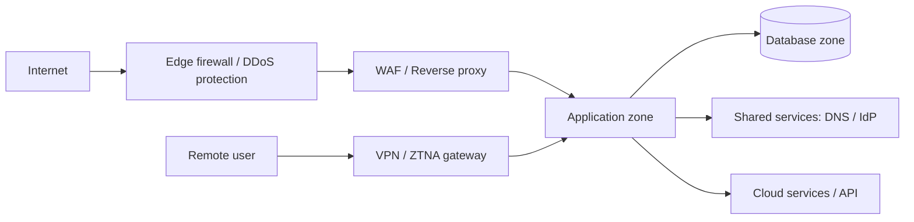
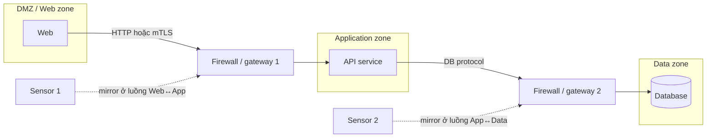
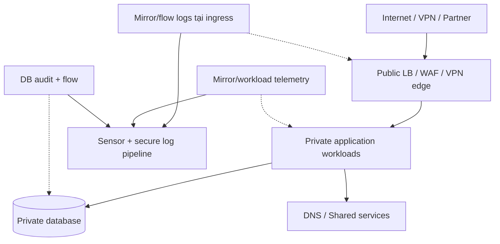

# Network sensor placement: đặt cảm biến IDS/IPS ở đâu để quan sát và bảo vệ đúng lưu lượng?

## 1. Vì sao vị trí cảm biến quan trọng không kém bộ quy tắc?

**Network sensor placement** là việc lựa chọn vị trí và phương thức đưa lưu lượng mạng tới cảm biến nhằm phát hiện, điều tra hoặc ngăn chặn hành vi đáng ngờ. Cảm biến có thể là **Network Intrusion Detection System (NIDS)**, **Network Intrusion Prevention System (NIPS)**, hệ thống phân tích metadata/luồng mạng (NDR), hoặc thành phần quan sát ở host, hypervisor, gateway và nền tảng cloud.

Một cảm biến IDS có bộ chữ ký tốt vẫn **không thể phát hiện nội dung của lưu lượng mà nó không nhìn thấy**. Ngược lại, đặt quá nhiều điểm thu thập mà thiếu năng lực xử lý, log và người vận hành có thể làm tăng mất gói, cảnh báo trùng và chi phí mà không cải thiện khả năng phát hiện. Vì thế, câu hỏi đầu tiên không phải “đặt IDS ở cổng nào?”, mà là:

> **Tài sản và ranh giới tin cậy nào phải được bảo vệ; đường lưu lượng thực tế đi qua đâu; tại vị trí nào cảm biến có đủ dữ liệu và năng lực để đưa ra quyết định?**

Ví dụ: một website có firewall Internet và hệ thống IDS chỉ quan sát cổng Internet. Khi máy chủ ứng dụng bị khai thác rồi giao tiếp với database trong cùng vùng mạng nội bộ, lưu lượng **east–west** này có thể không đi qua điểm Internet đó. IDS ở biên vẫn hoạt động bình thường nhưng không thấy diễn biến ở phía sau.

Đây là một phần của kiến trúc **phòng vệ nhiều lớp** trong bảo mật mạng: kết hợp phân đoạn, firewall, VPN, WAF, DNS security, xác thực kết nối, giám sát xâm nhập và ứng phó sự cố. Vị trí đặt sensor phải được thiết kế cùng đường truyền, ranh giới truy cập và yêu cầu vận hành của dịch vụ.

## 2. Phân biệt IDS, IPS và các nguồn quan sát khác

### 2.1. Cảm biến thụ động và thành phần nằm trên đường truyền

| Thành phần | Vị trí và dữ liệu | Khả năng điển hình | Hạn chế quan trọng |
|---|---|---|---|
| **NIDS** (Network IDS) | nhận **bản sao** packet qua TAP, SPAN, mirroring hoặc feed tương tự | phân tích gói, giao thức, chữ ký, metadata và phát cảnh báo | thường không chặn trực tiếp luồng; không thấy traffic không được mirror |
| **NIPS** (Network IPS) | đặt **inline** hoặc trên đường xử lý bắt buộc qua một enforcement point | phân tích và có thể drop/reject luồng phù hợp policy | phải chịu tải thực tế; lỗi/false positive có thể làm gián đoạn dịch vụ |
| **NDR / flow analysis** | metadata luồng, packet, DNS, log kết nối tùy kiến trúc | tương quan hành vi, bất thường, mối quan hệ giữa host | độ sâu phụ thuộc nguồn dữ liệu, không mặc nhiên đọc payload |
| **HIDS/HIPS/EDR** | quan sát tại endpoint/host hoặc workload | tiến trình, file, socket, hành vi hệ điều hành và phản ứng trên host | cần triển khai/được hỗ trợ trên tài sản đích |
| **WAF** | quan sát HTTP ở điểm có thể giải mã/parse ứng dụng | kiểm tra request/response HTTP, rule bot/rate limit tùy sản phẩm | không thay thế NIDS cho DNS, SSH hoặc mọi lưu lượng east–west |
| **Flow logs / NetFlow/IPFIX** | bản ghi metadata mạng từ thiết bị/cloud | ai giao tiếp với ai, lúc nào, volume và trạng thái tùy nguồn | thường không chứa payload; có thể sampling hoặc không ghi từng packet |
| **Application/TLS/DNS logs** | quan sát tại dịch vụ hoặc điểm kết thúc giao thức | cung cấp identity, hostname, hành động và ngữ cảnh ứng dụng | chỉ bao phủ dịch vụ có bật logging đúng và an toàn |

Một NIDS thụ động có thể tích hợp cơ chế phản ứng bên ngoài, ví dụ yêu cầu firewall áp dụng rule hoặc gửi tín hiệu reset kết nối. Tuy nhiên, **khả năng ngăn chặn đó khác với IPS inline** và có thể bị giới hạn bởi độ trễ, quyền thực thi, đường đi bất đối xứng hoặc trạng thái kết nối.

**IDS** thiên về phát hiện và cung cấp bằng chứng. **IPS** có trách nhiệm ra quyết định **cho qua hay chặn** trên đường phục vụ traffic. Vì IPS có khả năng tác động trực tiếp đến tính sẵn sàng, chiến lược đặt IPS phải tính tới **high availability (HA), năng lực xử lý, failure mode, rollback và chặn nhầm**.

### 2.2. Dữ liệu packet, flow và log bổ sung cho nhau

Giả sử một máy chủ gọi ra ngoài qua HTTPS:

- **Packet sensor** có thể thấy IP/port, thời điểm, kích thước, một số trường TLS ban đầu và payload không được mã hóa; không tự thấy nội dung HTTP đã được TLS bảo vệ.
- **Flow logs** có thể ghi cặp nguồn/đích, byte, packet, thời lượng và quyết định accept/reject tùy nền tảng; không thay thế packet khi cần phân tích chi tiết protocol.
- **Proxy/TLS termination logs** có thể ghi hostname, đường dẫn HTTP và mã trạng thái nếu được cấu hình tương ứng.
- **Endpoint telemetry** có thể cho biết tiến trình nào tạo kết nối và identity nào đã thực hiện hành động.

Kết hợp các nguồn này thường cung cấp **bằng chứng tốt hơn** so với việc cố dùng một NIDS để giải thích mọi tình huống.

## 3. Bắt đầu từ threat model và sơ đồ đường dữ liệu

Trước khi xác định chỗ gắn TAP hoặc NIC monitor, hãy vẽ **luồng dữ liệu thực tế** (*data flow diagram*) và các ranh giới tin cậy:



Với từng mũi tên, ghi rõ:

1. **Tài sản/rủi ro:** dữ liệu khách hàng, tài khoản quản trị, dịch vụ thanh toán, DNS, hệ thống sao lưu hay endpoint nào quan trọng?
2. **Nguồn/đích và tuyến thực tế:** nguồn, subnet/zone, VLAN/VPC, protocol, port, NAT, load balancer, VPN và đường dự phòng.
3. **Trust boundary:** traffic đến từ Internet, từ người dùng đã xác thực, từ mạng đối tác hay từ workload nội bộ?
4. **Mối đe dọa:** khai thác dịch vụ công khai, di chuyển ngang, truy cập database ngoài dự kiến, rò dữ liệu, DNS bất thường, command-and-control hoặc DoS?
5. **Dữ liệu phát hiện cần thiết:** packet đầy đủ, metadata kết nối, DNS, identity, HTTP logs hay sự kiện endpoint?
6. **Thời điểm có thể quan sát:** trước/sau firewall, trước/sau NAT, trước/sau điểm kết thúc VPN hoặc TLS, tại nơi traffic giữa workload thực sự đi qua.
7. **Yêu cầu hành động:** chỉ cảnh báo, hay phải chặn tự động với khả năng chịu lỗi và quy trình phê duyệt?

Trong **STRIDE**, sensor placement liên quan trực tiếp đến việc phát hiện *Spoofing*, *Tampering*, *Information Disclosure*, *Denial of Service* và *Elevation of Privilege* trên các đường kết nối; tuy nhiên, cảm biến mạng **không thể tự chứng minh** một người dùng đã vượt quyền trên đối tượng ứng dụng chỉ bằng IP/port.

Đặt sensor theo **đường rủi ro có ý nghĩa** hiệu quả hơn cách triển khai đồng đều theo số lượng switch, subnet hoặc VPC.

## 4. Các vị trí điển hình trên đường Internet vào dịch vụ

### 4.1. Trước firewall biên

```text
Internet ── [Sensor A] ── Edge firewall ── DMZ / Application
```

Điểm này giúp quan sát **attempted traffic từ Internet**, kể cả nhiều gói bị firewall chặn, các dạng quét, bất thường protocol hoặc lưu lượng tăng đột biến. Khi cần hiểu áp lực băng thông/packet lên edge, dữ liệu ở phía trước firewall có ích.

Nhưng đây thường là điểm **nhiễu và lưu lượng cao**: nhiều request không bao giờ tới ứng dụng; lưu lượng HTTPS được mã hóa; link Internet có thể bão hòa làm packet mirror mất dữ liệu. Không nên đồng nhất số cảnh báo tại đây với số lần ứng dụng đã bị truy cập thành công.

Đặt một IPS inline tại đường Internet cũng đòi hỏi đánh giá **điểm lỗi, năng lực ở tốc độ thực và xử lý sự cố**. Không nên bổ sung thiết bị inline chỉ vì muốn quan sát traffic bị từ chối nếu thiết kế hiện tại không cần chặn ở vị trí đó.

### 4.2. Sau firewall biên, trước dịch vụ công khai

```text
Internet ── Firewall ── [Sensor B] ── DMZ / Reverse proxy / Server
```

Sensor B thấy phần lưu lượng **đã được firewall cho đi qua** điểm đó, thường giúp tập trung vào mối đe dọa thực sự tiếp cận vùng ứng dụng. Cần vẫn phân biệt **“được firewall cho phép”** với “đã được ứng dụng xác thực/ủy quyền”.

**So sánh A và B:**

| Tiêu chí | Trước firewall | Sau firewall |
|---|---|---|
| Thấy lưu lượng bị firewall chặn | có thể thấy | thường không thấy |
| Thấy traffic thực đi tiếp vào DMZ | có nhưng lẫn nhiều nguồn không được chấp nhận | tập trung hơn vào traffic đã qua firewall |
| Khối lượng và nhiễu | thường cao | thường thấp hơn, tùy mạng |
| Phù hợp để phân tích | áp lực edge, thăm dò và hành vi bị chặn | hành vi nhắm tới dịch vụ đã được mở |
| Khả năng thấy HTTP trong HTTPS | phụ thuộc TLS termination, không tự thấy nội dung | vẫn phụ thuộc TLS termination |

Nếu có đủ nguồn lực, kết hợp **firewall deny logs ở biên** và **packet sensor sau firewall** đôi khi cung cấp góc nhìn tương đương cho mục tiêu vận hành mà không phải mirror toàn bộ traffic ở cả hai phía.

### 4.3. Sau reverse proxy hoặc điểm kết thúc TLS

Đặt sensor **sau điểm TLS termination** đôi khi giúp xem nội dung HTTP rõ, **nếu** kết nối từ proxy tới backend thực sự truyền plaintext trong đoạn đang quan sát. Trường hợp proxy dùng **TLS re-encryption** tới backend, sensor ở link phía sau vẫn thấy ciphertext.

```text
Client ==HTTPS==> WAF/Proxy ==HTTPS mới==> Backend
                        |
                        +--> Access logs / audit HTTP

Đặt NIDS ở đường Proxy→Backend: vẫn mã hóa nếu chặng này dùng HTTPS.
```

Việc tắt TLS nội bộ chỉ để packet sensor đọc plaintext có thể làm tăng rủi ro lộ dữ liệu; cần cân nhắc **log tại điểm kết thúc TLS, telemetry trong ứng dụng hoặc cơ chế giải mã có ủy quyền**. Sensor placement phải tôn trọng chính sách bảo mật, quyền riêng tư và lưu trữ dữ liệu.

## 5. Quan sát east–west: lưu lượng giữa các vùng nội bộ

**North–south** thường chỉ traffic giữa người dùng/Internet và hệ thống của tổ chức; **east–west** chỉ traffic giữa các workload, server, subnet hoặc vùng trong cùng hạ tầng. Hai thuật ngữ này chỉ là cách mô tả tương đối: một đường tới SaaS hoặc cloud khác có thể được nhìn nhận khác tùy điểm thiết kế.

Với microsegmentation, câu hỏi quan trọng là **traffic giữa vùng nào thực sự buộc phải đi qua enforcement point**:



Trong ví dụ này, một sensor tại Internet edge có thể bỏ lỡ cả Web→App và App→DB. Sensor tại gateway giữa zone giúp phát hiện **kết nối ngoài mẫu đã phê duyệt**, lạm dụng dịch vụ, truy cập bất thường và dấu hiệu lan truyền từ máy đã bị xâm nhập.

Tuy nhiên, nếu hai pod/VM giao tiếp trong cùng subnet hoặc qua virtual switch nội bộ, lưu lượng có thể **không đi qua firewall giữa zone**. Muốn quan sát được phải bổ sung vSwitch mirroring, telemetry tại host, workload/eBPF, service mesh logs hoặc thiết kế gateway phù hợp.

### 5.1. Ưu tiên những ranh giới có ý nghĩa

| Ranh giới | Vì sao đáng đặt sensor | Những điều cần biết |
|---|---|---|
| **DMZ → internal application** | theo dõi tác động sau khi một dịch vụ public bị khai thác | proxy/NAT có thể che IP client gốc |
| **Application → database** | giám sát access pattern và các luồng không được phê duyệt tới dữ liệu | protocol DB có thể mã hóa; audit DB cung cấp ngữ cảnh truy vấn |
| **User LAN → server zone** | tìm lateral movement, truy cập quản trị trái mục đích | cần xác thực người dùng/host để phân biệt hoạt động hợp lệ |
| **Production → backup/management zone** | bảo vệ dữ liệu và quyền điều khiển trọng yếu | hoạt động backup có lưu lượng lớn, chu kỳ không đều |
| **Guest/Wi-Fi → corporate network** | xác minh cô lập khách/thiết bị không tin cậy | lưu lượng Wi-Fi nội bộ có thể không xuất hiện ở router core |
| **Vùng đối tác/VPN → tài nguyên nhạy cảm** | giám sát đầu vào từ mạng ngoài tổ chức | điểm VPN giải mã và quy tắc theo danh tính quyết định khả năng quan sát |
| **Workload → DNS/IdP/shared services** | phát hiện bất thường tại thành phần dùng chung có blast radius cao | lưu lượng có thể tập trung, cần chống nhiễu và DoS sensor |

Điểm có nhiều traffic không nhất thiết là điểm phát hiện tốt nhất; chọn vị trí dựa trên **mối đe dọa cần thấy, tín hiệu có thể khai thác và năng lực xử lý**.

## 6. SPAN, network TAP, packet broker và inline placement

### 6.1. SPAN / port mirroring

**SPAN** (*Switched Port Analyzer*, tên thường gặp trên thiết bị switch) tạo một **bản sao** lưu lượng từ port/VLAN/nguồn được chọn đến cổng monitor. Các công nghệ mirror tương tự có thể tồn tại dưới tên khác trên switch, hypervisor hoặc cloud.

Ưu điểm:

- Dễ triển khai khi switch đã hỗ trợ và có quyền cấu hình.
- Phù hợp thử nghiệm quan sát, lab, hoặc phân tích những đoạn mạng có lưu lượng vừa phải.
- Không cần đặt sensor trực tiếp trên đường dữ liệu chính.

Giới hạn:

- Cổng mirror có thể **quá tải** nếu tổng lưu lượng mirror vượt tốc độ/công suất.
- Switch có thể ưu tiên chuyển traffic sản xuất và **drop bản sao** khi bị nghẽn; phát hiện sự kiện sẽ thiếu.
- Một số cấu hình mirror có thể thay đổi hoặc bỏ mất metadata như VLAN tag, hoặc không sao chép tất cả hướng/loại frame.
- Nếu chỉ mirror một port/uplink, có thể bỏ lỡ traffic nội bộ giữa hai endpoint trên cùng switch hoặc vSwitch.
- Cần hiểu **ingress, egress, cả hai hướng, LAG/ECMP và vị trí của NAT**.

**Kết luận:** SPAN hữu ích nhưng không được coi là nguồn packet hoàn hảo; phải đo mất gói, kiểm tra chất lượng và đối chiếu lưu lượng.

### 6.2. Network TAP

**Network TAP** là thiết bị/phương thức chuyên dụng tạo bản sao lưu lượng trên một đoạn liên kết (đồng hoặc quang tùy loại) cho hệ thống giám sát. TAP có thể thuận lợi hơn SPAN khi cần thu thập ổn định trên một đường vật lý có cấu hình được kiểm soát.

Nhưng TAP **không tự đảm bảo** packet đầy đủ trong mọi thiết kế: cổng monitor, bộ gộp traffic, packet broker và sensor vẫn có thể quá tải. Với liên kết song công, hai chiều có thể được đưa ra các cổng riêng hoặc gộp tùy thiết bị; phải tính năng lực cổng và thứ tự gói tương ứng.

Triển khai TAP trên tuyến production cần kế hoạch kỹ thuật, chọn đúng media/link speed và đánh giá khả năng ảnh hưởng của thao tác lắp đặt. Không mặc định mọi TAP đều “zero risk” cho tính sẵn sàng.

### 6.3. Network packet broker (NPB)

Một **packet broker** nhận traffic từ nhiều TAP/SPAN/feed, có thể lọc, phân phối, cân bằng tải, tách luồng hoặc loại trùng tùy tính năng để gửi cho nhiều sensor. Điều này giúp tránh đưa mọi bản sao không cần thiết tới một IDS.

Ví dụ:

```text
TAP đường Internet ──┐
SPAN DMZ ────────────┼──> Packet broker ───> IDS/NDR sensor pool
Mirror App↔DB ───────┘                 └──> Packet capture lưu ngắn hạn
```

Khi chia traffic giữa nhiều sensor, cần giữ **hai chiều của cùng một phiên** đến cùng engine khi detection yêu cầu tái dựng stream; nếu hash/partition sai hoặc đổi sensor giữa phiên, engine có thể thấy thiếu dữ liệu. Packet dedup và aggregation cũng phải được cấu hình sao cho không xóa nhầm bản ghi có ý nghĩa.

### 6.4. IPS inline

IPS **inline** xử lý traffic thật, sau đó quyết định cho qua hoặc drop. Ví dụ đơn giản:

```text
Client ── Firewall ── [IPS inline] ── Application zone
```

Ưu điểm: có thể ngăn lưu lượng đáng ngờ **ngay tại điểm mà tất cả traffic mục tiêu buộc phải đi qua**. Đổi lại, đây là thành phần tác động trực tiếp đến hiệu năng và tính sẵn sàng. Cần thiết kế rõ:

- **Throughput/pps, số kết nối, độ trễ và inspection capacity** ở peak thực tế.
- **HA, bypass và failure mode:** khi lỗi thì lưu lượng được cho đi (*fail-open*) hay bị chặn (*fail-closed*) theo chính sách? Các tùy chọn phụ thuộc thiết bị/kiến trúc.
- **Thay đổi rule an toàn:** monitor-only, thử nghiệm, canary, rollback và điều tra false positive.
- **Routing đúng:** không được vô tình tạo đường vòng bypass IPS qua link dự phòng hoặc service chain khác.
- **Mã hóa:** IPS đặt trước TLS termination có thể bị giới hạn ở metadata; muốn kiểm tra payload cần giải pháp phù hợp với quyền riêng tư và hiệu năng.

Không nên bật chế độ chặn tự động trên mọi signature ngay khi lắp IPS. Một false positive tại điểm chung có thể gây gián đoạn nhiều dịch vụ hơn một sensor thụ động báo sai.

## 7. Vị trí so với firewall, NAT, load balancer và reverse proxy

### 7.1. Trước và sau NAT

**Network Address Translation (NAT)** thay đổi địa chỉ hoặc cổng quan sát được tại những điểm khác nhau. Sensor nằm phía trước và phía sau NAT có thể thấy **cặp IP/port khác nhau** cho cùng một kết nối.

Ví dụ mô hình:

```text
Client 198.51.100.25:51000
    → Public VIP 203.0.113.20:443
    → [NAT / Load balancer]
    → Internal service 10.20.4.8:8443
```

Các địa chỉ trên thuộc dải dành cho tài liệu minh họa. Sensor ngoài biên có thể ghi VIP public; sensor phía trong có thể thấy địa chỉ thật của backend hoặc địa chỉ proxy; điều này tùy kiểu SNAT/DNAT/proxy. Không thể chỉ từ một địa chỉ IP trong log suy ra danh tính client gốc. Cần **NAT translation logs, load balancer request IDs, proxy logs hoặc correlation metadata** khi có quyền.

### 7.2. Sau load balancer: client IP có thể bị che

Một L7 reverse proxy thường thiết lập kết nối mới tới ứng dụng. Sensor phía sau proxy có thể chỉ thấy **địa chỉ proxy** và một số metadata kết nối, thay vì IP client. Các header như `X-Forwarded-For` chỉ đáng tin khi đến từ **chuỗi proxy đã xác minh**, được cấu hình loại bỏ/ghi đè giá trị client tự gửi.

Sensor placement không thay thế việc quản trị log định danh tại WAF, API gateway và ứng dụng. Nếu không ghép được request từ client gốc tới backend, điều tra phát hiện “máy proxy gọi DB” có thể thiếu ngữ cảnh.

### 7.3. Sau firewall không mặc nhiên đã an toàn

Firewall đã cho phép TCP/443 nghĩa là kết nối đến dịch vụ được policy L3/L4 chấp thuận; payload vẫn có thể chứa input nguy hiểm, hoặc một danh tính hợp lệ có thể lạm dụng API. Cảm biến sau firewall có ích nhưng phải phối hợp **WAF, authentication/authorization, rate limiting và log ứng dụng**.

Với firewall stateful, NAT và policy routing, đặt sensor ở một hướng có thể bỏ lỡ phản hồi hoặc nhìn thấy stream khác trạng thái; điều này ảnh hưởng độ chính xác của phân tích giao thức.

## 8. Lưu lượng bất đối xứng, ECMP, LAG và đường dự phòng

**Asymmetric routing** xảy ra khi các gói đi và về của cùng một phiên không đi qua cùng đường. Một sensor trên uplink A có thể thấy request nhưng response lại chạy qua uplink B:

```text
Client ── request ──> Router A ──> Server
Client <─ response ── Router B <── Server

Sensor tại Router A: thấy request, thiếu response.
```

Thiếu một chiều có thể làm sai state của IDS, gây cảnh báo không chính xác hoặc bỏ lỡ hành vi. Tương tự, ECMP, LAG, multi-path routing, failover và overlay tunnel có thể khiến packet cùng một phiên xuất hiện tại nhiều điểm hoặc chỉ một phần.

Biện pháp:

1. Lập sơ đồ **forward path và return path**, kể cả đường dự phòng/route policy.
2. Chọn điểm giám sát **hội tụ** hoặc mirror đủ các nhánh để thu cả hai chiều.
3. Nếu dùng packet broker/load balancing, đảm bảo **flow affinity** theo cả hai chiều; kiểm tra hash qua NAT/VLAN/encapsulation.
4. Đo **packet loss, out-of-order, duplicate packets và stream reconstruction gaps**.
5. Kiểm tra lại coverage sau thay đổi routing, thêm link LAG, chuyển vùng dự phòng hoặc thay đổi service mesh.

**Không phải mọi detector đều cần full bidirectional payload**: flow analytics có thể phân tích một chiều trong một số trường hợp. Nhưng khả năng phát hiện cụ thể phải được kiểm chứng với dữ liệu sensor thật, không suy ra từ việc cổng monitor có đèn link.

## 9. VPN, truy cập từ xa và các đường đã mã hóa

### 9.1. Cảm biến đặt trước hay sau VPN concentrator?

```text
Remote client ==VPN tunnel==> VPN gateway ── internal traffic ──> Apps
              [Sensor A]              [Sensor B]
```

- **Sensor A, trước điểm giải mã VPN:** thường thấy IP tunnel endpoints, port, kích thước/tần suất, một phần thông tin bắt tay tùy VPN; không thấy payload ứng dụng bên trong tunnel đã mã hóa.
- **Sensor B, phía trong sau khi VPN gateway giải mã:** có thể thấy lưu lượng nội bộ được gateway chuyển tiếp, **nếu** vị trí mirror nằm trên đúng đường đó. Lưu lượng ứng dụng vẫn có thể được **mã hóa tiếp bằng TLS**.

Những giải pháp ZTNA/remote access hiện đại có thể định tuyến theo ứng dụng, POP cloud hoặc agent endpoint thay vì đi qua một concentrator vật lý duy nhất. Khi đó nên kết hợp **gateway/session logs, IdP, endpoint telemetry, DNS và các điểm packet monitoring phù hợp**.

### 9.2. TLS 1.3, HTTP/3, DoH và DoT

Mã hóa làm giảm độ sâu nội dung mà NIDS mạng có thể đọc:

| Lưu lượng | Sensor mạng thông thường có thể quan sát | Nguồn bổ sung |
|---|---|---|
| HTTPS qua TCP/TLS 1.3 | IP, TCP, metadata TLS còn lộ, kích thước/thời gian | WAF/reverse proxy log, application log, endpoint |
| HTTP/3 qua QUIC/UDP | UDP, metadata QUIC nhìn thấy được; nhiều nội dung được bảo vệ | edge/CDN hỗ trợ HTTP/3, QUIC telemetry, application log |
| DNS thuần | các trường truy vấn/trả lời khi không mã hóa và sensor nằm trên đường | DNS resolver logs để có context |
| DoH/DoT | metadata kết nối mã hóa; không tự đọc query DNS bên trong | resolver/endpoint logs theo chính sách |
| IPsec/SSL VPN | metadata đường hầm nếu capture phía ngoài | gateway logs và packet/flow phía trong sau giải mã |

**Không nên tắt mã hóa chỉ để thỏa nhu cầu IDS** nếu điều đó làm yếu bảo vệ dữ liệu. Thay vì vậy, có thể đặt sensor ở điểm kết thúc TLS được cấp phép, kết hợp logs và endpoint telemetry hoặc dùng khả năng phân tích metadata khi phù hợp.

**Encrypted ClientHello (ECH)**, khi được hỗ trợ và sử dụng, có thể giảm thông tin tên host quan sát trực tiếp trong một số bắt tay TLS; vì thế việc xây detection chỉ dựa vào SNI nhìn thấy cần được đánh giá lại.

## 10. Đặt sensor trong cloud và hạ tầng ảo hóa

### 10.1. Đường đi cloud có thể khác mạng vật lý

Trong AWS, Azure, Google Cloud và môi trường ảo hóa, VM hoặc container có thể kết nối qua **virtual switch, fabric của nhà cung cấp, private endpoint, transit routing và managed services**. Traffic giữa hai workload có thể không xuất hiện trên một cổng vật lý mà đội vận hành tự quản lý.

Một số cách quan sát:

- **Cloud packet mirroring** tại interface hoặc nguồn được hỗ trợ, gửi bản sao traffic tới collector/sensor đúng phạm vi; ví dụ AWS VPC Traffic Mirroring hoặc Google Cloud Packet Mirroring theo tài liệu nhà cung cấp.
- **Flow logs và network telemetry:** AWS VPC Flow Logs, Azure virtual network/flow telemetry và Google Cloud VPC Flow Logs tùy phạm vi/tính năng được hỗ trợ.
- **Logs ở managed gateway:** load balancer, WAF, VPN, DNS, service mesh, cloud firewall.
- **Host/workload sensors:** endpoint security agent, eBPF telemetry, logs của container runtime hoặc CNI khi phù hợp.

Không phải mọi instance, NIC, loại traffic, dịch vụ được quản lý hoặc region đều hỗ trợ **cùng một kiểu mirroring**. Phải đọc điều kiện hỗ trợ, giới hạn quota, encapsulation, MTU, chi phí egress và cơ chế bảo vệ collector **của nền tảng/phiên bản đang dùng**.

### 10.2. Placement tại các vùng cloud



Đừng mặc định một packet sensor trong **shared services VPC** sẽ thấy mọi kết nối giữa các workload trong các VPC khác chỉ vì có peering/Transit Gateway. Nó chỉ thấy traffic **thực đi qua điểm thu thập** hoặc được mirror đến; còn quyền và route phải được xét riêng.

**Đặt collector** cũng là một quyết định bảo mật: mirror packet có thể chứa dữ liệu nhạy cảm, danh tính và metadata mạng. Cần mã hóa kênh đưa dữ liệu, phân quyền vùng collector, giới hạn retention, quản lý bí mật và ngăn sensor trở thành đường truy cập từ vùng ít tin cậy sang vùng nhạy cảm.

### 10.3. Kubernetes và service mesh

Một cluster có nhiều loại đường traffic:

- **North–south:** ingress controller/API gateway tới Service/Pod.
- **East–west:** Pod↔Pod, Node↔Node, service mesh, endpoint database và DNS.
- **Control plane:** API server, controller, admission, kubelet và các thành phần node.

Sensor tại một **ingress gateway** có thể thấy traffic Internet đi vào nhưng bỏ lỡ Pod↔Pod nội bộ. Khi workload dùng overlay/VXLAN hoặc eBPF forwarding, packet tại node/underlay có thể bị encapsulate hoặc bỏ qua đường capture truyền thống. Một số thành phần service mesh còn dùng mTLS, khiến packet sensor tại vSwitch thấy ciphertext.

Biện pháp quan sát nên chọn theo rủi ro:

1. NIDS tại điểm ingress/egress quan trọng nếu có đường mirror phù hợp.
2. **CNI/eBPF flow telemetry** và Kubernetes audit logs để bổ sung identity workload, namespace và service.
3. **Service mesh/proxy logs** tại điểm giao tiếp được ủy quyền, nhất là khi dùng mTLS.
4. **NetworkPolicy và RBAC** để giảm quyền; sensor chỉ kiểm tra hiệu lực và phát hiện bất thường, không thay thế enforcement.

Namespace không tự đảm bảo network isolation; cần kiểm tra cách CNI thực thi policy. Không nên tuyên bố “đã quan sát tất cả east–west” chỉ vì đã thu traffic tại ingress controller.

## 11. Mạng không dây, VPN và chi nhánh từ xa

### 11.1. Wi-Fi và NAC

Trong mạng Wi-Fi, điểm truy cập (AP), wireless controller, switch, VLAN hoặc cloud-managed gateway có thể quyết định nơi traffic đi qua. Nếu lưu lượng người dùng được **tunnel về controller**, một sensor ở link giữa controller và LAN có thể thấy nội dung sau giải mã link Wi-Fi theo đường xử lý. Nhưng nếu AP **local breakout** trực tiếp ra Internet hoặc traffic client↔client không qua gateway tập trung, sensor tại controller trung tâm có thể bỏ lỡ.

Các câu hỏi cần xác minh:

- SSID khách và SSID doanh nghiệp có VLAN/role truy cập khác nhau không?
- Traffic được chuyển tiếp tại AP, controller hay gateway? Có split tunnel?
- NAC/802.1X cung cấp danh tính thiết bị/người dùng cho log giám sát ở đâu?
- Guest traffic được phân đoạn thế nào và có thể đi tới tài nguyên nội bộ không?
- IPv6, captive portal, DNS và các thiết bị IoT có đi trên cùng đường kiểm soát không?

NIDS là công cụ quan sát **lưu lượng đã tới điểm thu thập**, không thay thế giám sát 802.11 ở lớp vô tuyến hoặc hệ thống WIDS/WIPS khi cần phát hiện rogue AP, deauthentication và những sự kiện đặc thù Wi-Fi.

### 11.2. Branch và remote office

Một chi nhánh có thể kết nối qua SD-WAN/VPN về trung tâm nhưng đồng thời **truy cập Internet trực tiếp**. Sensor tại data center chỉ thấy phần lưu lượng được backhaul về trung tâm, không mặc nhiên thấy SaaS hoặc truy cập local breakout.

Có thể kết hợp:

- Sensor hoặc flow telemetry tại **branch gateway**.
- SD-WAN/secure web gateway/SASE logs ở POP mà traffic thực đi qua.
- Endpoint telemetry cho thiết bị làm việc từ xa.
- DNS/security logging tại resolver được tổ chức sử dụng.

Placement đúng phụ thuộc **routing policy theo ứng dụng** và nơi người dùng thực sự đi ra Internet tại từng thời điểm.

## 12. Năng lực sensor: bps, pps, peak, burst và mất gói

Một lỗi thiết kế phổ biến là dùng tốc độ interface để suy ra sensor đủ sức phân tích mọi packet. **Link speed**, **khả năng xử lý packet (pps)** và **khả năng inspection ở chiều sâu yêu cầu** là những đại lượng khác nhau.

| Chỉ số | Ý nghĩa | Cần đo ở đâu? |
|---|---|---|
| **bps / Gbps** | tổng lượng dữ liệu truyền theo thời gian | uplink, mirror interface, ingest của sensor |
| **pps** | số gói xử lý mỗi giây | thiết bị mirror, NIC, CPU và engine IDS/IPS |
| **Connection/flow rate** | số phiên mới và số phiên đồng thời | firewall/IPS và engine reassembly |
| **Peak/burst** | tải đột biến trong khoảng thời gian ngắn | đo theo cửa sổ nhỏ hơn trung bình giờ |
| **Packet capture drop** | packet không được nhận bởi sensor/capture path | NIC/driver/kernel/capture engine |
| **Stream gaps / decoder errors** | thiếu packet, lỗi giải mã hoặc không tái dựng được phiên | IDS engine và telemetry phân tích |
| **Alert latency** | thời gian từ sự kiện đến khi cảnh báo sẵn sàng | sensor → queue → SIEM/SOC |
| **CPU/memory/queue depth** | mức bão hòa bên trong sensor và pipeline | sensor host, NPB, collector, log pipeline |

### 12.1. Ví dụ tính nguồn mirror bị quá tải

Một liên kết **10 Gbps full-duplex** có thể truyền lưu lượng đáng kể ở **cả hai chiều**. Nếu hệ thống mirror đồng thời lưu lượng **8 Gbps từ hướng A→B** và **7 Gbps từ hướng B→A** vào một cổng monitor 10 Gbps mà không phân chia phù hợp, tổng dữ liệu đưa tới cổng có thể xấp xỉ **15 Gbps**, vượt khả năng vật lý cổng 10 Gbps. Bản sao bị drop hoặc bị hạn chế, dù link sản xuất ở mỗi hướng chưa vượt 10 Gbps.

Lưu ý: đây là ví dụ về **tổng các luồng một chiều**, chưa cộng mọi overhead của encapsulation và packet broker. Trong hệ thống thực, phải tính thêm L2/L3 overhead, tunnel headers, packet size distribution và mức burst.

Một sensor có NIC 10 Gbps cũng có thể không kiểm tra được 10 Gbps traffic ở mọi bộ rule: quy trình **stream reassembly, parsing, TLS metadata analysis, signature matching và log export** đều tiêu tốn tài nguyên.

### 12.2. Lập kế hoạch công suất

1. Thu baseline và peak **theo hướng và loại traffic**; xét mùa cao điểm, backup, triển khai và sự cố DDoS.
2. Tính tải **sau mirroring/aggregation**, chú ý traffic bị sao chép nhiều lần.
3. Xác minh throughput **được đo với bộ rule và cấu hình thực tế** của sensor, không chỉ thông số marketing.
4. Phân phối traffic theo **flow affinity**, có headroom cho burst và tăng trưởng.
5. Theo dõi drop ở từng lớp: nguồn mirror, broker, NIC, kernel, IDS engine, event queue và SIEM.
6. Có chính sách với traffic không thể inspection đầy đủ: phân loại mất coverage, giảm tải có chủ đích hoặc bổ sung nguồn telemetry.

Không nên chỉ kết luận “zero packet loss” từ chỉ số của IDS nếu packet đã bị drop **trước khi đến IDS**. Để đánh giá end-to-end, cần đối chiếu counter tại nguồn, broker, monitor port và sensor.

## 13. Bảo vệ chính cảm biến và luồng log

Cảm biến nằm gần vùng quan trọng và có thể nhận bản sao của dữ liệu nhạy cảm. Nó cần được bảo vệ như một thành phần hạ tầng an ninh:

- **Tách cổng thu thập và cổng quản trị.** NIC monitor nên dùng để nhận traffic; không mở đường quản trị ngược qua cổng nhận packet trừ khi thiết kế đã kiểm soát rõ.
- **Least privilege:** tài khoản vận hành, cập nhật rule, truy cập packet capture và xuất log được giới hạn theo vai trò.
- **Bảo vệ dữ liệu:** TLS/mã hóa kênh log, mã hóa dữ liệu lưu trữ khi cần, mask/redact trường nhạy cảm, retention và kiểm soát chia sẻ.
- **Cập nhật engine:** duy trì bản vá, kiểm thử rule mới và giám sát tình trạng pipeline.
- **Đồng bộ thời gian:** NTP/nguồn thời gian tin cậy giúp đối chiếu dấu vết trên firewall, DNS, endpoint và SIEM.
- **Khả năng phục hồi:** sensor/collector HA và queue có chính sách xử lý khi không còn chỗ lưu; kiểm soát tác động của log storm.
- **Giám sát sensor:** cảnh báo khi nguồn mirror mất, interface down, packet drops tăng, ruleset lỗi, detection engine dừng hoặc log không đến SIEM.

**Một IDS không phát cảnh báo** có thể vì không có sự kiện đáng ngờ, nhưng cũng có thể vì **mirror bị ngắt, sensor quá tải, parser lỗi hoặc pipeline log gián đoạn**. Cần xây health checks độc lập với số alert.

Với IPS inline, bổ sung kiểm tra failover, đường bypass được phê duyệt và **chế độ khi mất điện/thiết bị lỗi**. Cần đánh giá liệu fail-open có làm mất chức năng ngăn chặn trong thời gian sự cố, hay fail-closed có làm mất dịch vụ trọng yếu.

## 14. Thiết kế coverage bằng ma trận cảm biến – mối đe dọa

Một bảng coverage hữu ích ghi **mối đe dọa, đường kết nối, vị trí sensor, dữ liệu quan sát được và khoảng trống còn lại**:

| Use case | Đường cần quan sát | Sensor/nguồn phù hợp | Khoảng trống và dữ liệu bổ sung |
|---|---|---|---|
| Quét dịch vụ từ Internet | Internet → edge | firewall logs; NIDS trước/sau firewall tùy mục tiêu | lưu lượng bị chặn không tới NIDS sau firewall |
| Input đáng ngờ vào HTTP API | client → WAF/reverse proxy → API | WAF logs + NIDS tại đường HTTP phù hợp | payload TLS mã hóa; cần log ở termination |
| Xâm nhập ứng dụng dẫn đến truy cập DB lạ | App zone → DB zone | NIDS ở inter-zone gateway; DB audit | traffic nội bộ cùng subnet hoặc DB/TLS bị mã hóa |
| Lateral movement qua SMB/RDP | user LAN → server/management zone | sensor giữa vùng; Windows/EDR logs | host-to-host cùng VLAN có thể bỏ sót |
| DNS bất thường | workload → resolver | mirror DNS link hoặc DNS query logs | DoH/DoT không giải được query qua NIDS thông thường |
| VPN credential bị lạm dụng | remote user → VPN/ZTNA → internal | gateway/auth logs, sensor sau VPN | traffic ngoài VPN hoặc TLS nội bộ vẫn bị che |
| Cloud workload gọi đích bất thường | VM/pod → cloud service/Internet | cloud mirroring/flow logs, egress gateway | traffic tới managed services và overlay tùy hỗ trợ |
| Exfiltration qua HTTPS | workload → external endpoint | egress metadata/NDR, proxy/EDR | khó biết nội dung dữ liệu mã hóa chỉ bằng packet |
| Lạm dụng shared service | Dev → CI/CD/IdP → Prod | service logs + flow ở các trust boundary | network flow không chứng minh quyền thao tác |
| DoS tại gateway | Internet → edge / public endpoint | ISP/CDN metrics, firewall counters, IPS nếu phù hợp | sensor có thể mất packet khi bão hòa |

### 14.1. Phân biệt coverage với alert volume

**Coverage** là phần mối đe dọa/đường kết nối mà sensor hoặc nguồn telemetry có khả năng quan sát ở mức cần thiết. **Alert volume** chỉ là số cảnh báo đã tạo. Một sensor tạo 100.000 alert từ các cổng Internet chưa chắc hữu ích hơn hai điểm thu thập có ít alert nhưng bao phủ được những kết nối đến database nhạy cảm.

Có thể xếp độ quan sát theo cấp:

1. **Không có dữ liệu:** sensor không thấy luồng.
2. **Metadata:** thấy nguồn/đích, thời điểm, khối lượng hoặc trạng thái.
3. **Protocol visibility:** có đủ dữ liệu để parse/reassemble giao thức.
4. **Application context:** có thêm định danh người dùng, API action, process hoặc log từ điểm kết thúc TLS.
5. **Actionability:** alert có owner, đủ bối cảnh và quy trình phản ứng hiệu quả.

Cấp độ có thể khác nhau giữa các use case trên **cùng một sensor**; không nên gắn nhãn “full visibility” cho cả vùng chỉ vì một phép thử HTTP đã thành công.

## 15. Quy trình triển khai cảm biến từng bước

### Bước 1 — Ưu tiên mục tiêu

Xác định hệ thống trọng yếu, ví dụ cổng Internet, API production, database chứa dữ liệu nhạy cảm, mạng quản trị, kết nối VPN và shared services. Chọn **use case phát hiện cần thiết**, thay vì bắt đầu từ danh sách cổng switch đang còn trống.

### Bước 2 — Vẽ topology thực

Thu sơ đồ **forward/return path**, subnet, VLAN, VRF, VPC/peering, NAT, load balancer, reverse proxy, VPN, route failover và cloud tunnel. Có thể dùng các cấu hình/phân tích đường đi được cấp quyền, flow logs, routing tables và network discovery phù hợp.

### Bước 3 — Chọn vantage point và nguồn telemetry

Ở mỗi ranh giới quan trọng, quyết định cần:

- NIDS thụ động qua TAP/SPAN/mirroring?
- IPS inline với yêu cầu chặn và HA?
- Flow logs hoặc packet broker?
- WAF, DNS, VPN, IdP, service mesh hay endpoint logs để bổ sung ngữ cảnh bị mã hóa?

### Bước 4 — Thiết kế công suất và bảo vệ dữ liệu

Kiểm tra bps, pps, peak, full-duplex aggregation, chi phí cloud mirror, packet size và năng lực bộ rule; phân quyền collector; xác định retention và cách xử lý thông tin nhạy cảm.

### Bước 5 — Triển khai trong chế độ quan sát

Cài đặt nguồn mirror/telemetry, kiểm tra traffic từ đúng subnet và cả hai chiều, đồng bộ thời gian, đo drop. Với IPS, ưu tiên chế độ monitor hoặc chính sách không chặn phù hợp giai đoạn triển khai trước khi bật prevention.

### Bước 6 — Xác minh bằng test được phê duyệt

Chọn những **kết nối hợp lệ và kịch bản mô phỏng an toàn** để xác nhận sensor quan sát đúng đường. Kiểm tra tình huống bị deny ở firewall bằng log của enforcement point; không nhất thiết cần tạo payload tấn công thật. Xác minh request/response, đường dự phòng, IPv4/IPv6, VPN và trường hợp traffic mã hóa nếu liên quan.

### Bước 7 — Tune và chuyển vận hành

Gắn owner cho sensor/use case, đưa cảnh báo vào SIEM/SOC, tinh chỉnh rule với mẫu lưu lượng hợp lệ, thiết lập dashboard sức khỏe sensor, kế hoạch cập nhật và phản ứng sự cố. Với IPS, thay đổi sang chế độ chặn theo **phê duyệt và rollout có kiểm soát**.

### Bước 8 — Review liên tục

Khi thay đổi routing, mở VPC, thêm Kubernetes cluster, chuyển TLS termination, bật HTTP/3, triển khai Wi-Fi/branch local breakout hoặc thay đổi VPN, kiểm tra lại **vị trí quan sát thực tế**.

## 16. Ví dụ xác minh sensor trong môi trường được phép

Giả sử một IDS được nối vào cổng mirror theo dõi lưu lượng giữa **application subnet** và **database subnet**. Đầu tiên cần xác minh sensor nhận được packet, có cả hướng đi và về, và xử lý được protocol ở mức cấu hình cho phép.

Một số lệnh **chỉ đọc** trên sensor Linux, sử dụng giao diện đúng của môi trường thử nghiệm:

```bash
# Xem trạng thái interface và thống kê nhận/gửi
ip -s link show dev monitor0

# Quan sát tóm tắt các packet giữa hai dải mạng thử nghiệm được cấp phép
sudo tcpdump -ni monitor0 -c 20 \
  'net 10.10.20.0/24 and net 10.10.30.0/24'

# Xem thông tin link/interface nếu driver hỗ trợ
sudo ethtool monitor0
```

Đây là **ví dụ về công cụ/địa chỉ minh họa**. Giao diện `monitor0` phải được thay bằng interface thực; lệnh `tcpdump` sẽ chờ đến khi thu đủ 20 packet phù hợp hoặc được dừng thủ công. Hai subnet có thể không được quan sát cùng lúc nếu có NAT, proxy hoặc route khác; filter phải dựa trên những địa chỉ mà sensor **thực thấy ở vị trí đặt**.

**Không suy luận “không có packet” là không có kết nối** nếu capture bị lọc sai, cổng SPAN cấu hình thiếu chiều hoặc traffic đi tuyến khác. Cần đối chiếu với switch/mirror counter, số liệu firewall, kết quả giao dịch của ứng dụng và log ở điểm đích.

Nếu sử dụng Zeek hoặc Suricata, có thể theo dõi **log kết nối, cảnh báo, decoder/reassembly errors, capture stats và timestamp** tùy cấu hình. Không nên giả định chỉ một loại log của sản phẩm đã chứng minh engine nhìn thấy đủ payload.

### 16.1. Ma trận test hồi quy

| Bài kiểm tra được phép | Kỳ vọng | Bằng chứng |
|---|---|---|
| Client trong DMZ kết nối API theo luồng hợp lệ | sensor vùng DMZ ghi nhận metadata/traffic | flow record hoặc packet + app log |
| API kết nối DB hợp lệ | sensor App↔DB nhìn thấy đúng hai chiều nếu thiết kế yêu cầu | capture + DB connection log |
| Dev bị chặn kết nối DB production | firewall/segmentation chặn | deny log; sensor sau firewall có thể **không** thấy |
| Người dùng VPN kết nối ứng dụng nội bộ | sensor sau VPN ghi nhận luồng đã chuyển tiếp | VPN session log + flow record |
| Web HTTP/3 hoạt động qua CDN | edge log/điểm sensor có hỗ trợ QUIC ghi được thông tin | CDN/WAF HTTP/3 logs + UDP flow |
| Đổi đường truyền dự phòng | coverage sensor vẫn được duy trì hoặc cảnh báo mất coverage | so sánh trước/sau chuyển tuyến |
| Nguồn SPAN bị ngắt trong lab | health monitoring phát hiện lỗi | mất packet feed + sensor health alert |

Không cần hoặc không nên gửi lưu lượng gây hại tới hệ thống bên ngoài để kiểm thử hiệu lực capture. Kịch bản thử nghiệm phải nằm trong **phạm vi được ủy quyền**, với tải và thời gian phù hợp.

## 17. Những lỗi triển khai thường gặp

1. **Chỉ đặt IDS tại Internet edge:** bỏ lỡ lateral movement và traffic giữa các workload nội bộ.
2. **Chỉ nhìn firewall policy:** rule allow/deny không chứng minh packet đã được sensor nhận; cần kiểm chứng đường đi và mirror.
3. **Cho rằng SPAN không bao giờ mất packet:** bản sao có thể bị drop khi nguồn hoặc cổng monitor quá tải.
4. **Mirror một chiều:** IDS thiếu response, làm giảm khả năng tái dựng stream hoặc hiểu kết quả kết nối.
5. **Quên ECMP/LAG/failover:** traffic chuyển sang đường khác khiến một sensor từng hoạt động tốt trở thành vùng mù.
6. **Đặt cảm biến trước VPN/TLS rồi kỳ vọng thấy payload rõ:** chỉ nhìn ciphertext hoặc metadata cho tới điểm kết thúc được phép.
7. **Đặt sensor sau proxy rồi dùng IP proxy làm danh tính client:** cần log/headers từ chuỗi proxy đáng tin cậy.
8. **Giả định sensor ở shared VPC thấy mọi kết nối cloud:** traffic phải thực sự đi qua hoặc được mirror đến sensor.
9. **Chỉ tính Gbps:** traffic nhiều gói nhỏ hoặc nhiều phiên có thể làm quá tải engine trước khi hết băng thông.
10. **Bật IPS block ngay mọi rule:** false positive có thể ảnh hưởng trực tiếp dịch vụ hợp lệ.
11. **Đếm alert thay cho kiểm tra coverage:** nhiều cảnh báo có thể đến từ một đường dễ quan sát trong khi database chưa có telemetry.
12. **Bỏ qua quyền riêng tư của packet capture:** payload/log có thể chứa token, cookie hoặc dữ liệu cá nhân.
13. **Không giám sát sức khỏe sensor:** mất mirror hoặc lỗi pipeline khiến SOC im lặng mà không biết có khoảng trống.
14. **Không kiểm thử sau thay đổi mạng:** VLAN, route, WAF/TLS, branch, cloud và Kubernetes thay đổi thường làm lệch placement ban đầu.

## 18. Tình huống thiết kế: doanh nghiệp hybrid có website, VPN và database

### 18.1. Bối cảnh

Một tổ chức có hệ thống:

- Website public sau CDN/WAF, reverse proxy kết nối tới ứng dụng tại cloud.
- Application gọi database private và DNS/IdP dùng chung.
- Nhân viên truy cập tài nguyên nội bộ qua VPN/ZTNA.
- Chi nhánh có SD-WAN, một phần SaaS đi trực tiếp ra Internet.
- Workload Kubernetes giao tiếp east–west trong cluster.

Mục tiêu là phát hiện **thăm dò từ Internet, bất thường HTTP, truy cập DB trái nhu cầu, lateral movement, lạm dụng VPN và traffic outbound bất thường**.

### 18.2. Đề xuất vị trí và nguồn dữ liệu

| Ưu tiên | Điểm/nguồn | Dữ liệu mục tiêu | Lý do |
|---|---|---|---|
| Cao | CDN/WAF logs + firewall edge logs | HTTP request, challenge/block, attempted network connections | phân tích đầu vào Internet khi TLS kết thúc tại edge |
| Cao | Mirror/telemetry giữa application zone và database | kết nối tới DB, lưu lượng mới hoặc sai hướng | bảo vệ dữ liệu nhạy cảm sau perimeter |
| Cao | VPN/ZTNA session logs + sensor ở đường nội bộ phù hợp | principal, thiết bị, đích nội bộ, luồng sau VPN | điều tra truy cập từ xa qua gateway |
| Cao | DNS resolver logs | truy vấn bất thường và miền nhạy cảm | thấy DNS kể cả khi mạng riêng nhiều phân đoạn |
| Trung bình–cao | Workload/CNI/service mesh telemetry trong Kubernetes | Pod↔Pod và hành vi egress | bù cho luồng không đi qua firewall vật lý |
| Trung bình–cao | Cloud flow logs và mirroring theo rủi ro | east–west cloud, VM hoặc endpoint quan trọng | mở rộng coverage ngoài các gateway tập trung |
| Theo nhu cầu | Sensor/flow tại SD-WAN hoặc egress chi nhánh | SaaS/local breakout | trung tâm dữ liệu không nhìn thấy mọi đường ra |
| Theo nhu cầu | NIDS trước firewall Internet | lưu lượng bị chặn, quét ở edge | dùng khi use case yêu cầu packet ở vùng chưa được lọc |

**Điểm quyết định:** nếu chỉ có kinh phí đặt **một** sensor packet mới, hãy chọn ranh giới bảo vệ tài sản có tác động cao và thiếu telemetry nhất, thay vì mặc định Internet uplink. Trong nhiều kiến trúc, log firewall/WAF ở edge đã đầy đủ hơn packet sensor thụ động, trong khi App↔DB là khoảng trống nguy hiểm cần bổ sung.

### 18.3. Kiểm tra lại sau triển khai

1. Vẽ các luồng thực từ CDN/WAF tới origin và đích DB; xác định chặng nào mã hóa.
2. Kiểm tra vùng App↔DB: traffic có đi qua link được mirror hay nằm trên cùng vSwitch?
3. Xác minh VPN user identity có thể ghép với kết nối nội bộ bằng request/flow/session IDs.
4. Kiểm tra các workload Kubernetes có thể giao tiếp ngang ngoài gateway được quan sát không.
5. Kiểm tra branch local breakout để tránh giả định mọi HTTP egress đều đi qua sensor tại trung tâm.
6. Thực hiện kiểm thử coverage trên luồng được phép, đo packet drops và latency log.
7. Đặt owner, lịch review và trigger khi thêm cloud region, subnet, route hoặc điểm kết thúc TLS.

### 18.4. Bảng ghi quyết định

```yaml
# Mẫu tài liệu thiết kế, không phải cấu hình chạy trực tiếp
use_case: detect_unapproved_app_to_database_connections
business_asset: customer_database
trust_boundary: application_zone_to_data_zone
data_sources:
  - network_mirror_at_database_ingress
  - database_audit_logs
sensor_mode: passive_ids
required_visibility:
  - connection_metadata
  - bidirectional_flow_when_available
known_limitations:
  - application_payload_is_tls_encrypted
  - traffic_within_same_virtual_switch_may_be_unseen
verification:
  - approved_test_connections
  - source_and_sensor_counter_comparison
  - validate_identity_correlation
owner: security_operations
review_trigger:
  - database_network_change
  - routing_or_tls_termination_change
```

Giá trị trong mẫu là **giả định để học tập**; khi triển khai thực tế cần liên kết tới tài sản, cấu hình nguồn mirror, người phụ trách và yêu cầu bảo mật cụ thể.

## 19. Câu hỏi tự kiểm tra và bài tập

**Câu 1.** Vì sao NIDS đặt trước firewall thường tạo nhiều tín hiệu về traffic bị chặn, trong khi NIDS sau firewall tập trung hơn vào traffic tiếp cận dịch vụ?

**Câu 2.** Một link 10 Gbps full-duplex được mirror cả hai hướng vào cổng 10 Gbps. Khi nào bản sao có thể bị drop dù link vẫn hoạt động bình thường?

**Câu 3.** Reverse proxy kết thúc TLS từ Internet và mở phiên TLS mới tới backend. Sensor ở giữa proxy và backend có đọc được HTTP body không? Cần bổ sung nguồn dữ liệu nào?

**Câu 4.** Một IDS nhận packet ở uplink A nhưng response của phiên đi qua uplink B do ECMP. Những loại sai lệch nào có thể xuất hiện và nên xử lý bằng topology hoặc packet broker thế nào?

**Câu 5.** Chỉ có NIDS tại ingress của Kubernetes. Những lưu lượng Pod↔Pod, hostNetwork hoặc service mesh nào có thể không được quan sát? Nên phối hợp nguồn telemetry nào?

**Câu 6.** Nhân viên kết nối qua VPN. Sensor trước VPN gateway chỉ thấy encrypted tunnel. Đề xuất vị trí/nguồn bổ sung để liên kết hành động nội bộ với danh tính nhân viên.

**Câu 7.** Vì sao số lượng IDS alert bằng 0 không chứng minh mạng không có xâm nhập? Nêu ít nhất bốn phép kiểm tra sức khỏe và coverage.

**Câu 8.** Khi quyết định đặt IPS inline, cần cân nhắc gì về **failure mode, HA, throughput, latency, false positive và khả năng rollback**?

**Bài tập kiến trúc:** vẽ một mạng có Internet, WAF, firewall, DMZ, App, DB, VPN, DNS và một VPC cloud; chọn ít nhất năm điểm có khả năng thu telemetry. Với mỗi điểm, ghi **mối đe dọa, chiều traffic cần quan sát, phương thức lấy dữ liệu, khả năng thấy nội dung mã hóa, mức tải, phương pháp kiểm chứng và khoảng trống còn lại**. Sau đó chọn một use case có rủi ro cao và thiết kế ma trận test cho tuyến hoạt động bình thường lẫn tuyến dự phòng.

## 20. Tổng kết

**Network sensor placement** là quá trình chọn đúng **điểm nhìn** theo tài sản và ranh giới tin cậy. NIDS/IPS chỉ phát hiện hoặc ngăn chặn những luồng và đặc điểm mà kiến trúc thực sự đưa tới điểm kiểm soát. Vì vậy, cần xét **trước/sau firewall, NAT, load balancer, VPN, TLS termination, các đoạn east–west, Wi-Fi/branch và cloud/Kubernetes**, đồng thời xác minh cả đường đi và đường về.

Một phương án hiệu quả kết hợp **TAP/SPAN/mirroring/packet broker, IPS inline khi có nhu cầu ngăn chặn, flow logs và telemetry tại ứng dụng hoặc endpoint**, có tính toán công suất, bảo vệ dữ liệu, kiểm tra packet loss và thử nghiệm coverage liên tục. Sensor phải gắn với khả năng phản ứng của SOC, chính sách firewall/segmentation, xác thực kết nối và threat model; mục tiêu cuối cùng là **thấy đủ những hành vi quan trọng để phát hiện sớm và bảo vệ dịch vụ hợp lệ**, thay vì chỉ triển khai nhiều thiết bị.

**Tài liệu tham khảo để đọc sâu:** NIST SP 800-94 (*Guide to Intrusion Detection and Prevention Systems (IDPS)*); NIST SP 800-41 Rev.1 (*Guidelines on Firewalls and Firewall Policy*); tài liệu Zeek về network monitoring và traffic visibility; tài liệu Suricata về capture/IPS modes và performance; tài liệu chính thức của nhà cung cấp về TAP/SPAN, AWS VPC Traffic Mirroring, Google Cloud Packet Mirroring, cloud flow logs và Kubernetes network observability.
