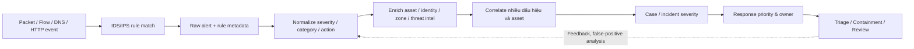
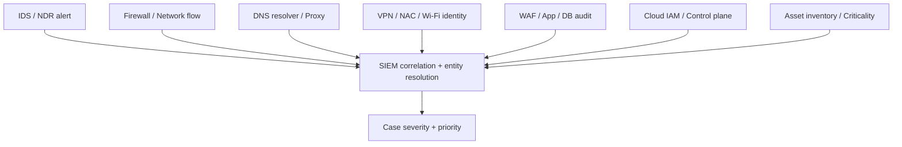
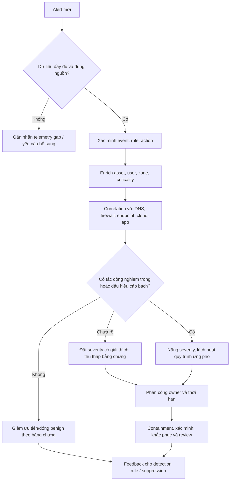

# Alert severity

> **Học phần:** `SECURITY_NETWORK_SECURITY`  
> **Chương:** IDS và IPS  
> **Chủ đề:** Cách hiểu, chuẩn hóa, hiệu chỉnh và sử dụng **mức độ nghiêm trọng của cảnh báo (alert severity)** để ưu tiên phân tích, phản ứng và giám sát các sự kiện an ninh mạng.

## Mục tiêu học tập

Sau bài này, người học có thể:

1. Phân biệt rõ **severity**, **confidence**, **risk**, **priority**, **impact** và **trạng thái xử lý** của một cảnh báo IDS/IPS.
2. Giải thích vì sao cùng một chữ ký IDS có thể có mức nghiêm trọng khác nhau tùy tài sản, vùng mạng, hành vi quan sát được và bằng chứng bổ sung.
3. Thiết kế thang severity nhất quán, ánh xạ dữ liệu từ sensor/IPS/WAF/NDR/SIEM mà không giả định mọi nhà cung cấp dùng cùng thứ tự số.
4. Thực hiện triage cảnh báo theo ngữ cảnh: phân đoạn, firewall, VPN, DNS, Wi-Fi, cloud flow logs, danh tính, asset criticality và chuỗi hành vi.
5. Phân biệt dấu hiệu tấn công, khai thác thành công, hành động IPS đã chặn và những cảnh báo có khả năng là false positive.
6. Thiết lập quy tắc correlation, deduplication, enrichment, escalation, tuning, kiểm thử và audit để giảm *alert fatigue* mà không che mất rủi ro thật.

## 1. Vì sao alert severity quan trọng?

**IDS (Intrusion Detection System)** phát hiện và tạo cảnh báo khi nhìn thấy sự kiện hoặc mẫu lưu lượng có dấu hiệu liên quan đến an ninh. **IPS (Intrusion Prevention System)** còn có khả năng thực thi hành động ngăn chặn phù hợp với chính sách và vị trí triển khai, ví dụ drop một gói hoặc từ chối một luồng.

Một hệ thống giám sát có thể tạo ra hàng nghìn cảnh báo mỗi ngày: kết nối đến cổng không được mở, truy vấn DNS bất thường, mẫu HTTP đáng ngờ, sự kiện mạng trông giống khai thác hoặc tín hiệu truyền dữ liệu ra ngoài. **Không phải mọi cảnh báo đều có mức nguy hiểm ngang nhau.**

**Alert severity** là nhãn phản ánh **mức độ nghiêm trọng được đánh giá** của một sự kiện hoặc tình huống. Nhãn có thể được engine rule định sẵn, do hệ thống SIEM chuẩn hóa hoặc được SOC điều chỉnh sau khi bổ sung ngữ cảnh.

Ví dụ:

- Một request có dấu hiệu thăm dò URL bị WAF/IPS **chặn trước khi đến ứng dụng** thường cần xử lý khác với việc backend đã xác nhận truy cập trái phép vào tệp nhạy cảm.
- Một luồng kết nối lạ từ laptop thử nghiệm trong lab có thể cần phân tích ở mức thấp hơn cùng tín hiệu đó phát sinh từ **domain controller**, **máy quản trị mạng** hoặc **workload thanh toán**.
- Nhiều cảnh báo riêng lẻ trông không nghiêm trọng nhưng khi ghép **VPN login → truy cập quản trị lạ → thay IAM policy** có thể tạo một vụ việc ưu tiên cao.

**Severity là công cụ ra quyết định, không phải sự thật tuyệt đối về việc tấn công đã thành công.** Nó phải được đặt cạnh bằng chứng, mức tin cậy, loại tài sản và chính sách ứng phó.

## 2. Phân biệt các khái niệm dễ nhầm

| Khái niệm | Câu hỏi cần trả lời | Ví dụ |
|---|---|---|
| **Alert severity** | Sự kiện/vụ việc này nghiêm trọng đến đâu theo chính sách phân loại? | `High` |
| **Detection confidence** | Ta tin ở mức nào rằng tín hiệu thực sự thể hiện hành vi đã mô tả? | `Medium confidence` vì chỉ có một flow bất thường |
| **Asset criticality** | Tài sản chịu ảnh hưởng quan trọng đến đâu với tổ chức? | Máy quản trị IAM quan trọng hơn máy demo không chứa dữ liệu |
| **Impact** | Nếu tình huống là thật, thiệt hại hoặc phạm vi ảnh hưởng là gì? | Rò rỉ dữ liệu khách hàng, gián đoạn dịch vụ thanh toán |
| **Likelihood** | Khả năng mối đe dọa/tình huống xảy ra trong ngữ cảnh hiện tại ra sao? | Có dấu hiệu khai thác và hệ thống đang phơi lộ |
| **Risk** | Rủi ro tổng hợp theo khả năng, tác động và kiểm soát hiện có là gì? | Rủi ro cao dù alert gốc chỉ “medium” |
| **Response priority** | Đội trực nên xử lý việc nào trước, với nguồn lực hiện có? | `P1` được xử lý ngay |
| **Disposition / status** | Kết luận và tiến độ xử lý cảnh báo hiện tại là gì? | `New`, `Investigating`, `Benign`, `Confirmed`, `Closed` |
| **IPS action** | Thiết bị đã làm gì với traffic? | `Alert`, `Drop`, `Reject`, tùy nền tảng |

**Không nên đồng nhất:**

- `High severity` **không có nghĩa** độ chính xác phát hiện cao.
- `High confidence` **không có nghĩa** tác động lớn; một cấu hình sai nhỏ có thể được xác nhận chắc chắn.
- `IPS dropped` **không có nghĩa** mọi thành phần của chuỗi tấn công đã bị ngăn.
- `P1` là mức ưu tiên hành động theo quy trình SOC; **không nhất thiết** đồng nghĩa nhãn severity của sensor.
- `Closed as false positive` mô tả kết luận sau điều tra, **không phải** một cấp severity.

### Ví dụ trực giác

Hai cảnh báo đều có chữ ký “kết nối bất thường trên TCP 443”:

- **A:** Workstation ở mạng lab gọi endpoint mô phỏng được đội SOC cho phép; không có dữ liệu nhạy cảm. Tín hiệu thật, nhưng ngữ cảnh hợp lệ.
- **B:** Database sản xuất vốn không được đi Internet lại phát sinh outbound tới đích chưa được duyệt, sau một sự kiện đăng nhập quản trị lạ. Có nhiều tín hiệu độc lập; cần điều tra khẩn hơn.

Tên chữ ký có thể giống nhau, nhưng **severity ở mức vụ việc** không nhất thiết giống nhau.

## 3. Từ rule severity đến incident severity

IDS/IPS thường tạo một mức ưu tiên hoặc mức nghiêm trọng **gắn với rule/signature**. Hệ thống giám sát sau đó có thể thay đổi mức theo **ngữ cảnh doanh nghiệp**.



Có thể chia thành ba cấp để tránh nhầm lẫn:

1. **Rule severity / priority:** Nhà viết rule hoặc nhà cung cấp đánh giá mẫu phát hiện nguy hiểm đến đâu nói chung.
2. **Event severity:** SIEM/NDR đánh giá một lần xuất hiện cụ thể, sau khi xét nguồn, đích, hành động IPS, độ phủ quan sát và các tín hiệu liên quan.
3. **Case/incident severity:** SOC đánh giá **toàn bộ tình huống**, tác động đã xác nhận hoặc có khả năng xảy ra, số tài sản và mức khẩn cấp phản ứng.

Một sự kiện có thể bắt đầu ở `Low` rồi trở thành `High` sau correlation. Ngược lại, một alert `High` từ chữ ký có thể được hạ mức ưu tiên sau khi xác minh là hoạt động thử nghiệm được phê duyệt.

**Không ghi đè mất giá trị ban đầu.** Nên lưu song song `original_severity`, `normalized_severity`, `case_severity`, lý do thay đổi và chính sách/phiên bản đã áp.

## 4. Thang mức độ nghiêm trọng tham khảo

Nhiều SOC dùng bốn hoặc năm cấp. Ví dụ dưới đây dùng **Informational, Low, Medium, High, Critical**; đây là **thang thiết kế minh họa**, không phải tiêu chuẩn bắt buộc cho tất cả IDS/IPS.

| Severity | Ý nghĩa vận hành gợi ý | Ví dụ tương đối | Hướng xử lý |
|---|---|---|---|
| **Informational** | Quan sát giúp xây baseline; chưa có dấu hiệu ảnh hưởng rõ | Một luồng liên lạc hợp lệ hoặc sự kiện policy đã biết | Ghi nhận, tổng hợp xu hướng |
| **Low** | Tín hiệu yếu hoặc tình huống ít ảnh hưởng; chưa có bằng chứng rõ của chuỗi nguy hiểm | Probe đơn lẻ bị chặn ở tài sản thử nghiệm | Xếp hàng review, làm giàu bối cảnh |
| **Medium** | Dấu hiệu đáng tin cần điều tra, ảnh hưởng chưa xác định hoặc phạm vi có giới hạn | Nhiều lần kết nối tới port không được cấp ở mạng nội bộ | Triage, xác minh owner và tài sản |
| **High** | Hành vi đe dọa đáng kể trên tài sản quan trọng, hoặc nhiều bằng chứng liên quan | Workload sản xuất liên hệ đích ngoài chính sách và xuất hiện bất thường danh tính | Điều tra ưu tiên cao, đánh giá cô lập |
| **Critical** | Đã xác nhận hoặc có bằng chứng mạnh về ảnh hưởng nghiêm trọng, phạm vi rộng hay mất kiểm soát tài sản đặc quyền | Hoạt động thay đổi IAM trái phép được xác nhận đồng thời có dấu hiệu lan rộng | Kích hoạt điều phối sự cố theo quy trình |

**Lưu ý:** Một sự kiện `Critical` có thể xảy ra ngay cả khi chữ ký gốc không được đặt mức `Critical`. Ngược lại, không nên gắn `Critical` chỉ vì một chuỗi byte trông giống exploit mà chưa kiểm tra asset, action và bằng chứng.

### Các tham số tổ chức nên định nghĩa

- Tên cấp độ, ý nghĩa, màu/số nếu có và **thứ tự chính xác**.
- Sự khác nhau giữa nhãn **severity của event** và **severity của incident**.
- Ai được nâng/hạ severity, điều kiện và log quyết định.
- Quy tắc ảnh hưởng của data classification, service criticality và số hệ thống bị tác động.
- Ngưỡng kích hoạt on-call, quản lý sự cố, nhóm pháp chế/quyền riêng tư và lãnh đạo khi phù hợp.
- Thời điểm rà soát lại severity khi bằng chứng thay đổi.

## 5. Vendor mapping: cẩn thận với số thứ tự

Mỗi engine hoặc schema có thể dùng **thang và thứ tự số khác nhau**. Ví dụ, nhiều công cụ IDS có trường gọi là `priority` hoặc `severity` với giá trị số, nhưng ý nghĩa phải được giải thích theo chính tài liệu của nguồn và phiên bản cấu hình.

**Sai lầm nguy hiểm:** Mặc định “số càng lớn càng nghiêm trọng” rồi gộp dữ liệu từ các nguồn. Một số hệ thống dùng **giá trị số nhỏ hơn để biểu thị mức ưu tiên cao hơn**; hệ thống khác lại ngược lại.

| Nguồn | Thuộc tính cần tìm | Cách xử lý an toàn |
|---|---|---|
| Signature IDS/IPS | Rule ID, classification, priority/severity, message | Giữ nguyên số và ánh xạ có tài liệu nguồn/phiên bản |
| WAF | Rule ID, action, anomaly score, severity metadata | Không đồng nhất anomaly score với incident severity |
| NDR / behavioral detection | Score/confidence, category, entity | Phân biệt model confidence và mức tác động |
| SIEM | Normalized severity, risk score, incident priority | Kiểm tra mapping và correlation đã tạo ra mức mới |
| Endpoint/EDR | Detection severity, disposition, device criticality | Nối theo endpoint identity, không chỉ IP |
| Cloud security findings | Provider severity, resource importance, trạng thái | Ánh xạ theo loại finding và tài nguyên thực tế |
| CVE/CVSS context | Điểm severity của lỗ hổng | **Không** coi CVSS score là bằng chứng khai thác đã diễn ra |
| Firewall log | Allow/Deny/Drop, rule, zone | Hành động policy tự nó không đủ xác định severity |

Ví dụ bộ dữ liệu giả định:

```json
{
  "sourceProduct": "Example-IDS",
  "sensorId": "sensor-dmz-01",
  "eventId": "evt-demo-0007",
  "signatureId": "demo-2107",
  "signature": "Suspicious outbound connection pattern",
  "originalPriority": 2,
  "priorityMeaning": "vendor-defined",
  "normalizedSeverity": "medium",
  "ipsAction": "alert",
  "srcIp": "10.20.10.21",
  "destIp": "203.0.113.77",
  "destPort": 443,
  "protocol": "TCP"
}
```

Đây **không** phải schema chính thức của Suricata, Snort hay bất kỳ sản phẩm cụ thể nào. Các giá trị là dữ liệu học tập. IP `203.0.113.77` thuộc dải dùng cho tài liệu, không phải chỉ dấu đe dọa thật.

### Quy tắc chuẩn hóa minh họa

```yaml
severityMapping:
  source: "Example-IDS"
  mappingVersion: "1.0"
  # Các giá trị dưới đây là quy ước giả định, KHÔNG phải bảng
  # áp dụng chung cho mọi IDS, IPS hoặc mọi phiên bản sản phẩm.
  originalPriority:
    1: high
    2: medium
    3: low
  unknown: needs_review
preserveOriginalFields: true
```

Khi xuất sang SIEM, cần kiểm tra thứ tự mapping, giá trị ngoài bảng, trường null, rule mới và phiên bản signature update. Mỗi thay đổi mapping nên có test để phát hiện việc **đảo ngược** Low/High.

## 6. Xây dựng severity dựa trên bằng chứng và ngữ cảnh

Để đánh giá severity chính xác hơn, xem ít nhất sáu nhóm thông tin:

1. **Tín hiệu phát hiện:** chữ ký hay hành vi nào, nguồn phát hiện, rule đã được tuning chưa?
2. **Trạng thái thực thi:** IDS chỉ alert; IPS đã drop một packet, reject session hay kết nối đã tiếp tục?
3. **Tài sản chịu ảnh hưởng:** production/staging, dữ liệu nhạy cảm, quyền quản trị, vai trò trong nghiệp vụ.
4. **Vị trí và ranh giới:** Internet → DMZ, user → data, guest Wi-Fi → management, cloud workload → control plane.
5. **Bằng chứng bổ sung:** DNS, flow log, proxy, VPN/IdP, WAF, EDR, endpoint, ứng dụng và IAM audit có nhất quán không?
6. **Tác động và phạm vi:** Sự kiện bị chặn hoàn toàn, một máy bị ảnh hưởng hay có nhiều tài sản và dữ liệu liên quan?

### Ví dụ cùng chữ ký, khác mức ưu tiên

| Quan sát | Ngữ cảnh thêm | Đánh giá triage ban đầu |
|---|---|---|
| Một request path traversal bị WAF chặn | Endpoint demo, không có backend access hoặc file read | Low/Medium tùy chính sách |
| Nhiều request traversal tới website public | Tần suất cao, nhiều nguồn, không rõ exploit thành công | Medium, xem xu hướng và mục tiêu |
| Request traversal qua WAF | Backend file audit cho thấy file nhạy cảm ngoài root bị đọc | High/Critical theo dữ liệu và mức tác động |
| Kết nối outbound lạ từ database | Data zone vốn không được đi Internet, flow được cho phép | High, cần điều tra đường egress |
| DNS query đến domain ít gặp | Có trong kiểm thử được cấp và không có dấu hiệu khác | Informational/Low |
| DNS query đáng ngờ + đăng nhập quản trị lạ | Cùng workload, gần thời điểm, thêm thay đổi cloud IAM | High/Critical tùy xác nhận |

Đây là **ví dụ phân tích**, không phải luật tự động nâng/hạ áp dụng cho mọi môi trường. Việc bị chặn bởi WAF/IPS có thể giảm khả năng tác động tại một ranh giới, nhưng **không xác nhận** host khác chưa bị ảnh hưởng hoặc kẻ tấn công không có đường đi khác.

## 7. Một mô hình điểm ưu tiên có thể giải thích

Có thể dùng **risk-based triage** để hỗ trợ sắp xếp công việc. Một mô hình minh họa lấy điểm 1–5 cho các yếu tố:

- `T` — **Threat evidence:** bằng chứng nguy hiểm của hành vi (1–5).
- `A` — **Asset impact:** mức ảnh hưởng nếu tài sản bị tác động (1–5).
- `E` — **Exposure / reachability:** đường tới tài sản và phạm vi phơi lộ (1–5).
- `C` — **Confidence:** độ tin cậy của phát hiện (1–5).

Ví dụ điểm hỗ trợ sắp hàng (không phải công thức chuẩn):

\[
S = 0.35T + 0.35A + 0.15E + 0.15C
\]

| Trường hợp minh họa | T | A | E | C | Điểm S | Diễn giải |
|---|---:|---:|---:|---:|---:|---|
| Scanner ngoài Internet bị chặn ở lab | 2 | 1 | 2 | 4 | 1.95 | Thường thấp; theo dõi xu hướng |
| Backend production gọi đích lạ | 4 | 4 | 4 | 3 | 3.85 | Cần điều tra nhanh |
| File nhạy cảm bị đọc trái phép có audit | 5 | 5 | 4 | 5 | 4.85 | Mức rất cao |

**Không biến điểm số thành quyết định tuyệt đối.** Những tình huống có tác động pháp lý, an toàn con người, mất kiểm soát tài khoản đặc quyền hoặc sự cố diện rộng có thể được nâng cấp **theo điều kiện bắt buộc** ngay cả khi mô hình điểm cho giá trị trung bình.

Ví dụ pseudo-policy:

```text
IF confirmed_unauthorized_privileged_change
   OR confirmed_sensitive_data_exposure
   OR multiple_critical_systems_affected:
    case_severity = CRITICAL or HIGH according to incident policy
ELSE:
    calculate triage_score from validated evidence and asset context
    apply documented severity mapping
    require analyst review for ambiguous or missing evidence

ALWAYS:
    preserve original detection severity
    record rationale, reviewer, timestamp and rule version
```

Mục đích của bảng và công thức là **dạy cách xây chính sách có thể giải thích**. Một SOC thực tế cần hiệu chỉnh dựa trên dữ liệu, định nghĩa cấp độ chính thức và kiểm tra khả năng phát hiện tình huống quan trọng bị bỏ lọt.

## 8. Tương quan tín hiệu từ các lớp phòng vệ mạng

Mức severity không nên phụ thuộc chỉ một sensor khi có thể dùng thông tin liên quan.



### Giá trị từng nguồn

| Nguồn | Câu hỏi có thể trả lời | Giới hạn |
|---|---|---|
| **Firewall / flow** | Kết nối có đường qua vùng nào, được cho phép hay bị từ chối? | Không tự xác minh payload hoặc quyền ứng dụng |
| **DNS resolver** | Host/client đã hỏi tên miền nào? | Cache, DoH/DoT, direct IP, resolver khác |
| **VPN / NAC / Wi-Fi** | User hoặc thiết bị nào đang dùng IP/zone tại thời điểm đó? | IP có thể đổi, NAT, session ngắn, identity mapping cần đúng thời gian |
| **WAF** | Request HTTP nào bị chặn, tới endpoint nào? | Cần giải mã/quan sát HTTP và có thể false positive |
| **EDR** | Tiến trình nào mở kết nối, hành vi host ra sao? | Không phải mọi host đều được quản lý và có telemetry |
| **Application/DB** | Hành động nghiệp vụ, kết quả authz và dữ liệu tác động? | Cần audit đúng chỗ, tránh log secret |
| **Cloud audit** | IAM role, resource policy hoặc control plane có thay đổi? | Hệ log cung cấp độ trễ/độ phủ khác nhau |
| **Asset inventory** | Tài sản nào là production, chứa dữ liệu gì, ai sở hữu? | Dữ liệu có thể stale; cần quản lý liên tục |

**Cẩn thận khi nối theo IP:** Với NAT, DHCP, proxy và Kubernetes, cùng IP có thể đại diện nhiều workload hoặc nhiều user ở các thời điểm khác nhau. Khi correlation, dùng **timestamp có múi giờ**, session ID, process ID, workload identity, device identity và các khóa liên kết đáng tin khác.

## 9. Những tình huống alert severity điển hình

### 9.1 Reconnaissance / port scanning

Một IDS báo nhiều kết nối tới các cổng khác nhau. Chữ ký có thể phản ánh hành vi thăm dò, nhưng chưa đủ kết luận host đích bị chiếm.

**Triage:**

- Đích là asset nào và có phơi lộ Internet hay chỉ nội bộ?
- Nguồn có phải scanner đã đăng ký, đội kiểm thử hay hệ quản lý lỗ hổng không?
- Firewall đã deny hay có kết nối được chấp nhận?
- Có thêm sự kiện đăng nhập thất bại/thành công, exploit hoặc thay đổi trạng thái không?

Một đợt quét ở mạng lab có thể Low; cùng hành vi từ **guest VLAN sang management zone**, kết hợp session thành công và quyền sai, có thể cần High hơn.

### 9.2 DNS bất thường

IDS/NDR phát hiện mẫu DNS lạ hoặc nhiều truy vấn đến một số hostname. Một số hành vi có thể liên quan **DNS tunneling**, nhưng cũng có thể do phần mềm telemetry, CDN, service discovery hoặc hệ kiểm thử.

**Không suy diễn “domain dài = độc hại”.** Cần xét nhịp truy vấn, kiểu record, kích thước phản hồi, danh tính tiến trình, resolver, đích đã biết và dữ liệu exfil có bằng chứng hay không. Severity phải dựa vào **hành vi đã kiểm chứng**, không phải duy nhất độ dài QNAME.

### 9.3 Mẫu khai thác ứng dụng web

WAF/IDS báo request có đặc điểm path traversal hoặc injection vào API. Nếu WAF trả BLOCK và backend không nhận request, tác động từ request đó có thể thấp hơn trường hợp backend đã trả dữ liệu ngoài phạm vi.

Cần kiểm tra *request ID → WAF decision → backend response → file/DB audit*. Một HTTP `200` không tự chứng minh khai thác thành công; phải biết API đã thực hiện hành động gì.

### 9.4 Truy cập bất thường đến control plane

Một user VPN thông thường hoặc workload app phát sinh kết nối đến quản trị firewall, Kubernetes API hay cloud IAM. Đường mạng **reachability** chưa chứng minh đã có quyền, nhưng nếu kết hợp log thay đổi policy trái phép, severity có thể tăng đáng kể.

Thêm bối cảnh: role trước/sau, MFA, change ticket, session, action, resource và asset criticality.

### 9.5 C2 / egress bất thường

Một database vốn không có nhu cầu outbound lại mở kết nối lặp lại đến đích không thuộc allowlist. IDS có thể cảnh báo mẫu lưu lượng, firewall/proxy có thể ghi ALLOW/DENY.

Nếu chỉ có **kết nối bị chặn**, cần xác nhận có tác động hoặc đường thay thế hay không. Nếu kèm tiến trình lạ trên host và dữ liệu được gửi ra ngoài, severity của vụ việc phải được đánh giá lại.

### 9.6 DDoS hoặc lượng kết nối tăng mạnh

Alert về volumetric traffic hoặc SYN bất thường có thể ảnh hưởng tính sẵn sàng. Đánh giá severity bằng **dịch vụ bị ảnh hưởng, lưu lượng hợp lệ bị suy giảm, vùng tác động và khả năng chống chịu**, không đơn thuần bằng packet count.

Một traffic spike do chiến dịch hợp lệ chưa phải tấn công; ngược lại, DDoS tốc độ không quá lớn có thể nghiêm trọng nếu gây nghẽn tài nguyên nhạy cảm.

## 10. IPS action ảnh hưởng cách phân loại như thế nào?

IPS thường được triển khai **inline** trên đường lưu lượng; IDS thường chỉ phát hiện/thông báo. Tuy nhiên hành vi cụ thể phụ thuộc platform, mode, fail-open/fail-close, rule action và đường đi thực tế.

| IPS/IDS event | Có thể kết luận | Không thể kết luận chỉ từ sự kiện |
|---|---|---|
| `Alert` | Sensor phát hiện một tín hiệu và ghi nhận | Request đã bị chặn hoặc exploit thành công |
| `Drop` | Có packet/traffic bị IPS loại bỏ theo cơ chế áp dụng | Toàn bộ chuỗi tấn công đã bị chặn, hoặc không có gói khác đến đích |
| `Reject` | Thiết bị từ chối theo chế độ/cơ chế cụ thể | Ứng dụng hoàn toàn không bị tác động bởi các request khác |
| `Pass` | Rule/policy cho traffic đi qua theo cơ chế được cấu hình | Traffic an toàn hoặc user có đủ quyền nghiệp vụ |
| `Would block / monitor` | Hệ thống đánh giá là đủ điều kiện chặn trong chế độ quan sát | Có block thực tế xảy ra |

**IPS hành động thành công không đồng nghĩa mức severity luôn giảm thành Low.** Ví dụ, hàng loạt nguồn cố xâm nhập dịch vụ trọng yếu, dù bị chặn ở điểm chính, vẫn có thể là một chiến dịch cần xử lý High do phạm vi và nguy cơ đường khác.

Ngược lại, một alert `High` do rule mặc định nhưng áp trên test traffic được phê duyệt có thể được đóng benign sau khi xác minh.

### Kiểm soát khi dùng IPS tự động

- Bật prevent theo những rule đã được kiểm thử, có baseline và có phương án rollback.
- Xác định traffic nào có thể bị drop làm gián đoạn ứng dụng, đặc biệt ở môi trường OT/IoT, thanh toán và hệ thống thời gian thực.
- Quản lý fail-open/fail-close theo yêu cầu an toàn và tính sẵn sàng; kiểm tra thực tế thiết bị.
- Dùng severity **cùng** confidence, asset criticality và policy để quyết định phản ứng, không cho một nhãn số tự động khóa tài sản trọng yếu vô điều kiện.
- Ghi audit đầy đủ về việc engine đã alert hay drop và người/cơ chế nào thay đổi mode.

## 11. False positive, false negative và detection confidence

Một alert tốt phải cân bằng khả năng phát hiện với số sự kiện làm mất thời gian.

- **True positive (TP):** Alert phản ánh đúng một sự kiện thuộc phạm vi phát hiện được định nghĩa.
- **False positive (FP):** Alert báo một hành vi nằm trong nhóm đáng ngờ nhưng thực tế không thỏa định nghĩa mối đe dọa cần báo.
- **False negative (FN):** Hoạt động thuộc phạm vi cần phát hiện xảy ra nhưng sensor không tạo alert.
- **True negative (TN):** Trường hợp bình thường được hệ thống nhận định đúng là không đáng báo.

Đối với hệ IDS, cách phân loại cần dựa trên **ground truth có kiểm chứng**. Một alert phát hiện request giống khai thác có thể là **true positive về hành vi thăm dò** dù exploit không thành công. Vì thế nên ghi rõ “phát hiện đúng *điều gì*?” trước khi gắn TP/FP.

### Một số chỉ số

\[
\text{Precision}=\frac{TP}{TP+FP}
\]

\[
\text{Recall}=\frac{TP}{TP+FN}
\]

\[
\text{False Positive Rate}=\frac{FP}{FP+TN}
\]

Trong vận hành IDS/IPS, khó xác định mọi `FN` và `TN` trên traffic thật; số liệu thường chỉ được ước tính từ tập kiểm thử, incident review hoặc mẫu được gắn nhãn. Đừng báo “99% accuracy” nếu chưa định nghĩa tập dữ liệu và mẫu số.

**Detection confidence** nên thể hiện lý do: chữ ký có độ chính xác cao, hai nguồn log độc lập xác nhận, endpoint telemetry chứng minh process hay chỉ có traffic mẫu mơ hồ. Mức confidence có thể thay đổi khi thêm bằng chứng; nó không nhất thiết tăng cùng severity.

## 12. Tuning alert severity mà không che mất rủi ro

**Alert fatigue** xuất hiện khi số alert vượt khả năng xử lý hoặc nhiều alert lặp lại thiếu bối cảnh, khiến cảnh báo quan trọng bị bỏ qua. Một quy trình tuning tốt giảm nhiễu **mà không xóa dấu vết cần điều tra**.

Các kỹ thuật:

1. **Thresholding:** Chỉ tạo case khi số event trong cửa sổ thời gian vượt điều kiện phù hợp.
2. **Deduplication:** Hợp nhất event trùng về rule, asset, principal, thời gian hoặc hành vi để giảm số case mở.
3. **Suppression có phạm vi:** Tạm không gửi thông báo cho hoạt động đã được phê duyệt, nhưng vẫn giữ raw event/audit theo chính sách.
4. **Contextual allowlist:** Nhận diện scanner nội bộ, change window hoặc hệ thống bảo trì với thời hạn và chủ sở hữu.
5. **Correlation:** Nâng mức khi nhiều tín hiệu liên quan xuất hiện theo chuỗi, thay vì chỉ đếm số gói.
6. **Rule tuning:** Điều chỉnh điều kiện match hoặc parsing phù hợp với ứng dụng, kiểm thử false positive và detection gap.
7. **Severity enrichment:** Gắn nhãn tài sản quan trọng, quyền danh tính, dữ liệu nhạy cảm và hậu quả có thể có.
8. **Review định kỳ:** Kiểm tra các trường hợp incident đã bị lỡ, những rule im lặng bất thường và các ngoại lệ sắp hết hạn.

### Những điều không nên làm

- **Tắt cả loại chữ ký** chỉ vì một ứng dụng gây nhiều FP mà không kiểm tra phạm vi ảnh hưởng.
- **Hạ mọi alert của một subnet xuống Low**, đặc biệt khi subnet chứa dịch vụ quan trọng.
- **Xóa raw event** khi dedup case; điều này làm mất bằng chứng chuỗi hành vi.
- **Đặt suppression vĩnh viễn** theo IP nếu IP thay đổi chủ sở hữu hoặc nhiều workload dùng chung.
- **Đổi severity nhưng không ghi lý do**, dẫn đến đánh giá chất lượng không thể giải thích.
- **Chỉ nhìn alert được phát sinh** mà không giám sát số sensor mất kết nối hoặc rớt packet.

### Ví dụ tuning có kiểm soát

Một scanner nội bộ được phê duyệt tạo 5.000 event “port scan” vào giờ kiểm kê. Hướng xử lý:

- Đối chiếu identity, IP, ticket, lịch quét, danh sách đích và thời gian.
- Định nghĩa suppression **chỉ** cho scanner/đích/rule/cửa sổ được phê duyệt.
- Giữ tổng số event và audit rule suppression.
- Bất kỳ luồng ngoài lịch, ngoài đích hoặc có tín hiệu khai thác khác vẫn được phân tích.
- Đánh giá lại sau khi lịch quét hoặc địa chỉ thay đổi.

Tuning không phải “giấu alert”; mục tiêu là **đúng người nhận được đúng cảnh báo vào đúng thời điểm**.

## 13. Deduplication và correlation: event khác incident

Một host có thể tạo hàng trăm packet liên quan **một** hành vi; ngược lại, một incident có thể trải qua nhiều host, nhiều user và nhiều rule.

### Nhóm event thành case

```text
Input: normalized IDS/IPS events

For each event:
    validate timestamp, sensor, signature, action and entity identity
    join asset inventory, zone, user/workload, authorized change windows
    group duplicates by defensible correlation keys and time window
    preserve raw event IDs and counts

    if independent evidence indicates a linked threat chain:
        create or enrich one case
        recompute case severity using impact, confidence and scope
        record why severity changed

    route case by response priority and escalation policy
```

**Correlation key phải đúng ngữ nghĩa.** Ghép theo IP mà bỏ NAT, DHCP, Kubernetes pod churn hoặc VPN lease có thể nối nhầm người/tài sản. Đếm 10.000 alert từ một scanner không mặc nhiên là 10.000 incident; một alert duy nhất có bằng chứng lộ dữ liệu có thể quan trọng hơn rất nhiều.

### Correlation minh họa

| Thời điểm | Nguồn | Sự kiện | Nhìn đơn lẻ | Khi ghép chuỗi |
|---|---|---|---|---|
| 09:00 | VPN | Đăng nhập thành công từ thiết bị chưa thường thấy | Có thể Informational | Là mốc identity |
| 09:03 | IDS | Workstation → management zone qua port lạ | Medium | Liên quan user/thiết bị |
| 09:05 | Firewall | Một số luồng tới admin API được ALLOW | Medium/High theo boundary | Xác nhận có reachability |
| 09:07 | Cloud audit | Cùng principal có thay đổi role trái phép | High | Bằng chứng thao tác đặc quyền |
| 09:09 | EDR | Process bất thường trên thiết bị đó | High | Tăng confidence và phạm vi |

Nếu các bản ghi xác thực được cùng principal và thời gian hợp lệ, case có thể được nâng severity. **Không kết luận theo trùng IP đơn thuần** nếu IP NAT được chia sẻ hoặc không biết lease tại thời điểm đó.

## 14. Quy trình triage theo severity trong SOC

Một quy trình triage minh bạch gồm:



### Các bước cụ thể

**Bước 1 — Xác nhận nguồn và độ tin cậy dữ liệu.** Sensor đang online không? Có mất gói, backlog ingestion, lệch đồng hồ, trùng event, rule mới cập nhật hoặc cấu hình đang chạy ở monitor mode không?

**Bước 2 — Đọc event đúng cách.** Xem timestamp, event ID, signature/category, source/destination, interface/zone, protocol, action, rule priority và log gốc. Đọc mô tả rule để hiểu phát hiện một **mẫu giao tiếp** hay một **kết quả khai thác**.

**Bước 3 — Làm giàu tài sản.** Xác định tên, owner, business service, môi trường, dữ liệu nhạy cảm, loại thiết bị, IAM/service identity và những luồng mạng hợp lệ.

**Bước 4 — Đối chiếu bằng chứng.** Kết nối firewall, DNS, VPN, EDR, WAF, ứng dụng, database và cloud audit theo khóa tin cậy. Hỏi liệu hoạt động chỉ là attempt, được chặn hay đã dẫn tới hành động ngoài quyền.

**Bước 5 — Gán severity và priority.** Dùng thang chính thức; ghi rõ “vì sao High” hoặc “vì sao chỉ Medium”. Nếu bằng chứng thiếu nhưng hậu quả có thể cực lớn, có thể tạm nâng mức để xác minh nhanh theo playbook.

**Bước 6 — Quyết định phản ứng.** Trong trường hợp có căn cứ và thẩm quyền, cân nhắc chặn luồng, cô lập endpoint, thu hồi token hoặc kích hoạt incident response. Cần đánh giá rủi ro gián đoạn dịch vụ, đặc biệt với production/OT.

**Bước 7 — Kết thúc và học hỏi.** Lưu disposition, nguyên nhân, bằng chứng, các thay đổi rule/asset inventory, false positive, detection gap và bài học cho lần sau.

## 15. Ví dụ quy ước escalation và SLO

Dưới đây chỉ là **ví dụ nội bộ giả định**, không phải SLA/SLO bắt buộc. Tổ chức phải điều chỉnh theo quy mô, nhân lực, giờ trực, yêu cầu pháp lý và mức rủi ro.

| Case severity | Mức ưu tiên mẫu | Mục tiêu bắt đầu triage minh họa | Hướng điều phối |
|---|---|---|---|
| **Critical** | P1 | Trong 15 phút khi ca trực được kích hoạt | Incident commander, SOC, owner hệ thống, đội ứng phó |
| **High** | P2 | Trong 1 giờ | SOC L2/IR và owner tài sản |
| **Medium** | P3 | Trong ngày làm việc | Analyst triage, enrichment và quyết định follow-up |
| **Low** | P4 | Theo lịch review | Gộp xu hướng, rule tuning và baseline |
| **Informational** | Không tạo case riêng nếu policy không yêu cầu | Lưu/aggregate | Thống kê và phát hiện xu hướng |

**SLO phản ứng** đo việc bắt đầu điều tra hoặc thực hiện bước được định nghĩa, **không hứa mọi incident sẽ được xử lý xong** trong khoảng đó. Quy định rõ giờ làm việc hay 24/7, cách xử lý cảnh báo ngoài giờ, tình huống không có owner và cơ chế tự nâng mức khi vụ việc lan rộng.

### Các chỉ số theo dõi chất lượng

- **MTTA:** thời gian từ khi alert/case đến khi được analyst tiếp nhận; xác định mốc bắt đầu cụ thể.
- **MTTD:** thời gian từ hoạt động thực tế đến khi phát hiện, khi có ground truth đáng tin.
- **MTTR:** cần định nghĩa rõ là response hay remediation/recovery; không dùng mơ hồ.
- Tỷ lệ alert theo severity, tỷ lệ triage đúng hạn và backlog tồn đọng.
- Tỷ lệ FP hoặc benign theo rule/detection source, sau khi xác định cách gắn nhãn.
- Số case nghiêm trọng bị phát hiện muộn/đánh giá sai mức.
- Thời gian cập nhật severity sau khi có bằng chứng mới.
- Tỷ lệ sensor mất telemetry, packet drops và sự kiện không chuẩn hóa được severity.

Các chỉ số phải đi kèm mẫu số và phạm vi. **Giảm số alert không tự đồng nghĩa hệ thống an toàn hơn**; có thể do sensor tắt hoặc rule suppression quá rộng.

## 16. Một case study đầy đủ: kết nối DNS và egress của backend

**Bối cảnh giả lập:** Backend `billing-api` trong application zone xử lý thanh toán, được phép kết nối DB và một API đối tác qua proxy. Bình thường workload không tạo kết nối Internet trực tiếp. IDS báo “anomalous outbound behavior”, còn DNS resolver ghi một chuỗi truy vấn không phổ biến.

### Dữ liệu quan sát ban đầu

```text
10:01  IDS    billing-api -> 203.0.113.55:443   signature=outbound-pattern
10:01  FW     source_zone=APP destination=Internet action=DENY rule=EGRESS-APP-01
10:02  DNS    billing-api queried example-lab.invalid  result=NXDOMAIN
10:03  SIEM   asset=billing-api environment=production criticality=high
10:04  APP    no confirmed unauthorized transaction in current audit scope
```

Địa chỉ `203.0.113.55` và tên `example-lab.invalid` chỉ dành cho mô phỏng. Không nên coi chúng là IOC thực.

**Đánh giá bước đầu:**

- Nguồn là **workload sản xuất quan trọng** và luồng khác với allowlist.
- Firewall ghi nhận kết nối **bị từ chối**; đây là bằng chứng một đường outbound cụ thể đã bị chặn.
- Chỉ có DNS query và pattern IDS chưa chứng minh có C2 hoặc rò rỉ dữ liệu.
- Không thấy hành động trái quyền trong phạm vi app audit hiện có, nhưng vẫn cần biết audit có đầy đủ không.

**Triage minh họa:** Có thể đánh dấu **High để điều tra ưu tiên** vì tài sản quan trọng và kết nối không phù hợp, đồng thời ghi `confidence=medium` về giả thuyết C2 cho đến khi có EDR/process evidence hoặc indicator độc lập.

### Bằng chứng phát sinh sau đó — hai nhánh

**Nhánh A: benign misconfiguration**

- Release mới giới thiệu thư viện telemetry thử nghiệm có chức năng gọi endpoint không được phê duyệt.
- Owner và change ticket xác nhận nguồn request.
- Không có dữ liệu nhạy cảm được gửi; firewall chặn đúng.
- SOC hạ severity của case và xử lý như cấu hình sai/tuân thủ policy; không mở Internet trực tiếp khi không có nhu cầu.

**Nhánh B: hoạt động không được phép**

- EDR xác nhận một process lạ trong container cùng thời điểm.
- Proxy/cloud log cho thấy có đường egress khác đã cho phép gửi dữ liệu trái phép.
- IAM/app audit phát hiện dữ liệu nhạy cảm bị truy xuất ngoài nhiệm vụ.

SOC nâng case lên **Critical** hoặc mức tương ứng chính sách, kích hoạt incident response, kiểm soát đường egress, danh tính workload và phạm vi dữ liệu. Từ một alert giống nhau, sự khác biệt đến từ **bằng chứng và tác động**, không phải chỉ đổi nhãn chữ ký.

## 17. Mẫu quy tắc phân loại và dữ liệu case

### Cấu hình chính sách minh họa

```yaml
policy: soc-ids-alert-severity
version: "1.0"
severityLevels:
  - informational
  - low
  - medium
  - high
  - critical

enrichment:
  required:
    - sourceProduct
    - originalSeverity
    - sensorId
    - eventTime
    - alertAction
    - assetCriticality
  optional:
    - identity
    - zone
    - appAudit
    - cloudAudit
    - endpointEvidence

escalation:
  confirmedPrivilegedChange: high
  confirmedSensitiveDataExfiltration: critical
  multipleCriticalAssetsAffected: critical

review:
  preserveRawAlert: true
  requireReasonForOverride: true
  recordPolicyVersion: true
  unknownPriority: needs_review
```

Đây là **schema học tập**, không phải cấu hình có thể nạp trực tiếp vào SIEM/IDS/IPS. Điều kiện `confirmedSensitiveDataExfiltration` phải được xác minh theo policy và có thể có mức severity khác tùy tổ chức.

### Mẫu bản ghi case

```json
{
  "caseId": "CASE-DEMO-007",
  "eventIds": ["evt-demo-0007", "evt-demo-0008"],
  "originalSeverity": "medium",
  "normalizedSeverity": "medium",
  "caseSeverity": "high",
  "confidence": "medium",
  "responsePriority": "P2",
  "asset": "billing-api",
  "zone": "application",
  "alertAction": "alert",
  "relatedFirewallAction": "deny",
  "status": "investigating",
  "reason": "Production workload attempted an unapproved outbound path",
  "owner": "soc-l2",
  "mappingVersion": "1.0"
}
```

Đảm bảo giữ **evidence references** và thay đổi severity theo thời gian; một chuỗi ghi log không chứa đủ bằng chứng không nên được xem là xác nhận lây nhiễm hoặc khai thác thành công.

## 18. Thực hành trong lab và kiểm thử chính sách

Tất cả ca thử dùng **dữ liệu nhân tạo hoặc môi trường được phép**. Không cần tạo traffic gây hại vào hệ thống bên ngoài để kiểm tra logic severity.

### Bài tập A — Phân loại các cảnh báo

| Event | Tình huống | Severity đề xuất sơ bộ | Lý do cần cân nhắc |
|---|---|---|---|
| A | IDS phát hiện một request bị WAF chặn ở trang demo | Low/Medium | Không có bằng chứng hậu quả; tài sản ít quan trọng |
| B | Guest Wi-Fi cố vào mạng quản trị, firewall từ chối | Medium | Boundary nhạy cảm, nhưng không có phiên thành công |
| C | DNS bất thường + EDR process lạ trên máy nhân viên | High nếu correlation vững | Hai nguồn độc lập, cần xác minh hoạt động host |
| D | Cloud audit xác nhận role admin bị cấp trái phép | Critical/High | Hành động đặc quyền thực tế và phạm vi có thể lớn |
| E | Flow tăng đột biến do backup theo lịch | Informational/benign sau xác minh | Có change/owner, không thuộc hành vi tấn công |
| F | IPS báo drop nhiều lần vào public API production | Medium/High tùy chiến dịch/tác động | Bị chặn ở một điểm nhưng cần đánh giá phạm vi |

**Đề bài:** Với mỗi event, bổ sung hai nguồn bằng chứng cần xem và mô tả điều kiện sẽ khiến severity tăng hoặc giảm. Cần ghi lý do, không chỉ chọn một nhãn.

### Bài tập B — Kiểm thử normalization

```gherkin
Feature: IDS/IPS alert severity normalization

  Scenario: Preserve original priority while mapping
    Given an IDS event has original priority value 2
    And the source-specific mapping defines value 2 as medium
    When the SIEM normalizes the event
    Then normalized severity is medium
    And the original priority and mapping version are preserved

  Scenario: Unknown vendor values must not silently become low
    Given an IDS event has a priority value absent from the mapping
    When the event is ingested
    Then the normalized severity is marked needs-review
    And the event is retained for investigation
    And a data quality signal is generated

  Scenario: Critical confirmed impact can raise the case severity
    Given a medium-severity alert involves a production asset
    And independent audit confirms unauthorized privileged changes
    When the case is enriched
    Then the case severity follows the critical impact policy
    And the reason and evidence are recorded
    And the original alert severity remains unchanged

  Scenario: Approved scanner events are suppressed narrowly
    Given an approved scanner operates during a documented window
    When matching alerts occur within the approved scope
    Then duplicate notifications may be suppressed by policy
    And raw events remain available for audit
    And out-of-scope alerts are still investigated
```

### Bài tập C — Đánh giá tình huống

Một SIEM ghi 4.000 alert Low từ một sensor và 1 alert High từ một hệ thống dữ liệu quan trọng. Hệ thống có giới hạn xử lý 50 case mỗi giờ.

**Cách xử lý phù hợp:**

1. Không ưu tiên chỉ theo **số lượng** event. Xem case High với mức tác động và bằng chứng.
2. Nhóm trùng lặp các alert Low theo rule/asset/time, giữ raw event để điều tra.
3. Kiểm tra sensor health và khả năng bị flood làm mất các tín hiệu khác.
4. So sánh nhãn từ engine với mức severity/case priority sau enrichment.
5. Điều phối người xử lý theo policy; nếu xác định chiến dịch diện rộng, điều chỉnh severity của case liên quan.
6. Rà soát lại threshold, false positive và việc xử lý đúng SLO.

## 19. Những sai lầm thường gặp

**“High trên sensor đồng nghĩa phải mở P1.”** Không luôn đúng. P1 là mức ưu tiên phản ứng theo chính sách, còn nhãn sensor không có đầy đủ business context.

**“IPS đã drop nên chuyển mọi alert xuống Low.”** Sai. IPS có thể chỉ chặn một phần traffic; nhiều nguồn hoặc đường khác vẫn có thể còn nguy hiểm.

**“Không có IDS alert nghĩa là không có xâm nhập.”** Sai. Traffic mã hóa, sai vị trí sensor, packet drop, signature chưa có, sampling hoặc kết nối qua đường khác đều có thể gây điểm mù.

**“CVSS Critical nghĩa là incident Critical.”** Không. CVSS đánh giá độ nghiêm trọng của lỗ hổng theo hệ thống chấm điểm; incident severity còn phụ thuộc khai thác thực tế, tài sản, kiểm soát và hậu quả.

**“Severity = confidence.”** Không. Có thể có vụ việc rất nghiêm trọng nhưng bằng chứng chưa đủ, cần ưu tiên xác minh; cũng có thể có alert chắc chắn nhưng ít ảnh hưởng.

**“Số priority càng lớn càng khẩn cấp.”** Không thể giả định; mỗi sản phẩm/schema có thứ tự riêng. Mapping sai có thể đảo ngược ưu tiên xử lý.

**“False positive là sensor sai hoàn toàn.”** Có những cảnh báo **đúng về mẫu mạng** nhưng bị diễn giải sai là khai thác thành công. Cần định nghĩa detection objective trước khi kết luận.

**“Tắt rule ồn ào sẽ tăng chất lượng SOC.”** Không nhất thiết. Có thể làm tăng false negative và giảm độ phủ. Cần suppression có phạm vi, correlation và kiểm thử.

**“Đếm alert là đủ đo mức an toàn.”** Không. Phải đo độ phủ sensor, data quality, case outcome, thời gian triage và những incident bị bỏ sót.

## 20. Checklist vận hành alert severity

- [ ] Đã định nghĩa thang severity, ý nghĩa từng mức và thứ tự số rõ ràng.
- [ ] Tách rule priority, normalized event severity, case severity, confidence và response priority.
- [ ] Lưu source product/version, raw severity, mapping policy/version, rule ID và IPS action.
- [ ] Có inventory asset criticality, data classification, owner, production/staging và security zone.
- [ ] Correlation có xem NAT, DHCP, VPN lease, user/workload identity và thời gian.
- [ ] Có log firewall/flow, DNS, VPN/NAC, WAF, EDR, cloud IAM và app audit khi phù hợp.
- [ ] Đã phân biệt attempt, blocked traffic, successful connection và impact đã được xác nhận.
- [ ] Unknown/invalid priority không bị mặc định hạ xuống mức thấp.
- [ ] Có tiêu chí nâng/hạ case severity và bắt buộc ghi reason/evidence.
- [ ] Dedup/suppression giữ raw event, scope và expiry; không che sự kiện ngoài phạm vi.
- [ ] Đã kiểm thử false positive và false negative trên tập sự kiện được gắn nhãn.
- [ ] IPS prevention mode có risk assessment, rollout có kiểm thử và rollback.
- [ ] Có playbook escalation, owner, SLO và xử lý ca trực ngoài giờ theo nhu cầu thực tế.
- [ ] Giám sát packet drop, sensor health, ingestion lag và điểm mù TLS/overlay/IPv6.
- [ ] Rule và policy được rà soát khi đổi topology, thêm cloud/VPN/Wi-Fi hoặc đổi dịch vụ.
- [ ] Bản ghi sự cố bảo vệ dữ liệu cá nhân và secret, không sao chép payload thô không cần thiết.

## Kết luận

**Alert severity** biến các tín hiệu kỹ thuật từ IDS/IPS thành thông tin hỗ trợ SOC ra quyết định. Nhãn từ một rule là điểm bắt đầu, nhưng mức nghiêm trọng thực sự cần được đánh giá bằng **tài sản bị ảnh hưởng, ranh giới mạng, quyền danh tính, hành động IPS, bằng chứng tương quan, khả năng và tác động của sự cố**. Phối hợp IDS/IPS với firewall, DNS, VPN, NAC/Wi-Fi, WAF, phân đoạn, cloud IAM, endpoint và ứng dụng giúp giảm đánh giá sai mức. Một quy trình tốt phải **giữ dữ liệu gốc, chuẩn hóa rõ ràng, giải thích được quyết định, phát hiện điểm mù và cải tiến từ kết quả điều tra**.

**Tài liệu học sâu:** NIST SP 800-94 (*Guide to Intrusion Detection and Prevention Systems*), NIST SP 800-61 (*Computer Security Incident Handling Guide* và các bản cập nhật tương ứng), NIST SP 800-92 (*Guide to Computer Security Log Management*), MITRE ATT&CK (tactic/technique mapping), OWASP *Logging Cheat Sheet*, tài liệu rule/alert của Suricata và Snort theo phiên bản đang triển khai. Khi áp dụng thực tế, cần kiểm tra schema severity/priority và action chính xác của công cụ.
