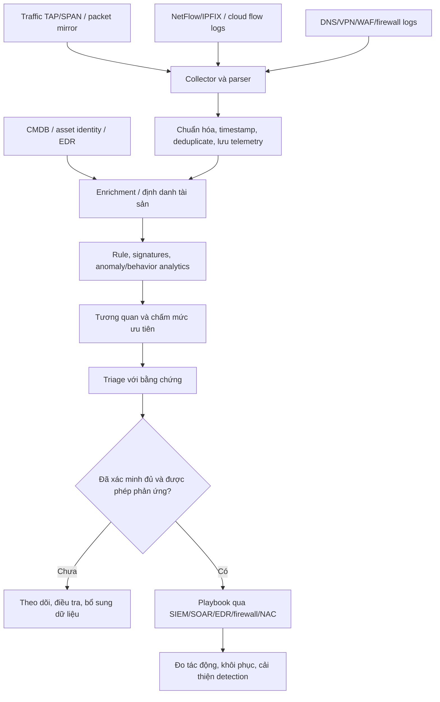

# NDR và behavior analytics: phát hiện và phản ứng với bất thường trên mạng

Một máy chủ ứng dụng trước đây chủ yếu gọi database và dịch vụ giám sát. Trong một đêm, máy bắt đầu kết nối định kỳ tới một địa chỉ chưa từng liên hệ, đồng thời truyền nhiều dữ liệu ra ngoài hơn mức thông thường. Firewall có thể vẫn cho phép TCP `443`, và IDS dựa trên chữ ký có thể chưa nhận diện được mẫu tấn công nào. Làm thế nào để nhận ra **hành vi đã thay đổi**, xác minh có dấu hiệu xâm nhập hay không, rồi phản ứng mà không vô tình làm gián đoạn dịch vụ hợp lệ?

Đó là một trong những bài toán của **Network Detection and Response (NDR)** kết hợp **behavior analytics** (phân tích hành vi). NDR thu thập và tương quan tín hiệu mạng để phát hiện hoạt động đáng ngờ, hỗ trợ điều tra và điều phối phản ứng. Phân tích hành vi xây dựng bối cảnh về những gì bình thường đối với một tài sản, nhóm tài sản hoặc luồng nghiệp vụ, rồi tìm sự khác biệt có ý nghĩa. **Bất thường không tự động đồng nghĩa với tấn công**: bản cập nhật phần mềm, backup, kiểm thử tải hoặc thay đổi định tuyến cũng có thể làm lưu lượng thay đổi mạnh.

Trong phạm vi module **SECURITY_NETWORK_SECURITY**, NDR giúp kết nối các lớp phòng vệ gồm VLAN/phân đoạn, firewall, VPN, IDS/IPS, DNS security, mạng không dây và cloud. Nó trả lời những câu hỏi mà một rule cho phép/chặn đơn lẻ không đủ giải đáp: *workload nào đang liên hệ ai, có thay đổi theo thời gian không, có dấu hiệu di chuyển ngang hoặc rò rỉ dữ liệu không, và nên xác minh hay chặn tại đâu?*

Sau bài học, bạn có thể:

- Phân biệt NDR với IDS, IPS, EDR, SIEM, UEBA và kiểm soát mạng truyền thống.
- Mô tả nguồn telemetry và giới hạn của packet capture, flow record, DNS, TLS metadata, cloud flow logs.
- Xây dựng baseline, nhận diện bất thường bằng luật, thống kê hoặc mô hình học máy mà không đánh đồng điểm bất thường với mức độ nguy hiểm.
- Điều tra các giả thuyết như beaconing, lateral movement, truy vấn DNS khác thường hoặc truyền dữ liệu ra ngoài.
- Thiết kế pipeline thu thập → phân tích → cảnh báo → triage → phản ứng có kiểm soát.
- Đánh giá false positive, độ bao phủ sensor, chất lượng dữ liệu, quyền riêng tư và hiệu quả của quy trình phản ứng.

## 1. NDR là gì và khác IDS/IPS ở điểm nào?

**NDR** là nhóm năng lực phát hiện, điều tra và hỗ trợ phản ứng với các dấu hiệu đe dọa dựa trên **quan sát mạng**. Nó có thể sử dụng packet, flow, metadata giao thức, threat intelligence, thống kê hành vi, mối quan hệ giữa tài sản và tích hợp từ hệ thống bảo mật khác.

Tên gọi NDR **không phải một tiêu chuẩn kỹ thuật quy định mọi sản phẩm phải hoạt động giống nhau**. Một triển khai NDR có thể dùng sensor thụ động, network telemetry do cloud cung cấp, thuật toán phân tích, hoặc phối hợp nhiều công cụ. Phản ứng có thể chỉ là cảnh báo và cung cấp bằng chứng, hoặc gửi yêu cầu cô lập/chặn tới firewall, NAC, EDR hay nền tảng điều phối nếu được tích hợp và cấp quyền.

### 1.1. So sánh các thành phần

| Thành phần | Nguồn quan sát chính | Chức năng tiêu biểu | Điều không nên mặc định |
|---|---|---|---|
| **NIDS** (Network IDS) | Packet/metadata tại điểm cảm biến | Nhận diện dấu hiệu đáng ngờ, thường theo chữ ký và quy tắc giao thức | Một alert không chứng minh xâm nhập thành công. |
| **NIPS** (Network IPS) | Lưu lượng đi **qua** điểm cưỡng chế inline | Có thể chủ động drop/reset theo chính sách | Không chặn được traffic không đi qua IPS. |
| **NDR** | Flow, packet, metadata và hành vi theo thời gian | Phát hiện, tương quan, triage, truy vết và hỗ trợ phản ứng | Không nhất thiết triển khai inline hay tự động chặn. |
| **EDR** | Endpoint: process, file, user, network connection | Điều tra và ứng phó tại thiết bị đầu cuối | Không phải mọi tài sản đều cài được agent (IoT, thiết bị mạng). |
| **SIEM** | Log/sự kiện đa nguồn | Tập trung sự kiện, tìm kiếm, tương quan, quản lý alert | Không tự có khả năng quan sát mạng nếu chưa thu telemetry. |
| **UEBA** | Hành vi user/entity qua log và các nguồn khác | Baseline, phát hiện thay đổi ở tài khoản và thực thể | Không phải chỉ tập trung vào packet. |
| **Firewall/WAF** | Gói tin/flow hoặc request HTTP theo vị trí | Thực thi allow/deny, lọc lưu lượng | Rule allow không chứng minh traffic an toàn. |
| **SOAR** | Cảnh báo, playbook và tích hợp điều khiển | Điều phối triage và thao tác phản ứng | Tự động hóa không thay cho chính sách phê duyệt và kiểm chứng. |

Một hệ thống thực tế có thể dùng cùng telemetry cho NIDS, NDR và SIEM. Sự khác nhau nằm ở **mục tiêu, phương pháp phân tích và quy trình phản ứng**, không phải một ranh giới tuyệt đối giữa sản phẩm.

### 1.2. Tình huống NDR bổ sung IDS dựa trên chữ ký

Giả sử API server vốn chỉ kết nối `db.internal:5432` và `metrics.internal:443`, nay bắt đầu liên hệ định kỳ một endpoint bên ngoài trên TCP `443`. Rule firewall vẫn cho phép; gói TLS có thể được mã hóa nên signature IDS không thấy nội dung ứng dụng. NDR có thể nhận ra **đích mới, tính chu kỳ, lượng byte khác thường, tương quan với thay đổi hệ thống** và tạo một hypothesis để điều tra.

Điều này không có nghĩa một kết nối mới chắc chắn là **command-and-control (C2)**. Trước khi kết luận, cần kiểm tra deployment mới, nhà cung cấp dịch vụ, job backup, process trên host, danh tính workload và các sự kiện khác.

## 2. NDR quan sát mạng từ đâu?

Khả năng phát hiện phụ thuộc vào **điểm đặt sensor** và **chất lượng dữ liệu**. Một cảm biến không thể suy luận chắc chắn về packet mà nó chưa từng quan sát.

```text
                      Internet / SaaS
                            |
                        Edge Firewall
                            |
                   +--------+--------+
                   |                 |
                DMZ / WAF         VPN Gateway
                   |                 |
                   +----- Core ------+
                         /   |   \
                    Users  Apps   Database
                              \
                             Cloud VPC

Nguồn quan sát có thể kết hợp:
  - TAP/SPAN hoặc sensor tại uplink, core, DMZ
  - NetFlow/IPFIX/sFlow và log firewall
  - DNS resolver, proxy/WAF, VPN, DHCP, NAC
  - VPC/cloud flow logs hoặc packet mirroring
  - EDR/identity/CMDB để xác định tài sản và ngữ cảnh
```

### 2.1. Packet capture (PCAP) và phân tích giao thức

**Full packet capture** có thể cung cấp Ethernet/IP/TCP/UDP headers, thứ tự packet, một phần nội dung giao thức không mã hóa và bằng chứng kỹ thuật để xác minh sự kiện. Sensor như Zeek hoặc Suricata có thể trích xuất thông tin giao thức và tạo log hoặc cảnh báo tùy khả năng triển khai.

Điểm mạnh: điều tra chi tiết handshake, DNS không mã hóa, lỗi giao thức và tương quan packet theo thời gian.

Hạn chế:

- Dữ liệu rất lớn ở liên kết tốc độ cao; mất packet khi mirror/capture quá tải.
- TLS 1.3, QUIC, DNS-over-HTTPS và các giao thức mã hóa che phần lớn payload ứng dụng.
- NIC offload, packet truncation, asymmetric routing và vị trí capture có thể làm một flow bị thiếu một chiều.
- PCAP chứa dữ liệu nhạy cảm, cần quyền truy cập và thời hạn lưu trữ rõ ràng.

### 2.2. Flow telemetry: nhìn quan hệ mà không cần toàn bộ payload

**NetFlow, IPFIX, sFlow, VPC Flow Logs** và các dạng flow telemetry cung cấp những trường tùy nguồn như IP/port nguồn–đích, protocol, thời gian bắt đầu/kết thúc, số byte/packet, interface, action hoặc TCP flags.

Ví dụ một bản ghi logic:

```json
{
  "start": "2026-11-28T02:00:00Z",
  "end": "2026-11-28T02:00:35Z",
  "src_ip": "10.20.4.12",
  "src_port": 54820,
  "dst_ip": "198.51.100.27",
  "dst_port": 443,
  "protocol": "TCP",
  "bytes_out": 1250000,
  "bytes_in": 42000,
  "observation_point": "vpc-app-egress"
}
```

Đây là bản ghi **minh họa đã chuẩn hóa**, không phải schema mặc định của NetFlow hay AWS. Tên trường, cách đếm byte, chiều lưu lượng và khoảng tổng hợp khác nhau theo exporter; nhiều nguồn **không có** dữ liệu `bytes_out`/`bytes_in` như ví dụ. Địa chỉ `198.51.100.27` thuộc dải dành cho tài liệu, không phải chỉ báo tấn công.

**Flow thường trả lời “ai liên hệ ai, bao lâu, bao nhiêu?” nhưng không khẳng định được payload chứa gì.** Sampling có thể làm thiếu những kết nối rất ngắn hoặc hiếm; byte counts và thời gian phải được chuẩn hóa trước khi so sánh giữa nguồn.

### 2.3. DNS, TLS và HTTP metadata

| Nguồn | Dấu hiệu có thể hữu ích | Giới hạn |
|---|---|---|
| DNS resolver log | QNAME, QTYPE, RCODE, nguồn truy vấn, thời gian, câu trả lời | DNS-over-HTTPS/TLS không đi qua resolver được quản lý có thể nằm ngoài tầm nhìn. |
| TLS handshake/metadata | Phiên bản TLS, SNI nếu có thể quan sát, ALPN, đặc tính kết nối | ECH có thể che SNI; TLS 1.3 mã hóa nhiều handshake fields; không đọc HTTP plaintext. |
| HTTP proxy/WAF log | Host/path, method, status, rule, request ID theo cấu hình | Chỉ thấy traffic thật sự qua proxy/WAF; body có thể bị giới hạn/masking. |
| VPN/NAC/identity | Người dùng được xác thực, thiết bị, phiên VPN, thay đổi truy cập | NAT, tài khoản chia sẻ và thiết bị không quản lý gây khó gắn danh tính. |
| Cloud/virtual network | Flow ở ENI/NIC/subnet, security decision, một số metadata | Độ trễ, tính tổng hợp, giới hạn theo dịch vụ; không phải packet-level truth. |
| EDR/host telemetry | Process tạo socket, user, DNS cache, parent process | Phải có agent/quyền phù hợp; endpoint có thể offline hoặc bị can thiệp. |

Thông tin như **TLS fingerprint** (ví dụ những đặc trưng được một số hệ thống gọi là JA3/JA4) có thể giúp so sánh client implementations theo telemetry được hỗ trợ, nhưng **không phải danh tính chắc chắn của phần mềm hay bằng chứng mã độc**. Nhiều ứng dụng dùng cùng TLS library, và đặc trưng có thể thay đổi theo version, network path, ECH hoặc QUIC.

### 2.4. NAT, proxy và đường đi bất đối xứng

Trước NAT, một flow có thể có `src_ip=10.20.4.12`; sau NAT, sensor thấy một public IP chia sẻ cho nhiều workload. Sau reverse proxy, nguồn kết nối backend có thể là proxy. Một thiết bị có thể **chỉ nhìn chiều request** vì đường về khác tuyến.

Để xác định ai thực sự liên hệ đích, hãy dùng NAT/conntrack logs, địa chỉ/port dịch, thời gian đồng bộ, bảng asset/IPAM và log proxy. Không nên lấy một public IP NAT rồi quy mọi lưu lượng cho đúng một máy.

## 3. Kiến trúc triển khai NDR: từ cảm biến đến hành động

Một kiến trúc mẫu gồm các chức năng tách biệt để có thể kiểm tra, mở rộng và giới hạn quyền:



### 3.1. Collection và normalization

Pipeline cần ghi rõ:

- **Timestamp:** UTC hoặc định dạng có timezone, sai số đồng hồ, thời điểm event xảy ra và lúc collector nhận event.
- **Định danh sensor:** thiết bị, interface, VLAN/VPC/namespace và vị trí trước/sau NAT.
- **Schema:** IP, port, protocol, flow start/end, bytes/packets, action, nguồn log, mức tin cậy của trường.
- **Xử lý trùng:** cùng một flow có thể xuất hiện ở nhiều điểm quan sát, trong hai chiều hoặc nhiều lần export.
- **Dữ liệu thiếu:** không coi field không có là giá trị `0`; không tự suy source identity từ IP mà không có mapping.
- **Chu kỳ lưu giữ:** metadata dài hạn phục vụ baseline, PCAP chi tiết ngắn hạn theo chính sách bảo mật.

Một hồ sơ tài sản thường gồm role (`workstation`, `API`, `DB`, `DNS resolver`), owner, môi trường (`prod`/`staging`), độ quan trọng, subnet/segment, service được phép, thay đổi gần đây và lịch sử hành vi.

### 3.2. NDR không nhất thiết chạy inline

Sensor trên SPAN/TAP thường **quan sát thụ động**. Nó có thể báo cho firewall/NAC/EDR cô lập thiết bị nhưng không tự chặn packet đang đi qua nếu không sở hữu điểm enforcement.

Một NIPS inline có thể drop packet ở nơi traffic thực sự đi qua. NDR dùng flow logs có độ trễ vài phút có thể phát hiện một chuỗi hành vi sau khi nó đã xảy ra. Do đó, phải thống nhất mục tiêu **phát hiện gần thời gian thực**, thời gian phản ứng chấp nhận được và vị trí có thể chặn, thay vì tuyên bố mọi cảnh báo đều ngăn chặn tức thì.

## 4. Behavior analytics: thế nào là “bình thường”?

**Baseline** là hình dung định lượng hoặc định tính về hành vi điển hình đối với **một thực thể và bối cảnh cụ thể**. Baseline có thể được thiết lập cho host, user, service account, subnet, loại workload, nhóm thiết bị tương đồng hoặc mối quan hệ giữa hai ứng dụng.

Các yếu tố thay đổi baseline:

- Giờ làm việc, cuối tuần, ngày lễ, batch jobs đêm và kỳ backup.
- Chu kỳ deploy, scale-out, autoscaling, firmware update và kiểm thử tải.
- Khác biệt giữa máy lập trình, máy in, camera, DNS resolver và database.
- Sự thay đổi đường Internet/VPN, NAT, proxy, endpoint cloud và tên miền phụ thuộc nhà cung cấp.
- Lượng dữ liệu quan sát và độ ổn định của mapping IP → tài sản.

**Không nên so một database chỉ gọi backend nội bộ với laptop của nhân viên thường xuyên truy cập website công khai.** Cả hai đều dùng TCP `443`, nhưng “đích mới” có ý nghĩa khác nhau.

### 4.1. Một số feature hay dùng

| Nhóm feature | Ví dụ đo lường | Câu hỏi điều tra |
|---|---|---|
| **Volume** | Bytes gửi/nhận theo cửa sổ thời gian, tỷ lệ upload/download | Có tăng truyền dữ liệu ra ngoài không? |
| **Frequency** | Số flow/connection tới một đích trong 5 phút | Có kết nối lặp đều hoặc tăng đột biến? |
| **Destination novelty** | Số domain/IP/ASN mới so với lịch sử hoặc nhóm tương đồng | Tại sao workload liên hệ đích chưa từng xuất hiện? |
| **Protocol/port** | Port/giao thức mới, UDP/443, DNS query rate | Có thay đổi cách ứng dụng giao tiếp? |
| **Fan-out** | Số đích nội bộ khác nhau từ một nguồn | Có dấu hiệu discovery hoặc quét ngang mạng? |
| **Fan-in** | Số nguồn thử một dịch vụ/port | Có tăng kết nối tới dịch vụ nhạy cảm? |
| **Timing** | Độ đều giữa các kết nối, giờ xuất hiện, burstiness | Có nhịp bất thường không? |
| **DNS** | NXDOMAIN rate, nhãn tên dài, entropy, tên mới, query type | Có thay đổi resolver hoặc truy vấn đáng ngờ? |
| **Direction** | Inbound/outbound, qua VPN, giữa VLAN/VPC | Luồng có vượt trust boundary dự kiến? |
| **Context** | Asset criticality, người dùng, process, thay đổi cấu hình | Hành vi có giải thích nghiệp vụ hợp lệ không? |

Các feature này giúp **đặt giả thuyết**. Ví dụ “domain có nhiều nhãn dài” cũng xuất hiện ở CDN hoặc telemetry hợp lệ; “nhiều kết nối” có thể là health check.

### 4.2. Baseline theo thời gian và nhóm tương đồng

Hai chiến lược bổ sung:

1. **Historical baseline:** so hành vi của một asset hôm nay với chính nó trong các khoảng tương đương. Ví dụ so lưu lượng thứ Hai 9:00 với các thứ Hai gần đây, không so với nửa đêm.
2. **Peer-group baseline:** so một asset với các asset cùng role và môi trường. Ví dụ API server production nên có lưu lượng tương tự các API server cùng pool, nhưng khác workstation hoặc backup server.

Khi không đủ lịch sử (**cold start**), nên dùng asset inventory, cấu hình mạng được phê duyệt và tín hiệu từ peer group, giảm mức tự tin của kết luận. Không tự đánh dấu mọi đích mới là malicious.

### 4.3. Minh họa điểm bất thường bằng thống kê bền vững

Giả sử theo dõi `flows_per_10m` của một host trong các khung thời gian cùng loại. Một cách minh họa là dùng trung vị và **Median Absolute Deviation (MAD)** thay vì chỉ dùng trung bình/độ lệch chuẩn:

\[
m=\operatorname{median}(x_i),\qquad
\operatorname{MAD}=\operatorname{median}(|x_i-m|)
\]

Một điểm lệch chuẩn hóa có thể biểu diễn:

\[
z_\mathrm{robust}=\frac{|x-m|}{1.4826\cdot\operatorname{MAD}}
\]

Hệ số `1.4826` giúp MAD gần tương thích với độ lệch chuẩn trong một số điều kiện phân phối chuẩn. Công thức **không dùng trực tiếp khi MAD bằng 0**; khi đó phải có chiến lược cho dữ liệu hằng/ít mẫu (ví dụ ngưỡng tối thiểu, mô hình đếm, so peer group hoặc yêu cầu thêm dữ liệu) thay vì chia cho 0.

Một ngưỡng như `z > 5` chỉ là **ví dụ kỹ thuật**, không phải ngưỡng chuẩn toàn ngành. Nên chọn ngưỡng theo dữ liệu thật, tỷ lệ báo sai, phân phối lệch, mùa vụ, yêu cầu phát hiện và khả năng SOC xử lý. Biến động có ý nghĩa thống kê vẫn chưa khẳng định có tấn công.

### 4.4. Dùng nhiều tín hiệu để tăng độ tin cậy

Giả sử một application server:

- Có **đích Internet chưa từng xuất hiện** trước đó.
- Kết nối tới đích này **lặp theo khoảng thời gian tương đối đều**.
- Bắt đầu gửi nhiều byte hơn bình thường.
- EDR ghi nhận tiến trình không thuộc danh sách deploy đã phê duyệt.

Kết hợp các bằng chứng này thường đáng ưu tiên điều tra hơn một cảnh báo đơn lẻ “new destination”. Tuy nhiên vẫn phải xác minh tiến trình, package, deployment, job vận hành và uy tín thông tin đích.

Không nên cộng điểm một cách máy móc nếu các feature **phụ thuộc nhau**: nhiều connections và nhiều packets có thể cùng phản ánh một sự kiện; tương tự đích mới và ASN mới thường đi cùng nhau.

## 5. Các phương pháp phát hiện trong NDR

Không có thuật toán duy nhất phù hợp mọi mạng. Một hệ thống có thể kết hợp:

### 5.1. Signature và rule-based detection

So khớp hành vi/giao thức với các quy tắc đã biết: dịch vụ trái policy, mẫu quét, thay đổi DNS đáng ngờ hoặc chỉ báo đe dọa đã kiểm chứng. Ưu điểm là **có thể giải thích**; hạn chế là khó nhận diện hoạt động mới chưa có rule.

Ví dụ policy một database production:

```text
Asset role: production-database
Expected inbound: TCP 5432 only from application tier
Observed: new inbound connection attempt from guest VLAN
Action: investigate route/segmentation violation and source identity
```

Không nhất thiết kết luận “máy khách bị xâm nhập”: thiết bị có thể cấu hình sai, đội vận hành thử kết nối hoặc kẻ tấn công đang thăm dò. Context quyết định mức ưu tiên.

### 5.2. Anomaly detection

Dùng ngưỡng động, phân phối, clustering hoặc mô hình theo chuỗi thời gian để tìm hành vi khác baseline. Hệ thống có thể đánh giá số flow, tỷ lệ byte, độ mới của đích hoặc kết nối trái lịch hoạt động. Ưu điểm là phát hiện mẫu ít biết trước; nhược điểm là **false positive**, trôi dữ liệu (*data drift*) và khó giải thích nếu model quá phức tạp.

### 5.3. Relationship/graph analytics

Biểu diễn mạng thành đồ thị: node có thể là host, user, process, subnet, domain hoặc service; edge là kết nối có timestamp, protocol và volume. Khi thấy một workstation liên hệ nhiều host nội bộ chưa từng gặp, phân tích đồ thị có thể giúp tìm **fan-out bất thường**, đường lan truyền hoặc một nhóm tài sản cùng truy cập endpoint mới.

Đồ thị phải được chuẩn hóa theo proxy/NAT và asset identity để không nhầm một NAT gateway thành một siêu-node “giao tiếp với toàn Internet”.

### 5.4. Supervised learning và threat intelligence

Mô hình có nhãn có thể phân loại một số hành vi với điều kiện nhãn đủ chất lượng và môi trường triển khai tương đồng tập huấn luyện. Threat intelligence hỗ trợ ưu tiên đích có liên quan tới hoạt động độc hại, nhưng **IP/domain có thể thay đổi chủ sở hữu hoặc dùng chung hạ tầng**. Không nên tự động cô lập hệ thống chỉ vì trùng một IOC thiếu bối cảnh và độ mới.

**Lựa chọn thực dụng:** khởi đầu với rule dễ hiểu cho những trust boundary quan trọng, bổ sung baseline theo role/time, dùng multi-signal correlation rồi mới tăng mức tự động hóa khi đã đo được false positive.

## 6. Những hành vi NDR thường tìm kiếm

### 6.1. Discovery và quét trong mạng nội bộ

Một host truy cập nhiều đích hoặc nhiều port chưa từng dùng có thể gợi ý discovery, inventory scan hoặc bước chuẩn bị di chuyển ngang. Nhưng đội vận hành, vulnerability scanner hoặc hệ thống monitoring cũng có thể làm điều đó.

**Bằng chứng nên đối chiếu:** danh tính nguồn, asset role, danh sách scanner được phê duyệt, lịch scan, số đích, tỷ lệ lỗi, log firewall và EDR process. Không khẳng định “port scan tấn công” chỉ từ số lượng SYN.

### 6.2. Lateral movement

Kẻ tấn công sau khi kiểm soát một workstation có thể tìm cách dùng tài khoản hoặc dịch vụ quản trị để truy cập host khác. Dấu hiệu có thể gồm kết nối SMB/RDP/SSH/WinRM bất thường tới nhiều máy, thay đổi tài khoản hoặc lần đầu giao tiếp với subnet nhạy cảm.

NDR nhìn thấy **đường mạng và thời gian**; việc đăng nhập thành công, lệnh chạy hoặc quyền bị lạm dụng cần xác minh thêm bằng log identity/AD, host và EDR.

### 6.3. Beaconing và liên lạc định kỳ

Một thiết bị có kết nối outbound lặp đều tới một đích mới có thể gợi ý beaconing. Tuy nhiên **health check, agent cập nhật, dịch vụ đồng bộ và keepalive** cũng có tính chu kỳ.

Xem đồng thời tính đều của khoảng cách thời gian, lượng byte, đích, lifetime của flow, process tạo socket, certificate/TLS metadata và thời điểm cài phần mềm. Mã hóa TLS **không làm mất toàn bộ metadata**, nhưng NDR cũng không tự đọc được nội dung C2 từ traffic mã hóa.

### 6.4. DNS bất thường

Các biểu hiện cần xem xét:

- Nhiều truy vấn tới các subdomain dài hoặc ít gặp.
- Tỷ lệ `NXDOMAIN` tăng đột biến.
- Các truy vấn rất đều theo thời gian hoặc lượng byte bất thường tới resolver.
- Workload đột ngột chuyển sang một resolver khác ngoài chính sách.

Giả thuyết có thể gồm sai cấu hình, một SDK sinh domain động, chương trình thử kết nối hoặc **DNS tunneling/exfiltration**. Không thể kết luận rò rỉ dữ liệu chỉ vì độ dài QNAME hoặc entropy cao. Với DoH/DoT, NDR có thể cần log tại resolver/endpoint để phân tích tên miền.

### 6.5. Truyền dữ liệu ra ngoài bất thường

Một ứng dụng bình thường tải xuống nhiều nhưng đột nhiên **upload** đáng kể tới đích mới cần điều tra. Phân biệt:

- Backup hợp lệ, release artifact, telemetry, đồng bộ dữ liệu.
- Truyền dữ liệu nhạy cảm ra ngoài trái chính sách.
- Một proxy/NAT gộp nhiều nguồn khiến một host bị “đội” byte count.

Flow chỉ cho biết hướng và khối lượng theo khả năng exporter; **không xác nhận loại dữ liệu đã truyền**. Muốn kiểm chứng cần kết hợp app logs, process, DLP hoặc các bằng chứng có thẩm quyền phù hợp.

### 6.6. Bảng tổng hợp use case

| Use case | Tín hiệu mạng | Giải thích hợp lệ có thể có | Nguồn xác minh bổ sung |
|---|---|---|---|
| Beaconing nghi vấn | Kết nối định kỳ tới đích mới | Monitoring, update agent, keepalive | EDR process, change log, asset owner. |
| Discovery nội bộ | Một nguồn thử nhiều host/port | Vulnerability scan được phép | Lịch scan, SOC ticket, account identity. |
| Lateral movement | Dịch vụ quản trị tới host chưa từng liên hệ | Vận hành, hỗ trợ kỹ thuật | Authentication logs, EDR, change ticket. |
| DNS tunneling nghi vấn | QNAME dài, nhiều subdomain lạ, query rate khác thường | CDN, telemetry, SDK định danh | Resolver logs, app behavior, domain context. |
| Exfiltration nghi vấn | Outbound bytes lớn tới đích mới | Backup/sync/export nghiệp vụ | DLP, storage/access logs, owner xác minh. |
| Policy deviation | Guest/IoT tới server nhạy cảm | Lỗi VLAN/route/rule | Firewall/NAC, CMDB, topology. |
| Dịch vụ mới không mong đợi | Workload đột nhiên lắng nghe hoặc kết nối qua port khác | Deploy dịch vụ mới | IaC/change log, host listening sockets. |
| Cloud lateral movement | Flow giữa VPC/pod/ENI mới so với baseline | Autoscaling/service discovery | Cloud inventory, Kubernetes metadata, audit log. |

**Mục tiêu của detection là tạo giả thuyết đáng điều tra**, không phải luôn gán nhãn hành vi là độc hại tại thời điểm đầu tiên xuất hiện.

## 7. Ví dụ hành vi: từ flow bất thường tới một kết luận có bằng chứng

Giả sử máy `10.20.4.12` có role `api-prod` và được phép gọi `db.internal:5432`, `metrics.internal:443`. Trong một khung thời gian, NDR thấy:

```text
02:00 UTC   10.20.4.12:54010 -> 198.51.100.27:443   8 KB out, 1 KB in
02:05 UTC   10.20.4.12:54022 -> 198.51.100.27:443   9 KB out, 1 KB in
02:10 UTC   10.20.4.12:54033 -> 198.51.100.27:443   8 KB out, 1 KB in
02:15 UTC   10.20.4.12:54047 -> 198.51.100.27:443  10 KB out, 1 KB in

Baseline: api-prod hiếm khi gọi Internet trực tiếp trong khoảng giờ này.
Thay đổi gần đây: chưa tìm thấy trong CMDB ở thời điểm triage ban đầu.
```

Các địa chỉ và giá trị trên **hoàn toàn giả lập**, dùng dải dành cho tài liệu, không đại diện IOC thực.

### 7.1. Quan sát được

- Một asset mang role API đã gửi nhiều flow ra đích Internet mới.
- Các flow xuất hiện vào khoảng cách thời gian gần đều nhau trong ví dụ.
- Có dữ liệu gửi/nhận theo record, nhưng không biết payload chứa gì.

### 7.2. Điều chưa được chứng minh

- Chưa biết đây là C2, telemetry được phê duyệt hay tác vụ hợp lệ.
- Chưa xác nhận quy trình nào trên API tạo socket.
- Chưa chắc flow record quan sát trước hay sau NAT, hoặc liệu có ghi thiếu flow.
- Chưa biết dữ liệu được truyền có nhạy cảm hay không.

### 7.3. Quy trình điều tra

1. **Xác nhận tài sản:** tra mapping `10.20.4.12` tại đúng thời điểm, owner, environment, container/pod/VM và các kết nối qua proxy/NAT.
2. **Kiểm tra thay đổi:** deploy mới, secret rotation, backup, agent monitoring, scheduled jobs và thay đổi chính sách egress.
3. **Đối chiếu endpoint:** EDR/host telemetry cho biết process, user, parent process hoặc chương trình thực hiện kết nối khi có dữ liệu.
4. **Kiểm tra destination context:** hostname và DNS ở thời điểm kết nối, certificate context có thể quan sát, chủ sở hữu dịch vụ và threat intelligence với độ mới phù hợp.
5. **Tìm dấu hiệu liên quan:** các host khác cùng gọi đích, tăng outbound bytes, alert identity bất thường hoặc truy cập tài nguyên nhạy cảm ngay trước đó.
6. **Xác minh ứng dụng:** owner xác nhận job hợp lệ hay không; SOC đánh giá chuỗi bằng chứng và mức độ ảnh hưởng.
7. **Quyết định phản ứng:** nếu có bằng chứng hợp lý về xâm nhập, xử lý theo playbook được phê duyệt. Nếu là hoạt động hợp lệ, cập nhật inventory/baseline và cân nhắc rule egress theo nhu cầu.

Kết luận mẫu đúng mức:

> “NDR phát hiện các kết nối TCP/443 định kỳ từ `api-prod` tới một đích Internet mới trong khoảng `02:00–02:15 UTC`. Hiện chưa có bằng chứng xác nhận tấn công. Đang đối chiếu deployment, EDR process và DNS/proxy log để xác định mục đích trước khi quyết định cô lập.”

## 8. Tương quan hành vi theo nhiều giai đoạn

Một cảnh báo riêng lẻ có thể có độ tin cậy thấp. Khi kết hợp nhiều nguồn theo **trục thời gian**, SOC có thể dựng chuỗi giả thuyết:


Đây là **chuỗi ví dụ để điều tra**, không khẳng định các hành động luôn xảy ra theo thứ tự ấy. Mỗi mắt xích cần có bằng chứng, đặc biệt khi IP NAT, host được dùng chung hoặc đồng hồ của các log lệch nhau.

### 8.1. Chuyển từ signal sang case có ngữ cảnh

Một case triage nên lưu:

| Trường | Ví dụ |
|---|---|
| Case ID | `ndr-case-2026-001` |
| Asset | `api-prod-02`, role `api`, owner `team-app` |
| Thời gian | `2026-11-28T02:00:00Z` đến `02:15:00Z` |
| Dấu hiệu | 4 outbound flows tới đích mới, khoảng cách ~5 phút |
| Nguồn dữ liệu | Flow exporter A, DNS resolver log, EDR telemetry |
| Mức tin cậy | Trung bình; chưa gắn được process và chưa loại trừ deployment |
| Giả thuyết | Agent hợp lệ / thay đổi cấu hình / liên lạc bất thường cần điều tra |
| Hành động đang làm | Xác nhận owner, so change history, kiểm tra endpoint |
| Quyết định phản ứng | Chờ xác minh; chưa có phê duyệt cách ly |

**Độ ưu tiên** còn phụ thuộc giá trị tài sản, độ nhạy cảm dữ liệu, khả năng ảnh hưởng hệ thống và mức độ liên quan của các tín hiệu khác — không chỉ dựa vào điểm bất thường.

## 9. Minh họa luật phát hiện có thể giải thích

Ví dụ sau là **pseudocode**, không phụ thuộc syntax của một sản phẩm. Mục đích là chỉ ra các điều kiện kiểm tra và dữ liệu cần có, không đưa ra ngưỡng chuẩn áp dụng cho mọi mạng.

```text
Mỗi 10 phút:
    với từng asset đã xác định danh tính:
        flows = các flow outbound đã chuẩn hóa
        compare_to = baseline theo role + khung giờ + ngày trong tuần

        new_destination_count = số đích chưa thấy trong lịch sử phù hợp
        outbound_bytes = tổng byte gửi theo chiều đã xác minh
        periodicity = độ đều của các kết nối lặp tới từng đích

        if sensor_coverage thấp:
            đánh dấu bằng chứng thiếu, không nâng mức kết luận

        if đích mới AND lịch sử ít khi có outbound AND periodicity đáng chú ý:
            tạo detection "unexpected periodic egress"
            bổ sung asset role, deployment changes và DNS/EDR context

        if đích đã được chủ sở hữu xác nhận là hợp lệ:
            ghi nhận xác minh, xem xét tune baseline/rule có phạm vi hẹp
```

### 9.1. Ví dụ SQL phân tích flow theo cửa sổ

Giả sử một bảng **đã được chuẩn hóa** có các trường `event_time`, `asset_id`, `dst_ip`, `dst_port`, `protocol`, `bytes_out`. Query dạng ANSI SQL minh họa cho một cửa sổ đã chọn:

```sql
SELECT
    asset_id,
    dst_ip,
    dst_port,
    protocol,
    COUNT(*) AS flow_count,
    SUM(bytes_out) AS total_bytes_out,
    MIN(event_time) AS first_seen,
    MAX(event_time) AS last_seen
FROM normalized_flows
WHERE event_time >= TIMESTAMP '2026-11-28 02:00:00'
  AND event_time <  TIMESTAMP '2026-11-28 03:00:00'
GROUP BY asset_id, dst_ip, dst_port, protocol
ORDER BY flow_count DESC;
```

Đây chỉ là **bước tổng hợp dữ liệu** để người phân tích quan sát những đích thường gặp trong khung thời gian. Nó **chưa tính baseline, chưa kiểm tra đích mới và chưa phát hiện C2**. Cần chú ý timezone của dữ liệu, dấu hiệu sampling, khả năng trùng flow hai chiều, khác biệt vendor exporter, và IP có thể đổi qua NAT/động IP.

### 9.2. Khi nào nên dùng truy vấn thay vì mô hình học máy?

Nếu câu hỏi là “có host nào trong VLAN khách gửi TCP tới database ngoài policy?”, một rule dựa trên segment, source/destination và port thường rõ ràng hơn mô hình học máy. Nếu câu hỏi là “máy nào đang thay đổi hành vi so với nhóm cùng vai trò trong nhiều tuần?”, baseline thống kê có thể hữu ích. NDR tốt **kết hợp cả hai**, với mức giải thích được và khả năng kiểm chứng bằng log/packet.

## 10. Phân tích traffic mã hóa và những gì NDR không nhìn thấy

Ngày càng nhiều luồng dùng TLS 1.3, HTTP/2 qua TLS, HTTP/3 qua QUIC, DNS-over-HTTPS/TLS và mã hóa ở tầng ứng dụng. NDR vẫn có thể quan sát một số thông tin của đường mạng, nhưng không nên suy luận trực tiếp payload từ kích thước gói hay một fingerprint.

| Câu hỏi | Có thể trả lời bằng metadata? | Khi nào cần dữ liệu bổ sung? |
|---|---|---|
| Máy A có kết nối tới IP B không? | Thường có tại điểm sensor phù hợp | NAT/proxy hoặc đường bất đối xứng có thể làm sai mapping. |
| Kết nối dùng TCP/443 hay UDP/443? | Có thể xem transport/protocol | Không thể mặc định mọi traffic TCP/443 là HTTPS hợp lệ. |
| Một host gửi bao nhiêu byte? | Có thể ước lượng từ flow hoặc capture | Flow sampling, offload, exporter semantics và nhiều điểm đo ảnh hưởng số liệu. |
| HTTP request truy cập path nào? | Không nếu chỉ thấy TLS ciphertext | Cần log WAF/proxy/endpoint tại nơi giải mã, khi được phép. |
| DNS QNAME là gì? | Có với DNS không mã hóa đi qua sensor | Với DoH/DoT cần resolver/endpoint logs nếu được thu. |
| Payload có dữ liệu bí mật không? | Không thể xác minh chỉ từ volume/timing | Cần app/storage/DLP evidence và quyền điều tra thích hợp. |
| Host bị nhiễm mã độc chưa? | Không thể chứng minh chỉ từ anomaly | Cần endpoint, forensic evidence, identity và ngữ cảnh hệ thống. |

**Encrypted traffic analytics** có thể dùng chiều dài packet, timing, hướng bytes, protocol negotiation, đích mới, hành vi lặp lại. Kết luận phải phản ánh giới hạn: “hành vi tương đồng với một nhóm mẫu” là khác “đã giải mã được nội dung tấn công”.

Trong môi trường TLS proxy/WAF, đôi khi log ứng dụng có thể cung cấp URL/request ID, nhưng NDR thụ động ở ngoài TLS termination **không tự có quyền đọc dữ liệu đó**. Quyền truy cập log và việc giải mã cần tuân thủ chính sách bảo vệ dữ liệu.

## 11. NDR trong mạng phân đoạn, VPN, Wi-Fi và cloud

### 11.1. VLAN và east–west visibility

Một sensor chỉ đặt ở Internet edge có thể bỏ sót traffic **giữa hai host cùng VLAN**, vì lưu lượng không đi qua router/firewall biên. Để phát hiện lateral movement, cần bố trí sensor hoặc telemetry tại uplink, switch core, vùng server, host hoặc mạng ảo theo đường thực tế.

**VLAN không tự thực thi mọi chính sách xuyên vùng**. Nếu inter-VLAN routing diễn ra trên L3 switch, NDR/IPS đặt ở firewall Internet có thể không thấy traffic đó. Cần bản đồ datapath và điểm mirror/telemetry phù hợp thay vì chỉ dựa vào sơ đồ subnet.

### 11.2. VPN và truy cập từ xa

Trên đường VPN, trước khi giải mã ta có thể chỉ thấy **outer tunnel** giữa client và gateway; bên trong tunnel chứa inner IP/flows. NDR cần kết hợp log gateway, danh tính VPN và telemetry phía sau điểm giải mã nếu muốn nhận diện dịch vụ nội bộ mà người dùng đã truy cập.

Một NAT gateway có thể khiến nhiều user cùng xuất hiện dưới một IP nguồn; cần mapping theo thời gian để tránh nhầm danh tính.

### 11.3. Wi-Fi và IoT

Thiết bị IoT/OT hoặc camera thường không cài được EDR, vì vậy quan sát mạng qua NDR có giá trị đặc biệt. Baseline cần theo **loại thiết bị và lịch hoạt động**: camera truyền stream liên tục khác máy in thỉnh thoảng kết nối; cảm biến gửi telemetry định kỳ có thể giống mẫu beaconing nếu không có ngữ cảnh.

Chất lượng sóng Wi-Fi, roam, loss ở lớp 2 có thể làm thay đổi frequency/connection counts; đôi khi cần log AP/NAC để phân biệt lỗi mạng với hoạt động nguy hiểm.

### 11.4. Cloud, container và service mesh

Trong VPC/VNet hay Kubernetes, sensor vật lý có thể không thấy toàn bộ traffic giữa ENI, node, Pod hoặc overlay. Các lựa chọn gồm cloud flow logs, traffic mirroring (nếu hỗ trợ), eBPF/host telemetry, proxy/service mesh logs và audit của orchestrator.

Cần đồng nhất **identity của workload** theo thời điểm: IP pod có thể tái sử dụng, instance scale-out làm đích mới tăng, service mesh tạo kết nối TLS khác. Một flow từ Envoy/sidecar có thể đại diện cho ứng dụng phía sau, nhưng không nên mặc định source IP của proxy chính là danh tính tác nhân.

## 12. Từ cảnh báo tới phản ứng: playbook có kiểm soát

**Response** là phần phân biệt NDR với một hệ thống chỉ hiển thị dashboard. Tuy nhiên phản ứng cần phụ thuộc vào mức độ chắc chắn, mức quan trọng của tài sản và tác động có thể gây ra.

### 12.1. Các mức phản ứng

| Mức | Ví dụ | Khi nào phù hợp? |
|---|---|---|
| **Quan sát** | Tạo alert, gắn tag case, lưu flow/PCAP trong phạm vi cho phép | Tín hiệu còn yếu hoặc đang thu baseline. |
| **Triage** | Kéo DNS/EDR/identity logs, đối chiếu change ticket, xác minh owner | Cần loại trừ hoạt động hợp lệ trước khi kết luận. |
| **Tăng giám sát** | Tạm tăng capture trong cửa sổ ngắn, log thêm egress theo quyền | Có dấu hiệu cần xác minh nhưng chưa đủ để chặn. |
| **Hạn chế có chọn lọc** | Chặn đích cụ thể qua firewall/proxy, tắt session nghi vấn | Có bằng chứng và policy cho phép; tránh chặn cả subnet rộng. |
| **Cô lập endpoint** | EDR/NAC đưa thiết bị vào vùng quarantine, hạn chế mạng | Sự cố nguy cơ cao, đã xét tới tác động nghiệp vụ và cách phục hồi. |
| **Ứng phó sự cố** | Kích hoạt IR, bảo toàn bằng chứng, xác định phạm vi ảnh hưởng | Có dấu hiệu xâm nhập đáng tin cậy hoặc sự cố cần escalations. |

Một NDR thụ động chỉ có thể **đề xuất/điều phối** chặn nếu được nối với hệ thống enforcement. Không được tự mô tả việc đã ngăn một kết nối nếu sensor chỉ thu flow và phát cảnh báo sau đó.

### 12.2. Playbook mẫu cho “unexpected periodic egress”

1. Xác nhận cảnh báo không do sensor trùng dữ liệu hoặc mapping IP sai.
2. Kiểm tra asset role, độ nhạy cảm, thời gian và baseline tương ứng.
3. Liên kết DNS, proxy/WAF, EDR process, tài khoản và lịch thay đổi.
4. Kiểm tra destination context và những tài sản khác cùng hành vi.
5. Chấm mức độ ưu tiên; đánh giá rủi ro nếu kết nối tiếp tục diễn ra.
6. Với bằng chứng đủ mạnh, yêu cầu phê duyệt hoặc áp chính sách ứng phó đã ủy quyền để chặn đích/cô lập asset.
7. Giữ bằng chứng cần thiết, xác minh hành động hiệu lực và giám sát các luồng thay thế.
8. Kiểm tra hoạt động dịch vụ sau phản ứng; có kế hoạch rollback và khôi phục.
9. Đóng case với kết luận được hỗ trợ, cải thiện rule/baseline và cập nhật playbook.

### 12.3. Giảm rủi ro do phản ứng tự động

Nếu tự động chặn mọi đích mới, một lần deploy hoặc backup có thể gây **outage diện rộng**. Nên:

- Thử playbook ở chế độ alert-only/simulation trước khi bật enforcement.
- Giới hạn phạm vi quyền API: chỉ được sửa rule cụ thể, đích cụ thể, thời gian cụ thể.
- Dùng TTL cho block tạm và lưu lại người/automation tạo thay đổi.
- Yêu cầu phê duyệt con người với tài sản trọng yếu hoặc hành động không dễ rollback.
- Kiểm tra các thao tác phản ứng có thành công thật không; cảnh báo “action sent” chưa đồng nghĩa firewall đã áp rule.
- Ghi log và audit đầy đủ, đo tác động lên luồng hợp lệ.

## 13. Đo độ hiệu quả của NDR và behavior analytics

Một hệ thống tạo nhiều alert không chắc là hệ thống phát hiện tốt. Cần đo **chất lượng cảnh báo, độ bao phủ và khả năng phản ứng**.

### 13.1. Precision, recall và false positives

Đối với những sự kiện đã có ground truth phù hợp:

- **True Positive (TP):** cảnh báo phát hiện đúng hoạt động cần phát hiện.
- **False Positive (FP):** cảnh báo nhưng không có hoạt động mục tiêu theo đánh giá.
- **False Negative (FN):** hoạt động mục tiêu xảy ra nhưng không được phát hiện.
- **True Negative (TN):** trường hợp bình thường được phân loại bình thường theo tập đánh giá.

Hai chỉ số thường dùng:

\[
\mathrm{Precision}=\frac{TP}{TP+FP}
\]

\[
\mathrm{Recall}=\frac{TP}{TP+FN}
\]

Với dữ liệu an ninh mất cân bằng lớn, chỉ nhìn **accuracy tổng thể** dễ gây hiểu nhầm. Ground truth cũng thường không đầy đủ: không phải mọi alert đã đóng là “sạch”, và không phải mọi tấn công bị bỏ sót đều có nhãn. Cần báo cáo phương pháp chọn mẫu, đánh nhãn và độ tin cậy của kết quả.

### 13.2. Chỉ số vận hành

| Chỉ số | Ý nghĩa | Cạm bẫy |
|---|---|---|
| **Alert volume** theo ngày/asset | Tải xử lý SOC và thay đổi policy/model | Nhiều alert không đồng nghĩa phát hiện tốt. |
| **False positive rate** theo use case | Mức nhiễu khi vận hành | Cần mẫu xác minh đủ đại diện. |
| **Time to detect / triage / respond** | Độ trễ từ hành vi tới hành động | Phải rõ mốc thời gian; log cloud có độ trễ riêng. |
| **Sensor coverage** | % segment/workload quan trọng có telemetry phù hợp | “Có sensor trong VPC” không bảo đảm mọi east–west path. |
| **Packet/flow drop, ingest lag** | Chất lượng pipeline | Dữ liệu thiếu làm báo cáo sai. |
| **Use-case coverage** | Những hành vi rủi ro có quy tắc và dữ liệu quan sát | Không nên chỉ đếm số rule được cấu hình. |
| **Time to validate** | Công sức triage mỗi alert | Tăng quá mức có thể gây alert fatigue. |
| **Playbook success/rollback** | Hành động phản ứng hiệu lực và an toàn | “Gọi API thành công” không chắc đã cô lập đúng máy. |
| **Model drift** | Baseline thay đổi theo môi trường | Relearn liên tục có thể hấp thụ hành vi xấu thành “bình thường”. |

### 13.3. Kiểm thử detection có kiểm soát

Tập kiểm thử nên bao gồm:

1. Traffic bình thường của từng nhóm tài sản và thời điểm khác nhau.
2. Những thay đổi hợp lệ nhưng bất thường: backup lớn, deploy mới, cập nhật agent, vulnerability scan đã phê duyệt.
3. Kịch bản mô phỏng an toàn trong lab: đích mới, thay đổi tần suất flow, nhiều kết nối nội bộ từ máy thử nghiệm.
4. Dữ liệu bị thiếu/mất chiều hoặc lệch thời gian để kiểm tra độ tin cậy của kết quả.
5. Việc phát hiện và phản ứng đúng policy, không ảnh hưởng các workload bên ngoài phạm vi thử nghiệm.

**Không cần và không nên phát tán mã độc hay tạo traffic tấn công vào mạng không được phép** để kiểm thử NDR. Sử dụng dữ liệu tổng hợp, lab cô lập hoặc kịch bản được đội bảo mật phê duyệt.

## 14. Sai lầm phổ biến và cách khắc phục

| Hiểu lầm/sai lầm | Vì sao sai? | Cách làm đúng |
|---|---|---|
| “Bất thường là xâm nhập.” | Backup, patch, deploy, monitoring đều làm traffic khác baseline. | Gắn bối cảnh asset, change log và bằng chứng từ nhiều nguồn. |
| “Không có signature IDS thì không có sự cố.” | Hành vi mới hoặc mã hóa có thể không match chữ ký. | Bổ sung behavior analytics và threat hunting. |
| “NDR nhìn được mọi HTTP request trong TLS.” | TLS/QUIC mã hóa payload; sensor chỉ thấy phần metadata phù hợp. | Kết hợp log tại proxy/WAF/endpoint được quyền. |
| “Một sensor ở Internet edge đủ cho cả lateral movement.” | East–west traffic có thể không đi qua edge. | Đo đường đi thực, triển khai telemetry tại segment quan trọng. |
| “Cùng IP nghĩa là cùng máy/người dùng.” | NAT, DHCP, VPN, proxy, container IP reuse làm mapping thay đổi. | Dùng identity/lease/NAT logs gắn thời gian. |
| “Điểm anomaly cao thì nên block ngay.” | Model có false positive và sai lệch bối cảnh. | Multi-signal triage, hạn chế phạm vi, phê duyệt/rollback. |
| “Cảnh báo trùng IOC là bằng chứng chắc chắn.” | IOC có thể cũ hoặc dịch vụ dùng chung. | Kiểm tra thời gian, provenance và ngữ cảnh. |
| “Nhiều alert nghĩa là SOC hiệu quả.” | Alert fatigue có thể che incident quan trọng. | Đo precision, thời gian triage và chất lượng phản ứng. |
| “Flow logs giống packet capture.” | Flow là dữ liệu tổng hợp/lấy mẫu theo nguồn. | Biết schema và giới hạn; dùng PCAP khi cần packet-level evidence. |
| “Baseline chỉ cần tạo một lần.” | Mạng thay đổi theo role, cloud autoscaling, mùa vụ. | Quản lý version, drift, đánh giá lại ngưỡng và ngoại lệ. |
| “NDR thay firewall/EDR/zero trust.” | Mỗi thành phần quan sát và enforcement ở điểm khác nhau. | Kết hợp nhiều lớp phòng vệ và identity-aware policy. |
| “Block IP là chấm dứt sự cố.” | Có thể có nhiều đích, kết nối khác hoặc host đã bị chiếm quyền. | Điều tra phạm vi, kiểm tra endpoint/identity và IR. |

## 15. Bài tập thực hành có đáp án định hướng

### Bài 1: phân biệt baseline thật và cảnh báo sai

Một nhóm `backup-server` truyền dữ liệu lớn mỗi đêm lúc 02:00; hệ thống NDR đặt ngưỡng chung “outbound > 1 GB/giờ” và báo liên tục. Nên làm gì?

**Gợi ý:** Xây baseline theo **role**, lịch backup và đích được phê duyệt; kiểm tra nguồn thật sự của traffic và loại dữ liệu được phép. Không nên tắt mọi alert outbound từ backup server, vì đích lạ hoặc truyền sai thời điểm vẫn có thể đáng ngờ.

### Bài 2: lateral movement hay kiểm thử bảo mật?

Workstation `10.10.10.25` kết nối TCP `445` tới nhiều server trong 5 phút. Cùng thời điểm có ticket scan nội bộ đã được phê duyệt. Có thể đóng alert ngay không?

**Gợi ý:** Đối chiếu nguồn cụ thể, chủ sở hữu, lịch scan, scope, tool/process và thời gian; không lấy một ticket scan chung để cho phép mọi hành vi. Nếu khớp đầy đủ, có thể gắn nhãn hoạt động hợp lệ và tune detection theo đúng nguồn/cửa sổ thay vì loại bỏ use case.

### Bài 3: cloud flow log báo nhiều kết nối từ một public IP

Sensor ở Internet gateway thấy một public IP kết nối tới nhiều domain. Điều đó có đủ để kết luận một host đã bị nhiễm mã độc?

**Gợi ý:** Không. Có thể là NAT gateway dùng chung. Cần mapping NAT/conntrack, cloud inventory, ENI/pod logs và thời gian để xác định workload nguồn.

### Bài 4: nghi DNS tunneling nhưng DNS đã mã hóa

NDR thấy workstation gửi nhiều kết nối tới một resolver DoH, nhưng không có QNAME trong PCAP. Cách điều tra đúng?

**Gợi ý:** Không thể tự suy domain từ ciphertext. Kiểm tra chính sách resolver, endpoint DNS logs, EDR/browser configuration, mạng egress và mục đích dùng DoH theo quyền; đo traffic volume/timing nhưng chỉ kết luận khi có bằng chứng bổ sung.

### Bài 5: có nên tự động cách ly một database production?

NDR báo database gửi dữ liệu đến một đích mới, điểm anomaly cao. Cô lập ngay có thể gây mất dịch vụ lớn. Chọn bước tiếp theo?

**Gợi ý:** Ưu tiên xác minh mapping, owner, job backup, tiến trình và dữ liệu liên quan; tăng giám sát, kiểm tra nguy cơ hiện tại, escalations theo playbook. Nếu có dấu hiệu sự cố nghiêm trọng cần can thiệp khẩn cấp, thực hiện theo quyền và quy trình được ủy quyền với kế hoạch phục hồi. Không để thuật toán một mình quyết định hành động khó đảo ngược.

### Bài 6: đo lường hiệu quả

Một hệ thống triển khai thêm rule mới làm số alert tăng gấp nhiều lần nhưng SOC vẫn xác nhận rất ít vụ việc. Những chỉ số nào cần nhìn?

**Gợi ý:** Precision/false positives theo use case, tỷ lệ xác minh, time-to-triage, độ bao phủ sensor, ingest loss, mức độ nghiêm trọng và số trường hợp bị bỏ sót qua kiểm thử có kiểm soát; không dùng alert volume làm thước đo duy nhất.

## 16. Checklist triển khai NDR và behavior analytics an toàn

- [ ] Đã xác định tài sản quan trọng, ranh giới tin cậy, hướng east–west và north–south cần quan sát.
- [ ] Bản đồ sensor/flow log đúng với mạng thực tế: VLAN, firewall, VPN, WAF, VPC, Kubernetes và đường proxy.
- [ ] Telemetry có timestamp, source, schema, điểm capture, khả năng deduplicate và theo dõi dữ liệu bị mất.
- [ ] Mapping IP → tài sản/owner/user/process được cập nhật theo thời gian; NAT/DHCP/proxy/cloud autoscaling đã được xét.
- [ ] Baseline theo role, thời điểm, lịch vận hành và peer group, có xử lý cold start và model drift.
- [ ] Detection dùng nhiều tín hiệu, có giải thích rõ điều quan sát được và giả thuyết chưa xác minh.
- [ ] Có use case cho scanning, lateral movement, beaconing, DNS bất thường, egress lệch và vi phạm phân đoạn.
- [ ] Những giới hạn của traffic mã hóa, TLS 1.3, QUIC, DoH/DoT và dữ liệu lấy mẫu được ghi rõ.
- [ ] NDR liên kết được với SIEM, EDR, identity, DNS, WAF/proxy và firewall logs theo quyền cần thiết.
- [ ] Cảnh báo có severity/context, case ID, evidence, owner, quyết định triage và thời hạn xử lý.
- [ ] Phản ứng tự động được thử nghiệm, có giới hạn quyền, approval phù hợp, TTL và cơ chế rollback.
- [ ] Đã đo precision, recall theo mẫu kiểm thử phù hợp, false positives, độ trễ phát hiện và độ bao phủ.
- [ ] Dữ liệu nhạy cảm được tối thiểu hóa, phân quyền, mã hóa khi lưu/chuyển và có chính sách retention.
- [ ] Có kịch bản giả lập an toàn, kiểm tra cả hoạt động hợp lệ lẫn tình huống phải phát hiện và theo dõi sau tuning.
- [ ] Không coi NDR thay thế segmentation, firewall, TLS/mTLS, xác thực, bảo vệ endpoint hay giám sát ứng dụng.

**Ghi nhớ:** NDR không đơn thuần hỏi “packet này có khớp chữ ký nguy hiểm không?”, mà hỏi **“hành vi giao tiếp của thực thể này có khác kỳ vọng, có liên quan các dấu hiệu khác, và chúng ta có đủ bằng chứng để hành động không?”**. Để đạt giá trị thực tế, cần kết hợp telemetry đúng vị trí, baseline có ngữ cảnh, xác minh trên nhiều nguồn, phản ứng phù hợp mức rủi ro và đo lường liên tục — không biến mọi bất thường thành một kết luận xâm nhập.
