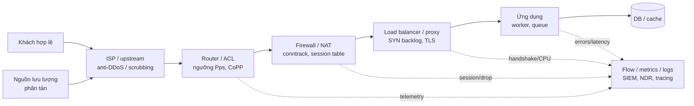
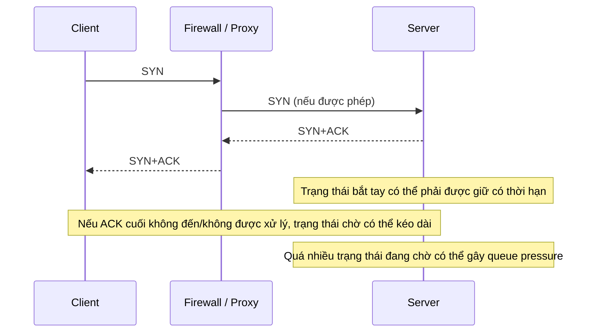
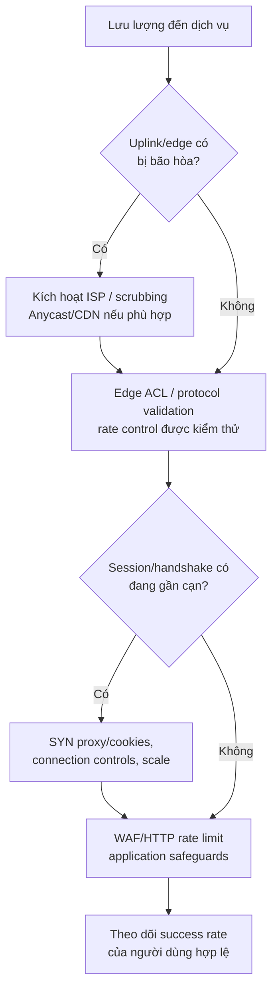

# Protocol exhaustion trong phòng chống DDoS

**Protocol exhaustion** (*cạn kiệt tài nguyên xử lý giao thức*) là một nhóm cơ chế tấn công từ chối dịch vụ mà đối tượng gây hại khiến máy chủ, thiết bị mạng hoặc thành phần bảo vệ phải tiêu thụ quá nhiều **trạng thái phiên, bộ nhớ, CPU, bộ đệm, bảng theo dõi kết nối hoặc năng lực xử lý handshake**. Kết quả là những kết nối hợp lệ không được thiết lập, bị chậm, bị loại bỏ hoặc mất phiên, ngay cả khi tổng lưu lượng tính bằng bit/giây chưa đạt mức bão hòa đường truyền.

Đây là nội dung trọng tâm trong chương **DDoS** của mô-đun **SECURITY_NETWORK_SECURITY**. Hiểu protocol exhaustion giúp thiết kế phòng vệ nhiều lớp bằng phân đoạn mạng, firewall, VPN, IDS/IPS, cân bằng tải, lọc lưu lượng ở upstream, giám sát flow và kiến trúc mạng an toàn. Bài học giới thiệu cơ chế, dấu hiệu quan sát và phương pháp giảm thiểu có kiểm soát; các tình huống và số liệu đều mang tính **minh họa phòng thủ**, không phải hướng dẫn phát động lưu lượng gây gián đoạn.

## 1. Mục tiêu học tập và khái niệm cốt lõi

Sau bài học, người học cần có thể:

1. Phân biệt **volumetric DDoS**, **protocol/resource exhaustion** và **application-layer DDoS**; nhận ra những trường hợp chồng lấn.
2. Giải thích tại sao TCP handshake, connection tracking, NAT, IP fragment reassembly hoặc TLS/QUIC handshake có thể trở thành điểm tiêu tốn tài nguyên.
3. Liên hệ **lưu lượng vào, số trạng thái tồn tại đồng thời, thời gian timeout và giới hạn xử lý** để tìm điểm nghẽn.
4. Đọc các dấu hiệu từ host, firewall, load balancer, reverse proxy, cloud telemetry và upstream provider.
5. Chọn biện pháp phòng vệ theo **điểm bị cạn kiệt** thay vì chỉ dựa vào tốc độ băng thông.
6. Thiết kế kiểm thử an toàn, runbook ứng phó và tiêu chí xác nhận rằng dịch vụ vẫn phục vụ người dùng thật.

### 1.1. Sự khác nhau giữa một gói tin và trạng thái mà nó tạo ra

Một gói mạng có thể rất nhỏ nhưng khiến thiết bị phải:

- Tạo một entry trong bảng theo dõi kết nối hoặc NAT.
- Giữ một phần bộ nhớ chờ hoàn tất handshake.
- Cấp phát bộ đệm cho phân mảnh hoặc tái lắp ráp.
- Phân tích giao thức, kiểm tra rule IDS/IPS hoặc cập nhật session.
- Thực hiện phép toán mật mã trong quá trình thiết lập kênh bảo mật.
- Ghi log, tạo sự kiện cảnh báo hoặc đồng bộ trạng thái sang thiết bị HA.

Đối tượng tấn công tìm cách khiến **chi phí xử lý hoặc lưu giữ trạng thái phía phòng thủ lớn hơn chi phí tạo yêu cầu**. Tuy nhiên, không phải mọi kiểu protocol exhaustion đều dựa trên sự bất đối xứng chi phí giống nhau; có trường hợp chủ yếu làm đầy bảng trạng thái do số lượng phiên đồng thời quá lớn.

### 1.2. So sánh ba nhóm DDoS

| Nhóm | Tài nguyên chịu áp lực | Ví dụ khái niệm | Tín hiệu điển hình |
| --- | --- | --- | --- |
| **Volumetric** | Băng thông đường truyền, packet-per-second ở ranh giới | Lưu lượng phản xạ/khuếch đại hoặc lượng packet ồ ạt | Bps/Pps tăng, uplink gần bão hòa, packet loss diện rộng |
| **Protocol exhaustion** | SYN backlog, connection/NAT table, CPU xử lý gói/handshake, fragment buffer | Lượng yêu cầu thiết lập hoặc giữ trạng thái vượt năng lực | Bảng trạng thái gần đầy, queue overflow, handshake thất bại, session drop |
| **Application layer** | Thread, worker, CPU ứng dụng, pool DB, API quota, tài nguyên nghiệp vụ | Request HTTP hợp lệ về cú pháp nhưng quá tốn chi phí xử lý | Rps tăng, latency p95/p99 và hàng đợi ứng dụng tăng, 5xx/429 |

**Ranh giới phân loại không tuyệt đối.** Một luồng TLS handshake có thể làm quá tải CPU ở proxy (liên quan giao thức) đồng thời gây tăng tài nguyên ở ứng dụng. Một đợt traffic cực lớn cũng có thể bão hòa cả đường truyền lẫn connection table. Việc phân nhóm nhằm **chọn phép đo và lớp giảm thiểu**, không nhằm ép mọi sự cố vào một nhãn duy nhất.

## 2. Bức tranh đường đi: nơi tài nguyên có thể cạn kiệt

Một dịch vụ Internet điển hình có thể qua nhiều lớp:



Các thành phần không nhất thiết xuất hiện theo thứ tự này trong mọi hệ thống. Có thể dùng CDN/WAF, cloud load balancer, direct server return, private link hoặc firewall dạng distributed. **Điểm nghẽn có thể nằm trước điểm quan sát**: nếu đường Internet đã bị bão hòa, một server nội bộ có thể không thấy phần lớn lưu lượng gây sự cố.

Đặt câu hỏi cho từng lớp:

| Lớp | Tài nguyên hữu hạn | Dữ liệu nên theo dõi |
| --- | --- | --- |
| Upstream / Internet edge | Bps, Pps, năng lực lọc của nhà cung cấp | Bps/Pps vào/ra, drop, congestion, thông báo từ ISP |
| Router/switch control plane | CPU điều khiển và queue gói gửi tới CPU | Control-plane policing counters, exception packets |
| Firewall/NGFW | Session table, NAT entries, inspection CPU, logs | Current sessions, new sessions/s, allocation failures, drops |
| Host TCP stack | SYN queue, accept queue, socket, memory | SYN-RECV, ListenOverflows, ListenDrops, syncookie counters |
| Proxy/load balancer | Frontend/back-end connections, TLS handshakes/s, thread/worker | Pending accepts, handshake failures, CPU, latency, backend health |
| UDP-aware gateway | Tracking timeout/state và xử lý packet | Pps, pseudo-session count, drops, application response |
| Ứng dụng và DB | Worker, request queue, connection pool | Rps, timeout, saturation, p95/p99, active DB connections |

Đội phòng thủ nên đo cả **tốc độ tạo trạng thái mới** lẫn **số trạng thái đang tồn tại** và **tỷ lệ thất bại của người dùng hợp lệ**.

## 3. TCP SYN và cạn kiệt trạng thái handshake

TCP thường thiết lập kết nối bằng **three-way handshake**:

```text
Client                          Server
  | ---------- SYN -----------> |
  | <------- SYN + ACK -------- |
  | ---------- ACK -----------> |
  |      Kết nối thiết lập      |
```

Máy chủ hoặc thiết bị trung gian có thể phải lưu thông tin về những lần bắt tay chưa hoàn tất. Nếu yêu cầu mở kết nối đến nhanh hơn tốc độ hoàn thành hoặc loại bỏ theo timeout, tài nguyên dành cho các phiên **half-open** có thể bị áp lực.

### 3.1. SYN backlog, accept queue và trạng thái TCP

Cần phân biệt các khái niệm:

- **SYN backlog/request queue**: cấu trúc quản lý những yêu cầu kết nối TCP đang chờ hoàn tất handshake, tùy hệ điều hành.
- **Accept queue**: các kết nối đã hoàn thành handshake nhưng ứng dụng chưa gọi thao tác accept để nhận.
- **SYN-RECV**: trạng thái TCP phía server đang chờ bước hoàn tất của quá trình handshake.
- **ESTABLISHED**: TCP handshake đã hoàn thành, nhưng dịch vụ ứng dụng chưa chắc đã xử lý thành công.
- **TIME_WAIT**: trạng thái liên quan đến việc đóng một kết nối TCP, **không đồng nghĩa** số lượng kết nối SYN half-open.

Một ứng dụng gọi accept chậm có thể làm đầy accept queue dù các client đều hợp lệ. Một server có nhiều kết nối giữ lâu có thể cạn file descriptor hoặc bộ nhớ **mà không cần SYN flood**. Khi điều tra, phải phân biệt **hàng đợi nào, loại trạng thái nào, thiết bị nào** bị giới hạn.

### 3.2. Khi không nhận được bước hoàn tất handshake



Sơ đồ minh họa cơ chế gây áp lực, **không phải bằng chứng rằng một yêu cầu SYN thiếu ACK là tấn công**. Bắt tay không hoàn tất cũng có thể do mất gói, định tuyến bất đối xứng, client thay mạng, thiết bị lọc sai hoặc đường trả về gặp sự cố.

### 3.3. Các biện pháp giảm thiểu có liên quan

| Biện pháp | Ý nghĩa | Giới hạn / điều kiện |
| --- | --- | --- |
| **SYN cookies** | Hạn chế nhu cầu lưu trạng thái cho một số handshake TCP chưa hoàn tất khi hàng đợi bị áp lực | Phụ thuộc stack, tùy chọn TCP và cấu hình; không chữa mọi dạng DDoS |
| **SYN proxy** | Thiết bị biên kiểm chứng khả năng hoàn tất handshake trước khi chuyển kết nối vào trong | Cần sizing, trạng thái và kiểm thử tương thích; chính proxy có thể thành điểm nghẽn |
| **Điều chỉnh backlog/timeouts có căn cứ** | Tăng dư địa và giảm việc giữ trạng thái không cần thiết | Không thay thế lọc nguồn; cấu hình quá thấp có thể chặn mạng chậm/hợp lệ |
| **Rate limiting hợp lý tại edge** | Giới hạn áp lực mở phiên đến một đích/vùng | Thận trọng với NAT tập trung và đợt tăng truy cập hợp lệ |
| **Upstream DDoS protection** | Chặn/làm sạch trước khi quá tải link hoặc edge | Phụ thuộc năng lực ISP/scrubbing và tuyến chuyển lưu lượng |
| **Quan sát đủ chiều** | Phân biệt lỗi handshake với mất gói/route | Cần capture/log tại nhiều điểm khi đường đi bất đối xứng |

**SYN cookies bảo vệ một kiểu tài nguyên cụ thể**, không khắc phục đầy bảng NAT của upstream, cạn CPU TLS hay bandwidth congestion. Tương tự, tăng backlog chỉ trì hoãn áp lực nếu nguồn sinh lưu lượng tiếp tục vượt công suất.

## 4. Cạn kiệt bảng theo dõi kết nối và NAT

**Connection tracking (conntrack)** là cơ chế ghi lại các luồng để thực hiện stateful firewall, NAT hoặc phân tích lưu lượng. Thông thường, một entry được liên hệ với **5-tuple** gồm IP nguồn/đích, cổng nguồn/đích và giao thức, cùng một số metadata trạng thái, direction, NAT và timeout.

Một entry phải chiếm bộ nhớ và tài nguyên tra cứu. Nếu số entry tiến gần giới hạn, thiết bị có thể không tạo được trạng thái cho kết nối hợp lệ mới; log có thể xuất hiện **table full, allocation failure, early drop** hoặc thông báo tương đương tùy nền tảng.

### 4.1. Định luật gần đúng: tốc độ tạo và thời gian sống

Ở trạng thái ổn định với các điều kiện phù hợp, có thể dùng gần đúng từ **Little's law**:

\[
N \approx \lambda \times W
\]

Trong đó:

- \(N\): số trạng thái đồng thời trung bình.
- \(\lambda\): số luồng/phiên mới được nhận vào hệ thống trong một giây.
- \(W\): thời gian trung bình một trạng thái được giữ, tính bằng giây.

**Ví dụ minh họa:** thiết bị ghi nhận 1.000 luồng mới/giây và trung bình giữ mỗi trạng thái 30 giây:

\[
N \approx 1.000 \times 30 = 30.000\ \text{entry}
\]

Nếu timeout trung bình là 60 giây trong điều kiện tương tự, số entry trung bình có thể lên gần **60.000**. Điều này giải thích tại sao **tốc độ và thời gian giữ trạng thái cùng quyết định sức ép bảng phiên**.

Đây **không phải công thức dự đoán chính xác mọi firewall**. Dòng phiên thực tế có nhiều nhóm timeout, NAT, truyền lại, cơ chế loại bỏ, tải biến thiên và các giới hạn CPU/bộ nhớ không tuyến tính. Một ngưỡng kỹ thuật cần dựa trên số đo thực và hành vi sản phẩm.

### 4.2. UDP cũng có thể làm đầy bảng trạng thái

UDP **không thiết lập kết nối bằng handshake như TCP**. Nhưng stateful firewall/NAT có thể tạo **pseudo-session** từ gói UDP để nhớ đường phản hồi, áp chính sách hoặc ánh xạ NAT.

Do đó, cụm từ “UDP connection exhaustion” trên một số dashboard có thể thực chất là **cạn bảng theo dõi luồng UDP** ở middlebox, không phải UDP tự có kết nối giống TCP.

Các điểm cần phân biệt:

- Datagram đến từ nhiều cặp địa chỉ/cổng có thể tạo nhiều entry nếu policy tracking cho phép.
- Timeout UDP thường khác TCP và có thể có trạng thái trước/sau khi nhìn thấy phản hồi.
- DNS, VoIP, gaming, QUIC và telemetry đều có traffic UDP hợp lệ cần được xét riêng.
- Vô hiệu hóa tracking bừa bãi có thể làm sai NAT, firewall policy hoặc logging.
- Tăng giới hạn conntrack mà không xem tài nguyên nhớ/CPU có thể dịch chuyển điểm nghẽn sang phần khác.

### 4.3. NAT và cổng nguồn cũng có giới hạn

Một NAT gateway có thể bị giới hạn bởi **khả năng lưu mapping, số cổng khả dụng theo địa chỉ public, số phiên mới/giây** hoặc quota của nền tảng cloud. Không nên nhầm cạn cổng NAT với cạn SYN backlog trên web server.

Ví dụ nhiều người dùng trong một văn phòng đi qua cùng IP NAT đến một dịch vụ bên ngoài. Nếu mở quá nhiều kết nối hợp lệ, giới hạn theo **một IP nguồn** tại WAF hoặc NGFW có thể gây chặn nhầm. Cần cân nhắc số user thực sau NAT và log ánh xạ.

## 5. IP fragmentation và reassembly pressure

Ở cấp IP, một datagram có thể liên quan tới các **fragment**. Việc theo dõi hoặc lắp ráp các mảnh đòi hỏi bộ đệm và thời gian chờ. Với hệ thống thực hiện reassembly, lưu quá nhiều trạng thái chờ mảnh còn thiếu có thể gây áp lực bộ nhớ/CPU.

### 5.1. Phân biệt IPv4 và IPv6

- **IPv4:** việc phân mảnh có thể xảy ra ở phía nguồn hoặc một số router trung gian theo điều kiện giao thức/DF và MTU; thiết bị nhận hoặc middlebox phân tích có thể phải xử lý các mảnh.
- **IPv6:** router trung gian **không phân mảnh packet**; nguồn sử dụng Fragment extension header khi cần, và Path MTU Discovery giữ vai trò quan trọng.
- **Firewall/IPS:** có thể cần nhận diện fragment để tránh áp rule không nhất quán; không phải mọi thiết bị đều reassemble giống nhau.
- **Ứng dụng/tunnel:** VPN, encapsulation và MTU thực tế có thể tạo thêm các tình huống packet cần xử lý đặc biệt.

### 5.2. Dấu hiệu và giải pháp

| Dấu hiệu | Ý nghĩa có thể | Việc cần xác minh |
| --- | --- | --- |
| IP fragment queue/memory tăng | Nhiều fragment cần ghép hoặc chờ | MTU, tunnel, nguồn lưu lượng, fragment timeouts |
| Reassembly timeout tăng | Không đủ mảnh để tái dựng packet | Mất gói, packet reordering, lọc sai hoặc lưu lượng bất thường |
| Drop do fragment policy | Quy tắc lọc từ chối một loại traffic | Ảnh hưởng ứng dụng hợp lệ và giao thức liên quan |
| CPU middlebox tăng khi nhiều fragments | Chi phí parsing/reassembly cao | Bản vá thiết bị, offload, profile inspection và baseline |

**Không chặn toàn bộ fragment hoặc ICMP theo cảm tính.** Việc chặn ICMP cần cho PMTUD, đặc biệt ICMPv6 Packet Too Big, có thể tạo lỗi black-hole MTU và làm hỏng kết nối hợp lệ. Cần cấu hình theo chính sách đã kiểm thử, giám sát và yêu cầu hệ thống.

## 6. TLS handshake và áp lực tính toán

Với HTTPS, việc thiết lập một kết nối mới có thể yêu cầu thực hiện **TLS handshake**, xác nhận tham số bảo mật và phép toán mật mã. Chi phí cụ thể phụ thuộc TLS version, cipher suite, loại key exchange, tăng tốc phần cứng, session resumption và cách proxy cân bằng tải.

Nếu có quá nhiều handshake mới, **CPU của reverse proxy, load balancer hoặc WAF** có thể trở thành nút cổ chai trước khi ứng dụng nhận request. Đây là dạng tiêu hao tài nguyên ở lớp bảo vệ/thiết lập giao thức, có thể chồng lấn với application-layer DoS.

### 6.1. Sự khác nhau giữa connection rate và request rate

Một phiên HTTPS có thể gửi nhiều request bằng **HTTP keep-alive**, HTTP/2 multiplexing hoặc HTTP/3; ngược lại, lượng lớn kết nối tồn tại ngắn có thể tạo nhiều handshake cho một lượng request không tương ứng.

Cần theo dõi riêng:

| Chỉ số | Vai trò |
| --- | --- |
| **New TCP connections/s** | Áp lực tạo socket và state TCP |
| **TLS full handshakes/s** | Áp lực mật mã, nhất là khi resumption không được sử dụng |
| **TLS resumed handshakes/s** | Mức độ tái sử dụng trạng thái phiên bảo mật |
| **Concurrent TLS connections** | Bộ nhớ/FD/session pressure |
| **HTTP requests/s** | Tải xử lý request phía proxy/app |
| **TLS handshake failures và nguyên nhân** | Lỗi mạng, client config, certificate hay overload |
| **CPU, queue length, p95/p99 latency** | Xác định saturation và tác động người dùng |

Một lượng lớn **TLS alert** không tự chứng minh tấn công DDoS. Các sự kiện như hết hạn chứng chỉ, lỗi CA, client upgrade hoặc cấu hình cipher sai cũng có thể gây tăng handshake failure.

### 6.2. Giảm thiểu ở tầng TLS

- Chọn cấu hình TLS được hỗ trợ và tối ưu phù hợp, cập nhật phần mềm và thư viện mật mã.
- Dùng **session resumption** hoặc connection reuse phù hợp với yêu cầu bảo mật và đặc tính ứng dụng.
- Đặt điểm kết thúc TLS tại hạ tầng có đủ CPU/acceleration và cơ chế scale.
- Kết hợp **connection rate controls** với tín hiệu trạng thái, thay vì giới hạn IP nguồn tuyệt đối.
- Dùng upstream/CDN/reverse proxy để hấp thụ kết nối phù hợp; **bảo vệ origin** khỏi đường trực tiếp vượt qua edge.
- Kiểm thử ảnh hưởng của **TLS inspection** ở NGFW/WAF: việc giải mã khiến thiết bị bảo vệ cũng tiêu thụ tài nguyên.
- Bảo vệ quota, memory, FD và service pools, quan sát lỗi từ chối hợp lệ.

**Tối ưu kết nối không thay thế bảo vệ giao thức bên dưới.** Nếu Internet uplink đã bão hòa, TLS tuning trên máy chủ không khiến gói đến được server.

## 7. QUIC, HTTP/3 và áp lực UDP/handshake

**QUIC** thường chạy trên UDP và tích hợp bảo vệ kết nối với **TLS 1.3**. Nó có cơ chế thiết lập kết nối, định danh phiên và kiểm soát truyền khác với TCP. Vì vậy, phân tích một dịch vụ sử dụng **HTTP/3 trên UDP/443** không thể chỉ nhìn **TCP SYN-RECV**.

Những nguồn áp lực có thể bao gồm:

- Xử lý Initial packet và **TLS handshake** phía QUIC server.
- Bộ nhớ/trạng thái theo **connection ID** hoặc thông tin đường đi.
- CPU cho mật mã, packet processing và quản lý retransmission.
- Pseudo-session hoặc NAT mapping ở firewall phía trước.
- Giới hạn Pps/CPU tại điểm nhận UDP trước khi ứng dụng xử lý.

QUIC có cơ chế **address validation** (ví dụ token/Retry) và **giới hạn khuếch đại trước khi xác minh địa chỉ của peer** theo giao thức. Những cơ chế này giảm một số rủi ro, nhưng **không bảo đảm không thể bị DoS** và phải được triển khai/kiểm thử phù hợp.

Khi cần giảm thiểu, phải xác minh **UDP/443 và TCP/443** đang được sử dụng như thế nào. Không nên chặn mặc định UDP/443 trong sản xuất chỉ dựa trên quan sát một loại lưu lượng; việc đổi đường sang HTTP/2 có thể ảnh hưởng hiệu năng, tính năng hoặc trải nghiệm của client. Nếu doanh nghiệp chọn không dùng HTTP/3, đó là quyết định kiến trúc có thử nghiệm và phương án fallback.

## 8. DNS, ICMP và control-plane resource pressure

Không phải mọi hiện tượng giao thức bị quá tải đều xảy ra ở web server.

### 8.1. Hạ tầng DNS

DNS authoritative và recursive resolver có thể chịu áp lực ở **query processing, socket/worker, cache, recursion state, upstream latency hoặc giới hạn kết nối**. Một đợt truy vấn tên không tồn tại quy mô lớn có thể tạo nhu cầu xử lý khác với truy vấn tên đã có trong cache.

Cần phân biệt:

- **DNS query overload:** năng lực xử lý của DNS server/resolver bị vượt.
- **DNS reflection/amplification:** lưu lượng phản xạ làm bão hòa mạng nạn nhân, thường được phân loại **volumetric**, không tự động là cạn trạng thái resolver của nạn nhân.
- **DNS cache miss pressure:** truy vấn không được cache làm tăng tải truy vấn lên upstream và worker.
- **DNS over HTTPS/TLS:** DNS có thể tạo thêm chi phí HTTP/TLS ở điểm giải mã.

Giảm thiểu theo vai trò DNS server, chẳng hạn caching, rate-limit phù hợp, capacity, Anycast cho authoritative DNS và hợp tác với nhà cung cấp. **Response Rate Limiting (RRL)** thường được nói đến trong bảo vệ authoritative DNS khỏi một số tình huống khuếch đại; không nên áp cùng một cơ chế thiếu cân nhắc cho recursive resolver và mọi client.

### 8.2. ICMP và CPU của router/firewall

Thiết bị mạng đôi khi phải gửi một số packet tới **control plane** để xử lý ngoại lệ, lỗi hoặc giao thức quản lý. Khi số packet như vậy vượt khả năng CPU, hiệu năng điều khiển và quản trị có thể suy giảm.

**Control Plane Policing (CoPP)** hoặc cơ chế tương đương giúp bảo vệ CPU thiết bị, nhưng cần phân loại traffic thiết yếu: routing protocol, quản trị, BFD (nếu dùng), ARP/ND, ICMP/ICMPv6 phục vụ hoạt động mạng và các gói ngoại lệ. **Chặn hết ICMP hay Neighbor Discovery có thể làm hỏng mạng**, đặc biệt với IPv6.

## 9. Tại sao chỉ nhìn Mbps/Gbps là không đủ?

Các thông số đo các tài nguyên khác nhau:

| Chỉ số | Ký hiệu | Câu hỏi trả lời |
| --- | --- | --- |
| **Bit/s** | Bps | Đường truyền có bị bão hòa? |
| **Packet/s** | Pps | Thiết bị có xử lý kịp số lượng packet? |
| **Connection/session setup/s** | CPS hoặc new sessions/s | Hệ thống có tạo trạng thái kịp? |
| **Concurrent sessions** | N | Có gần giới hạn số phiên/entry? |
| **Half-open TCP states** | SYN-RECV hoặc counter liên quan | Có áp lực handshake TCP không? |
| **TLS/QUIC handshakes/s** | H/s | Năng lực thiết lập kết nối mật mã có bị cạn? |
| **Fragment/reassembly states** | Số entry/bytes | Bộ nhớ ghép packet có bị áp lực? |
| **CPU / memory / FD utilization** | % / số lượng | Thành phần nào đang hết tài nguyên? |
| **Legitimate success rate / latency** | % / ms | Người dùng hợp lệ bị ảnh hưởng bao nhiêu? |

### 9.1. Một ví dụ số liệu so sánh

Giả định có hai thời điểm trên cùng một firewall:

| Chỉ số | Thời điểm bình thường | Khi sự cố |
| --- | ---: | ---: |
| Lưu lượng | 450 Mbps | 520 Mbps |
| Packet rate | 70.000 Pps | 350.000 Pps |
| New sessions | 2.000/s | 22.000/s |
| Active sessions | 80.000 | 490.000 |
| Session capacity được cấu hình | 600.000 | 600.000 |
| New session allocation failures | 0/s | 800/s |
| TCP/TLS truy cập hợp lệ thành công | 99,8% | 78% |

Số liệu chỉ để minh họa. **Băng thông tăng ít** nhưng Pps, số phiên và lỗi cấp phát tăng mạnh. Nghi ngờ hợp lý là **protocol/session exhaustion tại firewall**; cần xác minh thêm cấu hình, tài nguyên thật, loại giao thức và ảnh hưởng đường trả về. Không nên kết luận chỉ từ một chỉ số đơn.

Ngược lại, nếu link Internet đạt 100% utilization và router trước firewall drop traffic, **nâng session capacity ở firewall chưa chắc giúp**. Nơi bị bão hòa trước quyết định chiến lược.

### 9.2. Baseline và năng lực đỉnh

Đặt ngưỡng theo:

- Chu kỳ ngày/tuần, khung giờ đông người dùng.
- Chiến dịch marketing, kỳ trả lương, lịch bảo trì, release hoặc sự kiện lớn.
- Phân bố theo source network, zone, protocol, application và destination.
- Sự kiện cloud auto-scaling, HA failover hoặc chuyển tuyến.
- Số phiên mới/giây **và** số phiên đồng thời; một dịch vụ streaming khác API ngắn hạn.
- Mức tăng latency, tỷ lệ lỗi người dùng hợp lệ, queue depth và thời gian phục hồi.

Tối ưu ngưỡng để phát hiện **thay đổi bất thường so với hành vi hợp lệ**, không lấy một giá trị cứng chung cho mọi dịch vụ.

## 10. Nhận diện protocol exhaustion từ nhiều nguồn bằng chứng

### 10.1. Chỉ số cần thu từ host Linux

Ví dụ **chỉ đọc**, dành cho máy chủ thuộc quyền quản trị:

```bash
# Tổng quan trạng thái socket và thống kê TCP
ss -s

# Đếm kết nối TCP đang ở SYN-RECV tại thời điểm quan sát
ss -Htan state syn-recv | wc -l

# Counter kernel, tên chỉ số phụ thuộc kernel/distribution
nstat -az | grep -E 'Syncookies|ListenOverflows|ListenDrops'

# Xem cấu hình liên quan mà KHÔNG thay đổi hệ thống
sysctl net.ipv4.tcp_syncookies
sysctl net.core.somaxconn
sysctl net.ipv4.tcp_max_syn_backlog

# Kiểm tra thống kê packet/drop của interface được quản trị
ip -s link show dev eth0
```

**Giới hạn của các lệnh:**

- Các counter thường là **số tích lũy**; cần đo chênh lệch theo khoảng thời gian, không kết luận chỉ từ một lần đọc.
- Số SYN-RECV tại một thời điểm không đại diện đầy đủ cho rate/timeout, và SYN cookies có thể thay đổi cách trạng thái được lưu.
- Tên sysctl, kernel counter và đường dẫn có thể khác theo nền tảng.
- Một số công cụ có thể chưa được cài sẵn; không thay cấu hình bảo mật chỉ để thực hiện phép đo.
- Máy nằm sau proxy có thể chỉ thấy các kết nối từ proxy, không thấy trực tiếp client cuối.

### 10.2. Quan sát connection tracking khi được phép

Trên Linux dùng nf_conntrack, nếu đã triển khai:

```bash
# Kiểm tra số entry và giới hạn, chỉ đọc
sysctl net.netfilter.nf_conntrack_count
sysctl net.netfilter.nf_conntrack_max

# Nếu có bộ công cụ conntrack và đủ quyền:
sudo conntrack -S
```

**nf_conntrack không mặc định được dùng trong mọi kiến trúc**. Một server không thực hiện stateful NAT/firewall có thể không có đầy đủ module hoặc chỉ số. Tỉ lệ count/max gần 100% là tín hiệu áp lực; kết luận vẫn cần **allocation/drop counters, state distribution, CPU/memory và log firewall**.

### 10.3. Packet capture trong giới hạn an toàn

Khi cần xác minh đường đi, có thể lấy một **mẫu nhỏ, có bộ lọc** trên hệ thống được phép quản trị:

```bash
# Minh họa lấy tối đa 200 packet có SYN tại interface đã xác minh
sudo tcpdump -ni eth0 -c 200 \
  'tcp port 443 and (tcp[tcpflags] & tcp-syn != 0)'
```

Không chạy capture dài vô hạn hoặc chia sẻ toàn bộ pcap mặc định. Ghi **interface, thời gian, filter, mức độ packet loss, hướng traffic và quyền thu thập**. SYN retransmission có thể xảy ra trong một đường mạng hợp lệ bị lỗi; cần liên kết với session/queue counters và các điểm quan sát khác.

### 10.4. Log của firewall, load balancer và upstream

| Nguồn | Dữ liệu giá trị cao | Giới hạn |
| --- | --- | --- |
| Firewall/NGFW | New sessions/s, active entries, state allocation failure, rule action, zone | Log có thể bị sampling, aggregation hoặc chậm chuyển |
| NAT gateway | Port allocation/mapping, session limit, packet drop | Không phải mọi nền tảng cung cấp lý do drop chi tiết |
| Reverse proxy/LB | Accept queue, connection errors, handshake failures, upstream connection pool | Một lỗi phía backend có thể tạo triệu chứng gần giống |
| Cloud flow logs | Bps/Pps tương đối, accept/reject, địa chỉ/port/protocol | REJECT không tự chỉ ra một rule nào; tùy nhà cung cấp |
| ISP/scrubbing | Uplink utilization, loại lưu lượng, kết quả filtering | Có thể thấy đoạn lưu lượng không bao giờ đến thiết bị của mình |
| App/DB | Successful requests, timeout, 5xx/429, pool usage | Không quan sát được request bị chặn trước ứng dụng |

Đối với cloud, chỉ số và log chi tiết của từng nền tảng khác nhau. Không sử dụng mẫu thống kê của một hệ thống như bằng chứng cho thiết bị khác.

## 11. Phân biệt DDoS với sự cố hợp lệ

**Tăng tải không tự động là tấn công.** Các sự kiện có thể gây áp lực tương tự:

- Khách tăng đột biến sau sự kiện ra mắt sản phẩm hoặc chiến dịch marketing.
- Phiên bản ứng dụng mới tạo nhiều kết nối ngắn thay vì tái sử dụng connection.
- Lỗi client retry quá nhanh khi backend chậm.
- Đứt tuyến làm SYN-ACK hoặc ACK cuối không quay về; backlog tăng mà không có ý đồ tấn công.
- Cấu hình timeout hoặc giới hạn conntrack quá thấp so với nhu cầu mới.
- HA failover khiến toàn bộ phiên dồn vào một node có năng lực thấp.
- DNS cache mất hiệu lực hàng loạt hoặc resolver gặp lỗi upstream.
- TLS certificate/cipher upgrade gây handshake failure.

### 11.1. Bảng quyết định nhanh

| Quan sát | Giả thuyết ưu tiên | Bằng chứng cần bổ sung |
| --- | --- | --- |
| Link đạt 100%, firewall không thấy phần lớn gói | Upstream congestion/volumetric DDoS hoặc sự cố provider | ISP telemetry, interface counters, hướng lưu lượng |
| SYN-RECV/ListenOverflows tăng, Bps không quá lớn | TCP handshake queue pressure | Capture hai phía, SYN/ACK ratio, ứng dụng accept queue |
| Conntrack count/max sát ngưỡng, nhiều allocation fail | Session exhaustion | State type, NAT mapping, nguồn tăng trưởng, CPU |
| Proxy CPU cao, TLS full handshake rate tăng | TLS handshake pressure | CPU profile, resumption rate, TLS errors, WAF logs |
| 5xx tăng nhưng network/session khỏe | App/DB/backend overload | Worker/DB pool, deploy, latency, error traces |
| Một nhóm NAT hợp lệ bị chặn do per-IP threshold | False positive rate limiting | User count sau NAT, lịch campaign, rule hits |
| Fragment queue tăng sau thay đổi tunnel MTU | Path MTU/fragment handling issue | MTU/PMTUD, IPv4/IPv6, interface drops |

Mức độ xác thực kết luận tăng khi **triệu chứng client, counter tài nguyên, quyết định policy và điểm quan sát trên đường đi** trùng nhau theo thời gian.

## 12. Phòng vệ nhiều lớp: giảm tải tại đúng nơi

Một chiến lược bảo vệ cần gồm **phòng ngừa, phát hiện, ứng phó và phục hồi**:



Sơ đồ chỉ là logic ưu tiên. Những dịch vụ không phải HTTP có thể không dùng WAF/CDN. Nhiều kiểm soát có thể cần chạy song song tùy mức độ và kiến trúc.

### 12.1. Tại ISP/upstream và Internet edge

- Đăng ký và kiểm thử phương án hỗ trợ DDoS với ISP/scrubbing provider trước sự cố.
- Dùng **Anycast hoặc phân phối địa lý** nếu dịch vụ và nhà cung cấp hỗ trợ; không giả định Anycast tự triệt tiêu mọi tấn công.
- Đảm bảo hệ thống ở upstream có thể xử lý lưu lượng trước khi nó đi đến đường truyền nhỏ hơn.
- Cấu hình ACL/filter theo giao thức/tài sản đích với mức độ thận trọng.
- Kiểm soát spoofed traffic tại mạng nguồn theo hướng dẫn **source address validation/BCP 38**; tổ chức nhận lưu lượng không thể tự loại bỏ toàn bộ spoofing trên Internet.
- Nếu dùng **BGP diversion, blackholing hoặc FlowSpec**, phải có quy trình phê duyệt, giới hạn phạm vi, khả năng rollback và đánh giá tác động. **Blackholing một đích** bảo vệ hạ tầng xung quanh nhưng khiến chính dịch vụ đích có thể không phục vụ được người dùng.

### 12.2. Tại firewall, NGFW và NAT

- Theo dõi capacity session, new sessions/s, allocation failure, memory và CPU.
- Bố trí policy **default deny** ở vùng không cung cấp dịch vụ công khai; không mở cổng dư thừa.
- Xác minh timeout theo protocol/ứng dụng, tránh giữ entry quá lâu **và** tránh cắt phiên hợp lệ.
- Khi có NAT, xem giới hạn cổng và state mapping, không chỉ firewall rule.
- Tối ưu log: log đầy đủ bất chấp tải có thể làm tăng disk/CPU/collector pressure; cần sampling/tổng hợp phù hợp và bảo toàn sự kiện quan trọng.
- Thiết kế HA với session synchronization và return path nhất quán; **một node còn lại phải chịu được tải thực** trong phương án dự phòng.

### 12.3. Tại host, load balancer và proxy

- Cấu hình **SYN cookies/SYN proxy** nếu phù hợp stack và topology.
- Điều chỉnh accept queue/backlog/FD limits dựa trên đo đạc và năng lực thật.
- Tái sử dụng kết nối hợp lý, giới hạn số kết nối chờ và handshake theo service/tenant khi kiến trúc hỗ trợ.
- Scale điểm kết thúc TLS/QUIC và chuẩn hóa đường giữa proxy với backend.
- Tách endpoint public với management; bảo vệ control plane và admin interface khỏi trực tiếp chịu tải Internet không cần thiết.
- Dùng health checks và circuit breakers/timeout có thiết kế để giảm tác động lan truyền sang backend.

### 12.4. Tại ứng dụng

Ngay cả khi nghi ngờ protocol exhaustion, ứng dụng vẫn cần:

- Rate limiting theo **user, token, session hoặc resource** khi có định danh đáng tin cậy.
- Queue/bulkhead, admission control, timeout và backpressure.
- Cache cho nội dung có thể cache, tránh làm DB chịu tải không cần.
- Đo **latency/success rate của người dùng hợp lệ** và business transaction.
- Phân biệt lỗi 429, 503, timeout và kết quả bị chặn ở network.
- Chuẩn bị trang trạng thái/dịch vụ dự phòng nếu phù hợp.

**Chỉ dựa trên IP nguồn** dễ gây chặn nhầm khi người dùng qua CGNAT, VPN doanh nghiệp hoặc proxy chia sẻ. Tương tự, dựa hoàn toàn trên một danh tính app không giải quyết lưu lượng gây áp lực trước khi hoàn tất xác thực.

## 13. Rate limiting và SYN protection: không có một ngưỡng chung

Các ngưỡng như “tối đa X kết nối/giây mỗi IP”, “Y session đang mở” hoặc “Z giây timeout” phải dựa trên baseline và thiết kế. Một endpoint đăng nhập, API streaming, DNS resolver và proxy tải tệp có đặc tính rất khác nhau.

### 13.1. Chọn đơn vị giới hạn

| Đối tượng giới hạn | Ưu điểm | Rủi ro nếu áp máy móc |
| --- | --- | --- |
| IP nguồn | Dễ áp tại edge trước xác thực | Nhiều user chung NAT; spoofing khiến đếm sai |
| Prefix/mạng nguồn | Giảm phụ thuộc từng IP | Dễ ảnh hưởng tổ chức lớn hoặc nhà mạng |
| Destination IP/port | Bảo vệ một dịch vụ bị áp lực | Chặn cả traffic hợp lệ khi mức quá thấp |
| New TCP session/s | Đúng hơn với handshake pressure | Ứng dụng dùng connection churn hợp lệ có thể bị ảnh hưởng |
| Concurrent connections | Bảo vệ memory/FD/session capacity | App long-lived connection cần ngưỡng riêng |
| TLS handshakes/s | Bảo vệ CPU mật mã | Không phản ánh hết các kết nối resumed hoặc QUIC |
| User/token/tenant | Công bằng theo nghiệp vụ | Chỉ khả thi sau điểm xác thực tin cậy |
| Cost-based quota | Định lượng tài nguyên thực tế của request | Cần đo lường/thiết kế phức tạp hơn |

**Khi giảm ngưỡng, đừng chỉ đo số gói đã drop.** Phải đo **tỷ lệ các kết nối hợp lệ được thiết lập và hoàn thành tác vụ**, bởi một chính sách chặn nhiều có thể khiến báo cáo trông “thành công” trong khi người dùng thật mất dịch vụ.

### 13.2. Pseudopolicy minh họa (không phải cấu hình thiết bị)

```yaml
policy_id: "PROTOCOL-PROTECTION-WEB-EXAMPLE"
scope:
  destination: "web-public-service"
  protocols: ["tcp/443", "udp/443-if-http3-enabled"]
observability:
  - "new_connections_per_second"
  - "concurrent_connections"
  - "handshake_success_ratio"
  - "firewall_session_allocation_failures"
  - "legitimate_user_success_rate"
controls:
  tcp_syn_protection: "enabled-when-supported-and-tested"
  connection_rate_policy: "based-on-service-baseline"
  udp_quic_policy: "separate-evaluation-if-applicable"
  upstream_mitigation: "engage-before-link-saturation"
  logging: "aggregate-when-necessary-to-preserve-capacity"
change_management:
  owner: "Network Security + SRE"
  review: "after-traffic-pattern-or-release-change"
  rollback: "documented-and-tested"
```

**Không copy mẫu này vào router/firewall.** Các giá trị cố ý ở mức chính sách, không phải cú pháp của sản phẩm cụ thể hoặc ngưỡng khai thác.

## 14. Runbook ứng phó sự cố protocol exhaustion

Một runbook nên cho phép quyết định nhanh mà vẫn bảo vệ dịch vụ hợp lệ.

### Pha A — Triage: xác minh tác động

1. Ghi **thời gian bắt đầu**, dịch vụ/vùng bị ảnh hưởng, mức độ người dùng hợp lệ thất bại.
2. Xác nhận lỗi biểu hiện là timeout kết nối, TLS failure, HTTP 503, DNS timeout hay packet loss.
3. Kiểm tra tuyến mạng, deploy/config change, HA và thông báo provider để không gán nhầm sự cố vận hành là DDoS.
4. Quan sát Bps/Pps, sessions/s, concurrent sessions, queue state, CPU/memory và link utilization.
5. Ưu tiên **đường dữ liệu đang bão hòa thực sự**.

### Pha B — Xác định tài nguyên cạn

- **Uplink bão hòa?** Hợp tác ISP/upstream; chỉnh host TCP sẽ không giảm lượng packet đang nghẽn trước đó.
- **SYN queue/handshake bị quá tải?** Xác minh listen/backlog/cookies counters và thiết kế SYN proxy.
- **Firewall conntrack/NAT full?** Xem state type/timeout, allocation fail, NAT capacity và cách state được áp.
- **Proxy TLS/QUIC CPU cao?** Xem full handshakes, crypto CPU, resumption, queue và mode HTTP/3.
- **App/DB mới là nút cổ chai?** Không giới hạn ở giải pháp mạng; phối hợp application owner.

### Pha C — Kích hoạt giảm thiểu đã phê duyệt

- Áp profile/scrubbing từ nhà cung cấp cho dịch vụ và giao thức đang bị ảnh hưởng.
- Bật hoặc điều chỉnh cơ chế SYN protection/connection admission đã kiểm thử.
- Giới hạn có mục tiêu theo destination, protocol, action và ngữ cảnh; tránh block rộng ngay lập tức.
- Scale thành phần đang thiếu năng lực nếu kiến trúc cho phép, nhưng không coi scale là biện pháp duy nhất.
- Bảo vệ log/telemetry quan trọng và đường quản trị; đề phòng logging quá tải.
- Ghi **người quyết định, thời điểm, policy version, phạm vi và rollback** cho mỗi thay đổi.

### Pha D — Kiểm chứng

Dùng các phép đo **trước/sau** cùng khung quan sát:

| Cần chứng minh | Dữ liệu |
| --- | --- |
| Tài nguyên đích giảm áp lực | Queue/conntrack/CPU/fragment metrics giảm và ổn định |
| Link không còn quá tải hoặc đã được scrub | Uplink utilization, provider filtering, packet loss |
| Người dùng hợp lệ phục hồi | TCP/TLS handshake success, API success, latency p95/p99 |
| Policy không chặn luồng thiết yếu | VPN, DNS, auth, monitoring và luồng nghiệp vụ được test |
| Không phát sinh lỗi mới | HA/session sync, routing, application/DB errors |
| Khả năng điều tra còn đầy đủ | Log và trace ID tiếp tục hoạt động, data retention phù hợp |

### Pha E — Phục hồi và hậu kiểm

Khi traffic bình thường trở lại, hạ các kiểm soát khẩn cấp có thể gây false positive theo phương án kiểm soát thay đổi. Giữ những cải tiến cần thiết đã được thẩm định. Tổng hợp timeline, phát hiện, tín hiệu cảnh báo hiệu quả, nguồn thiếu dữ liệu, mức tác động và kế hoạch tăng sức chịu tải.

Không công bố hoặc lưu trữ những mẫu dữ liệu chứa danh tính cá nhân, khóa truy cập, cookies, nội dung riêng tư ngoài nhu cầu điều tra được phê duyệt.

## 15. Bốn tình huống chẩn đoán điển hình

### 15.1. Case A — Website timeout, SYN-RECV tăng

**Bối cảnh:** website public có tỷ lệ kết nối TCP thất bại tăng. Link vẫn còn dư băng thông, nhưng proxy hoặc host có nhiều trạng thái SYN-RECV và chỉ số listen overflow tăng.

**Nhận định ban đầu:** có khả năng tài nguyên xử lý handshake TCP bị áp lực.

**Bằng chứng cần ghép:**

- Client hợp lệ ghi nhận kết nối chậm hoặc timeout.
- Host/proxy ghi SYN queue/overflow counters thay đổi bất thường.
- Firewall/upstream chỉ ra packet/session rate tại dịch vụ tăng.
- Capture có phạm vi cho thấy handshake không hoàn tất ở một số luồng.
- Loại trừ sự cố route/return path và deploy khiến accept queue bị đầy.

**Giảm thiểu:** phối hợp biện pháp SYN protection ở điểm phù hợp, cân đối tải và upstream filtering khi cần. Không bật rộng cơ chế làm thay đổi handshake mà chưa có kế hoạch kiểm thử.

**Tiêu chí thành công:** kết nối hợp lệ mới được thiết lập lại ổn định, queue pressure giảm, website vẫn trả phản hồi đúng và không tạo false positives lớn.

### 15.2. Case B — Firewall session table gần đầy trong khi Mbps vừa phải

**Bối cảnh:** firewall báo active sessions gần giới hạn, đồng thời có allocation failures; server chỉ thấy một phần request.

**Nhận định ban đầu:** bảng trạng thái/NAT đang là điểm giới hạn, không nhất thiết do bandwidth.

**Bằng chứng:** new-session rate tăng, nhiều luồng có tuổi ngắn hoặc trạng thái chờ, event drop gắn đúng zone/đích, RAM/CPU và policy counters được xác minh. Phải xác định lượng luồng đó là hợp lệ hay bất thường.

**Giảm thiểu:** giảm traffic không cần ngay tại biên, kiểm tra timeout theo giao thức, điều chỉnh capacity theo dữ liệu thực và kiểm tra khả năng scale/HA. Không chỉ tăng số entry tối đa mà bỏ qua bộ nhớ và thời gian lookup.

**Tiêu chí thành công:** giảm allocation failure, tỷ lệ hoàn thành kết nối hợp lệ phục hồi và dịch vụ khác sau cùng firewall không suy giảm.

### 15.3. Case C — TLS CPU cao sau thay đổi ứng dụng

**Bối cảnh:** số lượng full TLS handshakes/s tăng, CPU proxy cao, nhưng không thấy link saturation hoặc nhiều trạng thái SYN-RECV.

**Giả thuyết cạnh tranh:** DDoS handshake, lỗi client mới vô hiệu kết nối tái sử dụng, certificate/config change khiến session resumption giảm, hoặc autoscaling/failover làm dồn tải.

**Kiểm tra:** so sánh tỷ lệ full/resumed handshake, phiên bản client, release timeline, handshake errors, CPU crypto và hợp lệ của lưu lượng. Không kết luận tấn công khi chưa loại trừ thay đổi ứng dụng.

**Giảm thiểu:** bảo vệ connection admission, kiểm thử config TLS/resumption, scale TLS termination và chặn có mục tiêu nếu xác minh traffic bất thường.

### 15.4. Case D — UDP/443 tăng, tỷ lệ HTTP/3 thành công giảm

**Bối cảnh:** ứng dụng bật HTTP/3, firewall ghi pseudo-session UDP tăng; người dùng phàn nàn một số phiên bị chuyển sang HTTP/2 hoặc chậm.

**Cần xác minh:** trạng thái QUIC connection/handshake, UDP NAT timeout, packet loss, address validation, lưu lượng hợp lệ, khác biệt giữa trình duyệt và proxy. Một đợt nâng cấp browser cũng có thể làm thay đổi tỷ lệ UDP/443.

**Giảm thiểu:** điều chỉnh đường QUIC/UDP theo support thực tế và policy, xử lý conntrack pressure, kiểm tra fallback TCP/443. Không coi mọi UDP/443 là traffic xấu hoặc chặn toàn bộ mà không đo ảnh hưởng.

## 16. Phòng vệ trong cloud, CDN và mạng hybrid

DDoS protocol exhaustion trên cloud có thể nhắm tới **load balancer, NAT gateway, virtual firewall, instance networking, DNS service hoặc reverse proxy**. Một số thành phần do provider vận hành nên số liệu và khả năng cấu hình khác thiết bị on-premises.

| Thành phần | Điều phải biết | Biện pháp thiết kế |
| --- | --- | --- |
| **Cloud load balancer** | Connections/s, active connections, TLS handshakes, target health, quota | Scale đúng giới hạn nền tảng, health checks, regional design |
| **Cloud NAT** | Mapping/port allocation/packet drops, số IP egress | Giảm kết nối không cần, timeout hợp lý, chia workload nếu cần |
| **Virtual firewall/NGFW** | Stateful session capacity, throughput khi bật IPS, scaling model | Capacity testing, HA, route symmetry |
| **CDN/WAF** | Bảo vệ HTTP/HTTPS nào, HTTP/3, TLS termination, origin restrictions | Lọc tại edge, giữ origin không truy cập trực tiếp ngoài thiết kế |
| **Anycast DNS** | Phân phối truy vấn, vấn đề authoritative/recursive | Capacity, caching và chính sách chống lạm dụng phù hợp |
| **Hybrid VPN** | Tunnel endpoint, IPsec/IKE state, route, bandwidth | Giới hạn truy cập management, monitoring tunnel và failover |

**CDN không bảo vệ tự động mọi cổng hoặc giao thức.** Nếu SSH, game UDP hoặc VPN endpoint vẫn đi trực tiếp tới public IP khác, cần đánh giá và bảo vệ riêng. Với VPN/IPsec, một số traffic điều khiển như IKE có chi phí xử lý riêng; cần kiểm soát nguồn, xác thực và năng lực endpoint nhưng không bỏ qua khả năng kết nối của người dùng hợp lệ.

Sự cố DDoS có thể tạo tác động lan truyền: state table tại một cloud firewall đầy làm gián đoạn cả giao tiếp nội bộ không liên quan, NAT gateway quá tải làm lỗi gọi API bên ngoài, hoặc logging quá nhiều gây áp lực lưu trữ/collector. Vì vậy, phân tách tài nguyên theo zone và workload có thể giảm **blast radius**.

## 17. Kiểm thử khả năng chống protocol exhaustion an toàn

Không cần tạo lưu lượng phá hoại ngoài Internet để xác minh hệ thống được cấu hình tốt. Trong môi trường **lab/staging được phép**, có thể đánh giá theo quy trình kiểm soát tải, capacity test và fault injection an toàn.

### 17.1. Lập kế hoạch kiểm thử

- **Phạm vi:** chỉ đích, dịch vụ, tài khoản và thời gian được phê duyệt.
- **Mục tiêu:** đo giới hạn connection setup, session table, queue, TLS CPU hoặc failover, **không gây gián đoạn**.
- **Giới hạn:** xác định tải tối đa, thời lượng, tốc độ tăng theo nấc và điều kiện dừng.
- **Dữ liệu:** dùng client/test account hợp lệ và yêu cầu ít tốn tài nguyên, không xử lý dữ liệu thật không cần thiết.
- **Quan sát:** có metric từ cả load generator được ủy quyền, mạng, firewall, proxy, ứng dụng và client.
- **Rollback:** có quyền tắt phép thử, quay lại policy cũ và xác minh dịch vụ phục hồi.
- **Phối hợp:** thông báo SOC/SRE, network team và nhà cung cấp nếu phép thử có thể chạm quota hay trigger anti-DDoS.

**Không cung cấp ở đây các lệnh tạo SYN flood, kết nối hàng loạt hay phương pháp làm cạn bảng phiên**. Mục tiêu của bài là đo lường và quản trị phòng vệ; việc phát động tải cần công cụ kiểm thử phù hợp, môi trường cách ly và phê duyệt riêng.

### 17.2. Các test case nên có

| Test ID | Kiểm thử | Kết quả mong đợi |
| --- | --- | --- |
| T01 | Traffic hợp lệ tăng dần đến mức đỉnh dự kiến | Dịch vụ vẫn đạt SLO về success/latency |
| T02 | Mô phỏng backlog pressure có kiểm soát trong lab | Cảnh báo sớm, bảo vệ handshake hoạt động theo thiết kế |
| T03 | Session table tiếp cận ngưỡng cảnh báo giả lập | Có alert trước allocation failure; workload khác không bị ảnh hưởng |
| T04 | Kiểm thử TCP và QUIC/HTTP3 khi bật song song | Chính sách đúng cho cả TCP/443 và UDP/443 |
| T05 | Giả lập mất đường/return path trong lab | Phân biệt route failure với protocol exhaustion |
| T06 | Một node HA failover dưới tải hợp lệ | Node còn lại đủ năng lực và logging không mất kiểm soát |
| T07 | Thay đổi ngưỡng rate limit rồi kiểm tra user sau NAT | Người dùng hợp lệ không bị chặn nhầm quá mức |
| T08 | Chuyển qua upstream mitigation/scrubbing theo quy trình | Đường đi mới hoạt động, người dùng được phục vụ |
| T09 | Cấu hình MTU/tunnel được thử với traffic hợp lệ | Không gây lỗi PMTUD/fragment ngoài ý muốn |
| T10 | Khôi phục policy và hạ cơ chế khẩn cấp | SLO và trạng thái bảo vệ trở lại baseline |

### 17.3. Tiêu chí dừng

Dừng phép thử ngay khi đạt **một** trong các điều kiện đã xác định: tỷ lệ lỗi hợp lệ vượt ngưỡng SLO, CPU/memory/queue áp sát ngưỡng an toàn, xuất hiện packet drop ngoài vùng test, log/monitoring suy giảm, bên thứ ba bị ảnh hưởng hoặc người phụ trách yêu cầu. Sau đó xác minh trạng thái hệ thống và lưu số liệu trước/sau.

## 18. Chỉ số đánh giá hiệu quả giảm thiểu

Chỉ số **“đã chặn X triệu packet”** không đủ để xác nhận phòng vệ thành công. Cần đánh giá theo ba nhóm:

### 18.1. Hiệu quả về tài nguyên

- Link utilization và packet drop tại ranh giới.
- New sessions/s, active sessions và tỷ lệ allocation failure.
- SYN/accept queue, socket/FD/memory và kernel drop counters.
- TLS/QUIC handshake rate, success và CPU.
- Fragment/reassembly entries và timeout khi phù hợp.
- Tình trạng HA, session sync và logging pipeline.

### 18.2. Hiệu quả đối với người dùng hợp lệ

- Tỷ lệ TCP/TLS/QUIC handshake thành công với mẫu client hợp lệ.
- Tỷ lệ API giao dịch hoàn thành, HTTP status và request latency p95/p99.
- Số người dùng/đối tác bị chặn nhầm, đặc biệt nhóm dùng chung NAT.
- Các chức năng thiết yếu như DNS, auth, VPN, management, monitoring tiếp tục hoạt động.
- Mean time to detect (MTTD), mean time to mitigate (MTTM) hoặc thời gian phục hồi SLO, với định nghĩa đo rõ ràng.

### 18.3. Chất lượng phát hiện

- Độ phủ giám sát theo tài sản và giao thức, gồm cả IPv6 và UDP.
- Tỷ lệ alert có thể gắn với tài nguyên đang cạn kiệt.
- Số false positive do spike hợp lệ hoặc deploy.
- Độ trễ nhận thông tin từ upstream provider.
- Số rule ngoại lệ khẩn cấp còn tồn đọng và thời hạn rà soát.
- Tỷ lệ incident có đủ timeline/metric để rút kinh nghiệm.

**Không nên chỉ tối ưu một chỉ số.** Giảm session count bằng cách đóng tất cả kết nối có thể khiến biểu đồ “đẹp” nhưng dịch vụ mất tác dụng.

## 19. Những ngộ nhận thường gặp

| Ngộ nhận | Tại sao sai | Cách hiểu đúng |
| --- | --- | --- |
| “DDoS phải ngốn rất nhiều Gbps” | Session/CPU/queue có thể hết trước khi bão hòa link | Đo Pps, CPS, concurrent states, CPU và tỷ lệ lỗi |
| “SYN timeout chứng minh bị SYN flood” | Route, packet loss và client errors cũng gây timeout | Ghép capture, queue counters và log nhiều điểm |
| “SYN cookies giải quyết mọi DDoS” | Chỉ bảo vệ một phần cơ chế bắt tay TCP | Kết hợp upstream, conntrack, TLS, ứng dụng |
| “UDP không có connection nên firewall không thể full” | Stateful NAT/firewall tạo pseudo-sessions | Theo dõi UDP conntrack timeout và capacity |
| “Chỉ cần tăng nf_conntrack_max” | Có thể hết RAM/CPU và tăng latency | Capacity planning, timeout, lọc trước điểm nghẽn |
| “Tăng bandwidth là hết protocol exhaustion” | Backlog/FD/CPU còn có thể giới hạn | Xử lý đúng tài nguyên |
| “Chặn mọi ICMP/fragment sẽ an toàn” | Có thể phá PMTUD và lưu lượng hợp lệ | Lọc theo chuẩn và kiểm thử IPv4/IPv6 |
| “Rate-limit theo một IP luôn công bằng” | CGNAT/VPN chứa nhiều user thật | Dùng ngữ cảnh và kiểm tra false positive |
| “CDN tự bảo vệ mọi giao thức” | Dịch vụ không đi qua CDN vẫn lộ | Kiểm kê đường public và port/protocol |
| “Flow log REJECT chắc là DDoS” | Có thể deny đúng policy hoặc lỗi cấu hình | Xem baseline, rule, route, impact |
| “Tắt log khi có sự cố là nhanh nhất” | Mất khả năng xác minh và forensic | Dùng logging có ưu tiên/sampling an toàn |
| “DDoS mitigation thành công vì drop tăng” | Có thể đang drop cả user hợp lệ | Đo SLO, success, latency và user complaints |
| “Tăng autoscaling vô hạn sẽ chịu được mọi DDoS” | Quota, chi phí, edge và DB có giới hạn | Admission control, upstream protection, cost guardrails |
| “Blackhole là giải pháp không có tác dụng phụ” | Đích bị blackhole có thể mất dịch vụ | Chỉ dùng khi chấp nhận tác động và có kế hoạch phục hồi |

## 20. Checklist vận hành phòng chống protocol exhaustion

- [ ] Có inventory tài sản public, IP/port/protocol, owner, SLA/SLO và đường lưu lượng thực.
- [ ] Biết vị trí firewall/NAT, proxy, VPN endpoint, cloud LB, WAF và điểm upstream protection.
- [ ] Có baseline Bps, Pps, new sessions/s, concurrent sessions, handshake rate và success rate.
- [ ] Có dashboard/alert theo SYN queue, conntrack, NAT allocation, TLS/QUIC và CPU/memory phù hợp.
- [ ] Có phân biệt IPv4/IPv6, TCP/UDP, return path và các luồng nội bộ không qua edge.
- [ ] Cơ chế SYN cookies/SYN proxy/connection admission được cấu hình và kiểm thử khi áp dụng.
- [ ] Ngưỡng rate limit được thiết kế theo dịch vụ, điều kiện NAT và lưu lượng hợp lệ.
- [ ] Timeout và giới hạn session table được điều chỉnh từ đo đạc, không đặt tùy tiện.
- [ ] Chính sách fragment/ICMP không phá PMTUD, Neighbor Discovery hoặc tunnel hợp lệ.
- [ ] Có kế hoạch bảo vệ control plane, DNS, VPN và dịch vụ quản trị riêng.
- [ ] Cơ chế upstream/scrubbing và phương thức liên hệ nhà cung cấp đã được thử trước sự cố.
- [ ] CDN/WAF chỉ được ghi nhận bảo vệ đúng giao thức mà chúng thực sự xử lý.
- [ ] HA được kiểm thử khi một node chịu toàn bộ tải hợp lệ, cùng cấu hình route/session sync.
- [ ] Log, metric và packet capture giới hạn phạm vi vẫn có thể thu trong lúc sự cố.
- [ ] Có runbook với quyền quyết định, tiêu chí kích hoạt, ảnh hưởng và rollback rõ ràng.
- [ ] Kiểm thử thay đổi cả luồng phải được bảo vệ và luồng người dùng hợp lệ.
- [ ] Có cảnh báo tài nguyên cạn trước khi dịch vụ mất SLO và phương án graceful degradation.
- [ ] Incident report phân biệt điều đã quan sát, giả thuyết và kết luận có mức tin cậy.
- [ ] Dữ liệu log được bảo vệ, giảm nhạy cảm và lưu giữ theo chính sách.
- [ ] Các rule khẩn cấp và ngoại lệ có owner, thời hạn và vòng hậu kiểm.

## 21. Tổng kết

**Protocol exhaustion** khai thác giới hạn về **trạng thái, hàng đợi, phiên, bộ đệm, CPU hoặc khả năng thiết lập kết nối** của stack mạng và thiết bị bảo vệ. Nó có thể khiến dịch vụ mất khả dụng ngay cả khi đường truyền chưa bão hòa. Các ví dụ quan trọng gồm **TCP SYN/accept backlog pressure, firewall/NAT conntrack exhaustion, IP fragment reassembly pressure và TLS/QUIC handshake overload**; DNS/control plane và thành phần cloud cũng có thể trở thành điểm nghẽn.

Phòng vệ hiệu quả bắt đầu từ việc **đo đúng tài nguyên đang cạn**, phân biệt lưu lượng hợp lệ với hành vi bất thường và áp kiểm soát tại điểm còn đủ năng lực xử lý. Cần kết hợp **upstream DDoS protection, SYN/state controls, firewall/NGFW, cấu hình TLS/QUIC, phân đoạn, giám sát đa nguồn, HA và runbook ứng phó**. Thước đo cuối cùng không phải số packet bị loại mà là **khả năng giữ dịch vụ, chính sách truy cập và trải nghiệm người dùng hợp lệ ở mức được phê duyệt**, ngay cả khi lưu lượng gây áp lực tăng.
