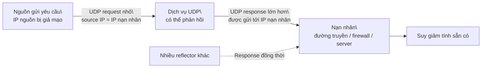
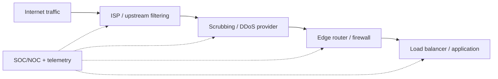

# UDP amplification trong tấn công DDoS và cách phòng vệ

## Mục tiêu học tập

Sau bài học, bạn có thể:

1. Giải thích cách **UDP reflection** và **UDP amplification** kết hợp trong một kiểu tấn công từ chối dịch vụ phân tán (DDoS), vai trò của địa chỉ IP nguồn giả mạo và các dịch vụ phản hồi UDP.
2. Phân biệt **hệ số khuếch đại theo byte**, **hệ số theo packet**, **tốc độ bit/giây (bps)** và **packet/giây (pps)**; hiểu giới hạn của những con số này khi phân tích sự cố.
3. Nhận diện dấu hiệu lưu lượng phản xạ trong **NetFlow/IPFIX, firewall, DNS logs, packet capture và telemetry từ ISP/cloud**, đồng thời phân biệt dấu hiệu với bằng chứng kết luận.
4. Xây dựng phòng vệ ở **mạng nguồn**, **máy chủ UDP có thể bị lạm dụng** và **mạng đích bị tấn công** bằng source address validation, giới hạn quyền truy vấn, rate limiting, upstream filtering, anycast và dịch vụ scrubbing.
5. Lập runbook ứng phó gồm **phát hiện → phân loại → phối hợp upstream → giảm thiểu → xác minh dịch vụ → khôi phục → hậu kiểm**, tránh vô tình chặn các dịch vụ DNS hoặc ứng dụng UDP hợp lệ.
6. Thực hành tính toán và đánh giá tín hiệu DDoS trên **dữ liệu giả lập ngoại tuyến**, không tạo lưu lượng phản xạ hoặc làm gián đoạn hệ thống thật.

## 1. UDP amplification là gì?

**UDP amplification** là hiện tượng một yêu cầu UDP tương đối nhỏ có thể kích hoạt phản hồi lớn hơn đáng kể. Trong kịch bản DDoS, hiện tượng này có thể bị lợi dụng cùng với **reflection**: bên gây tấn công khiến một hoặc nhiều dịch vụ UDP gửi phản hồi tới địa chỉ IP của bên bị hại, làm quá tải băng thông hoặc năng lực xử lý.

Ba chủ thể cần phân biệt:

- **Nguồn phát yêu cầu giả mạo:** đưa ra gói yêu cầu UDP với **IP nguồn ghi là địa chỉ nạn nhân** thay vì địa chỉ thật của máy gửi.
- **Reflector (máy chủ phản xạ):** dịch vụ UDP nhận gói yêu cầu và trả lời địa chỉ IP nguồn ghi trong packet; nó có thể là hệ thống hợp pháp bị lạm dụng chứ không phải máy đã bị chiếm quyền.
- **Nạn nhân (victim):** hệ thống nhận số lượng lớn phản hồi không được yêu cầu, có thể quá tải đường truyền, thiết bị mạng, firewall, load balancer hoặc ứng dụng.



**Reflection** nói về việc chuyển hướng lưu lượng phản hồi tới nạn nhân. **Amplification** nói về phản hồi tạo ra **lượng traffic lớn hơn yêu cầu**. Một sự cố có thể có reflection mà khuếch đại thấp, hoặc có phản hồi lớn trong giao tiếp UDP hoàn toàn hợp lệ mà **không hề có tấn công**.

### 1.1. Vì sao UDP tạo điều kiện cho kiểu lạm dụng này?

UDP là giao thức vận chuyển **không có bắt tay thiết lập kết nối ở tầng UDP** như TCP. Header UDP chứa cổng nguồn, cổng đích, độ dài và checksum. UDP không tự thiết lập cơ chế xác nhận danh tính bên gửi trước khi ứng dụng tạo phản hồi.

Khi mạng nguồn **không lọc gói có địa chỉ IP nguồn giả mạo**, máy gửi có thể phát packet với địa chỉ nguồn không thực sự được cấp cho nó. Nếu dịch vụ UDP phản hồi mà không có kiểm tra phù hợp, phản hồi có thể đi tới nạn nhân.

Điều này **không có nghĩa mọi dịch vụ UDP đều dễ bị khuếch đại**. Có các dịch vụ giới hạn kích thước phản hồi, yêu cầu xác thực, xác minh địa chỉ hoặc dùng challenge/cookie để giảm khả năng phản hồi lớn tới nguồn chưa được xác thực. Các giao thức ứng dụng trên UDP có thể có cơ chế an toàn riêng.

### 1.2. Các khái niệm liên quan

| Thuật ngữ | Ý nghĩa | Ví dụ theo góc nhìn phòng vệ |
|---|---|---|
| **DDoS** | Nhiều nguồn/lưu lượng làm giảm khả năng phục vụ | Uplink Internet bị bão hòa |
| **UDP reflection** | Phản hồi UDP bị chuyển đến IP nạn nhân | Nạn nhân nhận phản hồi DNS chưa từng hỏi |
| **UDP amplification** | Kích thước hoặc tổng lượng phản hồi lớn hơn yêu cầu | Một yêu cầu nhỏ tạo phản hồi lớn |
| **IP spoofing** | Địa chỉ IP nguồn không đại diện đúng nơi gửi gói | Mạng nguồn chưa có source address validation |
| **Reflector** | Máy chủ phản hồi có thể bị lợi dụng | DNS resolver mở truy vấn ngoài phạm vi |
| **Volumetric attack** | Tấn công tập trung làm đầy đường truyền | Inbound bps tăng vượt năng lực đường |
| **State/resource exhaustion** | Tạo áp lực lên bảng trạng thái, CPU hoặc giới hạn xử lý | Firewall có pps cao dù bps chưa tối đa |
| **Scrubbing** | Lọc lưu lượng tại hạ tầng có năng lực lớn trước khi chuyển traffic sạch | ISP/CDN/DDoS provider lọc upstream |

UDP amplification là **một kiểu tấn công theo luồng mạng**, không phải một lỗ hổng duy nhất có cùng cách sửa trên mọi dịch vụ.

## 2. Mô hình hóa mối đe dọa

### 2.1. Mục tiêu, ranh giới và tác động

Với một dịch vụ web hoặc API, có thể phân loại tài sản cần bảo vệ:

- Địa chỉ **public IP/VIP**, đường truyền Internet và kết nối với ISP.
- Firewall/router biên, ACL, NAT, bảng state/conntrack và CPU forwarding.
- Load balancer, DNS authoritative, reverse proxy và máy chủ ứng dụng.
- Hệ thống phát hiện (IDS/IPS), telemetry, SIEM và kênh quản trị OOB.
- Phụ thuộc vào nhà cung cấp DNS, CDN, cloud region và các tuyến dự phòng.

Những ranh giới tin cậy gồm **mạng nguồn → Internet/ISP**, **ISP → vùng biên doanh nghiệp**, **vùng biên → mạng dịch vụ**, **bộ lọc DDoS → backend**.

Mục tiêu tấn công chính thường là **Availability**. Tuy nhiên, quá trình ứng phó sai có thể tạo thêm rủi ro **Confidentiality** và **Integrity**, ví dụ vội mở firewall `any-any`, bỏ kiểm tra truy cập quản trị hoặc đặt bypass không có giám sát.

### 2.2. Vai trò của các bên trong cùng sự cố

| Vai trò | Nguy cơ | Biện pháp phòng vệ liên quan |
|---|---|---|
| **Mạng nơi gói giả mạo xuất phát** | Cho traffic mang source IP không hợp lệ ra Internet | Source address validation ở egress/ingress, anti-spoofing |
| **Dịch vụ reflector** | Vô tình tạo response tới nguồn chưa được xác minh | Giới hạn client, giảm kích thước/phần phản hồi, rate limit, xác thực khi phù hợp |
| **Nạn nhân** | Nhận traffic UDP không yêu cầu, quá tải đường hoặc thiết bị | Upstream DDoS mitigation, filtering, scrubbing, capacity, failover |
| **ISP/cloud provider** | Cần bảo vệ tuyến và kiểm soát peering | Source validation, FlowSpec/RTBH có kiểm soát, scrubber/Anycast theo hợp đồng |
| **SOC/NOC** | Có thể nhầm traffic hợp lệ hoặc chặn sai | Telemetry nhiều điểm, runbook, phối hợp, phản hồi có rollback |

Một doanh nghiệp có thể đồng thời là **nạn nhân** của phản xạ và **chủ sở hữu một dịch vụ UDP bị lạm dụng làm reflector**. Cần kiểm tra cả lưu lượng vào và ra.

## 3. Cơ chế phản xạ và khuếch đại: nhìn từ traffic

Ở mức khái niệm, luồng sự kiện gồm:

1. Một hệ thống phát yêu cầu UDP với địa chỉ nguồn không hợp lệ, trỏ đến địa chỉ nạn nhân.
2. Dịch vụ UDP công khai xử lý yêu cầu theo chức năng của nó.
3. Dịch vụ gửi phản hồi tới IP nguồn ghi trên gói, tức tới nạn nhân.
4. Nhiều phản hồi đồng thời từ nhiều địa chỉ reflector tạo tải vào đường truyền hoặc thiết bị của nạn nhân.
5. Nếu vượt năng lực xử lý hoặc băng thông, traffic hợp lệ bị tăng độ trễ, mất gói hoặc timeout.

Bài học chỉ phân tích **cơ chế và kiểm soát phòng vệ**; không hướng dẫn dựng nguồn giả mạo, chọn máy chủ phản xạ hay tạo yêu cầu khai thác trên Internet.

### 3.1. Các chỉ số không được đánh đồng

**Hệ số khuếch đại byte (Bandwidth Amplification Factor — BAF)** có thể được biểu diễn đơn giản:

```text
BAF_payload = tổng số byte payload phản hồi
              ---------------------------------
              tổng số byte payload yêu cầu
```

Ví dụ thuần toán học: một tương tác giả định có **70 byte payload yêu cầu** và **1.400 byte payload phản hồi**:

```text
BAF_payload = 1.400 / 70 = 20 lần
```

Đây là tỷ số **theo payload** trong ví dụ, **không phải con số cố định cho một giao thức**. Khi xét lượng traffic thực trên dây còn có IP/UDP header, Ethernet framing, encapsulation, fragmentation, retransmission ở tầng khác, batching và nhiều request/response. Vì vậy phải nói rõ số đo ở **tầng nào**.

**Hệ số khuếch đại packet (PAF)** so số packet phản hồi với số packet yêu cầu; một phản hồi lớn có thể bị chia thành nhiều packet IP tùy MTU và đặc điểm mạng. PAF không nhất thiết bằng BAF.

**Tốc độ bps** mô tả lượng bit trên giây và thường liên quan nghẽn băng thông. **pps** mô tả số packet trên giây, quan trọng khi thiết bị cần xử lý nhiều packet nhỏ. Một đợt tăng pps có thể làm căng CPU/packet processing khi bps chưa chạm trần.

**Công thức đo tốc độ cơ bản**:

```text
rate_bps = (bytes_observed_in_window * 8) / window_seconds
rate_pps = packets_observed_in_window / window_seconds
```

Ví dụ 750 MB theo **định nghĩa thập phân** (`750.000.000 byte`) được quan sát trong 60 giây:

```text
rate_bps = 750.000.000 * 8 / 60 = 100.000.000 bps = 100 Mbps
```

Con số đó chỉ mô tả **tốc độ trung bình của cửa sổ**, không có nghĩa đường truyền đạt đỉnh đúng 100 Mbps hoặc các luồng đều giống nhau. Cần lưu thêm peak rate và phân bố theo khoảng ngắn hơn.

### 3.2. Một phản hồi lớn có thể hoàn toàn hợp lệ

Không được coi mọi phản hồi UDP lớn hơn yêu cầu là tấn công:

- DNS có thể trả lời bản ghi hợp lệ có kích thước khác nhau.
- Giao thức truyền thông thời gian thực thường có tần suất và kích thước packet biến thiên.
- Dịch vụ đo đạc/giám sát, discovery hoặc các giao thức ứng dụng nội bộ có thể dùng UDP đúng chức năng.

**Dấu hiệu an ninh** nằm ở **mẫu hình lưu lượng, nguồn gốc, khả năng xác minh phiên, volume, thời gian và tác động**, không nằm trong tỷ số byte của một giao dịch đơn lẻ.

## 4. Những nhóm dịch vụ UDP cần rà soát

Nhiều giao thức UDP được thiết kế để trả lời yêu cầu mà không có bước xác minh địa chỉ nguồn chặt chẽ ở tầng UDP. Một số triển khai, phiên bản hoặc cấu hình **có thể** bị lợi dụng làm reflector/amplifier.

| Nhóm dịch vụ | Chức năng hợp lệ | Rủi ro phòng vệ cần đánh giá |
|---|---|---|
| **DNS resolver/authoritative** | Trả lời truy vấn tên miền và dữ liệu DNS | Resolver cho phép recursion với client không được phép; response lớn; cấu hình rate limiting |
| **NTP** | Đồng bộ thời gian cho hệ thống | Các chức năng truy vấn/điều khiển không cần thiết, kiểm soát client và phiên bản triển khai |
| **SSDP/UPnP** | Khám phá dịch vụ/thiết bị trong mạng cục bộ | Dịch vụ discovery lộ ra Internet hoặc vượt ranh giới nội bộ |
| **CLDAP/LDAP qua UDP** | Một số thao tác discovery/thư mục | Exposure của dịch vụ phản hồi khi không cần truy cập public |
| **Memcached qua UDP** | Cơ chế giao tiếp cũ/tùy phiên bản | Listener UDP không cần thiết, dịch vụ cache bị lộ ngoài vùng ứng dụng |
| **Một số dịch vụ game/discovery/management** | Discovery, status, dữ liệu ứng dụng | Trả lời không xác thực hoặc quá rộng; cần kiểm thử theo đặc tính sản phẩm |

**Không có nghĩa mọi server trong các nhóm này đều dễ bị khai thác.** Khả năng bị lạm dụng thay đổi theo phiên bản, cấu hình, patch, quy tắc truy cập, xác thực và giới hạn phản hồi. Đặc biệt, nhiều triển khai hiện đại đã hạn chế hoặc loại bỏ một số chế độ UDP cũ.

### 4.1. DNS: phân biệt recursive resolver và authoritative server

**Recursive resolver** phục vụ truy vấn thay mặt các client được cấp quyền. Nếu một resolver được cấu hình cho phép client bất kỳ trên Internet sử dụng recursion, nó có thể làm gia tăng khả năng bị lạm dụng và tiêu thụ tài nguyên không mong muốn.

Biện pháp:

- Chỉ cho **client hoặc subnet được phép** sử dụng recursion, chẳng hạn LAN/VPN nội bộ đã được xác định.
- Tách vai trò **recursive** và **authoritative** khi phù hợp để giảm bề mặt tác động.
- Áp dụng **DNS Response Rate Limiting (RRL)** ở các server hỗ trợ, có tuning và giám sát tỷ lệ từ chối.
- Kiểm soát những chức năng/truy vấn không cần thiết, giới hạn kích thước phản hồi trong bối cảnh tương thích.
- Xem xét **DNS Cookies** khi có hỗ trợ và tương thích: cơ chế giúp giảm giá trị của một số truy vấn giả mạo, nhưng **không thay thế phân quyền recursion hay chống giả mạo địa chỉ ở mạng nguồn**.
- Bảo vệ DNS authoritative có vai trò thiết yếu bằng anycast/capacity và quy trình DDoS với nhà cung cấp.

**DNSSEC** hỗ trợ xác minh tính xác thực và toàn vẹn dữ liệu DNS, không phải một giải pháp chống amplification hoàn chỉnh. Trong một số ngữ cảnh, dữ liệu DNSSEC còn làm response lớn hơn; cần đánh giá cấu hình EDNS, UDP size và fallback TCP phù hợp, **không tắt DNSSEC chỉ để giảm kích thước traffic một cách tùy tiện**.

### 4.2. NTP: ưu tiên chức năng đồng bộ thực sự cần thiết

Máy chủ NTP cần đồng bộ giờ để TLS, log correlation và các hệ thống khác hoạt động đúng. Tuy nhiên, không phải mọi chế độ điều khiển/thống kê đều cần được mở ra Internet.

- Bật đúng chức năng cần thiết; **tắt/hạn chế các chức năng điều khiển cũ không cần thiết** theo tài liệu triển khai.
- Giới hạn client quản trị và nguồn được phép khi máy chủ không cần phục vụ công cộng.
- Cập nhật phần mềm, kiểm tra phiên bản và chính sách truy vấn.
- Dùng hệ thống NTP có năng lực phù hợp, giám sát tần suất request/response và độ chính xác đồng hồ.

**Không chặn toàn bộ NTP giữa các thành phần vận hành thiết yếu** khi không có giải pháp đồng bộ thay thế; mất đồng bộ thời gian có thể khiến việc điều tra DDoS và các cơ chế xác thực bị sai lệch.

### 4.3. SSDP, CLDAP, cache và dịch vụ nội bộ

Các dịch vụ discovery/caching thường chỉ cần hoạt động trong **mạng ứng dụng hoặc mạng nội bộ**. Nếu không có nhu cầu công khai, dùng host firewall, ACL, cloud security group và phân đoạn để **chặn truy cập UDP từ Internet**.

Đối với những dịch vụ đã không còn dùng, **tắt listener** thường tốt hơn chỉ giấu port bằng NAT. Với dịch vụ bắt buộc sử dụng, xác định nhóm client hợp lệ, cơ chế xác thực/cookie hoặc giới hạn response theo sản phẩm.

## 5. Phát hiện UDP reflection/amplification tại nạn nhân

Khi bị tấn công, nạn nhân có thể nhận nhiều **UDP response không được khởi tạo hợp lệ bởi ứng dụng của mình**. Nhưng chỉ nhìn **port nguồn** không đủ để chứng minh loại tấn công, vì các dịch vụ hợp lệ cũng dùng cùng port.

### 5.1. Những dấu hiệu thường gặp

- **Inbound UDP bps/pps** tăng mạnh so với baseline theo cùng dịch vụ/giờ.
- Packet vào đến từ **nhiều IP nguồn khác nhau**, thường là các server phản hồi công khai.
- Traffic tập trung vào một hoặc vài **địa chỉ đích/VIP** của tổ chức, đôi khi với phân bố cổng đích bất thường.
- Tỷ trọng traffic mang đặc điểm phản hồi của một giao thức cao trong khi telemetry ứng dụng không cho thấy lượng yêu cầu tương ứng.
- Firewall thấy **UDP bị chặn hoặc “unsolicited”** tăng, hoặc bảng state/conntrack/CPU tăng bất thường.
- ISP/scrubbing provider thấy volume đã vượt quá năng lực uplink biên trong khi sensor phía sau firewall **chỉ thấy một phần**.
- Dịch vụ hợp lệ tăng latency, timeout hoặc mất gói cùng lúc lưu lượng vào bất thường.

**Độ lệch với baseline** có ích, nhưng cần xác minh tình trạng backup/streaming, mở rộng hạ tầng, migration hoặc thay route. Nếu traffic bình thường có volume tương tự, dựa vào mỗi bps sẽ dẫn đến false positive.

### 5.2. Những trường quan trọng trong NetFlow/IPFIX

| Trường hoặc nhóm | Dùng để làm gì? | Điều cần lưu ý |
|---|---|---|
| `sourceIPv4Address/sourceIPv6Address` | Nhận diện endpoint gửi phản hồi theo góc nhìn sensor | Có thể là reflector; không mặc định là kẻ khởi phát tấn công |
| `destinationIPv4Address/destinationIPv6Address` | Nhóm nạn nhân/VIP nhận traffic | NAT/anycast có thể làm thay đổi địa chỉ quan sát |
| `protocolIdentifier` | Chọn UDP và đối chiếu traffic khác | Không phải mọi flow UDP đều là reflection |
| `sourceTransportPort` | Gợi ý loại dịch vụ phản hồi | Chỉ là tín hiệu; một port không xác nhận payload |
| `destinationTransportPort` | Quan sát các cổng mà nạn nhân nhận phản hồi | Có thể biến thiên theo giao thức và mapping |
| `octetDeltaCount/packetDeltaCount` | Tính bps/pps | Cần lưu sample rate và cửa sổ export |
| `flowStart*/flowEnd*` | Xác định thời điểm, duration, chronology | Exporter thường báo trễ hoặc gộp flow |
| `ingressInterface/egressInterface` | Xác định tuyến và điểm vào | Có thể thiếu trong cloud/telemetry hạn chế |
| `tcpControlBits` | Phân tích luồng TCP khi phối hợp điều tra | Không áp dụng để chứng minh trạng thái của UDP |

**IPFIX là họ định dạng và trường thông tin; không phải thiết bị nào cũng xuất cùng tập field.** Với NetFlow sampled, số byte quan sát chỉ là ước lượng hoặc cần chuẩn hóa theo phương pháp của exporter; không nhân hệ số tùy tiện khi thiếu thông tin sampling.

### 5.3. Phân biệt thông tin từng điểm quan sát

```text
[Internet] --> [ISP / Scrubbing] --> [Edge Router] --> [Firewall] --> [Backend]
                 1                  2                3             4
```

- **Điểm 1:** thấy gần toàn bộ attack volume trước khi lọc; phù hợp đo năng lực upstream.
- **Điểm 2:** thấy traffic sau khi scrubbing hoặc định tuyến; không nên coi lượng nhỏ ở đây là cuộc tấn công đã nhỏ đi từ nguồn.
- **Điểm 3:** cho biết firewall state, drop, rule và áp lực thiết bị.
- **Điểm 4:** phản ánh traffic thực tới backend và chất lượng dịch vụ.

Khi đường Internet đã bão hòa trước firewall, **chỉ chặn bằng firewall nội bộ không khôi phục được băng thông của uplink**. Cần phối hợp upstream để loại bỏ traffic trước khi nó chiếm đường kết nối.

## 6. Tính toán baseline và ngưỡng cảnh báo

Một hệ thống giám sát có thể dùng **rate**, **ratio** và **ngữ cảnh dịch vụ** thay vì chỉ một ngưỡng bps.

### 6.1. Các đại lượng cốt lõi

```text
UDP_in_bps = 8 * inbound_udp_bytes / window_seconds

UDP_in_pps = inbound_udp_packets / window_seconds

udp_share = inbound_udp_bytes / all_inbound_bytes
            (chỉ tính khi mẫu số > 0)

unique_sources = số IP nguồn duy nhất tới một destination trong window

drop_ratio = firewall_dropped_packets / firewall_observed_packets
             (theo đúng tập traffic, xử lý mẫu số 0)
```

Khi tính bằng cửa sổ thời gian, cần xác định **event time**, chênh lệch đồng hồ, độ dài window, tình trạng trễ log và cả vùng địa chỉ được bảo vệ. Tốc độ theo trung bình 5 phút có thể làm mất đỉnh ngắn 10–20 giây.

### 6.2. Baseline theo dịch vụ và thời gian

Không so chung:

- Nút DNS authoritative với một API HTTPS chỉ thỉnh thoảng dùng UDP.
- Gateway VPN với máy trạm nội bộ.
- Máy chủ streaming/gaming với hệ thống backup.
- Cửa sổ giờ làm việc với đêm, ngày cao điểm hoặc thời gian triển khai.

Nên dùng thống kê **P95/P99 hoặc median/MAD** theo vai trò, đồng thời có một ngưỡng an toàn tuyệt đối gắn với **năng lực uplink/thiết bị**. Không mặc định `3σ` hoặc một hệ số tăng là bằng chứng tấn công.

Một detector tốt cũng theo dõi **số nguồn**, **loại ứng dụng**, **response-like metadata**, **dịch vụ backend có yêu cầu tương ứng không** và sự thay đổi sau khi provider áp mitigation.

### 6.3. Mẫu alert có thể điều tra

```json
{
  "event_type": "network.ddos.udp_reflection_suspected",
  "alert_id": "ddos-20261128-004",
  "occurred_at": "2026-11-28T05:30:00Z",
  "window_seconds": 60,
  "destination_asset": "public-vip-01",
  "destination_ip": "203.0.113.20",
  "observed": {
    "udp_inbound_bytes": 750000000,
    "udp_inbound_packets": 600000,
    "unique_source_ips": 4200,
    "estimated_bps": 100000000,
    "estimated_pps": 10000
  },
  "baseline": {
    "window": "same-hour-normal",
    "median_udp_bps": 12000000,
    "model_version": "net-ddos-v3"
  },
  "sensor": {
    "location": "provider-ingress",
    "sampling_known": true
  },
  "classification": "suspected_reflection",
  "recommended_action": "validate_traffic_and_contact_upstream"
}
```

Đây là dữ liệu **giả định**: giá trị `estimated_bps`/`estimated_pps` được tính theo cửa sổ. Việc gắn nhãn `suspected_reflection` **không kết luận** rằng 4.200 địa chỉ nguồn là các máy tấn công. Nhiều IP có thể chỉ là server phản hồi hợp lệ bị lợi dụng.

## 7. Phân biệt reflection DDoS với lỗi vận hành và traffic hợp lệ

| Hiện tượng | Có thể bị hiểu nhầm là DDoS | Cách đối chiếu |
|---|---|---|
| Nhiều DNS response đi vào resolver | Resolver đang phục vụ nhiều truy vấn do tăng người dùng | Đối chiếu request/response, cache behavior và vai trò DNS |
| Tăng UDP/443 | Lưu lượng QUIC/HTTP/3 tăng sau rollout | So lịch deployment, SNI/metadata khi quan sát được, backend metrics |
| IP nguồn đa dạng | Dịch vụ public vốn phục vụ nhiều client | Phân biệt client request với server response theo giao thức |
| UDP từ cổng quen thuộc | Có thể là traffic dịch vụ hợp lệ | Kiểm tra payload/metadata hợp pháp, session context, application logs |
| Tỷ lệ drop tăng | Firewall rule mới chặn traffic hợp lệ | Review change ticket, rule version và nguyên nhân drop |
| Bps tăng | Backup, replication, streaming, tải sự kiện | Asset owner, kế hoạch vận hành và baseline cùng chu kỳ |
| Backend không đáp ứng | DNS/TLS/app lỗi không do DDoS | Probe nhiều tuyến, server health, error rates và network telemetry |

**Tránh kết luận chỉ từ cổng UDP 53, 123, 1900 hoặc 11211.** Source port có thể thay đổi; một packet cũng có thể bị giả mạo. Cần xác minh bằng nhiều dấu hiệu và đánh giá ảnh hưởng.

## 8. Phòng ngừa tại mạng nguồn: chống giả mạo địa chỉ IP

Giảm khả năng spoofing là một trong những cách **phòng ngừa gốc** cho nhiều kiểu phản xạ.

### 8.1. BCP 38 — Source Address Validation

**BCP 38** (RFC 2827) khuyến nghị mạng lọc traffic để các gói rời mạng không mang địa chỉ nguồn không thuộc dải được phép phát từ mạng đó. Áp dụng đúng giúp giảm cơ hội một hệ thống phát yêu cầu với địa chỉ nguồn là nạn nhân ở nơi khác.

Ví dụ chính sách logic:

```text
Customer/network A được cấp các prefix đã đăng ký
  -> cho phép egress packets có source thuộc các prefix hợp lệ
  -> từ chối traffic có source nằm ngoài phạm vi đó
  -> ghi log/counter theo chính sách để kiểm tra sai cấu hình
```

**Không suy rằng một ACL tĩnh luôn đủ**. Trong mạng nhiều ISP/multihoming, routing không đối xứng, traffic qua VPN/tunnel hoặc môi trường cloud, source validation cần thiết kế tương ứng.

### 8.2. BCP 84 và uRPF

**BCP 84** (RFC 3704) bàn về lọc nguồn trong các hệ thống multihomed. **Unicast Reverse Path Forwarding (uRPF)** là một nhóm cơ chế có thể dùng để xác minh tính hợp lý của đường về địa chỉ nguồn.

- **Strict uRPF** thường yêu cầu đường tốt nhất trở về source đi qua cùng interface mà packet đi vào; có thể gây false positive trong mạng **asymmetric routing**.
- **Loose uRPF** thường kiểm tra sự tồn tại của route tới source; khả năng hạn chế spoofing khác strict mode và phải đánh giá theo topology.
- **ACL/prefix-based filtering** hoặc các biến thể enhanced/feasible-path có thể phù hợp hơn tùy mạng.

Bảo vệ cần áp dụng ở **điểm thực tế có thông tin quyền sở hữu nguồn**, ví dụ router access của khách hàng, edge hoặc SDN policy. ISP và tổ chức đều có vai trò trong thực thi chống giả mạo nguồn.

**Chỉ lọc inbound tại nạn nhân không loại bỏ được nguồn tạo phản xạ**; sự tham gia rộng của mạng nguồn và các dịch vụ phản xạ giúp giảm rủi ro trên Internet.

## 9. Giảm khả năng dịch vụ UDP bị lạm dụng làm reflector

Một đơn vị sở hữu DNS/NTP/discovery/cache cần xem dịch vụ của mình có **được truy vấn từ các client không cần thiết** và có tạo phản hồi quá lớn/không kiểm soát hay không.

### 9.1. Kiểm kê và chính sách dịch vụ

1. Liệt kê mọi **UDP listener** cùng tài sản, IP/IPv6, zone, owner và mục đích.
2. Phân loại dịch vụ **cần công khai** hay chỉ cần nội bộ.
3. Với dịch vụ nội bộ, giới hạn nguồn truy cập bằng firewall/ACL/security group và tránh public exposure.
4. Tắt các chức năng legacy hoặc không dùng theo hướng dẫn sản phẩm.
5. Cập nhật firmware/phần mềm, áp dụng cơ chế xác thực/validation có hỗ trợ.
6. Giới hạn tốc độ phản hồi và tài nguyên, nhưng kiểm thử để không làm hỏng truy vấn hợp lệ.
7. Giám sát tốc độ response, nguồn yêu cầu, tỷ lệ lỗi và tình trạng service health.
8. Gắn kiểm soát với change management, kiểm tra sau deploy và rà soát định kỳ.

### 9.2. DNS response rate limiting (RRL)

RRL là biện pháp hữu ích trên **DNS authoritative server** khi phù hợp triển khai, giúp hạn chế một số mô hình phản hồi lặp. Các triển khai khác nhau về cách tính bucket, xử lý slip/truncate và tương thích.

Cần lưu ý:

- DNS authoritative phục vụ người dùng thực qua nhiều recursive resolver; giới hạn quá chặt có thể làm tăng lỗi phân giải.
- Anycast có thể phân phối traffic nhưng thay đổi vị trí và quan sát, không tự giải quyết spoofing.
- DNSSEC và EDNS làm thay đổi kích thước/đặc tính phản hồi; cấu hình cần kiểm thử tương thích.
- RRL không thay thế anti-spoofing của mạng gửi, phân quyền recursion hay giám sát volumetric traffic.

### 9.3. Xác thực địa chỉ và nguyên tắc chống khuếch đại

Một số giao thức ứng dụng trên UDP có cơ chế **challenge/cookie/token** để giảm lượng phản hồi tới địa chỉ chưa được chứng minh thuộc bên yêu cầu. Ví dụ, **QUIC** có giới hạn chống amplification trước khi server xác thực địa chỉ client (quy tắc giới hạn lượng byte gửi tùy trạng thái xác minh theo RFC 9000).

Không áp dụng con số hoặc phương thức của QUIC **mặc định cho DNS, NTP hay mọi giao thức UDP khác**; mỗi giao thức có cơ chế riêng và phụ thuộc phiên bản triển khai.

## 10. Phòng vệ tại nạn nhân: phối hợp mạng biên và upstream

### 10.1. Vì sao chặn ở firewall nội bộ có thể quá muộn?

Giả sử đường kết nối Internet của doanh nghiệp có năng lực giới hạn. Nếu lượng UDP phản xạ đã **làm đầy uplink trước firewall**, firewall vẫn có thể drop packet nhưng khách hàng thật không thể đến dịch vụ.

Do đó, phòng vệ nên đặt nhiều tầng:



- **Upstream filtering:** giảm gói không mong muốn trước khi vào uplink doanh nghiệp.
- **Scrubbing center:** phân tích và lọc traffic trên hạ tầng lớn hơn, rồi chuyển traffic sạch về mạng đích.
- **Anycast:** phân tán tiếp nhận traffic đến nhiều điểm, có ích cho một số dịch vụ như DNS/CDN; không mặc định đủ cho mọi kiểu DDoS hoặc mọi ứng dụng.
- **Edge firewall/ACL:** thực thi policy cho những luồng còn tới biên; phù hợp lọc theo IP/port/protocol và rate trong phạm vi năng lực.
- **Host/application protection:** kiểm soát rate, authorization, resource cap và xử lý dịch vụ riêng; không khôi phục được uplink đã bị bão hòa.

### 10.2. Các công cụ giảm thiểu cần đánh giá cẩn thận

| Cơ chế | Vai trò | Rủi ro hoặc điều kiện |
|---|---|---|
| **Provider-managed DDoS protection** | Phân tích/filter upstream, hỗ trợ quy mô lớn | Phụ thuộc provider, phương thức chuyển traffic và coverage |
| **BGP FlowSpec** | Phân phối rule lọc traffic trên một số hạ tầng router | Cần kiểm soát quyền phát rule, scope, đồng bộ và tránh chặn nhầm |
| **RTBH (Remotely Triggered Black Hole)** | Loại traffic tới một đích nhằm bảo vệ hạ tầng rộng hơn | Có thể **làm đích đó không nhận traffic hợp lệ**; dùng như biện pháp cuối và có rollback |
| **ACL/rate limiting upstream** | Hạn chế traffic khớp điều kiện được xác định | Có thể gây collateral damage, nhất là DNS/UDP ứng dụng hợp lệ |
| **Anycast/CDN** | Phân phối tải và tăng khả năng chịu volumetric traffic | Routing/ứng dụng có giới hạn; không bảo đảm mọi site đều không lỗi |
| **Auto-scale/backend capacity** | Chịu tải phục vụ hợp lệ tốt hơn | Không giải quyết nghẽn tại đường Internet hoặc nguồn state exhaustion |

**Không triển khai FlowSpec/RTBH hoặc cấu hình route trong production chỉ từ một ngưỡng anomaly chưa được xác minh.** Cần chính sách change/incident, người phê duyệt, thời hạn, dự đoán tác động, telemetry và lối khôi phục.

### 10.3. Lưu ý đặc biệt với DNS và UDP/443

Nếu nạn nhân đang vận hành **DNS authoritative**, chặn toàn bộ UDP/53 có thể khiến người dùng không phân giải được tên miền. Nếu dùng **HTTP/3**, chặn UDP/443 có thể khiến client chuyển sang TCP/443 (khi được hỗ trợ) hoặc gặp lỗi, tùy cấu hình.

Giảm thiểu nên phân biệt **dịch vụ thực sự cần bảo vệ** với **traffic đáng ngờ** bằng policy theo nguồn/đích/ứng dụng và dữ liệu từ provider. Những quyết định chặn diện rộng phải được cân nhắc theo tác động tới dịch vụ hợp lệ.

## 11. Runbook ứng phó UDP amplification DDoS

### Giai đoạn 1 — Xác nhận và phân loại

1. Ghi thời gian bắt đầu, nguồn cảnh báo và **địa chỉ/VIP** chịu ảnh hưởng.
2. Kiểm tra **bps, pps, số nguồn, phân bố source port/protocol, destination port** tại điểm quan sát phù hợp.
3. Đối chiếu **độ trễ, packet loss, lỗi ứng dụng, trạng thái uplink/firewall/CPU**, không chỉ số lượng alert.
4. Xác minh liệu traffic trông giống **response không yêu cầu** hay có quan hệ với yêu cầu hợp lệ.
5. Kiểm tra thay đổi hợp lệ: release, backup, QUIC migration, DNS traffic spike, ISP rerouting.
6. Phân loại bước đầu: **suspected reflection/amplification** hoặc chưa đủ căn cứ; lưu mức tin cậy.

### Giai đoạn 2 — Khoanh vùng tác động

- Xác định đường vào chính, điểm bão hòa và mọi route dự phòng.
- Xác định dịch vụ cần duy trì trước tiên: DNS, web, VPN/IdP, cổng dịch vụ trọng yếu.
- Ưu tiên nguồn telemetry **ở upstream** khi đường nội bộ đã nghẽn.
- Tránh truy nhầm các **reflector IP** thành attacker chính hoặc chặn toàn bộ quốc gia/ASN khi chưa có đánh giá collateral damage.

### Giai đoạn 3 — Giảm thiểu có kiểm soát

- Kích hoạt runbook với ISP/CDN/cloud/DDoS provider theo hợp đồng và thông tin liên lạc đã chuẩn bị.
- Chia sẻ đích, thời gian, loại traffic, mức ảnh hưởng và thông tin telemetry đã lọc bí mật.
- Yêu cầu **upstream mitigation** phù hợp nếu uplink sắp bão hòa; xác nhận những rule nào được thực thi và ở đâu.
- Cân nhắc rate/filter trên những chiều lưu lượng có thể phân biệt đủ tốt; tránh chặn một dịch vụ trọng yếu chỉ từ source port.
- Với emergency blackhole, xác định rõ việc hi sinh khả năng truy cập một VIP, người phê duyệt, thời hạn và thời điểm gỡ.
- Giám sát cả dịch vụ bảo vệ và **dịch vụ phụ thuộc** để phát hiện chặn nhầm.

### Giai đoạn 4 — Xác minh hiệu lực

| Câu hỏi | Bằng chứng |
|---|---|
| Attack volume tại upstream đã giảm qua filter chưa? | Provider metrics và counters trước/sau scrubbing |
| Uplink còn bão hòa không? | Edge interface bps/pps, packet drop/error |
| Ứng dụng thật phục hồi chưa? | Synthetic probes từ nhiều vị trí, latency, success rate |
| DNS/UDP hợp lệ có bị gián đoạn không? | Resolver/authoritative logs, error rate, truy vấn kiểm thử hợp lệ |
| Firewall/conntrack/CPU có ổn định không? | Device health, session counters, packet drops |
| Có đường dự phòng bị bỏ qua kiểm soát không? | Route/ACL/flow path kiểm chứng |
| Các thay đổi khẩn cấp đã có owner và expiry chưa? | Change/incident ticket, policy version, audit |

**Giảm bps nhưng số request thành công vẫn thấp** chưa phải là khôi phục đầy đủ. Có thể còn vấn đề DNS, TLS, NAT state, routing hoặc backend sau khi traffic đã giảm.

### Giai đoạn 5 — Khôi phục và hậu kiểm

1. Chuyển dần về policy bình thường khi traffic ổn định; quan sát trước/trong/sau.
2. Gỡ những rule emergency không còn cần, đặc biệt FlowSpec/blackhole/ACL quá rộng.
3. Đối chiếu phiên bản policy, route và giới hạn bandwidth hiện tại với cấu hình chuẩn.
4. Lưu timeline, telemetry, tác động và các quyết định đã thực hiện.
5. Rà soát nếu doanh nghiệp đang vận hành **open reflector**; cập nhật cấu hình và giám sát.
6. Điều chỉnh threshold/runbook, làm việc với ISP về năng lực upstream và điểm liên lạc.
7. Kiểm thử lại phương án HA/failover, DNS phục hồi và kênh quản trị OOB.

## 12. Lab an toàn: đọc thống kê lưu lượng tổng hợp

Bài lab này **không sinh gói UDP**, không gửi truy vấn tới DNS/NTP công cộng và không thử khai thác reflector. Mọi giá trị đều là dữ liệu giả lập để thực hành giám sát.

### 12.1. Kịch bản

Một dịch vụ có hai điểm giám sát:

- **Provider ingress:** quan sát tổng lượng vào trước scrubbing.
- **Customer edge:** quan sát lượng còn lại sau scrubbing.

Ta có dữ liệu mô phỏng theo cửa sổ 60 giây:

| Cửa sổ | Bytes UDP ở provider ingress | Packets UDP ở provider ingress | Bytes UDP tại customer edge | Ghi chú |
|---|---:|---:|---:|---|
| T1 | 90.000.000 | 80.000 | 85.000.000 | Baseline |
| T2 | 96.000.000 | 85.000 | 89.000.000 | Baseline |
| T3 | 92.000.000 | 82.000 | 86.000.000 | Baseline |
| T4 | 750.000.000 | 600.000 | 110.000.000 | Surge và mitigation |
| T5 | 680.000.000 | 560.000 | 105.000.000 | Traffic vẫn cao ở upstream |
| T6 | 105.000.000 | 95.000 | 96.000.000 | Gần baseline |

Ví dụ tính T4:

```text
Ingress bps = 750.000.000 * 8 / 60
            = 100.000.000 bps = 100 Mbps

Ingress pps = 600.000 / 60 = 10.000 pps

Customer edge bps = 110.000.000 * 8 / 60
                  ≈ 14,67 Mbps

Chênh lệch bytes ở hai điểm = 640.000.000 trong 60 giây
```

Chênh lệch đó **không được gọi ngay là “toàn bộ attack traffic đã bị lọc”**. Các điểm có thể quan sát **khác tập lưu lượng**, có route khác, sampling hoặc counter/time window không đồng bộ; phải xác minh trước khi quy toàn bộ chênh lệch cho scrubbing.

### 12.2. Ví dụ tính toán ngoại tuyến

Đoạn Python sau **chỉ đọc số có sẵn trong mã**, không dùng socket, không truy cập Internet và không sinh lưu lượng:

```python
windows = [
    ("T1", 90_000_000, 80_000, 85_000_000),
    ("T2", 96_000_000, 85_000, 89_000_000),
    ("T3", 92_000_000, 82_000, 86_000_000),
    ("T4", 750_000_000, 600_000, 110_000_000),
    ("T5", 680_000_000, 560_000, 105_000_000),
    ("T6", 105_000_000, 95_000, 96_000_000)
]

seconds = 60
for label, ingress_bytes, ingress_packets, edge_bytes in windows:
    ingress_mbps = ingress_bytes * 8 / seconds / 1_000_000
    ingress_pps = ingress_packets / seconds
    edge_mbps = edge_bytes * 8 / seconds / 1_000_000
    print(
        f"{label}: ingress={ingress_mbps:.2f} Mbps, "
        f"pps={ingress_pps:.0f}, edge={edge_mbps:.2f} Mbps"
    )
```

Kết quả kỳ vọng một phần:

```text
T1: ingress=12.00 Mbps, pps=1333, edge=11.33 Mbps
T4: ingress=100.00 Mbps, pps=10000, edge=14.67 Mbps
T5: ingress=90.67 Mbps, pps=9333, edge=14.00 Mbps
```

**Lưu ý về đơn vị:** `Mbps` ở đây dùng `10^6 bit/s`; nếu dữ liệu nguồn là MiB (2^20 byte) cần chuyển đổi nhất quán. Tỷ số tốc độ upstream/edge **không** bằng hệ số khuếch đại request/response.

### 12.3. Bài tập phân loại kèm ngữ cảnh

Giả sử tại T4:

- Ingress UDP tăng mạnh so với T1–T3.
- Nhiều nguồn có đặc điểm của **UDP responses** trong khi app không ghi tương ứng lượng request được phát.
- Provider báo đã áp dụng chính sách lọc và xác nhận metrics trước/sau.
- Customer edge giảm volume, nhưng probe DNS và HTTPS hợp lệ phải tiếp tục được theo dõi.

Kết luận thận trọng là: **nghi vấn reflection/amplification gây volumetric traffic**, đã có bằng chứng về surge và mitigation; tiếp tục kiểm tra protocol, nguồn telemetry và tình trạng dịch vụ.

Không đủ dữ liệu để khẳng định **tổng số botnet, IP của kẻ tấn công, amplification factor thực tế hoặc reflector cụ thể nào đã bị lợi dụng**.

## 13. Thiết kế giám sát và cảnh báo

Một hệ thống cảnh báo nên có cả chỉ số **attack pressure** và **service health**.

| Nhóm | Chỉ số | Mục đích |
|---|---|---|
| Network | Ingress bps, pps, interface utilization | Nhận ra saturation hoặc packet-processing pressure |
| Flow | UDP share, unique source count, packet size distribution | Gợi ý volumetric response pattern |
| Firewall | Drop rate, conntrack utilization, CPU/memory | Phát hiện bottleneck ở điểm thực thi |
| DNS | Query/response volume, RCODE, RRL counters | Xem DNS là nạn nhân hoặc reflector, tác động tới phân giải |
| Provider | Pre/post mitigation rates, active filters, route health | Xác nhận hiệu quả upstream |
| Application | Availability, p95/p99 latency, error rates | Đo kết quả cuối cùng đối với người dùng |
| Operations | Time to detect/mitigate/restore, emergency-rule age | Đánh giá khả năng ứng phó |
| Data quality | Sample rate, log gaps, late data, NTP drift | Tránh đánh giá sai do thiếu dữ liệu |

Nên phân nhóm theo **VIP/ứng dụng/zone** và có đường cảnh báo riêng khi **collector không nhận log**. Khi nguồn chính bị mất do tấn công, dữ liệu quan sát từ ISP, cloud và application monitoring giúp tránh điểm mù.

### 13.1. Một bộ điều kiện cảnh báo ở mức khái niệm

```text
HIGH UDP PRESSURE nếu:
  inbound_udp_bps vượt baseline thích hợp
  VÀ (interface_utilization cao HOẶC packet_drop/latency tăng)
  VÀ dữ liệu có chất lượng đủ để đánh giá

SUSPECTED REFLECTION nếu bổ sung:
  response-like UDP flows tăng đột ngột
  VÀ nguồn phân tán / ứng dụng không có request tương ứng
  VÀ không có thay đổi hợp lệ giải thích được

ACTION:
  create incident + notify NOC/SOC + gather upstream metrics
  không tự động blackhole toàn bộ VIP chỉ từ một cảnh báo
```

Bộ điều kiện này chỉ mô tả **logic giám sát**, không phải cú pháp sản phẩm. Ngưỡng thực tế phải được hiệu chỉnh theo hạ tầng, có kịch bản false positive và kế hoạch bảo vệ dịch vụ hợp lệ.

## 14. Kiểm thử phòng vệ có trách nhiệm

Không cần **tạo DDoS thật** để kiểm thử runbook. Những cách an toàn hơn gồm:

1. **Tabletop exercise:** giả lập timeline sự cố; kiểm tra đội vận hành có biết ai gọi ISP, cách cung cấp bằng chứng và đường phê duyệt không.
2. **Synthetic telemetry replay:** nạp log/flow giả lập vào môi trường thử nghiệm đã tách biệt; xác nhận dashboard, threshold và alert.
3. **Provider drill được sắp xếp trước:** dùng khả năng kiểm thử của nhà cung cấp theo hợp đồng, đúng phạm vi và khung giờ.
4. **Configuration audit:** kiểm tra ACL, recursion policy, response limiting, anti-spoofing, route và trạng thái dịch vụ UDP.
5. **Functional tests trong lab:** xác minh client hợp lệ vẫn dùng được DNS/NTP/ứng dụng sau thay đổi phòng vệ, không gửi traffic gây bão hòa.
6. **Failover/recovery test:** kiểm tra đường dự phòng có đúng chính sách bảo mật và có giám sát hay không.

### 14.1. Ma trận nghiệm thu

| Kiểm thử | Tiêu chí thành công | Bằng chứng |
|---|---|---|
| Egress source validation | Gói có nguồn không được phép bị từ chối theo chính sách | Policy review, test được cho phép và counter |
| Recursive DNS restriction | Chỉ client hợp lệ dùng được recursion | ACL/config, DNS access logs, functional tests |
| UDP service inventory | Mỗi listener có owner và exposure hợp lệ | Asset inventory và cấu hình firewall |
| DDoS alert replay | Surge giả lập tạo alert đúng entity và severity | Rule version, event/ingest time, alert payload |
| Detection data-quality | Mất NetFlow/IPFIX gây cảnh báo độ phủ, không báo “mạng bình thường” | Collector health, sampling metadata |
| Upstream escalation | NOC/SOC kích hoạt đúng provider contact và runbook | Kết quả tabletop, contact sheet, ticket |
| Mitigation impact | Traffic hợp lệ vẫn truy cập được các dịch vụ trọng yếu | External probes và application metrics |
| Emergency-rule expiry | Rule lọc/blackhole có owner, thời hạn và rollback | Change ticket, config diff, audit |
| Recovery | Policy chuẩn và route được khôi phục, dịch vụ ổn định | Post-mitigation metrics và kiểm thử |
| Dual stack | IPv4/IPv6 đều có mức bảo vệ tương ứng | Address inventory, firewall/route validation |

**Đặc biệt:** Không “kiểm thử” bằng cách gửi yêu cầu giả mạo tới DNS/NTP/reflector ngoài phạm vi; hành động đó có thể gây hại cho hạ tầng của người khác hoặc tạo DDoS thật.

## 15. Những sai lầm thường gặp

| Sai lầm | Hậu quả | Hướng khắc phục |
|---|---|---|
| Cho rằng mọi UDP đều đáng ngờ | Chặn dịch vụ DNS, QUIC, VPN/VoIP hợp lệ | Baseline theo dịch vụ và kiểm tra application context |
| Xem IP của reflector là IP kẻ tấn công | Quy kết sai, blacklist quy mô lớn | Phân biệt nguồn phản hồi với nguồn giả mạo thực |
| Chỉ dùng firewall trong nhà khi uplink bão hòa | Traffic đã chiếm hết bandwidth trước firewall | Phối hợp ISP/upstream scrubbing |
| Tin rằng chặn `UDP/53` luôn an toàn | Gây lỗi phân giải DNS hợp lệ | Đánh giá dịch vụ, traffic và policy theo vai trò |
| Giới hạn DNS response quá chặt | Resolver/authoritative trả lời lỗi cho client thật | Tuning RRL và đo tác động |
| Giữ resolver recursion mở toàn Internet không cần thiết | Dễ bị lạm dụng, tăng rủi ro tải | Chỉ cho phép client được duyệt, tách vai trò |
| Bỏ qua source address validation | Mạng doanh nghiệp góp phần tạo traffic spoofed | BCP 38/84 theo topology |
| Chỉ quan sát pps hoặc chỉ bps | Bỏ lỡ saturation ở điểm khác | Cả bps/pps, session/CPU, application health |
| Không phân biệt điểm đo trước/sau scrubbing | Tính sai attack volume và hiệu quả lọc | Đánh dấu sensor location, sampling và cửa sổ |
| Chặn mạnh dựa một source port | Collateral damage với dịch vụ hợp lệ | Tương quan protocol, flow và trạng thái ứng dụng |
| Không giới hạn thời gian blackhole/FlowSpec | Dịch vụ tiếp tục bị chặn sau DDoS | TTL/owner/approval và kiểm tra tự động |
| Chỉ nhìn traffic nội bộ sau khi ISP lọc | Không biết đang có attack lớn ở upstream | Dashboard từ provider + edge + backend |
| Không có dữ liệu khi thiết bị bị quá tải | Mất khả năng xác minh sự cố | Collector độc lập, telemetry ở nhiều điểm |
| Coi CDN/anycast là miễn nhiễm DDoS | Chủ quan về coverage và dependency | Thiết kế capacity và provider runbook |

## 16. Câu hỏi ôn tập và gợi ý trả lời

**Câu 1.** UDP reflection khác UDP amplification như thế nào?

**Đáp án:** Reflection là việc phản hồi được gửi tới IP khác với máy khởi phát thực sự do **nguồn bị giả mạo**; amplification là lượng phản hồi lớn hơn yêu cầu theo metric đã định. Trong DDoS hai tính chất thường đi cùng nhau nhưng không đồng nhất.

**Câu 2.** Một phản hồi UDP có payload 1.000 byte cho request payload 50 byte. Có thể kết luận đây là một cuộc tấn công với BAF=20 không?

**Đáp án:** Có thể tính **BAF theo payload = 1.000/50 = 20** cho **tương tác giả định này**, nhưng không thể kết luận có tấn công. Cần xác định request có hợp lệ, source identity, pattern volume, thời gian và tác động. BAF thực tế trên đường truyền phải định nghĩa tầng đo.

**Câu 3.** Vì sao chặn lưu lượng tại firewall nội bộ chưa chắc khắc phục được UDP DDoS?

**Đáp án:** Khi đường kết nối từ ISP tới doanh nghiệp đã bão hòa, packet bị drop **sau khi vào uplink** vẫn chiếm bandwidth đó. Cần lọc hoặc scrubbing trước điểm nghẽn, thông qua upstream provider.

**Câu 4.** Chứng cứ nào giúp phân biệt reflector với máy tấn công?

**Đáp án:** Nguồn IP quan sát tại nạn nhân có thể chỉ là máy **đã gửi phản hồi**. Cần có telemetry ở mạng nguồn và các điểm trung gian để quy kết hành động gửi packet giả mạo. Không nên khẳng định reflector là bên cố ý tấn công.

**Câu 5.** Vì sao DNS authoritative có RRL vẫn cần kế hoạch DDoS upstream?

**Đáp án:** RRL có thể giảm một số kiểu phản hồi tại DNS server, nhưng traffic vào uplink có thể đã lớn, hoặc tấn công nhằm làm cạn tài nguyên ở lớp khác. Cần kết hợp segmentation, filtering upstream, capacity, anycast phù hợp và giám sát dịch vụ.

**Câu 6.** BCP 38 giải quyết vấn đề gì?

**Đáp án:** Giúp mạng nguồn **lọc địa chỉ IP nguồn không được phép**, giảm khả năng một máy phát request UDP mạo danh IP nạn nhân. Nó không tự loại mọi DDoS hoặc thay thế phòng vệ ở nạn nhân.

**Câu 7.** Địa chỉ đích của nạn nhân bị tăng lượng UDP từ port nguồn 53. Có được chặn toàn bộ UDP/53 ngay không?

**Đáp án:** Không nên quyết định chỉ từ port. Cần kiểm tra dịch vụ DNS hợp lệ của doanh nghiệp, flow direction, ứng dụng, telemetry và phối hợp ISP; nếu chặn rộng có thể làm DNS ngừng hoạt động.

**Câu 8.** Sau khi provider lọc, traffic tại edge giảm 80% nhưng người dùng vẫn không vào ứng dụng. Nên kiểm tra gì?

**Đáp án:** Kiểm tra DNS, route/failover, firewall/conntrack, TLS/load balancer, backend metrics và synthetic probe từ nhiều nơi. Số lượng traffic giảm không tự chứng minh **service recovery**.

**Câu 9.** Có thể dùng một máy trong lab để gửi packet giả mạo tới dịch vụ UDP ngoài Internet nhằm đo amplification thực không?

**Đáp án:** Không. Việc này có thể gây tác động tới hạ tầng ngoài phạm vi và gửi traffic không mong muốn tới nạn nhân. Dùng **dữ liệu mô phỏng, cấu hình kiểm toán hoặc thử nghiệm được sắp xếp trước với nhà cung cấp**.

## 17. Checklist khi thiết kế UDP DDoS protection

- [ ] Kiểm kê mọi UDP listener public/internal, owner, mục đích và vòng đời tài sản.
- [ ] Xác định dịch vụ thật sự cần public; giới hạn DNS recursion, NTP/discovery/cache không cần công khai.
- [ ] Áp dụng **BCP 38/84/source validation** tại mạng thuộc quyền quản lý và đánh giá multihoming/route bất đối xứng.
- [ ] Kiểm tra DNS RRL/cookies và những tính năng hạn chế phản hồi theo hỗ trợ của sản phẩm.
- [ ] Xây baseline UDP bps/pps, byte/packet size, unique sources và phân bố dịch vụ theo từng VIP/zone.
- [ ] Telemetry có vị trí đo, sampling, event time/ingest time, trạng thái collector và đủ thông tin IPv4/IPv6.
- [ ] Có giám sát độc lập ở ISP/cloud/scrubbing, edge và backend để không bỏ sót bão hòa upstream.
- [ ] Alert phân biệt **nghi vấn phản xạ** với kết luận incident, không chỉ dựa source port.
- [ ] Có hợp đồng/cơ chế liên hệ và quy trình kích hoạt DDoS provider/ISP.
- [ ] Chính sách rate/FlowSpec/RTBH có approval, scope, owner, TTL và kế hoạch rollback.
- [ ] Có health probes cho DNS, web, API, VPN và những dịch vụ cần giữ hoạt động.
- [ ] Có phương án HA/anycast/scrubbing theo capacity và failure domain phù hợp.
- [ ] Ghi lại timeline, traffic metrics và mọi thay đổi khẩn cấp trong khi ứng phó.
- [ ] Thử nghiệm trên **synthetic telemetry/tabletop** hoặc lab được phép; không tạo traffic làm nghẽn hệ thống khác.
- [ ] Sau sự cố, khôi phục đầy đủ policy, gỡ ngoại lệ và cập nhật playbook theo bài học thực tế.

## 18. Tài liệu tham khảo

- [RFC 2827 / BCP 38 — Network Ingress Filtering](https://www.rfc-editor.org/rfc/rfc2827): chống giả mạo địa chỉ nguồn ở biên mạng.
- [RFC 3704 / BCP 84 — Ingress Filtering for Multihomed Networks](https://www.rfc-editor.org/rfc/rfc3704): nguồn IP và lọc traffic trong mạng có nhiều đường kết nối.
- [RFC 4732 — Internet Denial-of-Service Considerations](https://www.rfc-editor.org/rfc/rfc4732): mô hình và những cân nhắc phòng vệ trước DoS.
- [RFC 5358 — Preventing Use of Recursive Nameservers in Reflector Attacks](https://www.rfc-editor.org/rfc/rfc5358): khuyến nghị ngăn recursive DNS bị lạm dụng trong phản xạ.
- [RFC 7873 — Domain Name System (DNS) Cookies](https://www.rfc-editor.org/rfc/rfc7873): phương pháp DNS cookie liên quan đến giảm một số kiểu giả mạo.
- [RFC 8085 — UDP Usage Guidelines](https://www.rfc-editor.org/rfc/rfc8085): hướng dẫn thiết kế ứng dụng dùng UDP, gồm cân nhắc chống congestion và amplification.
- [RFC 9000 — QUIC: A UDP-Based Multiplexed and Secure Transport](https://www.rfc-editor.org/rfc/rfc9000): ví dụ cơ chế xác minh địa chỉ và hạn chế khuếch đại trong một giao thức trên UDP.
- [RFC 7011 — Specification of the IPFIX Protocol](https://www.rfc-editor.org/rfc/rfc7011): nền tảng telemetry IP flow.
- [NIST SP 800-61 Rev. 2 — Computer Security Incident Handling Guide](https://csrc.nist.gov/pubs/sp/800/61/r2/final): nguyên tắc tổ chức phát hiện, phân tích và ứng phó sự cố (đối chiếu chính sách hiện hành của tổ chức).

**Ghi nhớ:** UDP reflection/amplification khai thác **địa chỉ nguồn giả mạo và dịch vụ phản hồi** để gia tăng lưu lượng vào nạn nhân. Phòng vệ hiệu quả cần **chặn spoofing từ mạng nguồn, không để dịch vụ UDP của mình thành reflector, và loại bỏ traffic tấn công tại upstream trước khi nó làm nghẽn đường truyền**. Việc phân loại luôn dựa trên nhiều nguồn bằng chứng, còn mọi biện pháp giảm thiểu phải được đo bằng **khả năng phục hồi dịch vụ hợp lệ**, không chỉ bằng số packet bị drop.
