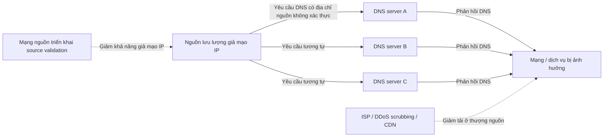
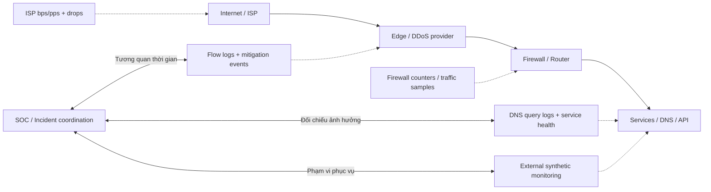
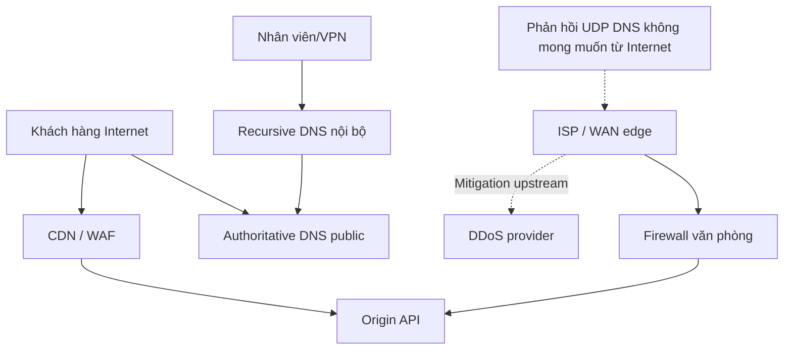

# DNS amplification: cơ chế phản xạ lưu lượng và thiết kế phòng vệ DDoS

## 1. DNS amplification là gì?

**DNS amplification** là một dạng **Distributed Denial of Service (DDoS)** trong đó hệ thống DNS bị lợi dụng để tạo lượng lưu lượng **phản hồi lớn hơn yêu cầu kích hoạt**, khiến một hệ thống đích nhận quá nhiều dữ liệu và suy giảm tính sẵn sàng. Dạng thường gặp là **DNS reflection/amplification**: tác nhân xấu không cần gửi tất cả lưu lượng trực tiếp đến nạn nhân; thay vào đó, các máy chủ DNS trả phản hồi về **địa chỉ IP nguồn bị giả mạo**.

Để hiểu đúng, cần tách hai khái niệm:

- **Reflection (phản xạ):** lưu lượng phản hồi từ một máy chủ trung gian đi tới nạn nhân thay vì người gửi yêu cầu thật. Trong trường hợp dựa trên UDP, điều này có thể xảy ra khi mạng nguồn cho phép **giả mạo địa chỉ IP nguồn** (*IP source address spoofing*).
- **Amplification (khuếch đại):** kích thước hoặc khối lượng phản hồi lớn hơn kích thước/khối lượng yêu cầu mà bên gây hại phải gửi, tạo ra bất đối xứng tài nguyên.

Hai khái niệm thường đi cùng nhau nhưng **không đồng nhất**. Một hệ thống DNS có thể bị flood trực tiếp mà không có phản xạ; một phản hồi DNS có thể bị gửi sai đích do spoofing nhưng hệ số khuếch đại không lớn. **DNS amplification DDoS** thường kết hợp phản xạ, khuếch đại và nhiều nguồn DNS nhằm gây áp lực lên băng thông hoặc hệ thống xử lý gói tin.

### Mục tiêu bảo mật bị ảnh hưởng

Trong bộ ba **CIA** (*Confidentiality, Integrity, Availability*), loại tấn công này chủ yếu đe dọa **Availability — tính sẵn sàng**. Một dịch vụ có TLS, xác thực người dùng và dữ liệu được mã hóa vẫn có thể ngừng hoạt động nếu đường kết nối mạng của nó bị bão hòa.

**Ví dụ:** website vẫn hoạt động trên máy chủ và CPU chưa đầy, nhưng uplink phía trước firewall đang nhận lượng lớn UDP phản hồi DNS không liên quan đến ứng dụng. Người dùng hợp lệ có thể không tải được trang vì gói tin bị mất hoặc độ trễ tăng. Tình huống này đòi hỏi kiểm soát **ở upstream/ISP hoặc nhà cung cấp chống DDoS**, chứ không chỉ thêm tài nguyên xử lý web.

## 2. Những kiến thức DNS cần có

**Domain Name System (DNS)** ánh xạ tên miền sang bản ghi dữ liệu như địa chỉ IPv4/IPv6 và những thông tin phục vụ vận hành. DNS có nhiều vai trò khác nhau, không phải máy chủ nào cũng cho phép mọi người sử dụng như nhau.

| Thành phần | Vai trò điển hình | Ý nghĩa trong đánh giá nguy cơ |
|---|---|---|
| **Stub resolver** | thành phần trên thiết bị người dùng gửi truy vấn đến resolver đã cấu hình | nguồn yêu cầu hợp lệ thường thấy ở client |
| **Recursive resolver** | truy vấn thay client, dùng cache và trả kết quả phân giải | nếu mở recursion cho Internet không có nhu cầu, có thể bị lạm dụng |
| **Authoritative DNS server** | trả lời dữ liệu có thẩm quyền cho các zone được phục vụ | phải trả lời truy vấn công khai cho domain public; có thể bị lợi dụng như reflector |
| **Forwarder** | chuyển truy vấn tới upstream resolver | quyền truy vấn và năng lực upstream ảnh hưởng đến lạm dụng |
| **DNS cache** | giữ kết quả theo TTL để giảm truy vấn lặp lại | giúp giảm tải, nhưng không ngăn mọi phản hồi bị phản xạ |
| **DNS over UDP** | truy vấn/phản hồi theo datagram, thường dùng UDP/53 | không có bước bắt tay xác nhận nguồn tương tự TCP |
| **DNS over TCP** | luồng DNS qua TCP, thường TCP/53 | cần hỗ trợ đúng; thiết lập kết nối giúp giảm khả năng phản xạ kiểu UDP giả nguồn |
| **DoT/DoH** | DNS mã hóa qua TLS/HTTPS theo thiết kế giao thức | bảo vệ một số thông tin truy vấn, không tự xử lý mọi hình thức DoS |

DNS không chỉ có bản ghi `A` và `AAAA`:

- `NS` xác định nameserver của zone.
- `MX` chứa thông tin máy chủ nhận thư.
- `TXT` mang dữ liệu dạng văn bản theo nhiều ứng dụng khác nhau.
- `CNAME` tạo bí danh.
- `DNSKEY`, `DS`, `RRSIG` và một số loại bản ghi khác hỗ trợ **DNSSEC**.

Kích thước thông điệp DNS thay đổi theo loại truy vấn, số lượng bản ghi trong câu trả lời, EDNS(0), chữ ký DNSSEC và cách máy chủ thực hiện phản hồi. **Không phải truy vấn DNS nào cũng tạo phản hồi lớn.**

### 2.1. Vì sao UDP có liên quan?

Truy vấn DNS truyền thống có thể sử dụng UDP vì overhead nhỏ và xử lý thuận tiện. UDP **không thiết lập phiên bằng một cơ chế bắt tay bắt buộc** trước khi chuyển datagram. Vì thế, nếu một mạng cho phép gói tin với **source IP giả mạo** thoát ra Internet, máy chủ DNS nhận gói có thể trả lời tới địa chỉ IP đã bị giả mạo.

Máy chủ DNS thường không thể chỉ nhìn một datagram UDP mà biết chắc nguồn IP là người thực sự phát sinh yêu cầu. Đây là lý do lọc địa chỉ nguồn ở **mạng xuất phát** đóng vai trò then chốt. Tuy nhiên, UDP không phải “giao thức độc hại”; phần lớn hoạt động DNS hợp lệ vẫn cần được phục vụ ổn định.

## 3. Mô hình DNS reflection/amplification

Sơ đồ **khái niệm** dưới đây mô tả mối quan hệ giữa bên phát sinh lưu lượng có nguồn bị giả mạo, hệ thống DNS trung gian và hệ thống chịu ảnh hưởng. Đây là mô hình phân tích phòng thủ, **không phải hướng dẫn tạo lưu lượng tấn công**.



Một cách diễn giải theo vai trò:

1. **Nguồn phát sinh:** nơi tạo gói tin có địa chỉ nguồn không phản ánh đúng nơi gửi; khâu phòng thủ quan trọng là kiểm soát **source address validation** tại mạng này.
2. **DNS reflector:** server DNS trả phản hồi cho địa chỉ nguồn xuất hiện trong datagram đã nhận; có thể là resolver cấu hình không phù hợp hoặc authoritative server công khai.
3. **Nạn nhân:** địa chỉ hoặc mạng nhận các phản hồi DNS không phải do ứng dụng của mình yêu cầu.
4. **Đường truyền trung gian:** các nhà mạng, gateway và điểm giảm thiểu DDoS mà lưu lượng đi qua.

Ở mô hình trên, nạn nhân có thể không vận hành dịch vụ DNS. Một website chỉ phục vụ HTTPS cũng có thể là đích của lưu lượng UDP phản xạ.

### 3.1. Khác biệt so với truy vấn DNS hợp lệ

Khi một máy khách thật gửi yêu cầu phân giải tên, nó thường có **ngữ cảnh truy vấn** ở resolver/client và mong phản hồi tương ứng. Với phản xạ:

- Thiết bị hoặc mạng đích có thể **không có yêu cầu DNS tương ứng**.
- Lưu lượng inbound chứa nhiều phản hồi DNS từ nhiều địa chỉ máy chủ khác nhau.
- Các đặc tính lưu lượng phản hồi, thời điểm và khối lượng không khớp với mức sử dụng DNS bình thường.
- Phản hồi có thể được gửi về cổng hoặc IP mà ứng dụng đang bị ảnh hưởng **không sử dụng cho một phiên DNS hợp lệ**.

Không nên dùng một dấu hiệu duy nhất để kết luận. DNS resolver hợp lệ cũng có thể nhận rất nhiều phản hồi trong giờ cao điểm, mạng sử dụng NAT có thể khiến log khó ghép phiên, và có những dịch vụ nội bộ thực sự cần nhận DNS traffic. Phải đối chiếu với **request history, flow metadata, cấu hình resolver và baseline**.

## 4. Hệ số khuếch đại: đo thế nào cho đúng?

**Amplification factor (AF)** là tỷ lệ phản hồi so với yêu cầu, nhưng phải ghi rõ **đang đo byte ở lớp nào**. Một định nghĩa đơn giản khi phân tích DNS:

```text
AF_payload = DNS_response_payload_bytes / DNS_query_payload_bytes
```

Nếu một yêu cầu DNS có payload 70 byte và phản hồi tương ứng có payload 1.400 byte, thì:

```text
AF_payload = 1.400 / 70 = 20
```

Đây là **số liệu giả định phục vụ bài học**, không phải thông số cố định của DNS hay dự đoán một sự cố cụ thể.

### 4.1. Đo đúng byte trên đường truyền

Khi ước tính băng thông thực tế, chỉ nhìn DNS payload là chưa đủ:

- **UDP header** và **IP header** tiêu tốn thêm byte.
- IPv4 và IPv6 có header khác nhau; extension headers có thể tăng chi phí.
- Tầng liên kết (Ethernet, VLAN, tunnel) cũng có overhead riêng.
- EDNS(0) và một số tùy chọn giao thức có thể thay đổi kích thước datagram.
- IP fragmentation có thể tạo **nhiều packet** cho một thông điệp lớn, làm tăng packet rate và nguy cơ mất mảnh.
- Vị trí mirror/NAT hoặc công cụ đo có thể tính byte khác nhau.

Vì vậy:

**AF theo DNS payload ≠ AF theo byte IP ≠ AF theo byte trên dây.**

Để công bố một tỷ lệ, cần ghi rõ mẫu đo, cách lấy kích thước và thời gian. Trong ứng phó DDoS, ưu tiên các chỉ số **bps và pps tại đường truyền bị nghẽn**, kết hợp công suất thực tế của router/firewall và log DNS.

### 4.2. Ví dụ định lượng mang tính phòng thủ

Giả sử một phép đo trong phòng lab được phép ghi nhận lưu lượng **phản hồi DNS vào mạng** trung bình 1.000 gói/giây, mỗi packet IP dài 1.400 byte:

```text
Lưu lượng IP xấp xỉ
  = 1.000 packet/s × 1.400 byte/packet × 8 bit/byte
  = 11.200.000 bit/s
  ≈ 11,2 Mbit/s
```

Đây chỉ là phép đổi đơn vị nhằm hiểu dashboard. Trong thực tế phải cộng overhead lớp liên kết nếu muốn tính băng thông vật lý, phân biệt tải trung bình với burst và kiểm tra liệu đường truyền hay bộ xử lý packet đang bão hòa.

**Cần phân biệt:**

- **Bandwidth saturation:** tổng bps vượt năng lực kênh truyền.
- **Packet-processing saturation:** pps vượt công suất xử lý thiết bị, có thể xuất hiện ngay khi bps chưa chạm trần.
- **State/resource exhaustion:** giới hạn table, CPU, queue hoặc dịch vụ đã đạt ngưỡng, không nhất thiết do băng thông.

Một kế hoạch chống DNS amplification chỉ nhìn AF mà không xem **đường đi, bps, pps và khả năng hấp thụ ở upstream** sẽ thiếu thông tin quyết định.

## 5. Những yếu tố khiến phản hồi DNS có kích thước lớn

Khả năng khuếch đại phụ thuộc cách truy vấn/phản hồi được mã hóa và cấu hình máy chủ DNS. Những yếu tố thường được nhắc đến:

| Yếu tố | Ảnh hưởng tới kích thước hoặc hành vi | Điều cần đánh giá để phòng thủ |
|---|---|---|
| **Nhiều bản ghi trong câu trả lời** | phản hồi có thể dài hơn truy vấn ngắn | record set hợp lệ, vận hành zone và mức tải |
| **DNSSEC** | bản ghi/chữ ký như RRSIG và DNSKEY làm tăng kích thước một số phản hồi | giữ xác thực DNSSEC; tối ưu kích thước và giới hạn UDP hợp lý |
| **EDNS(0)** | cho phép client/server thỏa thuận khả năng nhận UDP payload lớn hơn giới hạn DNS truyền thống | kích thước quảng bá, fragmentation, fallback sang TCP |
| **Additional section** | thông tin bổ trợ có thể làm phản hồi dài hơn | cấu hình authoritative và nhu cầu tương thích |
| **Máy chủ recursive mở rộng quá mức** | cho client ngoài phạm vi dùng dịch vụ và tạo truy vấn thay họ | ACL recursion, quyền client, rate limiting và giám sát |
| **Authoritative DNS công khai** | cần trả lời nhiều truy vấn Internet, trong đó có phản hồi lớn hợp lệ | RRL phù hợp, DNS Cookies khi hỗ trợ, upstream capacity |

### 5.1. EDNS(0) có vai trò gì?

**EDNS(0)** (RFC 6891) mở rộng khả năng DNS bằng cơ chế tùy chọn bổ sung, trong đó có khả năng quảng bá kích thước UDP payload mà bên nhận có thể xử lý. Mục đích của EDNS(0) là hỗ trợ DNS hiện đại chứ không phải tạo ra DDoS. Tuy nhiên, khi môi trường mạng cho phép gói nguồn giả, phản hồi UDP lớn có thể làm tăng chi phí nhận của đích.

Thiết kế an toàn cần cân đối:

- Tránh quảng bá kích thước UDP vượt khả năng vận chuyển ổn định của đường mạng.
- Hỗ trợ **fallback và DNS over TCP** theo yêu cầu vận hành.
- Kiểm tra tình trạng **fragmentation/PMTU**, timeout và tỷ lệ retry.
- Tương thích với DNSSEC và các bản ghi hợp lệ có kích thước lớn.

**Không nên tùy tiện tắt EDNS(0)** hoặc chặn DNS over TCP vì có thể làm hỏng phân giải tên hợp lệ, nhất là với DNSSEC và những câu trả lời lớn.

### 5.2. DNSSEC: bảo vệ tính xác thực, không phải biện pháp chống DDoS

**DNSSEC** giúp resolver xác minh tính xác thực và toàn vẹn của dữ liệu DNS trong mô hình tin cậy của DNSSEC. Chữ ký và dữ liệu hỗ trợ làm một số phản hồi lớn hơn; điều đó có thể ảnh hưởng kích thước packet.

Tuy nhiên, **tắt DNSSEC để giảm amplification** có thể đánh đổi trực tiếp khả năng xác minh dữ liệu DNS. Hướng xử lý đúng là kết hợp bảo vệ authoritative, source validation, RRL, DNS Cookies khi phù hợp, chính sách UDP response hợp lý và năng lực chống DDoS upstream. Không nên coi DNSSEC là nguyên nhân duy nhất hoặc dùng việc loại bỏ bảo vệ tính toàn vẹn như giải pháp mặc định.

## 6. Open resolver và authoritative server khác nhau thế nào?

Đây là phân biệt quan trọng khi **hardening hạ tầng DNS**.

### 6.1. Recursive resolver bị mở ra ngoài phạm vi

Một resolver nội bộ được thiết kế để phục vụ nhân viên hoặc workload nhưng chấp nhận **recursive queries từ toàn Internet** khi không có nhu cầu thường được gọi là **open resolver**. Điều này tạo ra bề mặt lạm dụng và có thể khiến tài nguyên DNS của tổ chức hỗ trợ lưu lượng phản xạ.

Phòng vệ ưu tiên:

1. Xác định rõ **nhóm client được phép dùng recursion**.
2. Giới hạn bằng ACL, firewall, chính sách mạng và tính năng xác thực/phân quyền nếu nền tảng hỗ trợ.
3. Tách resolver nội bộ khỏi authoritative service public khi cần, tránh áp chính sách recursion cho toàn bộ Internet.
4. Ghi log truy vấn theo mức cần thiết, giới hạn tài nguyên và theo dõi lưu lượng egress bất thường.
5. Kiểm tra IPv4 và IPv6, các interface public/private và mọi region/node.

Ví dụ khái niệm về yêu cầu cấu hình:

```text
Recursive DNS phục vụ:
  - subnet nội bộ đã được quản lý
  - máy khách VPN/đường private được phê duyệt

Recursive DNS không phục vụ:
  - nguồn Internet bất kỳ không được ủy quyền

Authoritative DNS cho tên miền công khai:
  - phải trả lời truy vấn public hợp lệ theo thiết kế
  - bảo vệ bằng cơ chế phù hợp với authoritative service
```

### 6.2. Authoritative server công khai không phải “open resolver”

Authoritative nameserver cho một miền public **cần phản hồi truy vấn từ nhiều mạng trên Internet**. Nếu chặn mọi nguồn lạ, người dùng ở các ISP khác có thể không phân giải được tên miền.

Do đó **không áp chính sách “chỉ allow subnet nội bộ”** lên authoritative DNS public. Thay vào đó phải đánh giá **khả năng phản xạ, rate limiting, tính sẵn sàng/Anycast, bảo vệ nguồn IP upstream và log**. Một authoritative server public không có nghĩa nó cho phép **recursion**; hai chức năng và cách kiểm soát phải được tách bạch.

| Thuộc tính | Recursive resolver nội bộ | Authoritative DNS public |
|---|---|---|
| Chức năng | thay client phân giải các tên miền | cung cấp câu trả lời có thẩm quyền cho zone |
| Đối tượng hợp lệ | nhóm client đã được ủy quyền | resolver/client cần phân giải domain public |
| Biện pháp quan trọng | giới hạn recursion/ACL và firewall | RRL, khả năng chịu tải, Anycast và kiểm soát lạm dụng |
| Sai lầm thường gặp | mở recursion ra mọi nguồn Internet | khóa hoàn toàn truy vấn public làm website không thể được tìm thấy |
| Logging | quan sát client và hoạt động resolver | quan sát query/response theo node, rps, bps/pps |

## 7. Phòng vệ nền tảng: chống giả mạo địa chỉ IP nguồn

**Source Address Validation (SAV)** và **ingress filtering** theo tinh thần **BCP 38 / RFC 2827** ngăn gói tin mang source IP không hợp lệ thoát khỏi hoặc đi vào một ranh giới mạng phù hợp. Đây là một biện pháp cơ sở để **giảm điều kiện cần cho phản xạ UDP**.

Tư duy cơ bản:

```text
Mạng khách hàng A được cấp những dải địa chỉ hợp lệ
        |
        v
Router biên: xác minh nguồn gói tin thuộc những dải được phép
        |
        +-- Nguồn hợp lệ: xử lý theo routing/policy
        |
        +-- Nguồn không thuộc phạm vi được phép: từ chối
```

**Vì sao phải làm tại mạng xuất phát?** Khi một gói UDP có địa chỉ nguồn giả đã đi ra Internet và đến máy chủ DNS trung gian, nạn nhân ở cuối chuỗi không thể buộc mạng xuất phát “thu hồi” gói đó. Họ vẫn cần giảm thiểu upstream, nhưng **lọc nguồn tại mạng gửi** giúp giảm khả năng tạo phản xạ ngay từ đầu.

### 7.1. BCP 38, BCP 84 và uRPF

- **BCP 38** đưa ra nguyên tắc lọc nguồn không hợp lệ ở biên mạng.
- **BCP 84 / RFC 3704** bàn về các kỹ thuật ingress filtering trong môi trường multihomed phức tạp.
- **Unicast Reverse Path Forwarding (uRPF)** là một trong các cơ chế thiết bị có thể dùng để kiểm tra tính hợp lý của đường trở về tới địa chỉ nguồn; **strict** hoặc **loose** mode có hành vi khác nhau.

**Không nên bật strict uRPF một cách máy móc** trên hạ tầng có asymmetric routing, multihoming hoặc policy routing: gói hợp lệ có thể đến từ interface khác với tuyến quay về tốt nhất và bị chặn sai. Cần thiết kế theo topology, route, prefix delegation, nhu cầu tunneling và đánh giá chặn nhầm.

### 7.2. Vai trò phối hợp của các bên

| Bên tham gia | Trách nhiệm phù hợp |
|---|---|
| ISP/access network | lọc nguồn IP không hợp lệ tại phía khách hàng khi có thể |
| Doanh nghiệp vận hành mạng | kiểm soát egress/source validation trên subnet và gateway được quản lý |
| Nhà cung cấp cloud | chính sách anti-spoofing ở lớp nền tảng theo dịch vụ; khách hàng vẫn cần kiểm tra cấu hình được phép |
| Nhà vận hành DNS | tránh mở recursion không cần thiết, giới hạn phản hồi/rate và theo dõi hành vi |
| Chủ dịch vụ bị DDoS | thiết kế mitigation upstream, phát hiện và kích hoạt ứng phó |
| Đội SOC/SRE/Network | ghép bằng chứng mạng, DNS và business metrics, xác minh hiệu lực biện pháp |

Không một tổ chức đơn lẻ có thể triển khai SAV cho toàn Internet. Phòng chống DNS reflection/amplification vì thế đòi hỏi **phối hợp hệ sinh thái mạng** và phòng vệ ở nhiều vị trí.

## 8. Response Rate Limiting (RRL) và DNS Cookies

### 8.1. Response Rate Limiting trên authoritative DNS

**DNS Response Rate Limiting (RRL)** là cơ chế hạn chế những phản hồi có mẫu lặp lại hoặc tốc độ bất thường theo khả năng triển khai của DNS server. Đối với authoritative server, RRL giúp giảm khả năng bị dùng để phát sinh lượng lớn phản hồi lặp lại.

Điểm cần hiểu:

- RRL thường đánh giá **phản hồi**, không phải luôn giới hạn đơn giản “N request/giây từ một IP”.
- Một số triển khai có cơ chế **slip/truncation** trong hoàn cảnh nhất định, khuyến khích client hợp lệ thử lại qua TCP.
- Cách phân nhóm và giới hạn phụ thuộc **DNS implementation**; không có một bộ số mặc định phù hợp mọi dịch vụ.
- Nếu nhiều resolver hợp lệ dùng chung địa chỉ nguồn hoặc nhà cung cấp DNS có traffic lớn, rate limit quá thấp gây **false positive/khó phân giải**.
- RRL tại một authoritative server có thể giảm lượng phản hồi phát ra từ server đó, nhưng **không xử lý gói phản xạ do những server khác trên Internet gửi tới nạn nhân**.

Một quy trình hợp lý là thu **baseline query/response rate**, bật theo chế độ đo/quan sát nếu sản phẩm hỗ trợ, kiểm thử resolver hợp lệ và theo dõi timeout, retry TCP, tỷ lệ lỗi, latency trước khi siết giới hạn.

### 8.2. DNS Cookies

**DNS Cookies** (RFC 7873) cung cấp một cơ chế dựa trên cookie để hỗ trợ máy chủ DNS kiểm tra một mức liên hệ giữa client/server và giảm một số nguy cơ liên quan đến địa chỉ nguồn giả mạo. Khi được client và server hỗ trợ, nó có thể bổ sung tín hiệu **xác thực tính liên tục của nguồn** ở mức giao thức.

Tuy nhiên:

- DNS Cookies không phải xác thực danh tính người dùng, không giống mật khẩu hoặc chứng chỉ TLS.
- Không phải mọi client hoặc server đều triển khai hoặc sử dụng cookies theo cùng cách.
- Cơ chế phải tương thích với client hợp lệ và hành vi fallback của DNS server.
- Không thể coi việc bật DNS Cookies là bảo đảm loại bỏ mọi phản xạ, flooding hoặc DoS.

Phải xem **khả năng hỗ trợ của phần mềm DNS** và giám sát lỗi của client trước/sau thay đổi. Đối với authoritative DNS quan trọng, DNS Cookies thường là **kiểm soát bổ sung** cùng RRL, mạng Anycast và hạ tầng giảm thiểu upstream.

### 8.3. Vai trò của DNS over TCP

DNS qua **TCP** có bước thiết lập kết nối, nên không có cùng kiểu phản xạ một-datagram-gửi-phản-hồi-lớn tới địa chỉ IP bị spoof như truy vấn UDP không xác nhận. TCP cũng cần có năng lực phục vụ câu trả lời lớn và xử lý truncated responses theo thiết kế DNS.

Nhưng **không nên chuyển toàn bộ DNS sang TCP với giả định sẽ chấm dứt mọi DoS**: TCP có chi phí tài nguyên và những nguy cơ khác. Cần cấu hình timeout, giới hạn kết nối, bảo vệ trạng thái và công suất phù hợp. Quan trọng là **hỗ trợ chuẩn DNS và hoạt động ổn định** trong khi kiểm soát vấn đề nguồn giả mạo và phản hồi.

## 9. Anycast, CDN DNS và năng lực phục vụ phân tán

**Anycast** cho phép nhiều điểm hiện diện (PoP) quảng bá cùng một địa chỉ IP theo thiết kế routing. Trong authoritative DNS quy mô lớn, Anycast có thể giúp phân bố truy vấn giữa các địa điểm và giảm điểm nghẽn đơn lẻ.

Các lợi ích tiềm năng:

- Phân tán lưu lượng DNS hợp lệ và một phần lưu lượng bất thường theo topology.
- Hạn chế tác động của sự cố khu vực khi các PoP có năng lực và cơ chế định tuyến phù hợp.
- Cho phép kết hợp scrubbing/mitigation gần nguồn traffic.

**Giới hạn quan trọng:** Anycast không làm tổng lưu lượng tấn công biến mất. Một số PoP có thể vẫn quá tải, routing có thể thay đổi, và lưu lượng tới **nạn nhân nhận phản hồi** không tự được bảo vệ chỉ vì các DNS reflector dùng Anycast. Cần phân biệt:

1. **Bảo vệ authoritative DNS của chính tổ chức khỏi DDoS trực tiếp.**
2. **Giảm khả năng authoritative DNS bị lợi dụng làm reflector.**
3. **Bảo vệ dịch vụ khác của tổ chức đang bị nhận DNS amplification từ Internet.**

Ba mục tiêu này liên quan nhưng có **đường lưu lượng, chủ thể kiểm soát và biện pháp khác nhau**.

## 10. Bảo vệ mạng/dịch vụ đang nhận lưu lượng DNS phản xạ

Khi một website/API hoặc dải IP của doanh nghiệp trở thành **đích nhận phản hồi DNS không mong muốn**, tăng CPU cho ứng dụng không xử lý được đường truyền đã bão hòa.

### 10.1. Thứ tự ưu tiên theo điểm nghẽn

| Tình huống | Dấu hiệu | Kiểm soát ưu tiên |
|---|---|---|
| **Internet uplink bão hòa** | packet loss, bps tại WAN gần/vượt công suất | ISP, upstream mitigation, scrubbing, chuyển tuyến đã phê duyệt |
| **Firewall/router bị quá tải pps** | CPU/data-plane drops tăng, throughput không nhất thiết max | lọc sớm upstream, tối ưu capacity/policy theo nhà cung cấp |
| **Lưu lượng UDP DNS không được yêu cầu tới host không dùng DNS** | nhiều response DNS inbound, không có query tương ứng | lọc tại upstream/edge có ngữ cảnh, theo dõi chặn nhầm |
| **DNS resolver của tổ chức quá tải** | độ trễ phân giải tăng, timeout, queue/cache pressure | năng lực resolver, ACL recursion, rate control và dự phòng |
| **Authoritative DNS chính bị tấn công** | tỷ lệ query đột biến, lỗi SERVFAIL/timeout phân giải ngoài mạng | Anycast/DNS provider, RRL, DDoS mitigation, health check đa vùng |
| **API/web vẫn lỗi sau khi traffic giảm** | backend saturation, retry storm, queue còn tồn | khôi phục dịch vụ, backpressure, kiểm tra phụ thuộc |

**Nguyên tắc:** nếu lưu lượng làm nghẽn **đường mạng trước firewall**, chỉ chặn ở firewall nội bộ là **quá muộn** để cứu uplink. Cần liên hệ ISP/DDoS provider để hấp thụ hoặc loại bỏ traffic **trước điểm bão hòa**.

### 10.2. Lọc phản hồi DNS không mong muốn

Đối với đích **không cần nhận DNS response trực tiếp**, có thể thiết kế lọc traffic UDP/53 không phù hợp, dựa trên vị trí và bằng chứng đã xác nhận.

Tuy nhiên, **đừng áp một quy tắc chặn mọi UDP/53 trên toàn tổ chức** nếu mạng có resolver, authoritative server hoặc các ứng dụng DNS hợp lệ. Cũng không nên mặc định response DNS chỉ dùng một kết hợp port cố định ở mọi đường đi: phải xem endpoint resolver, NAT, giao thức và sơ đồ kết nối thực tế.

Một chính sách tốt có thể chia:

- **Vùng website/API chỉ phục vụ HTTPS:** không mở dịch vụ DNS inbound nếu không có nhu cầu.
- **Resolver được phép:** chỉ nhận queries từ client đã được ủy quyền; cho phép phản hồi liên quan theo cơ chế stateful và thiết kế hạ tầng.
- **Authoritative DNS public:** cho phép DNS queries từ Internet và có cơ chế chịu tải/rate control phù hợp.
- **Mạng giám sát/nhà cung cấp:** tạo ngoại lệ rõ ràng, có owner và đo lường tác động.

Việc lọc theo các IP nameserver được cho là “kẻ tấn công” thường không bền vững: nhiều DNS reflector có thể là **máy chủ hợp pháp đang bị lạm dụng**, và chặn quá rộng có thể phá hoạt động phân giải DNS.

### 10.3. Scrubbing, RTBH và FlowSpec

Nhà mạng hoặc nhà cung cấp giảm thiểu DDoS có thể cung cấp:

- **Traffic scrubbing:** chuyển/định tuyến lưu lượng qua hạ tầng có năng lực lọc, sau đó chuyển phần hợp lệ về dịch vụ.
- **Remote Triggered Black Hole (RTBH):** kỹ thuật định tuyến làm traffic tới một đích/prefix bị loại bỏ theo quy trình; có thể bảo vệ các hạ tầng khác nhưng **làm mất dịch vụ tại đích bị blackhole**.
- **BGP FlowSpec:** cơ chế phân phối một số quy tắc xử lý/lọc flow trong môi trường được hỗ trợ và được nhà mạng phê duyệt.

Không coi RTBH/FlowSpec là thao tác tự triển khai tùy tiện. Cần **đánh giá mức độ tác động, quyền điều khiển định tuyến, thời hạn áp dụng, điều kiện rollback và xác minh an toàn** với upstream.

## 11. Phòng vệ DNS resolver và authoritative server của tổ chức

### 11.1. Checklist recursive resolver

- Recursion chỉ phục vụ **nhóm client được phép**, trên IPv4/IPv6 và interface đúng.
- Không có endpoint DNS quản trị hoặc recursion công khai ngoài ý định.
- Có **rate/connection safeguards**, giới hạn tài nguyên và logging phù hợp.
- Cache, timeout, upstream forwarder và DNS over TCP vận hành ổn định.
- Có dự phòng và giám sát từ nhiều subnet/vùng.
- Quyền cập nhật cấu hình/zone được giới hạn; tài khoản quản trị được audit.
- Đã kiểm tra cấu hình ở **mọi node/region**, không chỉ máy chính.

### 11.2. Checklist authoritative DNS

- Zone và dịch vụ public hoạt động qua UDP/TCP theo thiết kế.
- Không bật recursion công khai nếu không có yêu cầu rõ ràng.
- Có **RRL hoặc chức năng kiểm soát phản hồi phù hợp** với đặc tính authoritative.
- DNSSEC và EDNS(0) được cấu hình đúng; kiểm soát fragmentation/TC/TCP fallback.
- Có năng lực dự phòng/Anycast hoặc nhà cung cấp DNS chịu tải tương ứng với mức rủi ro.
- Có telemetry theo **node, zone, query type, response size, bps, pps và latency**.
- Có cơ chế phát hiện **bất thường egress response volume** và yêu cầu hỗ trợ ISP khi cần.
- Có đầu mối vận hành, runbook và kiểm thử thay đổi trước khi áp dụng chính sách rộng.

### 11.3. Những cấu hình sai dễ gây hiểu lầm

| Nhận định sai | Vì sao sai | Cách tiếp cận đúng |
|---|---|---|
| “Open resolver và authoritative DNS public là một” | recursion và phục vụ authoritative là hai vai trò khác nhau | giới hạn recursion, giữ khả năng truy vấn authoritative hợp lệ |
| “Chặn UDP/53 hoàn toàn là an toàn” | DNS hợp lệ có thể bị hỏng; cần TCP fallback và nhiều đường phân giải | lọc theo vai trò, nguồn, đích và policy |
| “Tắt DNSSEC sẽ giải quyết DDoS” | mất khả năng xác minh dữ liệu; phản xạ từ nhiều máy chủ khác vẫn có thể xảy ra | giữ DNSSEC và xử lý nguồn giả mạo/giảm thiểu |
| “Bật RRL thì không cần ISP” | RRL chỉ điều khiển server của mình, không cứu uplink đang nhận từ Internet | thiết kế upstream DDoS mitigation |
| “Có Anycast là hết nghẽn” | tải vẫn tồn tại và có thể tập trung theo routing | giám sát PoP và thiết kế capacity |
| “DNS Cookies chặn mọi request giả nguồn” | hỗ trợ client/server và tương thích khác nhau | dùng như một lớp kiểm soát bổ sung |

## 12. Giám sát phát hiện DNS amplification

Điểm khó trong phát hiện là xác định **dấu hiệu phản xạ**, không chỉ đếm nhiều DNS packets. Cần tách bối cảnh **nạn nhân**, **máy chủ DNS có nguy cơ làm reflector** và **dịch vụ DNS đang bị flood trực tiếp**.

### 12.1. Telemetry phía nạn nhân

| Tín hiệu | Ý nghĩa cần kiểm tra | Hạn chế |
|---|---|---|
| Inbound UDP bps/pps tăng bất thường | áp lực tài nguyên mạng | không tự xác định nguyên nhân là DNS amplification |
| Nhiều DNS responses với nguồn IP đa dạng | phù hợp giả thuyết reflection | IP nameserver có thể là hệ thống DNS hợp pháp |
| Phản hồi DNS không gắn với query đang chờ | đích nhận response ngoài dự kiến | cần resolver logs hoặc state/packet context đáng tin |
| UDP source port 53 thường xuất hiện | tín hiệu thường gặp với DNS response | chỉ port không đủ kết luận; NAT/tunnel có thể khác |
| Firewall packet drop/interface discard tăng | dấu hiệu nghẽn thiết bị/đường | có thể do lỗi link hay thay đổi traffic khác |
| Ping/API synthetic monitor thất bại theo nhiều vùng | đo ảnh hưởng người dùng | ping không thay thế SLO ứng dụng |
| Latency DNS và API cùng tăng | có thể là shared uplink bị ảnh hưởng | cần ghép mốc thời gian và telemetry các tầng |

**Quan trọng:** DNS reflection có thể nhắm vào IP không vận hành DNS. Các phản hồi inbound thường không mang ý nghĩa đối với ứng dụng đích. Nhưng nếu tài sản là resolver hoặc authoritative server, phải đối chiếu kỹ với truy vấn/phản hồi hợp lệ trước khi áp dụng lọc.

### 12.2. Telemetry phía DNS server có thể bị lạm dụng

- Tỷ lệ **query và response** theo nguồn, zone, record type, result code (NOERROR, NXDOMAIN...) và kích thước.
- **Response bytes/query bytes** và biến động của phân phối kích thước phản hồi.
- Tỷ lệ phản hồi lớn, UDP fragmentation, truncated response và TCP retry.
- Số lượng/độ đa dạng IP nguồn và bất thường theo lịch sử, nhưng lưu ý **IP có thể bị spoof**.
- Lưu lượng egress UDP tới những mạng không phải client mong đợi; theo dõi từ NetFlow/flow logs.
- DNS service CPU/memory, cache hit ratio, queue, packet loss và lỗi giải mã.
- Tác động của RRL/cookies: tỷ lệ phản hồi bị giới hạn, query timeout, lỗi client hợp lệ.

Một hệ thống authoritative public **thường có rất nhiều client khác nhau**; chỉ đếm số IP nguồn duy nhất không đủ chứng minh tấn công. Nên dùng **baseline theo thời gian, loại truy vấn, kích thước và tác động tài nguyên**.

### 12.3. Thu thập ở đâu?



Nếu uplink đã nghẽn trước firewall, một sensor đặt **bên trong** có thể thấy rất ít traffic và thậm chí ngừng báo cảnh báo. Vì thế **số liệu nhà mạng/edge** có thể là nguồn đáng tin nhất để xác nhận quy mô sự cố đầu vào.

## 13. Phân biệt DNS amplification với các hiện tượng khác

| Hiện tượng | Nơi áp lực xuất hiện | Tín hiệu phân biệt |
|---|---|---|
| **DNS reflection/amplification** | đích nhận các DNS responses không mong muốn | nhiều nguồn DNS, response inbound lớn, thiếu truy vấn tương ứng |
| **DNS query flood trực tiếp** | resolver/authoritative DNS nhận quá nhiều truy vấn | inbound queries tới dịch vụ DNS tăng, server CPU/pps/timeout |
| **Water torture / random-subdomain attack** | hạ tầng authoritative và resolver chịu tải phân giải những tên khác nhau | nhiều truy vấn tới các tên không tồn tại hoặc biến thể, cache hit thấp |
| **Legitimate traffic surge** | ứng dụng hoặc DNS tăng tải do nhu cầu thật | tương quan sự kiện nghiệp vụ, phiên hợp lệ và tỷ lệ hoàn thành |
| **Resolver retry storm** | client/resolver lặp lại truy vấn do upstream lỗi | retry tăng theo timeout, lỗi DNS và thay đổi mạng |
| **Lỗi DNSSEC/EDNS/MTU** | phân giải bị timeout/fragmentation dù không bị tấn công | lỗi tập trung theo loại response, network path, TCP fallback |
| **UDP flood không phải DNS** | đường mạng/host nhận lưu lượng UDP bất thường | packet không mang cấu trúc DNS hoặc không liên quan port/protocol DNS |

Phân loại đúng rất quan trọng vì **lưu lượng DNS trả về do reflection** và **truy vấn trực tiếp làm quá tải authoritative** có những cách giảm thiểu khác nhau. Chặn mọi DNS traffic có thể che triệu chứng trên một giao diện nhưng làm mất khả năng phân giải của khách hàng thật.

## 14. Threat modeling: bảo vệ nạn nhân và giảm vai trò reflector

Trong mô hình hóa mối đe dọa mạng, cần xem cả **hành vi tấn công**, **tài sản chịu ảnh hưởng** và **vị trí thực thi kiểm soát**.

### 14.1. Ví dụ kiến trúc

Giả định doanh nghiệp vận hành:

- Website/API qua CDN và load balancer.
- Authoritative DNS do nhà cung cấp DNS quản lý.
- Recursive DNS nội bộ phục vụ nhân viên qua VPN.
- Một kết nối Internet vào văn phòng và đường private giữa văn phòng – cloud.



Đồ thị trên mô tả **những đường chức năng và giả thuyết tác động**, không phải một topology production cụ thể. Trường hợp website đặt hoàn toàn sau CDN, mức phơi lộ IP origin và vai trò của kết nối văn phòng có thể rất khác. Cần xác minh các tuyến thật trước khi đề xuất biện pháp.

### 14.2. Bảng kịch bản

| Kịch bản | Điểm yếu giả định | Tác động | Biện pháp chủ đạo | Bằng chứng cần kiểm tra |
|---|---|---|---|---|
| Văn phòng nhận UDP DNS phản xạ | uplink nhỏ, không có bảo vệ upstream | VPN/API nội bộ mất kết nối | ISP scrubbing, lọc sớm, dự phòng mạng | WAN bps/pps, packet drops, synthetic checks |
| Resolver nội bộ mở recursion public | ACL sai hoặc firewall mở UDP/TCP DNS ngoài dự kiến | máy chủ bị lạm dụng, tiêu hao tài nguyên và egress | đóng recursion ngoài scope, ACL, log | cấu hình hiệu lực IPv4/IPv6, query ACL logs |
| Authoritative server bị dùng làm reflector | phản hồi UDP lớn, không có kiểm soát theo nhu cầu | tăng egress và nguy cơ tham gia reflection | RRL/cookies khi phù hợp, vận hành Anycast | response size/rate, tác động đến resolver hợp lệ |
| Authoritative DNS bị query flood trực tiếp | DNS provider thiếu capacity/HA | người dùng không phân giải được domain | nhà cung cấp DNS chống DDoS, Anycast, health tests | lookup latency đa vùng, provider telemetry |
| DNSSEC/EDNS bị cấu hình sai sau hardening | mất TCP fallback hoặc MTU không phù hợp | người dùng hợp lệ phân giải lỗi | sửa cấu hình, test đáp ứng lớn qua UDP/TCP | DNSSEC validation, truncated/TCP retry tests |
| Mitigation chặn nhầm traffic hợp lệ | điều kiện lọc quá rộng | dịch vụ hỏng dù DDoS đã giảm | canary/rollback, owner phê duyệt | false-positive metrics và SLO |

Trong STRIDE, vấn đề chủ đạo là **Denial of Service**; nhưng thiết kế cũng liên quan tới xác thực nguồn, toàn vẹn dữ liệu DNSSEC, khả năng phát hiện và kiểm toán. Cần đánh giá **rủi ro còn lại** vì mạng nguồn bên ngoài có thể không triển khai SAV.

## 15. Playbook ứng phó DNS amplification DDoS

Quy trình nên được chuẩn bị **trước** khi xảy ra sự cố, với quyền truy cập dashboard upstream, số điện thoại liên hệ NOC/SOC và những biện pháp đã phê duyệt.

### Giai đoạn A — Phát hiện và xác định phạm vi

1. Xác nhận tác động qua website/API, VPN, DNS synthetic monitoring, latency, tỷ lệ giao dịch thành công và hỗ trợ khách hàng.
2. Xem **ISP/edge bps và pps**, vị trí packet drops, công suất link, tình trạng firewall/router.
3. Đối chiếu traffic DNS: inbound **responses** hay inbound **queries**, UDP/TCP, nguồn/đích, phân bố kích thước packet, thời gian xuất hiện.
4. Xác định đích bị ảnh hưởng là **IP web/API**, DNS authoritative, resolver hay cả một đường mạng chia sẻ.
5. Kiểm tra yếu tố khác gần thời điểm sự cố: thay đổi route, DNS provider, cấu hình firewall, đợt truy cập hợp lệ hoặc lỗi ứng dụng.

### Giai đoạn B — Giảm tác động tại nơi hiệu quả

1. Nếu WAN đang bão hòa, **kích hoạt nhà cung cấp chống DDoS/ISP upstream** theo quy trình; cung cấp thông tin lưu lượng đã được xác minh.
2. Áp chính sách lọc cho **đích và giao thức phù hợp**, hạn chế chặn rộng làm hỏng recursive/authoritative DNS hợp lệ.
3. Nếu tổ chức có resolver đang bị lạm dụng, **khẩn trương giới hạn recursion theo client được phép** và kiểm tra trên mọi địa chỉ/instance.
4. Nếu authoritative DNS đang tham gia phản xạ, đánh giá bật/tinh chỉnh RRL, DNS Cookies và năng lực provider mà không phá phân giải DNSSEC/TCP.
5. Nếu authoritative DNS **là nạn nhân trực tiếp**, làm việc với DNS provider về Anycast, scrubbing, fallback và health checks đa vùng.
6. Giám sát **false positive, bps/pps, DNS resolution success, API SLO** ngay sau mỗi thay đổi; rollback nếu làm hỏng lưu lượng được phê duyệt.

### Giai đoạn C — Phục hồi và điều tra

- Kiểm tra lưu lượng đã giảm **trước điểm nghẽn**, không chỉ tại firewall nội bộ.
- Xác minh resolver phục vụ client được phép, authoritative trả lời đúng qua **UDP và TCP**, chữ ký DNSSEC vẫn hợp lệ nếu được dùng.
- Theo dõi queue, connection/state table, retry storm, cache và ứng dụng vẫn còn lỗi sau khi mạng ổn định.
- Lưu timeline, network metrics, DNS logs đã giảm dữ liệu nhạy cảm, policy diff và các quyết định của ISP/provider.
- Ghi tác động nghiệp vụ, thời gian phát hiện (**MTTD**), thời gian phục hồi (**MTTR**) và những kiểm soát cần sửa trước lần sau.

### Giao trách nhiệm

| Vai trò | Phần việc |
|---|---|
| Incident commander / SRE | điều phối ưu tiên kinh doanh, quyết định kích hoạt giảm thiểu |
| Network/NOC | xác định điểm nghẽn, liên hệ ISP/upstream, quản lý routing/filter |
| DNS operations | phân biệt recursive/authoritative, chỉnh RRL/ACL và test DNSSEC/EDNS |
| SOC | phân tích dấu hiệu, lưu bằng chứng và phối hợp điều tra |
| Cloud/platform | kiểm tra ingress, VPC, load balancer, private connectivity và capacity |
| Product/support | thông báo tình trạng dịch vụ và đo ảnh hưởng người dùng |

## 16. Kiểm thử và xác minh an toàn trong môi trường được phép

**Không tạo lưu lượng phản xạ tới địa chỉ của bên thứ ba, không giả mạo IP nguồn để thử nghiệm trên Internet và không thực hiện flood thực tế.** Những bài kiểm thử hợp lệ vẫn giúp xác minh gần hết phần cấu hình phòng vệ quan trọng.

### 16.1. Những phép kiểm tra an toàn

- **Review cấu hình DNS server:** authoritative có bật recursion ngoài dự kiến không? ACL đã bao phủ IPv4/IPv6 chưa?
- **Kiểm tra quyền truy vấn từ mạng thuộc tổ chức:** dùng client trong lab để xác minh resolver trả lời đúng cho nguồn được phép và từ chối nguồn thử nghiệm không được phép.
- **Kiểm tra DNSSEC/EDNS/TCP fallback:** truy vấn domain do tổ chức quản lý, so sánh phản hồi thông thường và loại phản hồi lớn hợp lệ, đánh giá timeout/TC flag khi thích hợp.
- **Kiểm tra giám sát:** mô phỏng tăng nhẹ traffic DNS trong phạm vi lab với giới hạn đã duyệt hoặc dùng dữ liệu PCAP mẫu không gây hại để kiểm tra pipeline và alert.
- **Kiểm tra ISP runbook:** diễn tập bàn giao metadata sự cố, quyền kích hoạt scrubbing, cách rollback và đầu mối liên hệ.
- **Kiểm tra BCP 38:** audit cấu hình source-validation, prefix và mạng multihomed trên router được quản lý; không chứng minh bằng cách phát tán gói giả nguồn ra Internet.
- **Kiểm tra mạng có bị chặn nhầm không:** DNS resolver nội bộ, authoritative công khai, IPv6, TCP fallback và người dùng qua VPN vẫn hoạt động.

### 16.2. Ví dụ lệnh đọc thông tin DNS

Các lệnh sau **chỉ đọc**, dùng với domain/resolver mà tổ chức cho phép thử nghiệm. Chúng phục vụ quan sát đặc tính phản hồi, không tạo phản xạ tới nạn nhân.

```bash
# Xem thông tin trả lời bình thường của domain minh họa
dig example.com A

# Kiểm tra truy vấn TCP hoạt động
dig +tcp example.com A

# Quan sát một truy vấn DNSSEC với tên miền được phép
dig +dnssec example.com DNSKEY

# Dùng resolver của lab/đội vận hành đã cho phép thay vì public server bất kỳ
dig @192.0.2.53 example.com A
```

**Lưu ý:** `192.0.2.53` thuộc dải tài liệu RFC 5737, là **địa chỉ minh họa**, không phải resolver thực được cấu hình sẵn. Hãy thay bằng resolver do tổ chức kiểm soát và chỉ gửi lượng truy vấn nhỏ, được phép. Không diễn giải một lần `dig` trả lời thành bằng chứng toàn bộ DNS hoạt động tốt từ mọi khu vực. Để đo tính sẵn sàng, cần test **từ nhiều vantage points**, thời điểm và loại bản ghi phù hợp.

### 16.3. Quan sát counters và log

Một bảng validation có thể gồm:

| Test case | Kết quả mong đợi | Bằng chứng |
|---|---|---|
| Client nội bộ truy vấn recursive resolver | trả lời hợp lệ | DNS logs + kết quả lookup |
| Client lab ngoài allowlist truy vấn recursion | bị từ chối theo policy | ACL/response/log; không cần flood |
| Client Internet phân giải authoritative public | thành công với UDP/TCP khi cần | external DNS checks |
| Truy vấn DNSSEC hợp lệ | validate thành công ở resolver hỗ trợ | DNSSEC validation result |
| Bật/tinh chỉnh RRL | giảm phản hồi lặp bất thường theo test được phép, vẫn phục vụ resolver thật | rate counters + latency/error |
| Route WAN chuyển dự phòng | monitoring và liên hệ provider còn hoạt động | runbook/synthetic tests |
| Source validation bị cấu hình lệch trong lab | cảnh báo hoặc policy check phát hiện | cấu hình router + kiểm tra chính sách |
| Mitigation ở upstream được diễn tập | xác định đúng người duyệt và đường rollback | biên bản tabletop |

Kiểm thử chịu tải cường độ cao, nếu thật sự cần để xác minh năng lực provider, phải dùng **dịch vụ diễn tập/đối tác có hợp đồng, phê duyệt và phạm vi riêng**. Không tự tạo DNS reflection traffic nhắm tới Internet để kiểm tra năng lực.

## 17. Một tình huống thực tế giả định: API không chạy DNS nhưng nhận DNS responses

**Bối cảnh:** API thanh toán của doanh nghiệp chạy qua HTTPS. Các metrics cho thấy:

- Request hợp lệ tới API giảm thành công trong cùng một khoảng thời gian.
- WAN inbound UDP traffic tăng mạnh; phần lớn packet có hình thái phản hồi DNS.
- Nhiều địa chỉ IP nguồn là máy chủ DNS của các mạng khác nhau.
- Tài nguyên CPU của API vẫn ở mức bình thường nhưng router biên ghi nhận packet drops.

**Giả thuyết chính:** một đợt DNS reflection/amplification đang tiêu tốn năng lực mạng, làm người dùng không thể truy cập API dù ứng dụng chưa cạn CPU.

### 17.1. Xác minh thay vì kết luận vội

1. Kiểm tra API có tự chạy DNS service hay không; xác nhận resolver nội bộ không nằm trên IP đích bị ảnh hưởng.
2. Ghép log WAN, firewall, flow metadata và synthetic monitoring để xác định thời điểm và điểm nghẽn.
3. Kiểm tra xem packet là **DNS responses không tương ứng với query** hay truy vấn hợp lệ trong hệ thống.
4. Đối chiếu thay đổi routing, DNS, provider hoặc marketing có thể tác động traffic.
5. Xác nhận với ISP liệu upstream có thấy cùng pattern trước khi traffic tới firewall.

### 17.2. Hành động phù hợp

Vì băng thông bị nghẽn **trước router/firewall**, ưu tiên liên hệ DDoS provider/ISP để áp chính sách giảm thiểu upstream theo mẫu đã xác minh. Sau đó đo lại **WAN bps/pps**, packet drops và **tỷ lệ giao dịch thanh toán thành công**. Nếu chỉ thêm một rule chặn UDP tại firewall bên trong, router vẫn phải nhận phần lớn lưu lượng và đường vào có thể còn bão hòa.

### 17.3. Điều không nên làm

- **Không** tự chặn toàn bộ mọi DNS server nguồn trên Internet, vì nhiều nguồn là hệ thống hợp pháp bị lợi dụng.
- **Không** tắt DNSSEC của website do nhầm nó là nguyên nhân chính.
- **Không** mở rộng web/API worker vô hạn khi điểm nghẽn là WAN.
- **Không** tuyên bố hết sự cố chỉ vì một dashboard nội bộ im lặng; sensor có thể đã mất feed do nghẽn.
- **Không** bỏ qua kiểm tra DNS resolution của khách hàng thật sau khi thay đổi policy.

**Bài học:** phân tích **nơi traffic bị nghẽn** và **đường đi phản xạ**, thay vì chỉ đo CPU ứng dụng.

## 18. Những nhầm lẫn phổ biến

1. **“DNS amplification chỉ xảy ra khi nạn nhân chạy DNS.”** Nạn nhân có thể là bất kỳ IP/mạng nhận phản hồi DNS phản xạ.
2. **“Open resolver và authoritative server công khai là như nhau.”** Recursion dành cho client được phép; authoritative phục vụ bản ghi public cho Internet.
3. **“Chặn DNS trên firewall là giải pháp đủ.”** Nếu uplink bão hòa trước firewall, cần giảm tải ở upstream.
4. **“UDP luôn nguy hiểm.”** UDP phục vụ nhiều ứng dụng hợp lệ; vấn đề phản xạ liên quan source spoofing và bất đối xứng phản hồi.
5. **“AF là một con số cố định của DNS.”** Phụ thuộc bản ghi, EDNS, DNSSEC, kích thước đo và overhead.
6. **“Chỉ cần ngăn IP giả ở nạn nhân.”** Giảm khả năng spoofing hiệu quả nhất đòi hỏi SAV ở mạng phát sinh; nạn nhân cần mitigation upstream.
7. **“Bật RRL là mọi DDoS DNS sẽ biến mất.”** RRL bảo vệ một server cụ thể; không lọc toàn bộ Internet và có thể gây false positive.
8. **“DNSSEC làm phản hồi lớn nên tốt nhất tắt đi.”** DNSSEC bảo vệ xác thực dữ liệu; không nên hy sinh mục tiêu an ninh này một cách máy móc.
9. **“Anycast tự nhân công suất vô hạn.”** Mỗi PoP và đường mạng vẫn có giới hạn, routing có thể dồn tải.
10. **“Chặn TCP/53 giúp chống amplification.”** DNS cần TCP trong nhiều tình huống hợp lệ; chặn có thể làm hỏng trả lời lớn và DNSSEC.
11. **“Nhiều DNS responses nghĩa là tấn công.”** Resolver hợp lệ cũng nhận responses; cần đối chiếu request history, baseline và business impact.
12. **“DDoS chỉ tính Gbps.”** pps, packet drops, state exhaustion và SLO quan trọng không kém.
13. **“Tài nguyên cloud co giãn nên không sợ DDoS.”** Uplink, provider quotas, dependencies và chi phí vẫn là điểm giới hạn.
14. **“Kiểm thử phản xạ trên Internet là cần thiết.”** Có thể xác minh phần lớn kiểm soát bằng audit cấu hình, lab an toàn và diễn tập được phép.

## 19. Câu hỏi tự kiểm tra và bài tập

**Câu 1.** Giải thích **reflection** và **amplification** khác nhau ở điểm nào. Một DNS resolver nội bộ chỉ cho phép truy vấn từ subnet được phê duyệt đã giải quyết được những nguy cơ nào và chưa giải quyết được nguy cơ nào?

**Câu 2.** Vì sao các mạng nguồn cần triển khai **BCP 38 / source address validation**, thay vì chỉ trông chờ nạn nhân lọc gói?

**Câu 3.** Một authoritative DNS server public trả lời nhiều client ngoài Internet. Vì sao chặn mọi truy vấn từ địa chỉ không nằm trong mạng công ty là phương án sai?

**Câu 4.** EDNS(0), DNSSEC và DNS over TCP có quan hệ gì với kích thước phản hồi và độ tin cậy của phân giải tên? Vì sao không nên tắt tùy tiện các chức năng này?

**Câu 5.** Khi một đợt DDoS làm nghẽn đường WAN trước firewall, việc áp rule drop ở firewall có hạn chế gì? Nêu vai trò của ISP, scrubbing và các chỉ số cần kiểm chứng.

**Câu 6.** Nêu ít nhất bốn nguồn telemetry giúp phân biệt **DNS reflection vào một API** với **DNS query flood trực tiếp vào authoritative DNS**.

**Câu 7.** RRL có thể gây false positive thế nào đối với recursive resolvers hợp lệ? Nên đo các chỉ số nào sau khi triển khai?

**Câu 8.** Một nhóm báo cáo “DNS amplification factor = 20” nhưng không ghi cách đo. Những câu hỏi nào cần đặt ra trước khi dùng số liệu cho capacity planning?

**Bài tập 1 — threat model:** thiết kế sơ đồ cho doanh nghiệp có authoritative DNS public, recursive DNS private, CDN/WAF, API, mạng văn phòng, VPN và ISP. Lập ít nhất **bốn kịch bản**, phân biệt DNS **bị lạm dụng làm reflector**, DNS **bị query flood**, và **ứng dụng bị nhận DNS response phản xạ**. Với mỗi kịch bản ghi: tài sản, trust boundary, điểm nghẽn, nguồn log, biện pháp phòng vệ, owner và rủi ro còn lại.

**Bài tập 2 — hardening checklist:** xây checklist kiểm tra recursion ACL, IPv4/IPv6, firewall, EDNS/DNSSEC/TCP fallback, RRL và monitoring cho một DNS server thử nghiệm do tổ chức sở hữu. Không thực hiện truy vấn cường độ cao hoặc phát gói giả địa chỉ nguồn ra Internet.

**Bài tập 3 — tabletop response:** giả định CDN/WAF vẫn báo API hoạt động, nhưng WAN của văn phòng mất kết nối do nhiều DNS responses. Hãy lập timeline 30 phút đầu theo **vai trò**: ai nhận diện, ai liên hệ ISP, ai xác minh nhầm traffic hợp lệ, ai quyết định thay đổi routing và ai báo trạng thái cho người dùng.

## 20. Tổng kết

**DNS amplification** là ví dụ tiêu biểu của DDoS dựa trên **phản xạ qua hệ thống DNS** và **bất đối xứng kích thước yêu cầu/phản hồi**. Điều kiện quan trọng là khả năng gửi gói UDP có địa chỉ nguồn giả mạo tại một số mạng phát sinh; các máy chủ DNS có thể bị lợi dụng để phát phản hồi lớn tới đích không mong muốn. Vì thế phải xem xét **DNS protocol, route, source validation, authoritative/recursive roles và vị trí nghẽn lưu lượng** cùng lúc.

Phòng vệ hiệu quả cần các lớp bổ sung nhau: **BCP 38/BCP 84** để hạn chế giả nguồn, **giới hạn recursion** cho resolver nội bộ, **RRL/DNS Cookies/EDNS và TCP fallback** có cấu hình phù hợp ở DNS server, **Anycast và năng lực nhà cung cấp DNS**, cùng **ISP/CDN/scrubbing ở upstream** khi nạn nhân bị bão hòa đường truyền. Giám sát phải kết hợp bps, pps, packet drops, DNS query/response logs, flow metadata và **SLO của người dùng hợp lệ**.

Mục tiêu không chỉ là giảm lượng traffic đáng ngờ mà còn phải bảo đảm **DNS hợp lệ vẫn hoạt động, ứng dụng phục hồi và cấu hình an ninh không tạo ra một sự cố mới**.

**Tài liệu tham khảo để đọc sâu:** RFC 2827 / BCP 38 (*Network Ingress Filtering*); RFC 3704 / BCP 84 (*Ingress Filtering for Multihomed Networks*); RFC 5358 (*Preventing Use of Recursive Nameservers in Reflector Attacks*); RFC 6891 (*Extension Mechanisms for DNS (EDNS(0))*); RFC 7873 (*Domain Name System (DNS) Cookies*); RFC 7766 (*DNS Transport over TCP – Implementation Requirements*); RFC 4732 (*Internet Denial-of-Service Considerations*); tài liệu nhà cung cấp authoritative DNS về Response Rate Limiting và DDoS mitigation.
